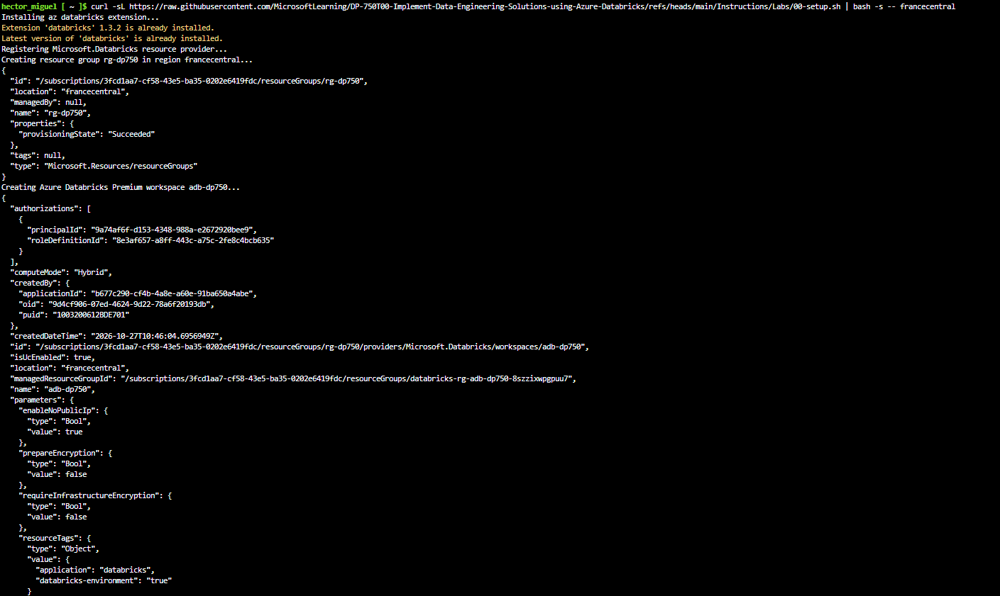
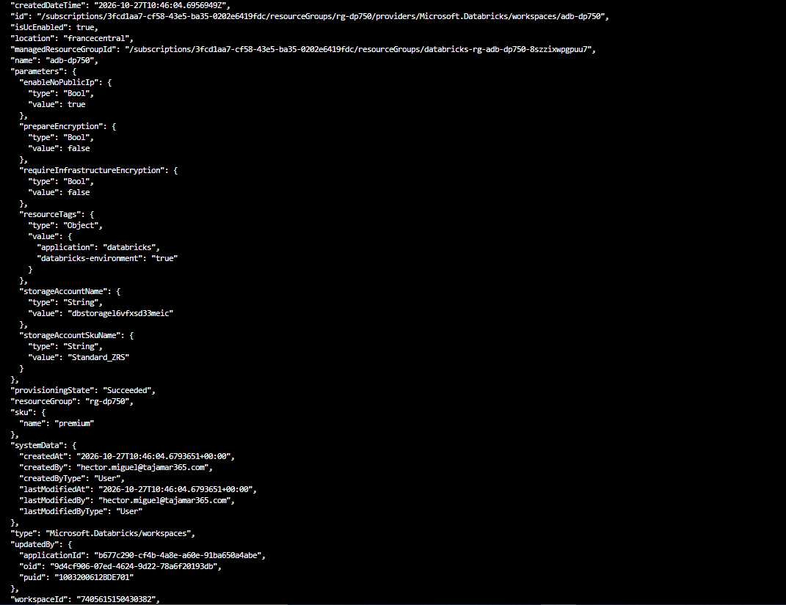
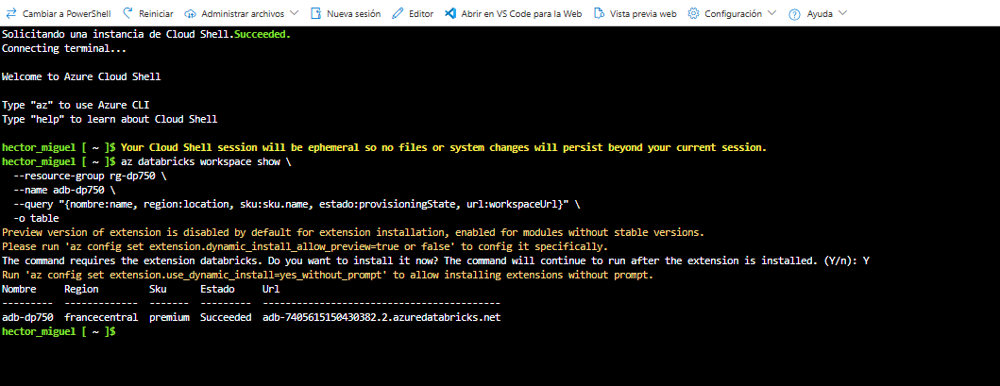
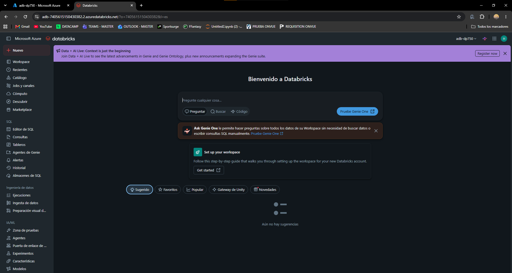

# Laboratorio 00 – Preparar el entorno de Azure Databricks

**Guía oficial:** [00-setup](https://microsoftlearning.github.io/DP-750T00-Implement-Data-Engineering-Solutions-using-Azure-Databricks/Instructions/Labs/00-setup.html)  
**Herramientas:** Azure Portal, Azure Cloud Shell (Bash), Azure CLI

---

## 1. Objetivo

Aprovisionar el entorno que se utilizará en todos los laboratorios de la DP-750:

1. Abrir **Azure Cloud Shell** desde el portal (sin instalar nada en local).
2. Ejecutar un script de Azure CLI que crea un **grupo de recursos** y un **workspace de Azure Databricks Premium**.
3. Abrir el workspace y comprobar que la interfaz de Databricks carga correctamente.

Los nombres de los recursos son fijos para poder localizarlos en los laboratorios siguientes:

| Recurso | Nombre |
|---|---|
| Grupo de recursos | `rg-dp750` |
| Workspace de Azure Databricks | `adb-dp750` |
| Plan (SKU) | `premium` |
| Región | Aleatoria (ver sección 3.2) |

> Se necesita el plan **Premium** porque los laboratorios usan **Unity Catalog**, control de acceso y compute **Serverless**, que no están disponibles en el plan Standard.

---

## 2. Abrir Azure Cloud Shell

1. Iniciar sesión en [https://portal.azure.com](https://portal.azure.com).
2. Pulsar el botón **Cloud Shell** (`>_`) de la barra superior del portal. Si lo pide, elegir **Bash**.
3. La primera vez se solicita configurar almacenamiento: seleccionar **No storage account required**, elegir la suscripción y pulsar **Apply**.
4. Esperar a que aparezca el prompt:


```
usuario@Azure:~$
```

> Si el botón de Cloud Shell no aparece (ventana demasiado estrecha), se puede abrir directamente [https://shell.azure.com](https://shell.azure.com) en una pestaña completa.

---

## 3. Ejecutar el script de aprovisionamiento

### 3.1 Comando

En Cloud Shell se descarga y ejecuta el script oficial del curso:

```bash
curl -sL https://raw.githubusercontent.com/MicrosoftLearning/DP-750T00-Implement-Data-Engineering-Solutions-using-Azure-Databricks/refs/heads/main/Instructions/Labs/00-setup.sh | bash
```

El despliegue tarda unos **5 minutos**. Termina mostrando el mensaje `Installation done`.

En esta práctica se fijó la región **France Central** pasándola como argumento al script (ver sección 3.2):

```bash
curl -sL https://raw.githubusercontent.com/MicrosoftLearning/DP-750T00-Implement-Data-Engineering-Solutions-using-Azure-Databricks/refs/heads/main/Instructions/Labs/00-setup.sh | bash -s -- francecentral
```





### 3.2 Qué hace el script

Antes de ejecutar un script descargado con `curl | bash` conviene revisar su contenido. Estas son las partes importantes de `00-setup.sh`:

```bash
# Si se pasa una región como argumento se usa; si no, se elige una al azar
REGIONS=( australiaeast ... westeurope westus westus2 westus3 )
REGION=${1:-${REGIONS[$RANDOM % ${#REGIONS[@]}]}}

RESOURCE_GROUP="rg-dp750"
WORKSPACE_NAME="adb-dp750"

# 1. Extensión de Azure CLI para Databricks
az extension add --upgrade -n databricks

# 2. Registrar el proveedor de recursos de Databricks en la suscripción
az provider register --namespace Microsoft.Databricks --wait

# 3. Crear el grupo de recursos
az group create --name $RESOURCE_GROUP --location $REGION

# 4. Crear el workspace Premium
az databricks workspace create \
  --resource-group $RESOURCE_GROUP \
  --name $WORKSPACE_NAME \
  --location $REGION \
  --sku premium
```

| Paso | Comando | Para qué sirve |
|---|---|---|
| 1 | `az extension add -n databricks` | Añade los comandos `az databricks ...` a la CLI |
| 2 | `az provider register` | Habilita el uso de `Microsoft.Databricks` en la suscripción (solo hace falta una vez) |
| 3 | `az group create` | Crea `rg-dp750` en la región elegida |
| 4 | `az databricks workspace create` | Crea `adb-dp750` con SKU `premium` |

> **Elegir la región:** como el script acepta la región como primer argumento, se puede fijar una cercana (por ejemplo `westeurope`) en lugar de una aleatoria:
>
> ```bash
> curl -sL https://raw.githubusercontent.com/MicrosoftLearning/DP-750T00-Implement-Data-Engineering-Solutions-using-Azure-Databricks/refs/heads/main/Instructions/Labs/00-setup.sh | bash -s -- westeurope
> ```
>
> También es útil si la región aleatoria no tiene cuota disponible para la suscripción.

Al crear el workspace, Azure genera además un **grupo de recursos administrado** (`databricks-rg-adb-dp750-...`) donde Databricks coloca la red, el almacenamiento y las máquinas virtuales de los clústeres. Ese grupo **no se debe modificar a mano**.

### 3.3 Comprobación desde Cloud Shell

```bash
az databricks workspace show \
  --resource-group rg-dp750 \
  --name adb-dp750 \
  --query "{nombre:name, region:location, sku:sku.name, estado:provisioningState, url:workspaceUrl}" \
  -o table
```

El estado debe ser `Succeeded` y el SKU `premium`.



### 3.4 Datos que hay que tener anotados

| Dato | Valor |
|---|---|
| Suscripción | `Azure for Students`|
| Grupo de recursos | `rg-dp750` |
| Workspace | `adb-dp750` |
| Región asignada | `francecentral` |
| URL del workspace | `adb-7405615150430382.2.azuredatabricks.net` |

---

## 4. Abrir el workspace de Azure Databricks

1. En el portal, buscar **Azure Databricks** en la barra superior y seleccionarlo.
2. Seleccionar el workspace **adb-dp750**.
3. En la página **Overview**, pulsar **Launch workspace**. La interfaz de Databricks se abre en una pestaña nueva.
4. Comprobar que aparece la página de inicio de Azure Databricks.



---

## 5. Problemas frecuentes

| Problema | Causa probable | Solución |
|---|---|---|
| `LocationNotAvailableForResourceType al usar spaincentral` | Azure Databricks no está disponible en esa región | Borrar rg-dp750 con az group delete --name rg-dp750 --yes y relanzar el script con francecentral |
| `Cloud Shell pide reinstalar la extensión databricks` | La sesión es efímera y pierde las extensiones al reiniciarse | Responder Y; los recursos de Azure siguen intactos |

---

## 6. Limpieza

> **No eliminar todavía los recursos:** el workspace `adb-dp750` se reutiliza en todos los laboratorios de la DP-750.

Cuando termine el curso:

```bash
az group delete --name rg-dp750 --yes --no-wait
```

O desde el portal: **Resource groups → rg-dp750 → Delete resource group**, escribir el nombre y confirmar. El grupo administrado `databricks-rg-adb-dp750-...` se elimina automáticamente con el workspace.

Entre laboratorios, lo que genera coste son los **clústeres encendidos**, no el workspace en sí: hay que terminar los clústeres al acabar cada práctica.

---

## 7. Conclusiones

- Cloud Shell permite aprovisionar recursos con Azure CLI sin instalar herramientas en local.
- Un único script crea el grupo de recursos `rg-dp750` y el workspace Premium `adb-dp750`.
- El plan **Premium** es necesario para Unity Catalog, control de acceso y compute Serverless.
- Databricks crea un grupo de recursos administrado propio para la infraestructura de los clústeres.
- Revisar un script antes de ejecutarlo con `curl | bash` es una buena práctica de seguridad.
