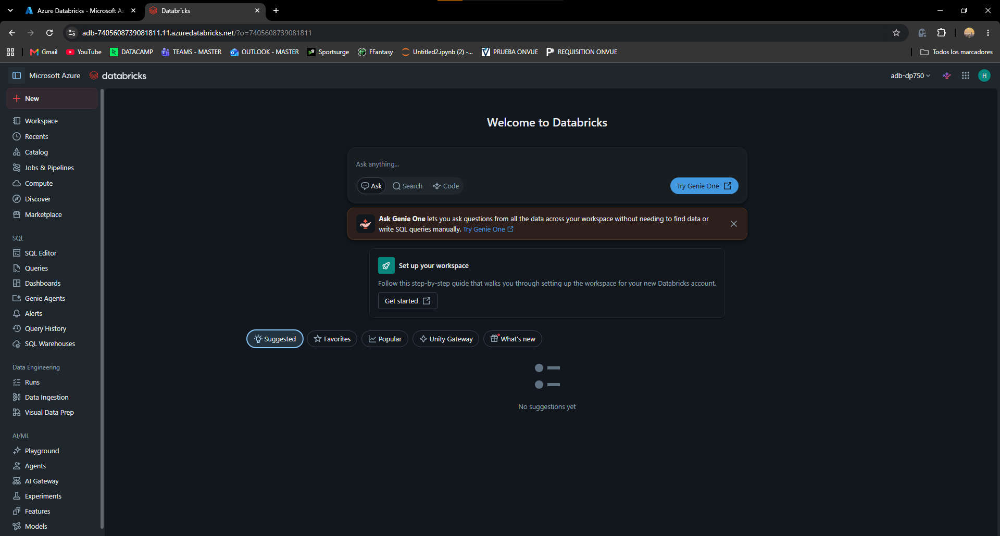
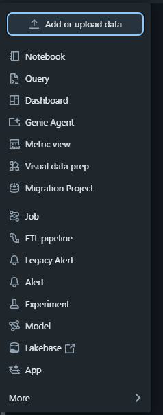
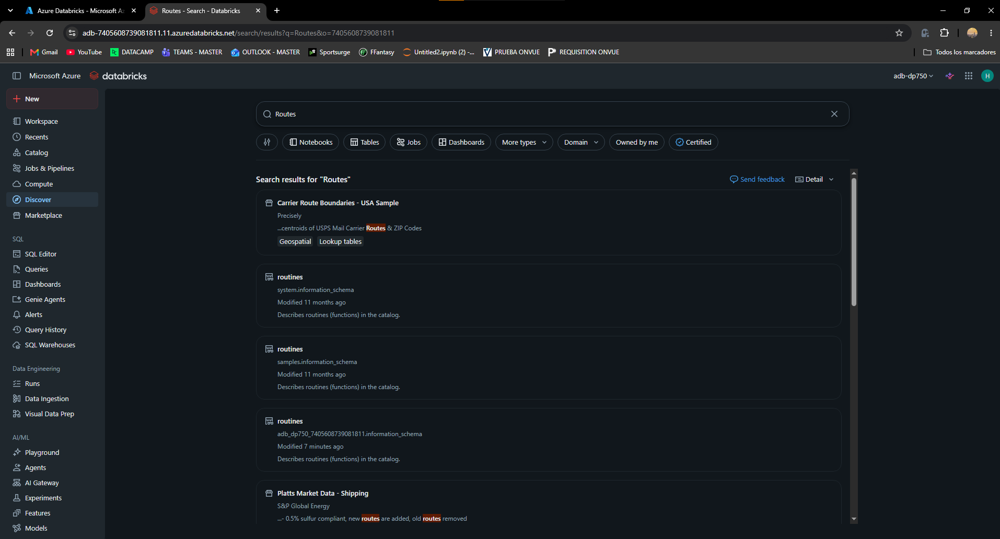
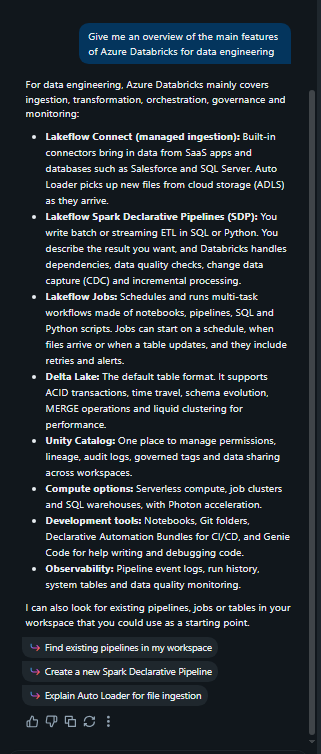
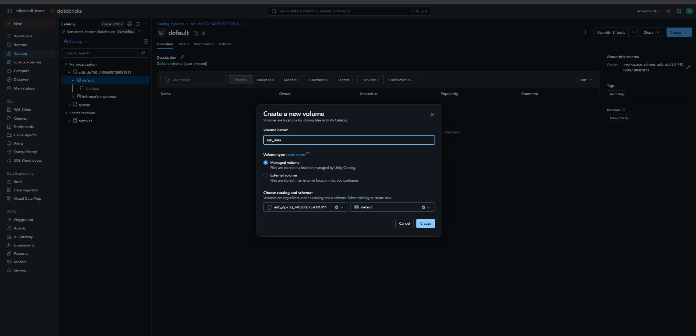
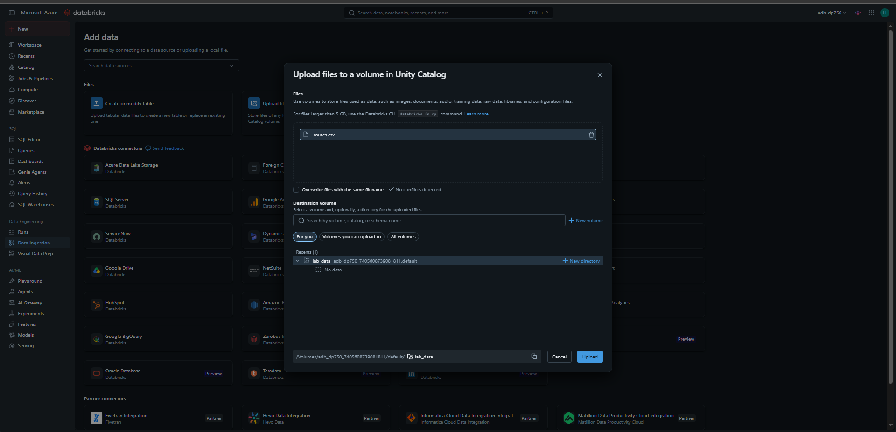
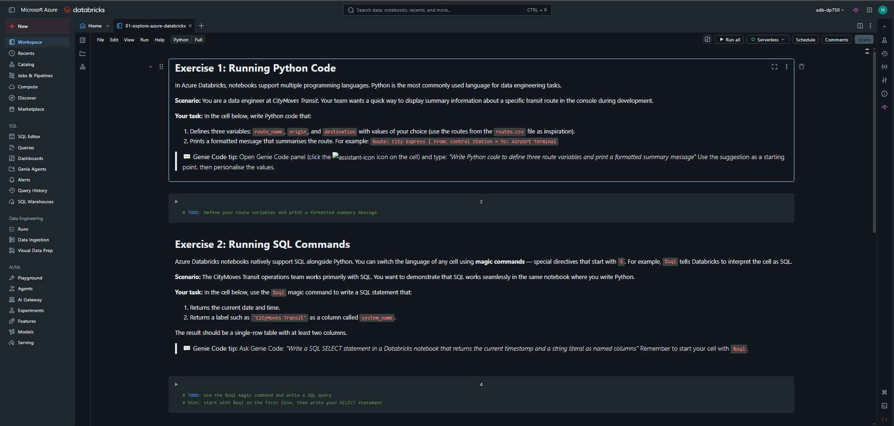
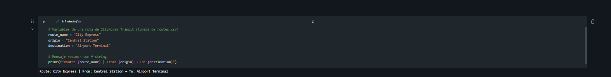
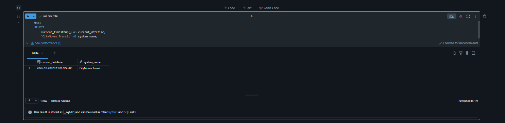
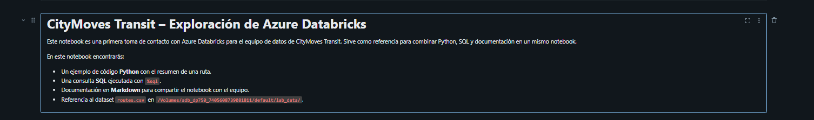

# Laboratorio 01 – Explorar Azure Databricks

**Guía oficial:** [01-explore-azure-databricks](https://microsoftlearning.github.io/DP-750T00-Implement-Data-Engineering-Solutions-using-Azure-Databricks/Instructions/Labs/01-explore-azure-databricks.html)  
**Notebook:** [01-explore-azure-databricks.ipynb](https://github.com/MicrosoftLearning/DP-750T00-Implement-Data-Engineering-Solutions-using-Azure-Databricks/blob/main/Allfiles/01-explore-azure-databricks.ipynb)  
**Workspace:** `adb-dp750` (creado en el [Laboratorio 00](../dp750-lab00-hector-miguel-tudela/README.md))  
**Compute:** Serverless  

---

## 1. Objetivo

Primer contacto con Azure Databricks en el papel de data engineer de **CityMoves Transit**, una autoridad de transporte público (autobús, tranvía y tren):

1. Recorrer las secciones principales de la interfaz del workspace.
2. Utilizar **Genie Code**, el asistente de IA integrado.
3. Crear un **volumen de Unity Catalog** y subir el dataset `routes.csv`.
4. Importar un notebook y trabajar con celdas **Python**, **SQL** (`%sql`) y **Markdown**.

---

## 2. Requisitos previos

| Elemento | Origen | Comprobación |
|---|---|---|
| Workspace Premium `adb-dp750` | Laboratorio 00 | Se abre con **Launch workspace** |
| Grupo de recursos `rg-dp750` | Laboratorio 00 | Visible en Azure Portal |
| Catálogo `adb-dp750` | Se crea automáticamente con el workspace (Unity Catalog) | Visible en **Catalog** |

---

## 3. Ejercicio 1 – Navegar por la interfaz del workspace

### 3.1 Barra lateral

En la barra lateral izquierda se identifican estas secciones:

| Sección | Contenido |
|---|---|
| **Workspace** | Carpetas personales y compartidas con notebooks y ficheros |
| **Recents** | Objetos abiertos recientemente |
| **Catalog** | Activos de Unity Catalog: catálogos, esquemas, tablas y volúmenes |
| **Jobs & Pipelines** | Flujos de trabajo automatizados |
| **Compute** | Gestión de clústeres y SQL warehouses |
| **Marketplace** | Datos y soluciones de partners |



### 3.2 Menú + New

Pulsar **+ New** (parte superior de la barra lateral) y revisar los tipos de objetos que se pueden crear: notebooks, queries, clústeres, dashboards, etc. **No se crea nada todavía.**



### 3.3 Búsqueda

Buscar `routes` en la barra superior. Todavía no devuelve resultados porque el dataset aún no se ha subido; se repetirá la búsqueda en la sección 5.



---

## 4. Ejercicio 1 (cont.) – Genie Code

**Genie Code** es el asistente de IA integrado en Databricks: genera código, explica errores, propone mejoras y responde preguntas sin salir de la interfaz.

1. En la página de inicio, pulsar el icono de **Genie Code** (esquina superior derecha).
2. Escribir el prompt:

```
What can I do with Azure Databricks as a data engineer?
```

3. Revisar la respuesta: tiene en cuenta el contexto del workspace.



> A partir de aquí, la guía recomienda usar Genie Code para escribir el código y el SQL: describir lo que se quiere en lenguaje natural, adaptar la sugerencia y ejecutarla.

---

## 5. Ejercicio 1 (cont.) – Subir el dataset de rutas

### 5.1 Crear el volumen `lab_data`

Un **volumen** de Unity Catalog es un espacio gobernado para guardar ficheros (CSV, JSON, imágenes…) que no son tablas.

1. Barra lateral → **Catalog**.
2. Expandir el catálogo **adb-dp750** y el esquema **default**.
3. Menú **⋮** junto a `default` → **Create** → **Volume**.
4. Nombre: `lab_data`, tipo **Managed** → **Create**.



> **Managed vs External:** en un volumen *managed* Unity Catalog gestiona la ubicación del almacenamiento y borra los ficheros al eliminar el volumen. En uno *external* los ficheros viven en una ubicación de almacenamiento propia que se registra en Unity Catalog.

### 5.2 Subir `routes.csv`

1. Descargar el fichero: [routes.csv](https://raw.githubusercontent.com/MicrosoftLearning/DP-750T00-Implement-Data-Engineering-Solutions-using-Azure-Databricks/refs/heads/main/Allfiles/data/routes.csv)
2. **+ New** → **Add or upload data** → **Upload files**.
3. Pulsar **Browse** y seleccionar `routes.csv`.
4. Destino: **adb-dp750** → **default** → **lab_data**.



Contenido del fichero (10 rutas):

| route_id | route_name | origin | destination | distance_km | avg_duration_min | vehicle_type |
|---|---|---|---|---|---|---|
| R001 | City Express | Central Station | Airport Terminal | 45 | 62 | Train |
| R002 | Harbor Line | Downtown | SeaPort | 12 | 18 | Bus |
| R003 | Mountain Pass | City Center | Highland Village | 78 | 105 | Train |
| R004 | Coastal Route | Harbor Bay | Sunset Cove | 34 | 47 | Bus |
| R005 | Metro North | South Terminal | North Junction | 28 | 35 | Tram |
| R006 | Eastern Corridor | West Plaza | East Industrial Park | 22 | 30 | Bus |
| R007 | Airport Shuttle | Airport Terminal | Business District | 15 | 20 | Bus |
| R008 | Riverside Express | North Bridge | South Docklands | 50 | 68 | Train |
| R009 | University Line | Central Station | Campus Gate | 8 | 12 | Tram |
| R010 | Night Owl | City Center | Suburbs Belt | 40 | 55 | Bus |

### 5.3 Comprobar la subida

En **Catalog**, expandir **adb-dp750 → default → lab_data** y comprobar que aparece `routes.csv`.

La ruta del fichero dentro del volumen sigue el formato `/Volumes/<catálogo>/<esquema>/<volumen>/<fichero>`:

```
/Volumes/adb-dp750/default/lab_data/routes.csv
```

> En este laboratorio no hace falta leer los datos; se utilizarán en laboratorios posteriores. Si se repite ahora la búsqueda de `routes`, ya aparece el volumen/fichero.

---

## 6. Importar el notebook del laboratorio

1. Barra lateral → **Workspace**.
2. Crear (o elegir) una carpeta para el laboratorio, por ejemplo `Labs/01-explore-azure-databricks`.
3. Menú **⋮** de la carpeta (o clic derecho) → **Import**.
4. Elegir **URL**, pegar la dirección y pulsar **Import**:

```
https://raw.githubusercontent.com/MicrosoftLearning/DP-750T00-Implement-Data-Engineering-Solutions-using-Azure-Databricks/refs/heads/main/Allfiles/01-explore-azure-databricks.ipynb
```

5. Abrir el notebook y, en el selector de compute de la parte superior, elegir **Serverless** antes de ejecutar ninguna celda.



> **Serverless** evita tener que crear y esperar a un clúster: Databricks proporciona el compute al momento y lo gestiona por nosotros.

---

## 7. Notebook – Ejercicio 1: ejecutar código Python

**Tarea:** definir tres variables (`route_name`, `origin`, `destination`) con una ruta de `routes.csv` e imprimir un resumen con el formato:

`Route: City Express | From: Central Station → To: Airport Terminal`

Prompt sugerido para Genie Code:

```
Write Python code to define three route variables and print a formatted summary message
```

Código utilizado:

```python
# Variables de una ruta de CityMoves Transit (tomada de routes.csv)
route_name = "City Express"
origin = "Central Station"
destination = "Airport Terminal"

# Mensaje resumen con f-string
print(f"Route: {route_name} | From: {origin} → To: {destination}")
```

Resultado esperado:

```
Route: City Express | From: Central Station → To: Airport Terminal
```



---

## 8. Notebook – Ejercicio 2: ejecutar SQL con `%sql`

Los notebooks de Databricks admiten varios lenguajes. Los **magic commands** (`%sql`, `%python`, `%md`, `%pip`…) cambian el lenguaje de una celda concreta, aunque el lenguaje por defecto del notebook sea Python.

**Tarea:** con `%sql`, devolver una fila con la fecha y hora actual y la etiqueta `'CityMoves Transit'` en una columna `system_name`.

Prompt sugerido:

```
Write a SQL SELECT statement in a Databricks notebook that returns the current timestamp and a string literal as named columns
```

Código utilizado:

```sql
%sql
SELECT
    current_timestamp()   AS current_datetime,
    'CityMoves Transit'   AS system_name;
```

Resultado: una tabla de una fila con dos columnas (`current_datetime`, `system_name`).



> `%sql` debe ir en la **primera línea** de la celda. Si se escribe más abajo, Databricks interpreta la celda como Python y da error de sintaxis.

---

## 9. Notebook – Ejercicio 3: documentar con Markdown

**Tarea:** editar la celda Markdown vacía para que incluya un título `#`, un párrafo de 2–3 frases con el propósito del notebook y una lista de al menos tres puntos.

Prompt sugerido:

```
Write a Markdown introduction cell for a data engineering notebook about a public transit system called CityMoves Transit
```

Contenido de la celda:

```markdown
%md
# CityMoves Transit – Exploración de Azure Databricks

Este notebook es una primera toma de contacto con Azure Databricks para el equipo de datos de CityMoves Transit.
Sirve como referencia para nuevos data engineers sobre cómo combinar Python, SQL y documentación en un mismo notebook
antes de construir los pipelines de rutas, horarios y viajeros.

En este notebook encontrarás:
- Un ejemplo de código **Python** que muestra el resumen de una ruta.
- Una consulta **SQL** ejecutada con el magic command `%sql`.
- Documentación en **Markdown** para compartir el notebook con el equipo.
- Referencia al dataset `routes.csv` almacenado en `/Volumes/adb-dp750/default/lab_data/`.
```



> En los notebooks importados desde `.ipynb` la celda ya es de tipo Markdown, por lo que `%md` no es obligatorio; sí lo es si se convierte una celda de código en Markdown.

---

## 10. Problemas frecuentes

| Problema | Causa probable | Solución |
|---|---|---|
| No aparece el catálogo `adb-dp750` | El workspace aún no tiene catálogo de workspace o el usuario no tiene permisos | Refrescar **Catalog**; comprobar que el workspace es **Premium** |
| No se puede crear el volumen | Falta el privilegio `CREATE VOLUME` en `default` | Usar un usuario administrador del workspace |
| Error de sintaxis al usar el catálogo en SQL | El nombre contiene un guion | Escribirlo entre backticks: `` `adb-dp750`.default `` |
| La celda `%sql` falla como Python | `%sql` no está en la primera línea | Moverlo a la primera línea de la celda |
| El notebook no ejecuta celdas | No se ha seleccionado compute | Elegir **Serverless** en el selector superior |
| Import por URL falla | Se ha usado la URL de GitHub (`blob`) en lugar de la `raw` | Usar la URL `raw.githubusercontent.com` |

---

## 11. Limpieza

> **No eliminar el volumen `lab_data` ni `routes.csv`:** se reutilizan en laboratorios posteriores.

Con compute **Serverless** no queda ningún clúster encendido al terminar, por lo que no hay que detener nada. El notebook puede quedarse en el workspace como referencia.

---

## 12. Conclusiones

- El workspace de Databricks agrupa en la barra lateral el código (Workspace), los datos (Catalog), la automatización (Jobs & Pipelines) y los recursos de cómputo (Compute).
- Genie Code acelera la escritura de código y SQL, pero las sugerencias hay que revisarlas y adaptarlas.
- Los **volúmenes** de Unity Catalog almacenan ficheros no tabulares con el mismo gobierno que las tablas, accesibles en `/Volumes/<catálogo>/<esquema>/<volumen>/`.
- Un mismo notebook combina Python, SQL y Markdown gracias a los **magic commands**.
- El compute **Serverless** permite ejecutar notebooks sin crear ni gestionar clústeres.
