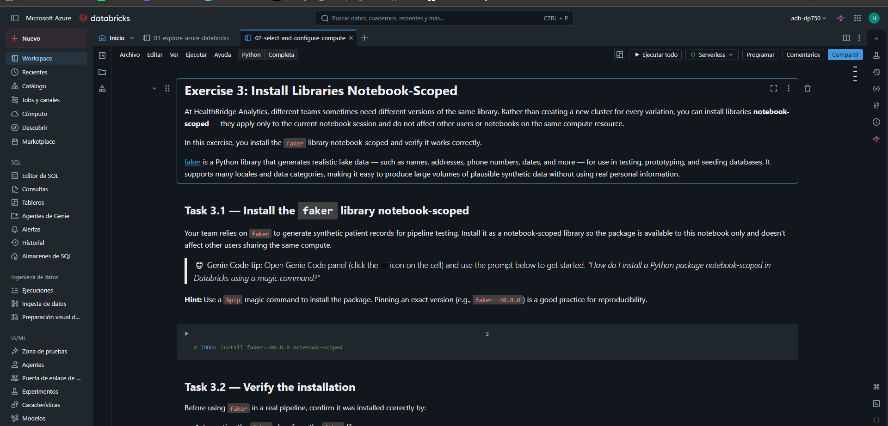
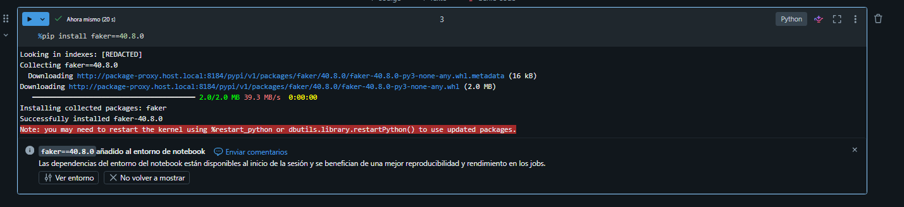
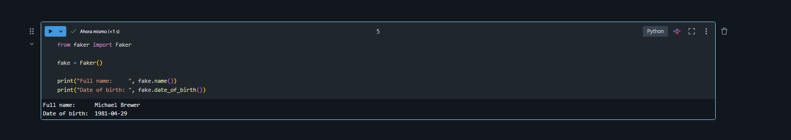
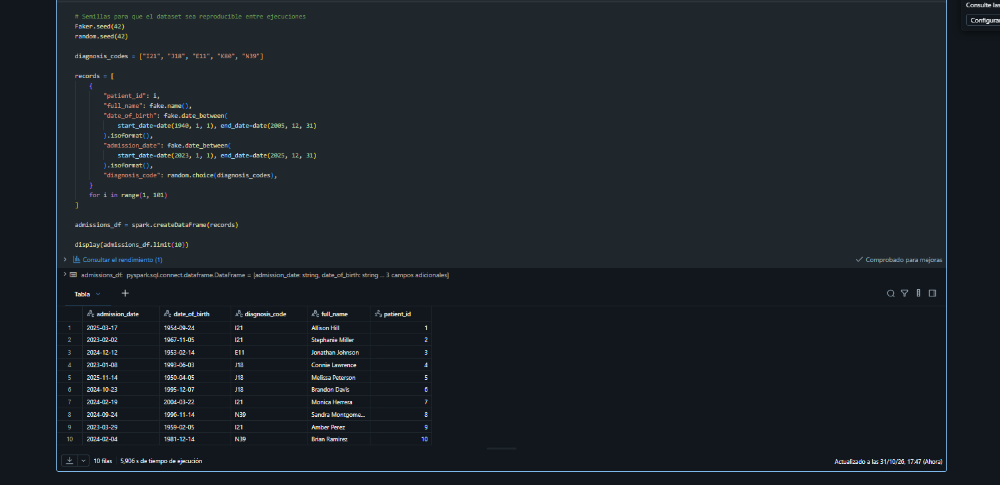
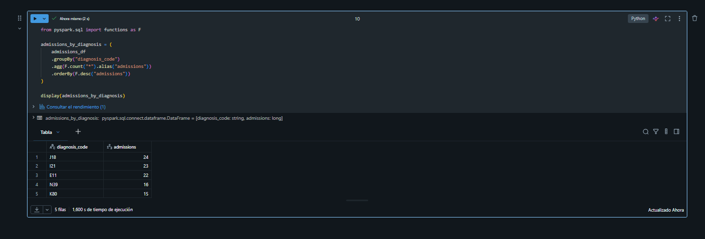

# Laboratorio 02 – Seleccionar y configurar compute en Azure Databricks

**Guía oficial:** [02-select-and-configure-compute](https://microsoftlearning.github.io/DP-750T00-Implement-Data-Engineering-Solutions-using-Azure-Databricks/Instructions/Labs/02-select-and-configure-compute.html)  
**Notebook:** [02-select-and-configure-compute.ipynb](https://github.com/MicrosoftLearning/DP-750T00-Implement-Data-Engineering-Solutions-using-Azure-Databricks/blob/main/Allfiles/02-select-and-configure-compute.ipynb)  
**Workspace:** `adb-dp750` (creado en el [Laboratorio 00](../dp750-lab00-hector-miguel-tudela/README.md))  
**Compute:** clúster all-purpose `healthbridge-dev` (ejercicios 1 y 2) y Serverless (ejercicios 3 y 4)  

---

## 1. Objetivo

En el papel de data engineer de **HealthBridge Analytics**, una organización sanitaria que procesa millones de registros de pacientes, se prepara el compute del equipo:

1. Crear y configurar un **clúster all-purpose** con runtime LTS, workers optimizados en memoria, autoescalado, auto-terminación y Photon.
2. Instalar una librería **a nivel de clúster** (`faker`) desde la interfaz.
3. Instalar la misma librería **a nivel de notebook** con `%pip` sobre compute Serverless.
4. Generar y analizar con PySpark un dataset **sintético** de ingresos hospitalarios.

---

## 2. Requisitos previos

| Elemento | Origen | Comprobación |
|---|---|---|
| Workspace Premium `adb-dp750` | Laboratorio 00 | Se abre con **Launch workspace** |
| Permiso para crear clústeres | Administrador del workspace / metastore o permiso *cluster creation* | Botón **Create compute** disponible en **Compute** |
| Cuota de vCPU en la región | Suscripción de Azure | Ver sección 9 si falla la creación del clúster |

---

## 3. Importar el notebook

1. Barra lateral → **Workspace** → carpeta del laboratorio (por ejemplo la carpeta personal).
2. Menú **⋮** (o clic derecho) → **Import** → **URL**:

```
https://raw.githubusercontent.com/MicrosoftLearning/DP-750T00-Implement-Data-Engineering-Solutions-using-Azure-Databricks/refs/heads/main/Allfiles/02-select-and-configure-compute.ipynb
```

3. Abrir el notebook. Se conectará a **Serverless** más adelante (sección 6).



---

## 4. Ejercicio 1 – Crear y configurar un clúster all-purpose

El equipo necesita un clúster compartido para desarrollo interactivo.

### 4.1 Configuración general

1. Barra lateral → **Compute** → **Create compute**.
2. Poner el desplegable **Simple form** en **OFF** para ver todas las opciones.
3. Configurar:

| Opción | Valor |
|---|---|
| **Cluster name** | `healthbridge-dev` |
| **Policy** | Unrestricted |
| **Cluster mode** | Multi node |
| **Access mode** | Standard (antes *Shared*) |

> **Access mode Standard:** varios usuarios pueden compartir el clúster con aislamiento entre ellos y gobierno de Unity Catalog. El modo *Dedicated* (antes *Single user*) asigna el clúster a un único usuario o grupo.


### 4.2 Rendimiento y runtime

| Opción | Valor | Motivo |
|---|---|---|
| **Databricks Runtime** | Última versión **LTS** | Soporte extendido y más estabilidad para un clúster de equipo |
| **Worker type** | Memory optimized (serie **E**, p. ej. `Standard_E4ds_v5`) | Joins grandes entre pacientes y resultados de laboratorio necesitan más memoria por core |
| **Autoscaling** | Activado, mín. `1` – máx. `3` workers | Ajusta los workers a la carga |
| **Auto termination** | `15` minutos | Evita pagar por un clúster inactivo |
| **Photon Acceleration** | Activado | Motor vectorizado en C++ que acelera SQL y DataFrames |

Pulsar **Create compute** y esperar a que el estado sea **Running** (varios minutos).


### 4.3 Configuración aplicada

| Dato | Valor |
|---|---|
| Versión de Databricks Runtime LTS elegida | |
| Worker type | |
| Driver type | |
| Workers (mín./máx.) | 1 / 3 |
| Auto termination | 15 min |
| Photon | Activado |

---

## 5. Ejercicio 2 – Instalar una librería a nivel de clúster

[faker](https://faker.readthedocs.io/) genera datos falsos realistas (nombres, direcciones, fechas…) para pruebas, sin usar datos reales de pacientes.

1. **Compute** → `healthbridge-dev` → pestaña **Libraries** → **Install new**.
2. Configurar:

| Opción | Valor |
|---|---|
| **Library source** | PyPI |
| **Package** | `faker==40.8.0` |

3. **Install** y esperar a que el estado sea **Installed**.


- **Fijar la versión** (`==40.8.0`) garantiza que todo el equipo y todas las ejecuciones del pipeline usan exactamente la misma librería (reproducibilidad).
- Las librerías de clúster **se reinstalan automáticamente** cada vez que el clúster arranca y están disponibles para **todos los notebooks** conectados a él.

### 5.1 Detener o eliminar el clúster

El resto de ejercicios usa Serverless, así que el clúster ya no hace falta:

1. **Compute** → `healthbridge-dev`.
2. **Terminate** para pararlo, o **⋮ → Delete** para eliminarlo.


> Eliminarlo evita que alguien lo vuelva a arrancar por error y genere costes.

---

## 6. Ejercicio 3 – Librerías a nivel de notebook

Abrir el notebook `02-select-and-configure-compute` y elegir **Serverless** en el selector de compute.


Una librería instalada a nivel de notebook solo afecta a la **sesión de ese notebook**: no interfiere con otros usuarios ni notebooks del mismo compute, lo que permite que equipos distintos usen versiones distintas de una misma librería sin crear clústeres nuevos.

### 6.1 Tarea 3.1 – Instalar `faker` con `%pip`

Prompt sugerido para Genie Code:

```
How do I install a Python package notebook-scoped in Databricks using a magic command?
```

```python
%pip install faker==40.8.0
```



> Si se reinstala una versión distinta de una librería que ya estaba cargada, hay que reiniciar el intérprete con `dbutils.library.restartPython()` en una celda aparte. Las variables definidas antes se pierden, por eso `%pip` debe ir al principio del notebook.

### 6.2 Tarea 3.2 – Verificar la instalación

```python
from faker import Faker

fake = Faker()

print("Full name:     ", fake.name())
print("Date of birth: ", fake.date_of_birth())
```

Se debe mostrar un nombre y una fecha de nacimiento aleatorios (cambian en cada ejecución).



---

## 7. Ejercicio 4 – Generar y analizar datos sintéticos de pacientes

Se necesita un dataset de ingresos hospitalarios realista para probar transformaciones y agregaciones, pero **sin información real de pacientes** (cumplimiento de HIPAA).

### 7.1 Tarea 4.1 – DataFrame con 100 ingresos sintéticos

| Columna | Descripción |
|---|---|
| `patient_id` | Entero de 1 a 100 |
| `full_name` | Nombre completo aleatorio |
| `date_of_birth` | Fecha entre `1940-01-01` y `2005-12-31`, como texto |
| `admission_date` | Fecha entre `2023-01-01` y `2025-12-31`, como texto |
| `diagnosis_code` | Uno de `I21`, `J18`, `E11`, `K80`, `N39` |

Prompt sugerido:

```
How do I generate a list of Python dictionaries using the Faker library, then create a PySpark DataFrame from that list?
```

```python
import random
from datetime import date
from faker import Faker

fake = Faker()

# Semillas para que el dataset sea reproducible entre ejecuciones
Faker.seed(42)
random.seed(42)

diagnosis_codes = ["I21", "J18", "E11", "K80", "N39"]

records = [
    {
        "patient_id": i,
        "full_name": fake.name(),
        "date_of_birth": fake.date_between(
            start_date=date(1940, 1, 1), end_date=date(2005, 12, 31)
        ).isoformat(),
        "admission_date": fake.date_between(
            start_date=date(2023, 1, 1), end_date=date(2025, 12, 31)
        ).isoformat(),
        "diagnosis_code": random.choice(diagnosis_codes),
    }
    for i in range(1, 101)
]

admissions_df = spark.createDataFrame(records)

display(admissions_df.limit(10))
```



> `spark` es la `SparkSession` que Databricks crea automáticamente en cada notebook. `display()` muestra el DataFrame como tabla interactiva (con opción de gráficos).

Significado de los códigos CIE-10 usados:

| Código | Diagnóstico |
|---|---|
| `I21` | Infarto agudo de miocardio |
| `J18` | Neumonía |
| `E11` | Diabetes mellitus tipo 2 |
| `K80` | Colelitiasis (cálculos biliares) |
| `N39` | Otros trastornos del sistema urinario (p. ej. infección urinaria) |

### 7.2 Tarea 4.2 – Ingresos por código de diagnóstico

Prompt sugerido:

```
How do I group by a column, count occurrences, and sort the result in descending order using PySpark DataFrame API?
```

```python
from pyspark.sql import functions as F

admissions_by_diagnosis = (
    admissions_df
    .groupBy("diagnosis_code")
    .agg(F.count("*").alias("admissions"))
    .orderBy(F.desc("admissions"))
)

display(admissions_by_diagnosis)
```

Equivalente en SQL registrando una vista temporal:

```python
admissions_df.createOrReplaceTempView("admissions")
```

```sql
%sql
SELECT diagnosis_code, COUNT(*) AS admissions
FROM admissions
GROUP BY diagnosis_code
ORDER BY admissions DESC;
```

El resultado son 5 filas cuya suma es 100.



| diagnosis_code | admissions |
|---|---|
| | |
| | |
| | |
| | |
| | |

---

## 8. Clúster vs. Serverless y librerías de clúster vs. notebook

| | Clúster all-purpose | Serverless |
|---|---|---|
| Arranque | Varios minutos | Casi inmediato |
| Configuración | Runtime, tipo de VM, workers, Photon, políticas… | La gestiona Databricks |
| Coste en reposo | Hasta que salta la auto-terminación | Sin coste en reposo |
| Librerías de clúster | Sí (pestaña **Libraries**) | No; se usan `%pip` o el panel **Environment** |
| Uso típico | Desarrollo compartido con configuración controlada | Notebooks y jobs sin gestionar infraestructura |

| | Librería de clúster | Librería de notebook (`%pip`) |
|---|---|---|
| Ámbito | Todos los notebooks del clúster | Solo la sesión del notebook |
| Persistencia | Se reinstala al reiniciar el clúster | Se pierde al desconectar/reiniciar la sesión |
| Instalación | Interfaz de **Compute → Libraries** | Magic command en una celda |
| Ventaja | Entorno homogéneo para todo el equipo | Versiones distintas por notebook sin afectar a otros |

---

## 9. Problemas frecuentes

| Problema | Causa probable | Solución |
|---|---|---|
| `QuotaExceeded` / no hay vCPU disponibles | La suscripción no tiene cuota suficiente de la familia E en la región | Elegir el tamaño E más pequeño, bajar el máximo de workers o pedir aumento de cuota |
| No aparece **Create compute** | Usuario sin permiso de creación de clústeres | Usar un administrador del workspace |
| No se ve **Access mode** ni **Policy** | **Simple form** activado | Ponerlo en **OFF** |
| La librería queda en estado `Failed` | Nombre o versión mal escritos | Revisar que el paquete sea `faker==40.8.0` |
| `ModuleNotFoundError: No module named 'faker'` en el notebook | El notebook está en Serverless y no tiene la librería del clúster | Ejecutar primero la celda `%pip install faker==40.8.0` |
| Variables perdidas tras `%pip` | Se reinició el intérprete de Python | Colocar `%pip` al principio y volver a ejecutar las celdas |
| `date_between` falla con fechas en texto | Faker espera `date` o expresiones como `-30y` | Usar objetos `datetime.date` como en el código de la sección 7.1 |

---

## 10. Limpieza

1. Comprobar en **Compute** que `healthbridge-dev` está **Terminated** o eliminado.
2. Serverless no deja recursos encendidos.

> **No eliminar el grupo de recursos `rg-dp750`:** el workspace se reutiliza en los siguientes laboratorios.

---

## 11. Conclusiones

- Un clúster all-purpose se configura con runtime, tipo de nodo, autoescalado, auto-terminación, Photon y modo de acceso según la carga de trabajo.
- Las versiones **LTS** del runtime son las recomendadas para clústeres compartidos.
- Las VMs **optimizadas en memoria** (serie E) encajan con cargas de joins y agregaciones grandes.
- La **auto-terminación** es la medida más sencilla de control de costes.
- Las librerías de **clúster** dan un entorno común; las de **notebook** (`%pip`) aíslan dependencias por notebook y funcionan en Serverless.
- `faker` permite generar datos sintéticos realistas para probar pipelines sin exponer datos reales de pacientes.
