# Laboratorio 03: Crear y organizar objetos en Unity Catalog

**Autor:** Héctor Miguel Tudela
**Máster:** Big Data & IA, Tajamar (con Microsoft)


---

## 1. Escenario

Eres ingeniero de datos en **Lakeside University**, una universidad que digitaliza sus operaciones académicas. El equipo construye una plataforma de datos moderna en Azure Databricks para gestionar **expedientes de estudiantes, catálogo de cursos y matrículas**.

En este laboratorio se diseña e implementa el espacio de nombres completo de Unity Catalog para el entorno de desarrollo: catálogo, esquemas medallion, tablas con restricciones, vistas, volúmenes y funciones SQL reutilizables, siguiendo las convenciones de nomenclatura.

## 2. Objetivos

- Crear un **catálogo** y **esquemas medallion** (`bronze`, `silver`, `gold`).
- Crear **tablas gestionadas** con restricciones de **clave primaria (PK)** y **clave foránea (FK)**.
- Construir una **vista estándar** y una **vista materializada**.
- Crear un **volumen gestionado** y cargar un CSV en él.
- Escribir una **función SQL escalar** reutilizable para clasificar notas.
- Usar sentencias **ALTER** para ampliar tablas y aplicar **etiquetas (tags)** de gobierno.

## 3. Requisitos previos

- Workspace de Azure Databricks Premium creado en el Laboratorio 00.
- Metastore de Unity Catalog asociado al workspace.
- Privilegio `CREATE CATALOG` sobre el metastore.
- Conocimientos básicos de SQL (`CREATE TABLE`, `SELECT`, `JOIN`).

---

## 5. Importar el notebook del laboratorio

1. En el workspace, seleccionar **Workspace** en la barra lateral izquierda.
2. Navegar a la carpeta donde guardar los notebooks (por ejemplo, la carpeta personal).
3. Menú **⋮** (o clic derecho) → **Import**.
4. Elegir **URL**, pegar la siguiente dirección y pulsar **Import**:
   `https://raw.githubusercontent.com/MicrosoftLearning/DP-750T00-Implement-Data-Engineering-Solutions-using-Azure-Databricks/refs/heads/main/Allfiles/03-create-and-organize-objects-in-unity-catalog.ipynb`
5. Abrir el notebook importado y, en el selector de compute, elegir **Serverless**.

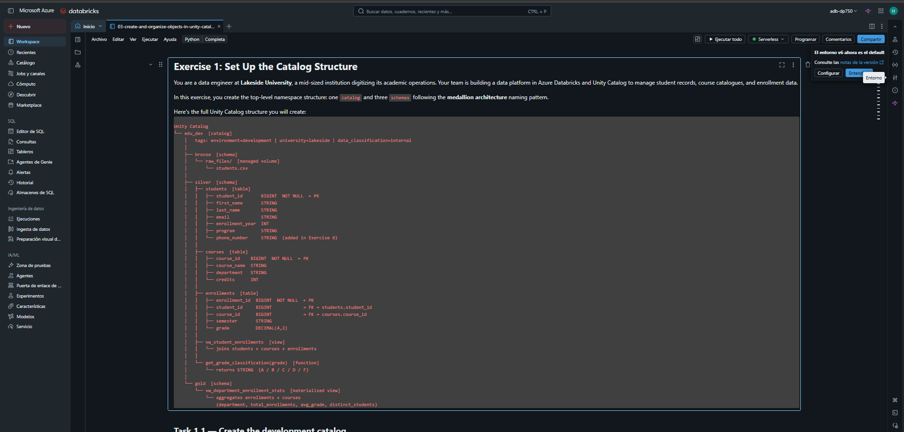
---

## 6. Ejercicio 1: Estructura del catálogo

### Tarea 1.1: Crear el catálogo `edu_dev`

Primero, la celda de Python proporcionada obtiene la ruta de almacenamiento (*Storage Root*) del catálogo por defecto del workspace, ya que no hay *default storage* habilitado:

```python
default_catalog = spark.catalog.currentCatalog()

storage_root = (
    spark.sql(f"DESCRIBE CATALOG EXTENDED {default_catalog}")
    .filter("info_name = 'Storage Root'")
    .select("info_value")
    .first()[0]
)
print(f"Storage root: {storage_root}")
```

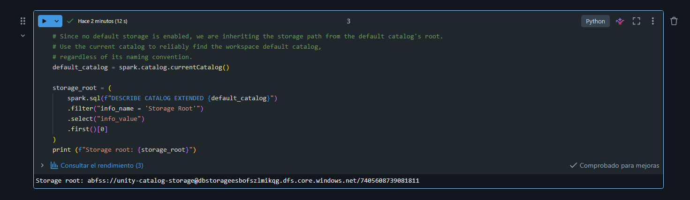

Después se crea el catálogo con un comentario descriptivo. Como el workspace no tiene almacenamiento por defecto, se le indica la ruta heredada con `MANAGED LOCATION`:

```python
spark.sql(f"""
CREATE CATALOG IF NOT EXISTS edu_dev
MANAGED LOCATION '{storage_root}'
COMMENT 'Entorno de desarrollo de la plataforma de datos de Lakeside University'
""")
```

> Si el workspace sí tuviera almacenamiento por defecto, bastaría con:
> ```sql
> CREATE CATALOG IF NOT EXISTS edu_dev
> COMMENT 'Entorno de desarrollo de la plataforma de datos de Lakeside University';
> ```

**Convención de nombres:** minúsculas con guiones bajos; sin puntos, espacios, barras `/` ni caracteres de control.

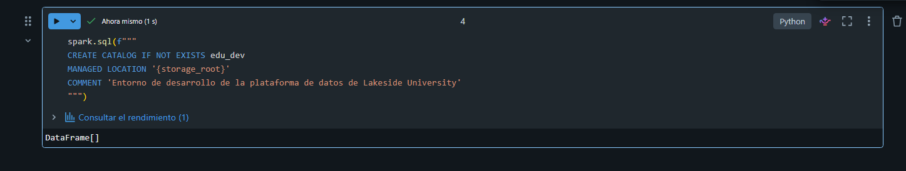

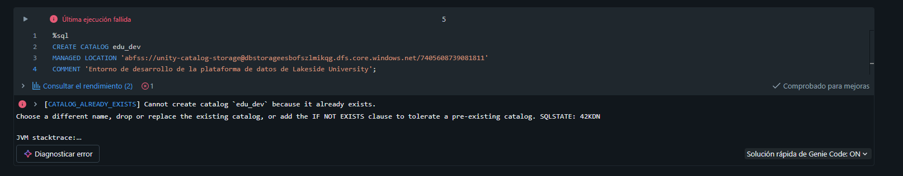

### Tarea 1.2: Crear los esquemas medallion

| Esquema | Propósito |
|---------|-----------|
| `bronze` | Datos crudos ingeridos, sin modificar |
| `silver` | Datos limpios, validados y enriquecidos |
| `gold` | Datos agregados, listos para analítica |

```sql
CREATE SCHEMA IF NOT EXISTS edu_dev.bronze COMMENT 'Datos crudos sin modificar';
CREATE SCHEMA IF NOT EXISTS edu_dev.silver COMMENT 'Datos limpios y validados';
CREATE SCHEMA IF NOT EXISTS edu_dev.gold   COMMENT 'Datos agregados para analítica';
```

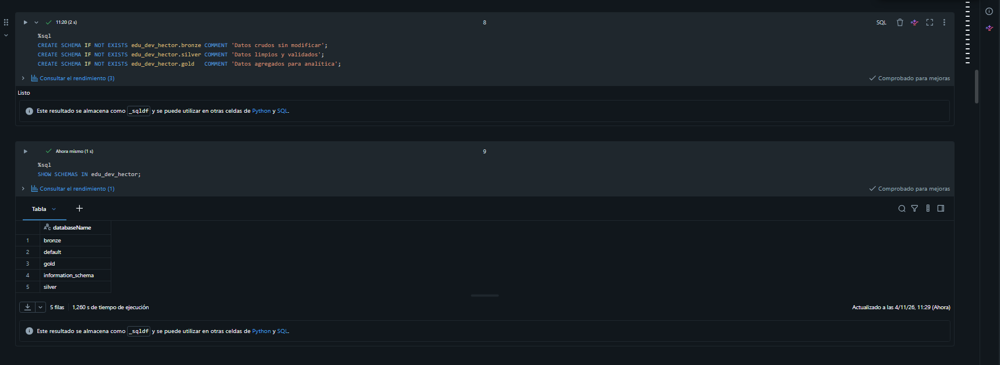

---

## 7. Ejercicio 2: Tablas con restricciones

> En Unity Catalog las restricciones PK/FK son **informativas**: ayudan al optimizador y documentan el modelo, pero **no imponen** integridad referencial al escribir.

### Tarea 2.1: Tabla `edu_dev.silver.students`

```sql
CREATE TABLE IF NOT EXISTS edu_dev.silver.students (
  student_id       BIGINT NOT NULL,
  first_name       STRING,
  last_name        STRING,
  email            STRING,
  enrollment_year  INT,
  program          STRING,
  CONSTRAINT students_pk PRIMARY KEY (student_id)
);
```

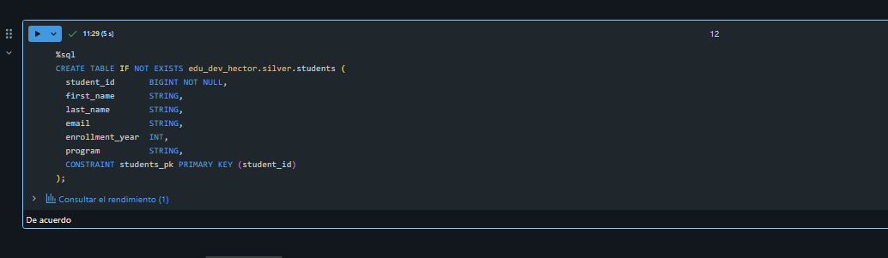


### Tarea 2.2: Tabla `edu_dev.silver.courses`

```sql
CREATE TABLE IF NOT EXISTS edu_dev.silver.courses (
  course_id    BIGINT NOT NULL,
  course_name  STRING,
  department   STRING,
  credits      INT,
  CONSTRAINT courses_pk PRIMARY KEY (course_id)
);
```

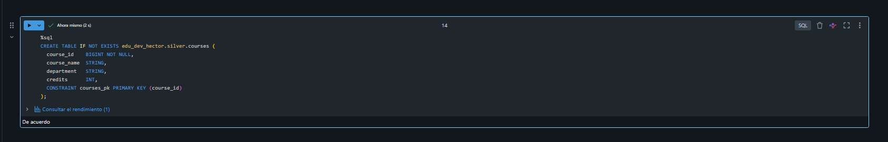

### Tarea 2.3: Tabla `edu_dev.silver.enrollments` (con claves foráneas)

```sql
CREATE TABLE IF NOT EXISTS edu_dev.silver.enrollments (
  enrollment_id  BIGINT NOT NULL,
  student_id     BIGINT,
  course_id      BIGINT,
  semester       STRING,
  grade          DECIMAL(4,2),
  CONSTRAINT enrollments_pk         PRIMARY KEY (enrollment_id),
  CONSTRAINT enrollments_student_fk FOREIGN KEY (student_id) REFERENCES edu_dev.silver.students(student_id),
  CONSTRAINT enrollments_course_fk  FOREIGN KEY (course_id)  REFERENCES edu_dev.silver.courses(course_id)
);
```

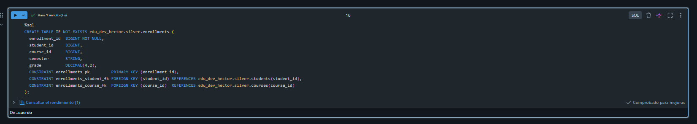

### Datos de ejemplo

Se ejecuta la celda proporcionada **sin modificarla**. Inserta 10 estudiantes, 6 cursos y 15 matrículas:

```sql
INSERT INTO edu_dev.silver.students VALUES
(1001, 'Emma',   'Watson',    'emma.watson@lakeside.edu',    2022, 'Computer Science'),
(1002, 'Liam',   'Ahmed',     'liam.ahmed@lakeside.edu',     2023, 'Data Science'),
(1003, 'Sofia',  'Chen',      'sofia.chen@lakeside.edu',     2021, 'Mathematics'),
(1004, 'James',  'Okonkwo',   'james.okonkwo@lakeside.edu',  2022, 'Computer Science'),
(1005, 'Aisha',  'Patel',     'aisha.patel@lakeside.edu',    2023, 'Data Science'),
(1006, 'Noah',   'Yamamoto',  'noah.yamamoto@lakeside.edu',  2020, 'Mathematics'),
(1007, 'Olivia', 'Kowalski',  'olivia.kowalski@lakeside.edu',2021, 'Computer Science'),
(1008, 'Carlos', 'Reyes',     'carlos.reyes@lakeside.edu',   2022, 'Data Science'),
(1009, 'Mei',    'Lindqvist', 'mei.lindqvist@lakeside.edu',  2023, 'Mathematics'),
(1010, 'Jake',   'OBrien',    'jake.obrien@lakeside.edu',    2020, 'Computer Science');

INSERT INTO edu_dev.silver.courses VALUES
(101, 'Introduction to Programming',   'Computer Science', 3),
(102, 'Data Structures',               'Computer Science', 4),
(103, 'Statistics for Data Science',   'Data Science',     3),
(104, 'Machine Learning Fundamentals', 'Data Science',     4),
(105, 'Calculus I',                    'Mathematics',      4),
(106, 'Linear Algebra',                'Mathematics',      3);

INSERT INTO edu_dev.silver.enrollments VALUES
(1,  1001, 101, 'Spring 2023', 8.50),
(2,  1001, 102, 'Fall 2023',   7.80),
(3,  1002, 103, 'Spring 2023', 9.20),
(4,  1002, 104, 'Fall 2023',   6.50),
(5,  1003, 105, 'Spring 2022', 7.00),
(6,  1003, 106, 'Fall 2022',   8.00),
(7,  1004, 101, 'Fall 2022',   6.80),
(8,  1005, 103, 'Spring 2023', 9.00),
(9,  1006, 105, 'Fall 2020',   7.50),
(10, 1007, 102, 'Spring 2022', 8.20),
(11, 1008, 104, 'Fall 2023',   7.30),
(12, 1009, 106, 'Spring 2023', 8.80),
(13, 1010, 101, 'Fall 2021',   5.50),
(14, 1004, 102, 'Spring 2023', 7.10),
(15, 1005, 104, 'Fall 2023',   8.90);
```

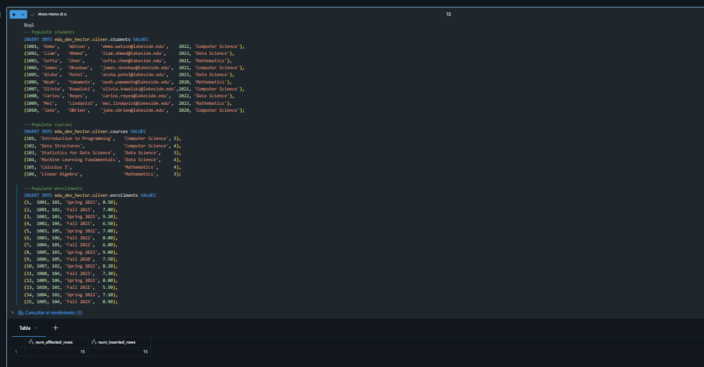

---

## 8. Ejercicio 3: Vistas

### Tarea 3.1: Vista estándar `edu_dev.silver.vw_student_enrollments`

Combina estudiantes, cursos y matrículas en un formato legible:

```sql
CREATE OR REPLACE VIEW edu_dev.silver.vw_student_enrollments AS
SELECT
  CONCAT(s.first_name, ' ', s.last_name) AS full_name,
  s.email,
  c.course_name,
  c.department,
  e.semester,
  e.grade
FROM edu_dev.silver.enrollments e
JOIN edu_dev.silver.students s ON e.student_id = s.student_id
JOIN edu_dev.silver.courses  c ON e.course_id  = c.course_id;
```

Comprobación rápida:

```sql
SELECT * FROM edu_dev.silver.vw_student_enrollments;
```

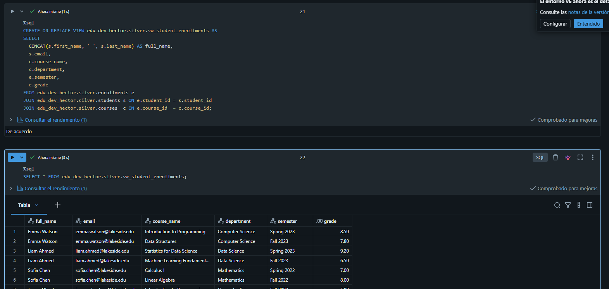

### Tarea 3.2: Vista materializada `edu_dev.gold.vw_department_enrollment_stats`

```sql
CREATE MATERIALIZED VIEW edu_dev.gold.vw_department_enrollment_stats AS
SELECT
  c.department,
  COUNT(*)                     AS total_enrollments,
  ROUND(AVG(e.grade), 2)       AS avg_grade,
  COUNT(DISTINCT e.student_id) AS distinct_students
FROM edu_dev.silver.enrollments e
JOIN edu_dev.silver.courses c ON e.course_id = c.course_id
GROUP BY c.department;
```

> ⚠️ Las vistas materializadas necesitan un **SQL warehouse**. Si la celda falla con compute **Serverless**, cambiar en el selector de compute a un **Serverless SQL warehouse** y volver a ejecutar.

Verificación:

```sql
SELECT * FROM edu_dev.gold.vw_department_enrollment_stats;
```

Resultado esperado (una fila por departamento):

| department | total_enrollments | avg_grade | distinct_students |
|------------|------------------:|----------:|------------------:|
| Computer Science | 6 | 7.32 | 4 |
| Data Science | 5 | 8.18 | 3 |
| Mathematics | 4 | 7.83 | 3 |

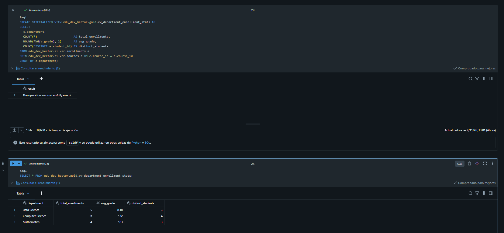

---

## 9. Ejercicio 4: Volumen y lectura de ficheros

Los **volúmenes** extienden el gobierno de Unity Catalog a los **ficheros**, no solo a las tablas.

### Tarea 4.1: Crear el volumen gestionado `raw_files`

```sql
CREATE VOLUME IF NOT EXISTS edu_dev.bronze.raw_files
COMMENT 'Zona de aterrizaje de ficheros crudos del sistema de información de estudiantes';
```

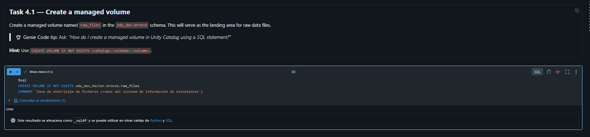

### Tarea 4.2: Escribir un CSV en el volumen

Se ejecuta la celda proporcionada **sin modificarla**:

```python
csv_content = """student_id,first_name,last_name,email,enrollment_year,program
1001,Emma,Watson,emma.watson@lakeside.edu,2022,Computer Science
1002,Liam,Ahmed,liam.ahmed@lakeside.edu,2023,Data Science
1003,Sofia,Chen,sofia.chen@lakeside.edu,2021,Mathematics
1004,James,Okonkwo,james.okonkwo@lakeside.edu,2022,Computer Science
1005,Aisha,Patel,aisha.patel@lakeside.edu,2023,Data Science
1006,Noah,Yamamoto,noah.yamamoto@lakeside.edu,2020,Mathematics
1007,Olivia,Kowalski,olivia.kowalski@lakeside.edu,2021,Computer Science
1008,Carlos,Reyes,carlos.reyes@lakeside.edu,2022,Data Science
1009,Mei,Lindqvist,mei.lindqvist@lakeside.edu,2023,Mathematics
1010,Jake,OBrien,jake.obrien@lakeside.edu,2020,Computer Science"""

dbutils.fs.put("/Volumes/edu_dev/bronze/raw_files/students.csv", csv_content, overwrite=True)
print("students.csv written to /Volumes/edu_dev/bronze/raw_files/")
```

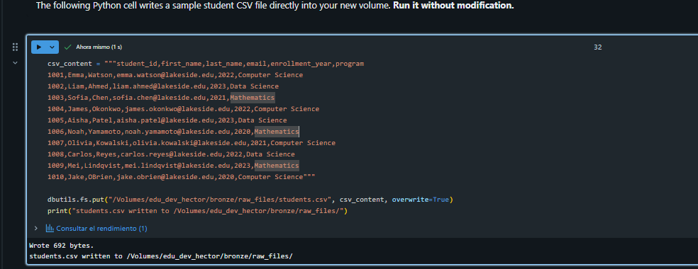

### Tarea 4.3: Leer el CSV en un DataFrame

```python
df_students = spark.read.csv(
    "/Volumes/edu_dev/bronze/raw_files/students.csv",
    header=True,
    inferSchema=True
)
df_students.display()
```

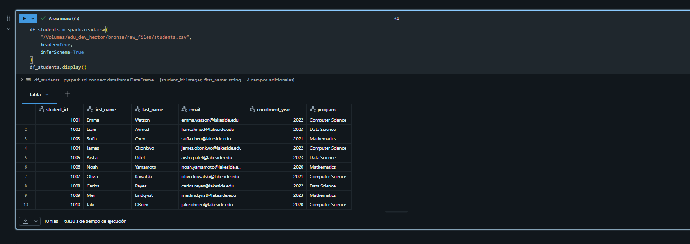

---

## 10. Ejercicio 5: Función SQL reutilizable

### Tarea 5.1: `edu_dev.silver.get_grade_classification`

| Rango de nota | Clasificación |
|---------------|---------------|
| ≥ 8.5 | `A` |
| ≥ 7.0 | `B` |
| ≥ 5.5 | `C` |
| ≥ 4.0 | `D` |
| < 4.0 | `F` |

```sql
CREATE OR REPLACE FUNCTION edu_dev.silver.get_grade_classification(grade DECIMAL(4,2))
RETURNS STRING
COMMENT 'Devuelve la clasificación en letra (A-F) según la escala de Lakeside University'
RETURN CASE
  WHEN grade >= 8.5 THEN 'A'
  WHEN grade >= 7.0 THEN 'B'
  WHEN grade >= 5.5 THEN 'C'
  WHEN grade >= 4.0 THEN 'D'
  ELSE 'F'
END;
```

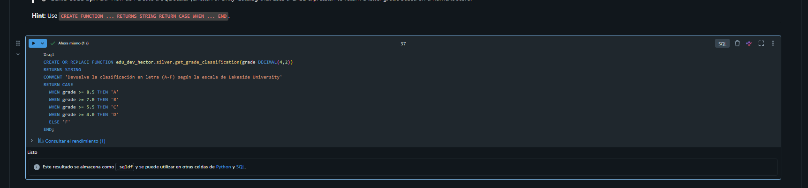

### Tarea 5.2: Probar la función

```sql
SELECT
  enrollment_id,
  student_id,
  course_id,
  semester,
  grade,
  edu_dev.silver.get_grade_classification(grade) AS grade_classification
FROM edu_dev.silver.enrollments
ORDER BY enrollment_id;
```

Resultado esperado: A para 8.50, 9.20, 9.00, 8.80 y 8.90; B para 7.80, 7.00, 8.00, 7.50, 8.20, 7.30 y 7.10; C para 6.50, 6.80 y 5.50.

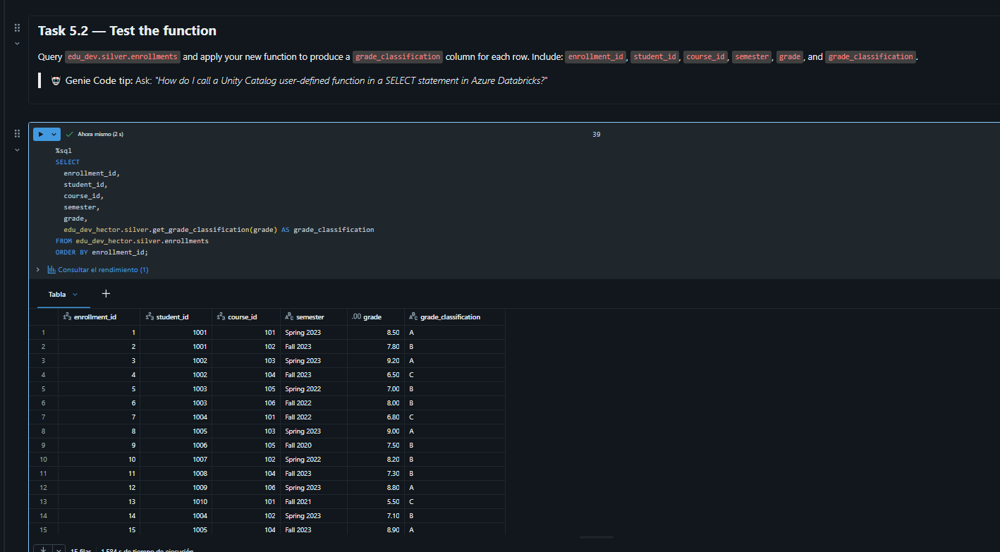

---

## 11. Ejercicio 6: Operaciones DDL

### Tarea 6.1: Añadir la columna `phone_number`

```sql
ALTER TABLE edu_dev.silver.students ADD COLUMN phone_number STRING;
```

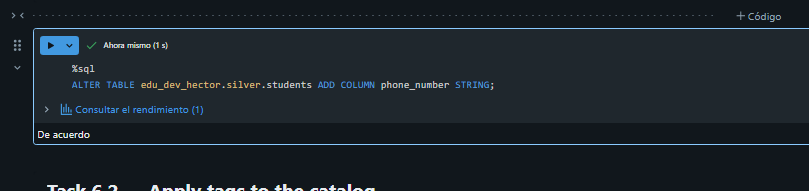

### Tarea 6.2: Aplicar etiquetas al catálogo

| Clave | Valor |
|-------|-------|
| `environment` | `development` |
| `university` | `lakeside` |
| `data_classification` | `internal` |

```sql
ALTER CATALOG edu_dev SET TAGS (
  'environment' = 'development',
  'university' = 'lakeside',
  'data_classification' = 'internal'
);
```

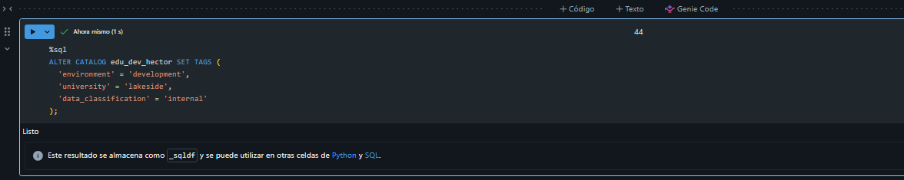

### Tarea 6.3: Verificación final

```sql
-- Tablas y vistas del esquema silver
SHOW TABLES IN edu_dev.silver;
```

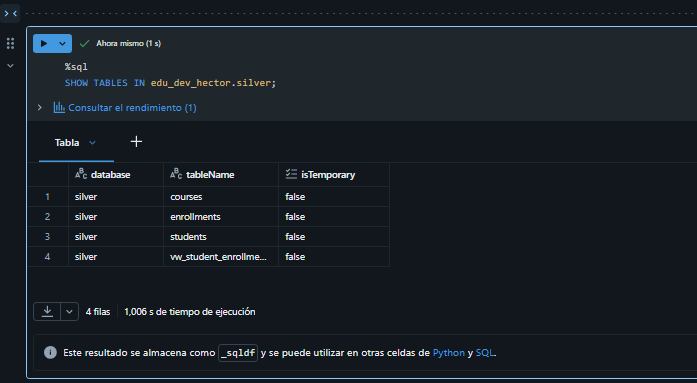

```sql
-- Comprobar que phone_number existe en students
DESCRIBE TABLE edu_dev.silver.students;
```

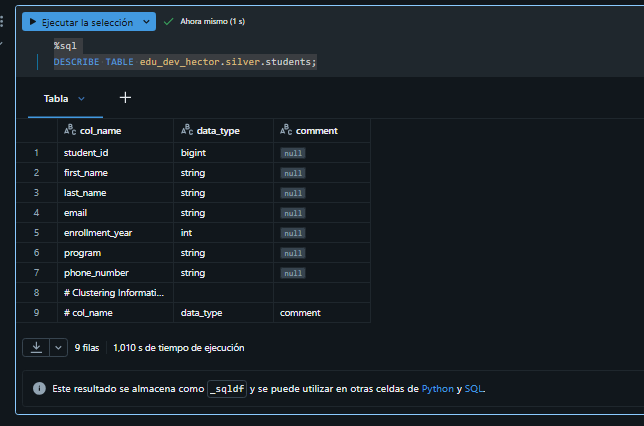

```sql
-- Detalles del catálogo
DESCRIBE CATALOG EXTENDED edu_dev;
```

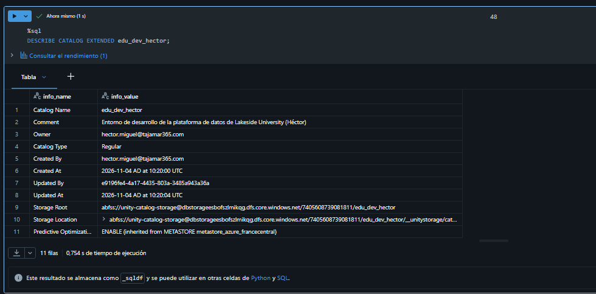

```sql
-- Etiquetas vía information_schema
SELECT *
FROM system.information_schema.catalog_tags
WHERE catalog_name = 'edu_dev';
```

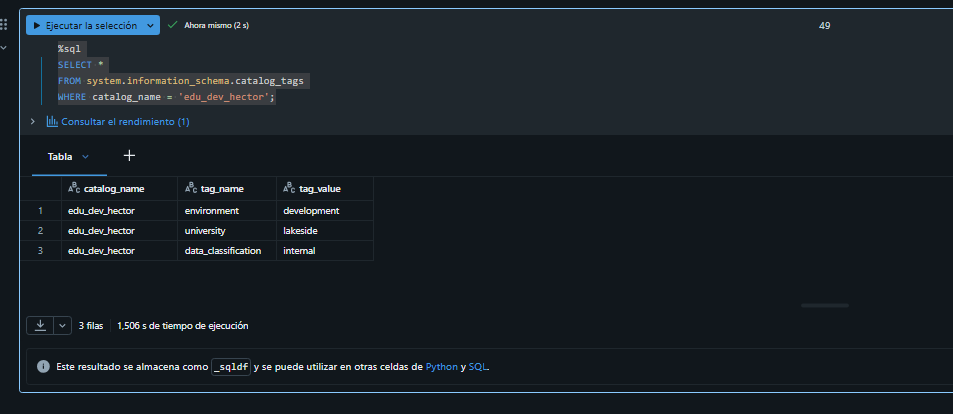

---

## 13. Limpieza (opcional)

```sql
DROP CATALOG IF EXISTS edu_dev CASCADE;
```

> ⚠️ Elimina de forma permanente todos los esquemas, tablas, vistas, volúmenes y funciones de `edu_dev`. Ejecutar solo si ya no se necesitan.

---

## 14. Conclusiones

- Unity Catalog organiza los datos en tres niveles: **catálogo → esquema → objeto** (`edu_dev.silver.students`).
- La arquitectura **medallion** (bronze/silver/gold) separa datos crudos, limpios y agregados.
- Las restricciones **PK/FK** son informativas: documentan el modelo y ayudan al optimizador, pero no validan datos al escribir.
- Las **vistas estándar** guardan la consulta; las **materializadas** guardan también el resultado precalculado y requieren un SQL warehouse.
- Los **volúmenes** gobiernan ficheros con los mismos permisos y trazabilidad que las tablas.
- Las **funciones SQL** centralizan la lógica de negocio y se reutilizan desde cualquier notebook o consulta.
- Las **etiquetas (tags)** facilitan el gobierno y la capacidad de descubrimiento de los datos.