# Laboratorio 04: Secure Unity Catalog Objects (DP-750)

**Autor:** Héctor Miguel Tudela
**Máster:** Big Data & IA, Tajamar (con Microsoft)

---

## 1. Escenario

Soy data engineer en **NorthMart Retail**, una cadena de supermercados con cuatro regiones (North, South, East, West). El equipo de seguridad plantea tres requisitos:

- Los analistas regionales solo deben ver los datos de su región.
- Los emails de los clientes son PII y deben enmascararse para la mayoría de usuarios.
- La API key de la plataforma de fidelización nunca debe guardarse en notebooks ni código.

Para resolverlos se implementa control de acceso, filtrado de filas, máscara de columnas y secretos respaldados por Azure Key Vault en Unity Catalog.

## 2. Objetivos

- Conceder y verificar permisos a un grupo de Databricks con SQL.
- Aplicar un row filter para restringir filas por región.
- Aplicar un column mask para proteger el email.
- Crear un Azure Key Vault y guardar un secreto.
- Crear un secret scope respaldado por Key Vault.
- Recuperar un secreto de forma segura en un notebook.

---

## 3. Preparación

### 3.1 Grupo `retail-analysts`

Settings → Identity and access → Groups → Manage → Add group. Nombre `retail-analysts` y se añade mi usuario como miembro.

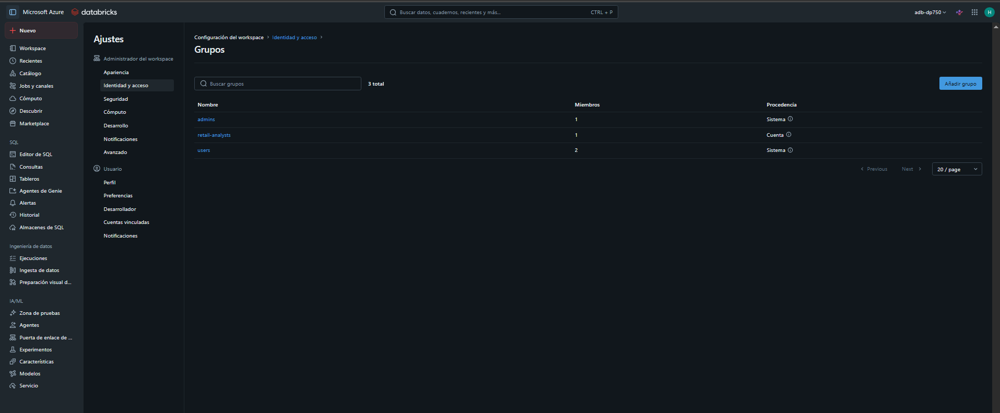

### 3.2 Importación del notebook

Workspace → Import → URL del notebook `04-secure-unity-catalog-objects.ipynb`, con compute **Serverless**.

### 3.3 Azure Key Vault

Creado en el Azure Portal:

| Parámetro | Valor |
|---|---|
| Nombre | `kv-northmart-<iniciales>` |
| Región | France Central (la del workspace) |
| Pricing tier | Standard |
| Permission model | Vault access policy |

📸 **Captura 3:** despliegue del Key Vault completado.

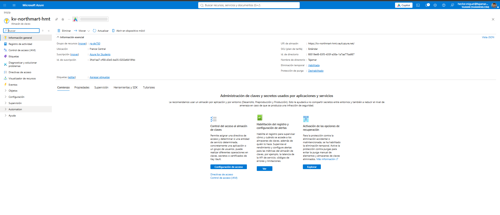

### 3.4 Access policy

Access policies → Create → permisos de secreto **Get** y **List** para mi usuario de Azure.

📸 **Captura 4:** lista de access policies.

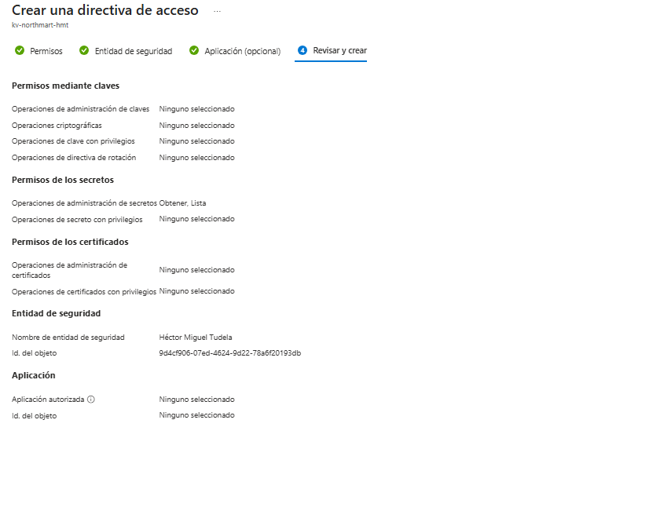

### 3.5 Secreto

Secrets → Generate/Import: nombre `loyalty-api-key` (el valor es el indicado en el enunciado).

📸 **Captura 5:** secreto `loyalty-api-key` en la lista.

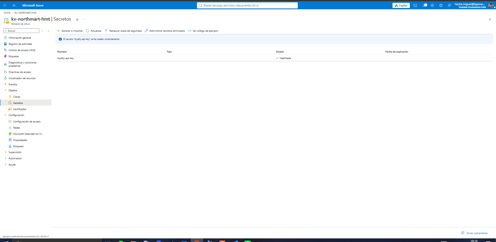

### 3.6 Datos del Key Vault

En Properties se copian el **Vault URI** y el **Resource ID**.

📸 **Captura 6:** página Properties con ambos valores.

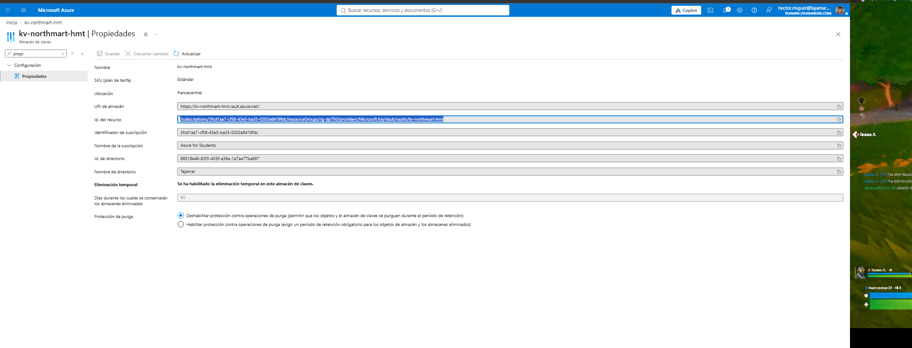

### 3.7 Secret scope

Se abre `https://<workspace-url>#secrets/createScope` (la **S** mayúscula) y se configura:

| Campo | Valor |
|---|---|
| Scope Name | `retail-kv-scope` |
| Manage Principal | All workspace users |
| DNS Name | Vault URI |
| Resource ID | Resource ID del Key Vault |

📸 **Captura 7:** confirmación de creación del scope.

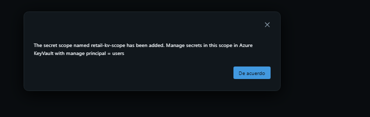

---

## 4. Ejercicio 1: Control de acceso

### Tarea 1.1: catálogo, schema y tabla

Se ejecutan las celdas que crean el catálogo `retail_catalog`, el schema `security_lab` y la tabla Delta `customers` con 6 clientes de ejemplo.

📸 **Captura 8:** celdas ejecutadas y `Storage root` impreso.

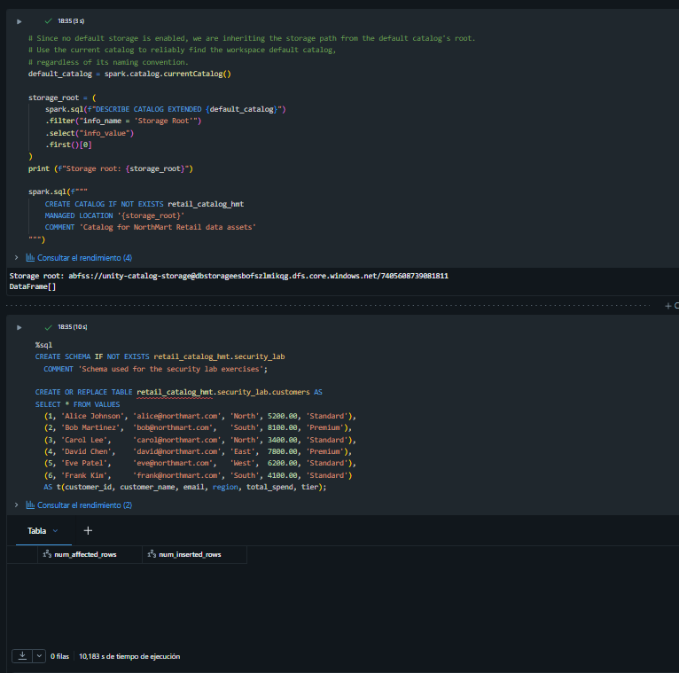

### Tarea 1.2: permisos al grupo

```sql
GRANT USE CATALOG ON CATALOG retail_catalog TO `retail-analysts`;
GRANT USE SCHEMA ON SCHEMA retail_catalog.security_lab TO `retail-analysts`;
GRANT SELECT ON TABLE retail_catalog.security_lab.customers TO `retail-analysts`;
```

Unity Catalog es jerárquico: para leer una tabla hacen falta `USE CATALOG`, `USE SCHEMA` y `SELECT`.

📸 **Captura 9:** grants ejecutados.

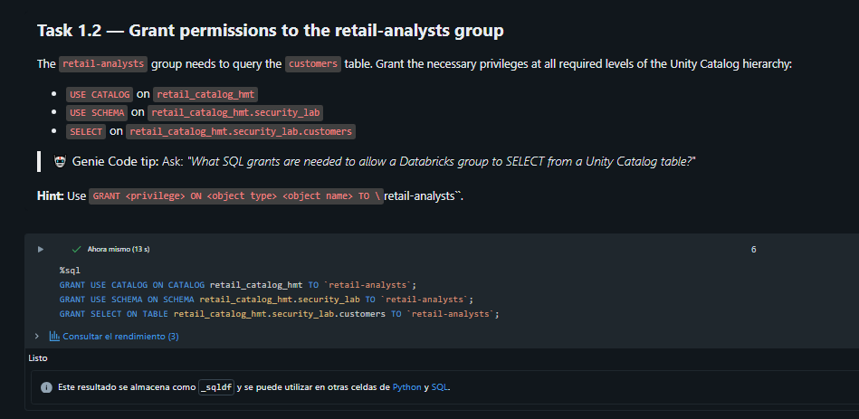

### Tarea 1.3: verificación

```sql
SHOW GRANTS ON TABLE retail_catalog.security_lab.customers;
```

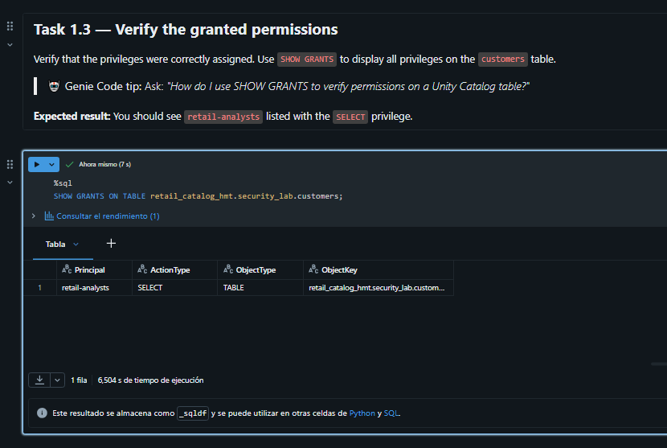

---

## 5. Ejercicio 2: Row filtering

### Tarea 2.1: función de filtro

```sql
CREATE OR REPLACE FUNCTION retail_catalog.security_lab.region_filter(region STRING)
RETURN region = 'North' OR current_user() = '<mi-email>';
```

Devuelve `TRUE` si la fila es de `North` o si el usuario es el privilegiado (yo).

📸 **Captura 11:** función creada.

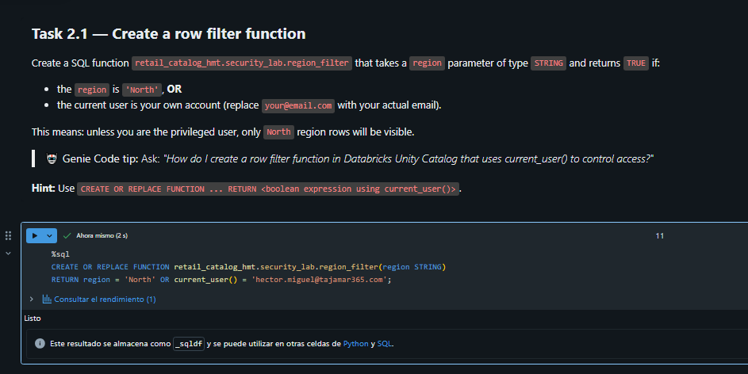

### Tarea 2.2: aplicar el filtro

```sql
ALTER TABLE retail_catalog.security_lab.customers
SET ROW FILTER retail_catalog.security_lab.region_filter ON (region);
```

📸 **Captura 12:** filtro aplicado.

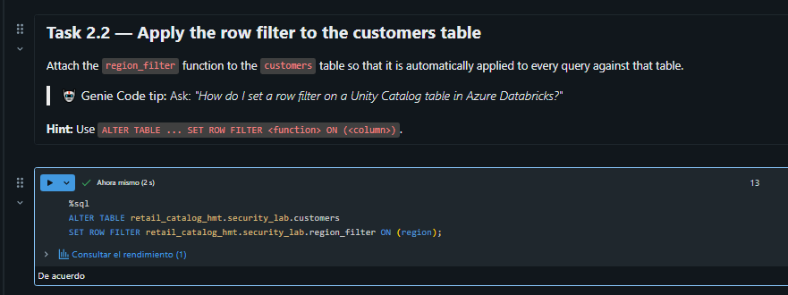

### Tarea 2.3: prueba

```sql
SELECT current_user();
SELECT * FROM retail_catalog.security_lab.customers;
```

- Con mi usuario como privilegiado: **6 filas**.
- Cambiando el email de la función a otro: solo **2 filas** (North).

📸 **Captura 13:** 6 filas con el usuario privilegiado.

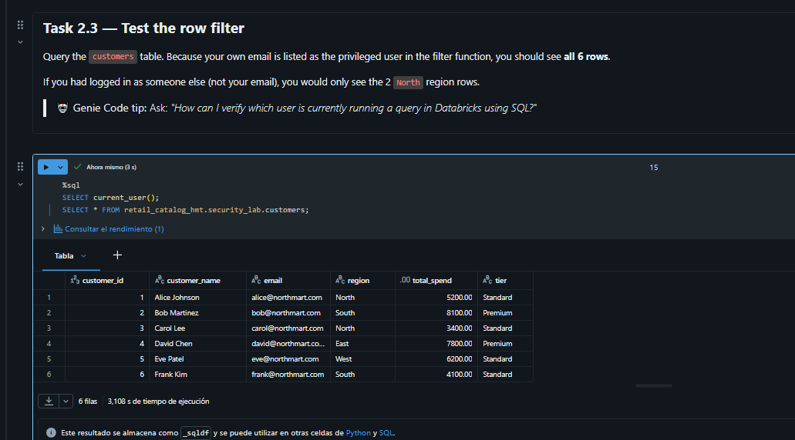

### Tarea 2.4: quitar el filtro

```sql
ALTER TABLE retail_catalog.security_lab.customers DROP ROW FILTER;
SELECT * FROM retail_catalog.security_lab.customers;
```

📸 **Captura 15:** 6 filas tras quitar el filtro.

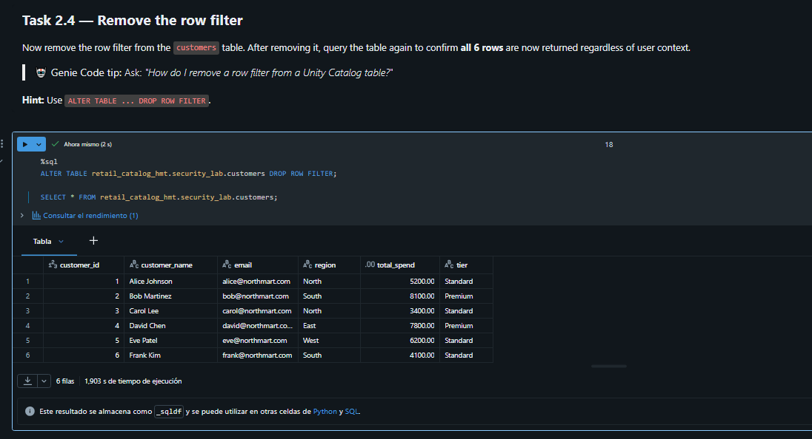

---

## 6. Ejercicio 3: Column masking

### Tarea 3.1: función de máscara

```sql
CREATE OR REPLACE FUNCTION retail_catalog.security_lab.mask_email(email STRING)
RETURN CASE WHEN current_user() = '<mi-email>' THEN email ELSE '***@***.com' END;
```

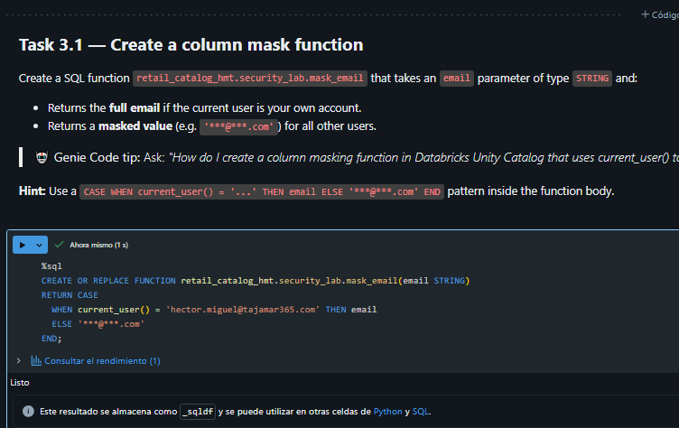

### Tarea 3.2: aplicar la máscara

```sql
ALTER TABLE retail_catalog.security_lab.customers
ALTER COLUMN email SET MASK retail_catalog.security_lab.mask_email;
```

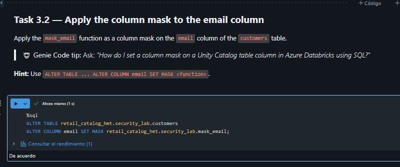

### Tarea 3.3: prueba

```sql
SELECT * FROM retail_catalog.security_lab.customers;
```

- Usuario privilegiado: emails reales.
- Otro usuario: `***@***.com`.

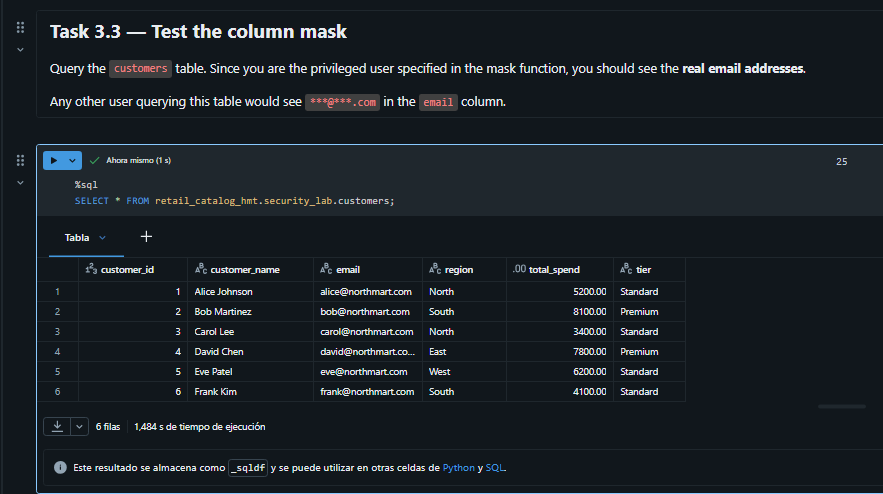

### Tarea 3.4: quitar la máscara

```sql
ALTER TABLE retail_catalog.security_lab.customers ALTER COLUMN email DROP MASK;
SELECT * FROM retail_catalog.security_lab.customers;
```

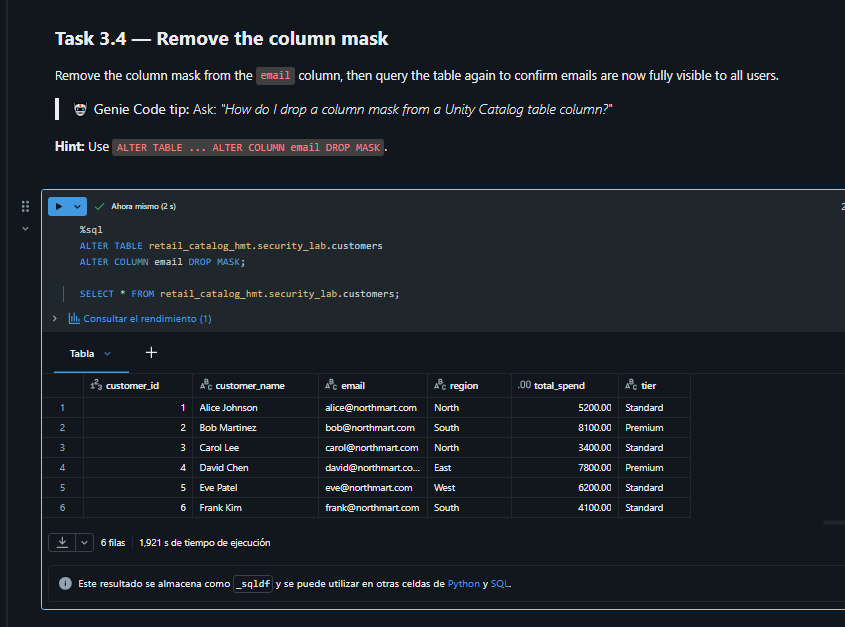

---

## 7. Ejercicio 4: Secretos con Azure Key Vault

### Tarea 4.1: listar secretos

```python
display(dbutils.secrets.list("retail-kv-scope"))
```

Devuelve solo los nombres de las claves, nunca los valores.

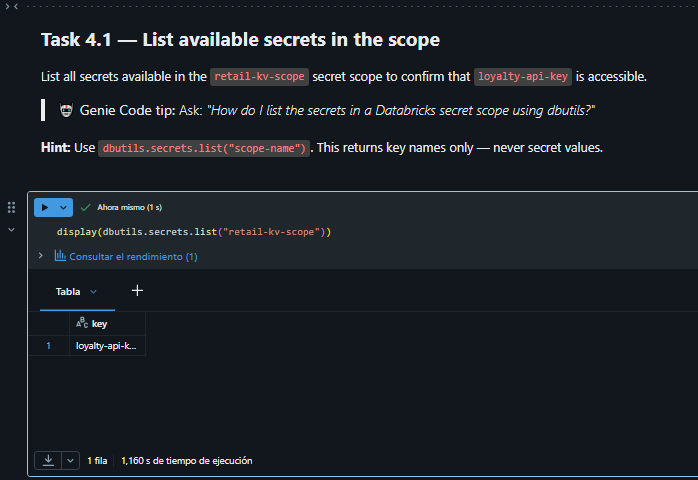

### Tarea 4.2: recuperar la API key

```python
api_key = dbutils.secrets.get(scope="retail-kv-scope", key="loyalty-api-key")
print(api_key)
```

Databricks redacta el valor automáticamente y muestra `[REDACTED]`.

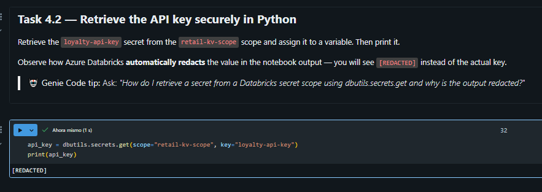

### Tarea 4.3: cadena de conexión

```python
connection_string = f"https://loyalty.northmart.com/api?key={api_key}"
print(connection_string)
```

La clave sigue apareciendo redactada.

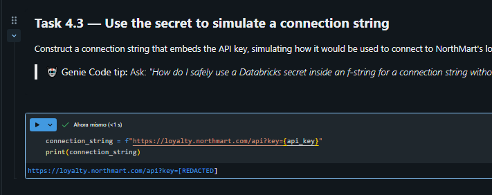

### Tarea 4.4: secreto con SQL

```sql
SELECT secret('retail-kv-scope', 'loyalty-api-key');
```

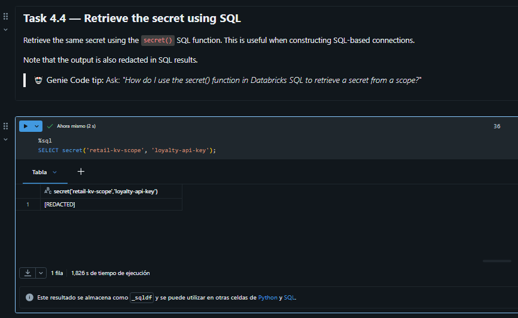

---

## 8. Limpieza

Se ejecuta la celda final del notebook, que elimina filtro, máscara, tabla, funciones, schema y catálogo.

📸 **Captura 25:** celda de cleanup ejecutada.


---

## 9. Conclusiones

- Unity Catalog controla el acceso de forma jerárquica (catálogo → schema → tabla) con `GRANT`/`SHOW GRANTS`.
- Los **row filters** restringen qué filas ve cada usuario sin duplicar tablas, usando `current_user()`.
- Los **column masks** protegen datos PII devolviendo un valor enmascarado según el usuario.
- Los **secret scopes respaldados por Azure Key Vault** evitan guardar credenciales en el código, y Databricks redacta sus valores en las salidas.