# Laboratorio 05: Govern Unity Catalog Objects (DP-750)

**Autor:** Héctor Miguel Tudela
**Máster:** Big Data & IA, Tajamar (con Microsoft)

---

## Paso 0. Importar el notebook

1. En Databricks: **Workspace** → carpeta del lab → **⋮** → **Import**.
2. Elegir **URL** y pegar:
   `https://raw.githubusercontent.com/MicrosoftLearning/DP-750T00-Implement-Data-Engineering-Solutions-using-Azure-Databricks/refs/heads/main/Allfiles/05-govern-unity-catalog-objects.ipynb`
3. Abrir el notebook y seleccionar **Serverless** en el selector de compute.

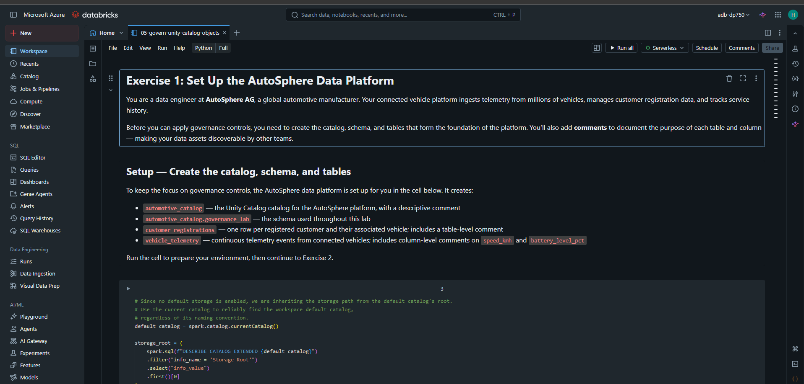

---

## Ejercicio 1. Crear catálogo, esquema y tablas

1. Ejecutar la primera celda (Python): crea `automotive_catalog` usando el storage root del catálogo por defecto.
2. Ejecutar la segunda celda (`%sql`): crea el esquema `governance_lab` y las tablas `customer_registrations` y `vehicle_telemetry`.

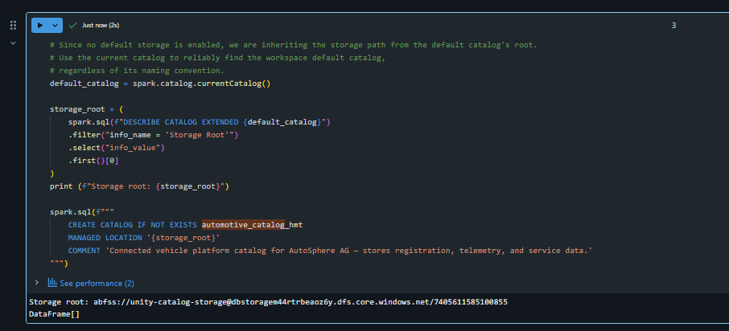
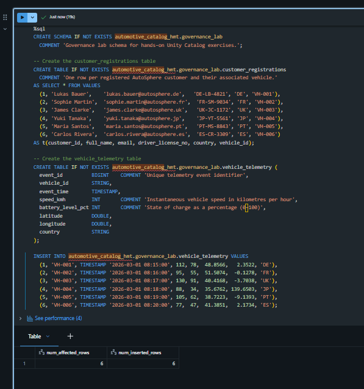

---

## Parte UI (tras el Ejercicio 1). Linaje en Catalog Explorer

1. **Catalog** → **automotive_catalog** → **governance_lab** → **vehicle_telemetry**.
2. Pestaña **Lineage** → **See Lineage Graph**.

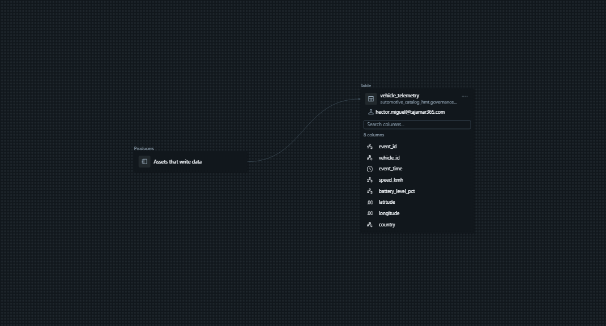

3. Seleccionar una columna (p. ej. `vehicle_id`) para ver el linaje a nivel de columna. El nodo `service_records` puede no existir porque el notebook no lo crea; en ese caso usar una columna de `vehicle_telemetry`.

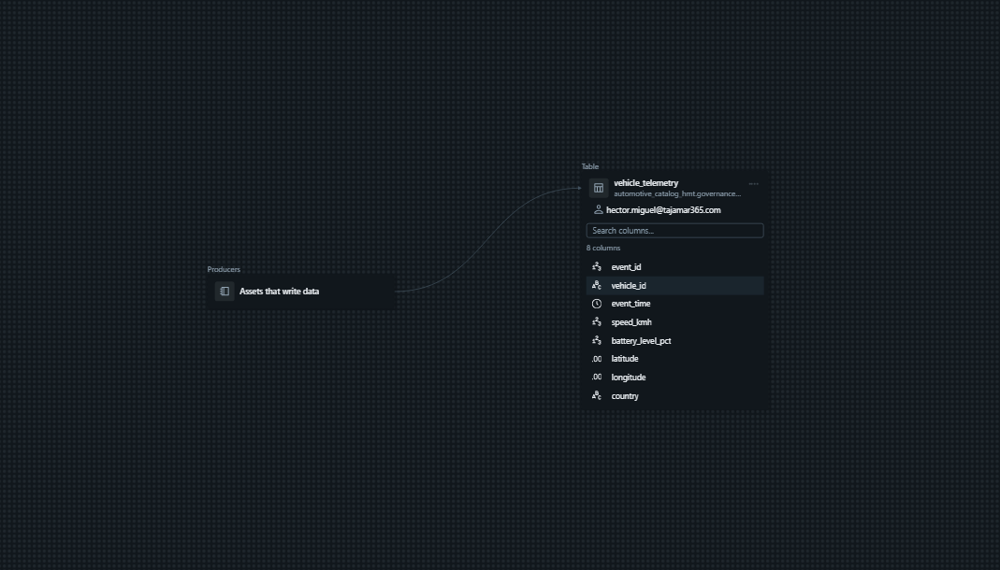

4. En `vehicle_telemetry`, pestaña **History**.

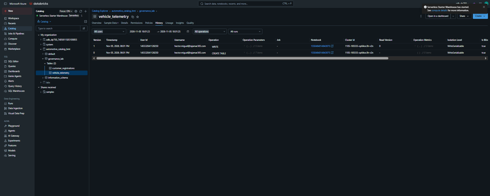

---

## Ejercicio 2. Etiquetas (tags)

### Tarea 2.1: tags de tabla

```sql
%sql
ALTER TABLE automotive_catalog.governance_lab.customer_registrations
SET TAGS ('domain' = 'customer', 'data_classification' = 'confidential');
```

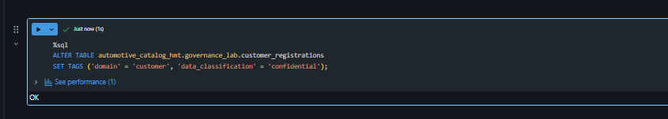

### Tarea 2.2: tags de columna

```sql
%sql
ALTER TABLE automotive_catalog.governance_lab.customer_registrations
ALTER COLUMN email SET TAGS ('pii' = 'email');

ALTER TABLE automotive_catalog.governance_lab.customer_registrations
ALTER COLUMN driver_license_no SET TAGS ('pii' = 'driver_license');
```

Si la celda no admite dos sentencias, separarlas en dos celdas.

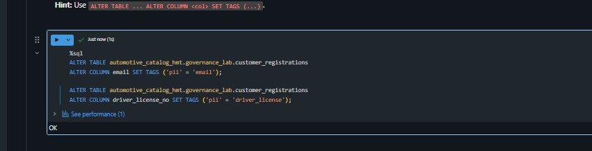

### Tarea 2.3: verificar

```sql
%sql
SELECT * FROM system.information_schema.table_tags
WHERE catalog_name = 'automotive_catalog'
  AND schema_name = 'governance_lab'
  AND table_name = 'customer_registrations';
```

```sql
%sql
SELECT * FROM system.information_schema.column_tags
WHERE catalog_name = 'automotive_catalog'
  AND schema_name = 'governance_lab'
  AND table_name = 'customer_registrations';
```

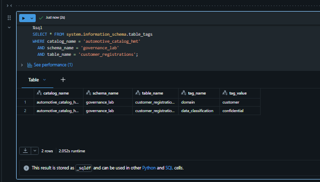
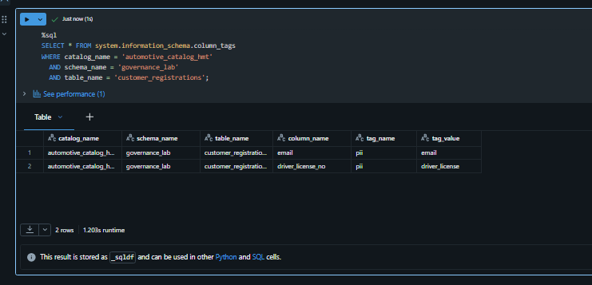

---

## Ejercicio 3. Retención de datos

### Tarea 3.1: propiedades de retención

```sql
%sql
ALTER TABLE automotive_catalog.governance_lab.vehicle_telemetry
SET TBLPROPERTIES (
  'delta.logRetentionDuration' = 'interval 14 days',
  'delta.deletedFileRetentionDuration' = 'interval 14 days'
);
```

Comprobación opcional:

```sql
%sql
SHOW TBLPROPERTIES automotive_catalog.governance_lab.vehicle_telemetry;
```

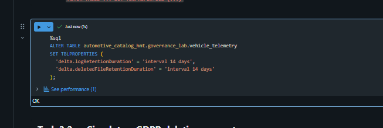

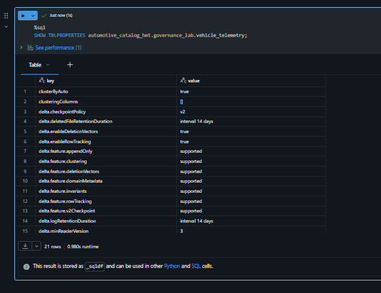

### Tarea 3.2: borrado GDPR (derecho de supresión)

```sql
%sql
DELETE FROM automotive_catalog.governance_lab.vehicle_telemetry
WHERE vehicle_id = 'VH-003';
```

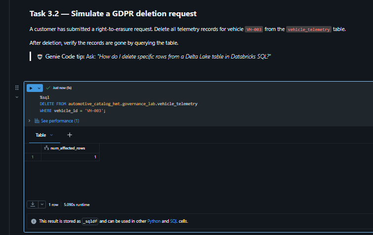

```sql
%sql
SELECT * FROM automotive_catalog.governance_lab.vehicle_telemetry
WHERE vehicle_id = 'VH-003';
```

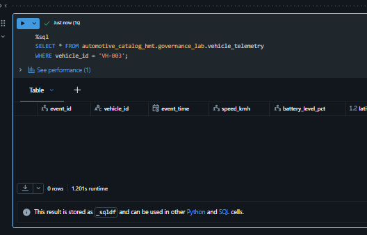

```sql
%sql
SELECT * FROM automotive_catalog.governance_lab.vehicle_telemetry;
```

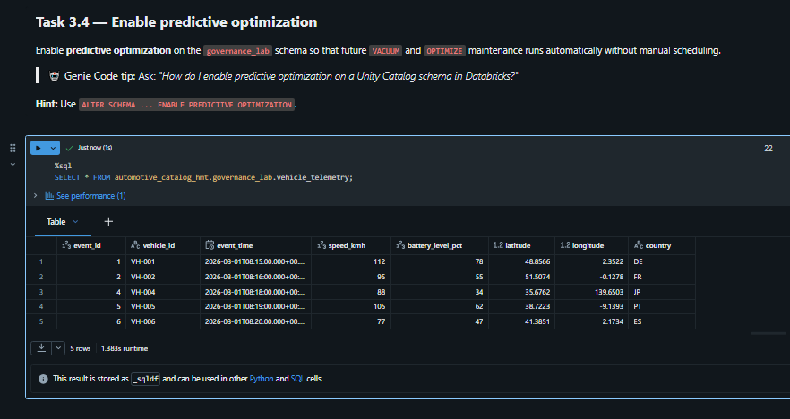


### Tarea 3.3: VACUUM

```sql
%sql
VACUUM automotive_catalog.governance_lab.vehicle_telemetry RETAIN 168 HOURS;
```

En Serverless no se puede bajar de 168 horas (7 días). No borrará archivos porque son recientes, y es lo esperado.

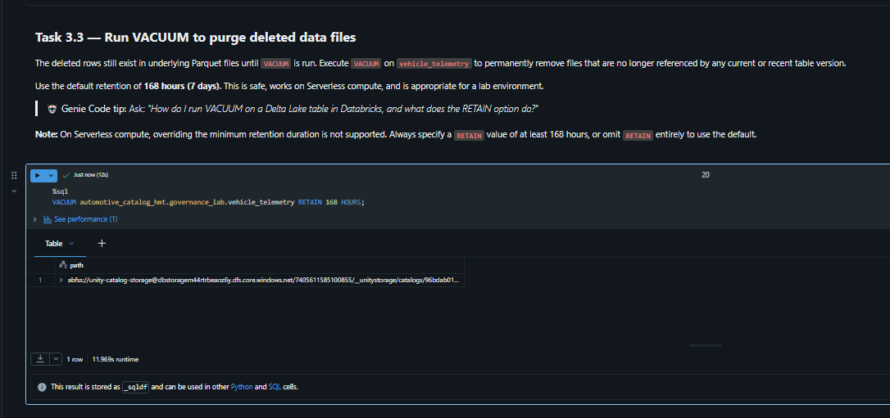

### Tarea 3.4: Predictive Optimization

```sql
%sql
ALTER SCHEMA automotive_catalog.governance_lab ENABLE PREDICTIVE OPTIMIZATION;
```

Si da error de permisos o de función no habilitada, es una limitación de la cuenta (se habilita a nivel de cuenta o metastore). Documentar el error con captura.

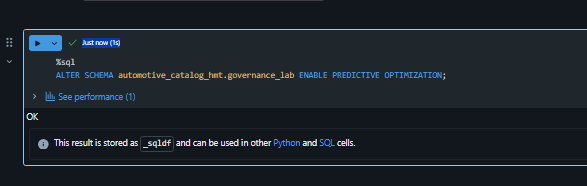

Comprobación:

```sql
%sql
DESCRIBE SCHEMA EXTENDED automotive_catalog.governance_lab;
```

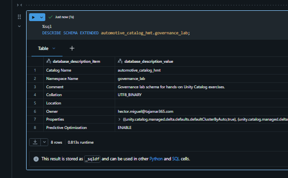

---

## Ejercicio 4. Linaje con SQL

### Tarea 4.1: tablas recientes del catálogo

```sql
%sql
SELECT source_table_full_name, COUNT(*) AS events
FROM system.access.table_lineage
WHERE source_table_full_name LIKE 'automotive_catalog%'
  AND event_time >= current_timestamp() - INTERVAL 7 DAYS
GROUP BY source_table_full_name
ORDER BY events DESC;
```

Si sale vacío: puede haber retraso de unos minutos en el registro de linaje, o `system.access` puede no estar habilitado.

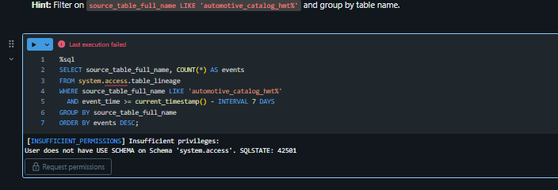

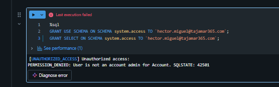

### Tarea 4.2: historial de vehicle_telemetry

```sql
%sql
DESCRIBE HISTORY automotive_catalog.governance_lab.vehicle_telemetry;
```

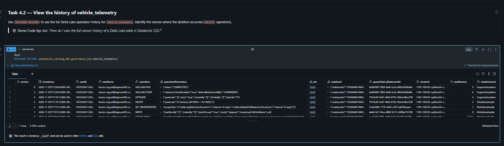

---

## Ejercicio 5. Auditoría

### Tarea 5.1: accesos a customer_registrations

```sql
%sql
SELECT user_identity.email AS user_email, action_name, event_time
FROM system.access.audit
WHERE request_params.full_name_arg = 'automotive_catalog.governance_lab.customer_registrations'
  AND action_name IN ('getTable', 'createTable')
  AND event_time >= current_timestamp() - INTERVAL 30 DAYS
ORDER BY event_time DESC;
```


### Tarea 5.2: cambios de permisos

Para generar al menos un evento (opcional, recomendable):

```sql
%sql
GRANT SELECT ON TABLE automotive_catalog.governance_lab.customer_registrations TO `account users`;
```

El audit log puede tardar unos minutos en reflejarlo. Después:

```sql
%sql
SELECT event_time,
       user_identity.email AS user_email,
       request_params.securable_type,
       request_params.securable_full_name,
       request_params.changes
FROM system.access.audit
WHERE service_name = 'unityCatalog'
  AND action_name = 'updatePermissions'
  AND request_params.securable_full_name LIKE 'automotive_catalog%'
  AND event_time >= current_timestamp() - INTERVAL 30 DAYS
ORDER BY event_time DESC;
```


### Tarea 5.3: resumen de actividad por usuario

```sql
%sql
SELECT user_identity.email AS user_email, COUNT(*) AS event_count
FROM system.access.audit
WHERE service_name = 'unityCatalog'
  AND event_time >= current_timestamp() - INTERVAL 7 DAYS
GROUP BY user_identity.email
ORDER BY event_count DESC;
```

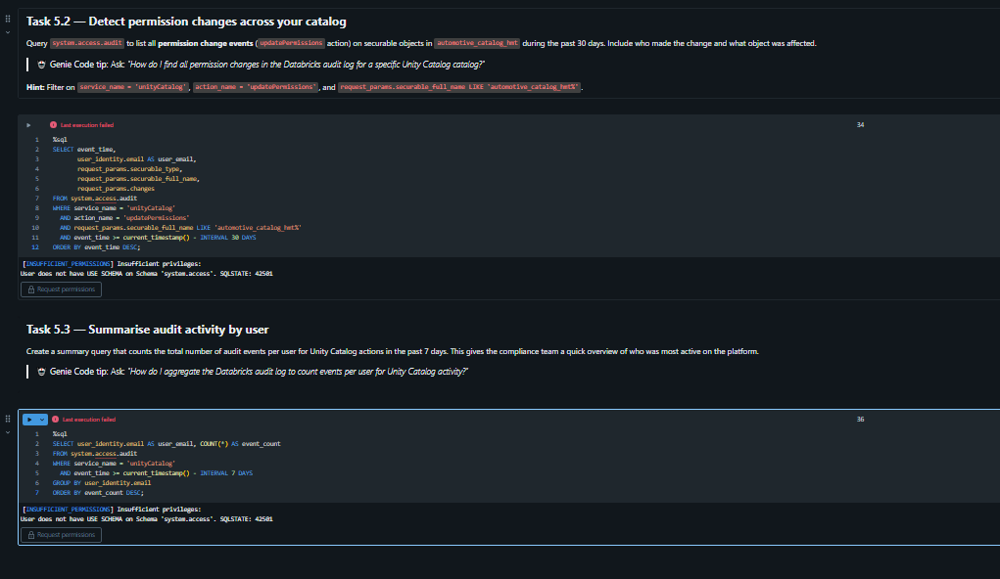

---

## Posibles problemas

- **`system.access` sin datos o sin acceso:** requiere habilitarlo con permisos de admin de cuenta. Documentar el error con captura.
- **Fallo en la celda 1 (storage root):** el catálogo por defecto no tiene root propio. Revisar el mensaje de error.

---

## Conclusión

Se han aplicado comentarios y tags (incluidos PII) para el descubrimiento de datos, retención Delta de 14 días con borrado GDPR y VACUUM, linaje visual y con `system.access.table_lineage`, y auditoría de accesos y permisos con `system.access.audit`.