# Laboratorio 06 – Design and Implement Data Modeling with Azure Databricks (DP-750)

> **Autor:** Héctor Miguel Tudela · **Máster Big Data & IA – Tajamar**
> **Teoría:** https://learn.microsoft.com/en-us/training/modules/design-implement-data-modeling-unity-catalog/
> **Laboratorio:** https://microsoftlearning.github.io/DP-750T00-Implement-Data-Engineering-Solutions-using-Azure-Databricks/Instructions/Labs/06-design-implement-data-modeling-unity-catalog.html

---

## 1. Escenario

Somos ingenieros de datos en **Northbank Financial**, un banco minorista del Reino Unido. Se construye un lakehouse en Azure Databricks para analítica de clientes, informes regulatorios y detección de fraude. Requisitos:

| Requisito | Solución en el lab |
|---|---|
| Seguimiento de cambios en atributos del cliente (ciudad, segmento, tipo de cuenta) | Dimensión **SCD Tipo 2** con `MERGE` |
| Millones de transacciones diarias, filtros rápidos por fecha | Tabla de hechos con **Liquid Clustering** |
| Rastro de auditoría (Basel III / FCA) | **Change Data Feed** + `table_changes()` |
| Recuperación ante cambios accidentales | **Time Travel** + `RESTORE TABLE` |

## 2. Objetivos

1. Crear un modelo de datos en Unity Catalog con tablas Delta gestionadas.
2. Aplicar liquid clustering a las tablas de transacciones.
3. Implementar SCD Tipo 2 en una dimensión de clientes con `MERGE`.
4. Consultar registros históricos con filtros point-in-time.
5. Activar Change Data Feed y consultar la auditoría con `table_changes()`.
6. Usar Time Travel para inspeccionar y restaurar versiones anteriores.

## 3. Requisitos previos

- Workspace Azure Databricks **Premium** (Lab 00) con metastore de Unity Catalog.
- Privilegio `CREATE CATALOG` en el metastore.
- SQL básico (CREATE TABLE, SELECT, MERGE) y PySpark.

> ⚠️ Si borraste `rg-dp750` tras el lab 05, hay que **recrear el workspace** antes de empezar (mismo procedimiento que en el lab 05).

---

## 4. Teoría resumida (módulo de Microsoft Learn)

Unidades: ingesta y fuentes · herramienta de ingesta · formato de tabla (Delta/Iceberg) · particionado · elección de SCD · **SCD Tipo 2** · tablas temporales/históricas · granularidad · **managed vs external** · **clustering**.

| | Managed | External |
|---|---|---|
| Metadatos | Unity Catalog | Unity Catalog |
| Ficheros de datos | Ubicación gestionada por UC | Ubicación indicada por el usuario |
| `DROP TABLE` | Se borran los ficheros (tras 8 días) | Los ficheros permanecen |
| Optimización automática | Predictive optimization disponible | No disponible |

---

## 5. Task 1 – Importar el notebook

1. Barra lateral → **Workspace**.
2. Abre/crea una carpeta para el lab → menú **⋮** → **Import**.
3. Elige **URL** y pega:
   `https://raw.githubusercontent.com/MicrosoftLearning/DP-750T00-Implement-Data-Engineering-Solutions-using-Azure-Databricks/refs/heads/main/Allfiles/06-design-implement-data-modeling-unity-catalog.ipynb`
4. **Import** → abre el notebook.
5. En el selector de compute elige **Serverless**.

---

## 6. Exercise 1 – Crear el modelo de datos financiero

### Task 1.1 – Catálogo y esquema

```sql
CREATE CATALOG IF NOT EXISTS banking_lab
  COMMENT 'Northbank Financial - lab de modelado de datos';
CREATE SCHEMA IF NOT EXISTS banking_lab.silver;
```

> El notebook trae su propia sentencia (con `MANAGED LOCATION` si procede): **ejecuta la del notebook**. Si `banking_lab` ya existe sin permisos para ti (como pasó con `automotive_catalog`), usa `banking_lab_hmt` y sustitúyelo en todo el lab.

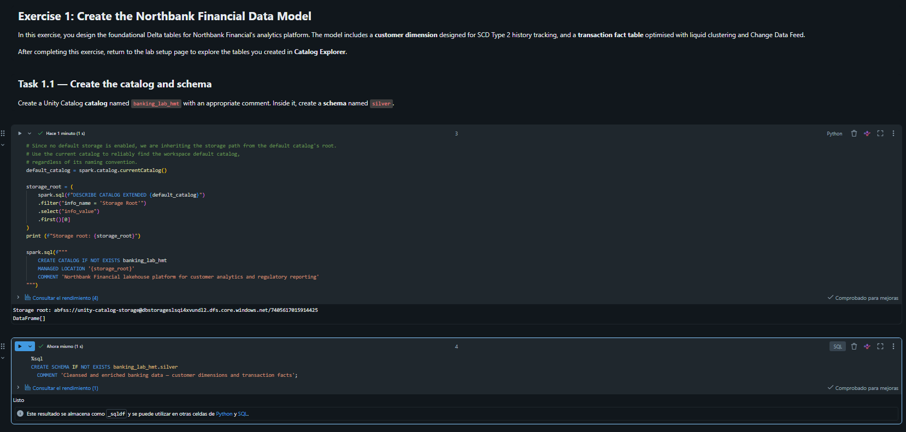

### Task 1.2 – Tabla `dim_customer` (SCD Tipo 2)  *(TODO)*

Propuesta (ajusta nombres de columnas a las del DataFrame del notebook en Task 2.1):

```sql
CREATE TABLE IF NOT EXISTS banking_lab.silver.dim_customer (
  customer_sk      BIGINT GENERATED ALWAYS AS IDENTITY,
  customer_id      STRING NOT NULL,
  customer_name    STRING,
  city             STRING,
  account_segment  STRING,
  account_type     STRING,
  valid_from       DATE,
  valid_to         DATE,
  is_current       BOOLEAN
)
CLUSTER BY (customer_id)
TBLPROPERTIES (delta.enableChangeDataFeed = true);
```

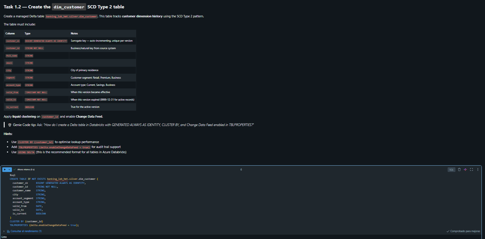

### Task 1.3 – Tabla `fact_transactions`  *(TODO)*

```sql
CREATE TABLE IF NOT EXISTS banking_lab.silver.fact_transactions (
  transaction_id    STRING NOT NULL,
  customer_id       STRING,
  transaction_date  DATE,
  amount            DECIMAL(18,2),
  currency          STRING DEFAULT 'GBP',
  transaction_type  STRING
)
CLUSTER BY (customer_id, transaction_date)
TBLPROPERTIES (
  delta.enableChangeDataFeed = true,
  delta.feature.allowColumnDefaults = 'supported'
);
```

> Compara con las columnas que use el `INSERT` de Task 3.1 y ajusta si difieren.

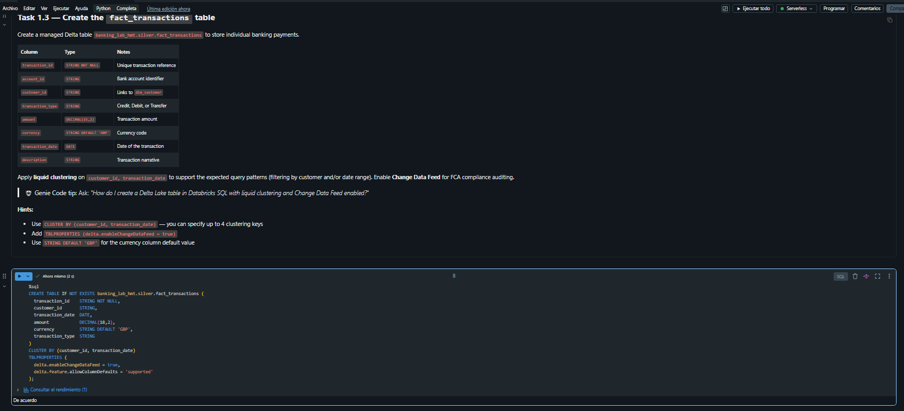

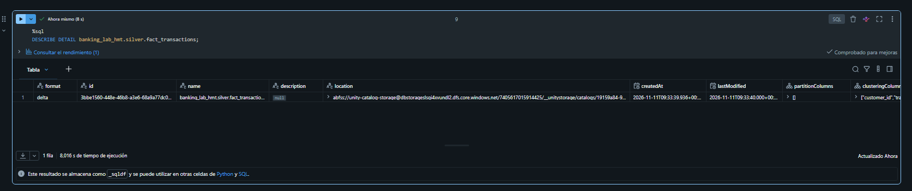
---

## 7. Task 2 – Managed vs External en Catalog Explorer

1. Barra lateral → **Catalog** → `banking_lab` → `silver`.
2. Abre **dim_customer** → pestaña **Details** → busca **Storage location** (gestionada por UC ⇒ tabla *managed*, porque no se indicó `LOCATION`).
3. Repite con **fact_transactions** y revisa la información de **Clustering**.

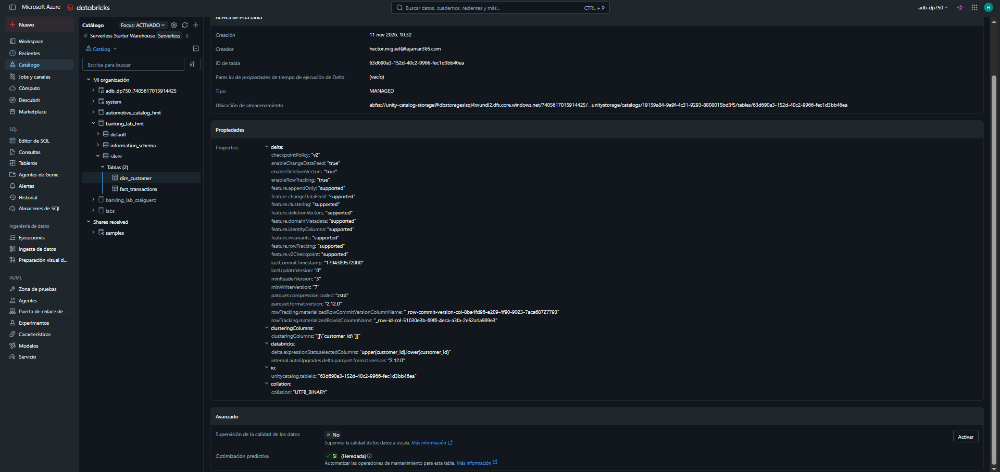
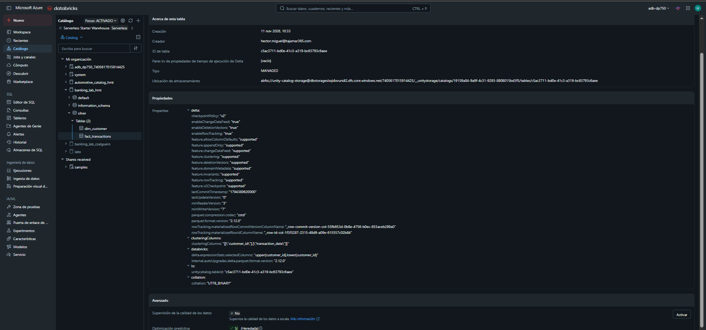

---

## 8. Exercise 2 – SCD Tipo 2 de clientes

### Task 2.1 – Carga inicial (DataFrame de 8 clientes)

Ejecuta la celda del notebook (escribe en `dim_customer` en modo *append*, `valid_from = 2020-01-01`, `valid_to = 9999-12-31`). Verificación:

```sql
SELECT * FROM banking_lab.silver.dim_customer ORDER BY customer_id;
```

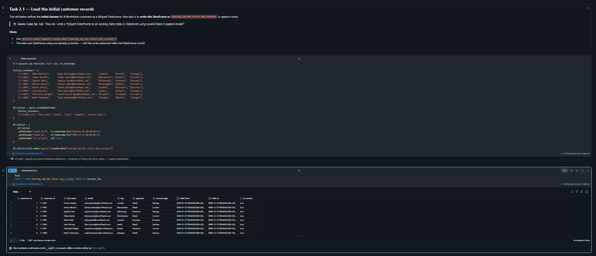

### Task 2.2 – Datos de staging

Ejecuta la celda del notebook (cambios en C-1001, C-1003, C-1006 y cliente nuevo C-1009) que registra la *temp view* de staging.

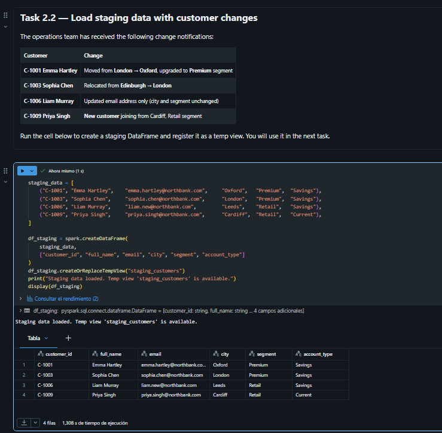

### Task 2.3 – MERGE + INSERT  *(TODOs)*

> `staging_customers` = nombre de la vista temporal que cree el notebook.

**Paso 1 – Cerrar los registros vigentes que cambiaron:**

```sql
MERGE INTO banking_lab.silver.dim_customer AS t
USING staging_customers AS s
  ON t.customer_id = s.customer_id AND t.is_current = true
WHEN MATCHED AND (
     t.city            <> s.city
  OR t.account_segment <> s.account_segment
  OR t.account_type    <> s.account_type
) THEN UPDATE SET
  t.valid_to   = current_date(),
  t.is_current = false;
```

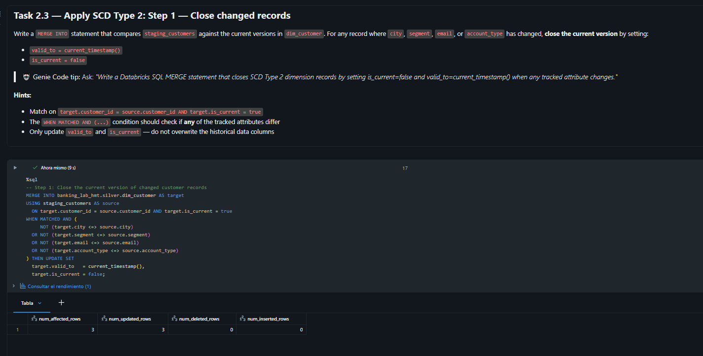

**Paso 2 – Insertar nuevas versiones y clientes nuevos:**

```sql
INSERT INTO banking_lab.silver.dim_customer
  (customer_id, customer_name, city, account_segment, account_type,
   valid_from, valid_to, is_current)
SELECT s.customer_id, s.customer_name, s.city, s.account_segment, s.account_type,
       current_date(), DATE'9999-12-31', true
FROM staging_customers s
LEFT JOIN banking_lab.silver.dim_customer t
  ON t.customer_id = s.customer_id AND t.is_current = true
WHERE t.customer_id IS NULL;   -- cambiados (ya cerrados) + nuevos
```

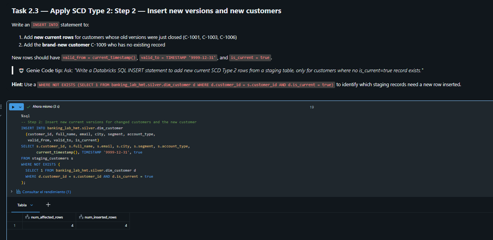

### Task 2.4 – Historial de C-1001

```sql
SELECT * FROM banking_lab.silver.dim_customer
WHERE customer_id = 'C-1001' ORDER BY valid_from;
```

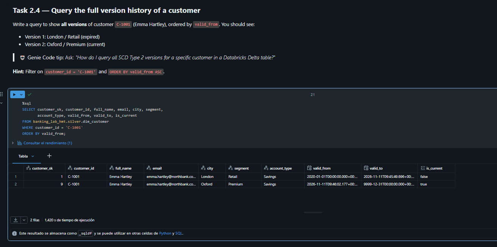

### Task 2.5 – Consulta point-in-time (2020-06-15)

```sql
SELECT * FROM banking_lab.silver.dim_customer
WHERE DATE'2020-06-15' >= valid_from AND DATE'2020-06-15' < valid_to;
```

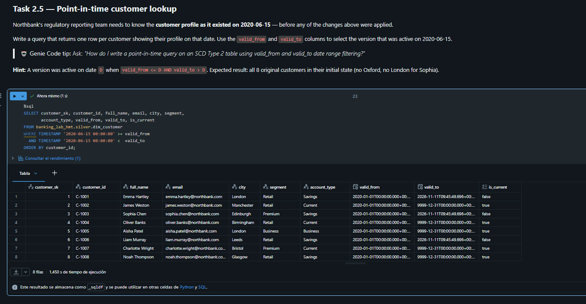

---

## 9. Exercise 3 – Change Data Feed y auditoría

### Task 3.1 – Insertar 10 transacciones (nov-2025)
Ejecuta la celda del notebook.

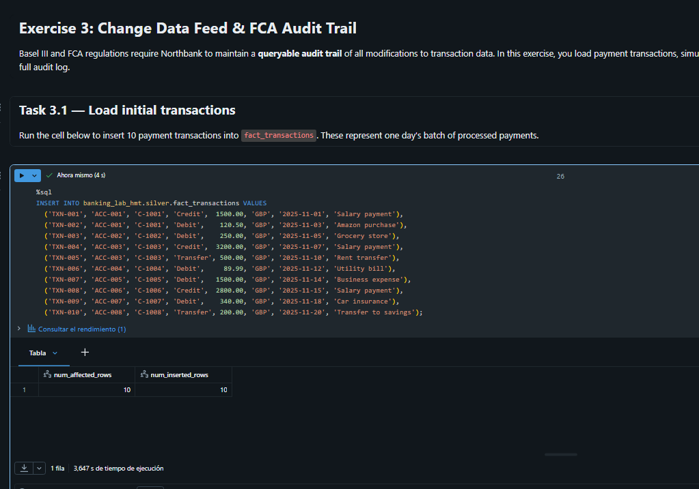

### Task 3.2 – Dos correcciones
Ejecuta las celdas del notebook: **TXN-003 → 275.50** y **TXN-007 → 1450.00** (dos `UPDATE` ⇒ dos versiones nuevas).

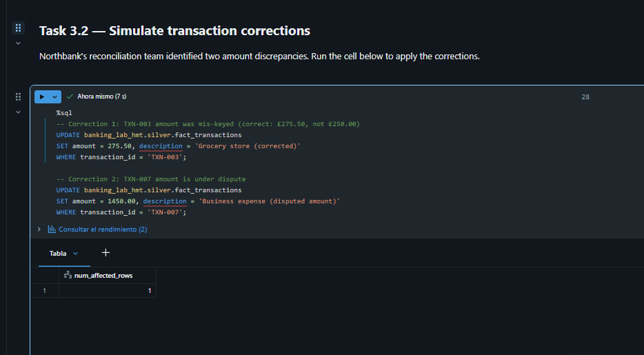

### Task 3.3 – `table_changes()`  *(TODO)*

```sql
SELECT *, _change_type, _commit_version, _commit_timestamp
FROM table_changes('banking_lab.silver.fact_transactions', 0)
ORDER BY _commit_timestamp, transaction_id;
```

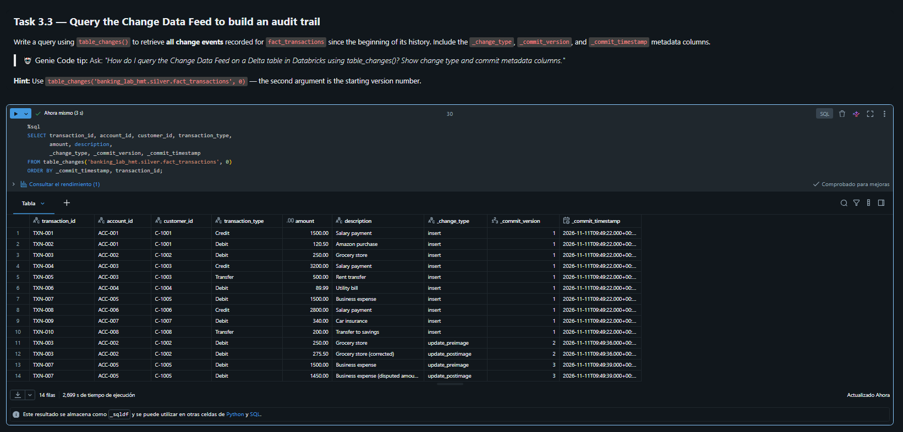

### Task 3.4 – Solo `update_postimage`

```sql
SELECT * FROM table_changes('banking_lab.silver.fact_transactions', 0)
WHERE _change_type = 'update_postimage'
ORDER BY transaction_id;
```

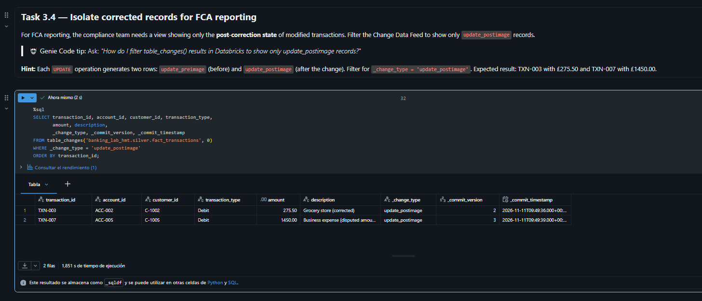

---

## 10. Exercise 4 – Time Travel

### Task 4.1 – Historial

```sql
DESCRIBE HISTORY banking_lab.silver.fact_transactions;
```

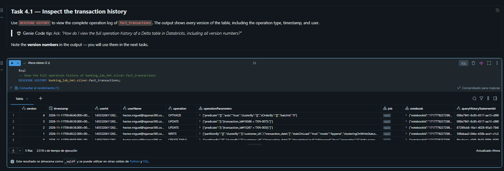

### Task 4.2 – Consultar la versión 1

```sql
SELECT transaction_id, amount
FROM banking_lab.silver.fact_transactions VERSION AS OF 1
WHERE transaction_id IN ('TXN-003', 'TXN-007');
```

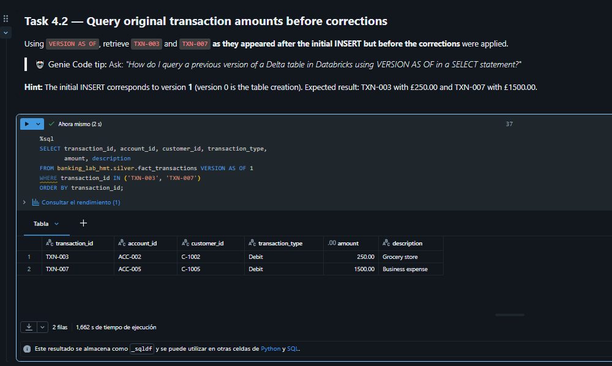

### Task 4.3 – Restaurar

```sql
RESTORE TABLE banking_lab.silver.fact_transactions TO VERSION AS OF 1;

SELECT transaction_id, amount
FROM banking_lab.silver.fact_transactions
WHERE transaction_id IN ('TXN-003', 'TXN-007');
```

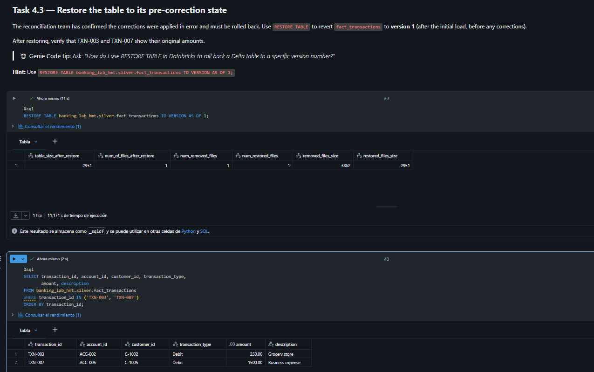

---

## 12. Limpieza

Si no vas a hacer más labs de Databricks hoy, borra el grupo de recursos para evitar cobros:

```bash
az group delete --name rg-dp750 --yes --no-wait
```

## 13. Problemas encontrados

| Error | Causa | Solución |
|---|---|---|
| `PERMISSION_DENIED: User does not have USE CATALOG on Catalog 'banking_lab'` al crear el esquema `silver` | `banking_lab` ya existía en el metastore compartido (creado por otra persona) y mi usuario no tenía permisos. El `CREATE CATALOG IF NOT EXISTS` no hizo nada y no creó un catálogo propio. | Crear un catálogo propio, `banking_lab_hmt`, con el mismo `MANAGED LOCATION`, y sustituir `banking_lab` por `banking_lab_hmt` en todo el notebook con *Find and replace → Replace all*. |
| `SCHEMA_NOT_FOUND: The schema banking_lab_hmt.silver cannot be found` al crear `dim_customer` | La celda que crea el esquema `silver` se eliminó por error al limpiar celdas duplicadas, así que el esquema no existía. | Añadir una celda nueva con `CREATE SCHEMA IF NOT EXISTS banking_lab_hmt.silver` y volver a ejecutar la creación de la tabla. |
| `dim_customer` vacía (0 filas) tras ejecutar la celda de carga del Task 2.1 | La celda terminaba en un `# TODO`: faltaba la sentencia que escribe el DataFrame en la tabla. | Completar el TODO con `df_initial.write.mode("append").saveAsTable("banking_lab_hmt.silver.dim_customer")`. |
| Columnas de `dim_customer` incompatibles con el DataFrame (`customer_name`/`account_segment`, sin `email`, fechas `DATE`) | Se creó la tabla antes de ver el DataFrame del notebook, que usa `full_name`, `email`, `segment` y `valid_from`/`valid_to` como `TIMESTAMP`. | Como la tabla estaba vacía, `DROP TABLE` y `CREATE TABLE` de nuevo con las columnas y tipos del DataFrame. |
| `[CAST_INVALID_INPUT] The value 'C-1001' of the type "STRING" cannot be cast to "DATE"` en el `INSERT` del Task 3.1 | El `INSERT` del notebook no lleva lista de columnas y las inserta por posición (`transaction_id, account_id, customer_id, transaction_type, amount, currency, transaction_date, description`). Mi `fact_transactions` tenía otro orden y le faltaban `account_id` y `description`. | Rechazar la sugerencia errónea de Genie Code, recrear `fact_transactions` con el orden de columnas del notebook y volver a ejecutar el `INSERT` original sin modificarlo. |