# Laboratorio 07 — Ingest Data into Unity Catalog (DP-750)

> **Autor:** Héctor Miguel Tudela · **Máster Big Data & IA – Tajamar**
> **Teoría:** https://learn.microsoft.com/en-us/training/modules/ingest-data-into-unity-catalog/
> **Laboratorio:** https://microsoftlearning.github.io/DP-750T00-Implement-Data-Engineering-Solutions-using-Azure-Databricks/Instructions/Labs/07-ingest-data-into-unity-catalog.html

---

## 1. Objetivo

Escenario: ingeniero de datos en **Solaris Energy** (parques solares y eólicos en Europa). Se construye una plataforma centralizada en Azure Databricks para consolidar lecturas de producción, eventos de turbinas y telemetría.

Objetivos del laboratorio:

- Crear una jerarquía de Unity Catalog (catálogo, esquemas y volumen).
- Cargar CSV desde un volumen gestionado a una tabla Delta con PySpark.
- Usar `COPY INTO` para cargas incrementales idempotentes.
- Crear tablas de resumen con `CREATE TABLE AS SELECT` (CTAS).
- Configurar Auto Loader para detectar y procesar archivos nuevos.

## 2. Entorno

| Elemento | Valor |
|---|---|
| Resource group | `rg-dp750` |
| Workspace | `adb-dp750` (Premium) |
| Cómputo | Serverless |
| Catálogo | `solaris_lab_hmt` (el notebook usa `solaris_lab`; se sustituyó con Find and replace) |
| Esquemas | `bronze`, `silver` |
| Volumen | `solaris_lab_hmt.bronze.raw_files` |

---

## Task 1 — Preparar el notebook

1. Acceso al workspace `adb-dp750`.
2. Importación del notebook `07-ingest-data-into-unity-catalog.ipynb` desde URL (Workspace → carpeta → Import → URL).
3. Cómputo **Serverless** seleccionado.
4. Find and replace: `solaris_lab` → `solaris_lab_hmt`.

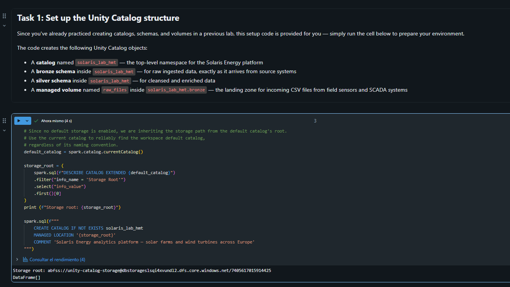

---

## Task 2 — Ejercicio 1: Jerarquía del catálogo

```sql
CREATE CATALOG IF NOT EXISTS solaris_lab_hmt;

CREATE SCHEMA IF NOT EXISTS solaris_lab_hmt.bronze;
CREATE SCHEMA IF NOT EXISTS solaris_lab_hmt.silver;

CREATE VOLUME IF NOT EXISTS solaris_lab_hmt.bronze.raw_files;
```

Después se ejecuta la celda proporcionada que genera `solar_readings.csv` y `turbine_events.csv` en `/Volumes/solaris_lab_hmt/bronze/raw_files/`.

Verificación:

```sql
SHOW SCHEMAS IN solaris_lab_hmt;
LIST '/Volumes/solaris_lab_hmt/bronze/raw_files/';
```

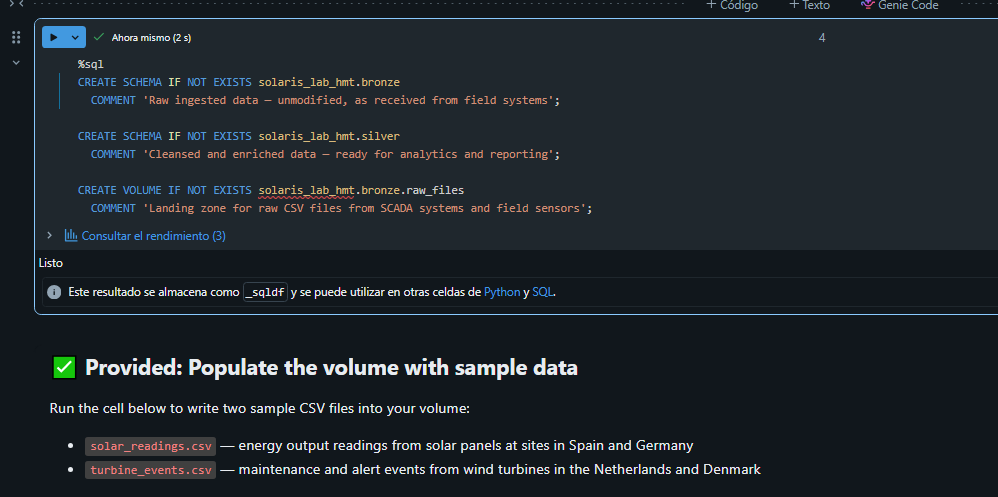
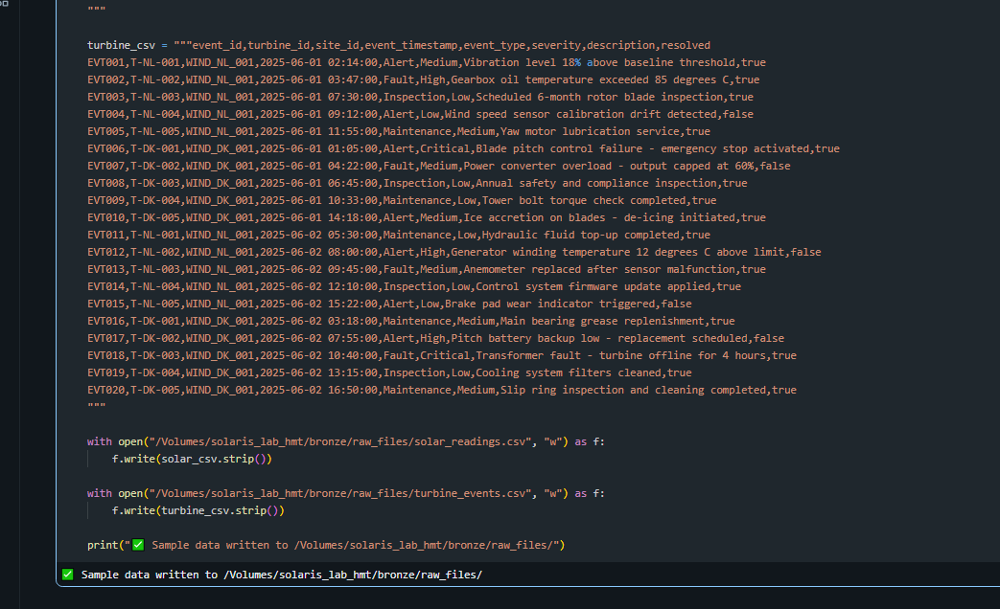
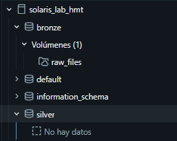
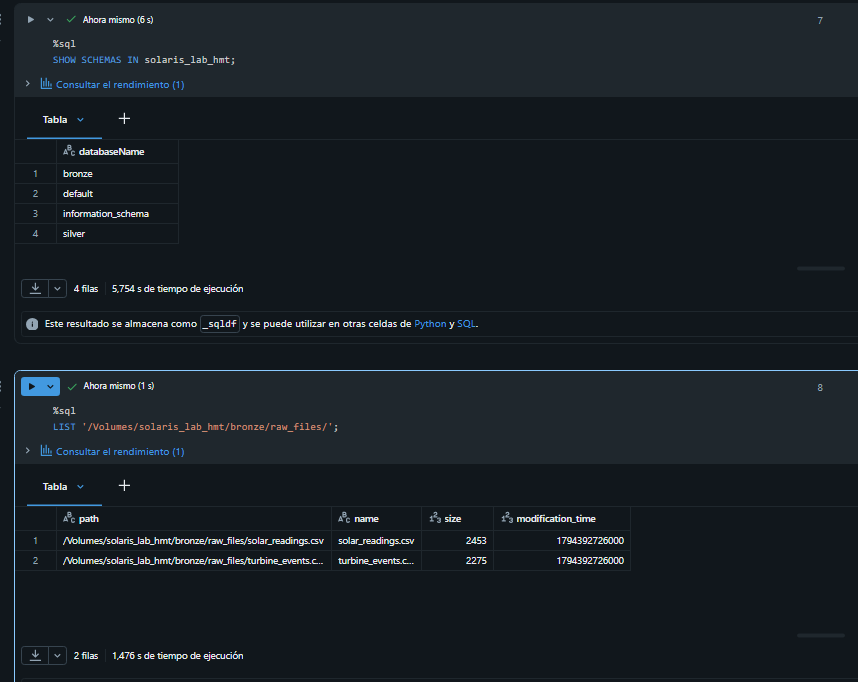

---

## Task 3 — Ejercicio 2: Ingesta batch con DataFrames (PySpark)

Pasos:

1. Leer `solar_readings.csv` en `df_solar` (cabecera + inferencia de esquema).
2. Revisar esquema y muestra de datos.
3. Escribir la tabla Delta `solaris_lab_hmt.bronze.solar_readings` en modo `overwrite`.
4. Verificar el total de filas y las filas con `status = 'Fault'`.

```python
# (completar con el código final de las celdas del notebook)
```

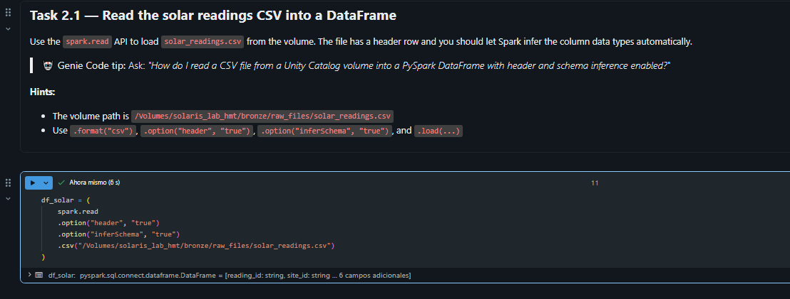

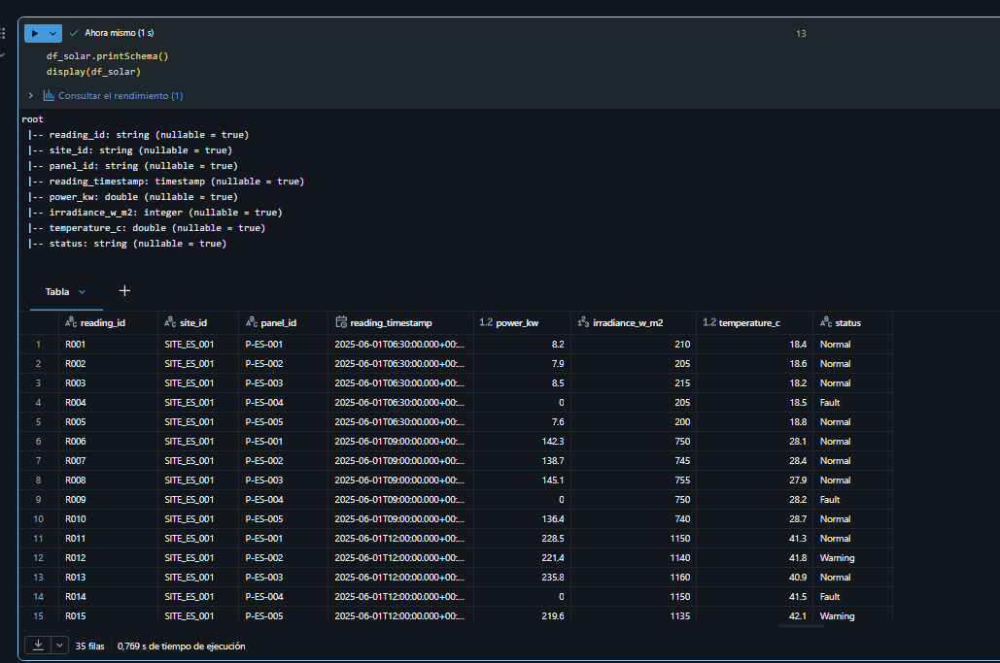

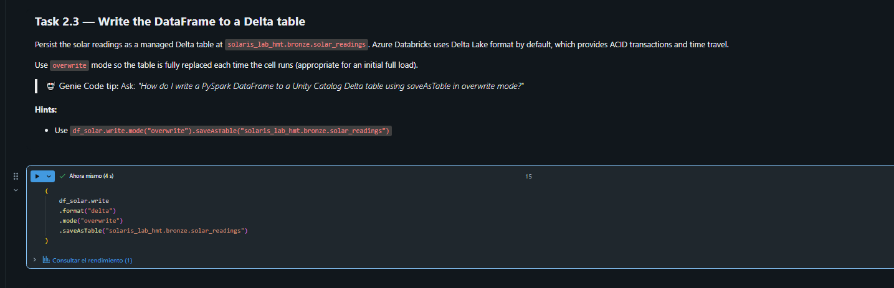


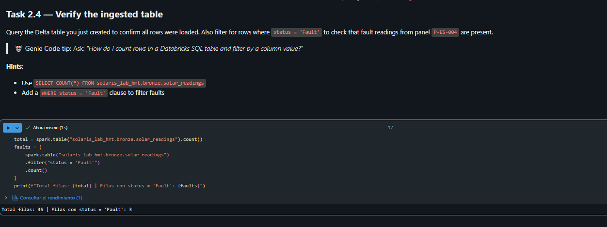

---

## Task 4 — Ejercicio 3: Ingesta con SQL (COPY INTO y CTAS)

Pasos:

1. Crear `solaris_lab_hmt.bronze.turbine_events` con 8 columnas: `event_id`, `turbine_id`, `site_id`, `event_timestamp`, `event_type`, `severity`, `description`, `resolved`.
2. Cargar `turbine_events.csv` con `COPY INTO`.
3. Ejecutar `COPY INTO` de nuevo y comprobar que el nº de filas **no cambia** (idempotencia).
4. Crear la tabla silver `solaris_lab_hmt.silver.daily_solar_production` con CTAS, agregando por fecha y sitio: `reading_date`, `site_id`, `total_power_kw`, `avg_irradiance`, `fault_count`.

```sql
-- (completar con el SQL final de las celdas del notebook)
```

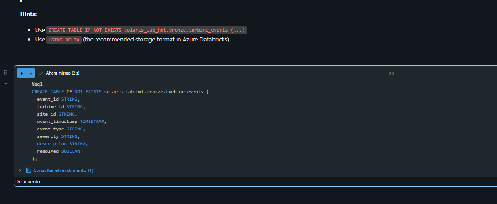

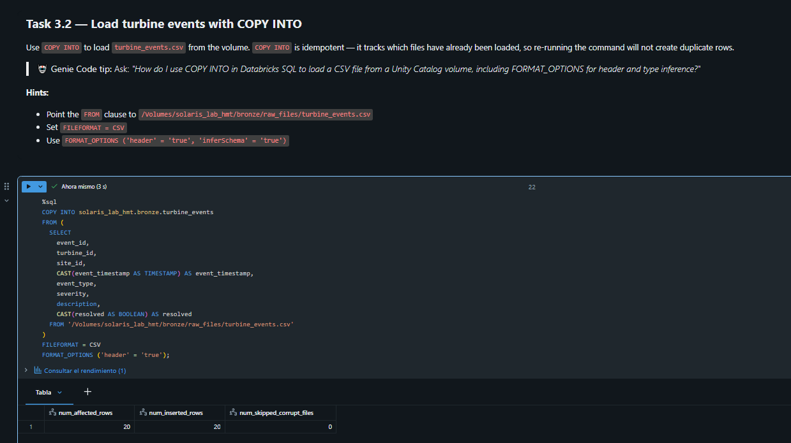

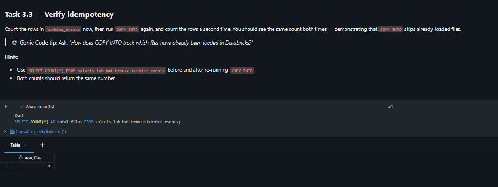
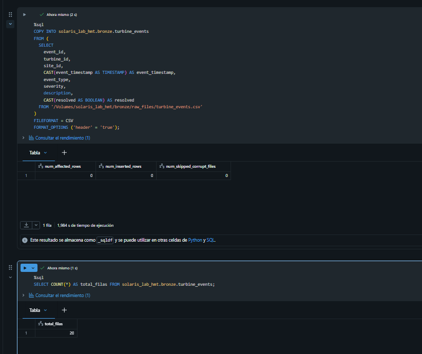

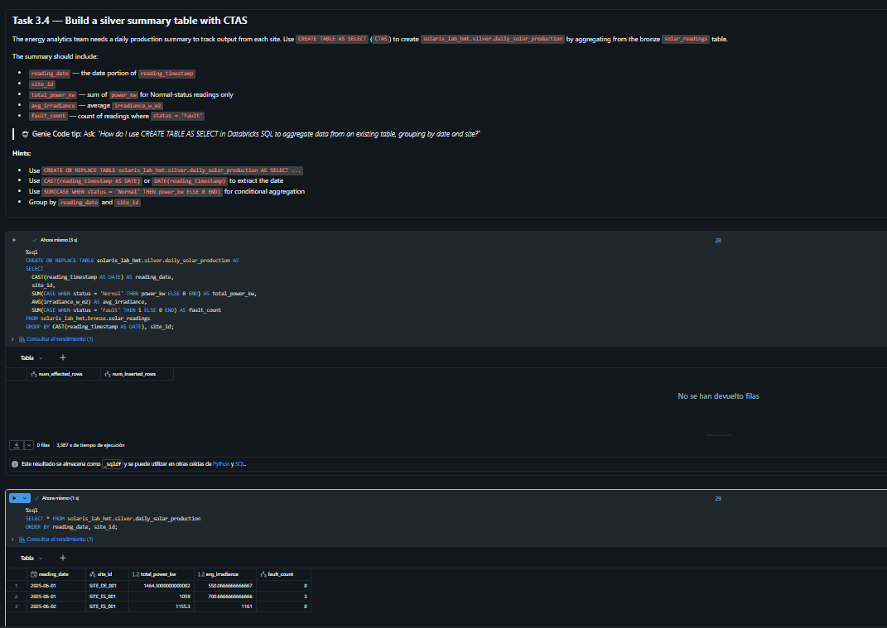

---

## Task 5 — Ejercicio 4: Auto Loader

Pasos:

1. Ejecutar la celda que genera `wave_1.csv`, `wave_2.csv`, `wave_3.csv` en `/Volumes/solaris_lab_hmt/bronze/raw_files/incoming/`.
2. Configurar `spark.readStream` con formato `cloudFiles`, CSV, inferencia de tipos y `schemaLocation` = `/Volumes/solaris_lab_hmt/bronze/raw_files/schema`.
3. Escribir en `solaris_lab_hmt.bronze.solar_readings_stream` con `trigger(availableNow=True)` y `checkpointLocation` = `/Volumes/solaris_lab_hmt/bronze/raw_files/checkpoint`.
4. Verificar **15 filas** y que una segunda ejecución **no crea duplicados**.

```python
# (completar con el código final de las celdas del notebook)
```

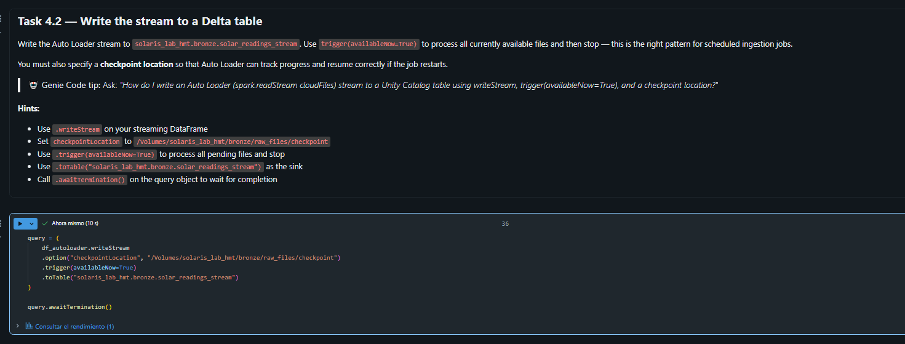
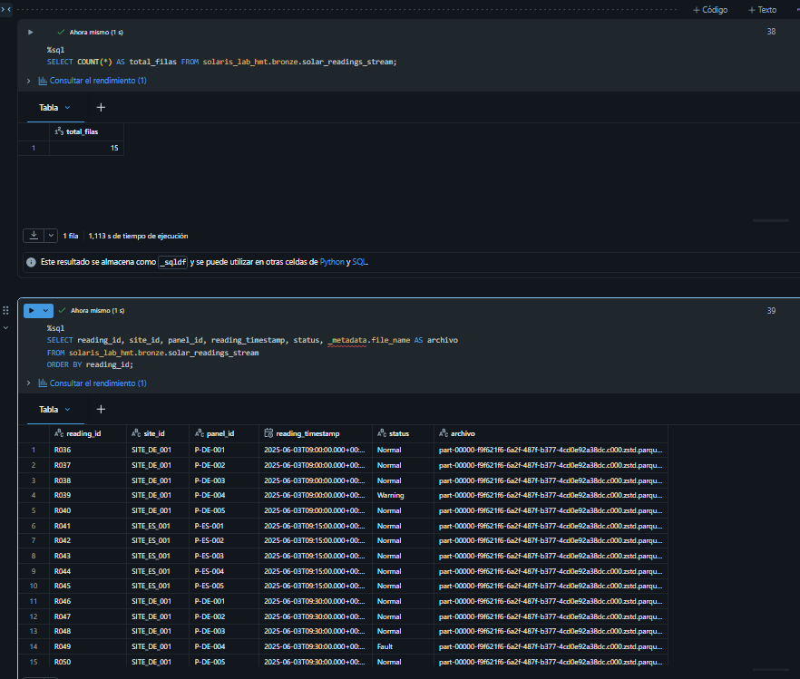

---

## 6. Conceptos clave

- **Volumen gestionado:** almacenamiento de archivos gobernado por Unity Catalog (`/Volumes/<catálogo>/<esquema>/<volumen>/`).
- **COPY INTO:** carga incremental idempotente; recuerda qué archivos ya cargó y no los duplica.
- **CTAS:** crea una tabla a partir del resultado de una consulta (capa silver agregada).
- **Auto Loader (`cloudFiles`):** detecta archivos nuevos de forma incremental; el `checkpointLocation` guarda el progreso y el `schemaLocation` el esquema inferido.
- **`trigger(availableNow=True)`:** procesa todo lo pendiente y termina (estilo batch sobre un stream).

## 7. Problemas encontrados

| Error | Causa | Solución |
|---|---|---|
| `[PARSE_SYNTAX_ERROR] Syntax error at or near '%'. SQLSTATE: 42601` al verificar el Task 2 con `%sql SHOW SCHEMAS ...` y `%fs ls ...` | Se pusieron dos comandos mágicos (`%sql` y `%fs`) en la misma celda. Solo la primera línea puede llevar el magic, así que la segunda línea (`%fs ls ...`) se interpretó como SQL y falló en el `%`. | Separar la verificación: dejar `SHOW SCHEMAS IN solaris_lab_hmt;` en una celda `%sql` y comprobar los archivos del volumen con `LIST '/Volumes/solaris_lab_hmt/bronze/raw_files/';` en otra celda (o con `dbutils.fs.ls(...)` en Python). |
| `SyntaxError: invalid syntax` al ejecutar `SHOW SCHEMAS IN solaris_lab_hmt;` | El notebook es de Python y la celda no llevaba `%sql` en la primera línea, así que Databricks interpretó la sentencia SQL como código Python. | Añadir `%sql` como primera línea de la celda. Regla para todo el lab: SQL con `%sql` arriba, PySpark sin magic. |
| `[DELTA_FAILED_TO_MERGE_FIELDS] Failed to merge fields 'event_timestamp' and 'event_timestamp'. SQLSTATE: 22005` en el `COPY INTO` de `turbine_events` (Task 3.2) | `COPY INTO` lee el CSV con todas las columnas como `STRING`, pero la tabla `turbine_events` define `event_timestamp` como `TIMESTAMP` (y `resolved` como `BOOLEAN`). Delta no puede unir esos dos tipos. | Convertir los tipos dentro del propio `COPY INTO` con un `SELECT` y `CAST(event_timestamp AS TIMESTAMP)` y `CAST(resolved AS BOOLEAN)`. La tabla no se había cargado, así que no hubo que limpiar nada. Se usó el mismo comando en el Task 3.3 para demostrar la idempotencia. |

## 8. Limpieza

No se elimina `rg-dp750`. Opcional, si se quiere borrar el catálogo del lab:

```sql
-- DROP CATALOG IF EXISTS solaris_lab_hmt CASCADE;
```

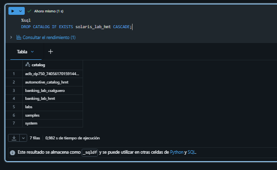
