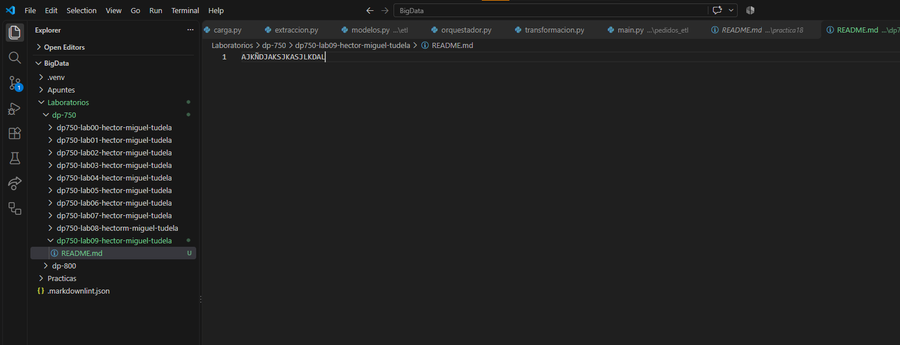

# Laboratorio 09 — Implement and Manage Data Quality Constraints in Unity Catalog (DP-750)

> **Autor:** Héctor Miguel Tudela · **Máster Big Data & IA – Tajamar**
> **Laboratorio:** https://microsoftlearning.github.io/DP-750T00-Implement-Data-Engineering-Solutions-using-Azure-Databricks/Instructions/Labs/09-implement-manage-data-quality-constraints-unity-catalog.html

---

## Objetivo

Escenario: ingeniero de datos en **ClearCover Insurance**, una aseguradora. Los ficheros de siniestros (*claims*) llegan con IDs vacíos, fechas ilegibles, importes `N/A` o negativos y estados no válidos. Hay que evitar que esos registros lleguen a los modelos actuariales y a los dashboards.

Se construye un **Lakeflow Spark Declarative Pipeline** que aplica calidad de datos en cada capa (bronze → silver → gold):

- Explorar los problemas de calidad de la tabla bronze.
- Definir **expectations** con tres acciones distintas: avisar (`expect`), descartar la fila (`expect_or_drop`) y abortar el pipeline (`expect_or_fail`).
- Validar y convertir tipos de datos (`claim_date` → `DATE`, `claim_amount` → `DECIMAL(12,2)`).
- Gestionar *schema drift* con Auto Loader y la columna `_rescued_data`.
- Ejecutar el pipeline y revisar las métricas en la pestaña **Data quality**.

## Entorno

| Elemento | Valor |
|---|---|
| Resource group | `rg-dp750` |
| Workspace | `adb-dp750` (Premium) |
| Cómputo | Serverless |
| Catálogo | `insurance_lab_hmt` — el notebook original usa `insurance_lab`; se sustituye con Find and replace por `insurance_lab_hmt` (mismo criterio que los labs 06 y 08, por si el nombre ya existe en el metastore compartido). **Confirmar antes de entregar que es el nombre realmente usado.** |
| Esquemas | `bronze`, `silver`, `gold` |
| Volumen | `insurance_lab_hmt.bronze.raw_files` |
| Tabla bronze | `claims_raw` (20 registros) |
| Pipeline | **ClearCover Claims Quality Pipeline** (modo *Triggered*) |
| Tablas del pipeline | `silver.claims_validated`, `silver.claims_rescued`, `gold.claims_summary` |

## Teoría resumida

| Concepto | Idea principal |
|---|---|
| Expectation | Restricción de calidad declarada sobre un dataset del pipeline |
| `@dp.expect` | Registra la violación en las métricas pero **conserva** la fila |
| `@dp.expect_or_drop` | **Descarta** las filas que no cumplen la condición |
| `@dp.expect_or_fail` | **Detiene** el pipeline si alguna fila no cumple |
| Rescued data column | Captura en JSON las columnas inesperadas o con tipo no válido en vez de fallar |

---

## Ejercicio 1 — Preparar la plataforma

### Preparar el notebook

1. Workspace → carpeta del lab → menú **⋮** → **Import** → **URL**.
2. Pegar la URL del notebook:
   `https://raw.githubusercontent.com/MicrosoftLearning/DP-750T00-Implement-Data-Engineering-Solutions-using-Azure-Databricks/refs/heads/main/Allfiles/09-implement-manage-data-quality-constraints-unity-catalog.ipynb`
3. Abrir el notebook y elegir cómputo **Serverless**.
4. **Find and replace** → *Replace all*: `insurance_lab` → `insurance_lab_hmt`.



### Ejecutar el notebook

Se ejecutan **todas las celdas**, de arriba a abajo. Crean:

- Catálogo `insurance_lab_hmt`
- Esquemas `bronze`, `silver` y `gold`
- Volumen `insurance_lab_hmt.bronze.raw_files` (zona de aterrizaje de los CSV de siniestros)
- Tabla Delta `insurance_lab_hmt.bronze.claims_raw` con 20 registros

Verificación en **Catalog Explorer**: los tres esquemas, el volumen y la tabla `claims_raw`.

📸 **Captura:** Catalog Explorer con el catálogo, esquemas, volumen y tabla creados.


---

## Ejercicio 2 — Explorar los problemas de calidad

### Task 2.1 — Localizar registros problemáticos

```sql
%sql
SELECT *
FROM insurance_lab_hmt.bronze.claims_raw
ORDER BY claim_id NULLS LAST;
```

Hay que encontrar al menos una fila de cada tipo de problema:

| Problema | Columna |
|---|---|
| Valor ausente | `claim_id` o `customer_id` |
| Fecha no interpretable | `claim_date` |
| Importe `N/A` o vacío | `claim_amount` |
| Importe negativo | `claim_amount` |
| Estado fuera de `OPEN`, `PENDING`, `CLOSED` | `status` |

📸 **Captura:** resultado de la consulta con las filas problemáticas.


### Task 2.2 — Comprobar los tipos

```sql
%sql
DESCRIBE TABLE insurance_lab_hmt.bronze.claims_raw;
```

`claim_date` y `claim_amount` son `STRING`. Es intencionado: en bronze se guarda el dato tal como llega y la conversión se hace en silver.

📸 **Captura:** salida de `DESCRIBE TABLE`.


---

## Ejercicio 3 — Nulabilidad y validación de estado

### Task 3.0 — Crear el pipeline

1. Importar en el workspace el fichero de partida:
   `https://raw.githubusercontent.com/MicrosoftLearning/DP-750T00-Implement-Data-Engineering-Solutions-using-Azure-Databricks/refs/heads/main/Allfiles/09-implement-manage-data-quality-constraints.py`
2. **Jobs & Pipelines** → **Create ETL pipeline** (Python).
3. Configuración (icono de engranaje):

| Ajuste | Valor |
|---|---|
| Pipeline name | `ClearCover Claims Quality Pipeline` |
| Mode | Triggered |
| Target catalog | `insurance_lab_hmt` |
| Target schema | `silver` |
| Compute | Serverless |

4. En el explorador de assets de la izquierda, **Import** del `.py` como código fuente del pipeline. Se mantiene abierto durante los ejercicios 3 a 5.
5. Abrir el `.py` y hacer **Find and replace** → *Replace all*: `insurance_lab` → `insurance_lab_hmt` (el fichero original referencia el catálogo `insurance_lab`; sin este cambio el pipeline apuntaría a un catálogo que no es el del lab).

📸 **Captura:** configuración del pipeline.


### Task 3.1 — Expectations en `claims_validated()`

Los decoradores de expectations van **justo debajo de `@dp.table(...)` y encima de `def claims_validated():`**.

| Nombre | Condición | Acción |
|---|---|---|
| `valid_claim_id` | `claim_id IS NOT NULL` | Descartar (`@dp.expect_or_drop`) |
| `valid_customer_id` | `customer_id IS NOT NULL` | Descartar (`@dp.expect_or_drop`) |
| `valid_status` | `status IN ('OPEN', 'PENDING', 'CLOSED')` | Avisar y conservar (`@dp.expect`) |
| `valid_coverage` | `coverage_amount > 0` | Fallar el pipeline (`@dp.expect_or_fail`) |

```python
@dp.table(name="claims_validated")
@dp.expect_or_drop("valid_claim_id", "claim_id IS NOT NULL")
@dp.expect_or_drop("valid_customer_id", "customer_id IS NOT NULL")
@dp.expect("valid_status", "status IN ('OPEN', 'PENDING', 'CLOSED')")
@dp.expect_or_fail("valid_coverage", "coverage_amount > 0")
def claims_validated():
    ...
```

---

## Ejercicio 4 — Comprobaciones de tipo

### Task 4.1 — Conversión de tipos

Dentro de `claims_validated()`, antes del `return`, se reemplazan las columnas originales:

```python
.withColumn("claim_date", col("claim_date").cast("date"))
.withColumn("claim_amount", col("claim_amount").cast("decimal(12,2)"))
```

### Task 4.2 – 4.4 — Expectations sobre los valores convertidos

| Task | Nombre | Condición | Acción |
|---|---|---|---|
| 4.2 | `valid_claim_date` | `claim_date IS NOT NULL` | `@dp.expect_or_drop` |
| 4.3 | `valid_claim_amount` | `claim_amount IS NOT NULL` | `@dp.expect_or_drop` |
| 4.4 | `non_negative_amount` | `claim_amount >= 0` | `@dp.expect_or_drop` |

```python
@dp.expect_or_drop("valid_claim_date", "claim_date IS NOT NULL")
@dp.expect_or_drop("valid_claim_amount", "claim_amount IS NOT NULL")
@dp.expect_or_drop("non_negative_amount", "claim_amount >= 0")
```

El orden de los decoradores no afecta al resultado. Un `cast()` que no puede convertir el valor devuelve `NULL`, y por eso se valida con `IS NOT NULL` después de la conversión.

📸 **Captura:** código completo de `claims_validated()` con todas las expectations.


---

## Ejercicio 5 — Schema drift con `_rescued_data`

### Task 5.1 — Completar `claims_rescued()`

Se elimina el `pass` y se devuelve un `readStream` de Auto Loader con estas opciones:

| Opción | Valor |
|---|---|
| Ruta de origen | `/Volumes/insurance_lab_hmt/bronze/raw_files/` |
| `cloudFiles.format` | `csv` |
| `header` | `true` |
| `cloudFiles.schemaLocation` | `/Volumes/insurance_lab_hmt/bronze/raw_files/_schema` |
| `cloudFiles.schemaEvolutionMode` | `rescue` |
| `rescuedDataColumn` | `_rescued_data` |
| `cloudFiles.inferColumnTypes` | `true` |

```python
return (
    spark.readStream.format("cloudFiles")
    .option("cloudFiles.format", "csv")
    .option("header", "true")
    .option("cloudFiles.schemaLocation", "/Volumes/insurance_lab_hmt/bronze/raw_files/_schema")
    .option("cloudFiles.schemaEvolutionMode", "rescue")
    .option("rescuedDataColumn", "_rescued_data")
    .option("cloudFiles.inferColumnTypes", "true")
    .load("/Volumes/insurance_lab_hmt/bronze/raw_files/")
)
```

Si en el futuro llegan ficheros con columnas nuevas (por ejemplo `broker_reference` o `fraud_score`), se guardan como JSON en `_rescued_data` en lugar de romper el pipeline.

📸 **Captura:** función `claims_rescued()` completada.


---

## Ejercicio 6 — Ejecutar y monitorizar

### Task 6.1 — Guardar el fichero

Guardar el `.py` en el workspace.

### Task 6.2 — Ejecución completa

Pulsar **Start**. El DAG debe mostrar tres datasets: `silver.claims_validated`, `silver.claims_rescued` y `gold.claims_summary`.

📸 **Captura:** DAG del pipeline con los tres datasets.


### Task 6.3 — Revisar la calidad de datos

Abrir el nodo `claims_validated` → pestaña **Data quality** y responder:

| Pregunta | Respuesta |
|---|---|
| ¿Qué expectations descartaron filas y cuántas? | COMPLETAR TRAS EJECUTAR |
| ¿Qué expectation emitió aviso (`warn`)? | COMPLETAR TRAS EJECUTAR |
| ¿Falló `valid_coverage`? | COMPLETAR TRAS EJECUTAR |

Si `valid_coverage` falla, se buscan en `bronze.claims_raw` las filas con `coverage_amount` a cero o `NULL`; el *event log* muestra el registro que viola la regla.

📸 **Captura:** pestaña **Data quality** de `claims_validated`.


### Task 6.4 — Verificación con SQL

**Recuento de filas válidas:**

```sql
%sql
SELECT COUNT(*) AS valid_claim_count
FROM insurance_lab_hmt.silver.claims_validated;
```

claims_raw (20 filas) → claims_validated (**X** filas): **N** filas descartadas por las expectations. *(COMPLETAR TRAS EJECUTAR: X y N)*

📸 **Captura:** resultado del recuento.


**Filas por tipo de siniestro y estado:**

```sql
%sql
SELECT claim_type, status, COUNT(*) AS count
FROM insurance_lab_hmt.silver.claims_validated
GROUP BY claim_type, status
ORDER BY claim_type, status;
```

📸 **Captura:** resultado por `claim_type` y `status`.


**Tabla gold:**

```sql
%sql
SELECT *
FROM insurance_lab_hmt.gold.claims_summary
ORDER BY claim_type, status;
```

📸 **Captura:** contenido de `gold.claims_summary`.


**Datos rescatados:**

```sql
%sql
SELECT claim_id, _rescued_data
FROM insurance_lab_hmt.silver.claims_rescued
WHERE _rescued_data IS NOT NULL;
```

📸 **Captura:** filas con `_rescued_data` no nulo.


---

## Conceptos clave

- **`@dp.expect`:** solo mide; las filas inválidas se conservan y se cuentan en las métricas.
- **`@dp.expect_or_drop`:** elimina las filas inválidas; adecuado para claves nulas, fechas o importes no convertibles.
- **`@dp.expect_or_fail`:** detiene la actualización del pipeline; adecuado para reglas críticas como `coverage_amount > 0`.
- **Bronze en `STRING`, silver tipado:** bronze conserva el dato crudo; la conversión (`cast`) y la validación se hacen al pasar a silver.
- **`cast` fallido → `NULL`:** por eso se combina la conversión con `IS NOT NULL` en una expectation.
- **`_rescued_data`:** recoge el drift de esquema en JSON sin romper la ingesta.
- **Pestaña Data quality:** muestra por expectation cuántas filas pasaron, fueron descartadas o dieron aviso.

## Problemas encontrados

| Error | Causa | Solución |
|---|---|---|
| *(Ejemplo, rellenar solo si ocurrió)* El pipeline termina en **Failed** con el error de la expectation `valid_coverage` (`expect_or_fail`) | Hay filas en `claims_raw` con `coverage_amount` a `0` o `NULL`; el registro que viola la regla aparece en el event log | COMPLETAR TRAS EJECUTAR: qué se hizo para que el pipeline terminara (p. ej. corregir o excluir esas filas de origen, o cambiar la acción de la expectation) |
| COMPLETAR TRAS EJECUTAR | | |

## Limpieza

No se elimina `rg-dp750`. Opcional, para borrar el catálogo del lab:

```sql
%sql
-- DROP CATALOG IF EXISTS insurance_lab_hmt CASCADE;
```
