# Laboratorio 11 – Implement Lakeflow Jobs with Azure Databricks (DP-750)

> **Autor:** Héctor Miguel Tudela · **Máster Big Data & IA – Tajamar**
> **Laboratorio:** https://microsoftlearning.github.io/DP-750T00-Implement-Data-Engineering-Solutions-using-Azure-Databricks/Instructions/Labs/11-implement-lakeflow-jobs.html

---

## 1. Escenario

Somos ingenieros de datos en **TelConnect**, un operador de telecomunicaciones regional. Los **CDR** (Call Detail Records) deben recorrer una arquitectura medallion **Bronze → Silver → Gold** y automatizarse con **Lakeflow Jobs**.

| Requisito | Solución en el lab |
|---|---|
| Procesar CDRs por capas | Notebook parametrizado con el widget `processing_date` |
| Encadenar el procesado con un resumen SQL | Job con 2 tareas dependientes: `process_cdrs → summarize_gold` |
| Ejecutar cuando llegan ficheros | Trigger **File arrival** sobre un Volume |
| Ejecución nocturna fija | Trigger **Scheduled** con cron `0 0 2 * * ?` (Europe/Amsterdam) |
| Enterarse de los fallos | Notificaciones por email, reintentos y timeout |

## 2. Objetivos

1. Ejecutar un notebook medallion parametrizado (Bronze, Silver, Gold).
2. Crear un Lakeflow Job con dos tareas dependientes.
3. Pasar un parámetro dinámico `processing_date`.
4. Configurar un trigger de llegada de ficheros y otro programado (cron).
5. Configurar notificaciones de fallo, reintentos y timeout.
6. Monitorizar una ejecución y revisar los *task values*.

## 3. Requisitos previos

- Workspace Azure Databricks **Premium** (Lab 00) con Unity Catalog.
- Permiso para crear catálogos y esquemas.
- PySpark y Spark SQL básicos.

> ⚠️ **Nombre del catálogo:** `telconnect_lab` ya existía en el metastore compartido (creado por otro alumno), así que en todo el lab se ha usado **`telconnect_lab_hmt`**. Ver el apartado de problemas encontrados.

---

## 4. Parte 1 – Ejecutar el notebook de la pipeline

### Task 1.1 – Importar el notebook

1. **Workspace** → menú **⋮** → **Importar** → **URL**.
2. URL (raw, no la de `github.com/.../blob/...`):
   `https://raw.githubusercontent.com/MicrosoftLearning/DP-750T00-Implement-Data-Engineering-Solutions-using-Azure-Databricks/refs/heads/main/Allfiles/11-implement-lakeflow-jobs.ipynb`
3. Abrir el notebook `11-implement-lakeflow-jobs` y conectar compute **Serverless**.

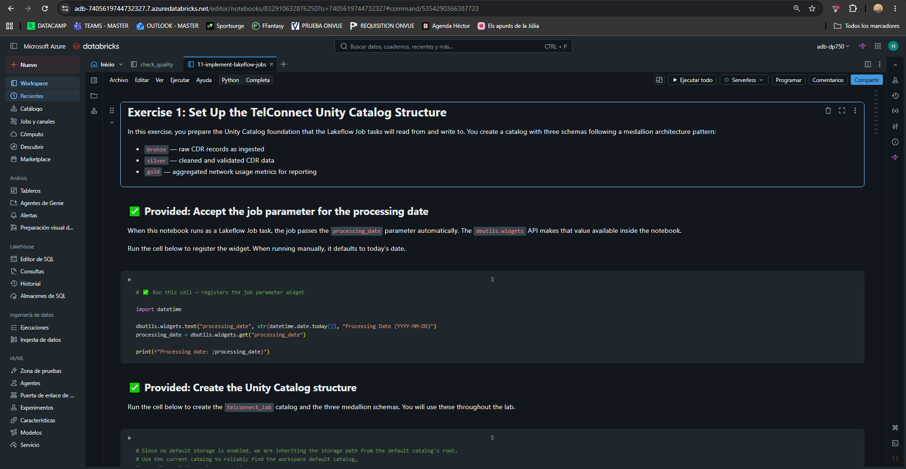

### Exercise 1 – Estructura de Unity Catalog

Celdas "Provided": registran el widget `processing_date` (por defecto, la fecha de hoy → `2026-11-17`) y crean el catálogo y los esquemas `bronze`, `silver` y `gold`.

Al ejecutar la celda con el nombre original dio `PERMISSION_DENIED` (el catálogo era de otro usuario). Se sustituyó `telconnect_lab` por `telconnect_lab_hmt` con **Editar → Buscar y reemplazar** y se volvió a ejecutar:

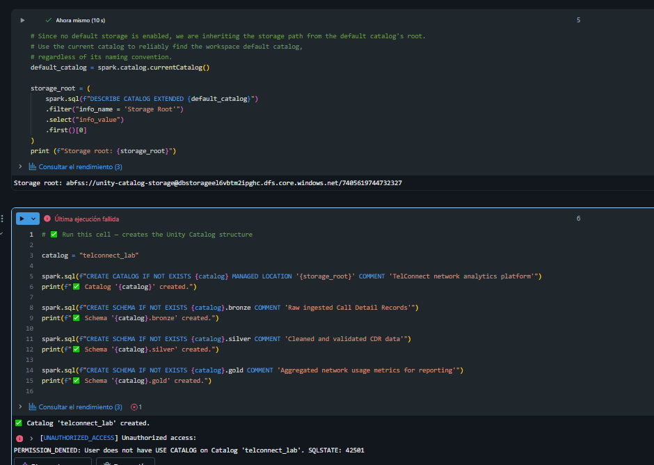

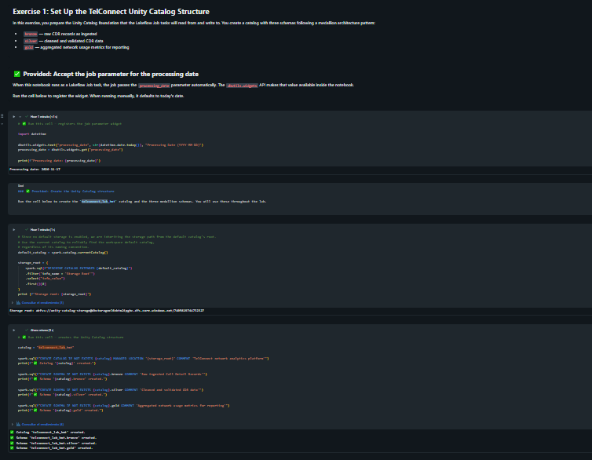

### Exercise 2 – Ingesta Bronze

- Se crea el volume `telconnect_lab_hmt.bronze.raw_uploads` y se descarga `telecom_cdrs.csv`.
- Se lee el CSV con un esquema explícito de 14 columnas: **30 registros**.
- Se guarda como tabla Delta `telconnect_lab_hmt.bronze.cdr_bronze` (**30 registros**).

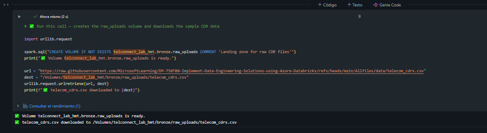

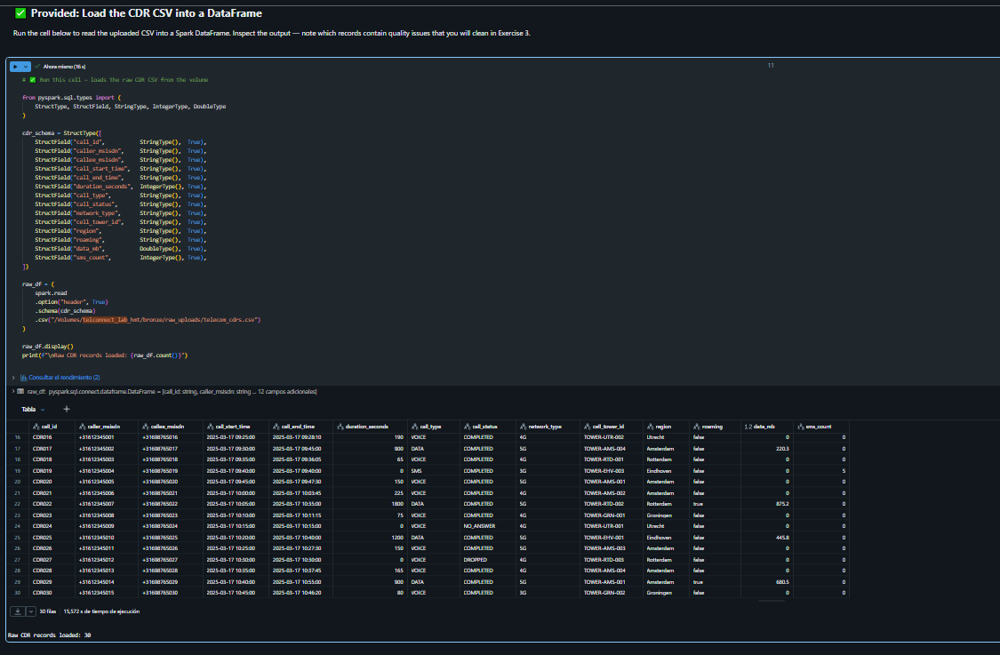

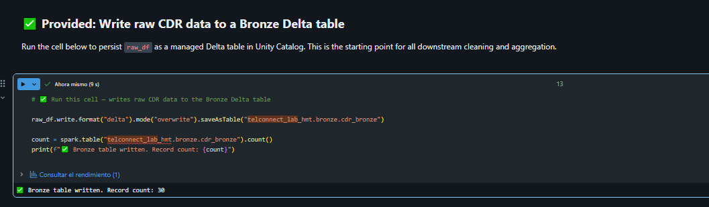

### Exercise 3 – Limpieza Silver

Cuatro reglas de calidad sobre `bronze_df`:

| Regla | Condición |
|---|---|
| 1 | Descartar `duration_seconds < 0` |
| 2 | Descartar VOICE y DATA con `callee_msisdn` nulo |
| 3 | Descartar VOICE `COMPLETED` con duración 0 |
| 4 | Conservar solo `call_type` VOICE, DATA y SMS |

Resultado: **Bronze 30 → Silver 29 → 1 descartado** (CDR010, duración −240).

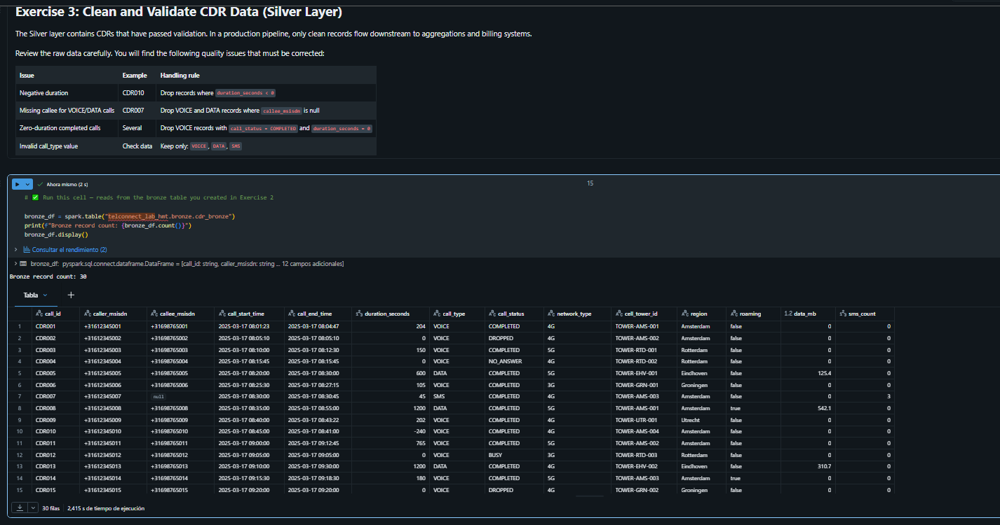

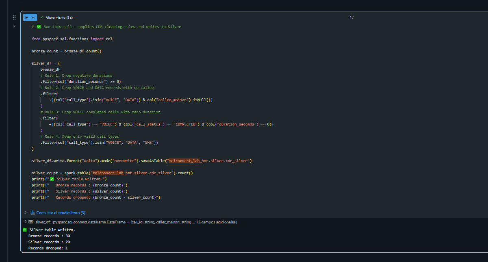

### Exercise 4 – Agregación Gold

Agrupa Silver por `region` y `network_type` y calcula `total_calls`, `completed_calls`, `drop_rate_pct`, `avg_voice_duration_sec` y `total_data_mb`. Se guarda en `telconnect_lab_hmt.gold.network_summary`: **11 filas**.

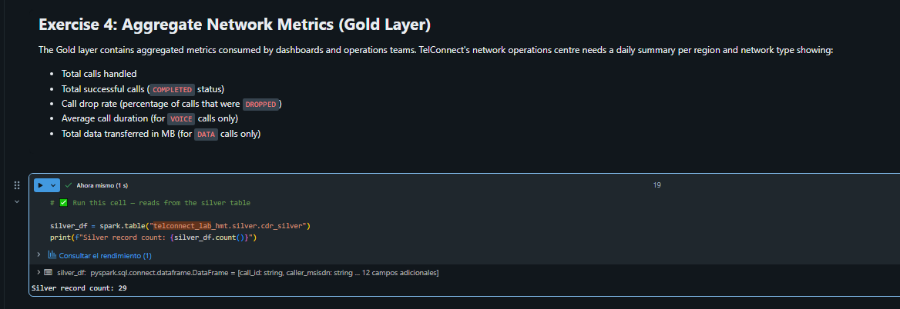

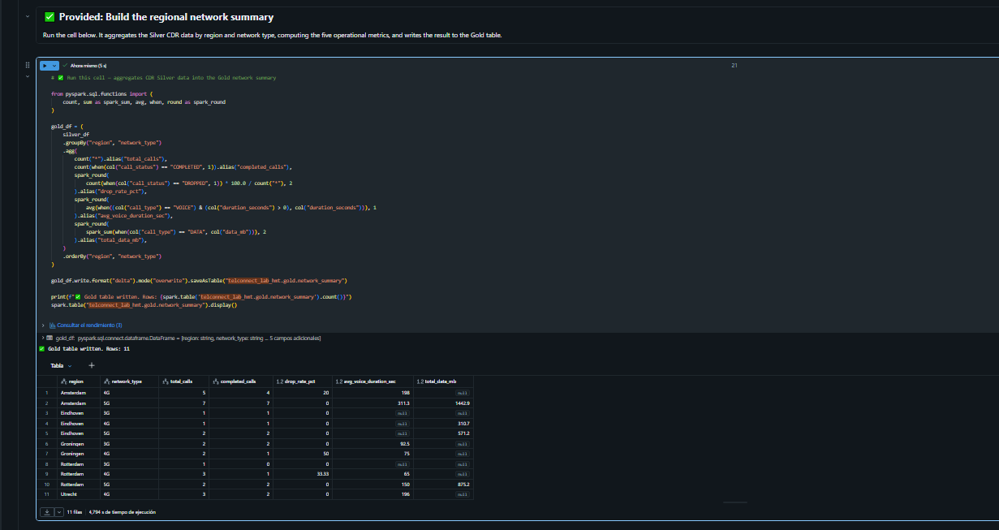

### Exercise 5 – Notebook listo para el job

Publica `gold_row_count` como *task value* con `dbutils.jobs.taskValues.set()` y termina con `dbutils.notebook.exit()` devolviendo un JSON de estado.

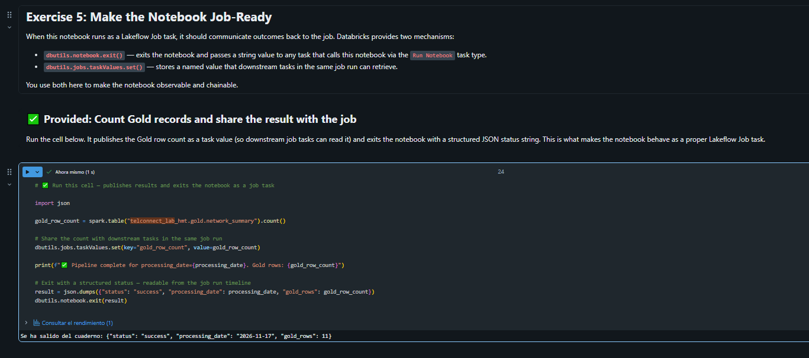

### Catálogo final

`telconnect_lab_hmt` con `bronze` (`cdr_bronze`, volume `raw_uploads`), `silver` (`cdr_silver`) y `gold` (`network_summary`):

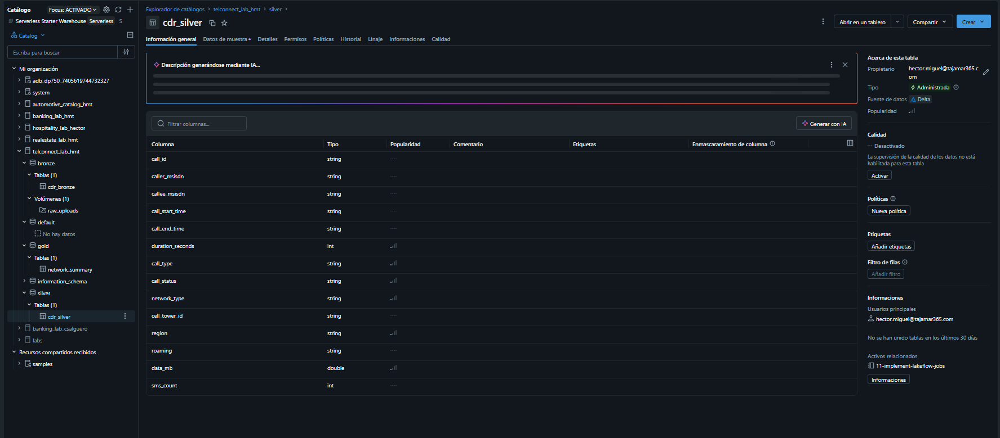

---

## 5. Parte 2 – Lakeflow Jobs

### Exercise 1 – Crear el job

1. **Jobs y canales → Crear → Job**, nombre `TelConnect CDR Pipeline`.
2. Tarea **Notebook** `process_cdrs`: notebook `11-implement-lakeflow-jobs`, compute **Serverless**.
3. Parámetro de job (**Parámetros del trabajo → Editar parámetro**): clave `processing_date`, valor `{{job.trigger.time.iso_date}}`.
4. **Ejecutar ahora** y comprobar que termina en **Satisfactorio**.

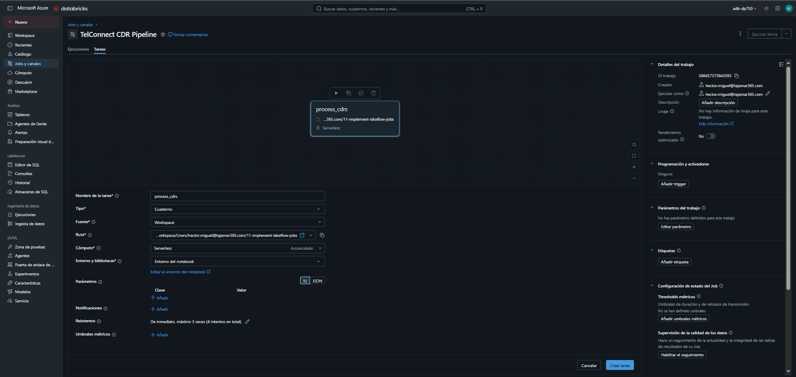

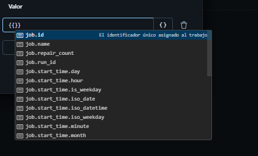

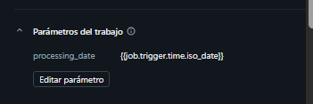

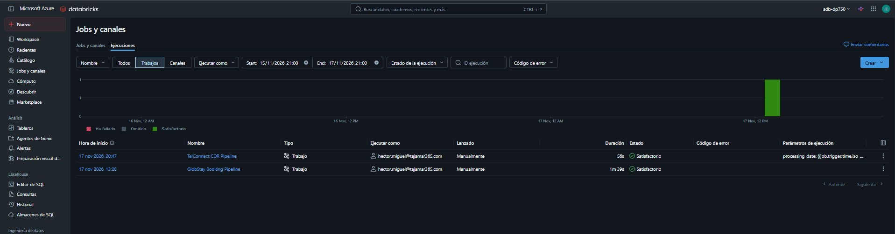

### Exercise 2 – Tarea SQL descendente `summarize_gold`

1. En el **Editor de SQL** (Serverless Starter Warehouse) se crea y **guarda** la consulta `summarize_gold_query`:

```sql
SELECT
  region,
  network_type,
  total_calls,
  drop_rate_pct
FROM telconnect_lab_hmt.gold.network_summary
ORDER BY drop_rate_pct DESC;
```

2. En el job: nueva tarea `summarize_gold` de tipo **SQL → Consulta**, almacén Serverless Starter Warehouse, **depende de** `process_cdrs` con la condición *Todas se han completado correctamente*.

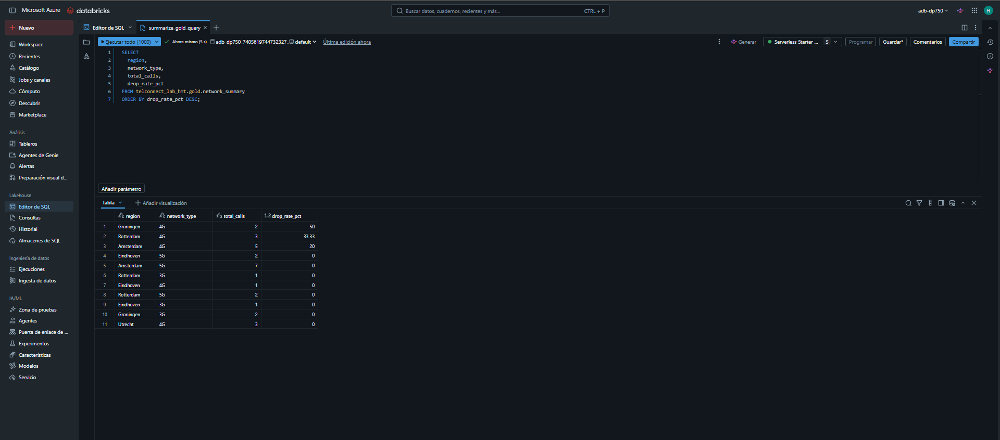

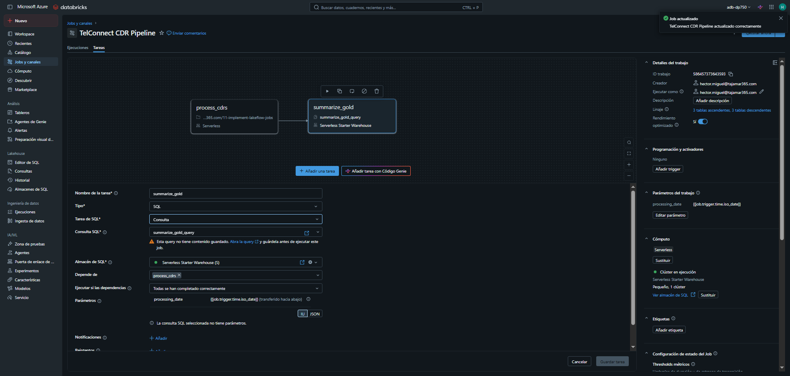

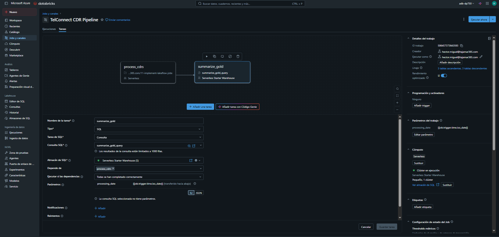

### Exercise 3 – Trigger de llegada de ficheros

**Programación y activadores → Añadir trigger** → tipo **Llegada de archivos**, ubicación `/Volumes/telconnect_lab_hmt/bronze/raw_uploads/`, y en **Avanzado** *Esperar después del último cambio* = 60 s (`00h 01m`).

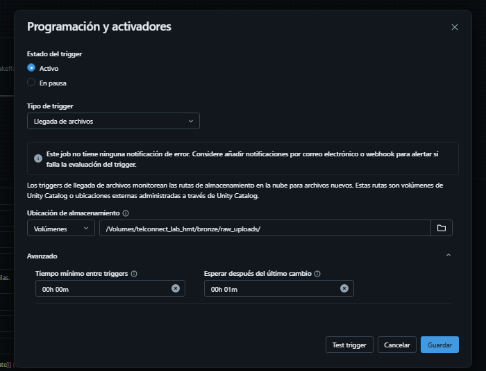

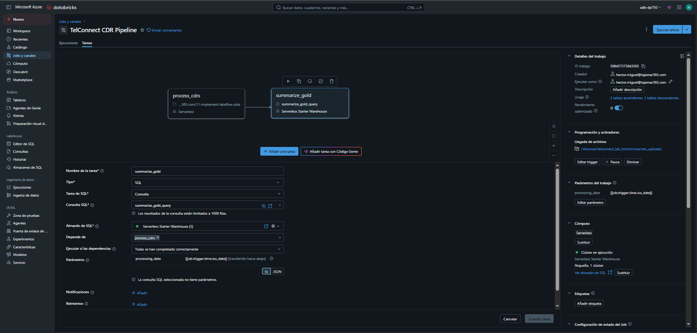

### Exercise 4 – Programación nocturna

Se elimina el trigger de llegada de archivos y se crea uno **Programado**: tipo *Programar* (no Intervalo), cron `0 0 2 * * ?`, zona horaria `Europe/Amsterdam`, estado **Activo**. Solo queda ese trigger, diario a las 02:00.

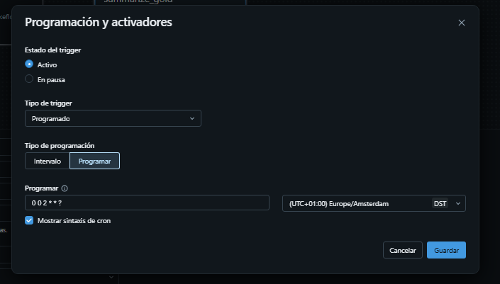

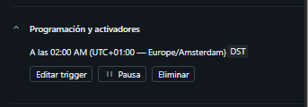

### Exercise 5 – Notificaciones

- **Nivel de job:** email a mi correo de Tajamar en caso de **Fallo**.
- **Nivel de tarea (`process_cdrs`):** email en **Fallo** con *Silenciar notificaciones hasta el último reintento* (en el YAML del job aparece como `alert_on_last_attempt: true`).


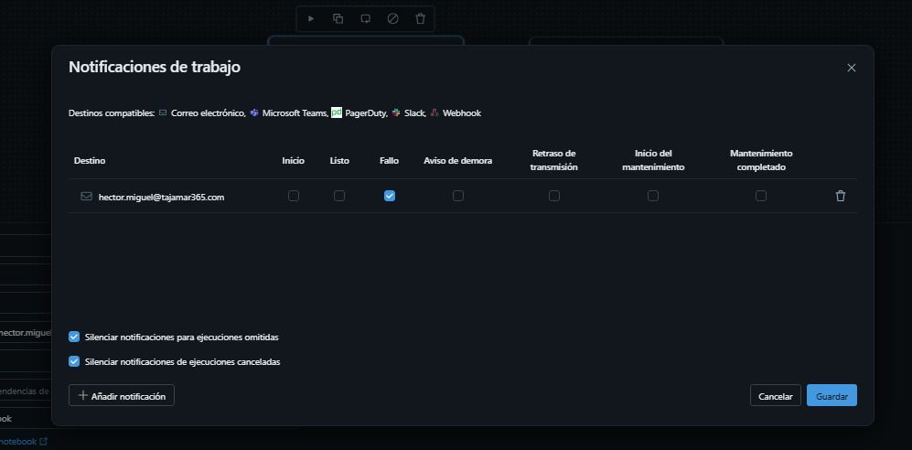


### Exercise 6 – Reintentos y timeout

En `process_cdrs`: **2 reintentos** con **60 s** de intervalo y, en *Umbrales métricos*, **Duración de ejecución** con aviso a **20 min** y timeout a **30 min**.

Los umbrales se configuraron desde el formulario (aviso 20m 0s, timeout 30m 0s). El formulario no permitía cambiar el número de reintentos, así que se editó el job con **⋮ → Editar como YAML** y se fijó `max_retries: 2`.

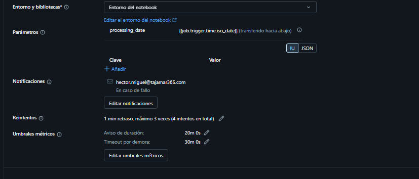

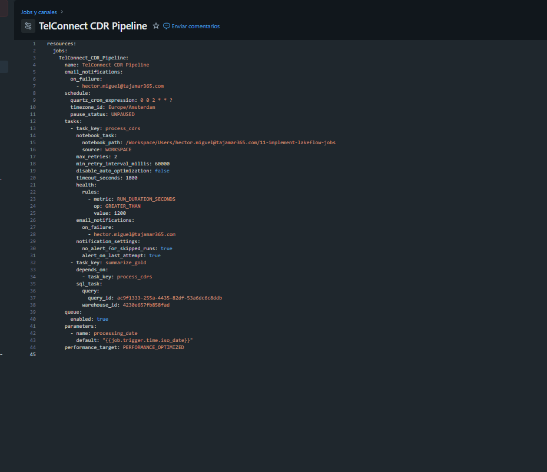

Fragmento relevante del YAML final de la tarea:

```yaml
- task_key: process_cdrs
  max_retries: 2
  min_retry_interval_millis: 60000
  timeout_seconds: 1800
  health:
    rules:
      - metric: RUN_DURATION_SECONDS
        op: GREATER_THAN
        value: 1200
  notification_settings:
    no_alert_for_skipped_runs: true
    alert_on_last_attempt: true
```

### Exercise 7 – Ejecutar y monitorizar

1. **Ejecutar ahora**: `process_cdrs` arranca primero y `summarize_gold` queda **Bloqueada** hasta que termine.
2. Ambas tareas terminan en **Satisfactorio** (`process_cdrs` 49 s, `summarize_gold` 11 s; ejecución total 1m 2s).
3. En la vista del notebook dentro del job se ve `Processing date: 2026-11-17` (viene del parámetro del job) y, al final, `gold_rows: 11`.

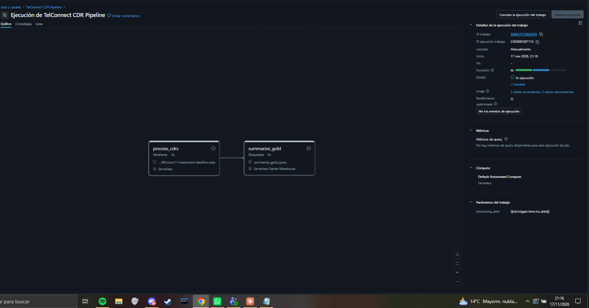

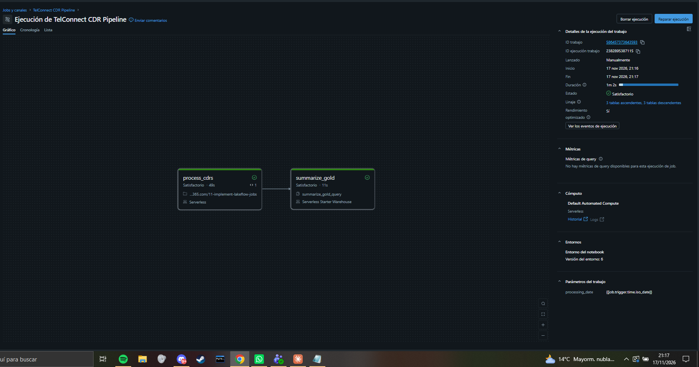

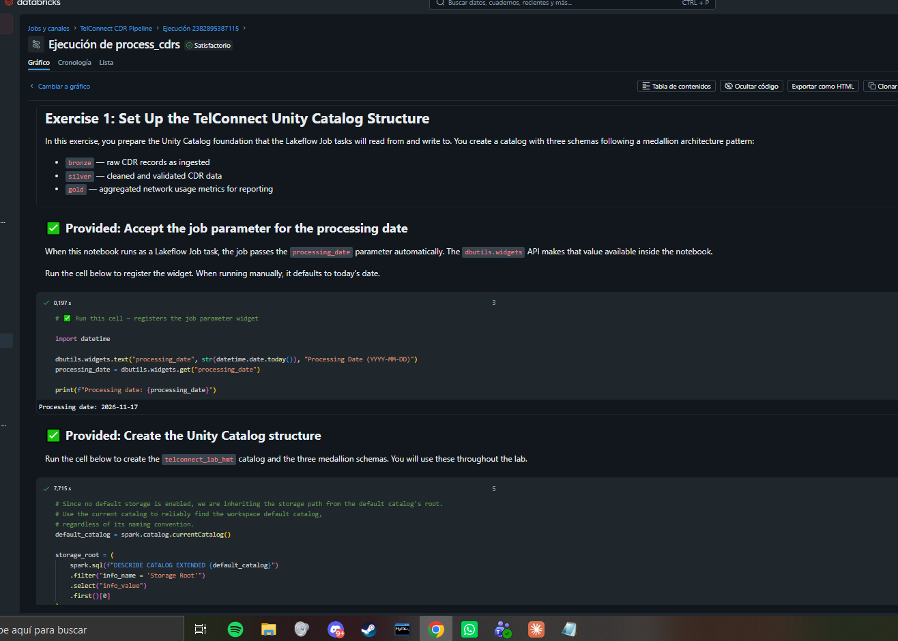

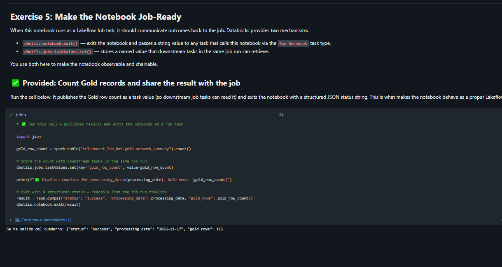

---

## 6. Resultados (checklist)

- [x] Catálogo `telconnect_lab_hmt` con `bronze`, `silver`, `gold` y las tablas `cdr_bronze` (30), `cdr_silver` (29) y `network_summary` (11).
- [x] Job `TelConnect CDR Pipeline` con 2 tareas dependientes (`process_cdrs → summarize_gold`).
- [x] Parámetro dinámico `processing_date = {{job.trigger.time.iso_date}}`.
- [x] Solo el trigger programado `0 0 2 * * ?` (Europe/Amsterdam) activo; el de llegada de archivos eliminado.
- [x] Notificaciones de fallo (job y tarea) con *mute until last retry*.
- [x] 2 reintentos de 60 s, aviso a 20 min y timeout a 30 min en `process_cdrs`.
- [x] Ejecución final en **Satisfactorio**.

## 7. Limpieza

El trigger programado seguiría lanzando el job cada noche, así que se elimina al terminar:

1. **Jobs y canales** → `TelConnect CDR Pipeline` → **⋮** → **Eliminar trabajo**.
2. Borrar el catálogo en el Editor de SQL:

```sql
DROP CATALOG IF EXISTS telconnect_lab_hmt CASCADE;
```

3. Eliminar la consulta guardada `summarize_gold_query` (opcional).
4. Comprobar en **Cómputo** que no queda ningún almacén ni clúster encendido.

## 8. Problemas encontrados

| Error | Causa | Solución |
|---|---|---|
| `PERMISSION_DENIED: User does not have USE CATALOG on Catalog 'telconnect_lab'` | El catálogo ya existía en el metastore compartido, creado por otro alumno | Usar `telconnect_lab_hmt` en todo el lab (Buscar y reemplazar) |
| Serverless se quedaba en "Esperando" más de 10 minutos | Navegador saturado por otra aplicación abierta (DataCamp) | Cerrar la aplicación y reconectar el compute |
| Solo 1 registro descartado en Silver | Con este CSV solo CDR010 incumple las reglas; las llamadas con duración 0 eran DROPPED, NO_ANSWER o BUSY, no COMPLETED | Resultado esperado con estos datos |
| Aviso "esta query no tiene contenido guardado" al añadir `summarize_gold` | La consulta tenía cambios sin guardar (`Guardar*`) | Guardarla en el Editor de SQL y recargar el job |
| Valor `{{job.start_time.*}}` marcado como error | El comodín `*` no es una referencia válida | Usar `{{job.trigger.time.iso_date}}` |
| El formulario no permitía cambiar el número de reintentos | La interfaz no aplicaba el cambio | Editar el job con **Editar como YAML** y fijar `max_retries: 2` |

## 9. Conclusiones

- Lakeflow Jobs convierte un notebook manual en un proceso repetible: parámetros dinámicos, dependencias entre tareas y ejecución sin intervención.
- El trigger de **llegada de archivos** reacciona a datos nuevos en un Volume, mientras que el **cron** da una ejecución predecible (aquí, diaria a las 02:00 hora de Ámsterdam). Se usa uno u otro según se quiera procesar por evento o por calendario.
- Las **notificaciones, reintentos y timeouts** hacen el pipeline operable: *mute until last retry* evita ruido por fallos transitorios y el timeout evita ejecuciones colgadas.
- Los *task values* (`gold_row_count`) y la salida de `dbutils.notebook.exit()` permiten pasar resultados entre tareas y ver el estado desde la línea de tiempo de la ejecución.
- En un metastore compartido conviene usar nombres de catálogo propios para evitar colisiones de permisos.
