# Lab 12 – Implementar procesos del ciclo de vida de desarrollo en Azure Databricks

## Objetivo

En este laboratorio trabajas como ingeniero de datos que mantiene un pipeline de procesamiento de pedidos para operaciones de almacén. El pipeline lee pedidos en bruto, elimina registros no válidos, normaliza los códigos de estado y calcula totales con impuestos. El equipo adopta prácticas de ciclo de vida de desarrollo de software: una estrategia de pruebas, el empaquetado como **Declarative Automation Bundle (DAB)** y el despliegue con la **Databricks CLI**.

El laboratorio tiene tres partes:

| Parte | Contenido | Dónde se hace |
|-------|-----------|---------------|
| 1 | Pruebas unitarias y de integración con pytest | Notebook en el workspace (compute Serverless) |
| 2 | Configurar el bundle | PowerShell local y VS Code |
| 3 | Desplegar y verificar el bundle | PowerShell local y UI del workspace |

## Prerrequisitos

- Un workspace de Azure Databricks **Premium** preparado en el Laboratorio 00
- Permiso para crear jobs (necesario en la Parte 3)
- Conocimientos básicos de Python y pytest
- Windows con PowerShell, `winget` y VS Code

---

## 0. Preparar el entorno (workspace de Azure Databricks)

Al empezar el laboratorio, la suscripción **Azure for Students** no tenía ningún workspace de Azure Databricks, así que hay que recrear el entorno del Laboratorio 00.

### 0.1 Comprobar que no hay workspaces

En el portal de Azure, busca **Azure Databricks**. La lista aparece vacía.

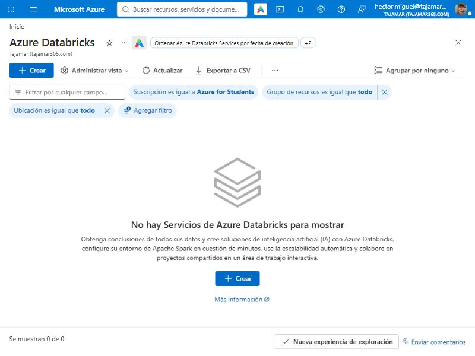

### 0.2 Crear el workspace

Desde **Crear**, rellena la pestaña **Datos básicos** con estos valores:

| Campo | Valor |
|-------|-------|
| Suscripción | Azure for Students |
| Grupo de recursos | `rg-dp750` (nuevo) |
| Nombre del área de trabajo | `adb-dp750` |
| Región | France Central |
| Plan de tarifa | Premium |
| Tipo de área de trabajo | Sin servidor (Serverless) |

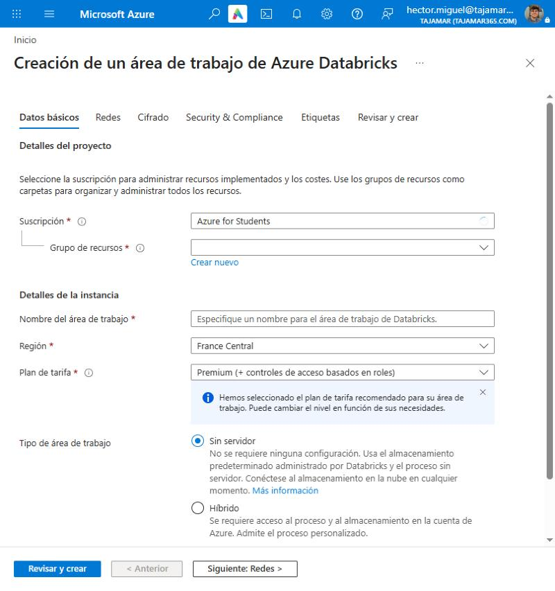

En **Revisar y crear** espera a que aparezca el mensaje **Validación correcta** y pulsa **Crear**.

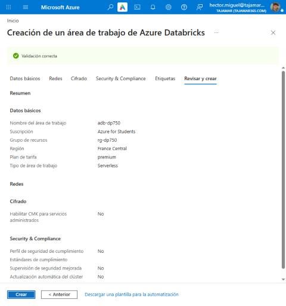

### 0.3 Esperar al despliegue

El despliegue tarda unos minutos. Cuando termina, el portal muestra **Se completó la implementación**.

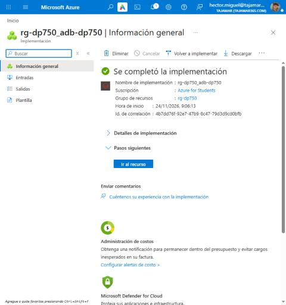

### 0.4 Abrir el workspace

Pulsa **Ir al recurso**. En la página del workspace aparecen la URL y el botón **Iniciar área de trabajo**.

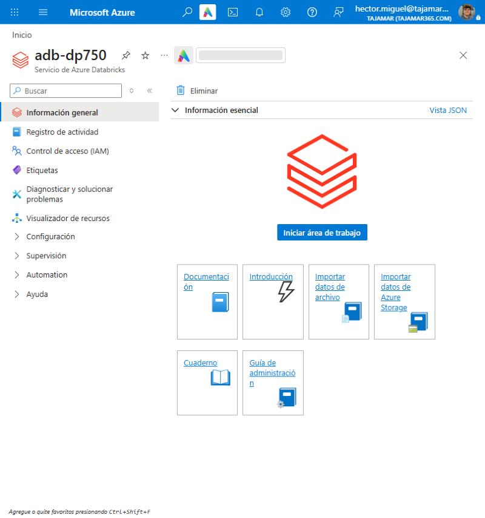

La URL del workspace (la necesitarás en la Parte 2) es:

```
https://adb-7405610560887783.3.azuredatabricks.net
```

Al abrirlo se carga la página de inicio de Databricks.

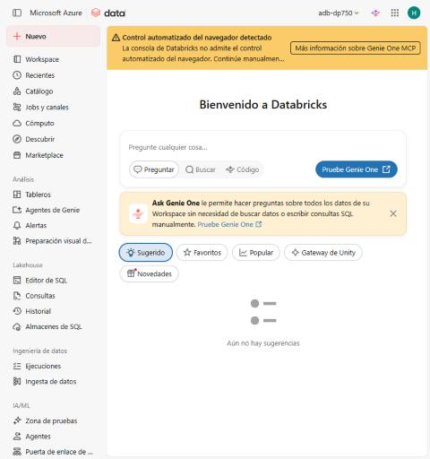

---

## 1. Parte 1: Estrategia de pruebas (Notebook)

> Esta parte se hace en el workspace, con el compute **Serverless**.

### 1.1 Importar el notebook

1. En el menú lateral abre **Workspace** y ve a tu carpeta de usuario.
2. Usa **Importar** y elige **URL**.
3. Importa el notebook desde la carpeta `Allfiles` del repositorio del laboratorio:

```
https://raw.githubusercontent.com/MicrosoftLearning/DP-750T00-Implement-Data-Engineering-Solutions-using-Azure-Databricks/refs/heads/main/Allfiles/12-implement-development-lifecycle-processes-in-azure-databricks.ipynb
```

### 1.2 Abrir el notebook y elegir compute

Abre el notebook y, en el selector de compute, elige **Serverless**.

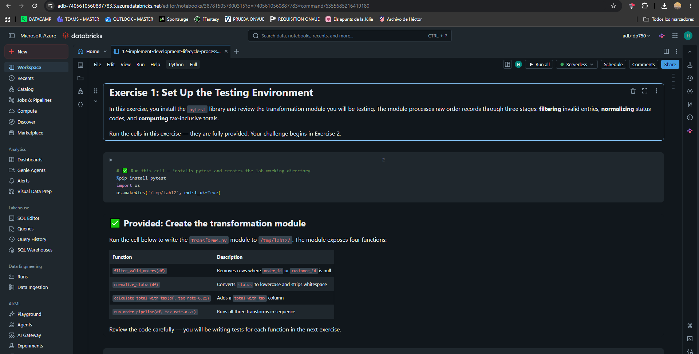

### 1.3 Ejercicio 1: instalar pytest y revisar `transforms.py`

Ejecuta la primera celda, que instala pytest y crea el directorio de trabajo `/tmp/lab12`:

```python
%pip install pytest
import os
os.makedirs('/tmp/lab12', exist_ok=True)
```

pytest ya viene instalado en el entorno Serverless (`Requirement already satisfied`). El aviso rojo final solo recomienda reiniciar Python si se hubiera instalado algo nuevo, y aquí no hace falta.

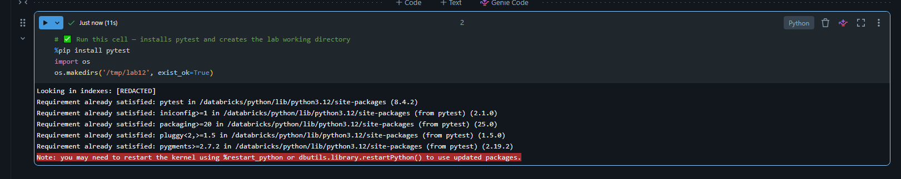

Ejecuta ahora la celda "Provided: Create the transformation module", que escribe el módulo `transforms.py` con cuatro funciones:

| Función | Descripción |
|---------|-------------|
| `filter_valid_orders(df)` | Elimina las filas donde `order_id` o `customer_id` son nulos |
| `normalize_status(df)` | Convierte `status` a minúsculas y quita espacios |
| `calculate_total_with_tax(df, tax_rate=0.21)` | Añade la columna `total_with_tax` |
| `run_order_pipeline(df, tax_rate=0.21)` | Ejecuta las tres transformaciones en secuencia |

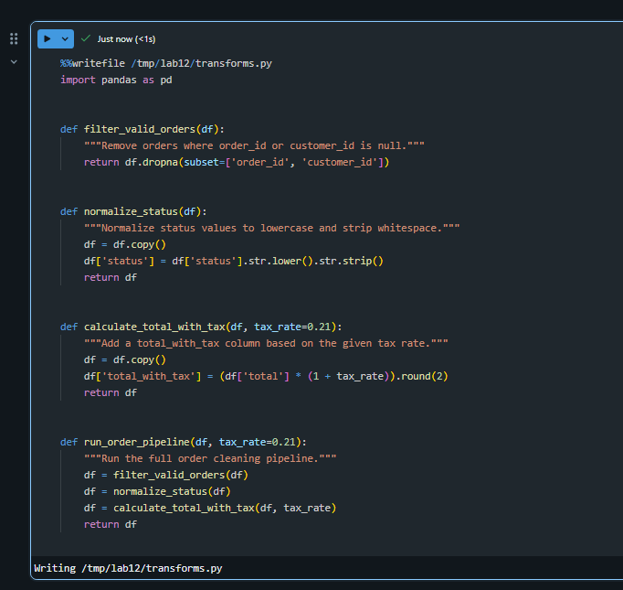

Por último, ejecuta la celda "Provided: Verify the module loads correctly" para comprobar que el módulo se importa:

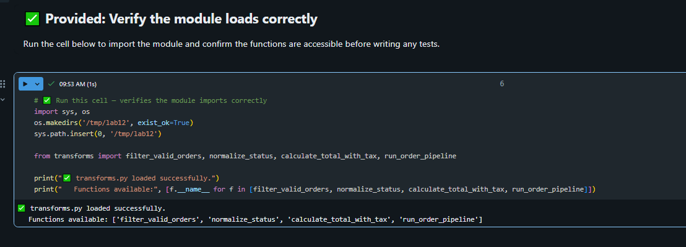

### 1.4 Ejercicio 2: pruebas unitarias con fixtures

Completa los `TODO` de la celda `%%writefile /tmp/lab12/test_transforms.py`. Se crea una fixture `sample_orders` con 5 filas (dos con valores nulos y estados con mayúsculas y espacios) y 8 pruebas, tres para `filter_valid_orders`, dos para `normalize_status` y tres para `calculate_total_with_tax`:

```python
%%writefile /tmp/lab12/test_transforms.py
import pytest
import pandas as pd
import sys
sys.path.insert(0, '/tmp/lab12')
from transforms import filter_valid_orders, normalize_status, calculate_total_with_tax


@pytest.fixture
def sample_orders():
    return pd.DataFrame({
        'order_id':    [1001,        1002,      None,        1004,        1005],
        'customer_id': ['C001',      'C002',    'C003',      None,        'C005'],
        'status':      ['Completed', 'PENDING', 'cancelled', 'completed', '  Pending  '],
        'total':       [150.00,      200.50,    75.00,       300.00,      125.75],
    })


# ── Tests for filter_valid_orders ─────────────────────────────────────────────

def test_filter_removes_null_order_id(sample_orders):
    result = filter_valid_orders(sample_orders)
    assert result['order_id'].isnull().sum() == 0


def test_filter_removes_null_customer_id(sample_orders):
    result = filter_valid_orders(sample_orders)
    assert result['customer_id'].isnull().sum() == 0


def test_filter_retains_correct_row_count(sample_orders):
    result = filter_valid_orders(sample_orders)
    assert len(result) == 3


# ── Tests for normalize_status ────────────────────────────────────────────────

def test_normalize_status_lowercases_values(sample_orders):
    result = normalize_status(sample_orders)
    assert all(result['status'] == result['status'].str.lower())


def test_normalize_status_strips_whitespace(sample_orders):
    result = normalize_status(sample_orders)
    assert all(result['status'] == result['status'].str.strip())


# ── Tests for calculate_total_with_tax ────────────────────────────────────────

def test_calculate_total_with_tax_adds_column(sample_orders):
    result = calculate_total_with_tax(sample_orders)
    assert 'total_with_tax' in result.columns


def test_calculate_total_with_tax_default_rate(sample_orders):
    result = calculate_total_with_tax(sample_orders)
    assert result['total_with_tax'].iloc[0] == round(150.00 * 1.21, 2)


def test_calculate_total_with_tax_custom_rate(sample_orders):
    result = calculate_total_with_tax(sample_orders, tax_rate=0.10)
    assert result['total_with_tax'].iloc[1] == round(200.50 * 1.10, 2)
```

La celda solo escribe el fichero (`Writing /tmp/lab12/test_transforms.py`):

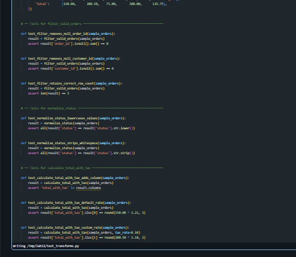

Ejecuta la celda "Run the unit tests". Deben pasar las 8 pruebas:

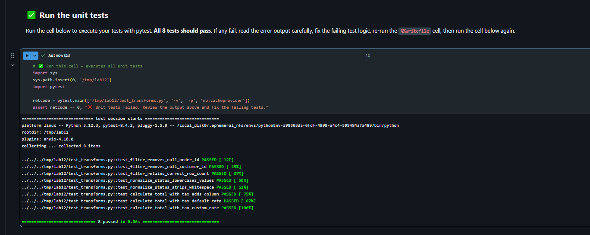

### 1.5 Ejercicio 3: prueba de integración

El notebook oficial del laboratorio termina en el Ejercicio 2 (la última celda ejecuta los tests unitarios), aunque la página del laboratorio describe un tercer ejercicio. Por eso la prueba de integración se escribe en celdas nuevas al final del notebook.

La prueba crea los datos con una sesión de Spark, los pasa a pandas y ejecuta el pipeline completo:

```python
%%writefile /tmp/lab12/test_integration.py
import pytest
import sys
sys.path.insert(0, '/tmp/lab12')
from pyspark.sql import SparkSession
from pyspark.sql.types import StructType, StructField, LongType, StringType, DoubleType
from transforms import run_order_pipeline


@pytest.fixture(scope="module")
def spark_session():
    return SparkSession.builder.getOrCreate()


@pytest.fixture
def raw_orders(spark_session):
    schema = StructType([
        StructField("order_id", LongType(), True),
        StructField("customer_id", StringType(), True),
        StructField("status", StringType(), True),
        StructField("total", DoubleType(), True),
    ])
    rows = [
        (1001, "C001", "Completed", 150.00),
        (1002, "C002", "PENDING", 200.50),
        (None, "C003", "cancelled", 75.00),
        (1004, None, "completed", 300.00),
        (1005, "C005", "  Pending  ", 125.75),
    ]
    # Datos creados con Spark y convertidos a pandas, que es lo que espera el pipeline
    return spark_session.createDataFrame(rows, schema).toPandas()


def test_pipeline_end_to_end(raw_orders):
    result = run_order_pipeline(raw_orders)
    # 1) Se eliminan los pedidos inválidos
    assert len(result) == 3
    assert list(result["order_id"]) == [1001, 1002, 1005]
    # 2) Los estados quedan normalizados
    assert list(result["status"]) == ["completed", "pending", "pending"]
    # 3) Se calcula el total con impuestos (21 % por defecto)
    expected = [round(150.00 * 1.21, 2), round(200.50 * 1.21, 2), round(125.75 * 1.21, 2)]
    assert list(result["total_with_tax"]) == pytest.approx(expected)


def test_pipeline_custom_tax_rate(raw_orders):
    result = run_order_pipeline(raw_orders, tax_rate=0.10)
    assert result["total_with_tax"].iloc[0] == pytest.approx(round(150.00 * 1.10, 2))
```

Y en otra celda se ejecuta:

```python
import sys, pytest
sys.path.insert(0, '/tmp/lab12')

retcode = pytest.main(['/tmp/lab12/test_integration.py', '-v', '-p', 'no:cacheprovider'])
assert retcode == 0, "❌ Integration tests failed. Review the output above."
```

Las dos pruebas de integración pasan:

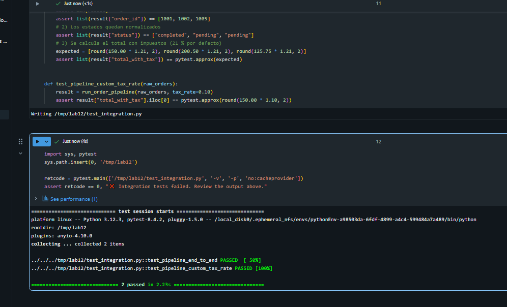

---

## 2. Parte 2: Configurar un Declarative Automation Bundle (PowerShell local)

### 2.1 Instalar la Databricks CLI

```powershell
winget install Databricks.DatabricksCLI
```

Cierra y vuelve a abrir PowerShell y comprueba la versión:

```powershell
databricks --version
```

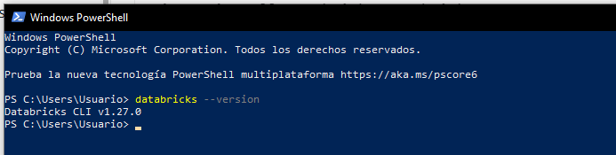

### 2.2 Autenticarse en el workspace

```powershell
databricks auth login --host https://adb-7405610560887783.3.azuredatabricks.net
```

La CLI propone como nombre de perfil el del workspace (`adb-7405610560887783`). Se acepta con Intro, se aprueba el inicio de sesión en el navegador y la CLI confirma que el perfil se ha guardado.

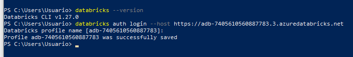

> **Nota:** como el perfil no se llama `DEFAULT` y el target `dev` del bundle no define `workspace.host`, hay que indicar a la CLI qué perfil usar. Se hace con una variable de entorno, válida mientras la ventana de PowerShell siga abierta:
>
> ```powershell
> $env:DATABRICKS_CONFIG_PROFILE = "adb-7405610560887783"
> ```

### 2.3 Crear el proyecto y sus subcarpetas

```powershell
mkdir ~/order-pipeline-bundle; cd ~/order-pipeline-bundle
mkdir notebooks, resources
```

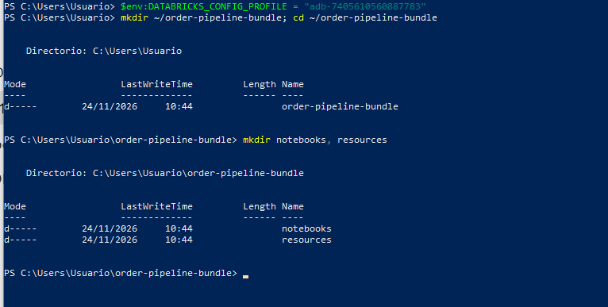

### 2.4 Crear `databricks.yml`

Abre la carpeta en VS Code (`code .`) y crea `databricks.yml` en la raíz con este contenido. Es la configuración del laboratorio con los tres `TODO` completados: nombre del bundle, variables (`environment` y `cluster_policy_id`), el job con sus dos tareas y los targets `dev` y `prod`.

```yaml
bundle:
  name: order-pipeline-bundle

variables:
  environment:
    description: The deployment environment name
    default: development
  cluster_policy_id:
    description: The cluster policy ID used for job clusters
    default: ""

resources:
  jobs:
    order-pipeline-job:
      name: ${var.environment}-order-pipeline
      tasks:
        - task_key: validate-data
          notebook_task:
            notebook_path: ./notebooks/validate.py
        - task_key: transform-data
          depends_on:
            - task_key: validate-data
          notebook_task:
            notebook_path: ./notebooks/transform.py

targets:
  dev:
    default: true
    mode: development
    variables:
      environment: development
  prod:
    mode: production
    workspace:
      host: https://adb-0000000000000000.0.azuredatabricks.net
    variables:
      environment: production
```

Usa dos espacios por nivel de indentación y nunca tabuladores. Guarda el fichero.

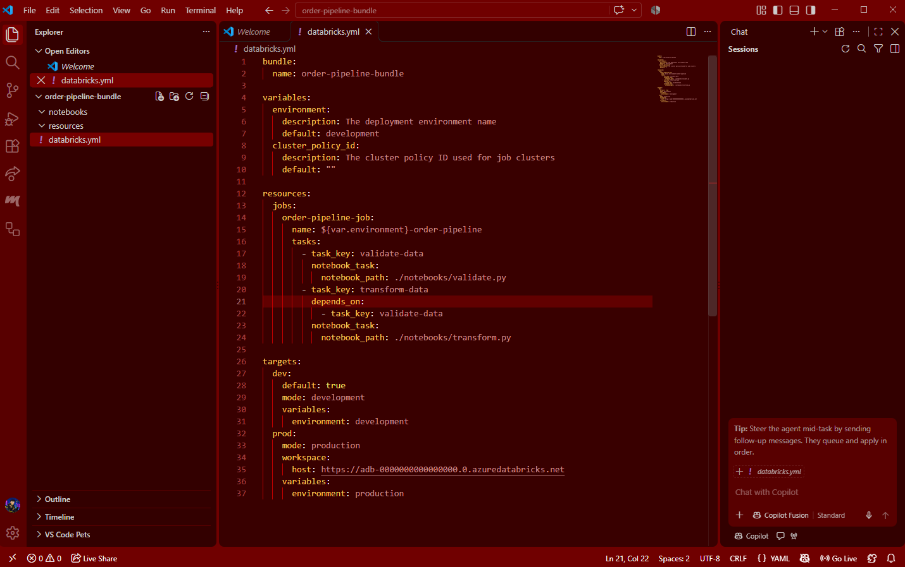

### 2.5 Crear los notebooks de ejemplo

Estos comandos escriben ficheros UTF-8 **sin BOM**, de modo que la primera línea es la cabecera de notebook de Databricks:

```powershell
[System.IO.File]::WriteAllLines("$PWD\notebooks\validate.py",  @("# Databricks notebook source", "# validate"))
[System.IO.File]::WriteAllLines("$PWD\notebooks\transform.py", @("# Databricks notebook source", "# transform"))
```

> No uses `Set-Content`: puede añadir un BOM y provocar el error de validación *"is not a notebook"*.

Compruébalo:

```powershell
Get-Content notebooks/validate.py
```

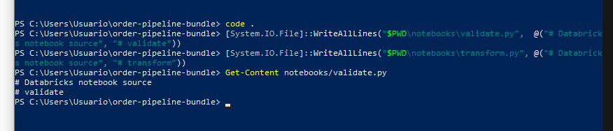

---

## 3. Parte 3: Desplegar y verificar el bundle

Ejecuta todo desde dentro de la carpeta `order-pipeline-bundle`.

### 3.1 Validar

```powershell
databricks bundle validate
```

Muestra el nombre del bundle, el target `dev`, el usuario y la ruta del workspace, y termina con `Validation OK!`. (Los caracteres como `←[1m` son códigos de color que la consola de Windows no interpreta; no afectan al resultado.)

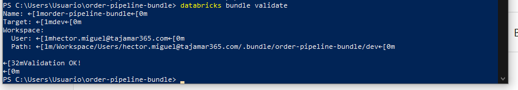

### 3.2 Previsualizar el despliegue

```powershell
databricks bundle plan -t dev
```

El job aparece como `create` y el resumen indica `Plan: 1 to add, 0 to change, 0 to delete, 0 unchanged`. Este comando no cambia nada en el workspace.

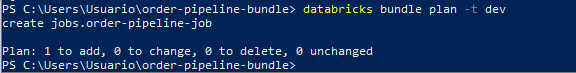

### 3.3 Desplegar

```powershell
databricks bundle deploy -t dev
```

Se suben 3 ficheros (`databricks.yml` y los dos notebooks) y se crea el job: `Resources: 1 created, 0 changed, 0 deleted, 0 unchanged`.

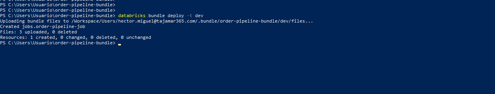

### 3.4 Verificar

```powershell
databricks bundle summary
```

El resumen muestra el job `order-pipeline-job` con el nombre `[dev hector_miguel] development-order-pipeline` y su URL.

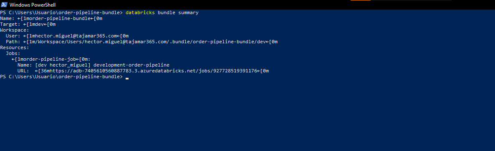

Abre la URL del job. Comprueba que:

- El nombre lleva el prefijo `[dev hector_miguel]`.
- Aparece el aviso *Managed by Declarative Automation Bundles*, el compute es **Serverless** y el job tiene la etiqueta `dev: hector_miguel`.

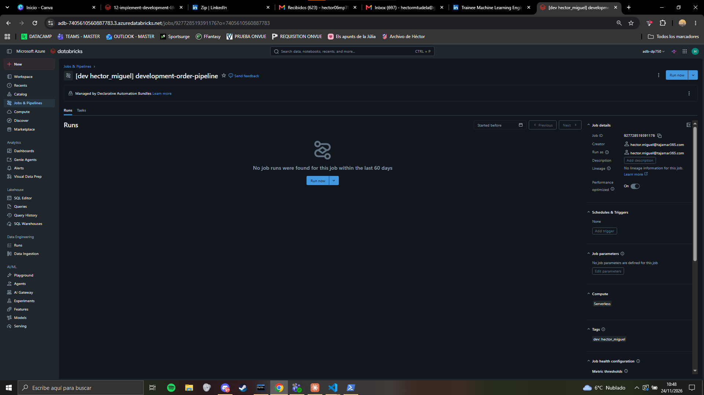

En la pestaña **Tasks** aparecen las dos tareas y `transform-data` depende de `validate-data`:

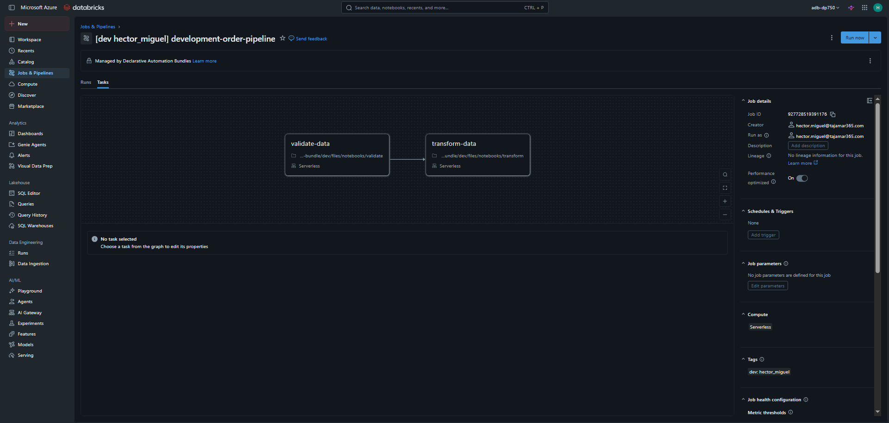

### 3.5 Limpieza (opcional)

```powershell
databricks bundle destroy -t dev
```

La CLI lista el recurso que se va a borrar y todos los ficheros de `/Workspace/Users/<usuario>/.bundle/order-pipeline-bundle/dev`. Confirma con `y`: `Destroy: 1 deleted`.

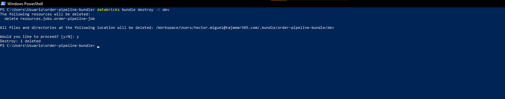

El job ya no aparece en **Jobs & Pipelines**:

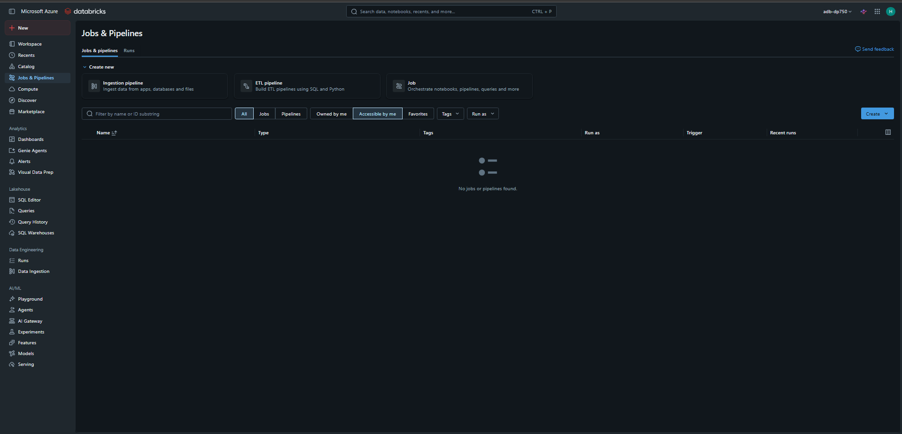

---