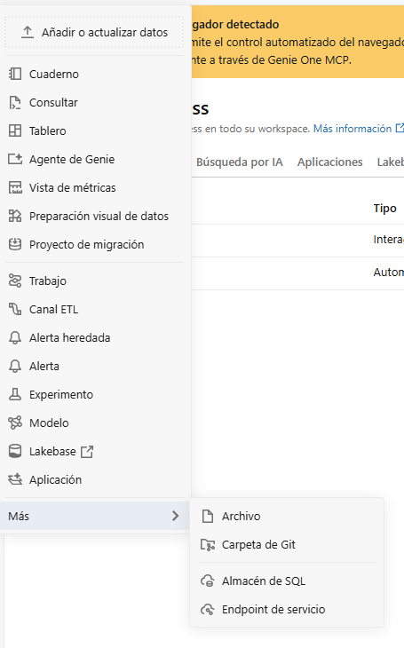
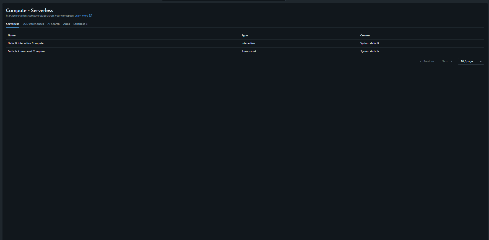
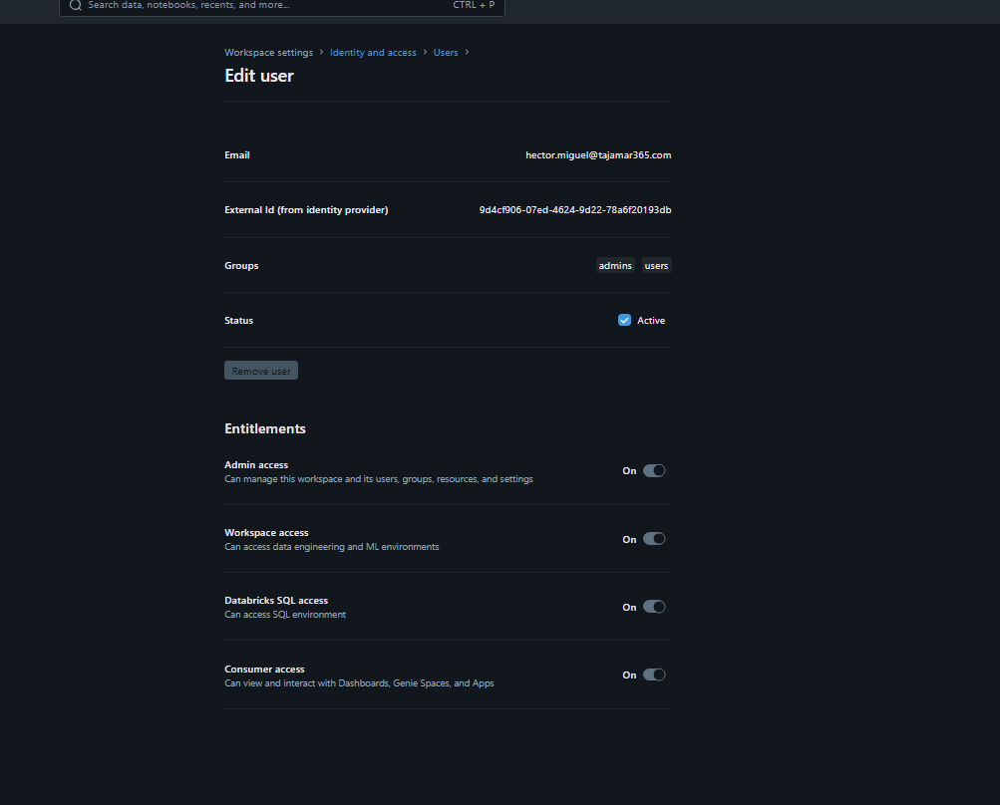
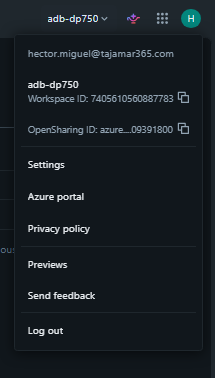

# Laboratorio 13: Monitorizar, solucionar problemas y optimizar cargas de trabajo en Azure Databricks

**Alumno:** hector.miguel@tajamar365.com

## Objetivo del laboratorio

Reproducir un problema de *data skew* y de *shuffle excesivo* en un cluster **classic** sin Photon (`perf-lab`), inspeccionarlo en la Spark UI, aplicar correcciones (broadcast join, AQE, eliminar `repartition()` innecesarios) y comprobar la mejora.

## Estado del laboratorio

**No se ha podido completar.** El primer paso (Paso 1: crear el cluster `perf-lab`) no es posible en este workspace, porque no ofrece ninguna forma de crear compute classic. Los pasos siguientes (importar el notebook, Ejercicios 1-5 y Spark UI) dependen de ese cluster y no se han ejecutado.

> Importante: no aparece ningún mensaje de error. Lo que ocurre es que la opción de crear un cluster **no existe** en la interfaz. Las capturas lo muestran.

## Paso 1: Crear el cluster `perf-lab` (no realizable)

El lab pide un cluster classic (no Serverless), con Photon desactivado, porque algunos ajustes de AQE solo están disponibles en clusters classic.

### 1.1 Menú "+ Nuevo" sin la opción Clúster

Al abrir **+ Nuevo** (y su submenú **Más**) aparecen Cuaderno, Consultar, Tablero, Trabajo, Canal ETL, Alerta, Experimento, Modelo, Aplicación, Archivo, Carpeta de Git, Almacén de SQL y Endpoint de servicio. **No hay opción "Clúster".**

### 1.2 Página Compute: solo compute serverless

Al entrar en **Compute** (también al abrir `/compute/new`, que redirige aquí) solo se muestran las pestañas **Serverless, SQL warehouses, AI Search, Apps y Lakebase**. La lista contiene únicamente `Default Interactive Compute` y `Default Automated Compute` (*System default*). No hay pestaña **All-purpose compute** ni botón **Create compute**.

### 1.3 No es un problema de permisos

El usuario pertenece al grupo `admins` y tiene activados **Admin access, Workspace access, Databricks SQL access y Consumer access**. No existe un derecho "Unrestricted cluster creation" que activar.

Acceso a Settings desde el menú del workspace (`adb-dp750`):

## Causa probable

Según la documentación, el flujo para crear compute classic es *Compute → Create compute*. En este workspace esa opción no está disponible. Hay casos idénticos reportados por otros usuarios:

- En Microsoft Q&A se describe un caso igual: al pulsar Compute se abre SQL warehouses aunque la cuenta tiene todos los permisos, y ocurre con los workspaces nuevos creados a partir del 24 de abril de 2026: <https://learn.microsoft.com/en-us/answers/questions/5871662/unable-to-create-a-new-compute-cluster-in-azure-da>
- En la comunidad de Databricks, un usuario indica que el derecho de creación sin restricciones ya no aparece y que parece que Databricks prioriza serverless: <https://community.databricks.com/t5/data-engineering/compute-tab-doesn-t-show-and-doesn-t-give-the-option-to-create-a/m-p/156509>

La causa exacta no se ha podido confirmar. Sí está confirmado, por las capturas, que el workspace solo ofrece compute serverless.

## Por qué serverless no sirve para este lab

Serverless no permite configurar Photon ni los ajustes de Spark (por ejemplo `spark.databricks.photon.enabled false` o los parámetros de AQE) que el laboratorio necesita para provocar y observar el skew y el shuffle.

## Pasos pendientes (no realizados)

| Paso | Contenido | Estado |
|---|---|---|
| 1 | Crear cluster `perf-lab` (sin Photon) | Bloqueado (sin opción de crear cluster) |
| 2 | Importar el notebook por URL | No realizado |
| Ejercicio 1-2 | Crear datos con skew y exponerlo | No realizado |
| Parte 2 | Spark UI: skew | No realizado |
| Ejercicio 3 | Broadcast join y AQE | No realizado |
| Ejercicio 4 y Parte 4 | Shuffle excesivo y Spark UI | No realizado |
| Ejercicio 5 | Reducir shuffle | No realizado |

Según indica el profesor, las cuentas de estudiante dan muchos fallos, por lo que se entregan estas capturas como justificación de que no es posible crear el cluster.
