# Laboratorio 10 – Implementar búsqueda inteligente (full-text, vectorial e híbrida)

**Guía oficial:** [10-implement-intelligent-search](https://microsoftlearning.github.io/mslearn-sql-developer/Instructions/Labs/10-implement-intelligent-search.html)
**Base de datos:** `AdventureWorksLT` en Azure SQL Database

---

## 1. Objetivo

Implementar y comparar tres enfoques de búsqueda sobre la tabla `dbo.ProductReview`:

1. **Full-text search** (palabras clave): `CONTAINS`, `FREETEXT`, `CONTAINSTABLE`, `FREETEXTTABLE`.
2. **Búsqueda vectorial** (significado): `VECTOR_DISTANCE` (exacta) y `VECTOR_SEARCH` (aproximada con índice DiskANN).
3. **Búsqueda híbrida** combinando ambas con **Reciprocal Rank Fusion (RRF)**.

En este laboratorio parto de cero, así que primero monto toda la infraestructura (Azure SQL, Foundry, modelos, identidad administrada, tabla, embeddings) y después hago las búsquedas.

---

## 2. Requisitos previos

- Suscripción de Azure con acceso a Azure OpenAI.
- Visual Studio Code con la extensión **SQL Server (mssql)** o SQL Server Management Studio.
- Nociones básicas de Azure SQL Database y T-SQL.

### Datos que hay que ir anotando

| Dato | Valor |
|---|---|
| Grupo de recursos | |
| Nombre del servidor SQL (`<servidor>.database.windows.net`) | |
| Método de autenticación (Entra / SQL) y usuario | |
| Nombre del proyecto Foundry | |
| Endpoint OpenAI (la parte antes de `.openai.azure.com`) | |
| Contraseña de la master key (guardarla) | |

---

## 3. Aprovisionar Azure SQL Database

1. Ir al [Azure SQL hub](https://aka.ms/azuresqlhub) e iniciar sesión. En el panel **Azure SQL Database** → **Show options** → **Create SQL Database**.
2. En la pestaña **Basics**:

   | Ajuste | Valor |
   |---|---|
   | Subscription | Mi suscripción |
   | Resource group | Crear o elegir uno (ej. `rg-dp800`) |
   | Database name | `AdventureWorksLT` |
   | Server | hectordb-adventureworks.database.windows.net |

3. Autenticación del servidor (elegir según la política de la organización):
   - **Microsoft Entra-only** (recomendado): poner mi cuenta como *Microsoft Entra admin*. Para conectar, en SSMS usar *Microsoft Entra MFA*.
   - **SQL + Entra / SQL authentication**: definir *Server admin login* y *Password* y guardarlos.
4. **Want to use SQL elastic pool** → **No**.
5. **Workload environment** → **Development**.
6. **Compute + storage** → **Configure database** → tier **Hyperscale**, compute **Serverless** → **Apply**.
7. **Backup storage redundancy** → **Locally-redundant backup storage**.
8. **Next: Networking** → **Connectivity method: Public endpoint**.
9. En **Firewall rules**: *Allow Azure services and resources to access this server* = **Yes** y *Add current client IP address* = **Yes**.
10. **Next: Security** → **Next: Additional settings**.
11. En **Data source** → *Use existing data* = **Sample** (crea AdventureWorksLT) → **OK**.
12. **Review + create** → **Create**.
13. Esperar a que termine el despliegue y abrir el recurso.

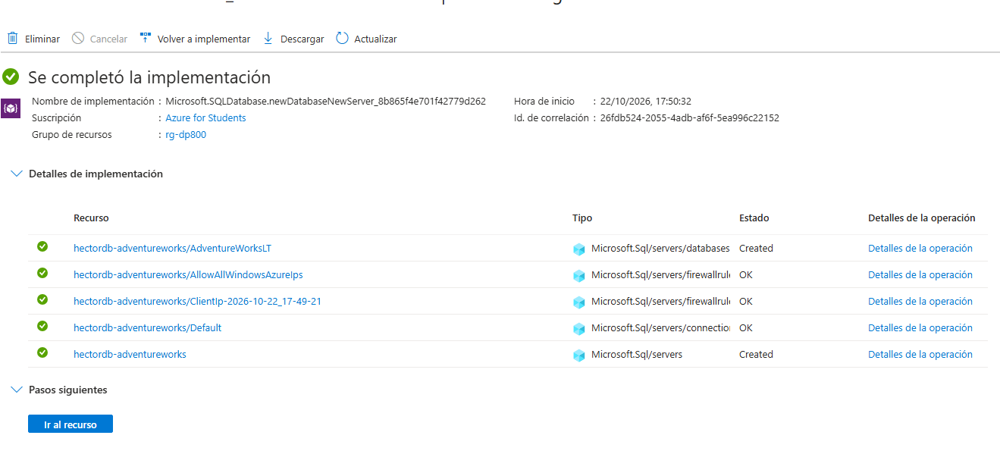

---

## 4. Crear el proyecto de Foundry y desplegar los modelos de Azure OpenAI

### 4.1 Crear el proyecto

1. Ir a [Microsoft Foundry](https://ai.azure.com) e iniciar sesión (si aparece el interruptor **New Foundry**, dejarlo activado).
2. Crear proyecto: nombre de proyecto (ej. `proj-sqlailab-lab10`) → **Advanced options** → mismo *Subscription* y *Resource group* que la base de datos, y una *Region* donde estén disponibles los modelos → **Create** (si sale **Let's go**, pulsarlo).

### 4.2 Desplegar `gpt-5-mini` (chat)

1. **Discover** → buscar `gpt-5-mini` → seleccionarlo.
2. **Deploy** → **Default settings**.
3. Si aparece el diálogo de proyecto, elegir la misma *Region* y mi proyecto → **Continue**.
4. *Deployment name*: `gpt-5-mini` → **Deploy**.

> Este laboratorio solo usa embeddings, pero la guía oficial pide desplegar también el modelo de chat porque se reutiliza en otros laboratorios.

### 4.3 Desplegar `text-embedding-3-small` (embeddings)

1. **Discover** → buscar `text-embedding-3-small` → seleccionarlo.
2. **Deploy** → **Default settings** → misma región y proyecto → **Continue**.
3. **Build → Models** para comprobar que aparecen los dos despliegues.

### 4.4 Obtener el endpoint de OpenAI

1. En el [portal de Azure](https://portal.azure.com/) → mi grupo de recursos → recurso **Foundry** (ej. `proj-sqlailab-lab10-resource`).
2. **Resource Management → Keys and Endpoint**.
3. Abrir la pestaña **OpenAI** (no *Foundry* ni *AI Services*) y anotar el endpoint, por ejemplo `https://proj-sqlailab-lab10-resource.openai.azure.com/`. Necesito solo el nombre previo a `.openai.azure.com`.

> ⚠️ La URL `.services.ai.azure.com` de la pestaña Foundry **no** funciona con `CREATE EXTERNAL MODEL`.

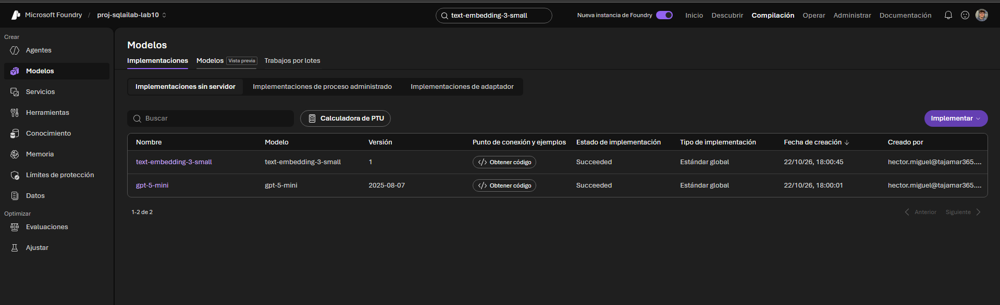
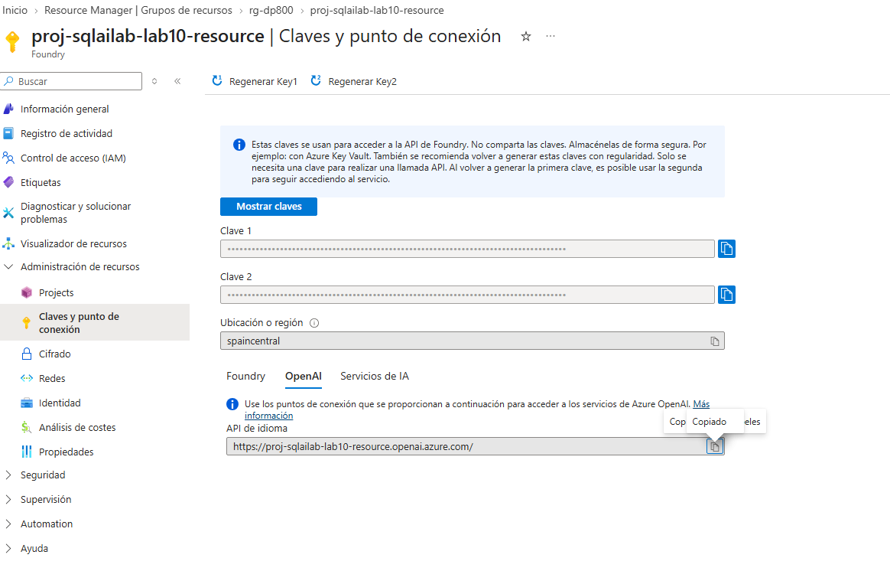

---

## 5. Configurar el acceso por identidad administrada

Azure SQL se autentica contra Azure OpenAI con su identidad administrada (sin claves).

1. Portal de Azure → **SQL server** (el servidor lógico, no la base de datos).
2. **Security → Identity**.
3. *System assigned managed identity* → **Status: On** → **Save**.
4. Ir al recurso **Azure OpenAI / Foundry** → **Access control (IAM)**.
5. **+ Add → Add role assignment**.
6. Pestaña **Role**: buscar y elegir **Cognitive Services OpenAI User** → **Next**.
7. Pestaña **Members**: **Managed identity** → **+ Select members**.
8. En *Managed identity* elegir **SQL server**, seleccionar mi servidor → **Select**.
9. **Review + assign** (dos veces).

> La asignación puede tardar hasta 5 minutos en surtir efecto. Mientras tanto se puede seguir.

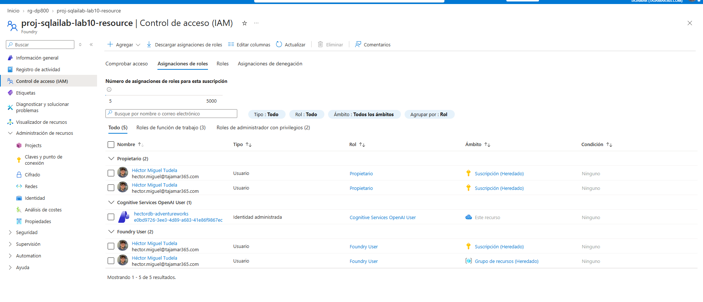

---

## 6. Crear la tabla `ProductReview`

AdventureWorksLT no trae reseñas, así que se carga una tabla con 140 reseñas.

1. Conectar a la base de datos desde SSMS o VS Code:
   - **Servidor:** `<servidor>.database.windows.net`
   - **Base de datos:** `AdventureWorksLT`
   - **Autenticación:** *Microsoft Entra MFA* o *SQL Login* según lo elegido en el paso 3.
2. Descargar [`product-reviews-insert.sql`](https://raw.githubusercontent.com/MicrosoftLearning/mslearn-sql-developer/main/Allfiles/product-reviews-insert.sql) y guardarlo en local.
3. Abrir el archivo y ejecutar **el script completo** contra `AdventureWorksLT`.
4. Verificar:

```sql
SELECT COUNT(*) AS TotalReviews FROM dbo.ProductReview;
GO
```

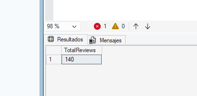

Comprobar además el nombre de la clave primaria (lo necesita el índice full-text más adelante):

```sql
SELECT name FROM sys.indexes
WHERE object_id = OBJECT_ID('dbo.ProductReview') AND is_primary_key = 1;
GO
```

Debe devolver `PK_ProductReview`. Si es otro nombre, usar ese en el apartado 9.

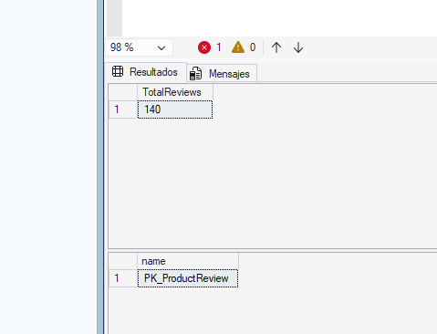

---

## 7. Credencial de base de datos y modelo externo de embeddings

### 7.1 Master key y credencial con identidad administrada

Sustituir `<your-openai-endpoint>` por el nombre del endpoint (ej. `proj-sqlailab-resource`) y poner una contraseña fuerte.

```sql
-- Crear la master key de la base de datos si no existe
IF NOT EXISTS (SELECT * FROM sys.symmetric_keys WHERE name = '##MS_DatabaseMasterKey##')
    CREATE MASTER KEY ENCRYPTION BY PASSWORD = '<your strong password here>';
GO

-- Crear la credencial usando Managed Identity
CREATE DATABASE SCOPED CREDENTIAL [https://<your-openai-endpoint>.openai.azure.com]
WITH IDENTITY = 'Managed Identity', SECRET = '{"resourceid":"https://cognitiveservices.azure.com"}';
GO
```

> ⚠️ **No cambiar** el `resourceid` del SECRET: debe ser exactamente `https://cognitiveservices.azure.com` (audiencia OAuth fija de Cognitive Services). Si se cambia, falla la autenticación.

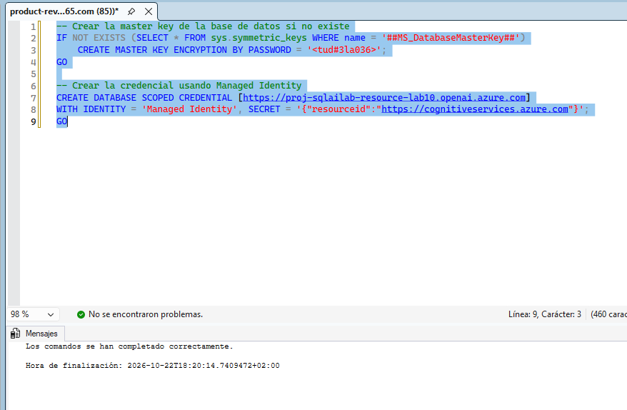

### 7.2 Modelo externo de embeddings

```sql
CREATE EXTERNAL MODEL my_embedding_model
WITH (
    LOCATION = 'https://<your-openai-endpoint>.openai.azure.com/openai/deployments/text-embedding-3-small/embeddings?api-version=2024-10-21',
    API_FORMAT = 'Azure OpenAI',
    MODEL_TYPE = EMBEDDINGS,
    MODEL = 'text-embedding-3-small',
    CREDENTIAL = [https://<your-openai-endpoint>.openai.azure.com]
);
GO
```

Verificar:

```sql
SELECT name, api_format, model_type_desc, model, location
FROM sys.external_models;
GO
```

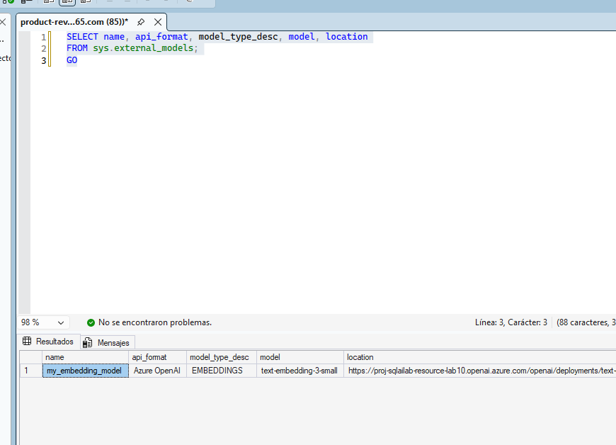

---

## 8. Columna vectorial, embeddings e índice vectorial

### 8.1 Añadir la columna vectorial

```sql
ALTER TABLE dbo.ProductReview
ADD ReviewVector VECTOR(1536);
GO
```

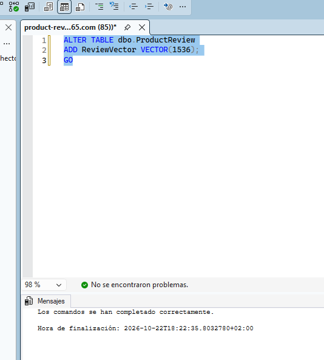

### 8.2 Generar los embeddings por lotes

Combina nombre de producto, título y texto de la reseña. Procesa 30 filas por lote, con pausa de 2 s y hasta 3 reintentos si hay límite de tasa.

```sql
DECLARE @batchSize INT = 30;
DECLARE @rowsUpdated INT = 1;
DECLARE @retryCount INT;
DECLARE @maxRetries INT = 3;

WHILE @rowsUpdated > 0
BEGIN
    SET @retryCount = 0;

    RETRY:
    BEGIN TRY
        UPDATE TOP (@batchSize) r
        SET r.ReviewVector = AI_GENERATE_EMBEDDINGS(
            p.Name + ' - ' + r.ReviewTitle + ': ' + r.ReviewText
            USE MODEL my_embedding_model)
        FROM dbo.ProductReview r
        INNER JOIN SalesLT.Product p ON r.ProductID = p.ProductID
        WHERE r.ReviewVector IS NULL;

        SET @rowsUpdated = @@ROWCOUNT;

        IF @rowsUpdated > 0
            WAITFOR DELAY '00:00:02';
    END TRY
    BEGIN CATCH
        SET @retryCount += 1;
        IF @retryCount <= @maxRetries
        BEGIN
            PRINT 'Rate limited. Retrying in 5 seconds... (Attempt '
                + CAST(@retryCount AS NVARCHAR(10)) + ' of '
                + CAST(@maxRetries AS NVARCHAR(10)) + ')';
            WAITFOR DELAY '00:00:05';
            GOTO RETRY;
        END
        ELSE
            THROW;
    END CATCH
END
GO
```

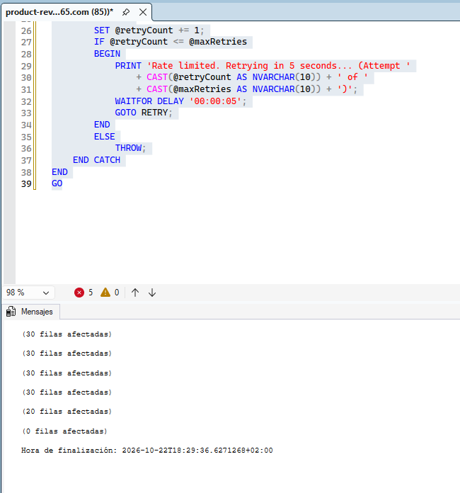

Tarda un par de minutos. Si falla con 403/autenticación, esperar a que el rol de la sección 5 se propague (hasta 5 min) y volver a ejecutar: el bucle solo procesa filas con `ReviewVector IS NULL`.

### 8.3 Verificar

```sql
SELECT
    COUNT(*)            AS TotalReviews,
    COUNT(ReviewVector) AS ReviewsWithEmbeddings
FROM dbo.ProductReview;
GO
```

Resultado esperado: **140** y **140**.

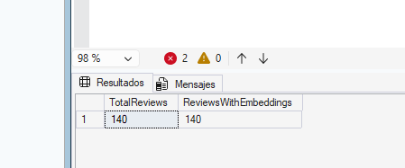

### 8.4 Crear el índice vectorial DiskANN

```sql
ALTER DATABASE SCOPED CONFIGURATION SET PREVIEW_FEATURES = ON;
GO

ALTER DATABASE SCOPED CONFIGURATION SET ALLOW_STALE_VECTOR_INDEX = ON;
GO

CREATE VECTOR INDEX IX_Review_ReviewVector
ON dbo.ProductReview(ReviewVector)
WITH (METRIC = 'cosine', TYPE = 'DISKANN');
GO
```

- `DISKANN` crea un índice de vecinos más cercanos aproximados (ANN) basado en grafo.
- `ALLOW_STALE_VECTOR_INDEX = ON` evita que la tabla quede en solo lectura al existir un índice vectorial.

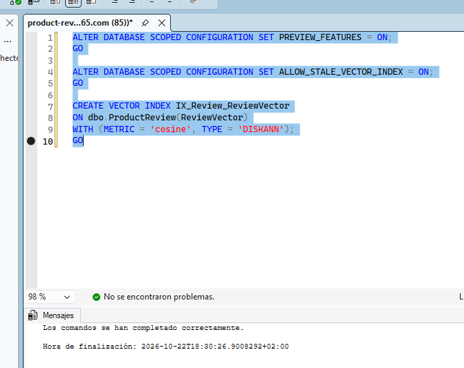

---

## 9. Crear el índice full-text

### 9.1 Catálogo e índice

```sql
CREATE FULLTEXT CATALOG ProductReviewCatalog AS DEFAULT;
GO

CREATE FULLTEXT INDEX ON dbo.ProductReview
(
    ReviewTitle LANGUAGE 1033,
    ReviewText  LANGUAGE 1033
)
KEY INDEX PK_ProductReview
ON ProductReviewCatalog
WITH (CHANGE_TRACKING AUTO);
GO
```

- `LANGUAGE 1033` = inglés (inflexiones: *ride* ↔ *riding*).
- `CHANGE_TRACKING AUTO` mantiene el índice actualizado.

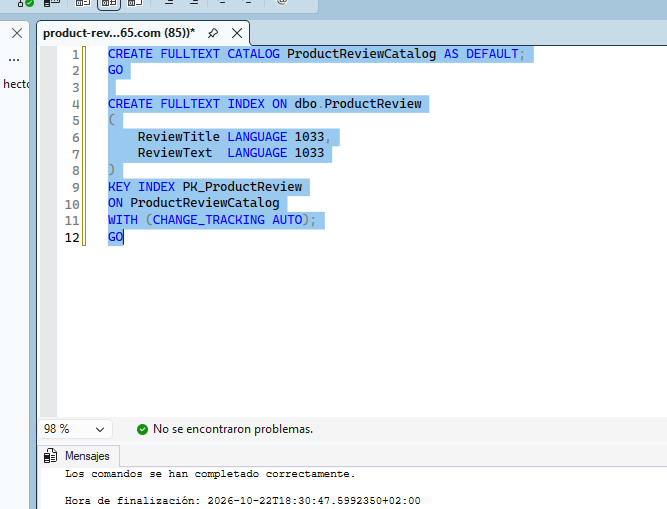

### 9.2 Verificar el estado

```sql
SELECT
    OBJECTPROPERTY(OBJECT_ID('dbo.ProductReview'), 'TableFullTextPopulateStatus') AS PopulateStatus,
    OBJECTPROPERTY(OBJECT_ID('dbo.ProductReview'), 'TableHasActiveFulltextIndex') AS HasActiveIndex;
GO
```

- `PopulateStatus = 0` → poblado. `1` → aún poblándose (esperar y repetir).
- `HasActiveIndex = 1` → índice activo.

Primera prueba:
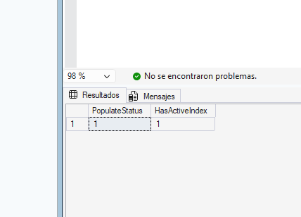

Segunda prueba:
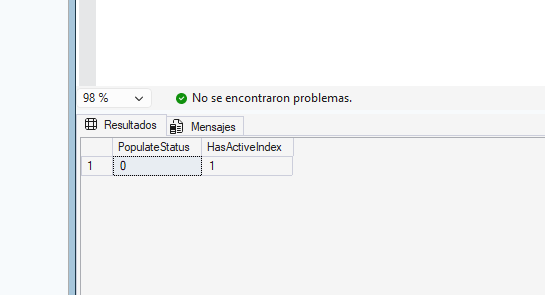

---

## 10. Búsqueda con predicados full-text

### 10.1 `CONTAINS` – palabra exacta

```sql
SELECT r.ReviewTitle, r.ReviewText, r.Rating, p.Name AS ProductName
FROM dbo.ProductReview r
INNER JOIN SalesLT.Product p ON r.ProductID = p.ProductID
WHERE CONTAINS(r.ReviewText, 'puncture');
GO
```

### 10.2 `FREETEXT` – frase con inflexiones

```sql
SELECT TOP 10 r.ReviewTitle, r.ReviewText, r.Rating, p.Name AS ProductName
FROM dbo.ProductReview r
INNER JOIN SalesLT.Product p ON r.ProductID = p.ProductID
WHERE FREETEXT(r.ReviewText, 'warm gloves for cold winter commuting');
GO
```

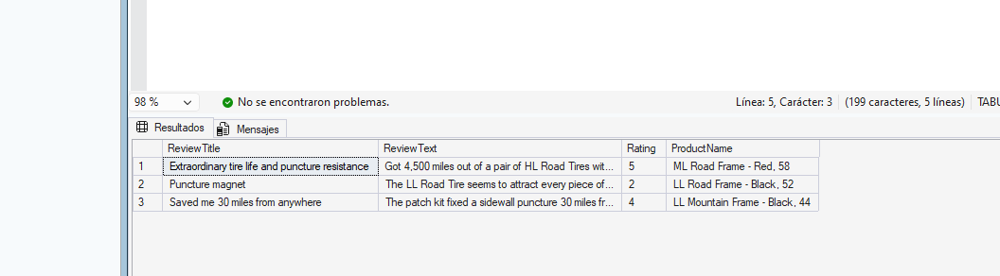

### 10.3 `CONTAINSTABLE` – resultados con ranking

```sql
SELECT TOP 10
    r.ReviewTitle, r.ReviewText, r.Rating,
    p.Name AS ProductName,
    ft.[RANK] AS FullTextRank
FROM dbo.ProductReview r
INNER JOIN SalesLT.Product p ON r.ProductID = p.ProductID
INNER JOIN CONTAINSTABLE(dbo.ProductReview, (ReviewTitle, ReviewText),
    'FORMSOF(INFLECTIONAL, mountain) AND FORMSOF(INFLECTIONAL, trail)') AS ft
    ON r.ReviewID = ft.[KEY]
ORDER BY ft.[RANK] DESC;
GO
```

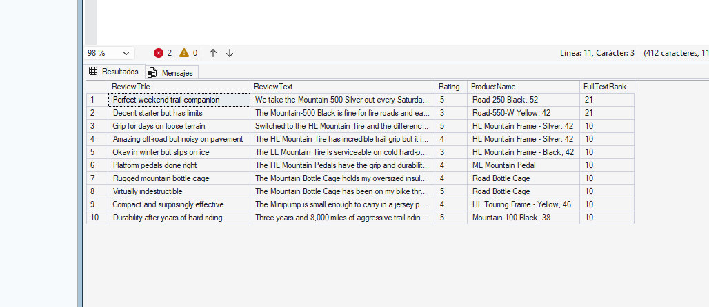

### 10.4 Búsqueda por prefijo

```sql
SELECT r.ReviewTitle, r.ReviewText, r.Rating, p.Name AS ProductName
FROM dbo.ProductReview r
INNER JOIN SalesLT.Product p ON r.ProductID = p.ProductID
WHERE CONTAINS(r.ReviewText, '"comfort*"');
GO
```

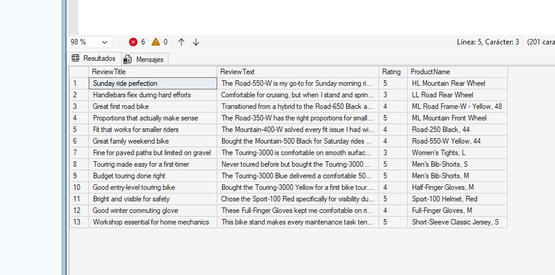

| Predicado | Comportamiento |
|---|---|
| `CONTAINS` | Palabra o frase exacta; control preciso, consulta más rígida |
| `FREETEXT` | Expande inflexiones y descarta *stopwords*; más flexible, puede ser menos preciso |
| `CONTAINSTABLE` | Como `CONTAINS`, pero devuelve `KEY` y `RANK` |
| Prefijo `"comfort*"` | Coincide con todas las palabras que empiezan por ese prefijo |

---

## 11. Búsqueda por similitud vectorial

### 11.1 `VECTOR_DISTANCE` – exacta (recorre todas las filas)

```sql
DECLARE @searchText NVARCHAR(1000) = 'comfortable seat for long distance touring';
DECLARE @searchVector VECTOR(1536);

SELECT @searchVector = AI_GENERATE_EMBEDDINGS(@searchText USE MODEL my_embedding_model);

SELECT TOP 5
    p.Name AS ProductName,
    r.ReviewTitle,
    r.ReviewText,
    r.Rating,
    VECTOR_DISTANCE('cosine', @searchVector, r.ReviewVector) AS Distance
FROM dbo.ProductReview r
INNER JOIN SalesLT.Product p ON r.ProductID = p.ProductID
ORDER BY Distance;
GO
```

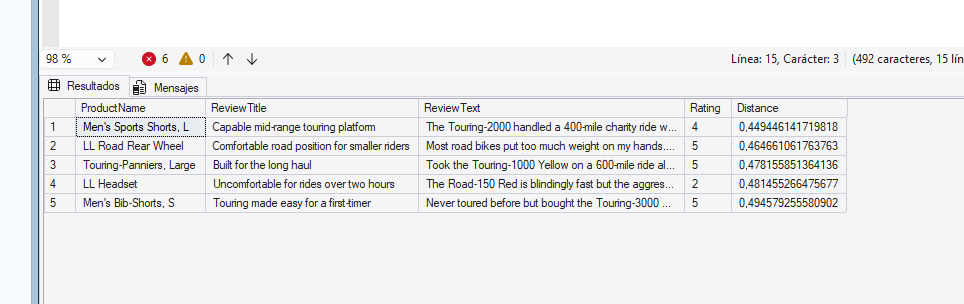

### 11.2 `VECTOR_SEARCH` – aproximada con DiskANN

```sql
DECLARE @searchText NVARCHAR(1000) = 'something to keep me visible when riding at night';
DECLARE @searchVector VECTOR(1536);

SELECT @searchVector = AI_GENERATE_EMBEDDINGS(@searchText USE MODEL my_embedding_model);

SELECT
    p.Name AS ProductName,
    r.ReviewTitle,
    r.ReviewText,
    r.Rating,
    pc.Name AS Category,
    vs.distance AS Distance
FROM VECTOR_SEARCH(
    TABLE = dbo.ProductReview AS r,
    COLUMN = ReviewVector,
    SIMILAR_TO = @searchVector,
    METRIC = 'cosine',
    TOP_N = 5
) AS vs
INNER JOIN SalesLT.Product p
    ON r.ProductID = p.ProductID
INNER JOIN SalesLT.ProductCategory pc
    ON p.ProductCategoryID = pc.ProductCategoryID
ORDER BY vs.distance;
GO
```

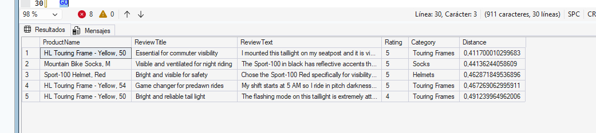

### 11.3 `VECTORPROPERTY` – metadatos

```sql
SELECT TOP 1
    VECTORPROPERTY(ReviewVector, 'Dimensions') AS VectorDimensions,
    VECTORPROPERTY(ReviewVector, 'BaseType')   AS VectorBaseType
FROM dbo.ProductReview
WHERE ReviewVector IS NOT NULL;
GO
```

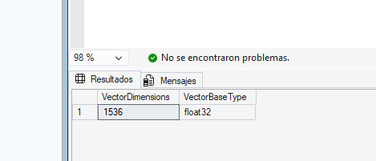


| Función | Tipo | Uso recomendado |
|---|---|---|
| `VECTOR_DISTANCE` | Exacta (escaneo completo) | Tablas pequeñas |
| `VECTOR_SEARCH` | Aproximada (índice DiskANN) | Tablas grandes |

---

## 12. Búsqueda híbrida con RRF

La fusión por rango (RRF) combina dos listas usando la posición en lugar de la puntuación bruta:

```
rrf_score = 1 / (k + rank_keyword) + 1 / (k + rank_vector)      (k = 60)
```

Los elementos que aparecen en ambas listas obtienen mayor puntuación.

```sql
DECLARE @searchText NVARCHAR(1000) = 'durable tires that resist punctures on rough terrain';
DECLARE @searchVector VECTOR(1536);
DECLARE @topN INT = 50;
DECLARE @rrfK INT = 60;

SELECT @searchVector = AI_GENERATE_EMBEDDINGS(@searchText USE MODEL my_embedding_model);

WITH keyword_search AS (
    SELECT TOP(@topN)
        r.ReviewID,
        RANK() OVER (ORDER BY ft.[RANK] DESC) AS keyword_rank
    FROM dbo.ProductReview r
    INNER JOIN FREETEXTTABLE(dbo.ProductReview, (ReviewTitle, ReviewText), @searchText) AS ft
        ON r.ReviewID = ft.[KEY]
),
vector_search AS (
    SELECT
        ReviewID,
        RANK() OVER (ORDER BY distance) AS vector_rank
    FROM (
        SELECT TOP (50) WITH APPROXIMATE
            r.ReviewID,
            vs.distance
        FROM VECTOR_SEARCH(
            TABLE = dbo.ProductReview AS r,
            COLUMN = ReviewVector,
            SIMILAR_TO = @searchVector,
            METRIC = 'cosine'
        ) AS vs
        ORDER BY vs.distance
    ) AS similar_reviews
),
combined AS (
    SELECT
        COALESCE(ks.ReviewID, vs.ReviewID) AS ReviewID,
        ks.keyword_rank,
        vs.vector_rank,
        COALESCE(1.0 / (@rrfK + ks.keyword_rank), 0.0) +
        COALESCE(1.0 / (@rrfK + vs.vector_rank), 0.0) AS rrf_score
    FROM keyword_search ks
    FULL OUTER JOIN vector_search vs ON ks.ReviewID = vs.ReviewID
)
SELECT TOP 10
    p.Name AS ProductName,
    r.ReviewTitle,
    r.ReviewText,
    r.Rating,
    c.keyword_rank,
    c.vector_rank,
    c.rrf_score
FROM combined c
INNER JOIN dbo.ProductReview r ON c.ReviewID = r.ReviewID
INNER JOIN SalesLT.Product p ON r.ProductID = p.ProductID
ORDER BY c.rrf_score DESC;
GO
```

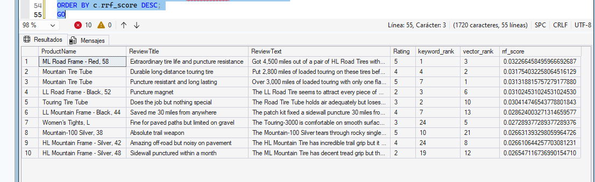

---

## 13. Comparación de los tres enfoques

Misma pregunta en los tres métodos: **"comfortable bike for long weekend rides with the family"**.

### 13.1 Solo full-text

```sql
SELECT TOP 5
    p.Name AS ProductName, r.ReviewTitle, r.ReviewText, r.Rating,
    ft.[RANK] AS FullTextRank
FROM dbo.ProductReview r
INNER JOIN SalesLT.Product p ON r.ProductID = p.ProductID
INNER JOIN FREETEXTTABLE(dbo.ProductReview, (ReviewTitle, ReviewText),
    'comfortable bike for long weekend rides with the family') AS ft
    ON r.ReviewID = ft.[KEY]
ORDER BY ft.[RANK] DESC;
GO
```

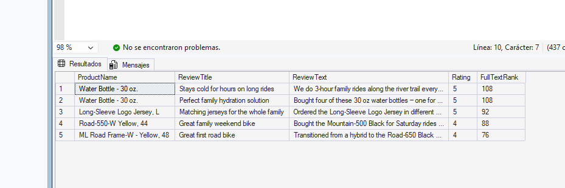

### 13.2 Solo vectorial

```sql
DECLARE @searchText NVARCHAR(1000) = 'comfortable bike for long weekend rides with the family';
DECLARE @searchVector VECTOR(1536);

SELECT @searchVector = AI_GENERATE_EMBEDDINGS(@searchText USE MODEL my_embedding_model);

SELECT
    p.Name AS ProductName, r.ReviewTitle, r.ReviewText, r.Rating,
    vs.distance AS Distance
FROM VECTOR_SEARCH(
    TABLE = dbo.ProductReview AS r,
    COLUMN = ReviewVector,
    SIMILAR_TO = @searchVector,
    METRIC = 'cosine',
    TOP_N = 5
) AS vs
INNER JOIN SalesLT.Product p
    ON r.ProductID = p.ProductID
ORDER BY vs.distance;
GO
```

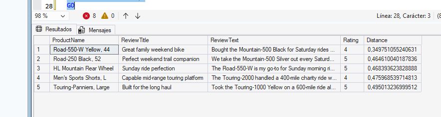

### 13.3 Híbrida (RRF)

```sql
DECLARE @searchText NVARCHAR(1000) = 'comfortable bike for long weekend rides with the family';
DECLARE @searchVector VECTOR(1536);
DECLARE @topN INT = 50;
DECLARE @rrfK INT = 60;

SELECT @searchVector = AI_GENERATE_EMBEDDINGS(@searchText USE MODEL my_embedding_model);

WITH keyword_search AS (
    SELECT TOP(@topN)
        r.ReviewID,
        RANK() OVER (ORDER BY ft.[RANK] DESC) AS keyword_rank
    FROM dbo.ProductReview r
    INNER JOIN FREETEXTTABLE(dbo.ProductReview, (ReviewTitle, ReviewText), @searchText) AS ft
        ON r.ReviewID = ft.[KEY]
),
vector_search AS (
    SELECT
        ReviewID,
        RANK() OVER (ORDER BY distance) AS vector_rank
    FROM (
        SELECT TOP (50) WITH APPROXIMATE
            r.ReviewID,
            vs.distance
        FROM VECTOR_SEARCH(
            TABLE = dbo.ProductReview AS r,
            COLUMN = ReviewVector,
            SIMILAR_TO = @searchVector,
            METRIC = 'cosine'
        ) AS vs
        ORDER BY vs.distance
    ) AS similar_reviews
),
combined AS (
    SELECT
        COALESCE(ks.ReviewID, vs.ReviewID) AS ReviewID,
        ks.keyword_rank,
        vs.vector_rank,
        COALESCE(1.0 / (@rrfK + ks.keyword_rank), 0.0) +
        COALESCE(1.0 / (@rrfK + vs.vector_rank), 0.0) AS rrf_score
    FROM keyword_search ks
    FULL OUTER JOIN vector_search vs ON ks.ReviewID = vs.ReviewID
)
SELECT TOP 5
    p.Name AS ProductName, r.ReviewTitle, r.ReviewText, r.Rating,
    c.keyword_rank, c.vector_rank, c.rrf_score
FROM combined c
INNER JOIN dbo.ProductReview r ON c.ReviewID = r.ReviewID
INNER JOIN SalesLT.Product p ON r.ProductID = p.ProductID
ORDER BY c.rrf_score DESC;
GO
```

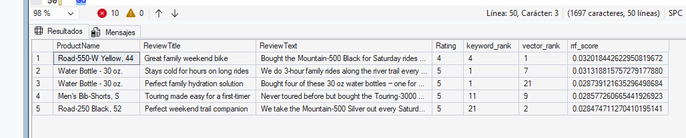

### 13.4 Tabla comparativa

| Enfoque | Fortaleza | Debilidad | Cuándo usarlo |
|---|---|---|---|
| Full-text | Coincidencia exacta de términos, rápido, ranking por relevancia | No entiende sinónimos ni intención | Códigos, nombres, términos técnicos |
| Vectorial | Entiende el significado aunque cambien las palabras | Puede pasar por alto términos concretos que pidió el usuario | Lenguaje natural, descripciones |
| Híbrida (RRF) | Combina ambas; sube lo que aparece en las dos listas | Consulta más compleja | Buscadores de producto de uso general |

---

## 14. Limpieza

> ⚠️ **No eliminar los recursos todavía.** Según la guía oficial, se reutilizan en los laboratorios 9, 10 y 11.

Cuando ya no hagan falta: Azure Portal → grupo de recursos → **Delete resource group** → escribir el nombre para confirmar → **Delete**. Si se usó un grupo ya existente, borrar por separado la base de datos SQL y el recurso de Azure OpenAI.

---

## 15. Problemas frecuentes

| Problema | Causa probable | Solución |
|---|---|---|
| No puedo conectar a la base de datos | IP sin permitir o método de autenticación equivocado | Revisar firewall del servidor y usar Entra MFA o SQL Login según lo configurado |
| `KEY INDEX` no encuentra `PK_ProductReview` | La PK tiene otro nombre | Consultar `sys.indexes` (apartado 6) y usar ese nombre |
| `PopulateStatus = 1` | El índice full-text aún se está poblando | Esperar unos segundos y repetir la consulta |
| `CREATE VECTOR INDEX` falla | Preview features desactivadas | Ejecutar `PREVIEW_FEATURES = ON` |
| Error 403 / autenticación al generar embeddings | Rol aún no propagado, o endpoint de la pestaña equivocada | Esperar hasta 5 minutos; usar el endpoint `.openai.azure.com` |
| `ReviewVector` con `NULL` | Embeddings sin generar | Volver a ejecutar el bucle por lotes del apartado 8.2 |

---

## 16. Conclusiones

- El **full-text** es la mejor opción cuando importa la palabra exacta.
- La **búsqueda vectorial** recupera por significado, aunque no coincidan las palabras.
- La **búsqueda híbrida con RRF** da los resultados más equilibrados al premiar lo que aparece en ambas listas.
- `VECTOR_SEARCH` con DiskANN escala mejor que `VECTOR_DISTANCE`, que recorre toda la tabla.