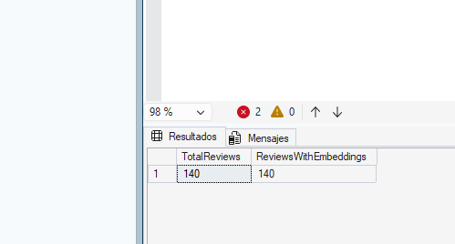
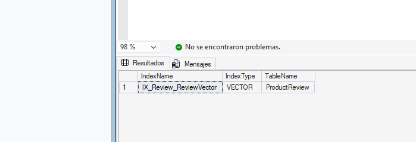
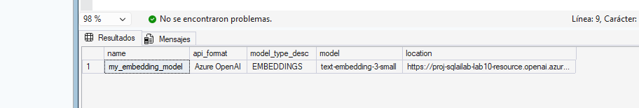
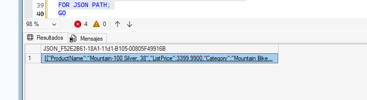
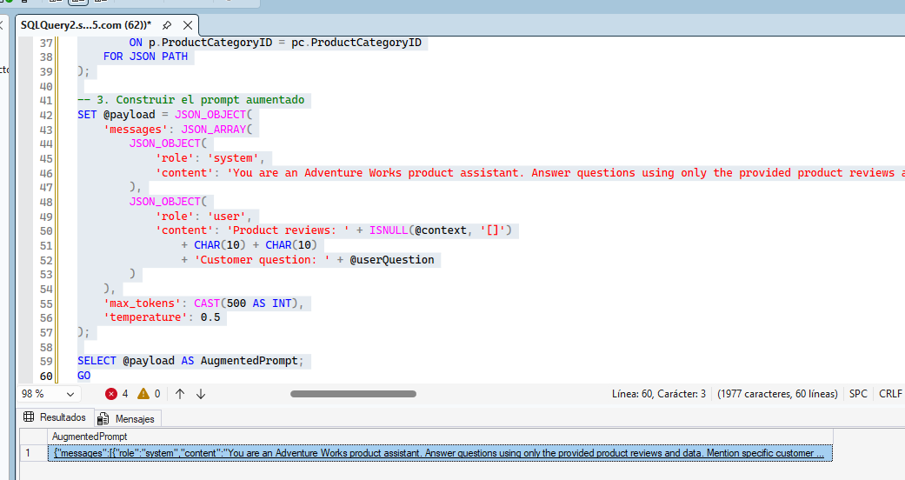
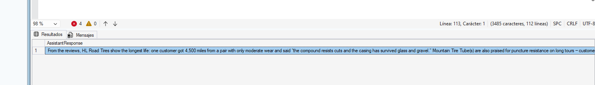
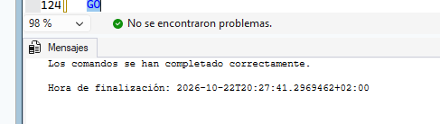
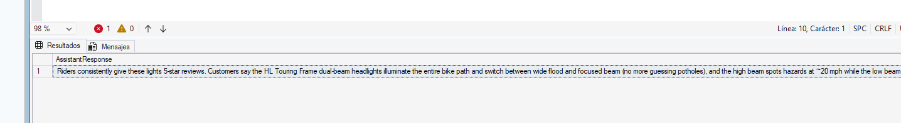
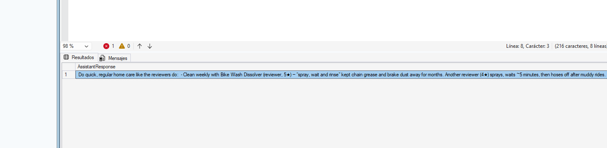
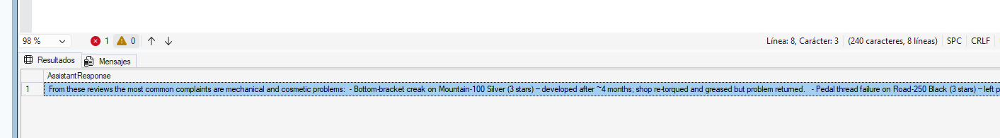

# Laboratorio 11 – Implementar soluciones RAG

**Guía oficial:** [11-implement-rag-solutions](https://microsoftlearning.github.io/mslearn-sql-developer/Instructions/Labs/11-implement-rag-solutions.html)  
**Base de datos:** `AdventureWorksLT` en Azure SQL Database  

---

## 1. Objetivo

Implementar una solución completa de **Retrieval-Augmented Generation (RAG)** usando Azure SQL Database y Azure OpenAI:

1. Convertir la pregunta del usuario en un embedding.
2. Recuperar las reseñas más relevantes con `VECTOR_SEARCH` y el índice DiskANN.
3. Convertir esas reseñas en contexto JSON.
4. Construir un prompt aumentado con instrucciones de grounding.
5. Invocar un modelo de chat de Azure OpenAI desde T-SQL.
6. Encapsular todo el flujo en el procedimiento `dbo.AskProductQuestion`.

A diferencia del Laboratorio 10, aquí no se comparan métodos de búsqueda: se utiliza la búsqueda vectorial como paso de recuperación para fundamentar la respuesta del modelo.

---

## 2. Reutilización del Laboratorio 10

Este laboratorio está diseñado para continuar el [Laboratorio 10](../dp800-lab10-miguel-tudela-hector/README.md). **No hay que crear otra base de datos ni repetir toda la preparación** si el Laboratorio 10 se terminó correctamente.

Antes de continuar, deben existir estos elementos:

| Elemento | Se reutiliza del Laboratorio 10 | Comprobación |
|---|---|---|
| Base de datos `AdventureWorksLT` | Sí | Conexión correcta a Azure SQL |
| Tabla `dbo.ProductReview` | Sí | 140 filas |
| Columna `ReviewVector VECTOR(1536)` | Sí | Consulta de la sección 3.1 |
| Embeddings de las 140 reseñas | Sí | `ReviewsWithEmbeddings = 140` |
| Índice `IX_Review_ReviewVector` | Sí | Consulta de la sección 3.2 |
| Identidad administrada del servidor SQL | Sí | Está activada |
| Rol `Cognitive Services OpenAI User` | Sí | Asignado al servidor SQL |
| Master key y credencial de base de datos | Sí | Consulta de la sección 6 del Laboratorio 10 |
| `my_embedding_model` | Sí | Consulta de la sección 7 del Laboratorio 10 |

### 2.1 Modelos de Foundry

El Laboratorio 10 desplegó `text-embedding-3-small`, que se reutiliza para crear el embedding de cada pregunta.

La guía oficial utiliza `gpt-5.4-mini`, pero en esta práctica se ha comprobado y configurado el deployment **`gpt-5-mini`**, que es el que se utiliza en los scripts de los pasos 7 y 8.

- No se debe volver a desplegar `text-embedding-3-small`.
- Si el nombre del deployment cambia en Foundry, hay que sustituirlo en la URL de chat.

> La URL del endpoint y la credencial siguen siendo las mismas. Solo cambia el nombre del deployment usado en la URL de chat.

### 2.2 Datos que hay que tener anotados

| Dato | Valor |
|---|---|
| Grupo de recursos | |
| Servidor SQL (`<servidor>.database.windows.net`) | |
| Base de datos | `AdventureWorksLT` |
| Proyecto de Foundry | |
| Nombre del endpoint OpenAI (parte anterior a `.openai.azure.com`) | |
| Deployment de embeddings | `text-embedding-3-small` |
| Deployment de chat utilizado | `gpt-5-mini` |

---

## 3. Comprobaciones iniciales

Conectar desde SSMS o VS Code a `AdventureWorksLT` usando el mismo método de autenticación del Laboratorio 10.

### 3.1 Comprobar la tabla y los embeddings

```sql
SELECT
    COUNT(*) AS TotalReviews,
    COUNT(ReviewVector) AS ReviewsWithEmbeddings
FROM dbo.ProductReview;
GO
```

El resultado esperado es `140` y `140`.



### 3.2 Comprobar el índice vectorial

```sql
SELECT
    i.name AS IndexName,
    i.type_desc AS IndexType,
    OBJECT_NAME(i.object_id) AS TableName
FROM sys.indexes AS i
WHERE i.object_id = OBJECT_ID('dbo.ProductReview')
  AND i.name = 'IX_Review_ReviewVector';
GO
```

Debe aparecer `IX_Review_ReviewVector` sobre `dbo.ProductReview`.



---

## 4. Comprobar Foundry y el acceso de Azure SQL

### 4.1 Comprobar los despliegues

En [Microsoft Foundry](https://ai.azure.com), abrir **Build → Models** y comprobar:

- `text-embedding-3-small`: necesario para `AI_GENERATE_EMBEDDINGS`.
- `gpt-5-mini`: deployment utilizado para la respuesta generativa de este laboratorio.

El nombre del deployment es sensible a la configuración usada en la URL. Si se eligió otro nombre, sustituirlo en los scripts.

### 4.2 Comprobar la identidad administrada

En Azure Portal:

1. Abrir el **SQL server** lógico, no la base de datos.
2. Ir a **Security → Identity** y comprobar que la identidad administrada del sistema está activada.
3. En el recurso de Azure OpenAI / Foundry, abrir **Access control (IAM)**.
4. Comprobar que esa identidad tiene el rol **Cognitive Services OpenAI User**.

Si se acaba de asignar el rol, esperar hasta cinco minutos antes de probar los scripts.

### 4.3 Comprobar el modelo externo de embeddings

```sql
SELECT
    name,
    api_format,
    model_type_desc,
    model,
    location
FROM sys.external_models
WHERE name = 'my_embedding_model';
GO
```

La columna `location` debe apuntar al deployment `text-embedding-3-small` y al endpoint `.openai.azure.com`.



---

## 5. Recuperación: buscar reseñas y crear el contexto JSON

Este es el primer paso propio de RAG. La pregunta se convierte en un vector y se usa `VECTOR_SEARCH` para recuperar las cinco reseñas más cercanas.

> **Compatibilidad con índices vectoriales nuevos:** en algunas versiones actuales de Azure SQL, un índice DiskANN nuevo no admite el parámetro `TOP_N` dentro de `VECTOR_SEARCH`. En ese caso, el número de resultados se indica en el `SELECT` con `TOP (5) WITH APPROXIMATE`, como en los scripts de este laboratorio. Si se copia la consulta original de la guía y aparece el error 42274 (`Vector search with newer index version does not support explicit TOP_N parameter`), hay que usar esta variante.

```sql
DECLARE @userQuestion NVARCHAR(1000) =
    'What mountain bike can handle really technical rocky trails?';
DECLARE @questionVector VECTOR(1536);

-- Convertir la pregunta en un embedding
SELECT @questionVector =
    AI_GENERATE_EMBEDDINGS(@userQuestion USE MODEL my_embedding_model);

-- Recuperar primero las cinco reseñas más relevantes
;WITH RelevantReviews AS (
    SELECT TOP (5) WITH APPROXIMATE
        r.ProductID,
        r.Rating,
        r.ReviewTitle,
        r.ReviewText,
        vs.distance AS Distance
    FROM VECTOR_SEARCH(
        TABLE = dbo.ProductReview AS r,
        COLUMN = ReviewVector,
        SIMILAR_TO = @questionVector,
        METRIC = 'cosine'
    ) AS vs
    ORDER BY vs.distance
)
-- Unir después las reseñas con las tablas de productos
SELECT
    p.Name AS ProductName,
    p.ListPrice,
    pc.Name AS Category,
    rr.Rating,
    rr.ReviewTitle,
    rr.ReviewText,
    rr.Distance
FROM RelevantReviews AS rr
INNER JOIN SalesLT.Product AS p
    ON rr.ProductID = p.ProductID
INNER JOIN SalesLT.ProductCategory AS pc
    ON p.ProductCategoryID = pc.ProductCategoryID
FOR JSON PATH;
GO
```

### Qué se debe observar

- `VECTOR_SEARCH` usa el índice DiskANN creado en el Laboratorio 10.
- Una distancia menor indica mayor similitud.
- Las reseñas son experiencias individuales y no únicamente descripciones de productos.
- `FOR JSON PATH` prepara el contexto que se enviará al modelo de chat.



---

## 6. Aumentar el prompt con el contexto de la base de datos

En esta fase se construye el payload de chat, pero todavía no se llama a Azure OpenAI. El JSON contiene un mensaje `system` con las reglas del asistente y un mensaje `user` con las reseñas recuperadas y la pregunta.

```sql
DECLARE @userQuestion NVARCHAR(1000) =
    'What is the best bike for commuting to work in rainy weather?';
DECLARE @questionVector VECTOR(1536);
DECLARE @context NVARCHAR(MAX);
DECLARE @payload NVARCHAR(MAX);

-- 1. Convertir la pregunta en un embedding
SELECT @questionVector =
    AI_GENERATE_EMBEDDINGS(@userQuestion USE MODEL my_embedding_model);

-- 2. Recuperar el contexto relevante
SET @context = (
    SELECT
        p.Name AS ProductName,
        p.ListPrice,
        pc.Name AS Category,
        rr.Rating,
        rr.ReviewTitle,
        rr.ReviewText
    FROM (
        SELECT TOP (5) WITH APPROXIMATE
            r.ProductID,
            r.Rating,
            r.ReviewTitle,
            r.ReviewText
        FROM VECTOR_SEARCH(
            TABLE = dbo.ProductReview AS r,
            COLUMN = ReviewVector,
            SIMILAR_TO = @questionVector,
            METRIC = 'cosine'
        ) AS vs
        ORDER BY vs.distance
    ) AS rr
    INNER JOIN SalesLT.Product AS p
        ON rr.ProductID = p.ProductID
    INNER JOIN SalesLT.ProductCategory AS pc
        ON p.ProductCategoryID = pc.ProductCategoryID
    FOR JSON PATH
);

-- 3. Construir el prompt aumentado
SET @payload = JSON_OBJECT(
    'messages': JSON_ARRAY(
        JSON_OBJECT(
            'role': 'system',
            'content': 'You are an Adventure Works product assistant. Answer questions using only the provided product reviews and data. Mention specific customer experiences from the reviews when relevant. Be concise and helpful. If the data does not contain enough information, say so.'
        ),
        JSON_OBJECT(
            'role': 'user',
            'content': 'Product reviews: ' + ISNULL(@context, '[]')
                + CHAR(10) + CHAR(10)
                + 'Customer question: ' + @userQuestion
        )
    ),
    'max_tokens': CAST(500 AS INT),
    'temperature': 0.5
);

SELECT @payload AS AugmentedPrompt;
GO
```

Revisar el resultado: debe ser un JSON con los mensajes, las reseñas recuperadas y la pregunta. El modelo debe quedar limitado a la información proporcionada por el contexto.



---

## 7. Generar una respuesta llamando a Azure OpenAI

Este script ejecuta todo el flujo RAG en una sola consulta: embedding, recuperación, construcción del prompt, llamada al endpoint y extracción del texto de respuesta.

En este paso se utilizan el endpoint y el deployment configurados en Foundry:

- Endpoint: `proj-sqlailab-lab10-resource.openai.azure.com`
- Deployment de chat: `gpt-5-mini`

```sql

DECLARE @userQuestion NVARCHAR(1000) =
    N'Which tires last the longest and resist punctures?';

DECLARE @questionVector VECTOR(1536);
DECLARE @context NVARCHAR(MAX);
DECLARE @payload NVARCHAR(MAX);
DECLARE @response NVARCHAR(MAX);
DECLARE @returnValue INT;
DECLARE @answer NVARCHAR(MAX);
DECLARE @finishReason NVARCHAR(50);

-- 1. Convertir la pregunta en un embedding
SELECT @questionVector =
    AI_GENERATE_EMBEDDINGS(
        @userQuestion USE MODEL my_embedding_model
    );

-- 2. Recuperar las 5 reseñas más relevantes
SET @context = (
    SELECT
        p.Name AS ProductName,
        p.ListPrice,
        pc.Name AS Category,
        rr.Rating,
        rr.ReviewTitle,
        rr.ReviewText
    FROM (
        SELECT TOP (5) WITH APPROXIMATE
            r.ProductID,
            r.Rating,
            r.ReviewTitle,
            r.ReviewText
        FROM VECTOR_SEARCH(
            TABLE = dbo.ProductReview AS r,
            COLUMN = ReviewVector,
            SIMILAR_TO = @questionVector,
            METRIC = 'cosine'
        ) AS vs
        ORDER BY vs.distance
    ) AS rr
    INNER JOIN SalesLT.Product AS p
        ON rr.ProductID = p.ProductID
    INNER JOIN SalesLT.ProductCategory AS pc
        ON p.ProductCategoryID = pc.ProductCategoryID
    FOR JSON PATH
);

-- 3. Construir el prompt aumentado (RAG)
SET @payload = JSON_OBJECT(
    'messages': JSON_ARRAY(
        JSON_OBJECT(
            'role': 'system',
            'content': 'You are an Adventure Works product assistant. Answer questions using only the provided product reviews and data. Mention specific customer experiences from the reviews when relevant. Be concise and helpful. If the data does not contain enough information, say so.'
        ),
        JSON_OBJECT(
            'role': 'user',
            'content': 'Product reviews: '
                + ISNULL(@context, N'[]')
                + CHAR(10) + CHAR(10)
                + 'Customer question: '
                + @userQuestion
        )
    ),
    'max_completion_tokens': 1500
);

-- 4. Llamar a Azure OpenAI
EXECUTE @returnValue = sp_invoke_external_rest_endpoint
    @url = N'https://proj-sqlailab-lab10-resource.openai.azure.com/openai/deployments/gpt-5-mini/chat/completions?api-version=2024-10-21',
    @method = 'POST',
    @payload = @payload,
    @credential = N'proj-sqlailab-lab10-resource.openai.azure.com',
    @response = @response OUTPUT;

-- 5. Comprobar y extraer la respuesta
IF @returnValue = 0
BEGIN
    SELECT
        @answer = content,
        @finishReason = finish_reason
    FROM OPENJSON(@response, '$.result.choices')
    WITH (
        content NVARCHAR(MAX) '$.message.content',
        finish_reason NVARCHAR(50) '$.finish_reason'
    );

    IF @answer IS NOT NULL AND LEN(@answer) > 0
    BEGIN
        SELECT @answer AS AssistantResponse;
    END
    ELSE
    BEGIN
        -- La llamada tuvo éxito, pero no se ha obtenido texto
        SELECT
            @finishReason AS FinishReason,
            @response AS FullResponse,
            @context AS RetrievedReviews;
    END
END
ELSE
BEGIN
    -- Mostrar el error HTTP completo
    SELECT
        @returnValue AS HttpStatus,
        JSON_VALUE(@response, '$.result.error.code')
            AS ErrorCode,
        JSON_VALUE(@response, '$.result.error.message')
            AS ErrorMessage,
        @response AS FullResponse;
END;
GO

```



---

## 8. Crear un procedimiento almacenado RAG

El procedimiento hace reutilizable el flujo completo para que una aplicación solo tenga que enviar una pregunta.

En este laboratorio se reutilizan el endpoint y el deployment que funcionan en el paso 7:

- Endpoint: `proj-sqlailab-lab10-resource.openai.azure.com`
- Deployment de chat: `gpt-5-mini`
- Credencial REST: `proj-sqlailab-lab10-resource.openai.azure.com`

La credencial de `sp_invoke_external_rest_endpoint` se escribe solo con el hostname, sin `https://`.

```sql
CREATE OR ALTER PROCEDURE dbo.AskProductQuestion
    @Question NVARCHAR(1000),
    @Answer NVARCHAR(MAX) OUTPUT
AS
BEGIN
    SET NOCOUNT ON;

    DECLARE @questionVector VECTOR(1536);
    DECLARE @context NVARCHAR(MAX);
    DECLARE @payload NVARCHAR(MAX);
    DECLARE @response NVARCHAR(MAX);
    DECLARE @returnValue INT;
    DECLARE @finishReason NVARCHAR(50);

    -- 1. Embedding de la pregunta
    SELECT @questionVector =
        AI_GENERATE_EMBEDDINGS(
            @Question USE MODEL my_embedding_model
        );

    -- 2. Recuperación vectorial del contexto
    SET @context = (
        SELECT
            p.Name AS ProductName,
            p.ListPrice,
            pc.Name AS Category,
            rr.Rating,
            rr.ReviewTitle,
            rr.ReviewText
        FROM (
            SELECT TOP (5) WITH APPROXIMATE
                r.ProductID,
                r.Rating,
                r.ReviewTitle,
                r.ReviewText
            FROM VECTOR_SEARCH(
                TABLE = dbo.ProductReview AS r,
                COLUMN = ReviewVector,
                SIMILAR_TO = @questionVector,
                METRIC = 'cosine'
            ) AS vs
            ORDER BY vs.distance
        ) AS rr
        INNER JOIN SalesLT.Product AS p
            ON rr.ProductID = p.ProductID
        INNER JOIN SalesLT.ProductCategory AS pc
            ON p.ProductCategoryID = pc.ProductCategoryID
        FOR JSON PATH
    );

    IF @context IS NULL
    BEGIN
        SET @Answer =
            'No reviews found matching your query. Please try a different question.';
        RETURN;
    END;

    -- 3. Prompt aumentado
    SET @payload = JSON_OBJECT(
        'messages': JSON_ARRAY(
            JSON_OBJECT(
                'role': 'system',
                'content': 'You are an Adventure Works product assistant. Follow these rules:
1. Answer only using the provided product reviews and data
2. Reference specific customer experiences from the reviews when relevant
3. Include star ratings to help the customer assess product quality
4. Keep responses under 150 words
5. Suggest related products when relevant'
            ),
            JSON_OBJECT(
                'role': 'user',
                'content': 'Product reviews: ' + @context
                    + CHAR(10) + CHAR(10)
                    + 'Customer question: ' + @Question
            )
        ),
        'max_completion_tokens': CAST(1500 AS INT)
    );

    -- 4. Llamada al modelo de chat
    EXECUTE @returnValue = sp_invoke_external_rest_endpoint
        @url = N'https://proj-sqlailab-lab10-resource.openai.azure.com/openai/deployments/gpt-5-mini/chat/completions?api-version=2024-10-21',
        @method = 'POST',
        @payload = @payload,
        @credential = N'proj-sqlailab-lab10-resource.openai.azure.com',
        @response = @response OUTPUT;

    -- 5. Extraer la respuesta y tratar errores habituales
    IF @returnValue = 0
    BEGIN
        SELECT
            @Answer = content,
            @finishReason = finish_reason
        FROM OPENJSON(@response, '$.result.choices')
        WITH (
            content NVARCHAR(MAX) '$.message.content',
            finish_reason NVARCHAR(50) '$.finish_reason'
        );

        IF @Answer IS NULL OR LEN(@Answer) = 0
            SET @Answer =
                N'The model did not return a text response. Finish reason: '
                + ISNULL(@finishReason, N'unknown');
    END
    ELSE IF @returnValue = 429
    BEGIN
        SET @Answer =
            N'The service is currently busy. Please try again in a moment.';
    END
    ELSE IF @returnValue IN (401, 403)
    BEGIN
        SET @Answer =
            N'Authentication failed. Please check the endpoint credential configuration.';
    END
    ELSE
    BEGIN
        SET @Answer =
            N'Unable to process your question. HTTP status: '
            + CAST(@returnValue AS NVARCHAR(10))
            + N'. Full response: '
            + ISNULL(@response, N'No response returned.');
    END;
END;
GO
```



> El procedimiento se crea con `CREATE OR ALTER`, por lo que se puede volver a ejecutar al corregir el endpoint o el deployment sin tener que borrarlo.

---

## 9. Probar el asistente RAG

### 9.1 Seguridad durante la noche

```sql
DECLARE @response NVARCHAR(MAX);

EXEC dbo.AskProductQuestion
    @Question = 'I ride before sunrise and after dark. What lights actually work well?',
    @Answer = @response OUTPUT;

SELECT @response AS AssistantResponse;
GO
```

Customers give these HL Touring Frame lights consistent 5‑star praise. Reviewers call the dual‑beam headlights a “game changer for predawn rides,” noting switchable wide flood and focused beams, a high beam that spots hazards at 20 mph, and an 800‑lumen output that lights trail edges. Multiple reviews confirm they’re weatherproof (survived torrential downpour) and reliable. For rear visibility, a seatpost‑mounted taillight was “visible from over 300 feet” and its rechargeable battery “lasts an entire work week.” Recommendation: use the HL Touring Frame dual‑beam headlight plus the rechargeable taillight for before‑sunrise and after‑dark commuting.



### 9.2 Mantenimiento de la bicicleta

```sql
DECLARE @response NVARCHAR(MAX);

EXEC dbo.AskProductQuestion
    @Question = 'How do I keep my bike maintained between shop visits?',
    @Answer = @response OUTPUT;

SELECT @response AS AssistantResponse;
GO
```

Do quick, regular home care like the reviewers do:  - Clean weekly with Bike Wash Dissolver (reviewer, 5★) — “spray, wait and rinse” kept chain grease and brake dust away for months. Another reviewer (4★) sprays, waits ~5 minutes, then hoses off after muddy rides.   - Use an All-Purpose Bike Stand (5★) so chain cleaning, brake adjustment and derailleur indexing are comfortable — clamp rotates 360° and holds without slipping.   - Carry a patch kit/tire levers (review attached to LL Mountain Frame, 4★) — it fixed a sidewall puncture 30 miles from a shop and lasted an 80‑mile ride.   - Inspect components regularly — one 3★ Road-250 owner had pedal threads strip; warranty helped.  Related: All-Purpose Bike Stand, patch kit/tire levers.



### 9.3 Quejas habituales

```sql
DECLARE @response NVARCHAR(MAX);

EXEC dbo.AskProductQuestion
    @Question = 'What are the most common problems or complaints people have with their bikes?',
    @Answer = @response OUTPUT;

SELECT @response AS AssistantResponse;
GO
```

From these reviews the most common complaints are mechanical and cosmetic problems:  - Bottom-bracket creak on Mountain-100 Silver (3 stars) — developed after ~4 months; shop re-torqued and greased but problem returned.   - Pedal thread failure on Road-250 Black (3 stars) — left pedal thread stripped out of aluminum crank after ~6 months; warranty covered repair but bike was unavailable for two weeks.   - Paint chips easily (ML Road Handlebars review, 3 stars) — chips on chainstay and near head tube after ~2 months.   - Bent derailleur hanger on ML Mountain Frame - Black, 40 (1 star) — arrived misaligned and needed shop realignment.   - Rattling/vibration and loose mounting hardware on Hitch Rack / fenders (2 stars).  If you want, I can list which products had each issue.



---

## 10. Qué ocurre en cada llamada

| Paso | Operación | Resultado |
|---|---|---|
| 1 | `AI_GENERATE_EMBEDDINGS(@Question)` | Vector de 1536 dimensiones para la pregunta |
| 2 | `VECTOR_SEARCH` | Cinco reseñas semánticamente cercanas |
| 3 | `FOR JSON PATH` | Contexto estructurado para el modelo |
| 4 | `JSON_OBJECT` y `JSON_ARRAY` | Prompt con instrucciones y contexto |
| 5 | `sp_invoke_external_rest_endpoint` | Llamada autenticada mediante identidad administrada |
| 6 | `JSON_VALUE` | Texto de `choices[0].message.content` |

La solución no entrena ni ajusta el modelo. El conocimiento específico se aporta en cada consulta mediante las reseñas recuperadas.

---

## 11. Problemas frecuentes

| Problema | Causa probable | Solución |
|---|---|---|
| `Invalid object name 'dbo.ProductReview'` | Se está conectado a otra base de datos | Seleccionar `AdventureWorksLT` |
| `ReviewVector` no existe o está vacío | No se terminó el Laboratorio 10 | Ejecutar las comprobaciones y completar la sección de embeddings del Laboratorio 10 |
| Error 42274: `newer index version does not support explicit TOP_N` | El índice vectorial usa la sintaxis nueva | Quitar `TOP_N` de `VECTOR_SEARCH` y usar `SELECT TOP (5) WITH APPROXIMATE` |
| `VECTOR_SEARCH` falla | Falta el índice DiskANN o las funciones preview | Comprobar `IX_Review_ReviewVector` y la configuración del Laboratorio 10 |
| Error 401/403 al generar embeddings | Rol no asignado o aún no propagado | Revisar la identidad del SQL server y esperar hasta cinco minutos |
| Error 401/403 al generar la respuesta | Endpoint, credencial o deployment incorrectos | Usar el endpoint de la pestaña **OpenAI**, conservar `resourceid` como `https://cognitiveservices.azure.com` y verificar `gpt-5-mini` |
| Error 404 en la llamada de chat | El nombre del deployment no coincide | Sustituir `gpt-5-mini` por el nombre exacto de Foundry |
| Error 31614 con el hostname | La credencial incluye `https://` o una ruta | En `@credential` usar solo `proj-sqlailab-lab10-resource.openai.azure.com` |
| Error 429 | Límite temporal del servicio | Esperar y repetir; el procedimiento devuelve un mensaje específico para este caso |
| `@context` es `NULL` | No se recuperaron reseñas | Probar otra pregunta y verificar que hay embeddings |
| El procedimiento ya existe | Se ejecutó una vez anteriormente | Volver a ejecutar: usa `CREATE OR ALTER PROCEDURE` |

---

## 12. Limpieza

> **No eliminar todavía los recursos si se van a realizar los Laboratorios 9, 10 u 11.** La base de datos, el recurso de Foundry, los modelos y la identidad se reutilizan.

Cuando ya no hagan falta:

1. Azure Portal → abrir el grupo de recursos.
2. Seleccionar **Delete resource group**.
3. Escribir el nombre del grupo para confirmar.
4. Seleccionar **Delete**.

Si se utilizó un grupo existente, borrar individualmente solo la base de datos SQL y el recurso de Azure OpenAI/Foundry que se hayan creado para las prácticas.

---

## 13. Conclusiones

- RAG separa la recuperación de información de la generación de lenguaje.
- Azure SQL puede recuperar reseñas mediante embeddings y `VECTOR_SEARCH`.
- El contexto JSON permite que el modelo responda usando datos reales de la base de datos.
- La identidad administrada evita guardar claves de Azure OpenAI en los scripts.
- `dbo.AskProductQuestion` convierte todo el flujo en una interfaz reutilizable para aplicaciones.
- La respuesta está limitada por las instrucciones del prompt y por las reseñas recuperadas, por lo que no sustituye una validación funcional de la información.
