# Laboratorio 08 – Integrar soluciones SQL con servicios de Azure (DP-800)

**Autor:** Héctor Miguel Tudela
**Fecha de inicio:** 15/10/2026
**Enunciado:** [Integrate SQL solutions with Azure services](https://microsoftlearning.github.io/mslearn-sql-developer/Instructions/Labs/08-integrate-sql-solutions-azure-services.html)

## Objetivo

Crear una configuración de **Data API Builder (DAB)** para una base de datos de catálogo de productos (`ProductCatalog`), exponer tablas y vistas como entidades mediante endpoints **REST** y **GraphQL**, y verificar que la API funciona correctamente.

## Requisitos previos

- Suscripción de Azure
- Azure CLI instalado y con sesión iniciada
- Visual Studio Code + extensión SQL Server (mssql) o SSMS
- Acceso a Azure SQL Database o a una instancia de SQL Server
- .NET SDK 8.0 o superior

---

## 1. Preparar la base de datos de ejemplo

### 1.1 Conexión

Conexión al servidor desde SSMS / VS Code (base de datos `master`).

> _Anota aquí el servidor usado (SQL Server local o Azure SQL) y el método de autenticación._

### 1.2 Crear la base de datos

```sql
CREATE DATABASE ProductCatalog;
GO
```

Si es SQL Server local, cambiar al contexto de la nueva base de datos:

```sql
USE ProductCatalog;
GO
```

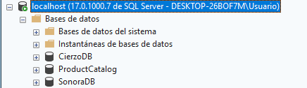

### 1.3 Crear tablas y vista

```sql
-- Tabla Categories
CREATE TABLE dbo.Categories (
    CategoryID INT IDENTITY(1,1) PRIMARY KEY,
    CategoryName NVARCHAR(50) NOT NULL,
    Description NVARCHAR(200)
);

-- Tabla Products
CREATE TABLE dbo.Products (
    ProductID INT IDENTITY(1,1) PRIMARY KEY,
    ProductName NVARCHAR(100) NOT NULL,
    CategoryID INT NOT NULL,
    UnitPrice DECIMAL(10,2) NOT NULL,
    UnitsInStock INT NOT NULL DEFAULT 0,
    Discontinued BIT NOT NULL DEFAULT 0,
    CONSTRAINT FK_Products_Categories
        FOREIGN KEY (CategoryID) REFERENCES dbo.Categories(CategoryID)
);
GO

-- Vista que combina producto y categoría
CREATE VIEW dbo.ProductCatalogView AS
SELECT
    p.ProductID,
    p.ProductName,
    c.CategoryName,
    p.UnitPrice,
    p.UnitsInStock,
    CASE
        WHEN p.UnitsInStock = 0 THEN 'Out of Stock'
        WHEN p.UnitsInStock < 10 THEN 'Low Stock'
        ELSE 'Available'
    END AS StockStatus
FROM dbo.Products p
INNER JOIN dbo.Categories c ON p.CategoryID = c.CategoryID
WHERE p.Discontinued = 0;
GO
```

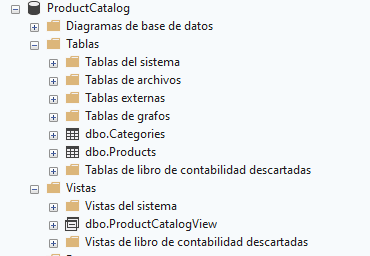

### 1.4 Insertar datos de ejemplo

```sql
-- Categorías
INSERT INTO dbo.Categories (CategoryName, Description) VALUES
('Electronics', 'Electronic devices and accessories'),
('Clothing', 'Apparel and fashion items'),
('Home & Garden', 'Products for home improvement');

-- Productos
INSERT INTO dbo.Products (ProductName, CategoryID, UnitPrice, UnitsInStock) VALUES
('Wireless Headphones', 1, 79.99, 50),
('USB-C Cable', 1, 12.99, 200),
('Laptop Stand', 1, 45.00, 5),
('Cotton T-Shirt', 2, 24.99, 100),
('Running Shoes', 2, 89.99, 0),
('Garden Hose', 3, 34.99, 25);
GO
```

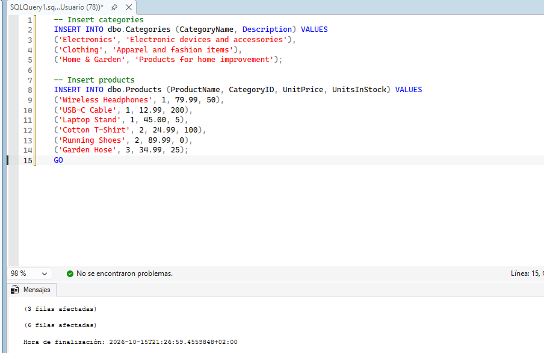

### 1.5 Verificación

```sql
SELECT * FROM dbo.Categories;
SELECT * FROM dbo.Products;
SELECT * FROM dbo.ProductCatalogView;
```

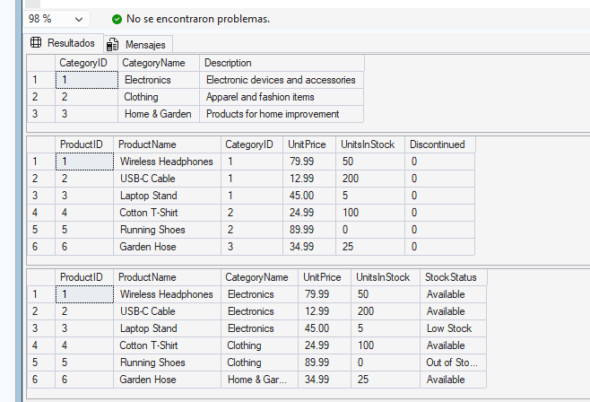

---

## 2. Instalar la CLI de Data API Builder
 
La CLI de DAB (`dab`) sirve para crear y gestionar el archivo de configuración `dab-config.json`.
 
### 2.1 Comprobar .NET SDK
 
Requisito: .NET SDK 8.0 o superior.
 
```bash
dotnet --version
```
 
> 10.0.401
 
### 2.2 Instalar la herramienta
 
Abrir una terminal o símbolo del sistema y ejecutar:
 
```bash
dotnet tool install --global Microsoft.DataApiBuilder
```
 
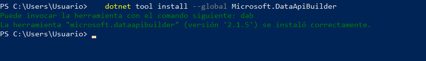
 
### 2.3 Verificar la instalación
 
```bash
dab --version
```
 
Debe mostrarse el número de versión, lo que confirma que la CLI está instalada y disponible en el `PATH`.
 


---
 
## 3. Crear la configuración inicial
 
Se usa la CLI de DAB para generar un archivo `dab-config.json` base.
 
### 3.1 Crear el directorio del proyecto
 
```bash
mkdir product-catalog-api
cd product-catalog-api
```
 
### 3.2 Inicializar la configuración
 
```bash
dab init --database-type mssql --connection-string "@env('DATABASE_CONNECTION_STRING')" --host-mode development
```


 
Este comando crea el archivo `dab-config.json`. La sintaxis `@env()` hace que DAB lea la cadena de conexión desde una variable de entorno en tiempo de ejecución, de modo que **no se guardan credenciales en el archivo**.
 
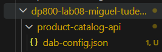
 
### 3.3 Revisar `dab-config.json`
 
El archivo generado debe tener una estructura similar a esta:
 
```json
{
  "$schema": "https://github.com/Azure/data-api-builder/releases/latest/download/dab.draft.schema.json",
  "data-source": {
    "database-type": "mssql",
    "connection-string": "@env('DATABASE_CONNECTION_STRING')"
  },
  "runtime": {
    "rest": { "enabled": true, "path": "/api" },
    "graphql": { "enabled": true, "path": "/graphql" },
    "host": { "mode": "development" }
  },
  "entities": {}
}
```
 
Puntos a comprobar (el archivo real puede tener más propiedades según la versión de DAB):
 
- `connection-string` usa `@env('DATABASE_CONNECTION_STRING')`
- Rutas `/api` (REST) y `/graphql` (GraphQL) en la sección `runtime`
- Modo `development`
- `entities` vacío por ahora


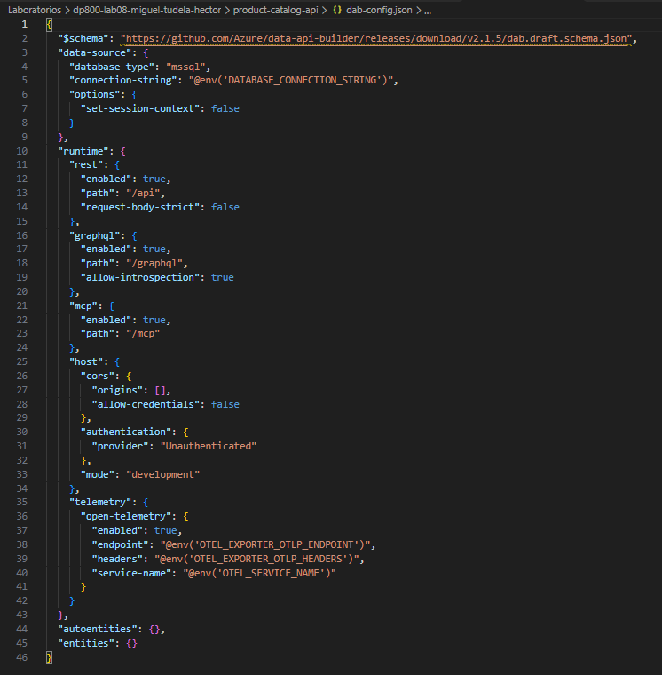  

---
 
## 4. Añadir entidades para las tablas
 
Desde la terminal, dentro de la carpeta `product-catalog-api`, se añaden las tablas `Categories` y `Products` como entidades de la API.
 
### 4.1 Añadir la entidad Category
 
```bash
dab add Category --source dbo.Categories --permissions "anonymous:read"
```
 
Expone la tabla `dbo.Categories` con lectura para usuarios anónimos.
 
### 4.2 Añadir la entidad Product
 
```bash
dab add Product --source dbo.Products --permissions "anonymous:read"
```
 
### 4.3 Dar CRUD completo a usuarios autenticados
 
```bash
dab update Product --permissions "authenticated:*"
```
 
Así `Product` permite lectura anónima y todas las acciones (crear, leer, actualizar, borrar) al rol `authenticated`.
 
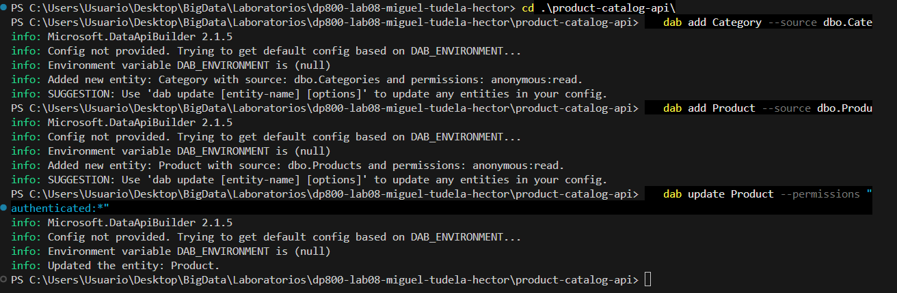
 
### 4.4 Revisar `dab-config.json`

La sección `entities` debe quedar así (puede variar ligeramente según el entorno):
 
```json
"entities": {
  "Category": {
    "source": { "object": "dbo.Categories", "type": "table" },
    "permissions": [
      { "role": "anonymous", "actions": ["read"] }
    ]
  },
  "Product": {
    "source": { "object": "dbo.Products", "type": "table" },
    "permissions": [
      { "role": "anonymous", "actions": ["read"] },
      { "role": "authenticated", "actions": ["*"] }
    ]
  }
}
```
 
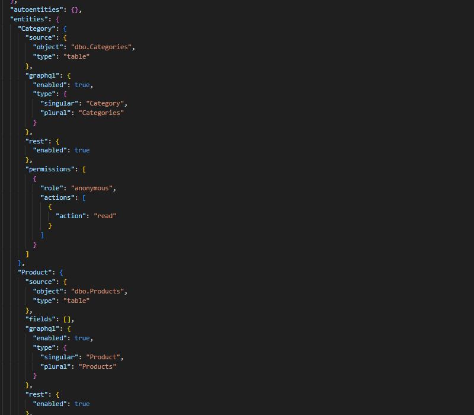
 
---
 
## 5. Configurar mapeos de campos y relaciones
 
Se mejora la entidad `Product` con nombres de campo más amigables para la API y una relación con `Category`. Esta vez se edita `dab-config.json` a mano.
 
> **Diferencia con el enunciado (DAB 2.1.5):** el enunciado usa la propiedad `mappings`. En la versión 2.x los mapeos se definen como `alias` dentro del array `fields` de la entidad (el `"fields": []` que genera `dab add`), así que se adaptó el paso a esa sintaxis. El resultado es el mismo: renombrar las columnas en la API.
 
### 5.1 Alias y relación en `Product`
 
Sustituir el bloque `Product` de `entities` por:
 
```json
"Product": {
  "source": {
    "object": "dbo.Products",
    "type": "table"
  },
  "fields": [
    { "name": "ProductID", "alias": "id" },
    { "name": "ProductName", "alias": "name" },
    { "name": "UnitPrice", "alias": "price" },
    { "name": "UnitsInStock", "alias": "stockQuantity" },
    { "name": "Discontinued", "alias": "isDiscontinued" }
  ],
  "graphql": {
    "enabled": true,
    "type": { "singular": "Product", "plural": "Products" }
  },
  "rest": { "enabled": true },
  "relationships": {
    "category": {
      "cardinality": "one",
      "target.entity": "Category",
      "source.fields": ["CategoryID"],
      "target.fields": ["CategoryID"]
    }
  },
  "permissions": [
    { "role": "anonymous", "actions": [ { "action": "read" } ] },
    { "role": "authenticated", "actions": [ { "action": "*" } ] }
  ]
}
```
 
- `fields` con `alias` renombra las columnas de la base de datos (por ejemplo, `ProductName` pasa a `name`).
- `relationships` permite que los clientes GraphQL naveguen desde un producto hasta su categoría (cardinalidad `one`).
### 5.2 Relación inversa en `Category`
 
Sustituir el bloque `Category` por:
 
```json
"Category": {
  "source": {
    "object": "dbo.Categories",
    "type": "table"
  },
  "graphql": {
    "enabled": true,
    "type": { "singular": "Category", "plural": "Categories" }
  },
  "rest": { "enabled": true },
  "relationships": {
    "products": {
      "cardinality": "many",
      "target.entity": "Product",
      "source.fields": ["CategoryID"],
      "target.fields": ["CategoryID"]
    }
  },
  "permissions": [
    { "role": "anonymous", "actions": [ { "action": "read" } ] }
  ]
}
```
 
Con esto se puede navegar también de una categoría a sus productos (cardinalidad `many`).
 
### 5.3 Guardar
 
Guardar los cambios en `dab-config.json`. El resto del archivo (`data-source`, `runtime`, etc.) no se modifica.
 
 
---
 
## 6. Añadir la vista como entidad de solo lectura
 
Se expone `ProductCatalogView` para los clientes que necesitan la información combinada de producto y categoría.
 
### 6.1 Añadir la entidad con la CLI
 
```bash
dab add ProductCatalog --source dbo.ProductCatalogView --source.type view --source.key-fields "ProductID" --permissions "anonymous:read"
```
 
`--source.key-fields` es necesario porque DAB no puede detectar automáticamente las claves primarias de una vista.
 
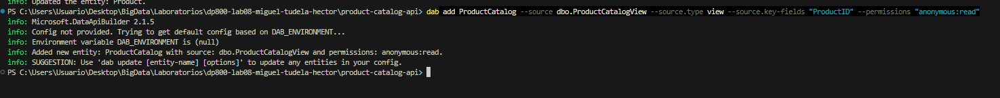
 
### 6.2 Verificar `dab-config.json`
 
Debe aparecer una nueva entidad `ProductCatalog` de tipo `view`, con la clave `ProductID` y permiso de lectura anónima. En el enunciado se muestra así:
 
```json
"ProductCatalog": {
  "source": {
    "object": "dbo.ProductCatalogView",
    "type": "view",
    "key-fields": ["ProductID"]
  },
  "graphql": { "operation": "query" },
  "permissions": [
    { "role": "anonymous", "actions": ["read"] }
  ]
}
```
 
> En DAB 2.1.5 el archivo generado puede variar ligeramente (por ejemplo, la clave puede aparecer como `primary-key` dentro de `fields`).
 
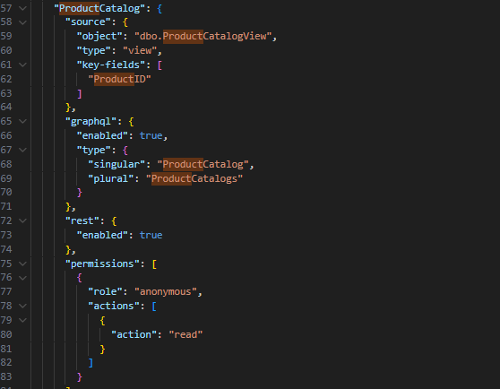

---

## 7. Probar en local
 
`dab start` lanza un servidor web local que se conecta a la base de datos con la cadena de conexión definida en la variable de entorno `DATABASE_CONNECTION_STRING`.
 
### 7.1 Ajuste previo: telemetría
 
El `dab-config.json` generado por DAB 2.1.5 incluye un bloque `telemetry` que lee tres variables `OTEL_*` que no están definidas en el equipo. Como no se necesita telemetría en este laboratorio, se elimina ese bloque (y la coma que queda tras `host`) para evitar errores de variables de entorno al arrancar:
 
```json
    "host": {
      "cors": {
        "origins": [],
        "allow-credentials": false
      },
      "authentication": {
        "provider": "Unauthenticated"
      },
      "mode": "development"
    }
  },
```
 
### 7.2 Definir la cadena de conexión
 
Abrir una terminal **PowerShell** o **Bash** (no CMD) en la carpeta `product-catalog-api`. La variable solo vive en esa terminal, así que `dab start` debe ejecutarse en la misma.
 
**SQL Server local (autenticación de Windows):**
 
```powershell
$env:DATABASE_CONNECTION_STRING="Server=localhost;Database=ProductCatalog;Integrated Security=true;TrustServerCertificate=true"
```
 
**Azure SQL con Microsoft Entra** (usa la identidad de la sesión de Azure CLI):
 
```powershell
$env:DATABASE_CONNECTION_STRING="Server=<tu-servidor>.database.windows.net;Database=ProductCatalog;Authentication=Active Directory Default;TrustServerCertificate=true"
```
 
**Azure SQL con usuario y contraseña:**
 
```powershell
$env:DATABASE_CONNECTION_STRING="Server=<tu-servidor>.database.windows.net;Database=ProductCatalog;User Id=<usuario>;Password=<contraseña>;TrustServerCertificate=true"
```
 
> SQL SERVER LOCAL 
 
### 7.3 Arrancar Data API Builder
 
```bash
dab start
```
 
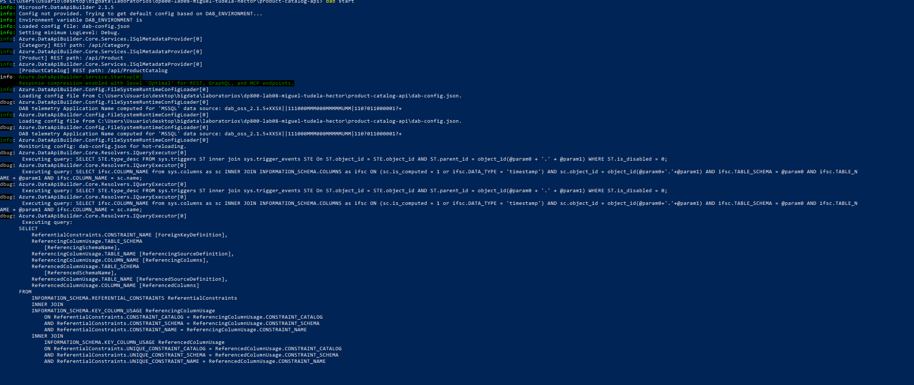
 
### 7.4 Probar el endpoint REST
 
En el navegador, abrir `http://localhost:5000/api/Product` (usar el puerto que indique la consola de `dab start`).
 
Debe devolver un JSON con los productos usando los nombres mapeados: `id`, `name`, `price`, `stockQuantity` e `isDiscontinued`.
 
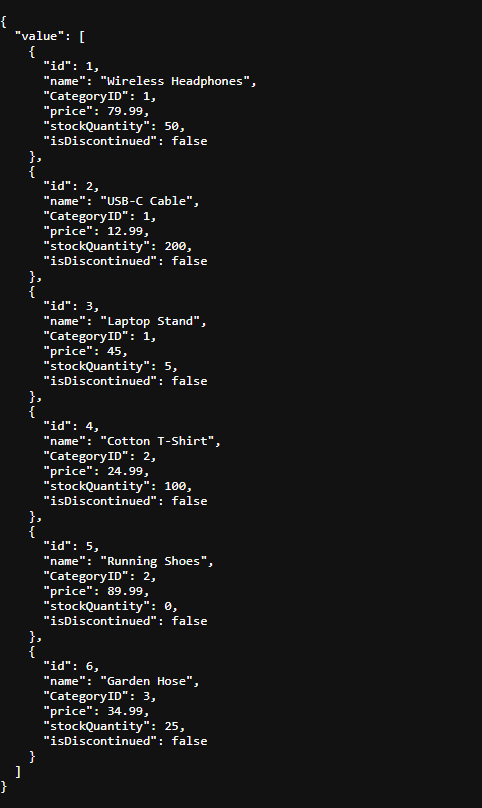
 
### 7.5 Probar GraphQL
 
Abrir `http://localhost:5000/graphql`, pulsar **Create Document** y ejecutar con **Ctrl+Alt+Enter**:
 
```graphql
query {
  products {
    items {
      id
      name
      price
      category {
        CategoryName
      }
    }
  }
}
```
 
La respuesta incluye cada producto con el nombre de su categoría, lo que demuestra que la relación configurada funciona.
 
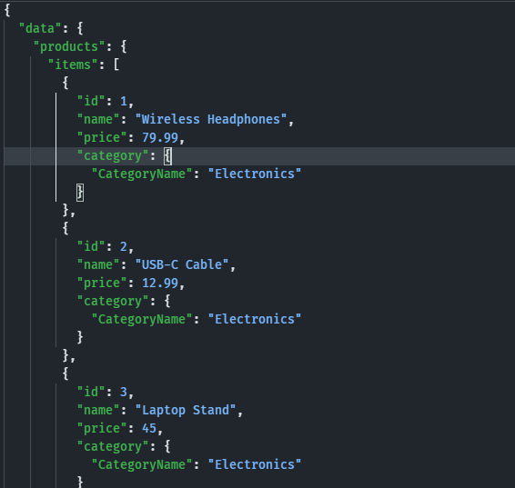
 
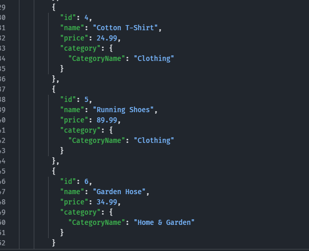

### 7.6 Parar el servidor
 
Volver a la terminal y pulsar `Ctrl+C`.

---
 
## 8. Limpieza
 
Si la base de datos no se va a usar para nada más, se eliminan los recursos creados. **Antes de limpiar**, comprobar que ya se han hecho las capturas del laboratorio y que se ha guardado una copia de `dab-config.json` junto con este README (no contiene credenciales, porque la cadena de conexión se lee de la variable de entorno).
 
### 8.1 Detener la API y limpiar la variable de entorno
 
Parar `dab start` con `Ctrl+C` si sigue en ejecución (si no, puede dar error al borrar la base de datos por conexiones abiertas). Opcionalmente, quitar la variable de la sesión de PowerShell:
 
```powershell
Remove-Item Env:DATABASE_CONNECTION_STRING
```
 
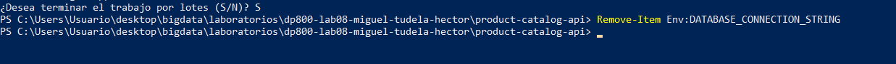

### 8.2 Eliminar la base de datos
 
```sql
USE master;
GO
DROP DATABASE IF EXISTS ProductCatalog;
GO
```
 
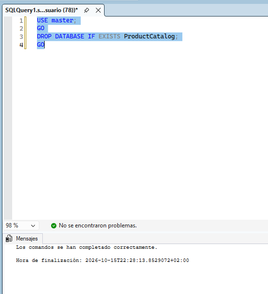
 
### 8.3 Eliminar el directorio del proyecto
 
Desde la carpeta que contiene `product-catalog-api`:
 
```powershell
Remove-Item -Recurse -Force product-catalog-api
```
 
(En Bash: `rm -rf product-catalog-api`.)
 
---
 
## 9. Conclusión
 
En este laboratorio se creó una configuración de Data API Builder desde cero para una base de datos de catálogo de productos:
 
- Se configuraron entidades para dos tablas (`Categories`, `Products`) y una vista (`ProductCatalogView`).
- Se definieron permisos por rol (lectura anónima y CRUD completo para usuarios autenticados en `Product`).
- Se renombraron columnas con alias y se configuraron relaciones bidireccionales entre `Product` y `Category`.
- Se verificó la API en local mediante endpoints REST y consultas GraphQL.
Estas técnicas permiten exponer bases de datos SQL mediante APIs REST y GraphQL de forma rápida, sin escribir código de backend.
 