# Laboratorio 09 – Generar y actualizar embeddings en Azure SQL Database

**Origen:** [mslearn-sql-developer – Lab 09](https://microsoftlearning.github.io/mslearn-sql-developer/Instructions/Labs/09-generate-update-embedings-sql.html)

---

## 1. Objetivo

Crear una referencia a un modelo externo (Azure OpenAI), generar embeddings a partir de texto almacenado en Azure SQL Database con la función `AI_GENERATE_EMBEDDINGS`, verificar los resultados y comprobar cómo mantener los embeddings cuando cambian los datos de origen. Por último, se realiza una búsqueda vectorial básica para confirmar que los embeddings capturan el significado semántico.

**Escenario:** desarrollador de bases de datos de Adventure Works que añade búsqueda con IA al catálogo de productos. El primer paso es generar y almacenar embeddings de las reseñas de clientes.

## 2. Requisitos previos

- Suscripción de Azure con acceso aprobado a Azure OpenAI.
- Visual Studio Code con la extensión SQL Server (mssql) o SQL Server Management Studio.
- Conocimientos básicos de Azure SQL Database y T-SQL.

## 3. Arquitectura resumida

| Pieza | Valor |
| --- | --- |
| Base de datos | Azure SQL Database `AdventureWorksLT` (Hyperscale serverless) |
| Proyecto Foundry | `proj-sqlailab` |
| Modelo de chat | `gpt-5.4-mini` |
| Modelo de embeddings | `text-embedding-3-small` (1536 dimensiones) |
| Autenticación SQL → OpenAI | Identidad administrada asignada por el sistema |
| Rol necesario | Cognitive Services OpenAI User |
| Tabla de trabajo | `dbo.ProductReview` (140 reseñas) |

> Sustituye en todo el documento `<tu-endpoint-openai>` por el nombre de tu endpoint (la parte anterior a `.openai.azure.com`).

---

## 4. Desarrollo paso a paso

### 4.1 Aprovisionar Azure SQL Database

1. Entrar en el [Azure SQL hub](https://aka.ms/azuresqlhub) → **Azure SQL Database** → **Show options** → **Create SQL Database**.
2. Pestaña **Basics**:
   - Subscription: tu suscripción.
   - Resource group: crear o seleccionar uno.
   - Database name: `AdventureWorksLT`.
   - Server: **Create new**, nombre único, ubicación y método de autenticación (Entra-only recomendado, o SQL + Entra).
3. **Want to use SQL elastic pool** → **No**.
4. **Workload environment** → **Development**.
5. **Compute + storage** → **Configure database** → servicio **Hyperscale**, cómputo **Serverless** → **Apply**.
6. **Backup storage redundancy** → **Locally-redundant backup storage**.
7. **Next: Networking** → conectividad **Public endpoint**.
8. Firewall: **Allow Azure services and resources to access this server** = Yes y **Add current client IP address** = Yes.
9. **Next: Security** → **Next: Additional settings**.
10. En **Data source** → **Use existing data** = **Sample** (crea AdventureWorksLT).
11. **Review + create** → **Create** y esperar al despliegue.

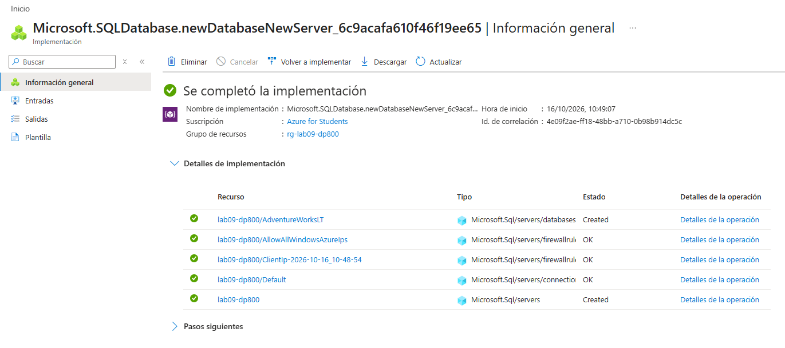

### 4.2 Crear el proyecto de Foundry y desplegar los modelos

**Proyecto**

1. Ir a [Microsoft Foundry](https://ai.azure.com) (con el interruptor **New Foundry** activado).
2. Crear proyecto `proj-sqlailab`, en **Advanced options** usar la misma suscripción y grupo de recursos que la base de datos y una región con modelos de Azure OpenAI → **Create**.

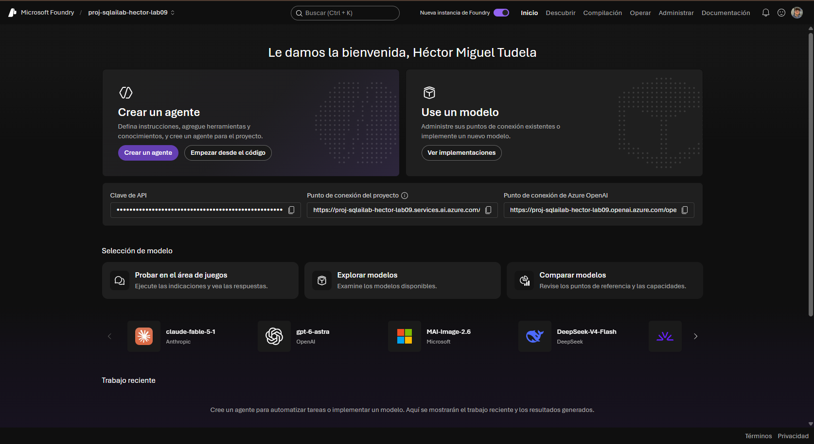

**Modelos**

1. **Discover** → buscar `gpt-5.4-mini` → **Deploy** → **Default settings** → seleccionar región y proyecto → nombre de despliegue `gpt-5.4-mini` → **Deploy**.
2. **Discover** → buscar `text-embedding-3-small` → **Deploy** → **Default settings** → mismo proyecto.
3. **Build** → **Models** para comprobar que aparecen ambos despliegues.

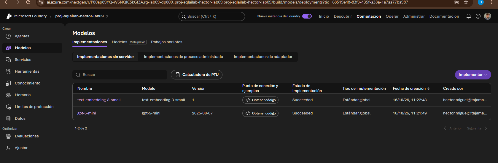

**Endpoint**

1. En Azure Portal → grupo de recursos → recurso **Foundry** (por ejemplo `proj-sqlailab-resource`).
2. **Resource Management** → **Keys and Endpoint** → pestaña **OpenAI** (no la de Foundry).
3. Anotar el endpoint, por ejemplo `https://proj-sqlailab-resource.openai.azure.com/`. El nombre necesario es `proj-sqlailab-resource`.

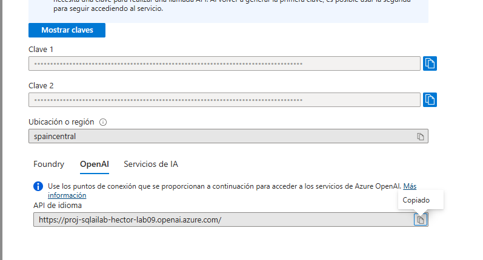

### 4.3 Configurar el acceso con identidad administrada

1. Azure Portal → **SQL server** (el servidor lógico) → **Security** → **Identity**.
2. **System assigned managed identity** → Status **On** → **Save**.
3. Ir al recurso **Azure OpenAI** → **Access control (IAM)** → **+ Add** → **Add role assignment**.
4. Rol **Cognitive Services OpenAI User** → **Next**.
5. **Members** → **Managed identity** → **+ Select members** → tipo **SQL server** → elegir tu servidor → **Select**.
6. **Review + assign** (dos veces).

> La asignación puede tardar hasta 5 minutos en surtir efecto.

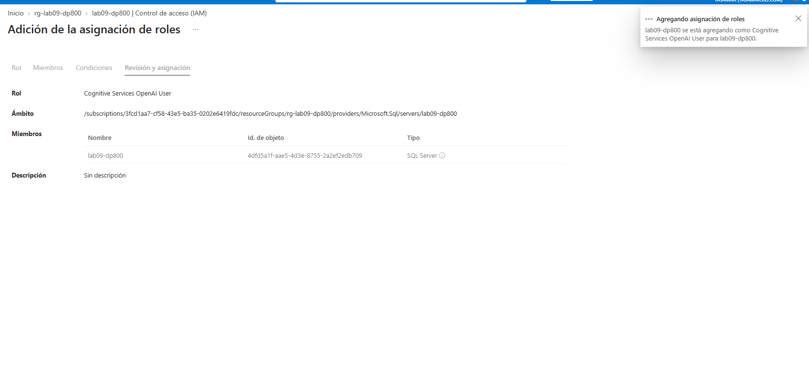

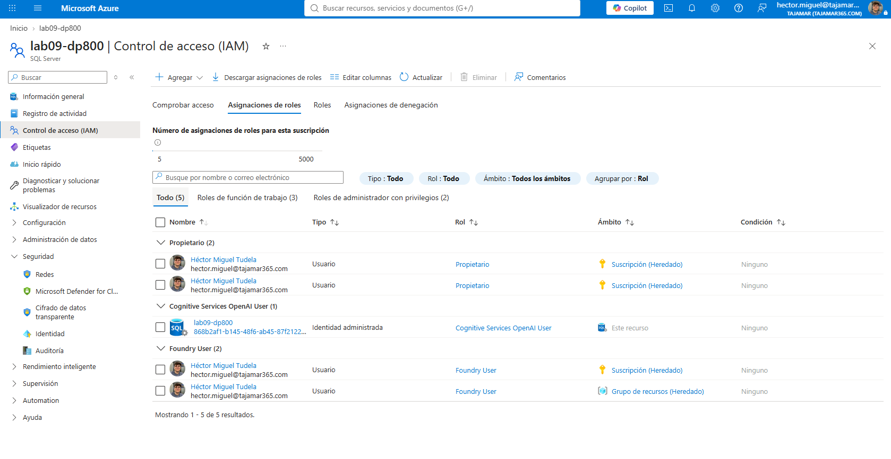

### 4.4 Crear la tabla ProductReview

1. Conectarse a `AdventureWorksLT` desde VS Code (mssql) o SSMS. Servidor: `<tu-servidor>.database.windows.net`.
2. Descargar [product-reviews-insert.sql](https://raw.githubusercontent.com/MicrosoftLearning/mslearn-sql-developer/main/Allfiles/product-reviews-insert.sql) y ejecutarlo completo.
3. Verificar:

```sql
SELECT COUNT(*) AS TotalReviews FROM dbo.ProductReview;
GO
```

**Resultado esperado:** 140 filas.

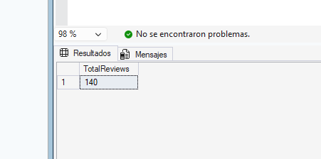

### 4.5 Credencial y modelo externo de embeddings

**Credencial con identidad administrada**

```sql
-- Crear la master key de la base de datos si no existe
IF NOT EXISTS (SELECT * FROM sys.symmetric_keys WHERE name = '##MS_DatabaseMasterKey##')
    CREATE MASTER KEY ENCRYPTION BY PASSWORD = '<tu contraseña segura>';
GO

-- Crear la credencial usando Managed Identity
CREATE DATABASE SCOPED CREDENTIAL [https://<tu-endpoint-openai>.openai.azure.com]
WITH IDENTITY = 'Managed Identity', SECRET = '{"resourceid":"https://cognitiveservices.azure.com"}';
GO
```

> ⚠️ El valor `resourceid` debe ser exactamente `https://cognitiveservices.azure.com`. No se cambia por el endpoint propio.

**Modelo externo**

```sql
CREATE EXTERNAL MODEL my_embedding_model
WITH (
    LOCATION = 'https://<tu-endpoint-openai>.openai.azure.com/openai/deployments/text-embedding-3-small/embeddings?api-version=2024-10-21',
    API_FORMAT = 'Azure OpenAI',
    MODEL_TYPE = EMBEDDINGS,
    MODEL = 'text-embedding-3-small',
    CREDENTIAL = [https://<tu-endpoint-openai>.openai.azure.com]
);
GO
```

### 4.6 Añadir la columna vectorial y generar embeddings

**Columna vectorial**

```sql
ALTER TABLE dbo.ProductReview
ADD ReviewVector VECTOR(1536);
GO
```

`VECTOR(1536)` coincide con la salida de `text-embedding-3-small`. Cada elemento ocupa 4 bytes (≈ 6 KB por fila).

**Prueba con una sola reseña**

```sql
SELECT TOP 1
    r.ReviewID,
    r.ReviewTitle,
    AI_GENERATE_EMBEDDINGS(
        r.ReviewTitle + ': ' + r.ReviewText
        USE MODEL my_embedding_model
    ) AS TestEmbedding
FROM dbo.ProductReview r;
GO
```

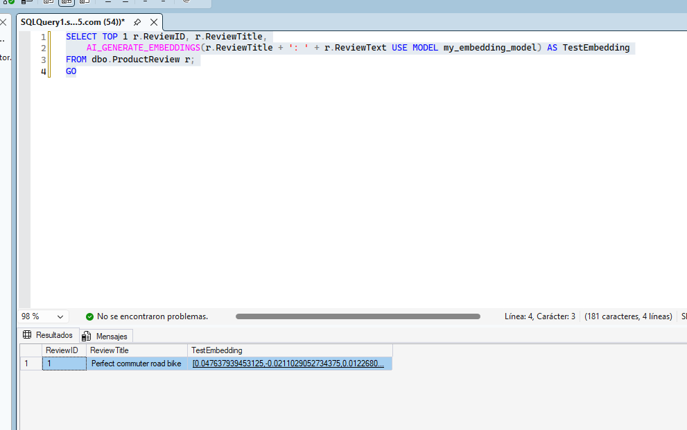

Si falla, comprobar que el rol de la identidad administrada ya se ha propagado (hasta 5 minutos).

**Generación por lotes con reintentos**

```sql
DECLARE @batchSize INT = 30;
DECLARE @rowsUpdated INT = 1;
DECLARE @retryCount INT;
DECLARE @maxRetries INT = 3;

WHILE @rowsUpdated > 0
BEGIN
    SET @retryCount = 0;

    RETRY:
    BEGIN TRY
        UPDATE TOP (@batchSize) r
        SET r.ReviewVector = AI_GENERATE_EMBEDDINGS(
            p.Name + ' - ' + r.ReviewTitle + ': ' + r.ReviewText
            USE MODEL my_embedding_model)
        FROM dbo.ProductReview r
        INNER JOIN SalesLT.Product p ON r.ProductID = p.ProductID
        WHERE r.ReviewVector IS NULL;

        SET @rowsUpdated = @@ROWCOUNT;

        -- Pausa breve entre lotes para respetar los límites de la API
        IF @rowsUpdated > 0
            WAITFOR DELAY '00:00:02';
    END TRY
    BEGIN CATCH
        SET @retryCount += 1;
        IF @retryCount <= @maxRetries
        BEGIN
            PRINT 'Rate limited. Retrying in 5 seconds... (Attempt '
                + CAST(@retryCount AS NVARCHAR(10)) + ' of '
                + CAST(@maxRetries AS NVARCHAR(10)) + ')';
            WAITFOR DELAY '00:00:05';
            GOTO RETRY;
        END
        ELSE
            THROW;
    END CATCH
END
GO
```

Procesa 30 reseñas por lote con 2 s de pausa y hasta 3 reintentos de 5 s ante límites de tasa. Se concatenan nombre del producto, título y texto para que el embedding capture producto y experiencia. Puede tardar un par de minutos.

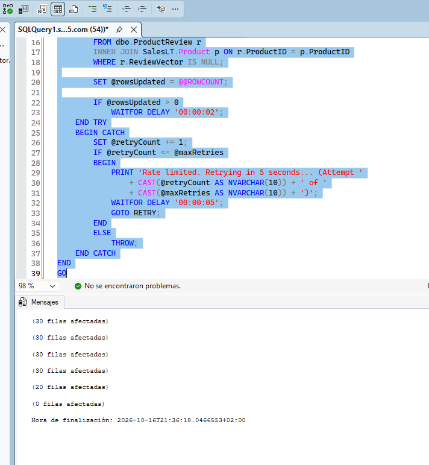

### 4.7 Verificar e inspeccionar los embeddings

**Recuento**

```sql
SELECT
    COUNT(*) AS TotalReviews,
    COUNT(ReviewVector) AS ReviewsWithEmbeddings,
    COUNT(*) - COUNT(ReviewVector) AS ReviewsMissingEmbeddings
FROM dbo.ProductReview;
GO
```

Esperado: 140 / 140 / 0. Si falta alguno, se vuelve a lanzar el script de lotes (solo procesa `ReviewVector IS NULL`).

**Metadatos con `VECTORPROPERTY`**

```sql
SELECT TOP 1
    r.ReviewID,
    r.ReviewTitle,
    VECTORPROPERTY(r.ReviewVector, 'Dimensions') AS VectorDimensions,
    VECTORPROPERTY(r.ReviewVector, 'BaseType') AS VectorBaseType,
    DATALENGTH(r.ReviewVector) AS VectorSizeBytes
FROM dbo.ProductReview r
WHERE r.ReviewVector IS NOT NULL;
GO
```

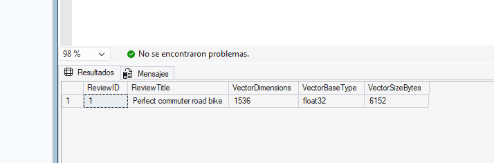

**Muestra de valores**

```sql
SELECT TOP 1
    r.ReviewID,
    r.ReviewTitle,
    LEFT(CAST(r.ReviewVector AS NVARCHAR(MAX)), 200) AS EmbeddingPreview
FROM dbo.ProductReview r
WHERE r.ReviewVector IS NOT NULL;
GO
```

El vector es un array JSON de 1536 números; aquí solo se ven los primeros 200 caracteres.

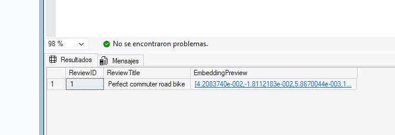

### 4.8 Validar con una búsqueda vectorial básica

**Búsqueda semántica**

```sql
DECLARE @searchText NVARCHAR(1000) = 'Which tires last the longest and resist punctures?';
DECLARE @searchVector VECTOR(1536);

SELECT @searchVector = AI_GENERATE_EMBEDDINGS(@searchText USE MODEL my_embedding_model);

SELECT TOP 5
    p.Name AS ProductName,
    r.ReviewTitle,
    r.ReviewText,
    r.Rating,
    VECTOR_DISTANCE('cosine', @searchVector, r.ReviewVector) AS Distance
FROM dbo.ProductReview r
INNER JOIN SalesLT.Product p ON r.ProductID = p.ProductID
ORDER BY Distance;
GO
```

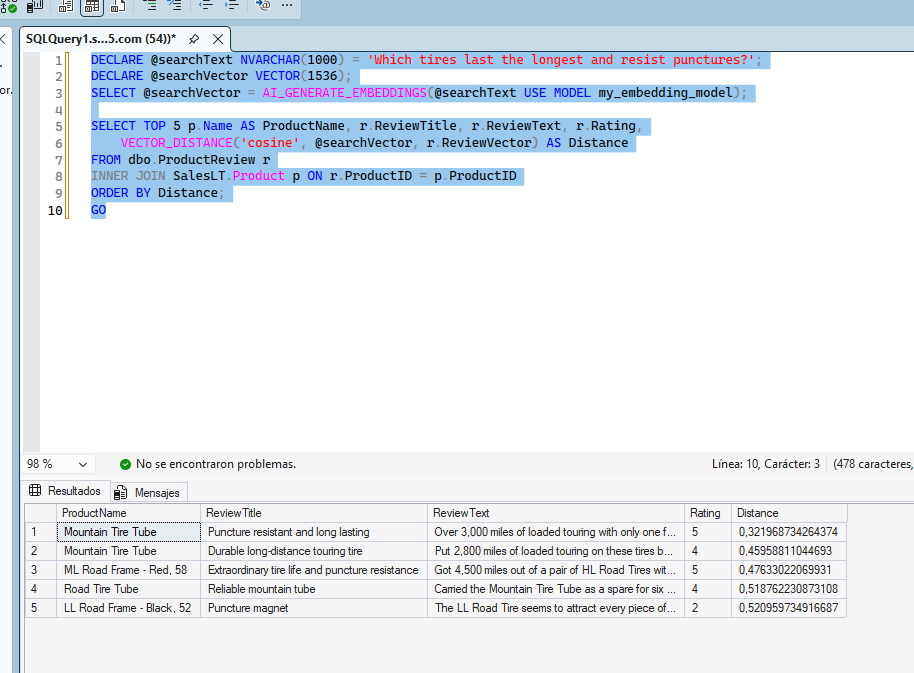

Devuelve reseñas de neumáticos sobre durabilidad y resistencia a pinchazos aunque usen otras palabras. La distancia coseno va de 0 (idéntico) a 2 (opuesto).

**Comparación con búsqueda por palabra clave**

```sql
SELECT TOP 5
    p.Name AS ProductName,
    r.ReviewTitle,
    r.ReviewText,
    r.Rating
FROM dbo.ProductReview r
INNER JOIN SalesLT.Product p ON r.ProductID = p.ProductID
WHERE r.ReviewText LIKE '%puncture%';
GO
```

`LIKE` solo encuentra la palabra exacta "puncture"; la búsqueda vectorial encuentra el concepto.

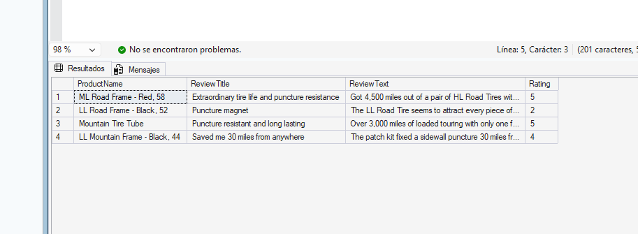

### 4.9 Mantenimiento de embeddings

Un embedding es una instantánea del texto en el momento de generarlo. Si el texto cambia, el embedding queda obsoleto.

**1) Distancia inicial de la reseña 124 (guantes de invierno)**

```sql
DECLARE @searchVector VECTOR(1536);
SELECT @searchVector = AI_GENERATE_EMBEDDINGS('warm winter cycling gloves' USE MODEL my_embedding_model);

SELECT
    r.ReviewID,
    r.ReviewTitle,
    r.ReviewText,
    VECTOR_DISTANCE('cosine', @searchVector, r.ReviewVector) AS DistanceBefore
FROM dbo.ProductReview r
WHERE r.ReviewID = 124;
GO
```

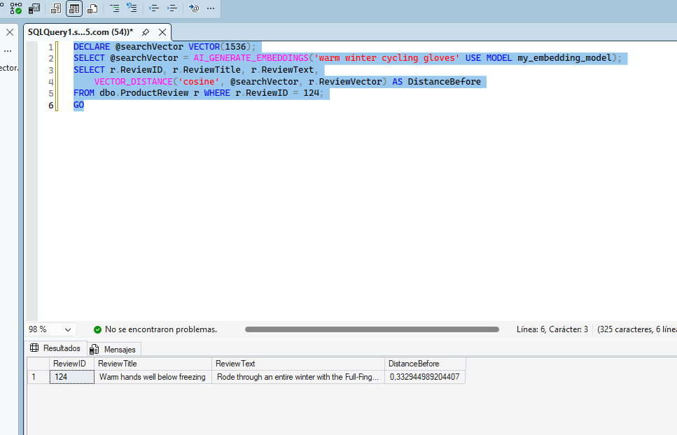

**2) Cambiar el texto sin actualizar el embedding**

```sql
UPDATE dbo.ProductReview
SET ReviewText = 'These tires are the most puncture-resistant tires I have ever used. Over 3000 miles with zero flats on rough gravel roads.',
    ReviewTitle = N'Indestructible tires'
WHERE ReviewID = 124;
GO
```

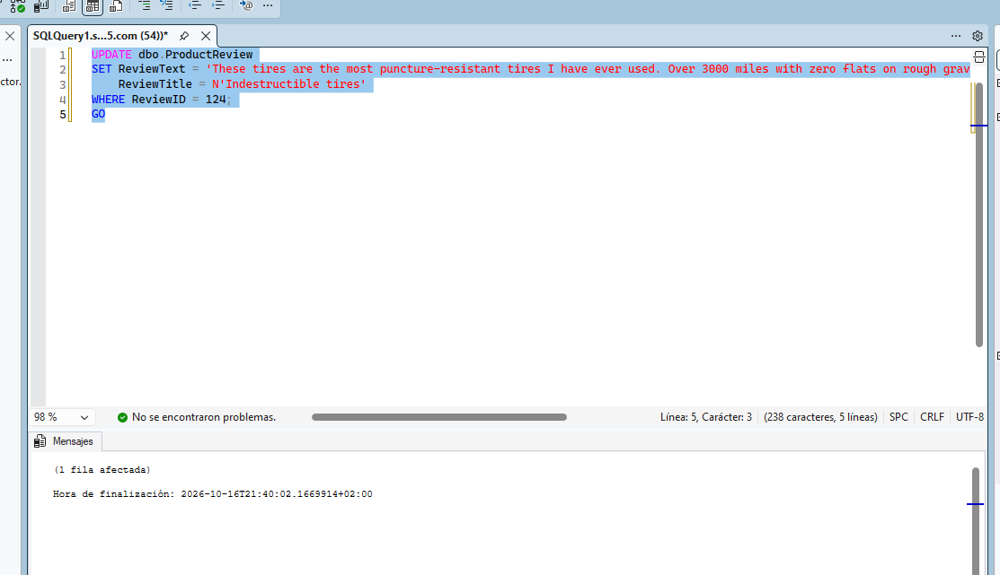

**3) Distancia con el embedding obsoleto**

```sql
DECLARE @searchVector VECTOR(1536);
SELECT @searchVector = AI_GENERATE_EMBEDDINGS('warm winter cycling gloves' USE MODEL my_embedding_model);

SELECT
    r.ReviewID,
    r.ReviewTitle,
    r.ReviewText,
    VECTOR_DISTANCE('cosine', @searchVector, r.ReviewVector) AS DistanceAfterTextChange
FROM dbo.ProductReview r
WHERE r.ReviewID = 124;
GO
```

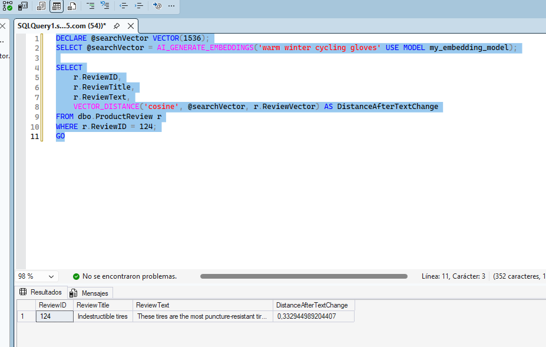

La distancia sigue siendo pequeña: el vector aún representa los guantes, aunque el texto ya habla de neumáticos. Una búsqueda de guantes devolvería esta reseña por error.

**4) Regenerar el embedding**

```sql
UPDATE r
SET r.ReviewVector = AI_GENERATE_EMBEDDINGS(
    p.Name + ' - ' + r.ReviewTitle + ': ' + r.ReviewText
    USE MODEL my_embedding_model)
FROM dbo.ProductReview r
INNER JOIN SalesLT.Product p ON r.ProductID = p.ProductID
WHERE r.ReviewID = 124;
GO
```

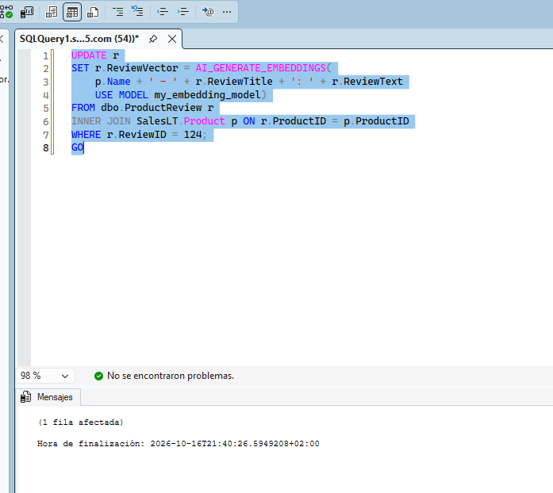

**5) Comprobar la distancia tras regenerar**

```sql
DECLARE @searchVector VECTOR(1536);
SELECT @searchVector = AI_GENERATE_EMBEDDINGS('warm winter cycling gloves' USE MODEL my_embedding_model);

SELECT
    r.ReviewID,
    r.ReviewTitle,
    r.ReviewText,
    VECTOR_DISTANCE('cosine', @searchVector, r.ReviewVector) AS DistanceAfterRegeneration
FROM dbo.ProductReview r
WHERE r.ReviewID = 124;
GO
```

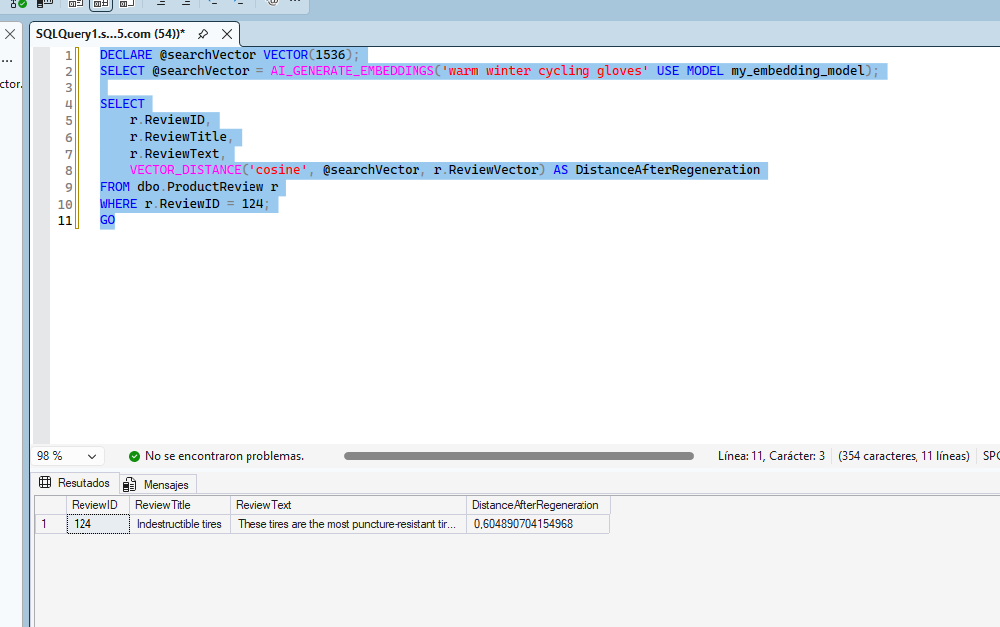

Ahora la distancia es mucho mayor: texto y vector vuelven a estar sincronizados. En producción se automatizaría con triggers, Change Tracking, Change Data Capture o un proceso externo (por ejemplo Azure Functions).

**6) Restaurar la reseña original** (para los laboratorios siguientes)

```sql
UPDATE dbo.ProductReview
SET ReviewTitle = N'Warm hands well below freezing',
    ReviewText = N'Rode through an entire winter with the Full-Finger Gloves and never had cold fingers even at minus 5 degrees with wind chill. The fleece lining is cozy without being bulky and I can still operate my brake levers precisely. Essential cold weather gear.'
WHERE ReviewID = 124;
GO

UPDATE r
SET r.ReviewVector = AI_GENERATE_EMBEDDINGS(
    p.Name + ' - ' + r.ReviewTitle + ': ' + r.ReviewText
    USE MODEL my_embedding_model)
FROM dbo.ProductReview r
INNER JOIN SalesLT.Product p ON r.ProductID = p.ProductID
WHERE r.ReviewID = 124;
GO
```

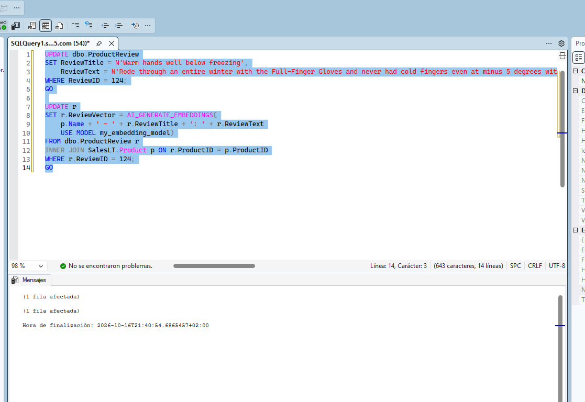

---

## 5. Resultados obtenidos

| Prueba | Valor esperado |
| --- | --- |
| Reseñas totales | 140 |
| Reseñas con embedding | 140 (0 sin embedding) |
| Dimensiones / tipo base / bytes | 1536 / float / ≈ 6148 |
| DistanceBefore (reseña 124) | Pequeña: el vector representa guantes de invierno |
| DistanceAfterTextChange | Pequeña, casi igual que la anterior: el embedding está obsoleto |
| DistanceAfterRegeneration | Mucho mayor: el vector ya representa neumáticos |

## 6. Conclusiones

- `AI_GENERATE_EMBEDDINGS` junto con `CREATE EXTERNAL MODEL` permite generar embeddings directamente desde T-SQL, sin claves API gracias a la identidad administrada.
- El tipo `VECTOR(1536)` almacena los embeddings y `VECTOR_DISTANCE` permite búsquedas por similitud semántica.
- La búsqueda vectorial encuentra conceptos aunque no coincidan las palabras, algo que `LIKE` no puede hacer.
- Los embeddings se quedan obsoletos si cambia el texto de origen, por lo que hay que regenerarlos y automatizar ese mantenimiento.

## 7. Limpieza

Estos recursos se reutilizan en los laboratorios 9, 10 y 11, así que **no se borran todavía**. Al terminar el bloque: Azure Portal → grupo de recursos → **Delete resource group** → escribir el nombre → **Delete**.