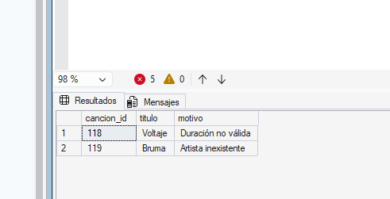

# Tablas temporales, variables de tabla y staging: ejercicios de refuerzo

Base de datos: `SonoraDB`


## Índice

**Parte 01 · Ejemplos**

- Sección 1, tablas temporales locales: [Ejemplo 1](#ejemplo-1-guardar-un-resultado-y-reutilizarlo-en-varias-consultas), [2](#ejemplo-2-definir-la-estructura-con-create-table), [3](#ejemplo-3-alcance-y-fin-de-vida-la-sesión), [4](#ejemplo-4-scripts-que-se-pueden-ejecutar-varias-veces), [5](#ejemplo-5-una-tabla-temporal-se-modifica-como-cualquier-tabla), [6](#ejemplo-6-lo-que-una-tabla-temporal-no-admite)
- Sección 2, tablas temporales globales: [Ejemplo 7](#ejemplo-7-compartir-un-resultado-con-otra-sesión), [8](#ejemplo-8-nombre-único-y-fin-de-vida-de-una-tabla-global)
- Sección 3, variables de tabla: [Ejemplo 9](#ejemplo-9-una-lista-corta-de-equivalencias), [10](#ejemplo-10-alcance-el-lote), [11](#ejemplo-11-transacciones-la-tabla-temporal-se-deshace-la-variable-no)
- Sección 4, staging: [Ejemplo 12](#ejemplo-12-aterrizar-el-lote-y-descartar-lo-que-sobra), [13](#ejemplo-13-normalizar-y-apartar-los-rechazos), [14](#ejemplo-14-cargar-y-cuadrar-las-cifras)

**Parte 02 · Ejercicios de refuerzo**

1. [Ejercicio 1](#ejercicio-1)
2. [Ejercicio 2](#ejercicio-2)
3. [Ejercicio 3](#ejercicio-3)
4. [Ejercicio 4](#ejercicio-4)
5. [Ejercicio 5](#ejercicio-5)
6. [Ejercicio 6](#ejercicio-6)
7. [Ejercicio 7](#ejercicio-7)
8. [Ejercicio 8](#ejercicio-8)
9. [Ejercicio 9](#ejercicio-9)
10. [Ejercicio 10](#ejercicio-10)
11. [Ejercicio 11](#ejercicio-11)
12. [Ejercicio 12](#ejercicio-12)

---

# Parte 01 · Ejemplos

> **Trabaja los ejemplos 1 a 11 en la misma ventana de consulta de SSMS** (la llamaremos **ventana 1**): las tablas temporales viven mientras la ventana siga abierta. Si la cierras, hay que volver a ejecutar el Paso 1 del Ejemplo 1.
>
> Los mensajes de error se muestran en inglés. Si tu instancia está en español, el número de mensaje (`Msg`) es el mismo.

## Sección 1. Tablas temporales locales (`#tabla`)

### Ejemplo 1. Guardar un resultado y reutilizarlo en varias consultas

**Pregunta de negocio:** Carmen Lozano (Data Analyst) prepara el informe de la semana de análisis. Necesita tres cifras sobre las mismas reproducciones válidas: el reparto por plan, el reparto por dispositivo y las tres canciones más escuchadas. Con una tabla temporal, el filtro se ejecuta **una sola vez**.

**Paso 1.** Guardar las reproducciones válidas de la semana en una tabla temporal:

```sql
DROP TABLE IF EXISTS #validas_semana;

SELECT r.reproduccion_id, r.usuario_id, r.cancion_id, r.fecha_hora,
       r.segundos_escuchados, r.dispositivo
INTO #validas_semana
FROM dbo.reproducciones AS r
WHERE r.tipo_contenido = N'Canción'
  AND r.segundos_escuchados >= 30
  AND r.fecha_hora >= '2026-09-16'
  AND r.fecha_hora <  '2026-09-23';
```


**Paso 2.** Reparto por plan:

```sql
SELECT u.plan_suscripcion,
       COUNT(*) AS reproducciones,
       CAST(SUM(v.segundos_escuchados) / 60.0 AS decimal(6,1)) AS minutos
FROM #validas_semana AS v
JOIN dbo.usuarios AS u ON u.usuario_id = v.usuario_id
GROUP BY u.plan_suscripcion
ORDER BY reproducciones DESC;
```


**Paso 3.** Reparto por dispositivo:

```sql
SELECT dispositivo,
       COUNT(*) AS reproducciones,
       CAST(SUM(segundos_escuchados) / 60.0 AS decimal(6,1)) AS minutos
FROM #validas_semana
GROUP BY dispositivo
ORDER BY reproducciones DESC, dispositivo;
```


**Paso 4.** Las tres canciones más escuchadas:

```sql
SELECT TOP (3) c.titulo, a.nombre AS artista, COUNT(*) AS reproducciones
FROM #validas_semana AS v
JOIN dbo.canciones AS c ON c.cancion_id = v.cancion_id
JOIN dbo.artistas  AS a ON a.artista_id = c.artista_id
GROUP BY c.titulo, a.nombre
ORDER BY reproducciones DESC, c.titulo;
```


> `#validas_semana` es una **foto**: si después entra una reproducción nueva en `reproducciones`, la tabla temporal no se entera. Para refrescarla hay que volver a ejecutar el Paso 1.

### Ejemplo 2. Definir la estructura con `CREATE TABLE`

**Pregunta de negocio:** Carmen quiere una ficha de actividad por usuario (reproducciones y minutos de la semana) para consultarla varias veces. Conviene controlar la estructura: tipos exactos, columnas obligatorias y una fila por usuario como máximo.

**Paso 1.** Crear la tabla temporal con su estructura y llenarla a partir de `#validas_semana`:

```sql
DROP TABLE IF EXISTS #actividad_usuario;

CREATE TABLE #actividad_usuario (
    usuario_id      int           NOT NULL PRIMARY KEY,
    reproducciones  int           NOT NULL,
    minutos         decimal(6,1)  NOT NULL
);

INSERT INTO #actividad_usuario (usuario_id, reproducciones, minutos)
SELECT usuario_id,
       COUNT(*),
       CAST(SUM(segundos_escuchados) / 60.0 AS decimal(6,1))
FROM #validas_semana
GROUP BY usuario_id;
```


**Paso 2.** ¿Qué usuarios han escuchado más minutos que la media de la semana?

```sql
SELECT u.nombre_usuario, a.reproducciones, a.minutos,
       CAST((SELECT AVG(minutos) FROM #actividad_usuario) AS decimal(6,1)) AS media_semana
FROM #actividad_usuario AS a
JOIN dbo.usuarios AS u ON u.usuario_id = a.usuario_id
WHERE a.minutos > (SELECT AVG(minutos) FROM #actividad_usuario)
ORDER BY a.minutos DESC;
```


### Ejemplo 3. Alcance y fin de vida: la sesión

**Contexto:** Elena Ruiz (Data Engineer) quiere confirmar que su tabla temporal no la ve nadie más y que no choca con la de otro compañero que use el mismo nombre.

**Paso 1.** En la ventana 1, comprobar el número de sesión:

```sql
SELECT @@SPID AS sesion;
```


**Paso 2.** Abre una **ventana 2** con `Ctrl+N` y ejecuta en ella:

```sql
USE SonoraDB;

SELECT @@SPID AS sesion;

SELECT COUNT(*) AS filas FROM #validas_semana;
```


**Paso 3.** En la ventana 2, crear una tabla temporal **con el mismo nombre** y otro contenido:

```sql
SELECT reproduccion_id, usuario_id, cancion_id
INTO #validas_semana
FROM dbo.reproducciones
WHERE tipo_contenido = N'Canción'
  AND segundos_escuchados >= 30
  AND fecha_hora >= '2026-09-16'
  AND fecha_hora <  '2026-09-23'
  AND dispositivo = N'Web';

SELECT COUNT(*) AS filas FROM #validas_semana;
```

**Salida esperada en la ventana 2:** `(4 rows affected)` y `filas = 4`. En la ventana 1, `SELECT COUNT(*) AS filas FROM #validas_semana;` sigue devolviendo **22**.


**Paso 4.** Ver cómo lo consigue SQL Server, desde cualquiera de las dos ventanas:

```sql
SELECT TABLE_NAME
FROM tempdb.INFORMATION_SCHEMA.TABLES
WHERE TABLE_NAME LIKE N'#validas%';
```


### Ejemplo 4. Scripts que se pueden ejecutar varias veces

**Contexto:** una tabla temporal dura toda la sesión, así que los scripts deben escribirse pensando en que la tabla puede seguir ahí de una ejecución anterior.

**Paso 1.** Comprobar que la tabla sobrevive a `GO`:

```sql
SELECT COUNT(*) AS filas FROM #validas_semana;
GO

SELECT COUNT(*) AS filas FROM #validas_semana;
GO
```


**Paso 2.** Intentar crearla otra vez sin borrarla antes:

```sql
SELECT reproduccion_id
INTO #validas_semana
FROM dbo.reproducciones;
```


**Paso 3.** El patrón correcto, borrar si existe y crear:

```sql
DROP TABLE IF EXISTS #moviles;

SELECT reproduccion_id, usuario_id
INTO #moviles
FROM #validas_semana
WHERE dispositivo = N'Móvil';
```


**Paso 4.** Una limitación que sorprende: este lote borra la tabla y la vuelve a crear con otra estructura.

```sql
DROP TABLE IF EXISTS #moviles;

SELECT reproduccion_id
INTO #moviles
FROM #validas_semana
WHERE dispositivo = N'Móvil';

DROP TABLE #moviles;

SELECT reproduccion_id, usuario_id, cancion_id
INTO #moviles
FROM #validas_semana
WHERE dispositivo = N'Móvil';
```


**Paso 5.** La solución es separar las dos creaciones en lotes distintos con `GO`:

```sql
DROP TABLE IF EXISTS #moviles;

SELECT reproduccion_id
INTO #moviles
FROM #validas_semana
WHERE dispositivo = N'Móvil';
GO

DROP TABLE #moviles;

SELECT reproduccion_id, usuario_id, cancion_id
INTO #moviles
FROM #validas_semana
WHERE dispositivo = N'Móvil';
GO
```


> **Regla práctica:** cada tabla temporal de un script se crea una sola vez, precedida de su `DROP TABLE IF EXISTS`. Si necesitas una versión distinta, dale otro nombre.

### Ejemplo 5. Una tabla temporal se modifica como cualquier tabla

**Pregunta de negocio:** Laura Gil (Marketing) quiere segmentar a los oyentes de la semana: **Intensivo** (10 minutos o más), **Habitual** (entre 6 y 10) y **Ocasional** (el resto). La campaña solo irá a intensivos y habituales, y hay que probarlo sin tocar ninguna tabla de Sonora.

**Paso 1.** Añadir una columna a `#actividad_usuario` (el `GO` es necesario para poder usar la columna nueva después):

```sql
ALTER TABLE #actividad_usuario ADD segmento nvarchar(10) NULL;
GO
```


**Paso 2.** Rellenar la columna:

```sql
UPDATE #actividad_usuario
SET segmento = CASE
                   WHEN minutos >= 10 THEN N'Intensivo'
                   WHEN minutos >= 6  THEN N'Habitual'
                   ELSE N'Ocasional'
               END;
```


**Paso 3.** Quitar a los que no entran en la campaña:

```sql
DELETE FROM #actividad_usuario
WHERE segmento = N'Ocasional';
```


**Paso 4.** Ver el resultado:

```sql
SELECT u.nombre_usuario, u.plan_suscripcion, a.minutos, a.segmento
FROM #actividad_usuario AS a
JOIN dbo.usuarios AS u ON u.usuario_id = a.usuario_id
ORDER BY a.minutos DESC;
```


**Paso 5.** Comprobar que Sonora no se ha enterado de nada:

```sql
SELECT (SELECT COUNT(*) FROM dbo.usuarios)       AS usuarios,
       (SELECT COUNT(*) FROM dbo.reproducciones) AS reproducciones;
```


### Ejemplo 6. Lo que una tabla temporal no admite

**Contexto:** el equipo de producto diseña la función "canciones favoritas". Elena prueba la estructura en una tabla temporal antes de proponerla.

**Paso 1.** Crear la tabla con claves ajenas a `usuarios` y `canciones`:

```sql
DROP TABLE IF EXISTS #favoritas;

CREATE TABLE #favoritas (
    usuario_id  int NOT NULL REFERENCES dbo.usuarios (usuario_id),
    cancion_id  int NOT NULL REFERENCES dbo.canciones (cancion_id),
    PRIMARY KEY (usuario_id, cancion_id)
);
```


**Paso 2.** Comprobar la consecuencia (el usuario 999 no existe):

```sql
INSERT INTO #favoritas (usuario_id, cancion_id) VALUES (999, 101);

SELECT usuario_id, cancion_id FROM #favoritas;
```


**Paso 3.** Intentar crear una vista sobre una tabla temporal (ejecutar este bloque solo):

```sql
CREATE VIEW dbo.v_validas_semana AS
SELECT reproduccion_id, usuario_id, cancion_id
FROM #validas_semana;
```


> En una tabla temporal, la integridad referencial la compruebas tú, con `EXISTS` y `NOT EXISTS`.

## Sección 2. Tablas temporales globales (`##tabla`)

### Ejemplo 7. Compartir un resultado con otra sesión

**Contexto:** Elena ha calculado las cinco canciones más escuchadas de la semana y Laura Gil quiere revisarlas desde su equipo antes de usarlas en la newsletter.

**Paso 1.** En la ventana 1, crear la tabla global a partir de la local:

```sql
DROP TABLE IF EXISTS ##top_semana;

SELECT TOP (5) c.titulo, a.nombre AS artista, COUNT(*) AS reproducciones
INTO ##top_semana
FROM #validas_semana AS v
JOIN dbo.canciones AS c ON c.cancion_id = v.cancion_id
JOIN dbo.artistas  AS a ON a.artista_id = c.artista_id
GROUP BY c.titulo, a.nombre
ORDER BY reproducciones DESC, c.titulo;
```


**Paso 2.** Abre una **ventana 2** (sesión de Laura) y consulta la tabla:

```sql
SELECT titulo, artista, reproducciones
FROM ##top_semana
ORDER BY reproducciones DESC, titulo;
```


**Paso 3.** Laura quita a Los Voltios (renegocian contrato) desde la ventana 2:

```sql
DELETE FROM ##top_semana
WHERE artista = N'Los Voltios';
```


**Paso 4.** Vuelve a la ventana 1 y consulta:

```sql
SELECT titulo, artista, reproducciones
FROM ##top_semana
ORDER BY reproducciones DESC, titulo;
```


> Las dos sesiones trabajan sobre **la misma** tabla: eso la hace útil para compartir y también peligrosa.

### Ejemplo 8. Nombre único y fin de vida de una tabla global

**No cierres todavía la ventana 2.**

**Paso 1.** En la ventana 2, intentar crear una tabla global con un nombre que ya existe:

```sql
CREATE TABLE ##top_semana (titulo nvarchar(150) NOT NULL);
```


**Paso 2.** En la ventana 2, Laura crea su propia tabla global con una nota para Elena:

```sql
CREATE TABLE ##notas_campana (nota nvarchar(100) NOT NULL);

INSERT INTO ##notas_campana (nota)
VALUES (N'He quitado a Los Voltios de la propuesta');
```


**Paso 3.** En la ventana 1, Elena la lee:

```sql
SELECT nota FROM ##notas_campana;
```


**Paso 4.** Cierra la ventana 2 sin guardar. Vuelve a la ventana 1 y repite la consulta del Paso 3.


**Paso 5.** `##top_semana` sigue existiendo (la creó la ventana 1). Como ya no hace falta, Elena la borra:

```sql
DROP TABLE IF EXISTS ##top_semana;
```


> **Regla práctica:** una tabla global se crea para un momento concreto y se borra con `DROP` en cuanto ha cumplido su función.

## Sección 3. Variables de tabla (`@tabla`)

### Ejemplo 9. Una lista corta de equivalencias

**Pregunta de negocio:** Nuria Campos (CMO) quiere comparar la semana en los dos grandes mercados de Sonora: **España** y **Latinoamérica**. En `SonoraDB` solo hay códigos de país, y la agrupación en mercados no está en ninguna tabla. Ejecuta el bloque completo de una vez:

```sql
DECLARE @mercados TABLE (
    pais     char(2)       NOT NULL PRIMARY KEY,
    mercado  nvarchar(20)  NOT NULL
);

INSERT INTO @mercados (pais, mercado) VALUES
('ES', N'España'),
('MX', N'Latinoamérica'),
('AR', N'Latinoamérica'),
('CO', N'Latinoamérica'),
('PR', N'Latinoamérica');

SELECT m.mercado,
       COUNT(*) AS reproducciones,
       COUNT(DISTINCT v.usuario_id) AS oyentes,
       CAST(SUM(v.segundos_escuchados) / 60.0 AS decimal(6,1)) AS minutos
FROM #validas_semana AS v
JOIN dbo.usuarios AS u ON u.usuario_id = v.usuario_id
JOIN @mercados    AS m ON m.pais = u.pais
GROUP BY m.mercado
ORDER BY minutos DESC;
```


### Ejemplo 10. Alcance: el lote

**Paso 1.** Ejecuta este script completo (fíjate en el `GO` intermedio):

```sql
DECLARE @planes_pago TABLE (plan_suscripcion nvarchar(20) NOT NULL PRIMARY KEY);

INSERT INTO @planes_pago (plan_suscripcion)
VALUES (N'Premium'), (N'Familiar');
GO

SELECT COUNT(*) AS usuarios_pago
FROM dbo.usuarios AS u
JOIN @planes_pago AS p ON p.plan_suscripcion = u.plan_suscripcion;
GO
```


**Paso 2.** Quitar el `GO` intermedio y ejecutar todo junto:

```sql
DECLARE @planes_pago TABLE (plan_suscripcion nvarchar(20) NOT NULL PRIMARY KEY);

INSERT INTO @planes_pago (plan_suscripcion)
VALUES (N'Premium'), (N'Familiar');

SELECT COUNT(*) AS usuarios_pago
FROM dbo.usuarios AS u
JOIN @planes_pago AS p ON p.plan_suscripcion = u.plan_suscripcion;
```


**Paso 3.** Selecciona con el ratón **solo el `SELECT`** del Paso 2 y pulsa `F5`.


### Ejemplo 11. Transacciones: la tabla temporal se deshace, la variable no

**Contexto:** Elena quiere probar un borrado sobre `#validas_semana` y dejar anotado lo que ha hecho, aunque al final deshaga la prueba. Ejecuta el bloque completo de una vez:

```sql
DECLARE @bitacora TABLE (
    paso   nvarchar(60)  NOT NULL,
    filas  int           NOT NULL
);

BEGIN TRAN;

    INSERT INTO @bitacora (paso, filas)
    SELECT N'Reproducciones de Móvil borradas', COUNT(*)
    FROM #validas_semana
    WHERE dispositivo = N'Móvil';

    DELETE FROM #validas_semana
    WHERE dispositivo = N'Móvil';

ROLLBACK;

SELECT COUNT(*) AS filas_tabla_temporal FROM #validas_semana;

SELECT paso, filas FROM @bitacora;
```


> El `ROLLBACK` deshace el `DELETE` sobre la tabla temporal (vuelve a tener 22 filas), pero la fila de `@bitacora` **sigue ahí**: las variables de tabla no participan en las transacciones.

### Las tres, cara a cara

| | `#local` | `##global` | `@variable de tabla` |
| --- | --- | --- | --- |
| ¿Quién la ve? | Solo la sesión que la crea | Todas las sesiones | Solo el lote que la declara |
| ¿Cuándo desaparece? | Al cerrar la sesión, o con `DROP` | Al cerrar la sesión que la creó, o con `DROP` | Al terminar el lote |
| ¿Sobrevive a `GO`? | Sí | Sí | No |
| ¿Cómo se crea? | `CREATE TABLE` o `SELECT ... INTO` | `CREATE TABLE` o `SELECT ... INTO` | `DECLARE ... TABLE` |
| ¿Admite `ALTER TABLE`? | Sí | Sí | No |
| ¿`ROLLBACK` deshace sus cambios? | Sí | Sí | No |
| ¿Mismo nombre en dos sesiones? | Sin conflicto | Error Msg 2714 | Sin conflicto |
| Volumen recomendado | Cualquiera | Cualquiera | Pocas filas |
| Uso típico | Resultados intermedios y staging | Compartir un resultado puntual | Listas cortas de valores |


# Parte 02 · Ejercicios de refuerzo

## Índice

**Parte 02 · Ejercicios de refuerzo (resueltos)**

1. [Ejercicio 1](#ejercicio-1)
2. [Ejercicio 2](#ejercicio-2)
3. [Ejercicio 3](#ejercicio-3)
4. [Ejercicio 4](#ejercicio-4)
5. [Ejercicio 5](#ejercicio-5)
6. [Ejercicio 6](#ejercicio-6)
7. [Ejercicio 7](#ejercicio-7)
8. [Ejercicio 8](#ejercicio-8)
9. [Ejercicio 9](#ejercicio-9)
10. [Ejercicio 10](#ejercicio-10)
11. [Ejercicio 11](#ejercicio-11)
12. [Ejercicio 12](#ejercicio-12)

---

## Ejercicio 1

El equipo de relación con sellos va a hacer varias consultas sobre los lanzamientos de este año. Guarda en la tabla temporal `#lanzamientos_2026` las canciones lanzadas en 2026, con su identificador, su título, el nombre del artista y la fecha de lanzamiento. Después, consulta sobre ella cuántos lanzamientos tiene cada artista, ordenados de más a menos y, en caso de empate, por nombre.

ón

**Paso 1.** Guardar los lanzamientos de 2026 en una tabla temporal:

```sql
DROP TABLE IF EXISTS #lanzamientos_2026;

SELECT c.cancion_id, c.titulo, a.nombre AS artista, c.fecha_lanzamiento
INTO #lanzamientos_2026
FROM dbo.canciones AS c
JOIN dbo.artistas  AS a ON a.artista_id = c.artista_id
WHERE c.fecha_lanzamiento >= '2026-01-01'
  AND c.fecha_lanzamiento <  '2027-01-01';
```


**Paso 2.** Lanzamientos por artista, consultando la tabla temporal:

```sql
SELECT artista, COUNT(*) AS lanzamientos
FROM #lanzamientos_2026
GROUP BY artista
ORDER BY lanzamientos DESC, artista;
```


> El filtro por fecha se ejecuta **una sola vez**, en el Paso 1. Con `>= '2026-01-01'` y `< '2027-01-01'` se cubre todo el año sin depender de la hora.

---

## Ejercicio 2

Finanzas necesita trabajar durante la mañana con la lista de usuarios de pago (planes `Premium` y `Familiar`). Crea con `CREATE TABLE` la tabla temporal `#usuarios_pago`, con el identificador como clave primaria, el nombre de usuario, el país y el plan, y llénala con un `INSERT ... SELECT`. Consulta cuántos usuarios de pago hay por país, de más a menos y por país en caso de empate. Por último, ejecuta de nuevo solo el `INSERT` y explica qué ocurre.

**Paso 1.** Crear la tabla temporal con su estructura:

```sql
DROP TABLE IF EXISTS #usuarios_pago;

CREATE TABLE #usuarios_pago (
    usuario_id        int           NOT NULL PRIMARY KEY,
    nombre_usuario    nvarchar(50)  NULL,
    pais              char(2)       NULL,
    plan_suscripcion  nvarchar(20)  NULL
);
```


**Paso 2.** Llenarla con `INSERT ... SELECT`:

```sql
INSERT INTO #usuarios_pago (usuario_id, nombre_usuario, pais, plan_suscripcion)
SELECT usuario_id, nombre_usuario, pais, plan_suscripcion
FROM dbo.usuarios
WHERE plan_suscripcion IN (N'Premium', N'Familiar');
```


**Paso 3.** Usuarios de pago por país:

```sql
SELECT pais, COUNT(*) AS usuarios_pago
FROM #usuarios_pago
GROUP BY pais
ORDER BY usuarios_pago DESC, pais;
```


**Paso 4.** Ejecutar de nuevo **solo** el `INSERT` del Paso 2:

```sql
INSERT INTO #usuarios_pago (usuario_id, nombre_usuario, pais, plan_suscripcion)
SELECT usuario_id, nombre_usuario, pais, plan_suscripcion
FROM dbo.usuarios
WHERE plan_suscripcion IN (N'Premium', N'Familiar');
```


**Explicación:** los 6 usuarios ya están en la tabla y la clave primaria sobre `usuario_id` impide duplicarlos. No se inserta ninguna fila y la tabla sigue con 6. Con `SELECT ... INTO` el problema habría sido otro (el objeto ya existe); con `CREATE TABLE` + `INSERT`, la estructura se queda y es el `INSERT` el que se rechaza.

---

## Ejercicio 3

Hugo Marín ha escrito este script para revisar las canciones de más de cinco minutos. La primera vez funciona y devuelve 4. Cuando lo ejecuta por segunda vez en la misma ventana, falla.

```sql
SELECT cancion_id, titulo, duracion_seg
INTO #largas
FROM dbo.canciones
WHERE duracion_seg > 300;

SELECT COUNT(*) AS canciones_largas FROM #largas;
```


**Paso 1.** Ejecutar el script original **dos veces** seguidas en la ventana 1:

```sql
SELECT cancion_id, titulo, duracion_seg
INTO #largas
FROM dbo.canciones
WHERE duracion_seg > 300;

SELECT COUNT(*) AS canciones_largas FROM #largas;
```


**Explicación:** la tabla temporal vive hasta que se cierra la sesión, así que la de la primera ejecución sigue ahí y `SELECT ... INTO` no puede crearla otra vez.

**Paso 2.** Script corregido, borrando la tabla antes de crearla:

```sql
DROP TABLE IF EXISTS #largas;

SELECT cancion_id, titulo, duracion_seg
INTO #largas
FROM dbo.canciones
WHERE duracion_seg > 300;

SELECT COUNT(*) AS canciones_largas FROM #largas;
```


**Paso 3.** Abre una **ventana 2** con `Ctrl+N` y ejecuta allí el script **original** (sin el `DROP`):

```sql
USE SonoraDB;

SELECT cancion_id, titulo, duracion_seg
INTO #largas
FROM dbo.canciones
WHERE duracion_seg > 300;

SELECT COUNT(*) AS canciones_largas FROM #largas;
```


**Respuesta:** en una ventana nueva **no** falla la primera vez. Cada ventana es una sesión distinta y cada sesión tiene sus propias tablas temporales, así que la `#largas` de la ventana 1 no existe para la ventana 2.

---

## Ejercicio 4

Sin ejecutarlo, indica qué devuelve cada uno de los tres lotes de este script. Después ejecútalo para comprobarlo.

```sql
DROP TABLE IF EXISTS #paises;

CREATE TABLE #paises (pais char(2) NOT NULL);
DECLARE @paises TABLE (pais char(2) NOT NULL);

INSERT INTO #paises (pais) VALUES ('ES'), ('MX');
INSERT INTO @paises (pais) VALUES ('ES'), ('MX');

SELECT COUNT(*) AS a FROM #paises;
SELECT COUNT(*) AS b FROM @paises;
GO

SELECT COUNT(*) AS c FROM #paises;
SELECT COUNT(*) AS d FROM @paises;
GO

SELECT COUNT(*) AS e FROM #paises;
GO
```


**Predicción:**

**Paso 1.** Lote 1: crear la tabla temporal y la variable de tabla, llenarlas y contarlas:

```sql
DROP TABLE IF EXISTS #paises;

CREATE TABLE #paises (pais char(2) NOT NULL);
DECLARE @paises TABLE (pais char(2) NOT NULL);

INSERT INTO #paises (pais) VALUES ('ES'), ('MX');
INSERT INTO @paises (pais) VALUES ('ES'), ('MX');

SELECT COUNT(*) AS a FROM #paises;
SELECT COUNT(*) AS b FROM @paises;
GO
```


**Paso 2.** Lote 2: consultar las dos después del `GO`:

```sql
SELECT COUNT(*) AS c FROM #paises;
SELECT COUNT(*) AS d FROM @paises;
GO
```


**Paso 3.** Lote 3: la tabla temporal sigue ahí:

```sql
SELECT COUNT(*) AS e FROM #paises;
GO
```


> Resumen del alcance: la **tabla temporal** vive toda la sesión; la **variable de tabla** solo vive en su lote.

---

## Ejercicio 5

Carmen va a responder tres preguntas sobre **todas** las reproducciones válidas del histórico, no solo las de la semana. Guarda esas reproducciones en `#validas` (identificador, usuario, canción, segundos y dispositivo) y responde, usando siempre esa tabla:

a) Reproducciones válidas y minutos (con un decimal) por país del usuario, ordenado por reproducciones de mayor a menor.

b) Títulos de las canciones del catálogo que no tienen ninguna reproducción válida, por orden alfabético.

c) Usuarios que no tienen ninguna reproducción válida, con su plan.


**Paso 1.** Guardar todas las reproducciones válidas del histórico (sin filtro de fecha):

```sql
DROP TABLE IF EXISTS #validas;

SELECT r.reproduccion_id, r.usuario_id, r.cancion_id,
       r.segundos_escuchados, r.dispositivo
INTO #validas
FROM dbo.reproducciones AS r
WHERE r.tipo_contenido = N'Canción'
  AND r.segundos_escuchados >= 30;
```


**Paso 2.** a) Reproducciones válidas y minutos por país:

```sql
SELECT u.pais,
       COUNT(*) AS reproducciones,
       CAST(SUM(v.segundos_escuchados) / 60.0 AS decimal(6,1)) AS minutos
FROM #validas AS v
JOIN dbo.usuarios AS u ON u.usuario_id = v.usuario_id
GROUP BY u.pais
ORDER BY reproducciones DESC, u.pais;
```


**Paso 3.** b) Canciones del catálogo sin ninguna reproducción válida:

```sql
SELECT c.titulo
FROM dbo.canciones AS c
WHERE NOT EXISTS (SELECT 1 FROM #validas AS v WHERE v.cancion_id = c.cancion_id)
ORDER BY c.titulo;
```


**Paso 4.** c) Usuarios sin ninguna reproducción válida:

```sql
SELECT u.nombre_usuario, u.plan_suscripcion
FROM dbo.usuarios AS u
WHERE NOT EXISTS (SELECT 1 FROM #validas AS v WHERE v.usuario_id = u.usuario_id)
ORDER BY u.nombre_usuario;
```


> Para buscar lo que **no** tiene reproducciones se usa `NOT EXISTS` y no `NOT IN`: es más seguro si la columna comparada puede contener `NULL`.

---

## Ejercicio 6

Finanzas quiere estimar los royalties de la semana de análisis por plan. La tarifa no está en ninguna tabla de Sonora: se pagan **0,08 €** por cada minuto válido escuchado por un usuario `Premium` o `Familiar` y **0,02 €** por cada minuto válido de un usuario `Free`. Guarda las tarifas en una variable de tabla `@tarifas` y calcula, a partir de `#validas_semana` (la tabla del Ejemplo 1; si ya no existe en tu sesión, vuelve a crearla), los minutos con un decimal, la tarifa y el importe con dos decimales por plan. Ordena por importe de mayor a menor.

ón

**Paso 1.** Asegurar que `#validas_semana` existe (se recrea por si ya no está en la sesión):

```sql
DROP TABLE IF EXISTS #validas_semana;

SELECT r.reproduccion_id, r.usuario_id, r.cancion_id, r.fecha_hora,
       r.segundos_escuchados, r.dispositivo
INTO #validas_semana
FROM dbo.reproducciones AS r
WHERE r.tipo_contenido = N'Canción'
  AND r.segundos_escuchados >= 30
  AND r.fecha_hora >= '2026-09-16'
  AND r.fecha_hora <  '2026-09-23';
GO
```


**Paso 2.** Declarar `@tarifas`, llenarla y calcular el importe. Selecciona y ejecuta **todo el bloque de una vez**: la variable de tabla solo vive en su lote.

```sql
DECLARE @tarifas TABLE (
    plan_suscripcion  nvarchar(20)  NOT NULL PRIMARY KEY,
    euros_minuto      decimal(4,2)  NOT NULL
);

INSERT INTO @tarifas (plan_suscripcion, euros_minuto) VALUES
(N'Premium',  0.08),
(N'Familiar', 0.08),
(N'Free',     0.02);

SELECT u.plan_suscripcion,
       CAST(SUM(v.segundos_escuchados) / 60.0 AS decimal(6,1)) AS minutos,
       t.euros_minuto,
       CAST(SUM(v.segundos_escuchados) / 60.0 * t.euros_minuto AS decimal(8,2)) AS importe
FROM #validas_semana AS v
JOIN dbo.usuarios AS u ON u.usuario_id = v.usuario_id
JOIN @tarifas     AS t ON t.plan_suscripcion = u.plan_suscripcion
GROUP BY u.plan_suscripcion, t.euros_minuto
ORDER BY importe DESC;
GO
```


> El importe se calcula con los segundos sin redondear (`SUM(...) / 60.0 * tarifa`) y solo se redondea al final con `CAST`. Si se multiplicara la columna `minutos` ya redondeada a un decimal, los céntimos podrían no cuadrar.

---

## Ejercicio 7

El equipo editorial quiere clasificar el catálogo por duración para montar playlists, sin modificar la tabla `canciones`. Copia en `#catalogo` el identificador, el título y la duración de todas las canciones. Añade una columna `formato` y rellénala: `Corta` si dura menos de 180 segundos, `Estándar` si dura entre 180 y 300 (ambos incluidos) y `Larga` si dura más de 300. Muestra cuántas canciones hay de cada formato, de más a menos y por formato en caso de empate. Después borra de `#catalogo` las canciones cortas y comprueba cuántas filas quedan en `#catalogo` y cuántas en `canciones`.

**Paso 1.** Copiar el catálogo en una tabla temporal:

```sql
DROP TABLE IF EXISTS #catalogo;

SELECT cancion_id, titulo, duracion_seg
INTO #catalogo
FROM dbo.canciones;
GO
```


**Paso 2.** Añadir la columna `formato` (en su propio lote, para que el `UPDATE` posterior la encuentre al compilar):

```sql
ALTER TABLE #catalogo ADD formato nvarchar(10) NULL;
GO
```


```sql
UPDATE #catalogo
SET formato = CASE
                  WHEN duracion_seg < 180   THEN N'Corta'
                  WHEN duracion_seg <= 300  THEN N'Estándar'
                  ELSE N'Larga'
              END;
```


**Paso 4.** Canciones por formato:

```sql
SELECT formato, COUNT(*) AS canciones
FROM #catalogo
GROUP BY formato
ORDER BY canciones DESC, formato;
```


**Paso 5.** Borrar las canciones cortas de la copia temporal:

```sql
DELETE FROM #catalogo
WHERE formato = N'Corta';
```


**Paso 6.** Comprobar que `canciones` no se ha tocado:

```sql
SELECT (SELECT COUNT(*) FROM #catalogo)        AS filas_catalogo_temporal,
       (SELECT COUNT(*) FROM dbo.canciones)    AS filas_canciones;
```


> Una tabla temporal se modifica como cualquier tabla (`ALTER`, `UPDATE`, `DELETE`), pero es una **copia**: la tabla real no cambia.

---

## Ejercicio 8

Nuria Campos quiere revisar desde su equipo las cifras por artista de la semana de análisis antes de la reunión con los sellos. Publica en una tabla temporal global `##artistas_semana` el nombre de cada artista, sus reproducciones válidas de la semana y sus minutos con un decimal. Después abre una segunda ventana de consulta y, desde ella, muestra solo los artistas con más de una reproducción, ordenados por reproducciones de mayor a menor.

Responde además:

a) ¿Qué le ocurre a la consulta de Nuria si cierras la primera ventana?

b) ¿Por qué no sería buena idea incluir en esta tabla el email de los oyentes de cada artista?

> Este ejercicio necesita `#validas_semana` en la ventana 1 (Ejercicio 6, Paso 1).

**Paso 1.** En la **ventana 1**, crear la tabla global:

```sql
DROP TABLE IF EXISTS ##artistas_semana;

SELECT a.nombre AS artista,
       COUNT(*) AS reproducciones,
       CAST(SUM(v.segundos_escuchados) / 60.0 AS decimal(6,1)) AS minutos
INTO ##artistas_semana
FROM #validas_semana AS v
JOIN dbo.canciones AS c ON c.cancion_id = v.cancion_id
JOIN dbo.artistas  AS a ON a.artista_id = c.artista_id
GROUP BY a.nombre;
```


**Paso 2.** Abre una **ventana 2** con `Ctrl+N` y ejecuta en ella:

```sql
USE SonoraDB;

SELECT artista, reproducciones, minutos
FROM ##artistas_semana
WHERE reproducciones > 1
ORDER BY reproducciones DESC, artista;
```


**Paso 3.** Cierra la ventana 1 (la que creó `##artistas_semana`) y vuelve a ejecutar en la ventana 2 la consulta del Paso 2.


**Respuestas:**

a) Si se cierra la primera ventana, es decir, la sesión que creó `##artistas_semana`, SQL Server borra la tabla global en cuanto ninguna otra sesión la está usando. La consulta de Nuria falla entonces con `Msg 208` (Invalid object name '##artistas_semana').

b) Una tabla global la ve y la puede modificar o borrar **cualquier sesión de la instancia**. Incluir emails (datos personales) los dejaría expuestos a todo el que tenga acceso a la instancia.

**Paso 4.** Limpieza: la tabla global se borra en cuanto ha cumplido su función (si ya desapareció al cerrar la ventana, el `IF EXISTS` evita el error):

```sql
DROP TABLE IF EXISTS ##artistas_semana;
```


---

## Ejercicio 9

Finanzas está simulando una subida de precio del plan Premium. Sin ejecutarlo, indica qué devuelven las dos consultas finales de este script. Después ejecútalo completo, de una vez, para comprobarlo.

```sql
DROP TABLE IF EXISTS #precios;

CREATE TABLE #precios (
    plan_suscripcion  nvarchar(20)  NOT NULL PRIMARY KEY,
    precio_mes        decimal(5,2)  NOT NULL
);

INSERT INTO #precios (plan_suscripcion, precio_mes)
VALUES (N'Premium', 10.99), (N'Familiar', 17.99);

DECLARE @cambios TABLE (
    plan_suscripcion  nvarchar(20)  NOT NULL,
    precio_nuevo      decimal(5,2)  NOT NULL
);

BEGIN TRAN;

    UPDATE #precios
    SET precio_mes = 11.99
    WHERE plan_suscripcion = N'Premium';

    INSERT INTO @cambios (plan_suscripcion, precio_nuevo)
    VALUES (N'Premium', 11.99);

ROLLBACK;

SELECT plan_suscripcion, precio_mes FROM #precios ORDER BY plan_suscripcion;

SELECT plan_suscripcion, precio_nuevo FROM @cambios;
```


**Paso 1.** Ejecutar el script completo, **de una vez**:

```sql
DROP TABLE IF EXISTS #precios;

CREATE TABLE #precios (
    plan_suscripcion  nvarchar(20)  NOT NULL PRIMARY KEY,
    precio_mes        decimal(5,2)  NOT NULL
);

INSERT INTO #precios (plan_suscripcion, precio_mes)
VALUES (N'Premium', 10.99), (N'Familiar', 17.99);

DECLARE @cambios TABLE (
    plan_suscripcion  nvarchar(20)  NOT NULL,
    precio_nuevo      decimal(5,2)  NOT NULL
);

BEGIN TRAN;

    UPDATE #precios
    SET precio_mes = 11.99
    WHERE plan_suscripcion = N'Premium';

    INSERT INTO @cambios (plan_suscripcion, precio_nuevo)
    VALUES (N'Premium', 11.99);

ROLLBACK;

SELECT plan_suscripcion, precio_mes FROM #precios ORDER BY plan_suscripcion;

SELECT plan_suscripcion, precio_nuevo FROM @cambios;
GO
```


> La tabla temporal **sí** participa en la transacción y se deshace; la variable de tabla **no**. Por eso una variable de tabla sirve para dejar un registro de lo que se intentó aunque la transacción se revierta.

---

## Ejercicio 10

Varias consultas del equipo necesitan saber a qué **género principal** pertenece cada género (los géneros principales son los hijos directos de `Música`, y cada subgénero, a cualquier profundidad, cuenta para su género principal). Recorrer el árbol con una CTE recursiva en cada consulta es repetir código. Calcula el árbol una sola vez y guárdalo en `#arbol_generos`, con el identificador de cada género y el nombre de su género principal. Después, usando esa tabla, responde:

a) ¿Cuántas canciones del catálogo hay en cada género principal? Ordena de más a menos y por nombre en caso de empate.

b) ¿Cuántas reproducciones válidas (de todo el histórico) y cuántos minutos, con un decimal, tiene cada género principal? Ordena por reproducciones de mayor a menor.

ón

> Se asume que `dbo.generos` tiene las columnas `genero_id`, `nombre` y `genero_padre_id`. Si en tu base de datos se llaman distinto, ajústalas.

**Paso 1.** Calcular el árbol una sola vez con una CTE recursiva y guardarlo:

```sql
DROP TABLE IF EXISTS #arbol_generos;

WITH arbol AS (
    SELECT g.genero_id, g.nombre AS genero_principal
    FROM dbo.generos AS g
    WHERE g.genero_padre_id = (SELECT m.genero_id
                               FROM dbo.generos AS m
                               WHERE m.nombre = N'Música')

    UNION ALL

    SELECT h.genero_id, a.genero_principal
    FROM dbo.generos AS h
    JOIN arbol       AS a ON h.genero_padre_id = a.genero_id
)
SELECT genero_id, genero_principal
INTO #arbol_generos
FROM arbol;
```


**Paso 2.** a) Canciones del catálogo por género principal:

```sql
SELECT t.genero_principal, COUNT(*) AS canciones
FROM dbo.canciones AS c
JOIN #arbol_generos AS t ON t.genero_id = c.genero_id
GROUP BY t.genero_principal
ORDER BY canciones DESC, t.genero_principal;
```


**Paso 3.** b) Reproducciones válidas (todo el histórico) y minutos por género principal:

```sql
SELECT t.genero_principal,
       COUNT(*) AS reproducciones,
       CAST(SUM(r.segundos_escuchados) / 60.0 AS decimal(6,1)) AS minutos
FROM dbo.reproducciones AS r
JOIN dbo.canciones  AS c ON c.cancion_id = r.cancion_id
JOIN #arbol_generos AS t ON t.genero_id  = c.genero_id
WHERE r.tipo_contenido = N'Canción'
  AND r.segundos_escuchados >= 30
GROUP BY t.genero_principal
ORDER BY reproducciones DESC, t.genero_principal;
```


> La CTE recursiva se ejecuta **una sola vez** (Paso 1). Las dos consultas siguientes solo hacen un `JOIN` con la tabla ya calculada.

---

## Ejercicio 11

Los sellos han enviado el lote de novedades que se publican el viernes 25/09. Está en `dbo.stg_canciones_2509` y hay que prepararlo antes de cargarlo en `canciones`. Aterriza el lote en la tabla temporal `#novedades` sin duplicados exactos, comprueba que no queda ningún `cancion_id` repetido y descarta las canciones que ya existen en el catálogo. Muestra lo que queda, ordenado por identificador.

ón

**Paso 1.** Aterrizar el lote sin duplicados exactos:

```sql
DROP TABLE IF EXISTS #novedades;

SELECT DISTINCT cancion_id, titulo, artista_id, genero_id, duracion_seg, fecha_lanzamiento
INTO #novedades
FROM dbo.stg_canciones_2509;
```


**Paso 2.** Comprobar que no queda ningún `cancion_id` repetido:

```sql
SELECT cancion_id, COUNT(*) AS veces
FROM #novedades
GROUP BY cancion_id
HAVING COUNT(*) > 1;
```


**Paso 3.** Descartar las canciones que ya existen en el catálogo:

```sql
DELETE FROM #novedades
WHERE EXISTS (SELECT 1 FROM dbo.canciones AS c WHERE c.cancion_id = #novedades.cancion_id);
```


**Paso 4.** Ver lo que queda:

```sql
SELECT cancion_id, titulo, artista_id, duracion_seg
FROM #novedades
ORDER BY cancion_id;
```


> `DISTINCT` solo elimina filas **idénticas en todas las columnas**. Por eso el Paso 2 comprueba el `cancion_id` por separado: dos filas con el mismo identificador pero distinto título sobrevivirían al `DISTINCT`.

---

## Ejercicio 12

Continúa con `#novedades`. El equipo de catálogo ha fijado dos reglas, que se aplican en este orden:

1. El artista debe existir en `artistas`. Motivo de rechazo: `Artista inexistente`.
2. La duración debe ser mayor que cero. Motivo de rechazo: `Duración no válida`.

Aparta en `#novedades_rechazadas` las canciones que incumplen cada regla, con su identificador, su título y el motivo, y quítalas de `#novedades`. Después carga las canciones limpias en `canciones` dentro de una transacción, comprueba cuántas canciones hay en el catálogo y deshaz la transacción para conservar el punto de partida.

ón

> Este ejercicio necesita `#novedades` en la ventana 1 (Ejercicio 11).

**Paso 1.** Crear la tabla de rechazos:

```sql
DROP TABLE IF EXISTS #novedades_rechazadas;

CREATE TABLE #novedades_rechazadas (
    cancion_id  int           NOT NULL,
    titulo      nvarchar(150) NULL,
    motivo      nvarchar(60)  NOT NULL
);
```


**Paso 2.** Regla 1: el artista debe existir. Primero se aparta y después se quita de `#novedades`:

```sql
INSERT INTO #novedades_rechazadas (cancion_id, titulo, motivo)
SELECT n.cancion_id, n.titulo, N'Artista inexistente'
FROM #novedades AS n
WHERE NOT EXISTS (SELECT 1 FROM dbo.artistas AS a WHERE a.artista_id = n.artista_id);

DELETE FROM #novedades
WHERE NOT EXISTS (SELECT 1 FROM dbo.artistas AS a WHERE a.artista_id = #novedades.artista_id);
```


**Paso 3.** Regla 2: la duración debe ser mayor que cero:

```sql
INSERT INTO #novedades_rechazadas (cancion_id, titulo, motivo)
SELECT cancion_id, titulo, N'Duración no válida'
FROM #novedades
WHERE duracion_seg <= 0;

DELETE FROM #novedades
WHERE duracion_seg <= 0;
```


**Paso 4.** Revisar los rechazos:

```sql
SELECT cancion_id, titulo, motivo
FROM #novedades_rechazadas
ORDER BY cancion_id;
GO
```

**Salida esperada:**



**Paso 5.** Cargar las canciones limpias dentro de una transacción, contar y deshacer. Ejecuta **todo el bloque de una vez**:

```sql
BEGIN TRAN;

    INSERT INTO dbo.canciones (cancion_id, titulo, artista_id, genero_id, duracion_seg, fecha_lanzamiento)
    SELECT n.cancion_id, n.titulo, n.artista_id, n.genero_id, n.duracion_seg, n.fecha_lanzamiento
    FROM #novedades AS n
    WHERE NOT EXISTS (SELECT 1 FROM dbo.canciones AS c WHERE c.cancion_id = n.cancion_id);

    SELECT COUNT(*) AS canciones_tras_la_carga FROM dbo.canciones;

ROLLBACK;

SELECT COUNT(*) AS canciones_tras_el_rollback FROM dbo.canciones;
GO
```


> Las reglas se aplican **en orden**: 119 se rechaza por la regla 1 y ya no llega a la regla 2. Las tres canciones limpias (116, 117 y 120) son las que se cargan. El `ROLLBACK` deja `canciones` como estaba (15 filas), lo que permite repetir el ejercicio.