 
 
 # Clase 15: Stored Procedures y Triggers
Base de datos: `SonoraDB`

- [Sesión 1 · Stored Procedures](#clase-15--sesión-1-stored-procedures)
- [Sesión 2 · Triggers](#clase-15--sesión-2-triggers)

> **Ojo al orden:** el *Punto de partida* de la sesión 2 borra `dbo.historial_planes`, `dbo.bajas_usuarios` y `dbo.usp_cambiar_plan`, que se crearon en la sesión 1 (y que en la sesión 2 se vuelven a crear con otra forma). Si quieres conservar lo de la sesión 1, termina antes sus ejercicios y ejecuta su script de limpieza.
>

---

# Clase 15 · Sesión 1: Stored Procedures
Base de datos: `SonoraDB`

## Índice

**Punto de partida**

**Parte 01 · Teoría y ejemplos**
1. [Qué es un procedimiento almacenado](#1-qué-es-un-procedimiento-almacenado)
   - [Ejemplo 1](#ejemplo-1-guardar-una-consulta-como-procedimiento-y-ejecutarla) · [Ejemplo 2](#ejemplo-2-modificar-un-procedimiento-y-el-go-que-no-puede-faltar)
2. [Parámetros: de entrada, con valor por defecto y de salida](#2-parámetros-de-entrada-con-valor-por-defecto-y-de-salida)
   - [Ejemplo 3](#ejemplo-3-parámetros-de-entrada) · [Ejemplo 4](#ejemplo-4-valores-por-defecto-y-filtros-opcionales) · [Ejemplo 5](#ejemplo-5-parámetros-de-salida-output)
3. [Variables y control de flujo: `IF` y `WHILE`](#3-variables-y-control-de-flujo-if-y-while)
   - [Ejemplo 6](#ejemplo-6-variables-y-rowcount-refrescar-una-tabla-resumen) · [Ejemplo 7](#ejemplo-7-if--else-validar-antes-de-actuar) · [Ejemplo 8](#ejemplo-8-while-repetir-una-tarea-día-a-día)
4. [Manejo de errores: `TRY ... CATCH` y `THROW`](#4-manejo-de-errores-try--catch-y-throw)
   - [Ejemplo 9](#ejemplo-9-sin-try--catch-el-error-no-detiene-nada) · [Ejemplo 10](#ejemplo-10-throw-errores-propios-y-no-ocultar-los-ajenos)
5. [Transacciones dentro de un procedimiento](#5-transacciones-dentro-de-un-procedimiento)
   - [Ejemplo 11](#ejemplo-11-una-transacción-que-no-protege) · [Ejemplo 12](#ejemplo-12-la-plantilla-completa-todo-o-nada)
6. [El procedimiento de carga: log e idempotencia](#6-el-procedimiento-de-carga-log-de-ejecuciones-e-idempotencia)
   - [Ejemplo 13](#ejemplo-13-la-tabla-de-log-y-una-primera-carga-que-deja-rastro) · [Ejemplo 14](#ejemplo-14-idempotencia-ejecutar-dos-veces-no-duplica) · [Ejemplo 15](#ejemplo-15-cuando-la-carga-falla-el-log-lo-cuenta) · [Ejemplo 16](#ejemplo-16-el-procedimiento-de-carga-completo)
7. [Ejecutar sin tocar las tablas: el permiso `EXECUTE`](#7-ejecutar-sin-tocar-las-tablas-el-permiso-execute)
   - [Ejemplo 17](#ejemplo-17-una-cuenta-de-servicio-que-solo-puede-lanzar-la-carga)

**Parte 02 · Ejercicios de refuerzo (resueltos)**
[Ej. 1](#ejercicio-1) · [Ej. 2](#ejercicio-2) · [Ej. 3](#ejercicio-3) · [Ej. 4](#ejercicio-4) · [Ej. 5](#ejercicio-5) · [Ej. 6](#ejercicio-6) · [Ej. 7](#ejercicio-7) · [Ej. 8](#ejercicio-8) · [Ej. 9](#ejercicio-9) · [Ej. 10](#ejercicio-10) · [Ej. 11](#ejercicio-11) · [Ej. 12](#ejercicio-12) · [Ej. 13](#ejercicio-13)

**Anexo:** [Limpieza](#limpieza)

---

# Punto de partida

Seguimos con **Sonora** y la base de datos `SonoraDB`. Este script deja el punto de partida (43 reproducciones, 10 usuarios, 15 canciones, 9 artistas), crea el buzón `stg_reproducciones_app` (lote del 23/09) y el lote de altas `stg_usuarios_2309`. Se puede ejecutar varias veces.

```sql
USE SonoraDB;
GO

-- 1. Cargas de las clases anteriores (idempotentes)
INSERT INTO dbo.reproducciones
    (reproduccion_id, usuario_id, cancion_id, fecha_hora, segundos_escuchados, dispositivo, tipo_contenido)
SELECT s.reproduccion_id, s.usuario_id, s.cancion_id, s.fecha_hora,
       s.segundos_escuchados, s.dispositivo, s.tipo_contenido
FROM dbo.stg_reproducciones AS s
WHERE NOT EXISTS (SELECT 1 FROM dbo.reproducciones AS r WHERE r.reproduccion_id = s.reproduccion_id);

INSERT INTO dbo.usuarios (usuario_id, nombre_usuario, email, pais, plan_suscripcion, fecha_alta)
SELECT s.usuario_id, s.nombre_usuario, s.email, s.pais, s.plan_suscripcion, s.fecha_alta
FROM dbo.stg_usuarios AS s
WHERE NOT EXISTS (SELECT 1 FROM dbo.usuarios AS u WHERE u.usuario_id = s.usuario_id);
GO

-- 2. Lote del 22/09
DROP TABLE IF EXISTS dbo.stg_reproducciones_2209;

CREATE TABLE dbo.stg_reproducciones_2209 (
    reproduccion_id      int,
    usuario_id           int,
    cancion_id           int,
    fecha_hora           datetime2(0),
    segundos_escuchados  int,
    dispositivo          nvarchar(20),
    tipo_contenido       nvarchar(10)
);

INSERT INTO dbo.stg_reproducciones_2209
    (reproduccion_id, usuario_id, cancion_id, fecha_hora, segundos_escuchados, dispositivo, tipo_contenido) VALUES
(37, 5,  NULL, '2026-09-21 22:00', 30,  N'Móvil', N'Anuncio'),
(38, 5,  104,  '2026-09-21 22:01', 190, N'Móvil', N'Canción'),
(39, 8,  106,  '2026-09-22 07:30', 12,  N'Móvil', N'Canción'),
(40, 10, 103,  '2026-09-22 09:00', 176, N'Móvil', N'Canción'),
(41, 9,  NULL, '2026-09-22 09:10', 30,  N'Web',   N'Anuncio'),
(42, 9,  111,  '2026-09-22 09:11', 356, N'Web',   N'Canción'),
(43, 1,  114,  '2026-09-22 10:00', 25,  N'Móvil', N'Canción');

INSERT INTO dbo.reproducciones
    (reproduccion_id, usuario_id, cancion_id, fecha_hora, segundos_escuchados, dispositivo, tipo_contenido)
SELECT s.reproduccion_id, s.usuario_id, s.cancion_id, s.fecha_hora,
       s.segundos_escuchados, s.dispositivo, s.tipo_contenido
FROM dbo.stg_reproducciones_2209 AS s
WHERE NOT EXISTS (SELECT 1 FROM dbo.reproducciones AS r WHERE r.reproduccion_id = s.reproduccion_id);
GO

-- 3. Volver al punto de partida
DELETE FROM dbo.reproducciones WHERE reproduccion_id > 43;
DELETE FROM dbo.usuarios       WHERE usuario_id > 10;
DELETE FROM dbo.artistas       WHERE artista_id > 9;

UPDATE dbo.usuarios
SET plan_suscripcion = N'Free'
WHERE nombre_usuario = N'marta_rock';
GO

-- 4. Buzón de entrada: lote del 23/09
DROP TABLE IF EXISTS dbo.stg_reproducciones_app;

CREATE TABLE dbo.stg_reproducciones_app (
    reproduccion_id      int,
    usuario_id           int,
    cancion_id           int,
    fecha_hora           datetime2(0),
    segundos_escuchados  int,
    dispositivo          nvarchar(20),
    tipo_contenido       nvarchar(10)
);

INSERT INTO dbo.stg_reproducciones_app
    (reproduccion_id, usuario_id, cancion_id, fecha_hora, segundos_escuchados, dispositivo, tipo_contenido) VALUES
(42, 9, 111,  '2026-09-22 09:11', 356, N'Web',      N'Canción'),
(43, 1, 114,  '2026-09-22 10:00', 25,  N'Móvil',    N'Canción'),
(44, 2, 107,  '2026-09-23 08:20', 198, N'Web',      N'Canción'),
(45, 6, 113,  '2026-09-23 12:05', 158, N'Smart TV', N'Canción'),
(46, 5, NULL, '2026-09-23 13:00', 30,  N'Móvil',    N'Anuncio'),
(47, 5, 104,  '2026-09-23 13:01', 190, N'Móvil',    N'Canción');
GO

-- 5. Lote de altas de usuarios del 23/09 (Ejercicio 13)
DROP TABLE IF EXISTS dbo.stg_usuarios_2309;

CREATE TABLE dbo.stg_usuarios_2309 (
    usuario_id        int,
    nombre_usuario    nvarchar(50),
    email             nvarchar(150),
    pais              char(2),
    plan_suscripcion  nvarchar(20),
    fecha_alta        date
);

INSERT INTO dbo.stg_usuarios_2309
    (usuario_id, nombre_usuario, email, pais, plan_suscripcion, fecha_alta) VALUES
(10, N'kiara_perreo', N'kiara.perreo@mail.com', 'PR', N'Premium',  '2026-09-21'),
(11, N'teo.bass',     N'teo.bass@mail.com',     'ES', N'Free',     '2026-09-22'),
(12, N'ines_wave',    N'ines.wave@mail.com',    'CO', N'Premium',  '2026-09-22'),
(12, N'ines_wave',    N'ines.wave@mail.com',    'CO', N'Premium',  '2026-09-22'),
(13, N'rober.mx',     N'rober.mx@mail.com',     'MX', N'Premiun',  '2026-09-23'),
(14, N'cami_ar',      NULL,                     'AR', N'Familiar', '2026-09-23'),
(15, N'lola.pop',     N'lola.pop@mail.com',     'ES', N'Family',   '2026-09-23'),
(16, N'max_techno',   N'max.techno@mail.com',   'CO', N'Free',     '2026-09-23');
GO

-- 6. Comprobación del punto de partida
SELECT (SELECT COUNT(*) FROM dbo.reproducciones)         AS reproducciones,
       (SELECT COUNT(*) FROM dbo.usuarios)               AS usuarios,
       (SELECT COUNT(*) FROM dbo.canciones)              AS canciones,
       (SELECT COUNT(*) FROM dbo.artistas)               AS artistas,
       (SELECT COUNT(*) FROM dbo.stg_reproducciones_app) AS lote_app;
```

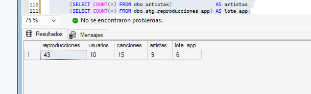


---

# Parte 01 · Teoría y ejemplos

## 1. Qué es un procedimiento almacenado

### Sintaxis

```sql
-- Crear o modificar
CREATE OR ALTER PROCEDURE dbo.usp_nombre
AS
BEGIN
    SET NOCOUNT ON;

    -- instrucciones
END;
GO

-- Ejecutar
EXEC dbo.usp_nombre;

-- Ver su código
EXEC sp_helptext N'dbo.usp_nombre';

-- Borrar
DROP PROCEDURE IF EXISTS dbo.usp_nombre;
```

**Reglas clave:**
- `CREATE PROCEDURE` debe ser la primera instrucción de su lote (si no, **Msg 111**).
- El cuerpo llega hasta el final del lote, no hasta el `END`: el `GO` posterior es obligatorio.
- `CREATE PROCEDURE` falla con **Msg 2714** si ya existe; `CREATE OR ALTER` lo sustituye.
- Crear un procedimiento no lo ejecuta. No uses el prefijo `sp_` (reservado); usa `usp_`.
- `SET NOCOUNT ON` evita los mensajes `(n rows affected)`.
- Llamar a uno que no existe da **Msg 2812**.

### Ejemplo 1. Guardar una consulta como procedimiento y ejecutarla

**Paso 1.** Crear el procedimiento:

```sql
CREATE OR ALTER PROCEDURE dbo.usp_top_canciones
AS
BEGIN
    SET NOCOUNT ON;

    SELECT TOP (3) c.titulo, COUNT(*) AS reproducciones
    FROM dbo.reproducciones AS r
    JOIN dbo.canciones AS c ON c.cancion_id = r.cancion_id
    WHERE r.tipo_contenido = N'Canción'
      AND r.segundos_escuchados >= 30
      AND r.fecha_hora >= '2026-09-16'
      AND r.fecha_hora <  '2026-09-23'
    GROUP BY c.titulo
    ORDER BY reproducciones DESC, c.titulo;
END;
GO
```

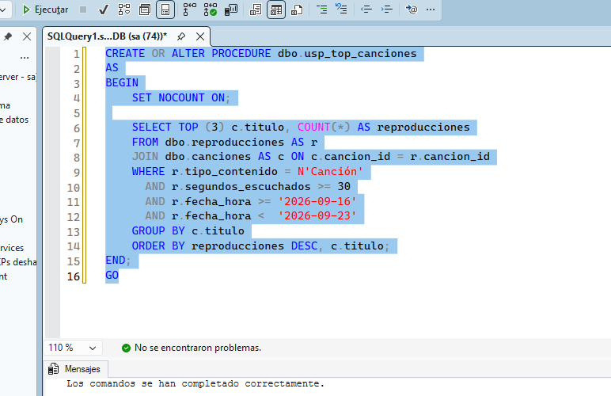

**Paso 2.** Ejecutarlo:

```sql
EXEC dbo.usp_top_canciones;
```

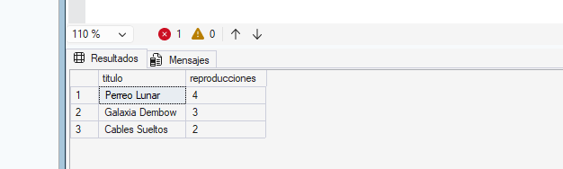

**Paso 3.** Comprobar dónde ha quedado guardado (Object Explorer: *SonoraDB > Programmability > Stored Procedures*, o con la consulta):

```sql
SELECT ROUTINE_SCHEMA, ROUTINE_NAME, CREATED, LAST_ALTERED
FROM INFORMATION_SCHEMA.ROUTINES
WHERE ROUTINE_TYPE = N'PROCEDURE'
ORDER BY ROUTINE_NAME;
```


---

### Ejemplo 2. Modificar un procedimiento y el `GO` que no puede faltar

**Paso 1.** Intentar crearlo otra vez con `CREATE PROCEDURE` (da **Msg 2714**, el original no se toca):

```sql
CREATE PROCEDURE dbo.usp_top_canciones
AS
BEGIN
    SELECT 1 AS prueba;
END;
GO
```


**Paso 2.** Modificarlo con `CREATE OR ALTER` (añade el artista):

```sql
CREATE OR ALTER PROCEDURE dbo.usp_top_canciones
AS
BEGIN
    SET NOCOUNT ON;

    SELECT TOP (3) c.titulo, a.nombre AS artista, COUNT(*) AS reproducciones
    FROM dbo.reproducciones AS r
    JOIN dbo.canciones AS c ON c.cancion_id = r.cancion_id
    JOIN dbo.artistas  AS a ON a.artista_id = c.artista_id
    WHERE r.tipo_contenido = N'Canción'
      AND r.segundos_escuchados >= 30
      AND r.fecha_hora >= '2026-09-16'
      AND r.fecha_hora <  '2026-09-23'
    GROUP BY c.titulo, a.nombre
    ORDER BY reproducciones DESC, c.titulo;
END;
GO

EXEC dbo.usp_top_canciones;
```

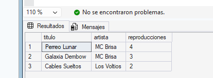

**Paso 3.** Ver el código guardado:

```sql
EXEC sp_helptext N'dbo.usp_top_canciones';
```

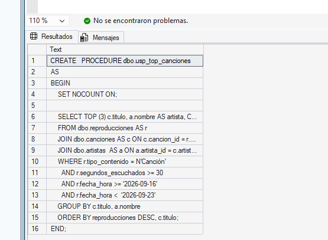

**Paso 4.** Procedimiento de prueba, bien escrito:

```sql
CREATE OR ALTER PROCEDURE dbo.usp_prueba_go
AS
BEGIN
    SELECT N'Hola desde el procedimiento' AS mensaje;
END;
GO

EXEC dbo.usp_prueba_go;
```


**Paso 5.** El mismo script **sin el `GO`** intermedio (el `EXEC` queda guardado *dentro* del procedimiento, que se llama a sí mismo):

```sql
CREATE OR ALTER PROCEDURE dbo.usp_prueba_go
AS
BEGIN
    SELECT N'Hola desde el procedimiento' AS mensaje;
END;

EXEC dbo.usp_prueba_go;
```

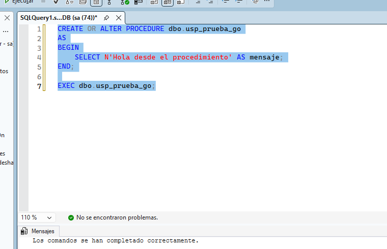

**Paso 6.** Ejecutarlo (se repite hasta el nivel 32 y da **Msg 217**):

```sql
EXEC dbo.usp_prueba_go;
```

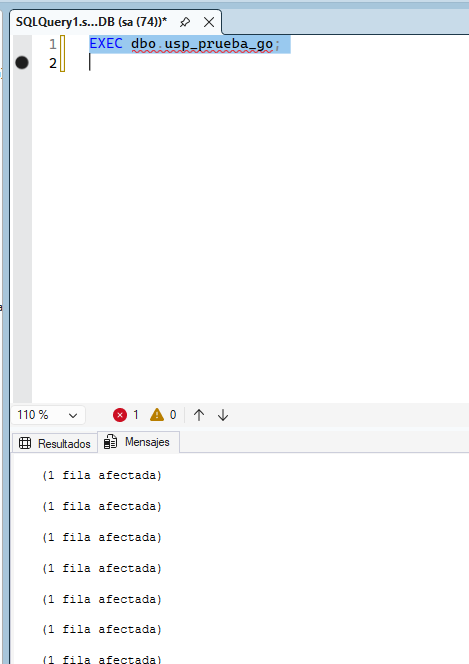

**Paso 7.** Borrar el procedimiento de prueba:

```sql
DROP PROCEDURE IF EXISTS dbo.usp_prueba_go;
```

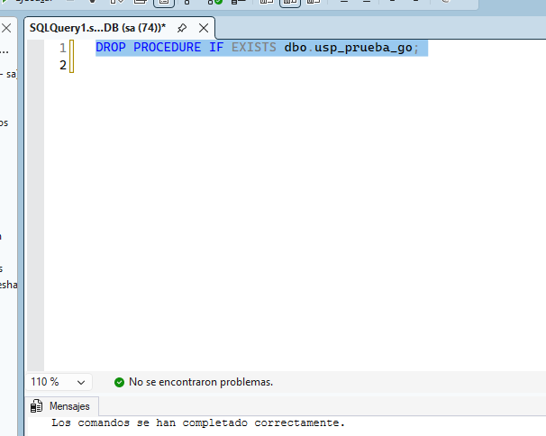

---

## 2. Parámetros: de entrada, con valor por defecto y de salida

### Sintaxis

```sql
CREATE OR ALTER PROCEDURE dbo.usp_nombre
    @obligatorio  tipo,
    @opcional     tipo = valor_por_defecto,
    @salida       tipo OUTPUT
AS
BEGIN
    SET NOCOUNT ON;

    SELECT ... WHERE columna = @obligatorio;

    SET @salida = ...;
END;
GO

-- Por posición
EXEC dbo.usp_nombre valor1, valor2;

-- Por nombre (el orden da igual y se pueden omitir los opcionales)
EXEC dbo.usp_nombre @obligatorio = valor1;

-- Recoger un parámetro de salida
DECLARE @resultado tipo;
EXEC dbo.usp_nombre @obligatorio = valor1, @salida = @resultado OUTPUT;
SELECT @resultado;
```


### Ejemplo 3. Parámetros de entrada

**Paso 1.** Añadir `@desde` y `@hasta`:

```sql
CREATE OR ALTER PROCEDURE dbo.usp_top_canciones
    @desde  date,
    @hasta  date
AS
BEGIN
    SET NOCOUNT ON;

    SELECT TOP (3) c.titulo, a.nombre AS artista, COUNT(*) AS reproducciones
    FROM dbo.reproducciones AS r
    JOIN dbo.canciones AS c ON c.cancion_id = r.cancion_id
    JOIN dbo.artistas  AS a ON a.artista_id = c.artista_id
    WHERE r.tipo_contenido = N'Canción'
      AND r.segundos_escuchados >= 30
      AND r.fecha_hora >= @desde
      AND r.fecha_hora <  @hasta
    GROUP BY c.titulo, a.nombre
    ORDER BY reproducciones DESC, c.titulo;
END;
GO
```

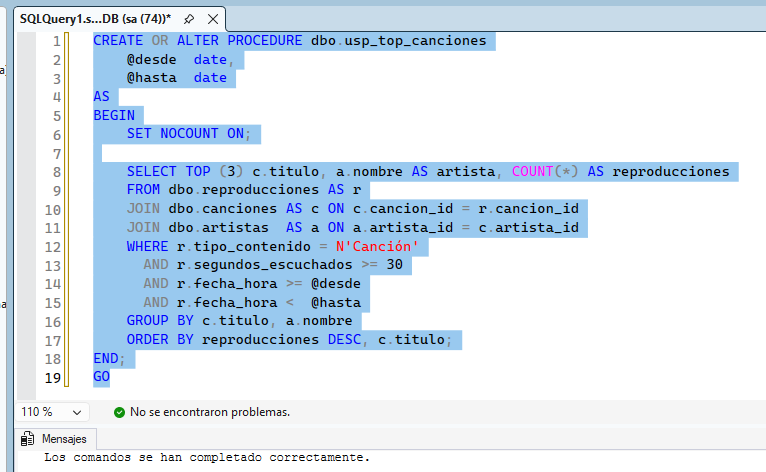

**Paso 2.** Llamada por posición (semana de análisis):

```sql
EXEC dbo.usp_top_canciones '2026-09-16', '2026-09-23';
```

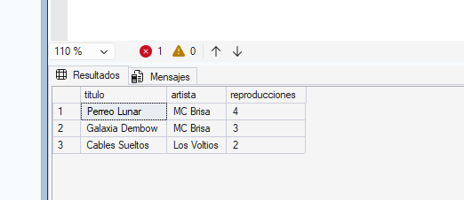

**Paso 3.** Llamada por nombre (14 y 15 de septiembre, parámetros en otro orden):

```sql
EXEC dbo.usp_top_canciones @hasta = '2026-09-16', @desde = '2026-09-14';
```


**Paso 4.** Olvidar un parámetro obligatorio (**Msg 201**):

```sql
EXEC dbo.usp_top_canciones '2026-09-16';
```

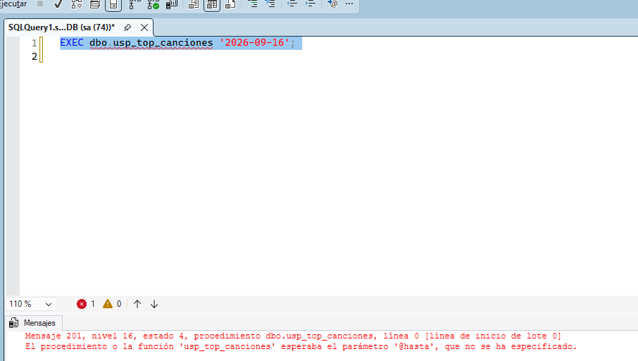

---

### Ejemplo 4. Valores por defecto y filtros opcionales

**Paso 1.** Añadir `@top` (por defecto 3) y `@plan` (por defecto `NULL` = todos):

```sql
CREATE OR ALTER PROCEDURE dbo.usp_top_canciones
    @desde  date,
    @hasta  date,
    @top    int           = 3,
    @plan   nvarchar(20)  = NULL
AS
BEGIN
    SET NOCOUNT ON;

    SELECT TOP (@top) c.titulo, a.nombre AS artista, COUNT(*) AS reproducciones
    FROM dbo.reproducciones AS r
    JOIN dbo.canciones AS c ON c.cancion_id = r.cancion_id
    JOIN dbo.artistas  AS a ON a.artista_id = c.artista_id
    JOIN dbo.usuarios  AS u ON u.usuario_id = r.usuario_id
    WHERE r.tipo_contenido = N'Canción'
      AND r.segundos_escuchados >= 30
      AND r.fecha_hora >= @desde
      AND r.fecha_hora <  @hasta
      AND (@plan IS NULL OR u.plan_suscripcion = @plan)
    GROUP BY c.titulo, a.nombre
    ORDER BY reproducciones DESC, c.titulo;
END;
GO
```

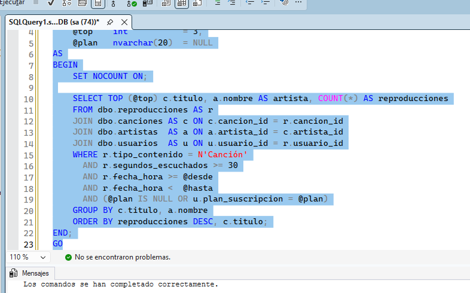

**Paso 2.** La llamada de antes sigue funcionando (mismo resultado que el Ejemplo 3):

```sql
EXEC dbo.usp_top_canciones @desde = '2026-09-16', @hasta = '2026-09-23';
```


**Paso 3.** Cinco canciones:

```sql
EXEC dbo.usp_top_canciones @desde = '2026-09-16', @hasta = '2026-09-23', @top = 5;
```

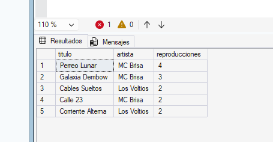

**Paso 4.** Solo plan Free (se salta `@top`):

```sql
EXEC dbo.usp_top_canciones @desde = '2026-09-16', @hasta = '2026-09-23', @plan = N'Free';
```

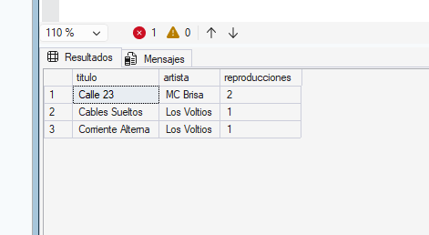

---

### Ejemplo 5. Parámetros de salida (`OUTPUT`)

**Paso 1.** Procedimiento con dos parámetros de salida:

```sql
CREATE OR ALTER PROCEDURE dbo.usp_cifras_periodo
    @desde           date,
    @hasta           date,
    @reproducciones  int           OUTPUT,
    @minutos         decimal(8,1)  OUTPUT
AS
BEGIN
    SET NOCOUNT ON;

    SELECT @reproducciones = COUNT(*),
           @minutos        = CAST(COALESCE(SUM(segundos_escuchados), 0) / 60.0 AS decimal(8,1))
    FROM dbo.reproducciones
    WHERE tipo_contenido = N'Canción'
      AND segundos_escuchados >= 30
      AND fecha_hora >= @desde
      AND fecha_hora <  @hasta;
END;
GO
```

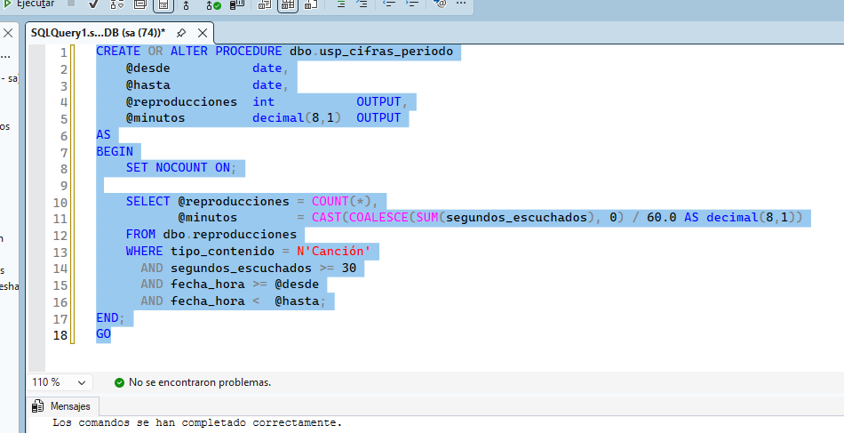

**Paso 2.** Llamarlo recogiendo los resultados (bloque completo de una vez):

```sql
DECLARE @n int, @min decimal(8,1);

EXEC dbo.usp_cifras_periodo
     @desde = '2026-09-16',
     @hasta = '2026-09-23',
     @reproducciones = @n OUTPUT,
     @minutos = @min OUTPUT;

SELECT @n AS reproducciones, @min AS minutos;
```

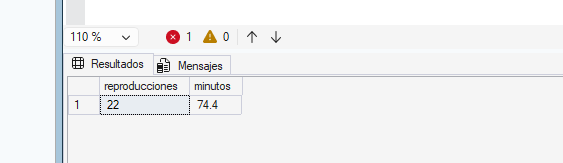

**Paso 3.** La misma llamada **sin** `OUTPUT` (no hay error, pero devuelve `NULL`):

```sql
DECLARE @n int, @min decimal(8,1);

EXEC dbo.usp_cifras_periodo
     @desde = '2026-09-16',
     @hasta = '2026-09-23',
     @reproducciones = @n,
     @minutos = @min;

SELECT @n AS reproducciones, @min AS minutos;
```

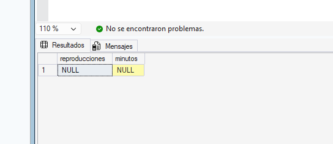

**Paso 4.** Usar los valores devueltos (dos llamadas y una comparación):

```sql
DECLARE @n_semana int, @min_semana decimal(8,1);
DECLARE @n_previo int, @min_previo decimal(8,1);

EXEC dbo.usp_cifras_periodo
     @desde = '2026-09-16', @hasta = '2026-09-23',
     @reproducciones = @n_semana OUTPUT, @minutos = @min_semana OUTPUT;

EXEC dbo.usp_cifras_periodo
     @desde = '2026-09-14', @hasta = '2026-09-16',
     @reproducciones = @n_previo OUTPUT, @minutos = @min_previo OUTPUT;

SELECT @n_semana AS repro_semana,
       @n_previo AS repro_dos_dias_previos,
       CAST(@min_semana / 7 AS decimal(5,1)) AS minutos_dia_semana,
       CAST(@min_previo / 2 AS decimal(5,1)) AS minutos_dia_previos;
```

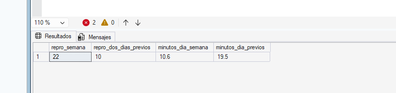

---

## 3. Variables y control de flujo: `IF` y `WHILE`

### Sintaxis

```sql
-- Variables
DECLARE @contador int = 0;
DECLARE @total int, @dia date;

SET @dia = '2026-09-16';
SET @total = (SELECT COUNT(*) FROM dbo.tabla);
SELECT @total = COUNT(*) FROM dbo.tabla;

-- Filas afectadas por la instrucción anterior
DELETE FROM dbo.tabla WHERE ...;
SET @contador = @@ROWCOUNT;

-- Decisión
IF condicion
BEGIN
    -- si se cumple
END
ELSE
BEGIN
    -- si no
END;

-- Repetición
WHILE condicion
BEGIN
    -- instrucciones
    SET @contador = @contador + 1;
END;

-- Salir con un código
RETURN 1;

-- Recoger el código
DECLARE @estado int;
EXEC @estado = dbo.usp_nombre;
```

**Reglas clave:** una variable vive hasta el final del lote (si ejecutas solo la línea que la usa, **Msg 137**); sin valor inicial vale `NULL`; `@@ROWCOUNT` cambia con cada instrucción, guárdalo enseguida; sin `BEGIN ... END`, `IF`/`WHILE` solo controlan la instrucción siguiente; `IS NULL` para comparar con `NULL`; `WHILE` se reserva para repetir **tareas**, no para recorrer filas.

### Ejemplo 6. Variables y `@@ROWCOUNT`: refrescar una tabla resumen

**Paso 1.** Variables en un lote normal (bloque completo de una vez):

```sql
DECLARE @inicio date = '2026-09-16';
DECLARE @total int;

SET @total = (SELECT COUNT(*) FROM dbo.reproducciones WHERE fecha_hora >= @inicio);

SELECT @inicio AS inicio, @total AS reproducciones_desde_inicio;
```

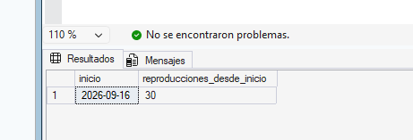

```sql
SELECT @inicio AS inicio, @total AS reproducciones_desde_inicio;
```

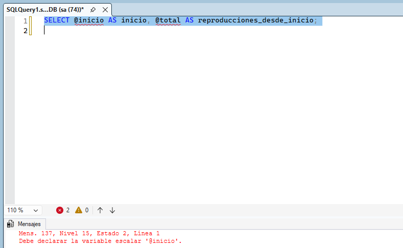

**Paso 2.** Crear la tabla resumen:

```sql
DROP TABLE IF EXISTS dbo.resumen_diario;

CREATE TABLE dbo.resumen_diario (
    dia             date          NOT NULL PRIMARY KEY,
    reproducciones  int           NOT NULL,
    oyentes         int           NOT NULL,
    minutos         decimal(8,1)  NOT NULL
);
GO
```

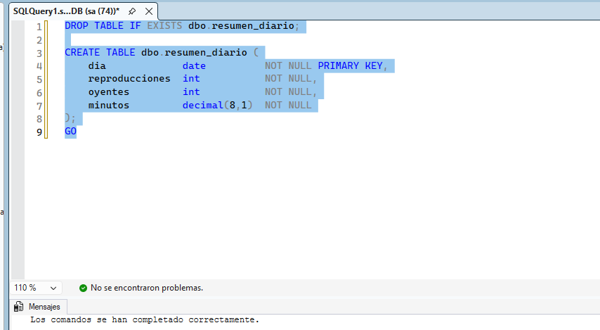

**Paso 3.** Crear el procedimiento:

```sql
CREATE OR ALTER PROCEDURE dbo.usp_refrescar_resumen_diario
    @desde  date,
    @hasta  date
AS
BEGIN
    SET NOCOUNT ON;

    DECLARE @borradas int, @insertadas int;

    DELETE FROM dbo.resumen_diario
    WHERE dia >= @desde
      AND dia <  @hasta;

    SET @borradas = @@ROWCOUNT;

    INSERT INTO dbo.resumen_diario (dia, reproducciones, oyentes, minutos)
    SELECT CAST(r.fecha_hora AS date),
           COUNT(*),
           COUNT(DISTINCT r.usuario_id),
           CAST(SUM(r.segundos_escuchados) / 60.0 AS decimal(8,1))
    FROM dbo.reproducciones AS r
    WHERE r.tipo_contenido = N'Canción'
      AND r.segundos_escuchados >= 30
      AND r.fecha_hora >= @desde
      AND r.fecha_hora <  @hasta
    GROUP BY CAST(r.fecha_hora AS date);

    SET @insertadas = @@ROWCOUNT;

    SELECT @borradas AS filas_borradas, @insertadas AS filas_insertadas;
END;
GO
```

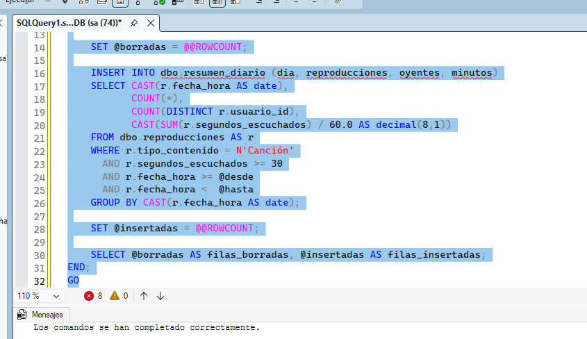

**Paso 4.** Ejecutarlo para la semana de análisis (borradas 0, insertadas 7):

```sql
EXEC dbo.usp_refrescar_resumen_diario @desde = '2026-09-16', @hasta = '2026-09-23';
```

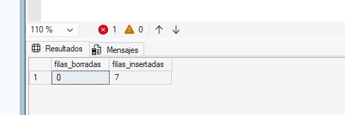

**Paso 5.** Ejecutarlo otra vez con los mismos parámetros (borradas 7, insertadas 7):

```sql
EXEC dbo.usp_refrescar_resumen_diario @desde = '2026-09-16', @hasta = '2026-09-23';
```

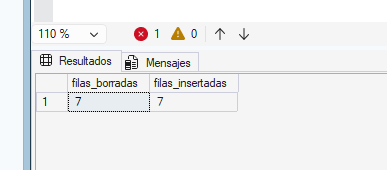

**Paso 6.** Ver el resumen:

```sql
SELECT dia, reproducciones, oyentes, minutos
FROM dbo.resumen_diario
ORDER BY dia;
```

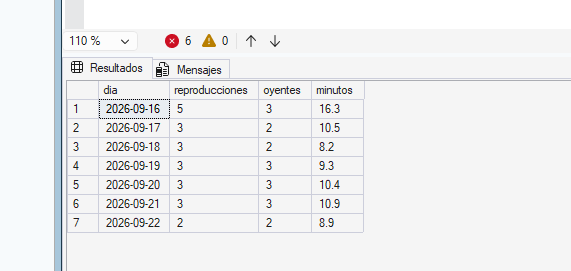

---

### Ejemplo 7. `IF ... ELSE`: validar antes de actuar

**Paso 1.** La trampa del `IF` sin `BEGIN ... END` (el segundo `PRINT` se ejecuta siempre):

```sql
DECLARE @filas_nuevas int = 0;

IF @filas_nuevas > 0
    PRINT N'Hay filas nuevas.';
    PRINT N'Lanzando la carga...';
```

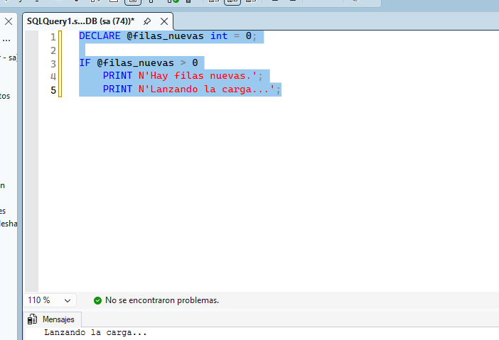

**Paso 2.** Modificar el procedimiento: valida, informa con `PRINT` y devuelve un código con `RETURN`:

```sql
CREATE OR ALTER PROCEDURE dbo.usp_refrescar_resumen_diario
    @desde  date,
    @hasta  date
AS
BEGIN
    SET NOCOUNT ON;

    DECLARE @insertadas int;
    DECLARE @periodo nvarchar(40) = CAST(@desde AS nvarchar(10)) + N' y ' + CAST(@hasta AS nvarchar(10));

    IF @desde IS NULL OR @hasta IS NULL OR @desde >= @hasta
    BEGIN
        PRINT N'Periodo no válido: @desde debe ser anterior a @hasta.';
        RETURN 1;
    END;

    DELETE FROM dbo.resumen_diario
    WHERE dia >= @desde
      AND dia <  @hasta;

    INSERT INTO dbo.resumen_diario (dia, reproducciones, oyentes, minutos)
    SELECT CAST(r.fecha_hora AS date),
           COUNT(*),
           COUNT(DISTINCT r.usuario_id),
           CAST(SUM(r.segundos_escuchados) / 60.0 AS decimal(8,1))
    FROM dbo.reproducciones AS r
    WHERE r.tipo_contenido = N'Canción'
      AND r.segundos_escuchados >= 30
      AND r.fecha_hora >= @desde
      AND r.fecha_hora <  @hasta
    GROUP BY CAST(r.fecha_hora AS date);

    SET @insertadas = @@ROWCOUNT;

    IF @insertadas = 0
        PRINT N'Aviso: sin reproducciones válidas entre ' + @periodo + N'.';
    ELSE
        PRINT N'Resumen actualizado entre ' + @periodo + N'. Días con datos: '
              + CAST(@insertadas AS nvarchar(10)) + N'.';

    RETURN 0;
END;
GO
```

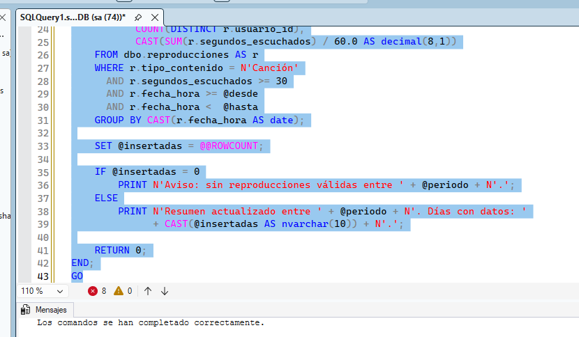

**Paso 3.** Fechas al revés, recogiendo el código de retorno (estado = 1):

```sql
DECLARE @estado int;

EXEC @estado = dbo.usp_refrescar_resumen_diario @desde = '2026-09-23', @hasta = '2026-09-16';

SELECT @estado AS estado;
```

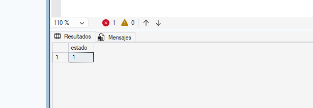

**Paso 4.** Semana de análisis y semana sin datos (estado = 0 las dos veces):

```sql
DECLARE @estado int;

EXEC @estado = dbo.usp_refrescar_resumen_diario @desde = '2026-09-16', @hasta = '2026-09-23';
SELECT @estado AS estado;

EXEC @estado = dbo.usp_refrescar_resumen_diario @desde = '2026-10-05', @hasta = '2026-10-12';
SELECT @estado AS estado;
```

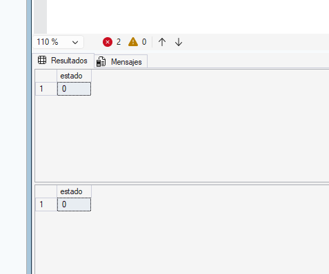

---

### Ejemplo 8. `WHILE`: repetir una tarea día a día

**Paso 1.** Procedimiento que recorre el periodo con un `WHILE` y llama al de refresco para cada día:

```sql
CREATE OR ALTER PROCEDURE dbo.usp_reconstruir_resumen_diario
    @desde  date,
    @hasta  date
AS
BEGIN
    SET NOCOUNT ON;

    DECLARE @dia date = @desde;
    DECLARE @dia_siguiente date;
    DECLARE @vueltas int = 0;

    WHILE @dia < @hasta
    BEGIN
        SET @dia_siguiente = DATEADD(DAY, 1, @dia);

        EXEC dbo.usp_refrescar_resumen_diario @desde = @dia, @hasta = @dia_siguiente;

        SET @dia = @dia_siguiente;
        SET @vueltas = @vueltas + 1;
    END;

    PRINT N'Días procesados: ' + CAST(@vueltas AS nvarchar(10)) + N'.';
END;
GO
```

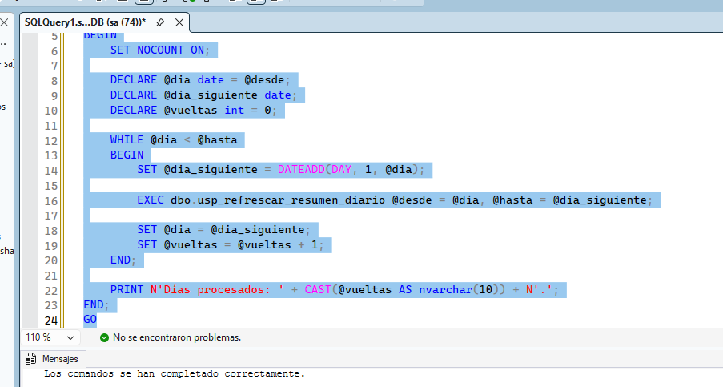

**Paso 2.** Ejecutarlo (del 14/09 al 23/09 incluido):

```sql
EXEC dbo.usp_reconstruir_resumen_diario @desde = '2026-09-14', @hasta = '2026-09-24';
```

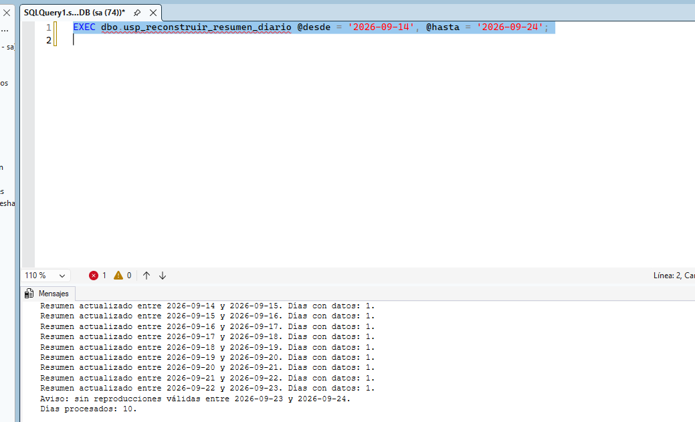

**Paso 3.** Ver el resumen completo (9 días, del 14 al 22/09):

```sql
SELECT dia, reproducciones, oyentes, minutos
FROM dbo.resumen_diario
ORDER BY dia;
```

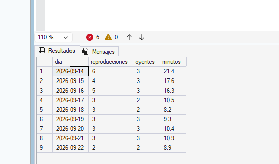

---

## 4. Manejo de errores: `TRY ... CATCH` y `THROW`

### Sintaxis

```sql
BEGIN TRY
    -- instrucciones que pueden fallar
END TRY
BEGIN CATCH
    SELECT ERROR_NUMBER() AS numero, ERROR_MESSAGE() AS mensaje;

    THROW;      -- volver a lanzar el error capturado
END CATCH;

-- Lanzar un error propio (número >= 50000)
IF condicion_que_no_debe_darse
    THROW 50001, N'Texto del error.', 1;
```

Funciones dentro del `CATCH`: `ERROR_NUMBER()`, `ERROR_MESSAGE()`, `ERROR_LINE()`, `ERROR_PROCEDURE()`, `ERROR_SEVERITY()`, `ERROR_STATE()`.

**Reglas clave:** nada entre `END TRY` y `BEGIN CATCH`; la instrucción anterior a un `THROW` termina en `;`; `THROW` sin argumentos solo vale dentro de un `CATCH`; un `CATCH` que no relanza **oculta** el error.

### Ejemplo 9. Sin `TRY ... CATCH`, el error no detiene nada

**Paso 1.** Tres inserciones, la segunda repite la clave (**Msg 2627**, pero la tercera se ejecuta igualmente; quedan los ids 1 y 2):

```sql
DROP TABLE IF EXISTS #prueba;

CREATE TABLE #prueba (id int NOT NULL PRIMARY KEY);

INSERT INTO #prueba (id) VALUES (1);
INSERT INTO #prueba (id) VALUES (1);
INSERT INTO #prueba (id) VALUES (2);

SELECT id FROM #prueba ORDER BY id;
```

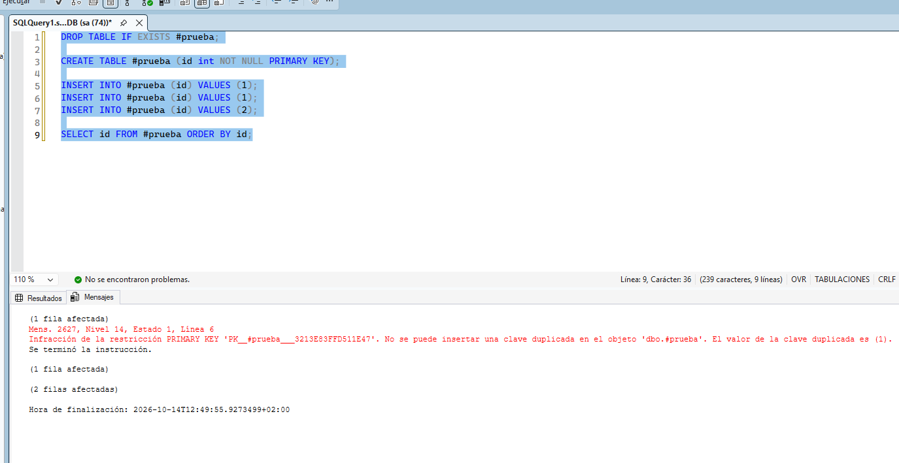

**Paso 2.** Lo mismo dentro de un `TRY` (el `CATCH` captura, la tercera no se ejecuta; queda solo el id 1):

```sql
DROP TABLE IF EXISTS #prueba;

CREATE TABLE #prueba (id int NOT NULL PRIMARY KEY);

BEGIN TRY
    INSERT INTO #prueba (id) VALUES (1);
    INSERT INTO #prueba (id) VALUES (1);
    INSERT INTO #prueba (id) VALUES (2);
END TRY
BEGIN CATCH
    SELECT ERROR_NUMBER()  AS numero,
           ERROR_LINE()    AS linea,
           ERROR_MESSAGE() AS mensaje;
END CATCH;

SELECT id FROM #prueba ORDER BY id;
```

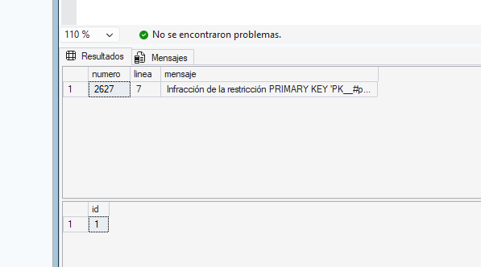

---

### Ejemplo 10. `THROW`: errores propios, y no ocultar los ajenos

**Paso 1.** Sustituir el `PRINT` + `RETURN 1` por un `THROW`:

```sql
CREATE OR ALTER PROCEDURE dbo.usp_refrescar_resumen_diario
    @desde  date,
    @hasta  date
AS
BEGIN
    SET NOCOUNT ON;

    DECLARE @insertadas int;
    DECLARE @periodo nvarchar(40) = CAST(@desde AS nvarchar(10)) + N' y ' + CAST(@hasta AS nvarchar(10));

    IF @desde IS NULL OR @hasta IS NULL OR @desde >= @hasta
        THROW 50001, N'Periodo no válido: @desde debe ser anterior a @hasta.', 1;

    DELETE FROM dbo.resumen_diario
    WHERE dia >= @desde
      AND dia <  @hasta;

    INSERT INTO dbo.resumen_diario (dia, reproducciones, oyentes, minutos)
    SELECT CAST(r.fecha_hora AS date),
           COUNT(*),
           COUNT(DISTINCT r.usuario_id),
           CAST(SUM(r.segundos_escuchados) / 60.0 AS decimal(8,1))
    FROM dbo.reproducciones AS r
    WHERE r.tipo_contenido = N'Canción'
      AND r.segundos_escuchados >= 30
      AND r.fecha_hora >= @desde
      AND r.fecha_hora <  @hasta
    GROUP BY CAST(r.fecha_hora AS date);

    SET @insertadas = @@ROWCOUNT;

    IF @insertadas = 0
        PRINT N'Aviso: sin reproducciones válidas entre ' + @periodo + N'.';
    ELSE
        PRINT N'Resumen actualizado entre ' + @periodo + N'. Días con datos: '
              + CAST(@insertadas AS nvarchar(10)) + N'.';
END;
GO
```

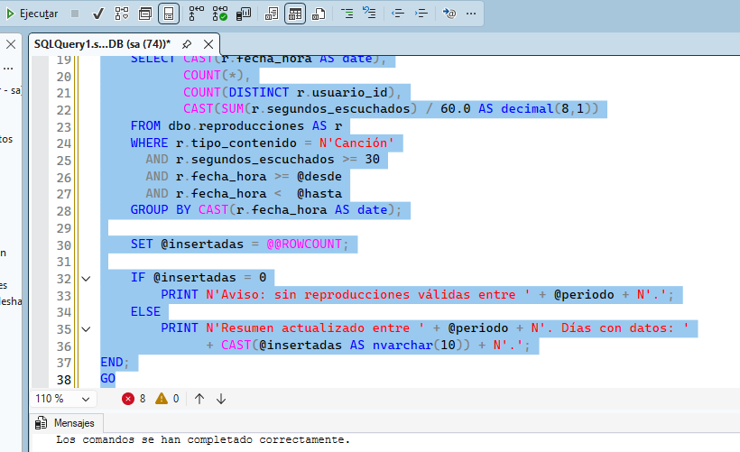

**Paso 2.** Llamarlo con las fechas al revés (**Msg 50001** en rojo):

```sql
EXEC dbo.usp_refrescar_resumen_diario @desde = '2026-09-23', @hasta = '2026-09-16';
```

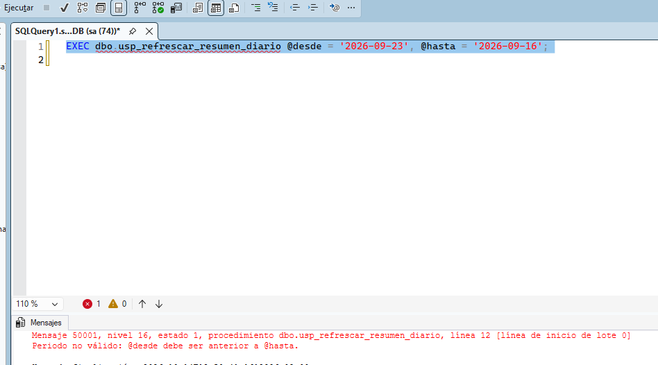

**Paso 3.** Capturarlo desde fuera con otro `TRY ... CATCH`:

```sql
BEGIN TRY
    EXEC dbo.usp_refrescar_resumen_diario @desde = '2026-09-23', @hasta = '2026-09-16';

    PRINT N'Esta línea no se ejecuta.';
END TRY
BEGIN CATCH
    SELECT ERROR_NUMBER()    AS numero,
           ERROR_PROCEDURE() AS procedimiento,
           ERROR_MESSAGE()   AS mensaje;
END CATCH;
```

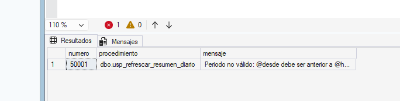

**Paso 4.** El error que se oculta (el `CATCH` no relanza: nada en rojo, la ejecución parece correcta):

```sql
BEGIN TRY
    EXEC dbo.usp_refrescar_resumen_diario @desde = '2026-09-23', @hasta = '2026-09-16';
END TRY
BEGIN CATCH
    PRINT N'Algo ha fallado en el refresco.';
END CATCH;
```

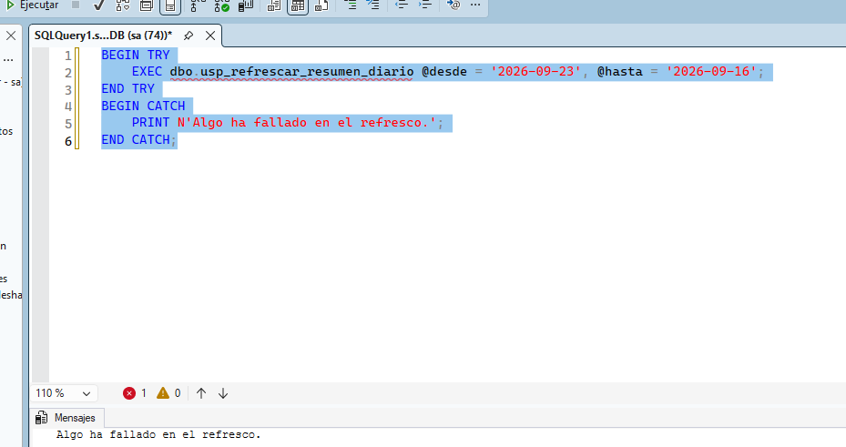

**Paso 5.** La versión correcta: hacer lo necesario y **volver a lanzar**:

```sql
BEGIN TRY
    EXEC dbo.usp_refrescar_resumen_diario @desde = '2026-09-23', @hasta = '2026-09-16';
END TRY
BEGIN CATCH
    PRINT N'Algo ha fallado en el refresco.';

    THROW;
END CATCH;
```

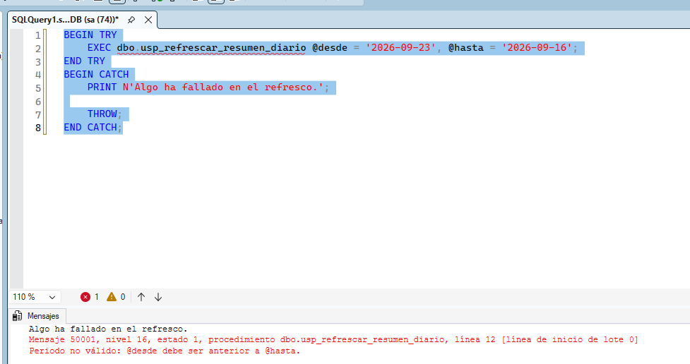

---

## 5. Transacciones dentro de un procedimiento

### Plantilla (para aprenderla tal cual)

```sql
CREATE OR ALTER PROCEDURE dbo.usp_nombre
    @parametro tipo
AS
BEGIN
    SET NOCOUNT ON;
    SET XACT_ABORT ON;

    BEGIN TRY
        -- 1. Validaciones (con THROW si algo no cuadra)

        BEGIN TRAN;

            -- 2. Modificaciones que van juntas

        COMMIT;
    END TRY
    BEGIN CATCH
        IF @@TRANCOUNT > 0 ROLLBACK;

        THROW;
    END CATCH;
END;
GO
```

**Reglas clave:** validar **antes** de abrir la transacción; el `ROLLBACK` del `CATCH` lleva `;` porque detrás va `THROW`; `IF @@TRANCOUNT > 0` evita un segundo error; si dudas de una transacción abierta, `SELECT @@TRANCOUNT;` y `ROLLBACK;`; una sola instrucción ya es todo o nada; las variables (normales y de tabla) no participan en las transacciones.

### Ejemplo 11. Una transacción que no protege

**Paso 1.** Tabla de historial (solo admite los tres planes):

```sql
DROP TABLE IF EXISTS dbo.historial_planes;

CREATE TABLE dbo.historial_planes (
    cambio_id      int IDENTITY(1,1) NOT NULL PRIMARY KEY,
    usuario_id     int           NOT NULL,
    plan_anterior  nvarchar(20)  NOT NULL,
    plan_nuevo     nvarchar(20)  NOT NULL,
    fecha_cambio   datetime2(0)  NOT NULL DEFAULT SYSDATETIME(),
    CONSTRAINT CK_historial_planes_plan
        CHECK (plan_nuevo IN (N'Free', N'Premium', N'Familiar'))
);
GO
```

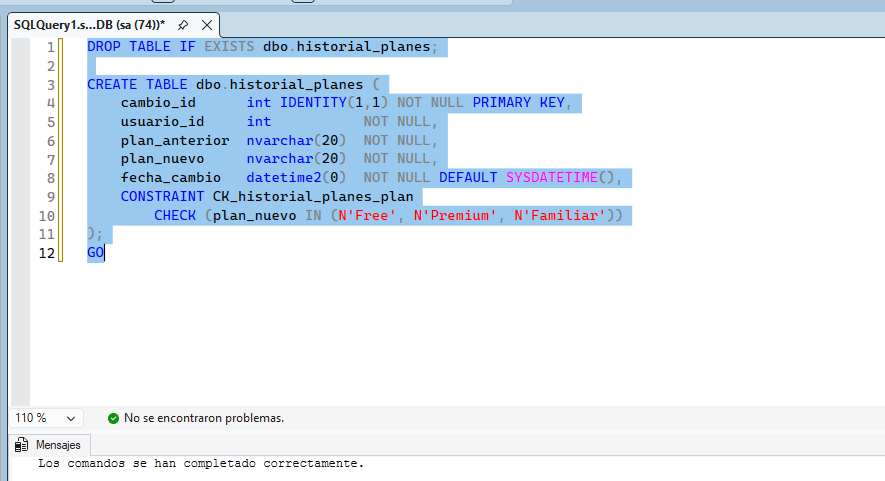

**Paso 2.** El procedimiento de Hugo (sin `XACT_ABORT` ni `TRY ... CATCH`):

```sql
CREATE OR ALTER PROCEDURE dbo.usp_cambiar_plan
    @nombre_usuario  nvarchar(50),
    @plan_nuevo      nvarchar(20)
AS
BEGIN
    SET NOCOUNT ON;

    DECLARE @usuario_id int, @plan_anterior nvarchar(20);

    SELECT @usuario_id    = usuario_id,
           @plan_anterior = plan_suscripcion
    FROM dbo.usuarios
    WHERE nombre_usuario = @nombre_usuario;

    BEGIN TRAN;

        UPDATE dbo.usuarios
        SET plan_suscripcion = @plan_nuevo
        WHERE usuario_id = @usuario_id;

        INSERT INTO dbo.historial_planes (usuario_id, plan_anterior, plan_nuevo)
        VALUES (@usuario_id, @plan_anterior, @plan_nuevo);

    COMMIT;
END;
GO
```

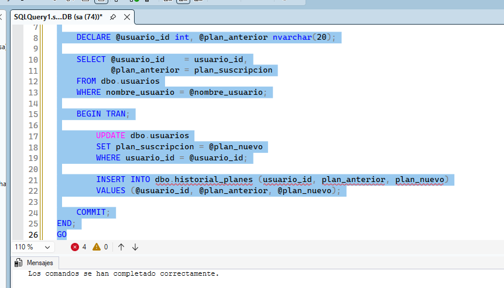

**Paso 3.** Cambio con el plan mal escrito (**Msg 547** por el `CHECK`):

```sql
EXEC dbo.usp_cambiar_plan @nombre_usuario = N'marta_rock', @plan_nuevo = N'Premiun';
```

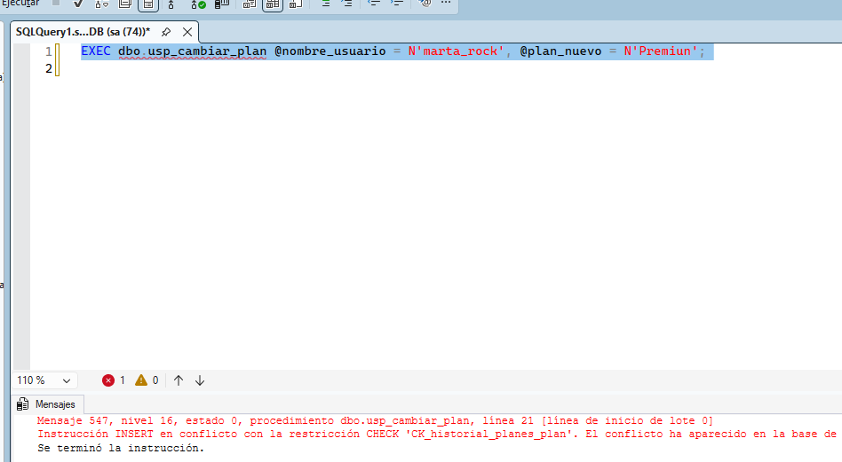

**Paso 4.** Comprobar cómo ha quedado (marta_rock = `Premiun`, historial = 0 filas):

```sql
SELECT nombre_usuario, plan_suscripcion
FROM dbo.usuarios
WHERE nombre_usuario = N'marta_rock';

SELECT COUNT(*) AS cambios_en_historial FROM dbo.historial_planes;
```

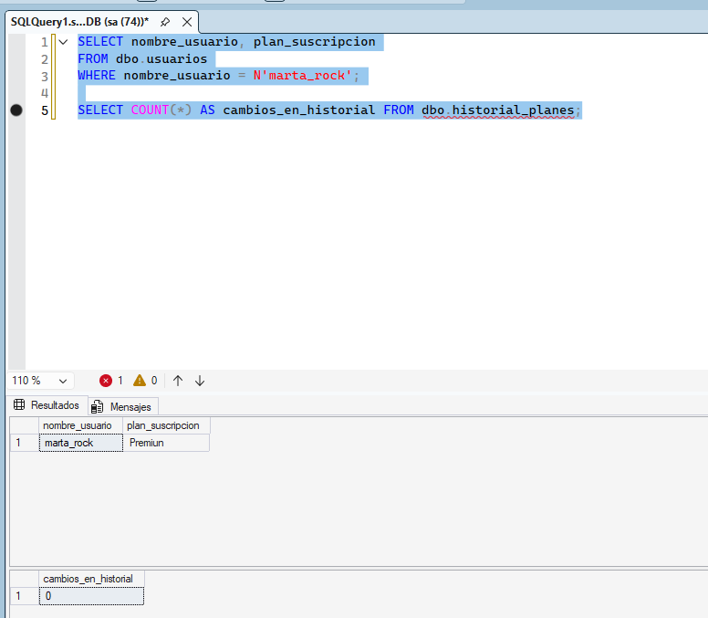

**Qué ha ocurrido:** el `UPDATE` funciona, el `INSERT` falla por el `CHECK` (solo se anula esa instrucción), la ejecución continúa y llega al `COMMIT`, que confirma el `UPDATE`. Resultado: un plan inexistente y sin rastro en el historial.

**Paso 5.** Reparar el dato a mano:

```sql
UPDATE dbo.usuarios
SET plan_suscripcion = N'Free'
WHERE nombre_usuario = N'marta_rock';
```

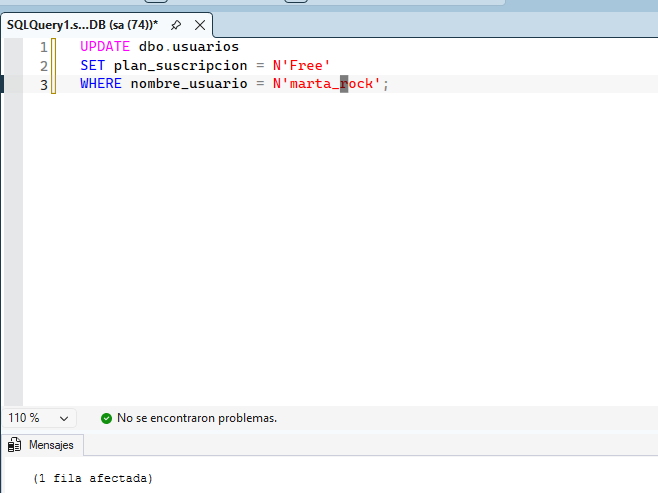

---

### Ejemplo 12. La plantilla completa: todo o nada

**Paso 1.** Reescribir el procedimiento con la plantilla y validaciones:

```sql
CREATE OR ALTER PROCEDURE dbo.usp_cambiar_plan
    @nombre_usuario  nvarchar(50),
    @plan_nuevo      nvarchar(20)
AS
BEGIN
    SET NOCOUNT ON;
    SET XACT_ABORT ON;

    DECLARE @usuario_id int, @plan_anterior nvarchar(20);

    BEGIN TRY
        SELECT @usuario_id    = usuario_id,
               @plan_anterior = plan_suscripcion
        FROM dbo.usuarios
        WHERE nombre_usuario = @nombre_usuario;

        IF @usuario_id IS NULL
            THROW 50002, N'El usuario no existe.', 1;

        IF @plan_anterior = @plan_nuevo
            THROW 50003, N'El usuario ya tiene ese plan.', 1;

        BEGIN TRAN;

            UPDATE dbo.usuarios
            SET plan_suscripcion = @plan_nuevo
            WHERE usuario_id = @usuario_id;

            INSERT INTO dbo.historial_planes (usuario_id, plan_anterior, plan_nuevo)
            VALUES (@usuario_id, @plan_anterior, @plan_nuevo);

        COMMIT;
    END TRY
    BEGIN CATCH
        IF @@TRANCOUNT > 0 ROLLBACK;

        THROW;
    END CATCH;
END;
GO
```

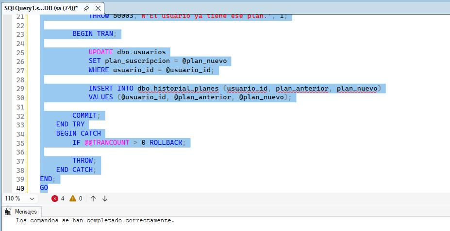

**Paso 2.** Repetir la llamada con el plan mal escrito (mismo **Msg 547**, pero ahora no cambia nada: marta_rock sigue en `Free`, historial = 0):

```sql
EXEC dbo.usp_cambiar_plan @nombre_usuario = N'marta_rock', @plan_nuevo = N'Premiun';
```

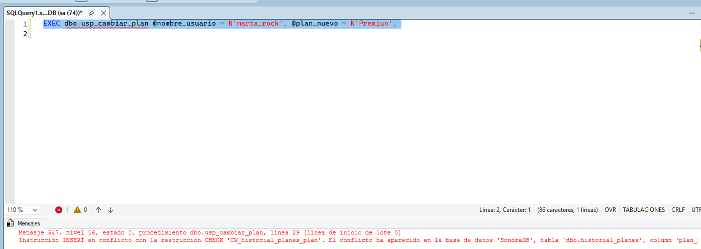

```sql
SELECT nombre_usuario, plan_suscripcion
FROM dbo.usuarios
WHERE nombre_usuario = N'marta_rock';

SELECT COUNT(*) AS cambios_en_historial FROM dbo.historial_planes;
```

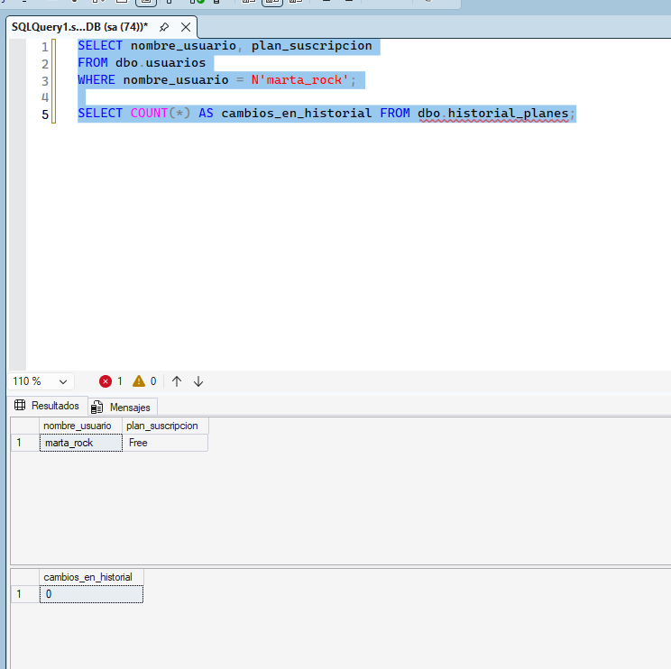

**Paso 3.** Usuario que no existe (**Msg 50002**, antes del `BEGIN TRAN`):

```sql
EXEC dbo.usp_cambiar_plan @nombre_usuario = N'marta_pop', @plan_nuevo = N'Premium';
```

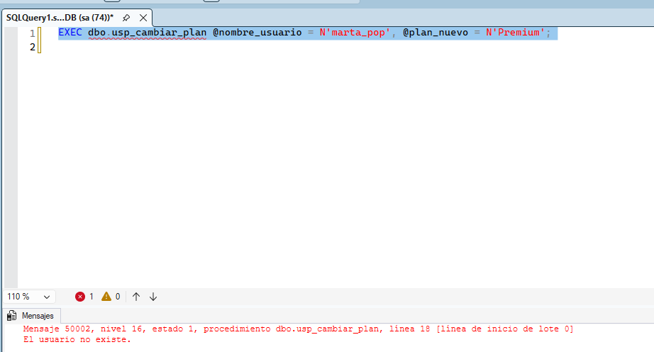

**Paso 4.** El cambio correcto:

```sql
EXEC dbo.usp_cambiar_plan @nombre_usuario = N'marta_rock', @plan_nuevo = N'Premium';

SELECT nombre_usuario, plan_suscripcion
FROM dbo.usuarios
WHERE nombre_usuario = N'marta_rock';

SELECT usuario_id, plan_anterior, plan_nuevo
FROM dbo.historial_planes
ORDER BY cambio_id;
```

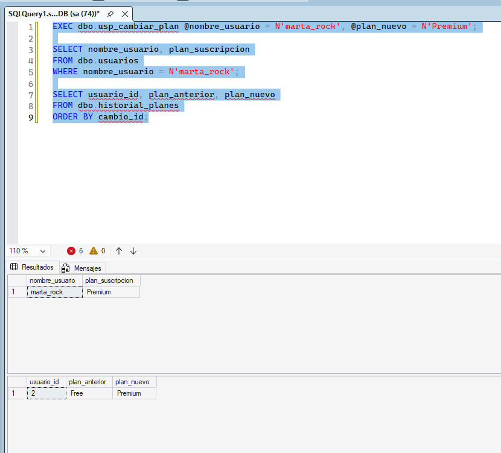

**Paso 5.** Devolver a marta_rock a su plan para conservar el punto de partida:

```sql
EXEC dbo.usp_cambiar_plan @nombre_usuario = N'marta_rock', @plan_nuevo = N'Free';
```

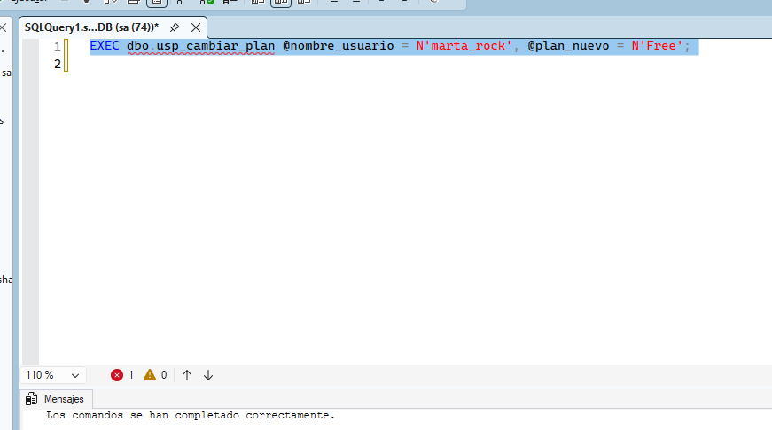

---

## 6. El procedimiento de carga: log de ejecuciones e idempotencia

Las cuatro etapas de una carga: **1)** anotar el inicio en el log, **2)** staging y validación, **3)** cargar dentro de una transacción, **4)** anotar el final (`OK` o `Error`).

```sql
CREATE OR ALTER PROCEDURE dbo.usp_carga
AS
BEGIN
    SET NOCOUNT ON;
    SET XACT_ABORT ON;

    DECLARE @log_id int, @insertadas int;

    -- 1. Anotar el inicio: antes del TRY y fuera de cualquier transacción
    INSERT INTO dbo.log_cargas (proceso, inicio, estado)
    VALUES (N'usp_carga', SYSDATETIME(), N'En curso');

    SET @log_id = SCOPE_IDENTITY();

    BEGIN TRY
        -- 2. Staging y validación

        -- 3. Carga
        BEGIN TRAN;
            INSERT INTO dbo.destino (...) SELECT ... WHERE NOT EXISTS (...);
            SET @insertadas = @@ROWCOUNT;
        COMMIT;

        -- 4. Anotar el final correcto
        UPDATE dbo.log_cargas
        SET fin = SYSDATETIME(), filas_insertadas = @insertadas, estado = N'OK'
        WHERE log_id = @log_id;
    END TRY
    BEGIN CATCH
        IF @@TRANCOUNT > 0 ROLLBACK;

        -- 4. Anotar el final con error: siempre DESPUÉS del ROLLBACK
        UPDATE dbo.log_cargas
        SET fin = SYSDATETIME(), estado = N'Error', mensaje_error = ERROR_MESSAGE()
        WHERE log_id = @log_id;

        THROW;
    END CATCH;
END;
```


### Ejemplo 13. La tabla de log y una primera carga que deja rastro

**Paso 1.** Tabla de log:

```sql
DROP TABLE IF EXISTS dbo.rechazos_carga;
DROP TABLE IF EXISTS dbo.log_cargas;

CREATE TABLE dbo.log_cargas (
    log_id            int IDENTITY(1,1) NOT NULL PRIMARY KEY,
    proceso           nvarchar(100)   NOT NULL,
    inicio            datetime2(0)    NOT NULL,
    fin               datetime2(0)    NULL,
    filas_leidas      int             NULL,
    filas_insertadas  int             NULL,
    filas_rechazadas  int             NULL,
    estado            nvarchar(10)    NOT NULL,
    mensaje_error     nvarchar(4000)  NULL
);
GO
```


**Paso 2.** Primera versión del procedimiento (la carga de siempre con `NOT EXISTS`, envuelta en el log):

```sql
CREATE OR ALTER PROCEDURE dbo.usp_cargar_reproducciones
AS
BEGIN
    SET NOCOUNT ON;
    SET XACT_ABORT ON;

    DECLARE @log_id int, @leidas int, @insertadas int;

    INSERT INTO dbo.log_cargas (proceso, inicio, estado)
    VALUES (N'usp_cargar_reproducciones', SYSDATETIME(), N'En curso');

    SET @log_id = SCOPE_IDENTITY();

    BEGIN TRY
        SET @leidas = (SELECT COUNT(*) FROM dbo.stg_reproducciones_app);

        INSERT INTO dbo.reproducciones
            (reproduccion_id, usuario_id, cancion_id, fecha_hora, segundos_escuchados, dispositivo, tipo_contenido)
        SELECT s.reproduccion_id, s.usuario_id, s.cancion_id, s.fecha_hora,
               s.segundos_escuchados, s.dispositivo, s.tipo_contenido
        FROM dbo.stg_reproducciones_app AS s
        WHERE NOT EXISTS (SELECT 1 FROM dbo.reproducciones AS r WHERE r.reproduccion_id = s.reproduccion_id);

        SET @insertadas = @@ROWCOUNT;

        UPDATE dbo.log_cargas
        SET fin = SYSDATETIME(),
            filas_leidas = @leidas,
            filas_insertadas = @insertadas,
            estado = N'OK'
        WHERE log_id = @log_id;
    END TRY
    BEGIN CATCH
        UPDATE dbo.log_cargas
        SET fin = SYSDATETIME(),
            filas_leidas = @leidas,
            estado = N'Error',
            mensaje_error = ERROR_MESSAGE()
        WHERE log_id = @log_id;

        THROW;
    END CATCH;
END;
GO
```


**Paso 3.** Ejecutar la carga y consultar el log (leídas 6, insertadas 4, `OK`; reproducciones = 47):

```sql
EXEC dbo.usp_cargar_reproducciones;

SELECT log_id, proceso, inicio, fin, filas_leidas, filas_insertadas, estado, mensaje_error
FROM dbo.log_cargas
ORDER BY log_id;

SELECT COUNT(*) AS reproducciones FROM dbo.reproducciones;
```


---

### Ejemplo 14. Idempotencia: ejecutar dos veces no duplica

**Paso 1.** Ejecutar otra vez y consultar (segunda fila del log: leídas 6, insertadas 0; reproducciones sigue en 47):

```sql
EXEC dbo.usp_cargar_reproducciones;

SELECT log_id, filas_leidas, filas_insertadas, estado
FROM dbo.log_cargas
ORDER BY log_id;

SELECT COUNT(*) AS reproducciones FROM dbo.reproducciones;
```


**Paso 2.** Qué la hace idempotente:

| Parte | ¿Idempotente? | Por qué |
| --- | --- | --- |
| La carga en `reproducciones` | Sí | El `NOT EXISTS` solo deja pasar las filas que aún no están en el destino |
| La anotación en `log_cargas` | No, a propósito | Cada ejecución **debe** dejar su propia fila: el log cuenta ejecuciones, no datos |

---

### Ejemplo 15. Cuando la carga falla, el log lo cuenta

**Paso 1.** Sustituir el contenido del buzón por el lote del 24/09 (la 47 es un reenvío, la 49 usuario inexistente, la 51 canción fuera de catálogo, la 53 segundos negativos):

```sql
DELETE FROM dbo.stg_reproducciones_app;

INSERT INTO dbo.stg_reproducciones_app
    (reproduccion_id, usuario_id, cancion_id, fecha_hora, segundos_escuchados, dispositivo, tipo_contenido) VALUES
(47, 5,  104, '2026-09-23 13:01', 190, N'Móvil',      N'Canción'),
(48, 8,  106, '2026-09-24 07:45', 234, N'Móvil',      N'Canción'),
(49, 99, 103, '2026-09-24 09:10', 176, N'Móvil',      N'Canción'),
(50, 4,  114, '2026-09-24 10:30', 175, N'Móvil',      N'Canción'),
(51, 3,  130, '2026-09-24 11:00', 200, N'Escritorio', N'Canción'),
(52, 3,  105, '2026-09-24 11:05', 412, N'Escritorio', N'Canción'),
(53, 9,  108, '2026-09-24 12:00', -5,  N'Web',        N'Canción'),
(54, 10, 113, '2026-09-24 18:15', 158, N'Móvil',      N'Canción');
```


**Paso 2.** Ejecutar la carga (**Msg 547**, clave ajena):

```sql
EXEC dbo.usp_cargar_reproducciones;
```


**Paso 3.** Consultar el log y el destino (fila 3: leídas 8, `Error`, con mensaje; reproducciones sigue en 47):

```sql
SELECT log_id, filas_leidas, filas_insertadas, estado, mensaje_error
FROM dbo.log_cargas
ORDER BY log_id;

SELECT COUNT(*) AS reproducciones FROM dbo.reproducciones;
```


**Qué ha ocurrido:** el procedimiento falla *bien* (no deja nada a medias, lo anota y avisa), pero por tres filas defectuosas se quedan fuera cuatro correctas. Eso se arregla validando antes de cargar (Ejemplo 16).

---

### Ejemplo 16. El procedimiento de carga completo

Controles, en este orden (una fila se queda con el motivo del primero que incumple):

| Orden | Control | Motivo |
| --- | --- | --- |
| 1 | El usuario debe existir | `Usuario inexistente` |
| 2 | Si trae `cancion_id`, la canción debe existir | `Canción fuera de catálogo` |
| 3 | Segundos no negativos ni mayores que la duración | `Segundos fuera de rango` |

**Paso 1.** Tabla de rechazos (permanente):

```sql
DROP TABLE IF EXISTS dbo.rechazos_carga;

CREATE TABLE dbo.rechazos_carga (
    log_id               int           NOT NULL,
    reproduccion_id      int           NULL,
    usuario_id           int           NULL,
    cancion_id           int           NULL,
    segundos_escuchados  int           NULL,
    motivo               nvarchar(60)  NOT NULL
);
GO
```


**Paso 2.** Procedimiento completo:

```sql
CREATE OR ALTER PROCEDURE dbo.usp_cargar_reproducciones
AS
BEGIN
    SET NOCOUNT ON;
    SET XACT_ABORT ON;

    DECLARE @log_id int, @leidas int, @insertadas int, @rechazadas int;

    -- 1. Anotar el inicio
    INSERT INTO dbo.log_cargas (proceso, inicio, estado)
    VALUES (N'usp_cargar_reproducciones', SYSDATETIME(), N'En curso');

    SET @log_id = SCOPE_IDENTITY();

    BEGIN TRY
        SET @leidas = (SELECT COUNT(*) FROM dbo.stg_reproducciones_app);

        -- 2. Staging: sin duplicados, sin filas ya cargadas y con cada fila validada
        SELECT DISTINCT
               s.reproduccion_id, s.usuario_id, s.cancion_id, s.fecha_hora,
               s.segundos_escuchados, s.dispositivo, s.tipo_contenido,
               CASE
                   WHEN NOT EXISTS (SELECT 1 FROM dbo.usuarios AS u
                                    WHERE u.usuario_id = s.usuario_id)
                       THEN N'Usuario inexistente'
                   WHEN s.cancion_id IS NOT NULL
                        AND NOT EXISTS (SELECT 1 FROM dbo.canciones AS c
                                        WHERE c.cancion_id = s.cancion_id)
                       THEN N'Canción fuera de catálogo'
                   WHEN s.segundos_escuchados < 0
                        OR EXISTS (SELECT 1 FROM dbo.canciones AS c
                                   WHERE c.cancion_id = s.cancion_id
                                     AND s.segundos_escuchados > c.duracion_seg)
                       THEN N'Segundos fuera de rango'
               END AS motivo
        INTO #lote_carga
        FROM dbo.stg_reproducciones_app AS s
        WHERE NOT EXISTS (SELECT 1 FROM dbo.reproducciones AS r
                          WHERE r.reproduccion_id = s.reproduccion_id);

        -- 3. Carga: rechazos y filas buenas, todo o nada
        BEGIN TRAN;

            INSERT INTO dbo.rechazos_carga
                (log_id, reproduccion_id, usuario_id, cancion_id, segundos_escuchados, motivo)
            SELECT @log_id, l.reproduccion_id, l.usuario_id, l.cancion_id, l.segundos_escuchados, l.motivo
            FROM #lote_carga AS l
            WHERE l.motivo IS NOT NULL;

            SET @rechazadas = @@ROWCOUNT;

            INSERT INTO dbo.reproducciones
                (reproduccion_id, usuario_id, cancion_id, fecha_hora, segundos_escuchados, dispositivo, tipo_contenido)
            SELECT l.reproduccion_id, l.usuario_id, l.cancion_id, l.fecha_hora,
                   l.segundos_escuchados, l.dispositivo, l.tipo_contenido
            FROM #lote_carga AS l
            WHERE l.motivo IS NULL
              AND NOT EXISTS (SELECT 1 FROM dbo.reproducciones AS r
                              WHERE r.reproduccion_id = l.reproduccion_id);

            SET @insertadas = @@ROWCOUNT;

        COMMIT;

        -- 4. Anotar el final correcto
        UPDATE dbo.log_cargas
        SET fin = SYSDATETIME(),
            filas_leidas = @leidas,
            filas_insertadas = @insertadas,
            filas_rechazadas = @rechazadas,
            estado = N'OK'
        WHERE log_id = @log_id;
    END TRY
    BEGIN CATCH
        IF @@TRANCOUNT > 0 ROLLBACK;

        -- 4. Anotar el final con error, después del ROLLBACK
        UPDATE dbo.log_cargas
        SET fin = SYSDATETIME(),
            filas_leidas = @leidas,
            estado = N'Error',
            mensaje_error = ERROR_MESSAGE()
        WHERE log_id = @log_id;

        THROW;
    END CATCH;
END;
GO
```


**Paso 3.** Ejecutar con el mismo lote que falló en el Ejemplo 15:

```sql
EXEC dbo.usp_cargar_reproducciones;

SELECT log_id, filas_leidas, filas_insertadas, filas_rechazadas, estado
FROM dbo.log_cargas
ORDER BY log_id;

SELECT log_id, reproduccion_id, usuario_id, cancion_id, segundos_escuchados, motivo
FROM dbo.rechazos_carga
ORDER BY log_id, reproduccion_id;

SELECT COUNT(*) AS reproducciones FROM dbo.reproducciones;
```


**Paso 4.** Prueba de idempotencia (fila 5: insertadas 0, rechazadas 3; reproducciones sigue en 51):

```sql
EXEC dbo.usp_cargar_reproducciones;

SELECT log_id, filas_leidas, filas_insertadas, filas_rechazadas, estado
FROM dbo.log_cargas
WHERE log_id >= 4
ORDER BY log_id;

SELECT COUNT(*) AS reproducciones FROM dbo.reproducciones;
```


---

## 7. Ejecutar sin tocar las tablas: el permiso `EXECUTE`

### Sintaxis

```sql
-- Usuario de prueba sin login
CREATE USER nombre_usuario WITHOUT LOGIN;

-- Permiso de ejecución sobre un procedimiento concreto
GRANT EXECUTE ON OBJECT::dbo.usp_nombre TO nombre_usuario;

-- Probar como si fuéramos ese usuario
EXECUTE AS USER = N'nombre_usuario';
-- ... llamadas ...
REVERT;
```

Si una prueba falla a mitad, ejecuta `REVERT;` antes de seguir.

### Ejemplo 17. Una cuenta de servicio que solo puede lanzar la carga

**Paso 1.** Crear el usuario y darle `EXECUTE` sobre un único procedimiento:

```sql
IF USER_ID(N'svc_carga') IS NULL
    CREATE USER svc_carga WITHOUT LOGIN;

GRANT EXECUTE ON OBJECT::dbo.usp_cargar_reproducciones TO svc_carga;
GO
```


**Paso 2.** Lanzar la carga como `svc_carga`:

```sql
EXECUTE AS USER = N'svc_carga';

EXEC dbo.usp_cargar_reproducciones;

REVERT;
GO

SELECT log_id, filas_leidas, filas_insertadas, filas_rechazadas, estado
FROM dbo.log_cargas
WHERE log_id >= 5
ORDER BY log_id;
```


**Paso 3.** Intentar a mano lo que no debería poder (tres **Msg 229**: `SELECT` sobre `reproducciones`, `DELETE` sobre `log_cargas`, `EXECUTE` sobre `usp_cambiar_plan`):

```sql
EXECUTE AS USER = N'svc_carga';

SELECT COUNT(*) AS filas FROM dbo.reproducciones;

DELETE FROM dbo.log_cargas;

EXEC dbo.usp_cambiar_plan @nombre_usuario = N'marta_rock', @plan_nuevo = N'Premium';

REVERT;
GO
```


### ¿Qué herramienta uso en cada caso?

| Necesito... | Herramienta |
| --- | --- |
| Ordenar una consulta larga en pasos con nombre | CTE |
| Dar a otros una consulta ya preparada y siempre actualizada | Vista |
| Guardar una foto que debe conservarse | Tabla creada con `SELECT ... INTO` |
| Un resultado intermedio durante mi sesión, o limpiar un lote antes de cargarlo | Tabla temporal `#` |
| La misma consulta para distintos periodos, usuarios o países | Procedimiento con parámetros |
| Una tarea de varios pasos que debe ejecutarse siempre igual | Procedimiento |
| Varias modificaciones que no pueden quedarse a medias | Procedimiento con transacción, `XACT_ABORT ON` y `TRY ... CATCH` |
| Saber por la mañana qué pasó de madrugada | Tabla de log escrita por el propio procedimiento |
| Que una cuenta pueda lanzar una carga sin acceso a las tablas | `GRANT EXECUTE` sobre el procedimiento |

---

# Parte 02 · Ejercicios de refuerzo (resueltos)

> Antes de empezar, ejecuta otra vez el script del **Punto de partida**.

## Ejercicio 1

Procedimiento `dbo.usp_usuarios_por_plan`, sin parámetros: plan y número de usuarios, de más a menos.

```sql
CREATE OR ALTER PROCEDURE dbo.usp_usuarios_por_plan
AS
BEGIN
    SET NOCOUNT ON;

    SELECT plan_suscripcion, COUNT(*) AS usuarios
    FROM dbo.usuarios
    GROUP BY plan_suscripcion
    ORDER BY usuarios DESC;
END;
GO

EXEC dbo.usp_usuarios_por_plan;
```


---

## Ejercicio 2

`dbo.usp_canciones_de_artista`: recibe el nombre del artista y devuelve título, duración y fecha de lanzamiento.

```sql
CREATE OR ALTER PROCEDURE dbo.usp_canciones_de_artista
    @artista nvarchar(100)
AS
BEGIN
    SET NOCOUNT ON;

    SELECT c.titulo, c.duracion_seg, c.fecha_lanzamiento
    FROM dbo.canciones AS c
    JOIN dbo.artistas AS a ON a.artista_id = c.artista_id
    WHERE a.nombre = @artista
    ORDER BY c.fecha_lanzamiento;
END;
GO

EXEC dbo.usp_canciones_de_artista @artista = N'MC Brisa';
EXEC dbo.usp_canciones_de_artista @artista = N'Los Planetas';
```


---

## Ejercicio 3

Sobre `dbo.usp_top_canciones` (Ejemplo 4: `@desde`, `@hasta`, `@top = 3`, `@plan = NULL`). Cada llamada va en su propio lote (`GO`), porque el error de sintaxis del apartado d) impediría ejecutar todo el script junto.

```sql
-- a)
EXEC dbo.usp_top_canciones '2026-09-16';
GO

-- b)
EXEC dbo.usp_top_canciones @plan = N'Familiar', @hasta = '2026-09-23', @desde = '2026-09-16';
GO

-- c)
EXEC dbo.usp_top_canciones '2026-09-16', '2026-09-23', N'Free';
GO

-- d)
EXEC dbo.usp_top_canciones @desde = '2026-09-16', '2026-09-23';
GO

-- e)
EXEC dbo.usp_top_canciones '2026-09-23', '2026-09-16';
GO
```

- **a)** Error **Msg 201**: falta el parámetro obligatorio `@hasta`.
- **b)** Funciona: por nombre el orden no importa. Devuelve dos filas (las del plan Familiar).
- **c)** Error **Msg 245**: por posición, `N'Free'` va al tercer parámetro (`@top`, de tipo `int`) y falla la conversión.
- **d)** Error **Msg 119**: tras pasar `@desde` por nombre, el resto también debe ir por nombre.
- **e)** Sin error y **0 filas**: las fechas están al revés y el rango es imposible.


---

## Ejercicio 4

`dbo.usp_altas_desde`: `@desde` obligatorio y `@pais` opcional.

```sql
CREATE OR ALTER PROCEDURE dbo.usp_altas_desde
    @desde date,
    @pais char(2) = NULL
AS
BEGIN
    SET NOCOUNT ON;

    SELECT nombre_usuario, pais, plan_suscripcion, fecha_alta
    FROM dbo.usuarios
    WHERE fecha_alta >= @desde
      AND (@pais IS NULL OR pais = @pais)
    ORDER BY fecha_alta, nombre_usuario;
END;
GO

EXEC dbo.usp_altas_desde @desde = '2026-01-01';
EXEC dbo.usp_altas_desde @desde = '2026-01-01', @pais = 'ES';
```


---

## Ejercicio 5

`dbo.usp_actividad_usuario`: dos parámetros `OUTPUT`, sin devolver tabla.

```sql
CREATE OR ALTER PROCEDURE dbo.usp_actividad_usuario
    @nombre_usuario nvarchar(50),
    @reproducciones int OUTPUT,
    @minutos decimal(8,1) OUTPUT
AS
BEGIN
    SET NOCOUNT ON;

    DECLARE @usuario_id int = (SELECT usuario_id FROM dbo.usuarios WHERE nombre_usuario = @nombre_usuario);

    SELECT @reproducciones = COUNT(*),
           @minutos = CAST(COALESCE(SUM(segundos_escuchados), 0) / 60.0 AS decimal(8,1))
    FROM dbo.reproducciones
    WHERE usuario_id = @usuario_id
      AND tipo_contenido = N'Canción'
      AND segundos_escuchados >= 30;
END;
GO

DECLARE @rep int, @min decimal(8,1);

EXEC dbo.usp_actividad_usuario @nombre_usuario = N'alexbeats', @reproducciones = @rep OUTPUT, @minutos = @min OUTPUT;
SELECT @rep AS reproducciones, @min AS minutos;

EXEC dbo.usp_actividad_usuario @nombre_usuario = N'vale_indie', @reproducciones = @rep OUTPUT, @minutos = @min OUTPUT;
SELECT @rep AS reproducciones, @min AS minutos;

EXEC dbo.usp_actividad_usuario @nombre_usuario = N'fantasma', @reproducciones = @rep OUTPUT, @minutos = @min OUTPUT;
SELECT @rep AS reproducciones, @min AS minutos;
```


**Explicación:** `vale_indie` (existe, sin reproducciones) y `fantasma` (no existe) devuelven lo mismo: `0` y `0.0`. Un `COUNT(*)` de cero filas es 0 sin error; desde fuera no se pueden distinguir.

---

## Ejercicio 6

`dbo.usp_segmento_usuario`: usuario inexistente → mensaje y `RETURN 1`; si existe, minutos del periodo, segmento y `RETURN 0`.

```sql
CREATE OR ALTER PROCEDURE dbo.usp_segmento_usuario
    @nombre_usuario nvarchar(50),
    @desde date,
    @hasta date
AS
BEGIN
    SET NOCOUNT ON;

    DECLARE @usuario_id int = (SELECT usuario_id FROM dbo.usuarios WHERE nombre_usuario = @nombre_usuario);

    IF @usuario_id IS NULL
    BEGIN
        PRINT N'Usuario no encontrado: ' + @nombre_usuario;
        RETURN 1;
    END;

    DECLARE @minutos decimal(8,1);
    SELECT @minutos = CAST(COALESCE(SUM(segundos_escuchados), 0) / 60.0 AS decimal(8,1))
    FROM dbo.reproducciones
    WHERE usuario_id = @usuario_id
      AND tipo_contenido = N'Canción'
      AND segundos_escuchados >= 30
      AND fecha_hora >= @desde
      AND fecha_hora < @hasta;

    DECLARE @segmento nvarchar(20);

    IF @minutos >= 10
        SET @segmento = N'Intensivo';
    ELSE IF @minutos >= 6
        SET @segmento = N'Habitual';
    ELSE IF @minutos > 0
        SET @segmento = N'Ocasional';
    ELSE
        SET @segmento = N'Sin actividad';

    SELECT @nombre_usuario AS nombre_usuario, @minutos AS minutos, @segmento AS segmento;

    RETURN 0;
END;
GO

DECLARE @estado int;
EXEC @estado = dbo.usp_segmento_usuario @nombre_usuario = N'lucia.m', @desde = '2026-09-16', @hasta = '2026-09-23';
EXEC @estado = dbo.usp_segmento_usuario @nombre_usuario = N'marta_rock', @desde = '2026-09-16', @hasta = '2026-09-23';
EXEC @estado = dbo.usp_segmento_usuario @nombre_usuario = N'sofi.trap', @desde = '2026-09-16', @hasta = '2026-09-23';
EXEC @estado = dbo.usp_segmento_usuario @nombre_usuario = N'vale_indie', @desde = '2026-09-16', @hasta = '2026-09-23';
EXEC @estado = dbo.usp_segmento_usuario @nombre_usuario = N'fantasma', @desde = '2026-09-16', @hasta = '2026-09-23';
SELECT @estado AS estado_fantasma;
```

Esperado: lucia.m 12.1 Intensivo; marta_rock 7.2 Habitual; sofi.trap 5.6 Ocasional; vale_indie 0.0 Sin actividad; fantasma → mensaje `Usuario no encontrado: fantasma` y estado 1.


---

## Ejercicio 7

`dbo.usp_cifras_por_dia`: recorre el periodo día a día con `WHILE`, llama a `usp_cifras_periodo` y guarda en una variable de tabla (incluye los días sin actividad).

```sql
CREATE OR ALTER PROCEDURE dbo.usp_cifras_por_dia
    @desde date,
    @hasta date
AS
BEGIN
    SET NOCOUNT ON;

    DECLARE @resumen_temporal TABLE (
        dia date,
        reproducciones int,
        minutos decimal(8,1)
    );

    DECLARE @dia_actual date = @desde;
    DECLARE @dia_siguiente date;
    DECLARE @rep int, @min decimal(8,1);

    WHILE @dia_actual < @hasta
    BEGIN
        SET @dia_siguiente = DATEADD(DAY, 1, @dia_actual);

        EXEC dbo.usp_cifras_periodo
             @desde = @dia_actual,
             @hasta = @dia_siguiente,
             @reproducciones = @rep OUTPUT,
             @minutos = @min OUTPUT;

        INSERT INTO @resumen_temporal (dia, reproducciones, minutos)
        VALUES (@dia_actual, @rep, @min);

        SET @dia_actual = @dia_siguiente;
    END;

    SELECT dia, reproducciones, minutos FROM @resumen_temporal ORDER BY dia;
END;
GO

EXEC dbo.usp_cifras_por_dia @desde = '2026-09-20', @hasta = '2026-09-25';
```


---

## Ejercicio 8

Script del enunciado (para comprobarlo):

```sql
DROP TABLE IF EXISTS #pasos;

CREATE TABLE #pasos (
    paso   int           NOT NULL PRIMARY KEY,
    texto  nvarchar(30)  NOT NULL
);

BEGIN TRY
    INSERT INTO #pasos (paso, texto) VALUES (1, N'inicio');
    INSERT INTO #pasos (paso, texto) VALUES (2, NULL);
    INSERT INTO #pasos (paso, texto) VALUES (3, N'después del fallo');
END TRY
BEGIN CATCH
    INSERT INTO #pasos (paso, texto) VALUES (4, N'en el CATCH');

    IF ERROR_NUMBER() = 2627
        INSERT INTO #pasos (paso, texto) VALUES (5, N'clave duplicada');
        INSERT INTO #pasos (paso, texto) VALUES (6, N'¿y esta?');
END CATCH;

INSERT INTO #pasos (paso, texto) VALUES (7, N'fin del script');

SELECT paso, texto FROM #pasos ORDER BY paso;
```

**¿Qué filas devuelve?** Cuatro: los pasos **1, 4, 6 y 7**.

1. El paso 1 entra.
2. El paso 2 falla (**Msg 515**, viola el `NOT NULL` de `texto`) y salta al `CATCH`. El paso 3 no se ejecuta.
3. En el `CATCH` entra el paso 4.
4. `ERROR_NUMBER()` es 515, no 2627, así que el `IF` no se cumple. Sin `BEGIN ... END`, el `IF` solo controla el paso 5, que se omite.
5. El paso 6 no depende del `IF`: se ejecuta siempre.
6. Termina el `CATCH` y se ejecuta el paso 7.

**¿Qué cambia con `THROW;` justo antes de `END CATCH;`?** Se relanza el error 515 y el lote se corta ahí: el paso 7 y el `SELECT` final no se ejecutan (en pantalla solo se ve el error). `#pasos` conserva los pasos 1, 4 y 6.


---

## Ejercicio 9

`dbo.usp_alta_artista`: valida género (50010) y nombre duplicado (50011), calcula el id nuevo y lo devuelve.

```sql
CREATE OR ALTER PROCEDURE dbo.usp_alta_artista
    @nombre nvarchar(100),
    @pais char(2),
    @genero nvarchar(50),
    @artista_id int OUTPUT
AS
BEGIN
    SET NOCOUNT ON;

    DECLARE @genero_id int = (SELECT genero_id FROM dbo.generos WHERE nombre = @genero);

    IF @genero_id IS NULL
        THROW 50010, N'El género indicado no existe.', 1;

    IF EXISTS (SELECT 1 FROM dbo.artistas WHERE nombre = @nombre)
        THROW 50011, N'Ya existe un artista con ese nombre.', 1;

    SELECT @artista_id = ISNULL(MAX(artista_id), 0) + 1 FROM dbo.artistas;

    INSERT INTO dbo.artistas (artista_id, nombre, pais, genero_id)
    VALUES (@artista_id, @nombre, @pais, @genero_id);
END;
GO
```


Un error lanzado con `THROW` sin `TRY` corta el lote, así que cada llamada va en su propio lote:

```sql
-- Llamada 1: género inexistente -> Msg 50010
DECLARE @nuevo_id int;
EXEC dbo.usp_alta_artista @nombre = N'Aurora Boreal', @pais = 'ES', @genero = N'Synthwave', @artista_id = @nuevo_id OUTPUT;
GO

-- Llamada 2: correcta -> devuelve 10
DECLARE @nuevo_id int;
EXEC dbo.usp_alta_artista @nombre = N'Aurora Boreal', @pais = 'ES', @genero = N'House', @artista_id = @nuevo_id OUTPUT;
SELECT @nuevo_id AS nuevo_id_creado;
SELECT * FROM dbo.artistas WHERE artista_id = @nuevo_id;
GO

-- Llamada 3: nombre repetido -> Msg 50011
DECLARE @nuevo_id int;
EXEC dbo.usp_alta_artista @nombre = N'Aurora Boreal', @pais = 'ES', @genero = N'House', @artista_id = @nuevo_id OUTPUT;
GO

-- Limpieza (conservar el punto de partida)
DELETE FROM dbo.artistas WHERE artista_id > 9;
GO
```


---

## Ejercicio 10

**Preparación** (tabla y versión de Hugo, tal cual el enunciado):

```sql
DROP TABLE IF EXISTS dbo.bajas_usuarios;

CREATE TABLE dbo.bajas_usuarios (
    usuario_id      int           NOT NULL PRIMARY KEY,
    nombre_usuario  nvarchar(50)  NOT NULL,
    motivo          nvarchar(30)  NOT NULL,
    fecha_baja      datetime2(0)  NOT NULL DEFAULT SYSDATETIME(),
    CONSTRAINT CK_bajas_usuarios_motivo
        CHECK (motivo IN (N'Solicitud del usuario', N'Impago', N'Fraude'))
);
GO

CREATE OR ALTER PROCEDURE dbo.usp_baja_usuario
    @nombre_usuario  nvarchar(50),
    @motivo          nvarchar(30)
AS
BEGIN
    SET NOCOUNT ON;

    DECLARE @usuario_id int;

    SET @usuario_id = (SELECT usuario_id FROM dbo.usuarios WHERE nombre_usuario = @nombre_usuario);

    BEGIN TRAN;

        DELETE FROM dbo.reproducciones
        WHERE usuario_id = @usuario_id;

        INSERT INTO dbo.bajas_usuarios (usuario_id, nombre_usuario, motivo)
        VALUES (@usuario_id, @nombre_usuario, @motivo);

        DELETE FROM dbo.usuarios
        WHERE usuario_id = @usuario_id;

    COMMIT;
END;
GO
```


**a) Baja de `pau.synth` con motivo no admitido, y recuento:**

```sql
EXEC dbo.usp_baja_usuario @nombre_usuario = N'pau.synth', @motivo = N'Se ha cansado';
GO

SELECT (SELECT COUNT(*) FROM dbo.reproducciones) AS reproducciones,
       (SELECT COUNT(*) FROM dbo.usuarios)       AS usuarios,
       (SELECT COUNT(*) FROM dbo.bajas_usuarios) AS bajas;
```

Resultado: **41 reproducciones, 9 usuarios, 0 bajas**. El `DELETE` de reproducciones se ejecuta, el `INSERT` falla por el `CHECK` (**Msg 547**, solo se anula esa instrucción), la ejecución continúa, borra al usuario y el `COMMIT` confirma todo. Se pierde al usuario y sus reproducciones sin dejar constancia de la baja. No hay `XACT_ABORT ON` ni `TRY ... CATCH`.


**b) Recuperar al usuario y sus reproducciones:** ejecutar de nuevo el script del **Punto de partida**.

**c) Versión con la plantilla de la sección 5** (validación 50020 antes de abrir la transacción):

```sql
CREATE OR ALTER PROCEDURE dbo.usp_baja_usuario
    @nombre_usuario nvarchar(50),
    @motivo nvarchar(30)
AS
BEGIN
    SET NOCOUNT ON;
    SET XACT_ABORT ON;

    DECLARE @usuario_id int = (SELECT usuario_id FROM dbo.usuarios WHERE nombre_usuario = @nombre_usuario);

    BEGIN TRY
        IF @usuario_id IS NULL
            THROW 50020, N'El usuario no existe.', 1;

        BEGIN TRAN;

            DELETE FROM dbo.reproducciones WHERE usuario_id = @usuario_id;

            INSERT INTO dbo.bajas_usuarios (usuario_id, nombre_usuario, motivo)
            VALUES (@usuario_id, @nombre_usuario, @motivo);

            DELETE FROM dbo.usuarios WHERE usuario_id = @usuario_id;

        COMMIT;
    END TRY
    BEGIN CATCH
        IF @@TRANCOUNT > 0 ROLLBACK;
        THROW;
    END CATCH;
END;
GO

EXEC dbo.usp_baja_usuario @nombre_usuario = N'pau.synth', @motivo = N'Se ha cansado';
GO

SELECT (SELECT COUNT(*) FROM dbo.reproducciones) AS reproducciones,
       (SELECT COUNT(*) FROM dbo.usuarios)       AS usuarios,
       (SELECT COUNT(*) FROM dbo.bajas_usuarios) AS bajas;
```

Resultado: **43 reproducciones, 10 usuarios, 0 bajas**. El `CHECK` falla, salta al `CATCH`, el `ROLLBACK` deshace el primer `DELETE` y el `THROW` devuelve el error original.


**d) Baja con motivo admitido, recuento y vuelta al punto de partida:**

```sql
EXEC dbo.usp_baja_usuario @nombre_usuario = N'pau.synth', @motivo = N'Solicitud del usuario';
GO

SELECT (SELECT COUNT(*) FROM dbo.reproducciones) AS reproducciones,
       (SELECT COUNT(*) FROM dbo.usuarios)       AS usuarios,
       (SELECT COUNT(*) FROM dbo.bajas_usuarios) AS bajas;
GO

-- Después: ejecutar otra vez el script del Punto de partida y vaciar las bajas
DELETE FROM dbo.bajas_usuarios;
```


---

## Ejercicio 11

Versión con transacción y log del procedimiento de refresco (el periodo no válido también queda anotado como `Error`):

```sql
CREATE OR ALTER PROCEDURE dbo.usp_refrescar_resumen_diario
    @desde date,
    @hasta date
AS
BEGIN
    SET NOCOUNT ON;
    SET XACT_ABORT ON;

    DECLARE @log_id int, @insertadas int;
    DECLARE @periodo nvarchar(40) = CAST(@desde AS nvarchar(10)) + N' y ' + CAST(@hasta AS nvarchar(10));

    INSERT INTO dbo.log_cargas (proceso, inicio, estado)
    VALUES (N'usp_refrescar_resumen_diario', SYSDATETIME(), N'En curso');
    SET @log_id = SCOPE_IDENTITY();

    BEGIN TRY
        IF @desde IS NULL OR @hasta IS NULL OR @desde >= @hasta
            THROW 50001, N'Periodo no válido: @desde debe ser anterior a @hasta.', 1;

        BEGIN TRAN;

            DELETE FROM dbo.resumen_diario
            WHERE dia >= @desde AND dia < @hasta;

            INSERT INTO dbo.resumen_diario (dia, reproducciones, oyentes, minutos)
            SELECT CAST(r.fecha_hora AS date),
                   COUNT(*),
                   COUNT(DISTINCT r.usuario_id),
                   CAST(SUM(r.segundos_escuchados) / 60.0 AS decimal(8,1))
            FROM dbo.reproducciones AS r
            WHERE r.tipo_contenido = N'Canción'
              AND r.segundos_escuchados >= 30
              AND r.fecha_hora >= @desde
              AND r.fecha_hora < @hasta
            GROUP BY CAST(r.fecha_hora AS date);

            SET @insertadas = @@ROWCOUNT;

        COMMIT;

        UPDATE dbo.log_cargas
        SET fin = SYSDATETIME(),
            filas_insertadas = @insertadas,
            estado = N'OK'
        WHERE log_id = @log_id;

        IF @insertadas = 0
            PRINT N'Aviso: sin reproducciones válidas entre ' + @periodo + N'.';
        ELSE
            PRINT N'Resumen actualizado entre ' + @periodo + N'. Días con datos: ' + CAST(@insertadas AS nvarchar(10)) + N'.';

    END TRY
    BEGIN CATCH
        IF @@TRANCOUNT > 0 ROLLBACK;

        UPDATE dbo.log_cargas
        SET fin = SYSDATETIME(),
            estado = N'Error',
            mensaje_error = ERROR_MESSAGE()
        WHERE log_id = @log_id;

        THROW;
    END CATCH;
END;
GO
```


**Pruebas** (cada llamada en su lote, porque la segunda lanza un error):

```sql
EXEC dbo.usp_refrescar_resumen_diario @desde = '2026-09-16', @hasta = '2026-09-23';
GO

EXEC dbo.usp_refrescar_resumen_diario @desde = '2026-09-23', @hasta = '2026-09-16';
GO

SELECT TOP (2) proceso, filas_insertadas, estado, mensaje_error
FROM dbo.log_cargas
WHERE proceso = N'usp_refrescar_resumen_diario'
ORDER BY log_id DESC;
```

Esperado (de la más reciente a la más antigua): `Error` con `Periodo no válido: @desde debe ser anterior a @hasta.` y `OK` con 7 filas insertadas.


**Pregunta adicional:** sin la transacción, si el `INSERT` fallara justo después del `DELETE`, la tabla resumen se quedaría sin los datos de ese periodo y los cuadros de mando mostrarían 0 reproducciones y 0 minutos para esos días.

---

## Ejercicio 12

**Fragmentos** (código del enunciado):

```sql
-- A
INSERT INTO dbo.resumen_diario (dia, reproducciones, oyentes, minutos)
SELECT CAST(fecha_hora AS date), COUNT(*), COUNT(DISTINCT usuario_id),
       CAST(SUM(segundos_escuchados) / 60.0 AS decimal(8,1))
FROM dbo.reproducciones
WHERE tipo_contenido = N'Canción' AND segundos_escuchados >= 30
  AND fecha_hora >= '2026-09-16' AND fecha_hora < '2026-09-23'
GROUP BY CAST(fecha_hora AS date);

-- B: los sellos avisan de que a las canciones de Los Voltios les faltan 5 segundos de intro
UPDATE dbo.canciones
SET duracion_seg = duracion_seg + 5
WHERE artista_id = 4;

-- C
UPDATE dbo.usuarios
SET pais = 'PR'
WHERE nombre_usuario = N'kiara_perreo';

-- D
DELETE FROM dbo.stg_reproducciones_app
WHERE fecha_hora < '2026-09-23';

-- E
INSERT INTO dbo.log_cargas (proceso, inicio, estado)
VALUES (N'usp_carga_nocturna', SYSDATETIME(), N'En curso');
```


- **A: no es idempotente.** `resumen_diario` tiene `PRIMARY KEY` en `dia`, así que la segunda ejecución falla con **Msg 2627** (en una tabla sin clave habría duplicado filas). Arreglo: borrar el periodo antes de insertar, todo en una transacción:

```sql
SET XACT_ABORT ON;

BEGIN TRY
    BEGIN TRAN;

        DELETE FROM dbo.resumen_diario
        WHERE dia >= '2026-09-16' AND dia < '2026-09-23';

        INSERT INTO dbo.resumen_diario (dia, reproducciones, oyentes, minutos)
        SELECT CAST(fecha_hora AS date), COUNT(*), COUNT(DISTINCT usuario_id),
               CAST(SUM(segundos_escuchados) / 60.0 AS decimal(8,1))
        FROM dbo.reproducciones
        WHERE tipo_contenido = N'Canción' AND segundos_escuchados >= 30
          AND fecha_hora >= '2026-09-16' AND fecha_hora < '2026-09-23'
        GROUP BY CAST(fecha_hora AS date);

    COMMIT;
END TRY
BEGIN CATCH
    IF @@TRANCOUNT > 0 ROLLBACK;
    THROW;
END CATCH;
```


- **B: no es idempotente.** Cada ejecución suma 5 segundos más (a la segunda, +10 en total). Arreglo: asignar el **valor definitivo** en lugar de un incremento. Hay que sustituir los valores por la duración correcta de cada canción (consúltala antes en `dbo.canciones`):

```sql
UPDATE c
SET c.duracion_seg = v.duracion_correcta
FROM dbo.canciones AS c
JOIN (VALUES (/* cancion_id */ 0, /* duracion_correcta */ 0)
     ) AS v(cancion_id, duracion_correcta)
  ON v.cancion_id = c.cancion_id
WHERE c.artista_id = 4;
```

- **C: sí es idempotente.** Fija el valor `PR`; repetirlo lo deja igual.
- **D: sí es idempotente.** La primera ejecución borra las filas; la segunda no encuentra ninguna y no cambia nada.
- **E: no es idempotente, pero NO debe arreglarse.** Cada ejecución deja su propia fila en el log por diseño: el log mide ejecuciones, no el estado final.


---

## Ejercicio 13

**Tabla de rechazos:**

```sql
DROP TABLE IF EXISTS dbo.rechazos_altas;

CREATE TABLE dbo.rechazos_altas (
    log_id          int           NOT NULL,
    usuario_id      int           NULL,
    nombre_usuario  nvarchar(50)  NULL,
    motivo          nvarchar(60)  NOT NULL
);
GO
```


```sql
CREATE OR ALTER PROCEDURE dbo.usp_cargar_usuarios
AS
BEGIN
    SET NOCOUNT ON;
    SET XACT_ABORT ON;

    DECLARE @log_id int, @leidas int, @insertadas int, @rechazadas int;

    -- 1. Anotar el inicio
    INSERT INTO dbo.log_cargas (proceso, inicio, estado)
    VALUES (N'usp_cargar_usuarios', SYSDATETIME(), N'En curso');
    SET @log_id = SCOPE_IDENTITY();

    BEGIN TRY
        SET @leidas = (SELECT COUNT(*) FROM dbo.stg_usuarios_2309);

        -- 2. Staging: sin duplicados exactos, sin usuarios existentes, Family -> Familiar y validación
        SELECT DISTINCT
               s.usuario_id, s.nombre_usuario, s.email, s.pais,
               CASE
                   WHEN s.plan_suscripcion = N'Family' THEN N'Familiar'
                   ELSE s.plan_suscripcion
               END AS plan_suscripcion,
               s.fecha_alta,
               CASE
                   WHEN s.email IS NULL THEN N'Email vacío'
                   WHEN (CASE WHEN s.plan_suscripcion = N'Family' THEN N'Familiar' ELSE s.plan_suscripcion END)
                        NOT IN (N'Free', N'Premium', N'Familiar') THEN N'Plan no reconocido'
               END AS motivo
        INTO #lote_usuarios
        FROM dbo.stg_usuarios_2309 AS s
        WHERE NOT EXISTS (SELECT 1 FROM dbo.usuarios AS u WHERE u.usuario_id = s.usuario_id);

        -- 3. Carga y registro de rechazos
        BEGIN TRAN;

            INSERT INTO dbo.rechazos_altas (log_id, usuario_id, nombre_usuario, motivo)
            SELECT @log_id, l.usuario_id, l.nombre_usuario, l.motivo
            FROM #lote_usuarios AS l
            WHERE l.motivo IS NOT NULL;

            SET @rechazadas = @@ROWCOUNT;

            INSERT INTO dbo.usuarios (usuario_id, nombre_usuario, email, pais, plan_suscripcion, fecha_alta)
            SELECT l.usuario_id, l.nombre_usuario, l.email, l.pais, l.plan_suscripcion, l.fecha_alta
            FROM #lote_usuarios AS l
            WHERE l.motivo IS NULL
              AND NOT EXISTS (SELECT 1 FROM dbo.usuarios AS u WHERE u.usuario_id = l.usuario_id);

            SET @insertadas = @@ROWCOUNT;

        COMMIT;

        -- 4. Anotar el final correcto
        UPDATE dbo.log_cargas
        SET fin = SYSDATETIME(),
            filas_leidas = @leidas,
            filas_insertadas = @insertadas,
            filas_rechazadas = @rechazadas,
            estado = N'OK'
        WHERE log_id = @log_id;

    END TRY
    BEGIN CATCH
        IF @@TRANCOUNT > 0 ROLLBACK;

        -- 4. Anotar el error tras el ROLLBACK
        UPDATE dbo.log_cargas
        SET fin = SYSDATETIME(),
            filas_leidas = @leidas,
            estado = N'Error',
            mensaje_error = ERROR_MESSAGE()
        WHERE log_id = @log_id;

        THROW;
    END CATCH;
END;
GO
```


**Pruebas:** dos ejecuciones, log, rechazos y recuento de usuarios; después, limpieza.

```sql
EXEC dbo.usp_cargar_usuarios;
EXEC dbo.usp_cargar_usuarios;

SELECT TOP (2) log_id, proceso, filas_leidas, filas_insertadas, filas_rechazadas, estado
FROM dbo.log_cargas
WHERE proceso = N'usp_cargar_usuarios'
ORDER BY log_id DESC;

SELECT log_id, usuario_id, nombre_usuario, motivo
FROM dbo.rechazos_altas
ORDER BY log_id, usuario_id;

SELECT COUNT(*) AS usuarios FROM dbo.usuarios;
GO

-- Limpieza
DELETE FROM dbo.usuarios WHERE usuario_id > 10;
```

Esperado: primera ejecución leídas 8, insertadas 4, rechazadas 2, `OK`; segunda leídas 8, insertadas 0, rechazadas 2, `OK`. Rechazos: 13 `rober.mx` (*Plan no reconocido*) y 14 `cami_ar` (*Email vacío*), repetidos con el `log_id` de cada ejecución. `usuarios` = 14 tras las dos ejecuciones.


---

# Anexo

## Limpieza

> Este script no venía en lo que pegaste; lo he añadido yo. Borra los procedimientos, las tablas de apoyo y el usuario de prueba creados en la sesión. No toca las tablas originales ni los lotes de staging.

```sql
USE SonoraDB;
GO

DROP PROCEDURE IF EXISTS dbo.usp_top_canciones;
DROP PROCEDURE IF EXISTS dbo.usp_cifras_periodo;
DROP PROCEDURE IF EXISTS dbo.usp_refrescar_resumen_diario;
DROP PROCEDURE IF EXISTS dbo.usp_reconstruir_resumen_diario;
DROP PROCEDURE IF EXISTS dbo.usp_cambiar_plan;
DROP PROCEDURE IF EXISTS dbo.usp_cargar_reproducciones;
DROP PROCEDURE IF EXISTS dbo.usp_usuarios_por_plan;
DROP PROCEDURE IF EXISTS dbo.usp_canciones_de_artista;
DROP PROCEDURE IF EXISTS dbo.usp_altas_desde;
DROP PROCEDURE IF EXISTS dbo.usp_actividad_usuario;
DROP PROCEDURE IF EXISTS dbo.usp_segmento_usuario;
DROP PROCEDURE IF EXISTS dbo.usp_cifras_por_dia;
DROP PROCEDURE IF EXISTS dbo.usp_alta_artista;
DROP PROCEDURE IF EXISTS dbo.usp_baja_usuario;
DROP PROCEDURE IF EXISTS dbo.usp_cargar_usuarios;
GO

DROP TABLE IF EXISTS dbo.resumen_diario;
DROP TABLE IF EXISTS dbo.historial_planes;
DROP TABLE IF EXISTS dbo.rechazos_carga;
DROP TABLE IF EXISTS dbo.rechazos_altas;
DROP TABLE IF EXISTS dbo.log_cargas;
DROP TABLE IF EXISTS dbo.bajas_usuarios;
GO

IF USER_ID(N'svc_carga') IS NOT NULL
    DROP USER svc_carga;
GO
```


---

# Clase 15 · Sesión 2: Triggers
Base de datos: `SonoraDB`

## Índice

**Punto de partida**

**Parte 01 · Teoría y ejemplos**
1. [Qué es un trigger: crear, disparar y localizar](#1-qué-es-un-trigger-crear-disparar-y-localizar)
   - [Ejemplo T1](#ejemplo-t1) · [Ejemplo T2](#ejemplo-t2)
2. [Las tablas `inserted` y `deleted`: auditar cambios](#2-las-tablas-inserted-y-deleted-auditar-cambios)
   - [Ejemplo T3](#ejemplo-t3) · [Ejemplo T4](#ejemplo-t4) · [Ejemplo T5](#ejemplo-t5) · [Ejemplo T6](#ejemplo-t6)
3. [Triggers que validan: `THROW` y la transacción compartida](#3-triggers-que-validan-throw-y-la-transacción-compartida)
   - [Ejemplo T7](#ejemplo-t7) · [Ejemplo T8](#ejemplo-t8)
4. [Triggers `INSTEAD OF`: hacer otra cosa en su lugar](#4-triggers-instead-of-hacer-otra-cosa-en-su-lugar)
   - [Ejemplo T9](#ejemplo-t9) · [Ejemplo T10](#ejemplo-t10)
5. [Triggers DDL: vigilar la estructura](#5-triggers-ddl-vigilar-la-estructura)
   - [Ejemplo T11](#ejemplo-t11) · [Ejemplo T12](#ejemplo-t12)
6. [Convivir con triggers: inventario, desactivación y cuándo no usarlos](#6-convivir-con-triggers-inventario-desactivación-y-cuándo-no-usarlos)
   - [Ejemplo T13](#ejemplo-t13) · [Ejemplo T14](#ejemplo-t14)

**Parte 02 · Ejercicios de refuerzo (resueltos)**
[T1](#ejercicio-t1) · [T2](#ejercicio-t2) · [T3](#ejercicio-t3) · [T4](#ejercicio-t4) · [T5](#ejercicio-t5) · [T6](#ejercicio-t6) · [T7](#ejercicio-t7) · [T8](#ejercicio-t8) · [T9](#ejercicio-t9) · [T10](#ejercicio-t10) · [T11](#ejercicio-t11) · [T12](#ejercicio-t12)

**Anexo:** [Limpieza de la sesión 2](#limpieza-de-la-sesión-2)

> Los ejemplos y ejercicios de esta sesión se numeran con una **T** (de *trigger*) para no confundirlos con los de la sesión 1.

---

# Punto de partida (sesión 2)

Ejecuta este script antes de empezar. Retira cualquier trigger de esta clase que ya existiera, garantiza las cifras de siempre (43 reproducciones, 10 usuarios, 15 canciones y 9 artistas) y devuelve los planes de los usuarios y el catálogo a su estado original. Se puede ejecutar varias veces.

> Si conservas objetos de la sesión 1 con el mismo nombre (`dbo.historial_planes`, `dbo.bajas_usuarios`, `dbo.usp_cambiar_plan`), este script los borra. Hoy se vuelven a crear con otra forma.

```sql
USE SonoraDB;
GO

-- 0. Retirar los triggers de esta clase, por si ya existían.
--    Va lo primero: si siguieran activos, los pasos siguientes los dispararían.
DROP TRIGGER IF EXISTS trg_ddl_bitacora ON DATABASE;
DROP TRIGGER IF EXISTS trg_ddl_proteger_tablas ON DATABASE;
DROP TRIGGER IF EXISTS trg_ddl_vistas ON DATABASE;
DROP TRIGGER IF EXISTS trg_ddl_proteger_catalogo ON DATABASE;
GO

DROP TRIGGER IF EXISTS dbo.trg_artistas_aviso;
DROP TRIGGER IF EXISTS dbo.trg_usuarios_espia;
DROP TRIGGER IF EXISTS dbo.trg_usuarios_historial_planes;
DROP TRIGGER IF EXISTS dbo.trg_usuarios_baja;
DROP TRIGGER IF EXISTS dbo.trg_reproducciones_segundos;
DROP TRIGGER IF EXISTS dbo.trg_artistas_alta;
DROP TRIGGER IF EXISTS dbo.trg_canciones_aviso;
DROP TRIGGER IF EXISTS dbo.trg_usuarios_conteo;
DROP TRIGGER IF EXISTS dbo.trg_empleados_historial_puestos;
DROP TRIGGER IF EXISTS dbo.trg_reproducciones_contador;
DROP TRIGGER IF EXISTS dbo.trg_artistas_auditoria;
DROP TRIGGER IF EXISTS dbo.trg_reproducciones_fecha_alta;
DROP TRIGGER IF EXISTS dbo.trg_canciones_auditoria;
DROP TRIGGER IF EXISTS dbo.trg_canciones_reglas;
GO

-- 1. Retirar los objetos de apoyo de esta clase.
--    Al borrar una tabla o una vista se borran también sus triggers.
DROP VIEW IF EXISTS dbo.v_catalogo;
DROP VIEW IF EXISTS dbo.v_prueba_ddl;
DROP PROCEDURE IF EXISTS dbo.usp_cambiar_plan;

DROP TABLE IF EXISTS dbo.espia_trigger;
DROP TABLE IF EXISTS dbo.historial_planes;
DROP TABLE IF EXISTS dbo.bajas_usuarios;
DROP TABLE IF EXISTS dbo.log_cambios_esquema;
DROP TABLE IF EXISTS dbo.reproducciones_respaldo;
DROP TABLE IF EXISTS dbo.prueba_esquema;
DROP TABLE IF EXISTS dbo.prueba_libre;
DROP TABLE IF EXISTS dbo.altas_artistas;
DROP TABLE IF EXISTS dbo.conteo_trigger;
DROP TABLE IF EXISTS dbo.historial_puestos;
DROP TABLE IF EXISTS dbo.contador_canciones;
DROP TABLE IF EXISTS dbo.aud_artistas;
DROP TABLE IF EXISTS dbo.altas_web;
DROP TABLE IF EXISTS dbo.altas_web_rechazadas;
DROP TABLE IF EXISTS dbo.log_vistas;

DROP USER IF EXISTS svc_soporte;
GO

--    Y los del caso de estudio, por si se resolvió antes y no se limpió
DROP PROCEDURE IF EXISTS dbo.usp_sincronizar_catalogo;
DROP TABLE IF EXISTS dbo.aud_canciones;
DROP TABLE IF EXISTS dbo.rpt_catalogo;
DROP TABLE IF EXISTS dbo.ctl_sincronizacion;
GO

-- 2. Cargas de las clases anteriores (idempotentes)
INSERT INTO dbo.reproducciones
    (reproduccion_id, usuario_id, cancion_id, fecha_hora, segundos_escuchados, dispositivo, tipo_contenido)
SELECT s.reproduccion_id, s.usuario_id, s.cancion_id, s.fecha_hora,
       s.segundos_escuchados, s.dispositivo, s.tipo_contenido
FROM dbo.stg_reproducciones AS s
WHERE NOT EXISTS (SELECT 1 FROM dbo.reproducciones AS r WHERE r.reproduccion_id = s.reproduccion_id);

INSERT INTO dbo.usuarios (usuario_id, nombre_usuario, email, pais, plan_suscripcion, fecha_alta)
SELECT s.usuario_id, s.nombre_usuario, s.email, s.pais, s.plan_suscripcion, s.fecha_alta
FROM dbo.stg_usuarios AS s
WHERE NOT EXISTS (SELECT 1 FROM dbo.usuarios AS u WHERE u.usuario_id = s.usuario_id);
GO

-- 3. Lote del 22/09
DROP TABLE IF EXISTS dbo.stg_reproducciones_2209;

CREATE TABLE dbo.stg_reproducciones_2209 (
    reproduccion_id      int,
    usuario_id           int,
    cancion_id           int,
    fecha_hora           datetime2(0),
    segundos_escuchados  int,
    dispositivo          nvarchar(20),
    tipo_contenido       nvarchar(10)
);

INSERT INTO dbo.stg_reproducciones_2209
    (reproduccion_id, usuario_id, cancion_id, fecha_hora, segundos_escuchados, dispositivo, tipo_contenido) VALUES
(37, 5,  NULL, '2026-09-21 22:00', 30,  N'Móvil', N'Anuncio'),
(38, 5,  104,  '2026-09-21 22:01', 190, N'Móvil', N'Canción'),
(39, 8,  106,  '2026-09-22 07:30', 12,  N'Móvil', N'Canción'),
(40, 10, 103,  '2026-09-22 09:00', 176, N'Móvil', N'Canción'),
(41, 9,  NULL, '2026-09-22 09:10', 30,  N'Web',   N'Anuncio'),
(42, 9,  111,  '2026-09-22 09:11', 356, N'Web',   N'Canción'),
(43, 1,  114,  '2026-09-22 10:00', 25,  N'Móvil', N'Canción');

INSERT INTO dbo.reproducciones
    (reproduccion_id, usuario_id, cancion_id, fecha_hora, segundos_escuchados, dispositivo, tipo_contenido)
SELECT s.reproduccion_id, s.usuario_id, s.cancion_id, s.fecha_hora,
       s.segundos_escuchados, s.dispositivo, s.tipo_contenido
FROM dbo.stg_reproducciones_2209 AS s
WHERE NOT EXISTS (SELECT 1 FROM dbo.reproducciones AS r WHERE r.reproduccion_id = s.reproduccion_id);
GO

-- 4. Volver al punto de partida: se retira lo cargado o modificado en clases, ejercicios y casos
DELETE FROM dbo.reproducciones WHERE reproduccion_id > 43;
DELETE FROM dbo.usuarios       WHERE usuario_id > 10;
DELETE FROM dbo.canciones      WHERE cancion_id > 115;
DELETE FROM dbo.artistas       WHERE artista_id > 9;

UPDATE dbo.usuarios SET plan_suscripcion = N'Premium'  WHERE usuario_id IN (1, 3, 6, 8, 10);
UPDATE dbo.usuarios SET plan_suscripcion = N'Free'     WHERE usuario_id IN (2, 5, 7, 9);
UPDATE dbo.usuarios SET plan_suscripcion = N'Familiar' WHERE usuario_id = 4;

UPDATE dbo.empleados SET puesto = N'Data Engineer' WHERE empleado_id IN (5, 6);
UPDATE dbo.empleados SET jefe_id = 4 WHERE empleado_id = 7;

UPDATE dbo.canciones SET duracion_seg = 234 WHERE cancion_id = 106;
UPDATE dbo.canciones SET duracion_seg = 198 WHERE cancion_id = 107;
UPDATE dbo.canciones SET titulo = N'Diamantes Rotos' WHERE cancion_id = 109;
UPDATE dbo.canciones SET titulo = N'Sin Cobertura', duracion_seg = 175 WHERE cancion_id = 114;
UPDATE dbo.canciones SET titulo = N'Latido', duracion_seg = 330 WHERE cancion_id = 115;
GO

ALTER TABLE dbo.canciones DROP COLUMN IF EXISTS isrc;
GO

-- 5. Comprobación del punto de partida
SELECT (SELECT COUNT(*) FROM dbo.reproducciones) AS reproducciones,
       (SELECT COUNT(*) FROM dbo.usuarios)       AS usuarios,
       (SELECT COUNT(*) FROM dbo.canciones)      AS canciones,
       (SELECT COUNT(*) FROM dbo.artistas)       AS artistas,
       (SELECT COUNT(*) FROM sys.triggers)       AS triggers;
```


> **Regla de negocio de siempre:** una reproducción es **válida** cuando es de tipo `Canción` y se han escuchado al menos 30 segundos.
>
> **Hoy se crean objetos que siguen actuando aunque nadie los llame.** Un trigger olvidado afecta a todo lo que se haga después sobre su tabla, también en las próximas clases. Por eso hay que ejecutar la limpieza del final al terminar.
>
> Cuando el error se produce dentro de un trigger, SSMS añade al mensaje el nombre del trigger y el número de línea.

---

# Parte 01 · Teoría y ejemplos

 
 ## 1. Qué es un trigger: crear, disparar y localizar

Un **trigger** es un programa T-SQL unido a una tabla que SQL Server ejecuta por su cuenta cuando alguien inserta, modifica o borra filas en ella. Un procedimiento protege a quien pasa por él; un trigger protege **la tabla**, entre quien entre.

| Tipo | Cuándo se dispara |
| --- | --- |
| DML `AFTER` | **Después** de un `INSERT`, `UPDATE` o `DELETE` sobre una tabla |
| DML `INSTEAD OF` | **En lugar de** un `INSERT`, `UPDATE` o `DELETE` sobre una tabla o una vista |
| DDL | Después de un `CREATE`, `ALTER` o `DROP` en la base de datos |

### Sintaxis

```sql
-- Crear o modificar
CREATE OR ALTER TRIGGER dbo.trg_tabla_proposito
ON dbo.tabla
AFTER INSERT, UPDATE, DELETE        -- una, dos o las tres operaciones
AS
BEGIN
    SET NOCOUNT ON;

    -- instrucciones
END;
GO

-- Ver su código
EXEC sp_helptext N'dbo.trg_tabla_proposito';

-- Borrar
DROP TRIGGER IF EXISTS dbo.trg_tabla_proposito;
```

**Reglas clave:** `CREATE TRIGGER` primera instrucción del lote (**Msg 111**) y `GO` después; no tiene parámetros ni se llama con `EXEC`; se dispara **una vez por instrucción**, no por fila; se dispara aunque la instrucción afecte a **0 filas**; un trigger `AFTER` solo se dispara si la instrucción supera las restricciones; si se borra la tabla, se borran sus triggers; `SET NOCOUNT ON` siempre; no debe devolver resultados; `FOR` es sinónimo de `AFTER`; convención de nombres: `trg_tabla_proposito`.

### Ejemplo T1

**Crear un trigger y verlo dispararse.**

**Paso 1.** Crear el trigger (solo escribe un texto):

```sql
CREATE OR ALTER TRIGGER dbo.trg_artistas_aviso
ON dbo.artistas
AFTER INSERT, UPDATE, DELETE
AS
BEGIN
    PRINT N'>> Trigger disparado en dbo.artistas';
END;
GO
```


**Paso 2.** Dar de alta un artista (en la instrucción no aparece el trigger):

```sql
INSERT INTO dbo.artistas (artista_id, nombre, pais, genero_id)
VALUES (10, N'Aurora Boreal', 'ES', 11);
```


**Paso 3.** Dónde ha quedado guardado: Object Explorer, *SonoraDB > Tables > dbo.artistas > Triggers*, o con el catálogo:

```sql
SELECT name,
       OBJECT_NAME(parent_id) AS sobre,
       is_instead_of_trigger,
       is_disabled
FROM sys.triggers;
```


---

### Ejemplo T2

**Cuándo se dispara y cuándo no** (con el mismo trigger).

**Paso 1.** `UPDATE` que no encuentra ninguna fila (se dispara igualmente, `(0 rows affected)`):

```sql
UPDATE dbo.artistas
SET pais = 'PT'
WHERE artista_id = 999;
```


**Paso 2.** `UPDATE` de toda la tabla (diez filas, **un solo aviso**):

```sql
UPDATE dbo.artistas
SET pais = pais;
```


**Paso 3.** `INSERT` que falla (**Msg 2627**, el aviso **no aparece**):

```sql
INSERT INTO dbo.artistas (artista_id, nombre, pais, genero_id)
VALUES (10, N'Aurora Boreal Bis', 'ES', 11);
```


**Paso 4.** Una consulta (no dispara nada; resultado 10):

```sql
SELECT COUNT(*) AS artistas FROM dbo.artistas;
```


**Paso 5.** Borrar el artista de prueba y el trigger:

```sql
DELETE FROM dbo.artistas
WHERE artista_id = 10;
GO

DROP TRIGGER IF EXISTS dbo.trg_artistas_aviso;
```


| Instrucción | Filas afectadas | ¿Se dispara? |
| --- | --- | --- |
| `UPDATE` que no encuentra filas | 0 | Sí, una vez |
| `UPDATE` de toda la tabla | 10 | Sí, una vez |
| `INSERT` que falla por la clave primaria | Ninguna | No |
| `SELECT` | No modifica | No |
| `DELETE` de una fila | 1 | Sí, una vez |

---

## 2. Las tablas `inserted` y `deleted`: auditar cambios

Dentro del trigger existen dos tablas con las columnas de la tabla vigilada: **`inserted`** (filas nuevas, como quedan) y **`deleted`** (filas viejas, como estaban).

| Operación | `deleted` | `inserted` |
| --- | --- | --- |
| `INSERT` | Vacía | Las filas insertadas |
| `DELETE` | Las filas borradas | Vacía |
| `UPDATE` | Las filas **como estaban antes** | Las filas **como quedan después** |

Con `SYSDATETIME()` (cuándo) y `USER_NAME()` (quién) se completa una auditoría.

### Sintaxis

```sql
-- Dentro de un trigger de dbo.tabla
SELECT clave, columna FROM inserted;
SELECT clave, columna FROM deleted;

-- Emparejar antes y después de un UPDATE por la clave primaria
SELECT i.clave, d.columna AS antes, i.columna AS despues
FROM inserted AS i
JOIN deleted  AS d ON d.clave = i.clave
WHERE i.columna <> d.columna;

-- Salir pronto si el UPDATE ni siquiera menciona la columna
IF NOT UPDATE(columna)
    RETURN;

-- Saber qué operación ha disparado un trigger que atiende a varias
IF EXISTS (SELECT 1 FROM inserted) AND EXISTS (SELECT 1 FROM deleted)
    PRINT N'Ha sido un UPDATE';
ELSE IF EXISTS (SELECT 1 FROM inserted)
    PRINT N'Ha sido un INSERT';
ELSE
    PRINT N'Ha sido un DELETE, o una instrucción que no ha tocado ninguna fila';
```

**Reglas clave:** `inserted` y `deleted` solo existen dentro del trigger y son de solo lectura; contienen **todas** las filas afectadas (ninguna, una o un millón), así que se tratan como tablas, no con variables; `UPDATE(columna)` solo dice si la columna aparece en el `SET`, no si su valor ha cambiado; `<>` no detecta cambios desde/hacia `NULL`.

### Ejemplo T3

**Mirar dentro de `inserted` y `deleted`** con un trigger "espía".

**Paso 1.** Tabla espía y trigger:

```sql
DROP TABLE IF EXISTS dbo.espia_trigger;

CREATE TABLE dbo.espia_trigger (
    origen            varchar(8)    NOT NULL,
    usuario_id        int           NOT NULL,
    nombre_usuario    nvarchar(50)  NOT NULL,
    plan_suscripcion  nvarchar(20)  NOT NULL
);
GO

CREATE OR ALTER TRIGGER dbo.trg_usuarios_espia
ON dbo.usuarios
AFTER INSERT, UPDATE, DELETE
AS
BEGIN
    SET NOCOUNT ON;

    INSERT INTO dbo.espia_trigger (origen, usuario_id, nombre_usuario, plan_suscripcion)
    SELECT 'deleted', usuario_id, nombre_usuario, plan_suscripcion
    FROM deleted;

    INSERT INTO dbo.espia_trigger (origen, usuario_id, nombre_usuario, plan_suscripcion)
    SELECT 'inserted', usuario_id, nombre_usuario, plan_suscripcion
    FROM inserted;
END;
GO
```


**Paso 2.** `UPDATE` de una fila (dentro de una transacción que se deshace; bloque completo de una vez). Esperado: `deleted` Free, `inserted` Premium:

```sql
BEGIN TRAN;

    UPDATE dbo.usuarios
    SET plan_suscripcion = N'Premium'
    WHERE nombre_usuario = N'marta_rock';

    SELECT origen, usuario_id, nombre_usuario, plan_suscripcion
    FROM dbo.espia_trigger
    ORDER BY origen, usuario_id;

ROLLBACK;
```


**Paso 3.** `INSERT` (solo `inserted`):

```sql
BEGIN TRAN;

    INSERT INTO dbo.usuarios (usuario_id, nombre_usuario, email, pais, plan_suscripcion, fecha_alta)
    VALUES (11, N'teo.bass', N'teo.bass@mail.com', 'ES', N'Free', '2026-09-24');

    SELECT origen, usuario_id, nombre_usuario, plan_suscripcion
    FROM dbo.espia_trigger
    ORDER BY origen, usuario_id;

ROLLBACK;
```


**Paso 4.** `DELETE` (solo `deleted`; primero se borran las reproducciones del usuario):

```sql
BEGIN TRAN;

    DELETE FROM dbo.reproducciones
    WHERE usuario_id = 8;

    DELETE FROM dbo.usuarios
    WHERE nombre_usuario = N'vale_indie';

    SELECT origen, usuario_id, nombre_usuario, plan_suscripcion
    FROM dbo.espia_trigger
    ORDER BY origen, usuario_id;

ROLLBACK;
```


**Paso 5.** `UPDATE` de varias filas (los dos usuarios de México: un solo disparo, dos filas en cada tabla):

```sql
BEGIN TRAN;

    UPDATE dbo.usuarios
    SET plan_suscripcion = N'Familiar'
    WHERE pais = 'MX';

    SELECT origen, usuario_id, nombre_usuario, plan_suscripcion
    FROM dbo.espia_trigger
    ORDER BY origen, usuario_id;

ROLLBACK;
```


**Paso 6.** Comprobar la tabla espía (0 filas: el `ROLLBACK` también deshizo lo que escribió el trigger) y retirar el montaje:

```sql
SELECT COUNT(*) AS filas_en_espia FROM dbo.espia_trigger;
GO

DROP TRIGGER IF EXISTS dbo.trg_usuarios_espia;
DROP TABLE IF EXISTS dbo.espia_trigger;
```


> El trigger trabaja dentro de la misma transacción que la instrucción que lo dispara.

---

### Ejemplo T4

**Un trigger que solo sabe contar hasta uno.**

**Paso 1.** Tabla de historial:

```sql
DROP TABLE IF EXISTS dbo.historial_planes;

CREATE TABLE dbo.historial_planes (
    cambio_id      int IDENTITY(1,1) NOT NULL PRIMARY KEY,
    usuario_id     int            NOT NULL,
    plan_anterior  nvarchar(20)   NOT NULL,
    plan_nuevo     nvarchar(20)   NOT NULL,
    fecha_cambio   datetime2(0)   NOT NULL DEFAULT SYSDATETIME(),
    usuario_bd     nvarchar(128)  NOT NULL DEFAULT USER_NAME(),
    CONSTRAINT CK_historial_planes_plan
        CHECK (plan_nuevo IN (N'Free', N'Premium', N'Familiar'))
);
GO
```


**Paso 2.** El trigger de Hugo (con variables, el error a evitar):

```sql
CREATE OR ALTER TRIGGER dbo.trg_usuarios_historial_planes
ON dbo.usuarios
AFTER UPDATE
AS
BEGIN
    SET NOCOUNT ON;

    DECLARE @usuario_id int, @plan_anterior nvarchar(20), @plan_nuevo nvarchar(20);

    SELECT @usuario_id = usuario_id,
           @plan_nuevo = plan_suscripcion
    FROM inserted;

    SELECT @plan_anterior = plan_suscripcion
    FROM deleted;

    INSERT INTO dbo.historial_planes (usuario_id, plan_anterior, plan_nuevo)
    VALUES (@usuario_id, @plan_anterior, @plan_nuevo);
END;
GO
```


**Paso 3.** La prueba de Hugo (una fila, funciona):

```sql
UPDATE dbo.usuarios
SET plan_suscripcion = N'Premium'
WHERE nombre_usuario = N'marta_rock';

SELECT usuario_id, plan_anterior, plan_nuevo, usuario_bd
FROM dbo.historial_planes
ORDER BY cambio_id;
```


**Paso 4.** Campaña de Marketing: tres usuarios Free pasan a Premium, y el historial solo anota uno:

```sql
UPDATE dbo.usuarios
SET plan_suscripcion = N'Premium'
WHERE plan_suscripcion = N'Free';

SELECT usuario_id, plan_anterior, plan_nuevo
FROM dbo.historial_planes
ORDER BY cambio_id;
```


**Paso 5.** `UPDATE` que no afecta a nadie (falla con **Msg 515** por culpa del trigger):

```sql
UPDATE dbo.usuarios
SET email = N'nadie@mail.com'
WHERE usuario_id = 999;
```


**Paso 6.** `UPDATE` que no toca el plan (anota un cambio falso "Premium → Premium"):

```sql
UPDATE dbo.usuarios
SET pais = 'ES'
WHERE nombre_usuario = N'alexbeats';

SELECT usuario_id, plan_anterior, plan_nuevo
FROM dbo.historial_planes
WHERE usuario_id = 1;
```


| Situación | Qué hace | Qué debería hacer |
| --- | --- | --- |
| La instrucción cambia el plan de varias filas | Anota una, la que le toque | Anotar todas |
| La instrucción no afecta a ninguna fila | Falla y deshace una instrucción inofensiva | No hacer nada |
| La instrucción no cambia el plan | Anota un cambio falso | No anotar nada |

**Paso 7.** Dejarlo todo como estaba:

```sql
UPDATE dbo.usuarios
SET plan_suscripcion = N'Free'
WHERE usuario_id IN (2, 5, 7, 9);

DELETE FROM dbo.historial_planes;
```


> Regla: si en un trigger aparece `SELECT @variable = ... FROM inserted/deleted`, hay un fallo esperando. Se prueba con **una fila, varias filas y ninguna**.

---

### Ejemplo T5

**El mismo trigger, pensado para conjuntos.**

**Paso 1.** Sustituir el trigger:

```sql
CREATE OR ALTER TRIGGER dbo.trg_usuarios_historial_planes
ON dbo.usuarios
AFTER UPDATE
AS
BEGIN
    SET NOCOUNT ON;

    IF NOT UPDATE(plan_suscripcion)
        RETURN;

    INSERT INTO dbo.historial_planes (usuario_id, plan_anterior, plan_nuevo)
    SELECT i.usuario_id, d.plan_suscripcion, i.plan_suscripcion
    FROM inserted AS i
    JOIN deleted  AS d ON d.usuario_id = i.usuario_id
    WHERE i.plan_suscripcion <> d.plan_suscripcion;
END;
GO
```


**Paso 2.** Repetir el cambio de marta_rock y la campaña (4 filas en el historial):

```sql
UPDATE dbo.usuarios
SET plan_suscripcion = N'Premium'
WHERE nombre_usuario = N'marta_rock';

UPDATE dbo.usuarios
SET plan_suscripcion = N'Premium'
WHERE plan_suscripcion = N'Free';

SELECT usuario_id, plan_anterior, plan_nuevo, usuario_bd
FROM dbo.historial_planes
ORDER BY usuario_id;
```


**Paso 3.** Las tres instrucciones que no deben dejar rastro (el historial sigue con 4):

```sql
-- No afecta a ninguna fila
UPDATE dbo.usuarios
SET email = N'nadie@mail.com'
WHERE usuario_id = 999;

-- No menciona el plan
UPDATE dbo.usuarios
SET pais = 'ES'
WHERE nombre_usuario = N'alexbeats';

-- Menciona el plan, pero no lo cambia
UPDATE dbo.usuarios
SET plan_suscripcion = plan_suscripcion;

SELECT COUNT(*) AS cambios_en_historial FROM dbo.historial_planes;
```

<!-- CAPTURA -->

**Paso 4.** Un plan mal escrito (**Msg 547** del trigger; todo se deshace, alexbeats sigue en Premium y el historial en 4):

```sql
UPDATE dbo.usuarios
SET plan_suscripcion = N'Premiun'
WHERE nombre_usuario = N'alexbeats';
GO

SELECT nombre_usuario, plan_suscripcion
FROM dbo.usuarios
WHERE nombre_usuario = N'alexbeats';

SELECT COUNT(*) AS cambios_en_historial FROM dbo.historial_planes;
```


**Paso 5.** Terminar la campaña (los cuatro vuelven a Free; el historial queda con 8 filas):

```sql
UPDATE dbo.usuarios
SET plan_suscripcion = N'Free'
WHERE usuario_id IN (2, 5, 7, 9);

SELECT usuario_id, plan_anterior, plan_nuevo
FROM dbo.historial_planes
ORDER BY usuario_id, cambio_id;
```


---

### Ejemplo T6

**Quién ha sido: el trigger también ve lo que entra por un procedimiento.**

**Paso 1.** Procedimiento de hoy (ya no escribe en el historial):

```sql
CREATE OR ALTER PROCEDURE dbo.usp_cambiar_plan
    @nombre_usuario  nvarchar(50),
    @plan_nuevo      nvarchar(20)
AS
BEGIN
    SET NOCOUNT ON;

    IF NOT EXISTS (SELECT 1 FROM dbo.usuarios WHERE nombre_usuario = @nombre_usuario)
        THROW 50002, N'El usuario no existe.', 1;

    UPDATE dbo.usuarios
    SET plan_suscripcion = @plan_nuevo
    WHERE nombre_usuario = @nombre_usuario;
END;
GO
```


**Paso 2.** Cuenta de Soporte (solo puede ejecutar ese procedimiento):

```sql
IF USER_ID(N'svc_soporte') IS NULL
    CREATE USER svc_soporte WITHOUT LOGIN;

GRANT EXECUTE ON OBJECT::dbo.usp_cambiar_plan TO svc_soporte;
GO
```


**Paso 3.** Cambiar un plan como `svc_soporte` (el historial anota `svc_soporte` como autor):

```sql
EXECUTE AS USER = N'svc_soporte';

EXEC dbo.usp_cambiar_plan @nombre_usuario = N'marta_rock', @plan_nuevo = N'Premium';

REVERT;
GO

SELECT TOP (1) usuario_id, plan_anterior, plan_nuevo, usuario_bd
FROM dbo.historial_planes
ORDER BY cambio_id DESC;
```


**Paso 4.** Intentar falsear o borrar el historial (dos **Msg 229**):

```sql
EXECUTE AS USER = N'svc_soporte';

INSERT INTO dbo.historial_planes (usuario_id, plan_anterior, plan_nuevo)
VALUES (2, N'Premium', N'Free');

DELETE FROM dbo.historial_planes;

REVERT;
GO
```


**Paso 5.** Devolver a marta_rock a su plan como `dbo` (el historial queda con 10 filas):

```sql
EXEC dbo.usp_cambiar_plan @nombre_usuario = N'marta_rock', @plan_nuevo = N'Free';

SELECT COUNT(*) AS cambios_en_historial FROM dbo.historial_planes;
```


> Procedimiento y trigger no compiten: el primero es la puerta y el segundo es la cámara.

---

## 3. Triggers que validan: `THROW` y la transacción compartida

Un trigger `AFTER` se ejecuta con la instrucción ya hecha pero **dentro de su transacción**: si lanza un `THROW`, se deshace la transacción entera. Orden de preferencia: **primero la restricción, después el trigger**.

| Dónde está la instrucción que dispara el trigger | Qué se deshace |
| --- | --- |
| Suelta, sin `BEGIN TRAN` | Esa instrucción |
| Dentro de un `BEGIN TRAN ... COMMIT` | **Toda** la transacción |
| Dentro de un procedimiento con la plantilla de la sesión 1 | Toda la transacción; el error llega al `CATCH` |

El error de un trigger **termina el lote**.

### Sintaxis

```sql
CREATE OR ALTER TRIGGER dbo.trg_tabla_regla
ON dbo.tabla
AFTER INSERT, UPDATE
AS
BEGIN
    SET NOCOUNT ON;

    IF EXISTS (SELECT 1
               FROM inserted AS i
               JOIN dbo.otra_tabla AS o ON o.clave = i.clave
               WHERE i.valor > o.limite)          -- la condición que NO debe darse
        THROW 50100, N'Texto que explica la regla incumplida.', 1;
END;
GO
```


**Reglas clave:** la pregunta se hace sobre el conjunto (`IF EXISTS` sobre `inserted`/`deleted`); si una fila incumple, se deshace la instrucción entera; en un trigger basta `THROW` (no hace falta `ROLLBACK`); no abrir transacciones propias; un `ROLLBACK` a secas da **Msg 3609**; un trigger solo valida lo que pasa mientras está activo.

### Ejemplo T7

**Un historial que solo admite altas.**

**Paso 1.** Versión rápida con `ROLLBACK` a secas (error poco útil, **Msg 3609**; el historial sigue en 10):

```sql
CREATE OR ALTER TRIGGER dbo.trg_historial_planes_solo_altas
ON dbo.historial_planes
AFTER UPDATE, DELETE
AS
BEGIN
    SET NOCOUNT ON;

    IF EXISTS (SELECT 1 FROM deleted)
        ROLLBACK;
END;
GO

DELETE FROM dbo.historial_planes;
GO

SELECT COUNT(*) AS cambios_en_historial FROM dbo.historial_planes;
```


**Paso 2.** La versión que se explica:

```sql
CREATE OR ALTER TRIGGER dbo.trg_historial_planes_solo_altas
ON dbo.historial_planes
AFTER UPDATE, DELETE
AS
BEGIN
    SET NOCOUNT ON;

    IF NOT EXISTS (SELECT 1 FROM deleted)
        RETURN;

    THROW 50101, N'El historial de planes no se puede modificar ni borrar.', 1;
END;
GO
```


**Paso 3.** Probar a borrar, modificar y borrar algo que no existe (cada prueba en su lote; dos **Msg 50101** y un `(0 rows affected)`):

```sql
DELETE FROM dbo.historial_planes;
GO

UPDATE dbo.historial_planes
SET plan_nuevo = N'Familiar'
WHERE usuario_id = 2;
GO

DELETE FROM dbo.historial_planes
WHERE usuario_id = 999;
GO

SELECT COUNT(*) AS cambios_en_historial FROM dbo.historial_planes;
```


> Este trigger no protege de un `DROP TABLE`: eso lo vigilan los triggers DDL (sección 5).

---

### Ejemplo T8

**Una regla entre dos tablas, y hasta dónde llega el rechazo.**

**Paso 1.** Crear el trigger (los anuncios, con `cancion_id` a `NULL`, no se ven afectados):

```sql
CREATE OR ALTER TRIGGER dbo.trg_reproducciones_segundos
ON dbo.reproducciones
AFTER INSERT, UPDATE
AS
BEGIN
    SET NOCOUNT ON;

    IF EXISTS (SELECT 1
               FROM inserted AS i
               JOIN dbo.canciones AS c ON c.cancion_id = i.cancion_id
               WHERE i.segundos_escuchados > c.duracion_seg)
        THROW 50102, N'Hay reproducciones con más segundos escuchados que la duración de su canción.', 1;
END;
GO
```


**Paso 2.** Una reproducción imposible (900 s de una canción de 175; **Msg 50102**, sigue en 43):

```sql
INSERT INTO dbo.reproducciones
    (reproduccion_id, usuario_id, cancion_id, fecha_hora, segundos_escuchados, dispositivo, tipo_contenido)
VALUES (46, 4, 114, '2026-09-23 22:40', 900, N'Móvil', N'Canción');
GO

SELECT COUNT(*) AS reproducciones FROM dbo.reproducciones;
```


**Paso 3.** Un lote de tres filas con la imposible (no entra ninguna; sigue en 43):

```sql
INSERT INTO dbo.reproducciones
    (reproduccion_id, usuario_id, cancion_id, fecha_hora, segundos_escuchados, dispositivo, tipo_contenido) VALUES
(44, 2, 107, '2026-09-23 08:20', 198, N'Web',      N'Canción'),
(45, 6, 113, '2026-09-23 12:05', 158, N'Smart TV', N'Canción'),
(46, 4, 114, '2026-09-23 22:40', 900, N'Móvil',    N'Canción');
GO

SELECT COUNT(*) AS reproducciones FROM dbo.reproducciones;
```


**Paso 4.** El mismo lote sin la fila mala (entran 2; total 45):

```sql
INSERT INTO dbo.reproducciones
    (reproduccion_id, usuario_id, cancion_id, fecha_hora, segundos_escuchados, dispositivo, tipo_contenido) VALUES
(44, 2, 107, '2026-09-23 08:20', 198, N'Web',      N'Canción'),
(45, 6, 113, '2026-09-23 12:05', 158, N'Smart TV', N'Canción');
GO

SELECT COUNT(*) AS reproducciones FROM dbo.reproducciones;
```


**Paso 5.** El rechazo dentro de una transacción más grande (se deshace también el `UPDATE` del país):

```sql
BEGIN TRAN;

    UPDATE dbo.usuarios
    SET pais = 'PT'
    WHERE nombre_usuario = N'pau.synth';

    INSERT INTO dbo.reproducciones
        (reproduccion_id, usuario_id, cancion_id, fecha_hora, segundos_escuchados, dispositivo, tipo_contenido)
    VALUES (46, 4, 114, '2026-09-23 22:40', 900, N'Móvil', N'Canción');

COMMIT;
GO

SELECT @@TRANCOUNT AS transacciones_abiertas;

SELECT nombre_usuario, pais
FROM dbo.usuarios
WHERE nombre_usuario = N'pau.synth';
```


**Paso 6.** Cómo lo ve quien llama desde un `TRY ... CATCH` (`ERROR_PROCEDURE()` devuelve el nombre del trigger):

```sql
BEGIN TRY
    INSERT INTO dbo.reproducciones
        (reproduccion_id, usuario_id, cancion_id, fecha_hora, segundos_escuchados, dispositivo, tipo_contenido)
    VALUES (46, 4, 114, '2026-09-23 22:40', 900, N'Móvil', N'Canción');
END TRY
BEGIN CATCH
    IF @@TRANCOUNT > 0 ROLLBACK;

    SELECT ERROR_NUMBER()    AS numero,
           ERROR_PROCEDURE() AS origen,
           ERROR_MESSAGE()   AS mensaje;
END CATCH;
```


**Paso 7.** Retirar las dos reproducciones de prueba:

```sql
DELETE FROM dbo.reproducciones
WHERE reproduccion_id > 43;
```


> El trigger es la última línea de defensa, no el filtro: separar filas buenas y malas sigue siendo trabajo del staging del procedimiento.

---

## 4. Triggers `INSTEAD OF`: hacer otra cosa en su lugar

Un trigger `INSTEAD OF` se dispara **en lugar de** la instrucción: SQL Server prepara `inserted`/`deleted` con lo que la instrucción habría hecho y deja decidir al trigger. Si no hace nada, no pasa nada (y no avisa).

|  | `AFTER` | `INSTEAD OF` |
| --- | --- | --- |
| ¿La instrucción original se ejecuta? | Sí, antes que el trigger | No. La sustituye el trigger |
| ¿Se puede crear sobre una vista? | No | Sí |
| ¿Cuántos por tabla y operación? | Varios | Uno |
| ¿Puede tratar aparte unas filas? | No: todo o nada | Sí |

### Sintaxis

```sql
CREATE OR ALTER TRIGGER dbo.trg_objeto_proposito
ON dbo.tabla_o_vista
INSTEAD OF INSERT              -- o UPDATE, o DELETE
AS
BEGIN
    SET NOCOUNT ON;

    INSERT INTO dbo.tabla_real (columna1, columna2)
    SELECT i.columna1, i.columna2
    FROM inserted AS i;
END;
GO
```


**Reglas clave:** sobre una vista, `inserted`/`deleted` tienen las columnas de la vista; si escribe en su propia tabla, no se dispara a sí mismo; las restricciones se comprueban sobre lo que hace el trigger; solo un `INSTEAD OF` por tabla y operación; no se puede sobre una vista con `WITH CHECK OPTION`.

### Ejemplo T9

**Dar de alta canciones a través de una vista.**

**Paso 1.** La vista:

```sql
CREATE OR ALTER VIEW dbo.v_catalogo
AS
SELECT c.cancion_id,
       c.titulo,
       a.nombre AS artista,
       g.nombre AS genero,
       c.duracion_seg,
       c.fecha_lanzamiento
FROM dbo.canciones AS c
JOIN dbo.artistas  AS a ON a.artista_id = c.artista_id
JOIN dbo.generos   AS g ON g.genero_id  = c.genero_id;
GO
```


**Paso 2.** Intentar insertar por la vista (**Msg 4405**):

```sql
INSERT INTO dbo.v_catalogo (cancion_id, titulo, artista, genero, duracion_seg, fecha_lanzamiento)
VALUES (116, N'Eclipse Parcial', N'Luna Roja', N'Pop', 192, '2026-09-25');
```


**Paso 3.** Explicárselo con un trigger `INSTEAD OF`:

```sql
CREATE OR ALTER TRIGGER dbo.trg_v_catalogo_alta
ON dbo.v_catalogo
INSTEAD OF INSERT
AS
BEGIN
    SET NOCOUNT ON;

    IF EXISTS (SELECT 1
               FROM inserted AS i
               WHERE NOT EXISTS (SELECT 1 FROM dbo.artistas AS a WHERE a.nombre = i.artista))
        THROW 50110, N'Hay canciones de un artista que no está en el catálogo.', 1;

    IF EXISTS (SELECT 1
               FROM inserted AS i
               WHERE NOT EXISTS (SELECT 1 FROM dbo.generos AS g WHERE g.nombre = i.genero))
        THROW 50111, N'Hay canciones de un género que no existe.', 1;

    INSERT INTO dbo.canciones (cancion_id, titulo, artista_id, genero_id, duracion_seg, fecha_lanzamiento)
    SELECT i.cancion_id, i.titulo, a.artista_id, g.genero_id, i.duracion_seg, i.fecha_lanzamiento
    FROM inserted AS i
    JOIN dbo.artistas AS a ON a.nombre = i.artista
    JOIN dbo.generos  AS g ON g.nombre = i.genero;
END;
GO
```


**Paso 4.** Dar de alta dos canciones de una vez por la vista:

```sql
INSERT INTO dbo.v_catalogo (cancion_id, titulo, artista, genero, duracion_seg, fecha_lanzamiento) VALUES
(116, N'Eclipse Parcial', N'Luna Roja', N'Pop',   192, '2026-09-25'),
(117, N'Marea Baja',      N'DJ Coral',  N'House', 301, '2026-09-25');
GO

SELECT cancion_id, titulo, artista_id, genero_id, duracion_seg
FROM dbo.canciones
WHERE cancion_id > 115
ORDER BY cancion_id;
```


**Paso 5.** Un artista que no existe (**Msg 50110**; canciones sigue en 17):

```sql
INSERT INTO dbo.v_catalogo (cancion_id, titulo, artista, genero, duracion_seg, fecha_lanzamiento)
VALUES (118, N'Segunda Residencia', N'Los Planetas', N'Indie', 240, '2026-09-25');
GO

SELECT COUNT(*) AS canciones FROM dbo.canciones;
```


**Paso 6.** Retirar las dos canciones de prueba:

```sql
DELETE FROM dbo.canciones
WHERE cancion_id > 115;
```


---

### Ejemplo T10

**Convertir un `DELETE` en una baja ordenada.**

**Paso 1.** Qué ocurre hoy con el `DELETE` (**Msg 547**, clave ajena):

```sql
DELETE FROM dbo.usuarios
WHERE nombre_usuario = N'pau.synth';
```


**Paso 2.** Tabla de bajas:

```sql
DROP TABLE IF EXISTS dbo.bajas_usuarios;

CREATE TABLE dbo.bajas_usuarios (
    baja_id                  int IDENTITY(1,1) NOT NULL PRIMARY KEY,
    usuario_id               int            NOT NULL,
    nombre_usuario           nvarchar(50)   NOT NULL,
    plan_suscripcion         nvarchar(20)   NOT NULL,
    reproducciones_borradas  int            NOT NULL,
    fecha_baja               datetime2(0)   NOT NULL DEFAULT SYSDATETIME(),
    usuario_bd               nvarchar(128)  NOT NULL DEFAULT USER_NAME()
);
GO
```


**Paso 3.** El trigger que sustituye al `DELETE`:

```sql
CREATE OR ALTER TRIGGER dbo.trg_usuarios_baja
ON dbo.usuarios
INSTEAD OF DELETE
AS
BEGIN
    SET NOCOUNT ON;

    -- 1. Dejar constancia de cada baja
    INSERT INTO dbo.bajas_usuarios (usuario_id, nombre_usuario, plan_suscripcion, reproducciones_borradas)
    SELECT d.usuario_id, d.nombre_usuario, d.plan_suscripcion,
           (SELECT COUNT(*) FROM dbo.reproducciones AS r WHERE r.usuario_id = d.usuario_id)
    FROM deleted AS d;

    -- 2. Borrar sus reproducciones
    DELETE FROM dbo.reproducciones
    WHERE usuario_id IN (SELECT d.usuario_id FROM deleted AS d);

    -- 3. Ahora sí, borrar a los usuarios
    DELETE FROM dbo.usuarios
    WHERE usuario_id IN (SELECT d.usuario_id FROM deleted AS d);
END;
GO
```


**Paso 4.** Repetir el `DELETE` del Paso 1 sin cambiar una coma (tramita la baja: 41 reproducciones, 9 usuarios):

```sql
DELETE FROM dbo.usuarios
WHERE nombre_usuario = N'pau.synth';
GO

SELECT usuario_id, nombre_usuario, plan_suscripcion, reproducciones_borradas, usuario_bd
FROM dbo.bajas_usuarios;

SELECT (SELECT COUNT(*) FROM dbo.reproducciones) AS reproducciones,
       (SELECT COUNT(*) FROM dbo.usuarios)       AS usuarios;
```


**Paso 5.** Recuperar al usuario y sus reproducciones para conservar el punto de partida (43 y 10):

```sql
INSERT INTO dbo.usuarios (usuario_id, nombre_usuario, email, pais, plan_suscripcion, fecha_alta)
SELECT s.usuario_id, s.nombre_usuario, s.email, s.pais, s.plan_suscripcion, s.fecha_alta
FROM dbo.stg_usuarios AS s
WHERE NOT EXISTS (SELECT 1 FROM dbo.usuarios AS u WHERE u.usuario_id = s.usuario_id);

INSERT INTO dbo.reproducciones
    (reproduccion_id, usuario_id, cancion_id, fecha_hora, segundos_escuchados, dispositivo, tipo_contenido)
SELECT s.reproduccion_id, s.usuario_id, s.cancion_id, s.fecha_hora,
       s.segundos_escuchados, s.dispositivo, s.tipo_contenido
FROM dbo.stg_reproducciones_2209 AS s
WHERE NOT EXISTS (SELECT 1 FROM dbo.reproducciones AS r WHERE r.reproduccion_id = s.reproduccion_id);
GO

SELECT (SELECT COUNT(*) FROM dbo.reproducciones) AS reproducciones,
       (SELECT COUNT(*) FROM dbo.usuarios)       AS usuarios;
```


> Un trigger es código que se ejecuta sin estar escrito donde se ejecuta: quien lea `DELETE FROM dbo.usuarios ...` no ve que también borra reproducciones.

---

## 5. Triggers DDL: vigilar la estructura

Un trigger DDL se dispara con `CREATE`, `ALTER` o `DROP`. Está unido a la **base de datos** (`ON DATABASE`), solo es `AFTER`, y recibe la ficha del suceso con `EVENTDATA()` (XML).

| Ruta | Qué contiene |
| --- | --- |
| `(/EVENT_INSTANCE/EventType)[1]` | `CREATE_TABLE`, `ALTER_TABLE`, `DROP_TABLE`... |
| `(/EVENT_INSTANCE/SchemaName)[1]` | El esquema del objeto |
| `(/EVENT_INSTANCE/ObjectName)[1]` | El nombre del objeto |
| `(/EVENT_INSTANCE/TSQLCommand/CommandText)[1]` | El texto de la instrucción |

### Sintaxis

```sql
CREATE OR ALTER TRIGGER trg_ddl_proposito
ON DATABASE
AFTER CREATE_TABLE, ALTER_TABLE, DROP_TABLE
AS
BEGIN
    SET NOCOUNT ON;

    DECLARE @datos xml = EVENTDATA();

    DECLARE @objeto nvarchar(128) = @datos.value('(/EVENT_INSTANCE/ObjectName)[1]', 'nvarchar(128)');

    -- instrucciones
END;
GO

DISABLE TRIGGER trg_ddl_proposito ON DATABASE;
ENABLE TRIGGER trg_ddl_proposito ON DATABASE;
DROP TRIGGER IF EXISTS trg_ddl_proposito ON DATABASE;
```


**Reglas clave:** el nombre no lleva esquema; grupos como `DDL_TABLE_EVENTS` y `DDL_VIEW_EVENTS`; las tablas temporales no disparan triggers DDL; un `THROW` deshace la operación; si el trigger falla, fallan todos los `CREATE`/`ALTER`/`DROP` que vigila; las rutas de `EVENTDATA()` distinguen mayúsculas.

### Ejemplo T11

**Una bitácora de cambios de esquema.**

**Paso 1.** Tabla de la bitácora:

```sql
DROP TABLE IF EXISTS dbo.log_cambios_esquema;

CREATE TABLE dbo.log_cambios_esquema (
    cambio_id   int IDENTITY(1,1) NOT NULL PRIMARY KEY,
    fecha       datetime2(0)    NOT NULL DEFAULT SYSDATETIME(),
    usuario_bd  nvarchar(128)   NOT NULL DEFAULT USER_NAME(),
    evento      nvarchar(100)   NOT NULL,
    objeto      nvarchar(128)   NULL,
    comando     nvarchar(4000)  NULL
);
GO
```


**Paso 2.** Trigger DDL (en el Object Explorer: *Programmability > Database Triggers*):

```sql
CREATE OR ALTER TRIGGER trg_ddl_bitacora
ON DATABASE
AFTER CREATE_TABLE, ALTER_TABLE, DROP_TABLE
AS
BEGIN
    SET NOCOUNT ON;

    DECLARE @datos xml = EVENTDATA();

    INSERT INTO dbo.log_cambios_esquema (evento, objeto, comando)
    VALUES (@datos.value('(/EVENT_INSTANCE/EventType)[1]', 'nvarchar(100)'),
            @datos.value('(/EVENT_INSTANCE/ObjectName)[1]', 'nvarchar(128)'),
            @datos.value('(/EVENT_INSTANCE/TSQLCommand/CommandText)[1]', 'nvarchar(4000)'));
END;
GO
```


**Paso 3.** Una tarde cualquiera (la tabla temporal no deja rastro):

```sql
CREATE TABLE dbo.prueba_esquema (id int NOT NULL);
GO

ALTER TABLE dbo.prueba_esquema ADD nota nvarchar(50) NULL;
GO

DROP TABLE IF EXISTS #prueba_temporal;
CREATE TABLE #prueba_temporal (id int NOT NULL);
GO

DROP TABLE dbo.prueba_esquema;
GO
```


**Paso 4.** Leer la bitácora (3 filas: `CREATE_TABLE`, `ALTER_TABLE`, `DROP_TABLE`):

```sql
SELECT cambio_id, fecha, usuario_bd, evento, objeto
FROM dbo.log_cambios_esquema
ORDER BY cambio_id;
```


---

### Ejemplo T12

**Un seguro contra el `DROP TABLE` accidental.**

**Paso 1.** Copia de seguridad (43 filas):

```sql
DROP TABLE IF EXISTS dbo.reproducciones_respaldo;

SELECT *
INTO dbo.reproducciones_respaldo
FROM dbo.reproducciones;
```


**Paso 2.** Trigger que protege las tablas:

```sql
CREATE OR ALTER TRIGGER trg_ddl_proteger_tablas
ON DATABASE
AFTER DROP_TABLE
AS
BEGIN
    SET NOCOUNT ON;

    DECLARE @datos xml = EVENTDATA();

    DECLARE @tabla nvarchar(128) = @datos.value('(/EVENT_INSTANCE/ObjectName)[1]', 'nvarchar(128)');

    IF @tabla IN (N'usuarios', N'reproducciones', N'canciones', N'artistas', N'generos',
                  N'reproducciones_respaldo')
        THROW 50120, N'Tabla protegida: no se puede borrar mientras trg_ddl_proteger_tablas esté activo.', 1;
END;
GO
```


**Paso 3.** Intentar borrar la copia (**Msg 50120**; la tabla sigue con 43 filas y el intento no queda en la bitácora):

```sql
DROP TABLE dbo.reproducciones_respaldo;
GO

SELECT COUNT(*) AS filas_en_respaldo FROM dbo.reproducciones_respaldo;

SELECT COUNT(*) AS borrados_anotados
FROM dbo.log_cambios_esquema
WHERE evento = N'DROP_TABLE'
  AND objeto = N'reproducciones_respaldo';
```


**Paso 4.** El resto de tablas se pueden seguir borrando:

```sql
CREATE TABLE dbo.prueba_libre (id int NOT NULL);
GO

DROP TABLE dbo.prueba_libre;
GO
```


**Paso 5.** Para borrar la copia hay que querer hacerlo (desactivar, borrar, reactivar; `borrados_anotados` = 1):

```sql
DISABLE TRIGGER trg_ddl_proteger_tablas ON DATABASE;
GO

DROP TABLE dbo.reproducciones_respaldo;
GO

ENABLE TRIGGER trg_ddl_proteger_tablas ON DATABASE;
GO

SELECT COUNT(*) AS borrados_anotados
FROM dbo.log_cambios_esquema
WHERE evento = N'DROP_TABLE'
  AND objeto = N'reproducciones_respaldo';
```


---

## 6. Convivir con triggers: inventario, desactivación y cuándo no usarlos

Cuatro costumbres: **tener inventario** (`sys.triggers`), **conocer el coste** (el trigger va dentro de la instrucción y su transacción), **vigilar las cadenas** (hasta 32 niveles, **Msg 217**) y **desactivar con cuidado**.

| Necesito... | Herramienta |
| --- | --- |
| Que un valor sea obligatorio, único o esté en una lista | Restricción (`NOT NULL`, `UNIQUE`, `CHECK`) |
| Que un valor exista en otra tabla | `FOREIGN KEY` |
| Una regla que compara con otra tabla, o el valor nuevo con el antiguo | Trigger `AFTER` con `THROW` |
| Que cada cambio quede anotado, entre quien entre | Trigger `AFTER` |
| Ofrecer una operación a quien no tiene permiso sobre la tabla | Procedimiento con `GRANT EXECUTE` |
| Un proceso de varios pasos: validar, cargar, anotar, reintentar | Procedimiento |
| Separar filas buenas y malas de un lote | Procedimiento con staging |
| Mantener al día una tabla resumen grande | Procedimiento que recalcula |
| Vigilar o impedir cambios de estructura | Trigger DDL |

### Sintaxis

```sql
-- Inventario
SELECT name,
       OBJECT_NAME(parent_id) AS sobre,
       is_instead_of_trigger,
       is_disabled
FROM sys.triggers
ORDER BY sobre, name;

-- Desactivar y activar un trigger de una tabla
DISABLE TRIGGER dbo.trg_nombre ON dbo.tabla;
ENABLE TRIGGER dbo.trg_nombre ON dbo.tabla;

-- Todos los triggers de una tabla a la vez
DISABLE TRIGGER ALL ON dbo.tabla;
ENABLE TRIGGER ALL ON dbo.tabla;

-- Un trigger de base de datos
DISABLE TRIGGER trg_ddl_nombre ON DATABASE;
ENABLE TRIGGER trg_ddl_nombre ON DATABASE;
```

**Reglas clave:** desactivar no borra (`is_disabled` = 1); afecta a **todas las sesiones**; `CREATE OR ALTER` deja el trigger activado; con varios `AFTER` para la misma operación no se garantiza el orden; un trigger que modifica su propia tabla no se dispara a sí mismo; los triggers de base de datos aparecen con `sobre` a `NULL`.

### Ejemplo T13

**El inventario: qué hay instalado y qué hace de verdad una instrucción.**

**Paso 1.** Listar todos los triggers (7, todos activos):

```sql
SELECT name,
       OBJECT_NAME(parent_id) AS sobre,
       is_instead_of_trigger,
       is_disabled
FROM sys.triggers
ORDER BY sobre, name;
```


**Paso 2.** Leer el código de uno de ellos:

```sql
EXEC sp_helptext N'dbo.trg_usuarios_baja';
```


**Paso 3.** Traducir tres instrucciones corrientes a lo que hacen de verdad:

| Lo que alguien escribe | Lo que ocurre además |
| --- | --- |
| `UPDATE dbo.usuarios SET plan_suscripcion = ...` | Se inserta una fila en `historial_planes` por cada usuario que cambia de plan, con fecha y autor |
| `DELETE FROM dbo.usuarios WHERE ...` | Se archiva cada baja, se borran todas las reproducciones de esos usuarios y, entonces, se borra a los usuarios |
| `INSERT INTO dbo.reproducciones ...` | Se compara cada fila con la duración de su canción. Si una sola la supera, no entra ninguna |

---

### Ejemplo T14

**Desactivar un trigger: el agujero que no se ve.**

**Paso 1.** Desactivar el trigger del historial y comprobar su estado (`is_disabled` = 1):

```sql
DISABLE TRIGGER dbo.trg_usuarios_historial_planes ON dbo.usuarios;
GO

SELECT name, is_disabled
FROM sys.triggers
WHERE name = N'trg_usuarios_historial_planes';
```


**Paso 2.** Hacer el cambio y volver a activar (el plan cambia; el historial sigue en 10 filas; sin errores ni avisos):

```sql
UPDATE dbo.usuarios
SET plan_suscripcion = N'Familiar'
WHERE nombre_usuario = N'kiara_perreo';
GO

ENABLE TRIGGER dbo.trg_usuarios_historial_planes ON dbo.usuarios;
GO

SELECT nombre_usuario, plan_suscripcion
FROM dbo.usuarios
WHERE nombre_usuario = N'kiara_perreo';

SELECT COUNT(*) AS cambios_en_historial FROM dbo.historial_planes;
```


**Paso 3.** Una semana después, kiara_perreo vuelve a Premium (el historial solo dice Familiar → Premium: falta el primer cambio, y no se puede reconstruir):

```sql
UPDATE dbo.usuarios
SET plan_suscripcion = N'Premium'
WHERE nombre_usuario = N'kiara_perreo';

SELECT usuario_id, plan_anterior, plan_nuevo, usuario_bd
FROM dbo.historial_planes
WHERE usuario_id = 10
ORDER BY cambio_id;
```


> Una auditoría con huecos no es una auditoría. Un trigger de auditoría no se desactiva; un mantenimiento que desactive uno de validación se planifica, se anota y se comprueba el inventario al terminar.

### ¿Qué herramienta uso en cada caso?

| Necesito... | Herramienta |
| --- | --- |
| Guardar una consulta para reutilizarla | Vista |
| Una tarea de varios pasos que se lanza a voluntad, con parámetros | Stored procedure |
| Que algo ocurra **siempre** que cambien los datos de una tabla, entre quien entre | Trigger `AFTER` |
| Anotar qué cambió, de qué valor a qué valor, cuándo y quién | Trigger `AFTER` con `inserted` y `deleted` |
| Rechazar un cambio que incumple una regla entre tablas o de transición | Trigger `AFTER` con `THROW` |
| Insertar a través de una vista que une varias tablas | Trigger `INSTEAD OF` sobre la vista |
| Que un `DELETE` o un `INSERT` haga otra cosa en su lugar | Trigger `INSTEAD OF` sobre la tabla |
| Saber quién ha cambiado la estructura de la base de datos | Trigger DDL con `EVENTDATA()` |
| Impedir que se borre una tabla por descuido | Trigger DDL con `THROW` |
| Saber qué triggers hay y si están activos | `sys.triggers` |

---

# Parte 02 · Ejercicios de refuerzo (resueltos)

> Antes de empezar, ejecuta otra vez el script del **Punto de partida (sesión 2)**. Cada ejercicio crea lo que necesita. Todos los triggers usan `CREATE OR ALTER`, `SET NOCOUNT ON` y no guardan valores de `inserted`/`deleted` en variables.

## Ejercicio T1

Trigger `dbo.trg_artistas_alta` que anote cada artista nuevo en `dbo.altas_artistas`.

```sql
DROP TABLE IF EXISTS dbo.altas_artistas;

CREATE TABLE dbo.altas_artistas (
    artista_id  int            NOT NULL,
    nombre      nvarchar(100)  NOT NULL,
    fecha_alta  datetime2(0)   NOT NULL DEFAULT SYSDATETIME()
);
GO

CREATE OR ALTER TRIGGER dbo.trg_artistas_alta
ON dbo.artistas
AFTER INSERT
AS
BEGIN
    SET NOCOUNT ON;

    INSERT INTO dbo.altas_artistas (artista_id, nombre)
    SELECT artista_id, nombre
    FROM inserted;
END;
GO

INSERT INTO dbo.artistas (artista_id, nombre, pais, genero_id) VALUES
(10, N'Aurora Boreal', 'ES', 11),
(11, N'Trío Magnético', 'MX', 9);

SELECT artista_id, nombre FROM dbo.altas_artistas;

DELETE FROM dbo.artistas WHERE artista_id IN (10, 11);

SELECT artista_id, nombre FROM dbo.altas_artistas;

DROP TRIGGER IF EXISTS dbo.trg_artistas_alta;
```


**Explicación:** al hacer el `DELETE`, `altas_artistas` conserva a los dos artistas. El trigger es `AFTER INSERT` y no interviene en los borrados.

---

## Ejercicio T2

```sql
CREATE OR ALTER TRIGGER dbo.trg_canciones_aviso
ON dbo.canciones
AFTER UPDATE, DELETE
AS
BEGIN
    PRINT N'>> trg_canciones_aviso';
END;
GO

-- a)
UPDATE dbo.canciones SET duracion_seg = duracion_seg WHERE artista_id = 2;
GO

-- b)
UPDATE dbo.canciones SET titulo = N'Sin título' WHERE cancion_id = 500;
GO

-- c)
INSERT INTO dbo.canciones (cancion_id, titulo, artista_id, genero_id, duracion_seg, fecha_lanzamiento)
VALUES (116, N'Prueba', 1, 2, 100, '2026-09-25');
GO

-- d)
DELETE FROM dbo.canciones WHERE cancion_id = 103;
GO

-- e)
DELETE FROM dbo.canciones WHERE cancion_id = 116;
GO

-- f)
UPDATE dbo.artistas SET pais = pais WHERE artista_id = 2;
GO

DROP TRIGGER IF EXISTS dbo.trg_canciones_aviso;
```


El aviso aparece **3 veces** (a, b y e):

- **a)** Dispara: un `UPDATE` que no cambia datos dispara igualmente.
- **b)** Dispara: un `UPDATE` sin filas afectadas también.
- **c)** No dispara: el trigger no vigila `INSERT`.
- **d)** **Error y no dispara:** la canción 103 tiene reproducciones y la `FOREIGN KEY` (**Msg 547**) rechaza el borrado antes de que el `AFTER` llegue a dispararse.
- **e)** Dispara: borrado normal de la canción de prueba.
- **f)** No dispara: el trigger es de `canciones` y se actualiza `artistas`.

---

## Ejercicio T3

Número de filas en `inserted` y `deleted` para cada instrucción:

| Instrucción | filas_inserted | filas_deleted |
| --- | --- | --- |
| a) `UPDATE` de los 4 usuarios de España | 4 | 4 |
| b) `DELETE` de `usuario_id > 10` (no hay) | 0 | 0 |
| c) `INSERT` de 2 usuarios | 2 | 0 |
| d) `UPDATE` de los Free de México (1 usuario) | 1 | 1 |
| e) `UPDATE` de toda la tabla | 10 | 10 |

Comprobación:

```sql
DROP TABLE IF EXISTS dbo.conteo_trigger;

CREATE TABLE dbo.conteo_trigger (
    filas_inserted  int NOT NULL,
    filas_deleted   int NOT NULL
);
GO

CREATE OR ALTER TRIGGER dbo.trg_usuarios_conteo
ON dbo.usuarios
AFTER INSERT, UPDATE, DELETE
AS
BEGIN
    SET NOCOUNT ON;

    INSERT INTO dbo.conteo_trigger (filas_inserted, filas_deleted)
    SELECT (SELECT COUNT(*) FROM inserted),
           (SELECT COUNT(*) FROM deleted);
END;
GO

-- a)
BEGIN TRAN;
    UPDATE dbo.usuarios SET pais = 'ES' WHERE pais = 'ES';
    SELECT filas_inserted, filas_deleted FROM dbo.conteo_trigger;
ROLLBACK;
GO

-- b)
BEGIN TRAN;
    DELETE FROM dbo.usuarios WHERE usuario_id > 10;
    SELECT filas_inserted, filas_deleted FROM dbo.conteo_trigger;
ROLLBACK;
GO

-- c)
BEGIN TRAN;
    INSERT INTO dbo.usuarios (usuario_id, nombre_usuario, email, pais, plan_suscripcion, fecha_alta) VALUES
    (11, N'teo.bass',  N'teo.bass@mail.com',  'ES', N'Free',    '2026-09-24'),
    (12, N'ines_wave', N'ines.wave@mail.com', 'CO', N'Premium', '2026-09-24');
    SELECT filas_inserted, filas_deleted FROM dbo.conteo_trigger;
ROLLBACK;
GO

-- d)
BEGIN TRAN;
    UPDATE dbo.usuarios SET plan_suscripcion = N'Premium' WHERE plan_suscripcion = N'Free' AND pais = 'MX';
    SELECT filas_inserted, filas_deleted FROM dbo.conteo_trigger;
ROLLBACK;
GO

-- e)
BEGIN TRAN;
    UPDATE dbo.usuarios SET email = email;
    SELECT filas_inserted, filas_deleted FROM dbo.conteo_trigger;
ROLLBACK;
GO

DROP TRIGGER IF EXISTS dbo.trg_usuarios_conteo;
DROP TABLE IF EXISTS dbo.conteo_trigger;
```


**Explicación:** un `UPDATE` rellena las dos tablas con el mismo número de filas; un `INSERT` solo `inserted`; un `DELETE` solo `deleted`; y una instrucción que no toca nada dispara el trigger con 0 y 0.

---

## Ejercicio T4

```sql
DROP TABLE IF EXISTS dbo.historial_puestos;

CREATE TABLE dbo.historial_puestos (
    cambio_id        int IDENTITY(1,1) NOT NULL PRIMARY KEY,
    empleado_id      int            NOT NULL,
    puesto_anterior  nvarchar(50)   NOT NULL,
    puesto_nuevo     nvarchar(50)   NOT NULL,
    fecha_cambio     datetime2(0)   NOT NULL DEFAULT SYSDATETIME()
);
GO

CREATE OR ALTER TRIGGER dbo.trg_empleados_historial_puestos
ON dbo.empleados
AFTER UPDATE
AS
BEGIN
    SET NOCOUNT ON;

    IF NOT UPDATE(puesto)
        RETURN;

    INSERT INTO dbo.historial_puestos (empleado_id, puesto_anterior, puesto_nuevo)
    SELECT i.empleado_id, d.puesto, i.puesto
    FROM inserted AS i
    JOIN deleted AS d ON d.empleado_id = i.empleado_id
    WHERE i.puesto <> d.puesto;
END;
GO

-- Promoción de los dos Data Engineer
UPDATE dbo.empleados SET puesto = N'Senior Data Engineer' WHERE puesto = N'Data Engineer';

-- Reorganización: Carmen Lozano pasa a depender del CTO
UPDATE dbo.empleados SET jefe_id = 2 WHERE nombre = N'Carmen Lozano';

-- Un UPDATE que menciona el puesto y no lo cambia
UPDATE dbo.empleados SET puesto = puesto;

SELECT empleado_id, puesto_anterior, puesto_nuevo
FROM dbo.historial_puestos
ORDER BY empleado_id;
GO

-- Limpieza
DROP TRIGGER IF EXISTS dbo.trg_empleados_historial_puestos;

UPDATE dbo.empleados SET puesto = N'Data Engineer' WHERE empleado_id IN (5, 6);
UPDATE dbo.empleados SET jefe_id = 4 WHERE empleado_id = 7;
```


**Explicación:** solo quedan los empleados 5 y 6 (Data Engineer → Senior Data Engineer). El cambio de jefe no menciona `puesto` (`UPDATE(puesto)` falso) y `SET puesto = puesto` lo menciona pero el `WHERE i.puesto <> d.puesto` descarta todas las filas.

---

## Ejercicio T5

Script de Pablo:

```sql
DROP TABLE IF EXISTS dbo.contador_canciones;

SELECT c.cancion_id,
       (SELECT COUNT(*) FROM dbo.reproducciones AS r WHERE r.cancion_id = c.cancion_id) AS total
INTO dbo.contador_canciones
FROM dbo.canciones AS c;
GO

CREATE OR ALTER TRIGGER dbo.trg_reproducciones_contador
ON dbo.reproducciones
AFTER INSERT
AS
BEGIN
    SET NOCOUNT ON;

    UPDATE dbo.contador_canciones
    SET total = total + 1
    WHERE cancion_id = (SELECT cancion_id FROM inserted);
END;
GO
```


**a)** Una fila:

```sql
INSERT INTO dbo.reproducciones
    (reproduccion_id, usuario_id, cancion_id, fecha_hora, segundos_escuchados, dispositivo, tipo_contenido)
VALUES (44, 1, 103, '2026-09-23 08:00', 176, N'Móvil', N'Canción');
GO

SELECT cancion_id, total FROM dbo.contador_canciones WHERE cancion_id IN (103, 108);
SELECT COUNT(*) AS reproducciones FROM dbo.reproducciones;
```


Funciona: una sola fila devuelve un único `cancion_id` en la subconsulta. *Perreo Lunar* pasa de 7 a 8.

**b)** Un lote de 4 filas:

```sql
INSERT INTO dbo.reproducciones
    (reproduccion_id, usuario_id, cancion_id, fecha_hora, segundos_escuchados, dispositivo, tipo_contenido) VALUES
(45, 4, 103,  '2026-09-23 09:00', 176, N'Móvil',      N'Canción'),
(46, 6, 103,  '2026-09-23 09:30', 176, N'Smart TV',   N'Canción'),
(47, 3, 108,  '2026-09-23 10:00', 167, N'Escritorio', N'Canción'),
(48, 5, NULL, '2026-09-23 10:05', 30,  N'Móvil',      N'Anuncio');
GO

SELECT cancion_id, total FROM dbo.contador_canciones WHERE cancion_id IN (103, 108);
SELECT COUNT(*) AS reproducciones FROM dbo.reproducciones;
```


Error **Msg 512** (*Subquery returned more than 1 value*): el trigger de Pablo supone una sola fila. Al fallar, la instrucción entera se deshace: `reproducciones` sigue en 44 y los totales no cambian.

**c)** Trigger corregido, orientado a conjuntos:

```sql
CREATE OR ALTER TRIGGER dbo.trg_reproducciones_contador
ON dbo.reproducciones
AFTER INSERT
AS
BEGIN
    SET NOCOUNT ON;

    UPDATE c
    SET c.total = c.total + sub.nuevas
    FROM dbo.contador_canciones AS c
    JOIN (
        SELECT cancion_id, COUNT(*) AS nuevas
        FROM inserted
        WHERE cancion_id IS NOT NULL
        GROUP BY cancion_id
    ) AS sub ON sub.cancion_id = c.cancion_id;
END;
GO

INSERT INTO dbo.reproducciones
    (reproduccion_id, usuario_id, cancion_id, fecha_hora, segundos_escuchados, dispositivo, tipo_contenido) VALUES
(45, 4, 103,  '2026-09-23 09:00', 176, N'Móvil',      N'Canción'),
(46, 6, 103,  '2026-09-23 09:30', 176, N'Smart TV',   N'Canción'),
(47, 3, 108,  '2026-09-23 10:00', 167, N'Escritorio', N'Canción'),
(48, 5, NULL, '2026-09-23 10:05', 30,  N'Móvil',      N'Anuncio');
GO

SELECT cancion_id, total FROM dbo.contador_canciones WHERE cancion_id IN (103, 108);
SELECT COUNT(*) AS reproducciones FROM dbo.reproducciones;
```


**d)** Borrar las reproducciones de prueba:

```sql
DELETE FROM dbo.reproducciones WHERE reproduccion_id > 43;

SELECT cancion_id, total FROM dbo.contador_canciones WHERE cancion_id IN (103, 108);
SELECT COUNT(*) AS reproducciones_103 FROM dbo.reproducciones WHERE cancion_id = 103;
SELECT COUNT(*) AS reproducciones FROM dbo.reproducciones;
GO

DROP TRIGGER IF EXISTS dbo.trg_reproducciones_contador;
DROP TABLE IF EXISTS dbo.contador_canciones;
```


El contador sigue marcando **10** para *Perreo Lunar*, pero de verdad tiene **7** reproducciones. El trigger es solo `AFTER INSERT`: no ve los borrados. Mantener totales con triggers obliga a cubrir **todas** las transiciones (`INSERT`, `UPDATE` y `DELETE`) o el total se descuadra sin avisar; por eso un resumen grande es mejor recalcularlo con un procedimiento.

---

## Ejercicio T6

```sql
DROP TABLE IF EXISTS dbo.aud_artistas;

CREATE TABLE dbo.aud_artistas (
    auditoria_id  int IDENTITY(1,1) NOT NULL PRIMARY KEY,
    operacion     char(1)        NOT NULL CHECK (operacion IN ('I', 'U', 'D')),
    artista_id    int            NOT NULL,
    nombre        nvarchar(100)  NOT NULL,
    fecha         datetime2(0)   NOT NULL DEFAULT SYSDATETIME(),
    usuario_bd    nvarchar(128)  NOT NULL DEFAULT USER_NAME()
);
GO

CREATE OR ALTER TRIGGER dbo.trg_artistas_auditoria
ON dbo.artistas
AFTER INSERT, UPDATE, DELETE
AS
BEGIN
    SET NOCOUNT ON;

    IF EXISTS (SELECT 1 FROM inserted) AND NOT EXISTS (SELECT 1 FROM deleted)
    BEGIN
        INSERT INTO dbo.aud_artistas (operacion, artista_id, nombre)
        SELECT 'I', artista_id, nombre FROM inserted;
    END
    ELSE IF EXISTS (SELECT 1 FROM deleted) AND NOT EXISTS (SELECT 1 FROM inserted)
    BEGIN
        INSERT INTO dbo.aud_artistas (operacion, artista_id, nombre)
        SELECT 'D', artista_id, nombre FROM deleted;
    END
    ELSE IF EXISTS (SELECT 1 FROM inserted) AND EXISTS (SELECT 1 FROM deleted)
    BEGIN
        INSERT INTO dbo.aud_artistas (operacion, artista_id, nombre)
        SELECT 'U', i.artista_id, i.nombre
        FROM inserted AS i
        JOIN deleted AS d ON i.artista_id = d.artista_id
        WHERE i.nombre <> d.nombre;
    END
END;
GO

INSERT INTO dbo.artistas (artista_id, nombre, pais, genero_id) VALUES
(10, N'Aurora Boreal',  'ES', 11),
(11, N'Trío Magnético', 'MX', 9);

UPDATE dbo.artistas SET nombre = N'Aurora Boreal & Cía' WHERE artista_id = 10;

UPDATE dbo.artistas SET pais = 'PT' WHERE artista_id = 999;

DELETE FROM dbo.artistas WHERE artista_id IN (10, 11);

SELECT operacion, artista_id, nombre
FROM dbo.aud_artistas
ORDER BY operacion, artista_id;
GO

DROP TRIGGER IF EXISTS dbo.trg_artistas_auditoria;
```


**Salida esperada:** D 10 *Aurora Boreal & Cía*, D 11 *Trío Magnético*, I 10 *Aurora Boreal*, I 11 *Trío Magnético* y U 10 *Aurora Boreal & Cía*. El `UPDATE` sobre el artista 999 no deja nada (ninguna fila afectada).

---

## Ejercicio T7

```sql
CREATE OR ALTER TRIGGER dbo.trg_reproducciones_fecha_alta
ON dbo.reproducciones
AFTER INSERT
AS
BEGIN
    SET NOCOUNT ON;

    IF EXISTS (
        SELECT 1
        FROM inserted AS i
        JOIN dbo.usuarios AS u ON u.usuario_id = i.usuario_id
        WHERE i.fecha_hora < u.fecha_alta
    )
        THROW 50130, N'Hay reproducciones anteriores a la fecha de alta de su usuario.', 1;
END;
GO
```


Pruebas (cada una en su lote):

```sql
-- a) pau.synth se dio de alta el 21/09
INSERT INTO dbo.reproducciones
    (reproduccion_id, usuario_id, cancion_id, fecha_hora, segundos_escuchados, dispositivo, tipo_contenido)
VALUES (44, 9, 103, '2026-09-20 10:00', 176, N'Web', N'Canción');
GO
SELECT COUNT(*) AS reproducciones FROM dbo.reproducciones;
GO

-- b) kiara_perreo se dio de alta el 21/09
INSERT INTO dbo.reproducciones
    (reproduccion_id, usuario_id, cancion_id, fecha_hora, segundos_escuchados, dispositivo, tipo_contenido) VALUES
(44, 6,  101, '2026-09-23 09:00', 185, N'Smart TV', N'Canción'),
(45, 10, 113, '2026-09-20 23:50', 158, N'Móvil',    N'Canción'),
(46, 2,  107, '2026-09-23 10:00', 198, N'Web',      N'Canción');
GO
SELECT COUNT(*) AS reproducciones FROM dbo.reproducciones;
GO

-- c)
INSERT INTO dbo.reproducciones
    (reproduccion_id, usuario_id, cancion_id, fecha_hora, segundos_escuchados, dispositivo, tipo_contenido) VALUES
(44, 6,  101, '2026-09-23 09:00', 185, N'Smart TV', N'Canción'),
(46, 2,  107, '2026-09-23 10:00', 198, N'Web',      N'Canción');
GO
SELECT COUNT(*) AS reproducciones FROM dbo.reproducciones;
GO

-- Retirar las reproducciones de prueba (el trigger NO se borra: lo usan T9 y T12)
DELETE FROM dbo.reproducciones WHERE reproduccion_id > 43;
```


- **a)** Error **Msg 50130**: la reproducción es anterior al alta. Total: 43.
- **b)** Error **Msg 50130**: la fila 45 incumple la regla y **tumba también a las dos válidas** (el trigger juzga la instrucción entera). Total: 43.
- **c)** Sin la fila problemática, el lote entra: `(2 rows affected)`. Total: 45.

---

## Ejercicio T8

| Regla | Herramienta | Por qué |
| --- | --- | --- |
| a) Segundos escuchados no negativos | Restricción `CHECK` | Solo mira una columna de su propia fila |
| b) Email único | Restricción `UNIQUE` | Evitar duplicados es justo lo que hace |
| c) Toda canción con artista existente | Restricción `FOREIGN KEY` | Valida que el valor exista en otra tabla |
| d) Reproducción no anterior al alta del usuario | **Trigger** | Compara con un valor de otra tabla (`usuarios`), y un `CHECK` solo ve su fila |
| e) Plan solo `Free`, `Premium` o `Familiar` | Restricción `CHECK` | Lista fija de valores en una columna |
| f) Cada cambio de país anotado con fecha y autor | **Trigger** | Hay que ver el valor anterior y el nuevo y escribir en otra tabla; las restricciones no hacen auditoría |
| g) Duración que no baje más de un 10 % de golpe | **Trigger** | Es una regla de transición: compara `deleted` con `inserted`, y un `CHECK` no conoce el valor anterior |
| h) Título obligatorio | Restricción `NOT NULL` | Obligatoriedad de una columna |

Cinco restricciones (a, b, c, e, h) y tres triggers (d, f, g).

---

## Ejercicio T9

Con el trigger del Ejercicio T7 activo.

**a)** Con `BEGIN TRAN ... COMMIT`:

```sql
BEGIN TRAN;

    INSERT INTO dbo.artistas (artista_id, nombre, pais, genero_id)
    VALUES (10, N'Aurora Boreal', 'ES', 11);

    INSERT INTO dbo.reproducciones
        (reproduccion_id, usuario_id, cancion_id, fecha_hora, segundos_escuchados, dispositivo, tipo_contenido)
    VALUES (47, 9, 103, '2026-09-20 10:00', 176, N'Web', N'Canción');

    INSERT INTO dbo.artistas (artista_id, nombre, pais, genero_id)
    VALUES (11, N'Trío Magnético', 'MX', 9);

COMMIT;
GO

SELECT @@TRANCOUNT AS transacciones_abiertas,
       (SELECT COUNT(*) FROM dbo.artistas) AS artistas;
```


**0 transacciones abiertas y 9 artistas.** El trigger falla en el segundo `INSERT`, el error deshace **toda** la transacción (también el primer artista) y termina el lote.

**b)** Sin `BEGIN TRAN` ni `COMMIT`:

```sql
INSERT INTO dbo.artistas (artista_id, nombre, pais, genero_id)
VALUES (10, N'Aurora Boreal', 'ES', 11);

INSERT INTO dbo.reproducciones
    (reproduccion_id, usuario_id, cancion_id, fecha_hora, segundos_escuchados, dispositivo, tipo_contenido)
VALUES (47, 9, 103, '2026-09-20 10:00', 176, N'Web', N'Canción');

INSERT INTO dbo.artistas (artista_id, nombre, pais, genero_id)
VALUES (11, N'Trío Magnético', 'MX', 9);
GO

SELECT COUNT(*) AS artistas FROM dbo.artistas;
GO

-- Borrar los artistas de prueba
DELETE FROM dbo.artistas WHERE artista_id > 9;
```


**10 artistas.** Cada instrucción es su propia transacción: el primer artista ya está confirmado cuando falla la reproducción; el error termina el lote, así que el segundo artista no llega a insertarse.

**c)** `TRY ... CATCH`:

```sql
BEGIN TRY
    INSERT INTO dbo.reproducciones
        (reproduccion_id, usuario_id, cancion_id, fecha_hora, segundos_escuchados, dispositivo, tipo_contenido)
    VALUES (47, 9, 103, '2026-09-20 10:00', 176, N'Web', N'Canción');
END TRY
BEGIN CATCH
    IF @@TRANCOUNT > 0 ROLLBACK;

    SELECT ERROR_NUMBER()    AS numero,
           ERROR_PROCEDURE() AS origen,
           ERROR_MESSAGE()   AS mensaje;
END CATCH;
```


---

## Ejercicio T10

```sql
DROP TABLE IF EXISTS dbo.altas_web;
DROP TABLE IF EXISTS dbo.altas_web_rechazadas;

CREATE TABLE dbo.altas_web (
    email             nvarchar(150)  NOT NULL PRIMARY KEY,
    pais              char(2)        NOT NULL,
    plan_suscripcion  nvarchar(20)   NOT NULL
        CHECK (plan_suscripcion IN (N'Free', N'Premium', N'Familiar')),
    fecha_registro    datetime2(0)   NOT NULL DEFAULT SYSDATETIME()
);

CREATE TABLE dbo.altas_web_rechazadas (
    email             nvarchar(150)  NULL,
    pais              char(2)        NULL,
    plan_suscripcion  nvarchar(20)   NULL,
    motivo            nvarchar(60)   NOT NULL,
    fecha             datetime2(0)   NOT NULL DEFAULT SYSDATETIME()
);
GO
```


**a)** Primer lote, sin trigger:

```sql
INSERT INTO dbo.altas_web (email, pais, plan_suscripcion) VALUES
(N'teo.bass@mail.com',  'ES', N'Free'),
(N'ines.wave@mail.com', 'CO', N'Family'),
(N'rober.mx@mail.com',  'MX', N'Premiun');
GO

SELECT COUNT(*) AS filas FROM dbo.altas_web;
```


Error **Msg 547** (`CHECK`) y **0 filas** en `altas_web`: una sola instrucción es todo o nada, y `Family` o `Premiun` tumban también a la fila correcta.

**b)** Trigger `INSTEAD OF INSERT`:

```sql
CREATE OR ALTER TRIGGER dbo.trg_altas_web_entrada
ON dbo.altas_web
INSTEAD OF INSERT
AS
BEGIN
    SET NOCOUNT ON;

    -- Normalizar el lote en una tabla temporal
    SELECT email, pais,
           CASE
               WHEN plan_suscripcion = N'Family' THEN N'Familiar'
               WHEN plan_suscripcion = N'Gratis' THEN N'Free'
               ELSE plan_suscripcion
           END AS plan_suscripcion,
           fecha_registro
    INTO #entrada
    FROM inserted;

    -- Apartar planes inválidos
    INSERT INTO dbo.altas_web_rechazadas (email, pais, plan_suscripcion, motivo)
    SELECT email, pais, plan_suscripcion, N'Plan no reconocido'
    FROM #entrada
    WHERE plan_suscripcion NOT IN (N'Free', N'Premium', N'Familiar');

    -- Apartar emails ya registrados
    INSERT INTO dbo.altas_web_rechazadas (email, pais, plan_suscripcion, motivo)
    SELECT email, pais, plan_suscripcion, N'Email ya registrado'
    FROM #entrada
    WHERE plan_suscripcion IN (N'Free', N'Premium', N'Familiar')
      AND EXISTS (SELECT 1 FROM dbo.altas_web AS aw WHERE aw.email = #entrada.email);

    -- Insertar el resto (si no viene fecha, se usa la del servidor)
    INSERT INTO dbo.altas_web (email, pais, plan_suscripcion, fecha_registro)
    SELECT email, pais, plan_suscripcion, COALESCE(fecha_registro, SYSDATETIME())
    FROM #entrada
    WHERE plan_suscripcion IN (N'Free', N'Premium', N'Familiar')
      AND NOT EXISTS (SELECT 1 FROM dbo.altas_web AS aw WHERE aw.email = #entrada.email);
END;
GO
```


**c)** Repetir el primer lote, insertar el segundo y consultar:

```sql
INSERT INTO dbo.altas_web (email, pais, plan_suscripcion) VALUES
(N'teo.bass@mail.com',  'ES', N'Free'),
(N'ines.wave@mail.com', 'CO', N'Family'),
(N'rober.mx@mail.com',  'MX', N'Premiun');
GO

INSERT INTO dbo.altas_web (email, pais, plan_suscripcion) VALUES
(N'teo.bass@mail.com', 'ES', N'Premium'),
(N'lola.pop@mail.com', 'ES', N'Gratis');
GO

SELECT email, pais, plan_suscripcion FROM dbo.altas_web ORDER BY email;
SELECT email, pais, plan_suscripcion, motivo FROM dbo.altas_web_rechazadas ORDER BY email;
```


**`altas_web`:** `ines.wave@mail.com` (CO, Familiar), `lola.pop@mail.com` (ES, Free), `teo.bass@mail.com` (ES, Free).
**`altas_web_rechazadas`:** `rober.mx@mail.com` (MX, Premiun, *Plan no reconocido*) y `teo.bass@mail.com` (ES, Premium, *Email ya registrado*).

---

## Ejercicio T11

```sql
DROP TABLE IF EXISTS dbo.log_vistas;

CREATE TABLE dbo.log_vistas (
    cambio_id   int IDENTITY(1,1) NOT NULL PRIMARY KEY,
    fecha       datetime2(0)   NOT NULL DEFAULT SYSDATETIME(),
    usuario_bd  nvarchar(128)  NOT NULL DEFAULT USER_NAME(),
    evento      nvarchar(100)  NOT NULL,
    vista       nvarchar(128)  NULL
);
GO
```


**a)** Trigger de base de datos y prueba:

```sql
CREATE OR ALTER TRIGGER trg_ddl_vistas
ON DATABASE
AFTER CREATE_VIEW, ALTER_VIEW, DROP_VIEW
AS
BEGIN
    SET NOCOUNT ON;

    DECLARE @datos xml = EVENTDATA();

    INSERT INTO dbo.log_vistas (evento, vista)
    VALUES (@datos.value('(/EVENT_INSTANCE/EventType)[1]', 'nvarchar(100)'),
            @datos.value('(/EVENT_INSTANCE/ObjectName)[1]', 'nvarchar(128)'));
END;
GO

CREATE VIEW dbo.v_prueba_ddl
AS
SELECT usuario_id, nombre_usuario FROM dbo.usuarios;
GO

CREATE OR ALTER VIEW dbo.v_prueba_ddl
AS
SELECT usuario_id, nombre_usuario, pais FROM dbo.usuarios;
GO

DROP VIEW dbo.v_prueba_ddl;
GO

SELECT cambio_id, usuario_bd, evento, vista
FROM dbo.log_vistas
ORDER BY cambio_id;
```


Esperado: 3 filas (`CREATE_VIEW`, `ALTER_VIEW`, `DROP_VIEW`, todas sobre `v_prueba_ddl`, usuario `dbo`). El `CREATE OR ALTER VIEW` de una vista ya existente cuenta como `ALTER_VIEW`.

**b)** Si alguien borrara `dbo.log_vistas` y dejara el trigger: el trigger intentaría insertar en una tabla que no existe (**Msg 208**, *Invalid object name*) y, como trabaja dentro de la transacción de la instrucción, **fallaría cualquier `CREATE`, `ALTER` o `DROP` de una vista** para todos los usuarios de `SonoraDB` hasta que alguien repusiera la tabla o borrara el trigger. Un trigger DDL que falla bloquea la estructura que vigila.

**c)** Borrar el trigger (un trigger de base de datos se borra con `ON DATABASE`):

```sql
DROP TRIGGER IF EXISTS trg_ddl_vistas ON DATABASE;
```


---

## Ejercicio T12

Trigger activo del Ejercicio T7: `dbo.trg_reproducciones_fecha_alta`.

**a)** Inventario de los triggers de `reproducciones`:

```sql
SELECT name,
       OBJECT_NAME(parent_id) AS sobre,
       is_instead_of_trigger,
       is_disabled
FROM sys.triggers
WHERE parent_id = OBJECT_ID(N'dbo.reproducciones');
```


**b)** Desactivar y comprobar (`is_disabled` = 1):

```sql
DISABLE TRIGGER dbo.trg_reproducciones_fecha_alta ON dbo.reproducciones;
GO

SELECT name,
       OBJECT_NAME(parent_id) AS sobre,
       is_disabled
FROM sys.triggers
WHERE name = N'trg_reproducciones_fecha_alta';
```


**c)** Cargar las dos reproducciones históricas:

```sql
INSERT INTO dbo.reproducciones
    (reproduccion_id, usuario_id, cancion_id, fecha_hora, segundos_escuchados, dispositivo, tipo_contenido) VALUES
(51, 6,  102, '2026-08-15 21:00', 201, N'Smart TV', N'Canción'),
(52, 10, 103, '2026-09-10 18:00', 176, N'Móvil',    N'Canción');
GO
```


**d)** Volver a activar y comprobar:

```sql
ENABLE TRIGGER dbo.trg_reproducciones_fecha_alta ON dbo.reproducciones;
GO

SELECT name, is_disabled
FROM sys.triggers
WHERE name = N'trg_reproducciones_fecha_alta';
```


**No ha protestado:** `ENABLE TRIGGER` no revisa las filas que ya había. Las dos reproducciones incumplen la regla y siguen ahí, sin error ni aviso.

**e)** Reproducciones que hoy incumplen la regla:

```sql
SELECT r.reproduccion_id, u.nombre_usuario, r.fecha_hora, u.fecha_alta
FROM dbo.reproducciones AS r
JOIN dbo.usuarios AS u ON u.usuario_id = r.usuario_id
WHERE r.fecha_hora < u.fecha_alta;
```


Esperado: la 51 (`lucia.m`, 2026-08-15, alta 2026-09-01) y la 52 (`kiara_perreo`, 2026-09-10, alta 2026-09-21).

**f)** Un trigger solo vigila **los eventos que ocurren mientras está activo**: las filas que se cuelan durante un `DISABLE`, y las que ya había antes de crearlo, no se revisan al volver a activarlo. Una restricción (`CHECK`, `FOREIGN KEY`) se crea con `WITH CHECK` y **valida también las filas existentes**: no se puede activar si hay datos que la incumplen, y no se activa o desactiva "en silencio" por una sesión. Tras un mantenimiento así debe quedar anotado **qué** se ha cargado, **quién** lo ha autorizado, **cuándo**, **por qué** y que el trigger se ha vuelto a activar, junto con la consulta de la parte e) para que cualquiera pueda comprobar lo que no cumple la regla.

Limpieza del ejercicio:

```sql
DELETE FROM dbo.reproducciones WHERE reproduccion_id > 43;
DROP TRIGGER IF EXISTS dbo.trg_reproducciones_fecha_alta;
```


---

# Anexo

## Limpieza de la sesión 2

> Este script no venía en lo que pegaste; lo he añadido yo a partir de los pasos 0 y 1 del *Punto de partida*. Los triggers siguen actuando aunque nadie los llame, así que ejecútalo al terminar. Ejecutar de nuevo el *Punto de partida (sesión 2)* también deja todo limpio.

```sql
USE SonoraDB;
GO

-- Triggers de base de datos
DROP TRIGGER IF EXISTS trg_ddl_bitacora ON DATABASE;
DROP TRIGGER IF EXISTS trg_ddl_proteger_tablas ON DATABASE;
DROP TRIGGER IF EXISTS trg_ddl_vistas ON DATABASE;
DROP TRIGGER IF EXISTS trg_ddl_proteger_catalogo ON DATABASE;
GO

-- Triggers DML
DROP TRIGGER IF EXISTS dbo.trg_artistas_aviso;
DROP TRIGGER IF EXISTS dbo.trg_usuarios_espia;
DROP TRIGGER IF EXISTS dbo.trg_usuarios_historial_planes;
DROP TRIGGER IF EXISTS dbo.trg_usuarios_baja;
DROP TRIGGER IF EXISTS dbo.trg_reproducciones_segundos;
DROP TRIGGER IF EXISTS dbo.trg_artistas_alta;
DROP TRIGGER IF EXISTS dbo.trg_canciones_aviso;
DROP TRIGGER IF EXISTS dbo.trg_usuarios_conteo;
DROP TRIGGER IF EXISTS dbo.trg_empleados_historial_puestos;
DROP TRIGGER IF EXISTS dbo.trg_reproducciones_contador;
DROP TRIGGER IF EXISTS dbo.trg_artistas_auditoria;
DROP TRIGGER IF EXISTS dbo.trg_reproducciones_fecha_alta;
DROP TRIGGER IF EXISTS dbo.trg_historial_planes_solo_altas;
DROP TRIGGER IF EXISTS dbo.trg_v_catalogo_alta;
DROP TRIGGER IF EXISTS dbo.trg_altas_web_entrada;
GO

-- Vistas, procedimiento, tablas de apoyo y usuario de prueba
DROP VIEW IF EXISTS dbo.v_catalogo;
DROP VIEW IF EXISTS dbo.v_prueba_ddl;
DROP PROCEDURE IF EXISTS dbo.usp_cambiar_plan;

DROP TABLE IF EXISTS dbo.espia_trigger;
DROP TABLE IF EXISTS dbo.historial_planes;
DROP TABLE IF EXISTS dbo.bajas_usuarios;
DROP TABLE IF EXISTS dbo.log_cambios_esquema;
DROP TABLE IF EXISTS dbo.reproducciones_respaldo;
DROP TABLE IF EXISTS dbo.prueba_esquema;
DROP TABLE IF EXISTS dbo.prueba_libre;
DROP TABLE IF EXISTS dbo.altas_artistas;
DROP TABLE IF EXISTS dbo.conteo_trigger;
DROP TABLE IF EXISTS dbo.historial_puestos;
DROP TABLE IF EXISTS dbo.contador_canciones;
DROP TABLE IF EXISTS dbo.aud_artistas;
DROP TABLE IF EXISTS dbo.altas_web;
DROP TABLE IF EXISTS dbo.altas_web_rechazadas;
DROP TABLE IF EXISTS dbo.log_vistas;

DROP USER IF EXISTS svc_soporte;
GO

-- Comprobación: debe devolver 0 filas
SELECT name FROM sys.triggers;
```

