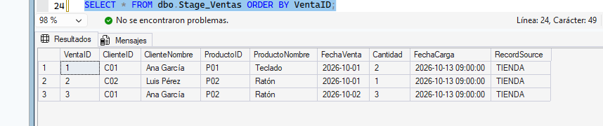
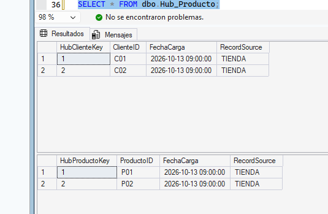
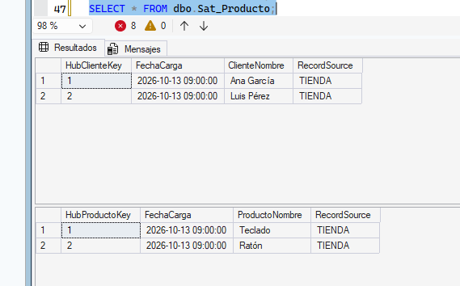
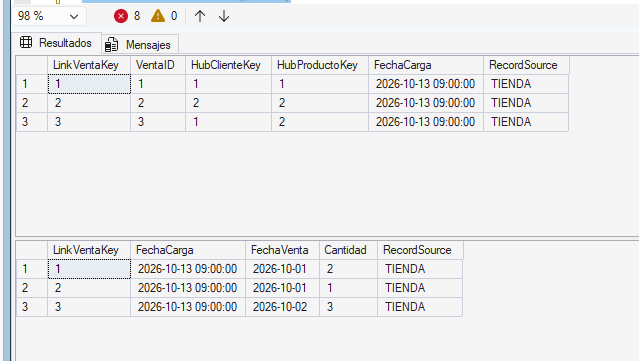
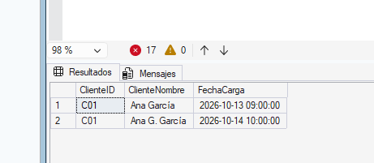
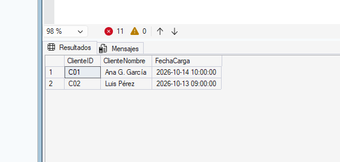
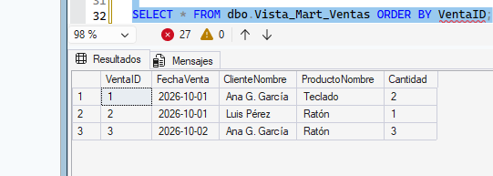
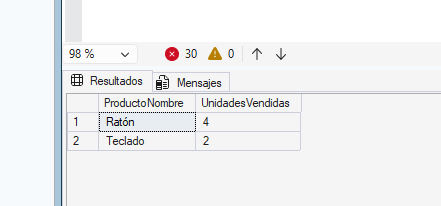
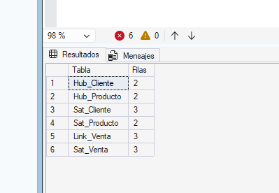
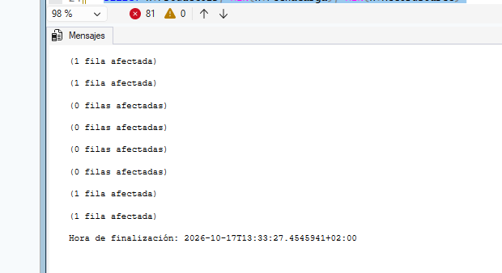

# Práctica: Data Vault en SQL Server 2025

Práctica didáctica de un **Data Vault sencillo** sobre SQL Server 2025 (SSMS). Se integran las ventas de una tienda conservando el origen de los datos y el histórico de cambios de nombres de clientes y productos.

> **Nota:** es un ejercicio inspirado en los principios de Data Vault. Se usan claves enteras `IDENTITY` en lugar de hash keys para mantenerlo simple. Una arquitectura de producción requiere reglas adicionales de historización, deduplicación, auditoría y cargas incrementales.

Ejecuta los scripts **en orden** sobre una instancia de laboratorio. Los `INSERT` no están diseñados para ejecutarse dos veces: si repites la práctica, usa una base de datos nueva.

## 1. Preparar SQL Server

📄 `scripts/01_preparar_bd.sql`

```sql
USE master;
GO

IF DB_ID(N'PracticaDataVault') IS NULL
    CREATE DATABASE PracticaDataVault;
GO

USE PracticaDataVault;
GO
```

## 2. Stage: recibir los datos originales

📄 `scripts/02_stage_ventas.sql`

`FechaCarga` y `RecordSource` permiten rastrear cuándo llegó cada registro y de qué sistema procede.

```sql
CREATE TABLE dbo.Stage_Ventas (
    VentaID        INT NOT NULL PRIMARY KEY,
    ClienteID      VARCHAR(10) NOT NULL,
    ClienteNombre  NVARCHAR(100) NOT NULL,
    ProductoID     VARCHAR(10) NOT NULL,
    ProductoNombre NVARCHAR(100) NOT NULL,
    FechaVenta     DATE NOT NULL,
    Cantidad       INT NOT NULL,
    FechaCarga     DATETIME2(0) NOT NULL,
    RecordSource   VARCHAR(30) NOT NULL
);
GO

INSERT INTO dbo.Stage_Ventas
    (VentaID, ClienteID, ClienteNombre, ProductoID,
     ProductoNombre, FechaVenta, Cantidad, FechaCarga, RecordSource)
VALUES
    (1, 'C01', N'Ana García', 'P01', N'Teclado', '2026-10-01', 2, '2026-10-13T09:00:00', 'TIENDA'),
    (2, 'C02', N'Luis Pérez', 'P02', N'Ratón',   '2026-10-01', 1, '2026-10-13T09:00:00', 'TIENDA'),
    (3, 'C01', N'Ana García', 'P02', N'Ratón',   '2026-10-02', 3, '2026-10-13T09:00:00', 'TIENDA');
GO

SELECT * FROM dbo.Stage_Ventas ORDER BY VentaID;
```



## 3. Raw Vault: Hubs

📄 `scripts/03_hubs.sql`

Un **Hub** guarda únicamente las *claves de negocio únicas*. El nombre descriptivo puede cambiar, por eso va en un Satellite.

```sql
CREATE TABLE dbo.Hub_Cliente (
    HubClienteKey INT IDENTITY(1,1) PRIMARY KEY,
    ClienteID     VARCHAR(10) NOT NULL UNIQUE,
    FechaCarga    DATETIME2(0) NOT NULL,
    RecordSource  VARCHAR(30) NOT NULL
);

CREATE TABLE dbo.Hub_Producto (
    HubProductoKey INT IDENTITY(1,1) PRIMARY KEY,
    ProductoID     VARCHAR(10) NOT NULL UNIQUE,
    FechaCarga     DATETIME2(0) NOT NULL,
    RecordSource   VARCHAR(30) NOT NULL
);
GO
```

Se inserta una fila por clave de negocio; `ROW_NUMBER()` elige un registro estable si la clave aparece varias veces en Stage (C01 aparece dos veces).

```sql
WITH Clientes AS (
    SELECT ClienteID, FechaCarga, RecordSource,
           ROW_NUMBER() OVER (PARTITION BY ClienteID ORDER BY FechaCarga, VentaID) AS rn
    FROM dbo.Stage_Ventas
)
INSERT INTO dbo.Hub_Cliente (ClienteID, FechaCarga, RecordSource)
SELECT ClienteID, FechaCarga, RecordSource FROM Clientes WHERE rn = 1;

WITH Productos AS (
    SELECT ProductoID, FechaCarga, RecordSource,
           ROW_NUMBER() OVER (PARTITION BY ProductoID ORDER BY FechaCarga, VentaID) AS rn
    FROM dbo.Stage_Ventas
)
INSERT INTO dbo.Hub_Producto (ProductoID, FechaCarga, RecordSource)
SELECT ProductoID, FechaCarga, RecordSource FROM Productos WHERE rn = 1;

SELECT * FROM dbo.Hub_Cliente;
SELECT * FROM dbo.Hub_Producto;
```



## 4. Raw Vault: Satellites descriptivos

📄 `scripts/04_satellites.sql`

Un **Satellite** conserva atributos y sus versiones en el tiempo. Su clave primaria es la clave del Hub + `FechaCarga`.

```sql
CREATE TABLE dbo.Sat_Cliente (
    HubClienteKey INT NOT NULL,
    FechaCarga    DATETIME2(0) NOT NULL,
    ClienteNombre NVARCHAR(100) NOT NULL,
    RecordSource  VARCHAR(30) NOT NULL,
    CONSTRAINT PK_Sat_Cliente PRIMARY KEY (HubClienteKey, FechaCarga),
    CONSTRAINT FK_Sat_Cliente_Hub FOREIGN KEY (HubClienteKey)
        REFERENCES dbo.Hub_Cliente(HubClienteKey)
);

CREATE TABLE dbo.Sat_Producto (
    HubProductoKey INT NOT NULL,
    FechaCarga     DATETIME2(0) NOT NULL,
    ProductoNombre NVARCHAR(100) NOT NULL,
    RecordSource   VARCHAR(30) NOT NULL,
    CONSTRAINT PK_Sat_Producto PRIMARY KEY (HubProductoKey, FechaCarga),
    CONSTRAINT FK_Sat_Producto_Hub FOREIGN KEY (HubProductoKey)
        REFERENCES dbo.Hub_Producto(HubProductoKey)
);
GO
```

Carga sin duplicar las observaciones repetidas de Stage:

```sql
WITH Clientes AS (
    SELECT ClienteID, ClienteNombre, FechaCarga, RecordSource,
           ROW_NUMBER() OVER (PARTITION BY ClienteID, FechaCarga ORDER BY VentaID) AS rn
    FROM dbo.Stage_Ventas
)
INSERT INTO dbo.Sat_Cliente (HubClienteKey, FechaCarga, ClienteNombre, RecordSource)
SELECT h.HubClienteKey, c.FechaCarga, c.ClienteNombre, c.RecordSource
FROM Clientes AS c
JOIN dbo.Hub_Cliente AS h ON h.ClienteID = c.ClienteID
WHERE c.rn = 1;

WITH Productos AS (
    SELECT ProductoID, ProductoNombre, FechaCarga, RecordSource,
           ROW_NUMBER() OVER (PARTITION BY ProductoID, FechaCarga ORDER BY VentaID) AS rn
    FROM dbo.Stage_Ventas
)
INSERT INTO dbo.Sat_Producto (HubProductoKey, FechaCarga, ProductoNombre, RecordSource)
SELECT h.HubProductoKey, p.FechaCarga, p.ProductoNombre, p.RecordSource
FROM Productos AS p
JOIN dbo.Hub_Producto AS h ON h.ProductoID = p.ProductoID
WHERE p.rn = 1;

SELECT * FROM dbo.Sat_Cliente;
SELECT * FROM dbo.Sat_Producto;
```



## 5. Raw Vault: Link y Satellite de ventas

📄 `scripts/05_link_y_sat_venta.sql`

Un **Link** registra relaciones entre Hubs. Aquí también guarda `VentaID`, que identifica el evento de negocio. `Sat_Venta` almacena los atributos de ese evento.

```sql
CREATE TABLE dbo.Link_Venta (
    LinkVentaKey   INT IDENTITY(1,1) PRIMARY KEY,
    VentaID        INT NOT NULL UNIQUE,
    HubClienteKey  INT NOT NULL,
    HubProductoKey INT NOT NULL,
    FechaCarga     DATETIME2(0) NOT NULL,
    RecordSource   VARCHAR(30) NOT NULL,
    CONSTRAINT FK_Link_Cliente FOREIGN KEY (HubClienteKey)
        REFERENCES dbo.Hub_Cliente(HubClienteKey),
    CONSTRAINT FK_Link_Producto FOREIGN KEY (HubProductoKey)
        REFERENCES dbo.Hub_Producto(HubProductoKey)
);

CREATE TABLE dbo.Sat_Venta (
    LinkVentaKey INT NOT NULL,
    FechaCarga   DATETIME2(0) NOT NULL,
    FechaVenta   DATE NOT NULL,
    Cantidad     INT NOT NULL,
    RecordSource VARCHAR(30) NOT NULL,
    CONSTRAINT PK_Sat_Venta PRIMARY KEY (LinkVentaKey, FechaCarga),
    CONSTRAINT FK_Sat_Venta_Link FOREIGN KEY (LinkVentaKey)
        REFERENCES dbo.Link_Venta(LinkVentaKey),
    CONSTRAINT CK_Sat_Venta_Cantidad CHECK (Cantidad > 0)
);
GO

INSERT INTO dbo.Link_Venta
    (VentaID, HubClienteKey, HubProductoKey, FechaCarga, RecordSource)
SELECT s.VentaID, c.HubClienteKey, p.HubProductoKey, s.FechaCarga, s.RecordSource
FROM dbo.Stage_Ventas AS s
JOIN dbo.Hub_Cliente AS c ON s.ClienteID = c.ClienteID
JOIN dbo.Hub_Producto AS p ON s.ProductoID = p.ProductoID;

INSERT INTO dbo.Sat_Venta
    (LinkVentaKey, FechaCarga, FechaVenta, Cantidad, RecordSource)
SELECT l.LinkVentaKey, s.FechaCarga, s.FechaVenta, s.Cantidad, s.RecordSource
FROM dbo.Stage_Ventas AS s
JOIN dbo.Link_Venta AS l ON s.VentaID = l.VentaID;
GO

SELECT * FROM dbo.Link_Venta;
SELECT * FROM dbo.Sat_Venta;
```



## 6. Simular un cambio y conservar el histórico

📄 `scripts/06_cambio_historico.sql`

El sistema comunica que el nombre de la clienta C01 ha cambiado. En vez de sobrescribir, se añade una **nueva versión** al Satellite.

```sql
INSERT INTO dbo.Sat_Cliente
    (HubClienteKey, FechaCarga, ClienteNombre, RecordSource)
SELECT HubClienteKey, '2026-10-14T10:00:00', N'Ana G. García', 'TIENDA'
FROM dbo.Hub_Cliente
WHERE ClienteID = 'C01';

SELECT h.ClienteID, s.ClienteNombre, s.FechaCarga
FROM dbo.Hub_Cliente AS h
JOIN dbo.Sat_Cliente AS s ON h.HubClienteKey = s.HubClienteKey
WHERE h.ClienteID = 'C01'
ORDER BY s.FechaCarga;
```



## 7. Business Vault: nombre vigente

📄 `scripts/07_business_vault.sql`

El Business Vault incorpora reglas de negocio. Aquí, una vista con `ROW_NUMBER()` selecciona la última versión de cada cliente. No copia datos: consulta los Satellites.

```sql
CREATE VIEW dbo.BV_ClienteActual AS
WITH Versiones AS (
    SELECT h.ClienteID,
           s.ClienteNombre,
           s.FechaCarga,
           ROW_NUMBER() OVER (
               PARTITION BY h.ClienteID
               ORDER BY s.FechaCarga DESC
           ) AS rn
    FROM dbo.Hub_Cliente AS h
    JOIN dbo.Sat_Cliente AS s ON s.HubClienteKey = h.HubClienteKey
)
SELECT ClienteID, ClienteNombre, FechaCarga
FROM Versiones
WHERE rn = 1;
GO

SELECT * FROM dbo.BV_ClienteActual ORDER BY ClienteID;
```



## 8. Data Mart: vista para analizar ventas

📄 `scripts/08_data_mart.sql`

```sql
CREATE VIEW dbo.Vista_Mart_Ventas AS
WITH ProductoActual AS (
    SELECT h.HubProductoKey,
           s.ProductoNombre,
           ROW_NUMBER() OVER (
               PARTITION BY h.HubProductoKey
               ORDER BY s.FechaCarga DESC
           ) AS rn
    FROM dbo.Hub_Producto AS h
    JOIN dbo.Sat_Producto AS s ON s.HubProductoKey = h.HubProductoKey
),
VentaActual AS (
    SELECT LinkVentaKey, FechaVenta, Cantidad,
           ROW_NUMBER() OVER (
               PARTITION BY LinkVentaKey
               ORDER BY FechaCarga DESC
           ) AS rn
    FROM dbo.Sat_Venta
)
SELECT l.VentaID,
       v.FechaVenta,
       c.ClienteNombre,
       p.ProductoNombre,
       v.Cantidad
FROM dbo.Link_Venta AS l
JOIN dbo.Hub_Cliente AS hc ON hc.HubClienteKey = l.HubClienteKey
JOIN dbo.BV_ClienteActual AS c ON c.ClienteID = hc.ClienteID
JOIN ProductoActual AS p ON p.HubProductoKey = l.HubProductoKey AND p.rn = 1
JOIN VentaActual AS v ON v.LinkVentaKey = l.LinkVentaKey AND v.rn = 1;
GO

SELECT * FROM dbo.Vista_Mart_Ventas ORDER BY VentaID;
```



**¿Cuántas unidades se han vendido por producto?**

```sql
SELECT ProductoNombre,
       SUM(Cantidad) AS UnidadesVendidas
FROM dbo.Vista_Mart_Ventas
GROUP BY ProductoNombre
ORDER BY UnidadesVendidas DESC;
```



> Esta es una **vista de consumo simplificada**, no un esquema estrella completo (sin `FactVentas` ni dimensiones).

## 9. Comprobación final

📄 `scripts/09_comprobacion_final.sql`

```sql
SELECT 'Hub_Cliente' AS Tabla, COUNT(*) AS Filas FROM dbo.Hub_Cliente
UNION ALL SELECT 'Hub_Producto', COUNT(*) FROM dbo.Hub_Producto
UNION ALL SELECT 'Sat_Cliente',  COUNT(*) FROM dbo.Sat_Cliente
UNION ALL SELECT 'Sat_Producto', COUNT(*) FROM dbo.Sat_Producto
UNION ALL SELECT 'Link_Venta',   COUNT(*) FROM dbo.Link_Venta
UNION ALL SELECT 'Sat_Venta',    COUNT(*) FROM dbo.Sat_Venta;
```



---

## 10. Preguntas resueltas

**1. ¿Qué información almacena un Hub y qué información almacena un Satellite?**
Un **Hub** almacena las claves de negocio únicas de una entidad (p. ej. `ClienteID`), junto con su clave técnica, `FechaCarga` y `RecordSource`. Un **Satellite** almacena los atributos descriptivos de esa entidad (p. ej. `ClienteNombre`) y sus versiones a lo largo del tiempo.

**2. ¿Por qué `Link_Venta` necesita referencias a los Hubs de cliente y producto?**
Porque un Link representa una **relación** entre Hubs: qué cliente compró qué producto. Sin las claves foráneas a `Hub_Cliente` y `Hub_Producto` no se podría saber quién compró qué, y se perdería la integridad referencial.

**3. ¿Qué ocurre con el valor antiguo del nombre de Ana después de insertar la nueva versión?**
No se pierde. El Satellite es de solo inserción: el nombre `Ana García` permanece con su `FechaCarga` original y se añade una fila nueva con `Ana G. García`. Ambas versiones quedan disponibles.

**4. ¿Por qué el Business Vault puede usar una vista sin copiar físicamente los datos?**
Porque una vista es una consulta guardada: aplica la regla de negocio (última versión por cliente) al ejecutarse sobre los Satellites existentes. Así no hay duplicación de datos y siempre refleja el estado actual del Raw Vault.

**5. ¿Qué diferencia existe entre una vista de Data Mart y un Data Mart dimensional con tablas de hechos y dimensiones?**
La vista de Data Mart es una consulta que une y aplana datos del vault para consumirlos fácilmente. Un Data Mart dimensional es un modelo físico en estrella con una tabla de hechos (`FactVentas`) y dimensiones (cliente, producto, fecha), optimizado para análisis y que puede materializarse.

**6. ¿Por qué `FechaCarga` es importante para la trazabilidad?**
Indica **cuándo** llegó cada registro al vault. Permite ordenar las versiones de un Satellite, obtener la vigente, reconstruir el estado en un momento dado y auditar el origen de cada dato (junto con `RecordSource`).

---

## 11. Ejercicio resuelto: carga incremental

📄 `scripts/10_carga_incremental.sql`

Se añade la venta `VentaID = 4` (cliente `C02`, producto `P01`, fecha `2026-10-03`, cantidad `5`) y se diseña una carga que **solo inserta lo que aún no existe**, sin romper claves primarias.

**Idea de diseño**

1. Se detectan las ventas **nuevas**: filas de Stage cuyo `VentaID` aún no está en `Link_Venta`.
2. **Hubs:** se insertan solo las claves de negocio que no existen (`NOT EXISTS`).
3. **Satellites:** se inserta una versión únicamente si el nombre es **distinto del último guardado** y no existe ya esa pareja (clave, `FechaCarga`). Así no se reinsertan versiones antiguas de Stage (p. ej. `Ana García`, que ya fue reemplazada por `Ana G. García`).
4. **Link y `Sat_Venta`:** se insertan solo las ventas nuevas.

```sql
-- 1) Nueva venta en Stage
IF NOT EXISTS (SELECT 1 FROM dbo.Stage_Ventas WHERE VentaID = 4)
    INSERT INTO dbo.Stage_Ventas
        (VentaID, ClienteID, ClienteNombre, ProductoID,
         ProductoNombre, FechaVenta, Cantidad, FechaCarga, RecordSource)
    VALUES
        (4, 'C02', N'Luis Pérez', 'P01', N'Teclado',
         '2026-10-03', 5, '2026-10-15T09:00:00', 'TIENDA');
GO

-- 2) Ventas nuevas
IF OBJECT_ID('tempdb..#Nuevas') IS NOT NULL DROP TABLE #Nuevas;

SELECT s.*
INTO #Nuevas
FROM dbo.Stage_Ventas AS s
WHERE NOT EXISTS (SELECT 1 FROM dbo.Link_Venta AS l WHERE l.VentaID = s.VentaID);

-- 3) Hubs: solo claves nuevas
INSERT INTO dbo.Hub_Cliente (ClienteID, FechaCarga, RecordSource)
SELECT n.ClienteID, MIN(n.FechaCarga), MIN(n.RecordSource)
FROM #Nuevas AS n
WHERE NOT EXISTS (SELECT 1 FROM dbo.Hub_Cliente h WHERE h.ClienteID = n.ClienteID)
GROUP BY n.ClienteID;

INSERT INTO dbo.Hub_Producto (ProductoID, FechaCarga, RecordSource)
SELECT n.ProductoID, MIN(n.FechaCarga), MIN(n.RecordSource)
FROM #Nuevas AS n
WHERE NOT EXISTS (SELECT 1 FROM dbo.Hub_Producto h WHERE h.ProductoID = n.ProductoID)
GROUP BY n.ProductoID;

-- 4) Satellites: solo si cambia el valor respecto a la última versión
WITH CliNuevos AS (
    SELECT n.ClienteID, n.ClienteNombre, n.FechaCarga, n.RecordSource,
           ROW_NUMBER() OVER (PARTITION BY n.ClienteID
                              ORDER BY n.FechaCarga DESC, n.VentaID DESC) AS rn
    FROM #Nuevas AS n
)
INSERT INTO dbo.Sat_Cliente (HubClienteKey, FechaCarga, ClienteNombre, RecordSource)
SELECT h.HubClienteKey, c.FechaCarga, c.ClienteNombre, c.RecordSource
FROM CliNuevos AS c
JOIN dbo.Hub_Cliente AS h ON h.ClienteID = c.ClienteID
WHERE c.rn = 1
  AND NOT EXISTS (
        SELECT 1 FROM dbo.Sat_Cliente AS s
        WHERE s.HubClienteKey = h.HubClienteKey
          AND s.FechaCarga = (SELECT MAX(s2.FechaCarga) FROM dbo.Sat_Cliente s2
                              WHERE s2.HubClienteKey = h.HubClienteKey)
          AND s.ClienteNombre = c.ClienteNombre)
  AND NOT EXISTS (
        SELECT 1 FROM dbo.Sat_Cliente AS s
        WHERE s.HubClienteKey = h.HubClienteKey AND s.FechaCarga = c.FechaCarga);

WITH ProNuevos AS (
    SELECT n.ProductoID, n.ProductoNombre, n.FechaCarga, n.RecordSource,
           ROW_NUMBER() OVER (PARTITION BY n.ProductoID
                              ORDER BY n.FechaCarga DESC, n.VentaID DESC) AS rn
    FROM #Nuevas AS n
)
INSERT INTO dbo.Sat_Producto (HubProductoKey, FechaCarga, ProductoNombre, RecordSource)
SELECT h.HubProductoKey, p.FechaCarga, p.ProductoNombre, p.RecordSource
FROM ProNuevos AS p
JOIN dbo.Hub_Producto AS h ON h.ProductoID = p.ProductoID
WHERE p.rn = 1
  AND NOT EXISTS (
        SELECT 1 FROM dbo.Sat_Producto AS s
        WHERE s.HubProductoKey = h.HubProductoKey
          AND s.FechaCarga = (SELECT MAX(s2.FechaCarga) FROM dbo.Sat_Producto s2
                              WHERE s2.HubProductoKey = h.HubProductoKey)
          AND s.ProductoNombre = p.ProductoNombre)
  AND NOT EXISTS (
        SELECT 1 FROM dbo.Sat_Producto AS s
        WHERE s.HubProductoKey = h.HubProductoKey AND s.FechaCarga = p.FechaCarga);

-- 5) Link y Sat_Venta
INSERT INTO dbo.Link_Venta
    (VentaID, HubClienteKey, HubProductoKey, FechaCarga, RecordSource)
SELECT n.VentaID, c.HubClienteKey, p.HubProductoKey, n.FechaCarga, n.RecordSource
FROM #Nuevas AS n
JOIN dbo.Hub_Cliente  AS c ON c.ClienteID  = n.ClienteID
JOIN dbo.Hub_Producto AS p ON p.ProductoID = n.ProductoID;

INSERT INTO dbo.Sat_Venta
    (LinkVentaKey, FechaCarga, FechaVenta, Cantidad, RecordSource)
SELECT l.LinkVentaKey, n.FechaCarga, n.FechaVenta, n.Cantidad, n.RecordSource
FROM #Nuevas AS n
JOIN dbo.Link_Venta AS l ON l.VentaID = n.VentaID
WHERE NOT EXISTS (SELECT 1 FROM dbo.Sat_Venta sv
                  WHERE sv.LinkVentaKey = l.LinkVentaKey AND sv.FechaCarga = n.FechaCarga);

DROP TABLE #Nuevas;
GO
```

