# Clase 23 – Introducción a Big Data · Sesión 2: Ingesta EL con Azure Data Factory

**Alumno:** Héctor Miguel Tudela · Máster Big Data & IA (Tajamar)
**Fecha de realización:** 18-nov-2026

> Documento vivo: se va completando a medida que se ejecuta cada ejercicio. Cada paso incluye su Captura (carpeta `images/`).

## 0. Recursos Azure utilizados

| Recurso | Nombre | Notas |
|---|---|---|
| Grupo de recursos (ADF + lago) | `rg-practica-adf` | France Central |
| Cuenta de almacenamiento (ADLS Gen2, LRS, HNS activado) | `stadfhmt2326` | Destino de los 3 ejercicios (contenedor `raw`) |
| Data Factory | `adf-practica-hmt2326France` | France Central, identidad administrada del sistema |
| Grupo de recursos (SQL) | `rg-practica1` | |
| Servidor SQL | `server-practica1-hmt` | Autenticación SQL, admin `practica` |
| Base de datos SQL | `sqldb-ventas` | Oferta gratuita (serverless) |

**Notas de entorno (decisiones y desviaciones respecto a la guía)**

- La suscripción *Azure for Students* tiene una **política de regiones**: East US y West Europe dan el error `RequestDisallowedByAzure`. Se usa **France Central**, que sí está permitida.
- Para ahorrar recursos se **reutiliza un único grupo de recursos, cuenta de almacenamiento y Data Factory** para los tres ejercicios, en lugar de crear uno por ejercicio. Se separan las ingestas por carpetas dentro de `raw`.
- Por seguridad, **las contraseñas las escribe el alumno**; nunca quedan en este documento. Tampoco se documentan claves de Cosmos DB.

---

## Ejercicio 1 · Azure SQL Database → ADLS Gen2

### 1.1 Servidor y base de datos SQL
Se crea el servidor `server-practica1-hmt` (France Central, autenticación SQL) y la base `sqldb-ventas` con la oferta gratuita. En el firewall del servidor se añade la IP del cliente y se marca **«Permitir que los servicios y recursos de Azure accedan a este servidor»** (necesario para que Data Factory llegue a la base de datos).

Captura: `images/ej1_01_conexion_query_editor.jpg` – Query editor conectado, devolviendo `sqldb-ventas` y el usuario `practica`.

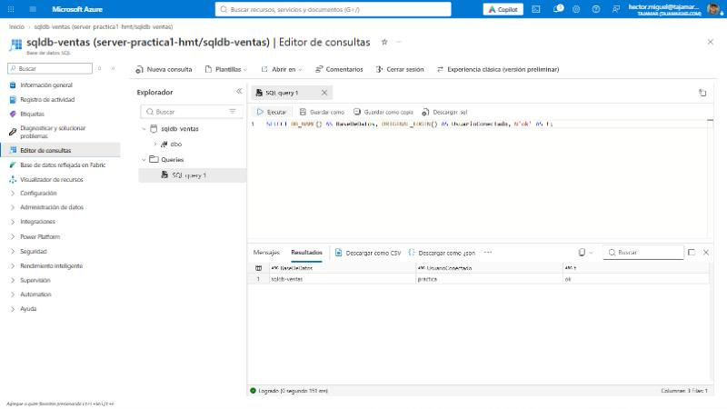

### 1.2 Modelo relacional y datos
Desde el **Editor de consultas** se ejecuta el script del enunciado en dos partes:

1. **Parte 1:** crea el esquema `etl` y las tablas `Clientes`, `Productos`, `Tiendas` y `Ventas` (con columnas calculadas persistidas `ImporteBruto`, `ImporteDescuento`, `ImporteNeto`, claves foráneas, restricciones `CHECK`) y 5 índices.
2. **Parte 2:** inserta 10 clientes, 12 productos, 4 tiendas y 30 líneas de venta, crea la vista **`etl.vw_ventas_extraccion`** (une las 4 tablas; es el origen de la copia) y valida.

Captura: `ej1_02_tablas_creadas.jpg` – «Consulta ejecutada correctamente» tras crear tablas e índices.
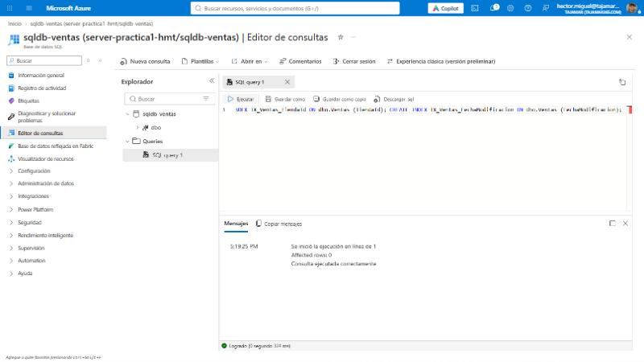

Captura: `ej1_03_vista_resultado.jpg` – `SELECT TOP (20) * FROM etl.vw_ventas_extraccion` con 20 filas.
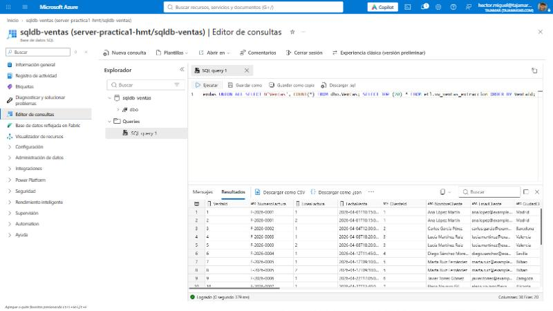

**Validación:** conteos esperados 10 / 12 / 4 / 30 y la vista con 30 filas.

Captura: `ej1_04_validacion_conteos.jpg`
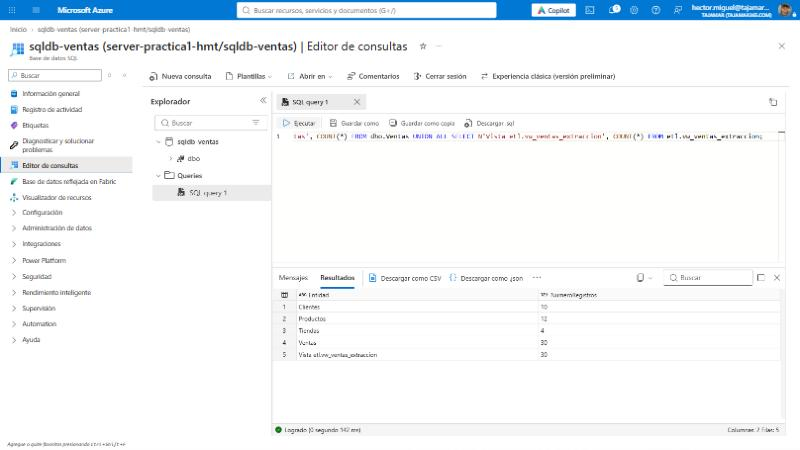

| Entidad | Registros |
|---|---|
| Clientes | 10 |
| Productos | 12 |
| Tiendas | 4 |
| Ventas | 30 |
| Vista `etl.vw_ventas_extraccion` | 30 |

### 1.3 Permisos: Managed Identity de Data Factory sobre el lago
En lugar de usar claves de la cuenta de almacenamiento, Data Factory se autentica con su **identidad administrada del sistema**. En la cuenta `stadfhmt2326` → *Control de acceso (IAM)* → *Agregar asignación de roles* se asigna **Storage Blob Data Contributor** (en español: *Colaborador de datos de Storage Blob*) a la identidad `adf-practica-hmt2326France`.

Captura: `ej1_05_rol_identidad_adf.jpg` – asignación con miembro `adf-practica-hmt2326France` (Factoría de datos V2).
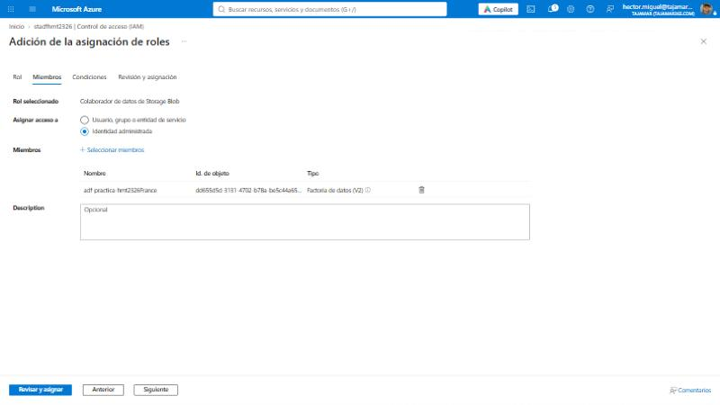

Captura: `ej1_06_rol_asignado_ok.jpg` – notificación «Asignación de roles agregada».
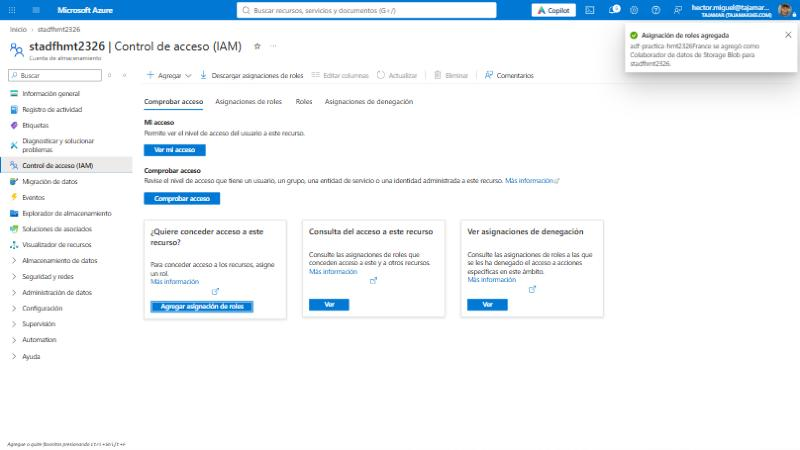

### 1.4 Contenedor `raw`
En *Contenedores* se crea `raw` (acceso privado). Es la capa de aterrizaje de datos sin transformar (patrón **EL**: Extract–Load, sin transformaciones).

Captura: `ej1_07_contenedor_raw.jpg`
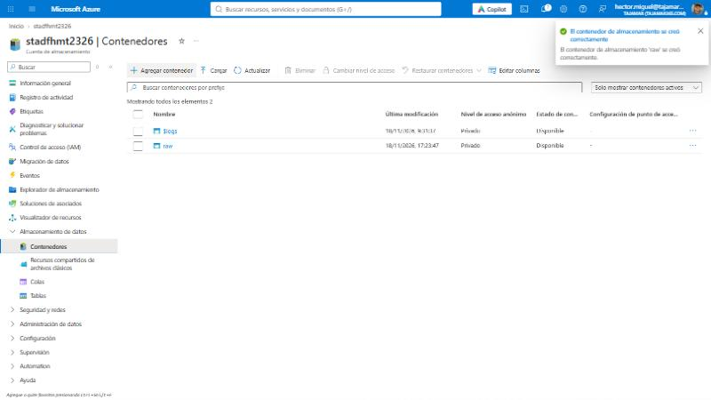

### 1.5 Linked Services en Data Factory Studio
Se crean en *Manage → Linked services*:

- **`ls_sql_ventas`** (Azure SQL Database): servidor `server-practica1-hmt.database.windows.net`, base `sqldb-ventas`, autenticación SQL con usuario `practica` (contraseña escrita por el alumno).
- **`ls_adls_raw`** (ADLS Gen2): autenticación **System-assigned managed identity**, cuenta `stadfhmt2326`. El *Test connection* resulta correcto porque el rol del paso 1.3 ya está asignado.

Captura: `ej1_08_ls_sql_creado.jpg`
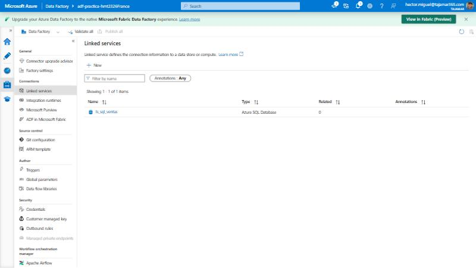

Captura: `ej1_09_ls_adls_conexion_ok.jpg` – «Connection successful».
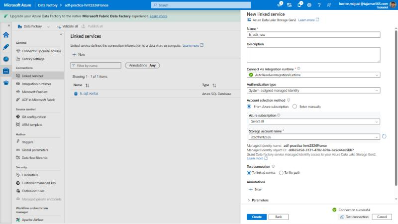

### 1.6 Datasets (los "mapas" de los datos)

Un **Linked Service** dice *dónde* está el sistema; un **Dataset** dice *qué datos concretos* hay dentro. Creé dos:

| Dataset | Tipo | Apunta a | Detalle |
|---|---|---|---|
| `ds_sql_vw_ventas_extraccion` | Azure SQL Database | vista `etl.vw_ventas_extraccion` | origen (source) |
| `ds_adls_raw_ventas_csv` | DelimitedText (ADLS Gen2) | `raw/sql/ventas/@dataset().pArchivo` | destino (sink), con **parámetro** `pArchivo` |

- El parámetro `pArchivo` permite que el pipeline decida el nombre del archivo en cada ejecución (así no se sobrescribe el anterior y queda histórico).
- CSV con cabecera, separador coma y salto de línea `\n`.
- En el dataset de ADLS dejé *Import schema = None*, porque la carpeta `sql/ventas` aún no existía (ADF la crea al escribir).

Captura: `ej1_10_dataset_sql_preview.jpg` – *Preview data* del dataset SQL con las 30 filas de la vista.
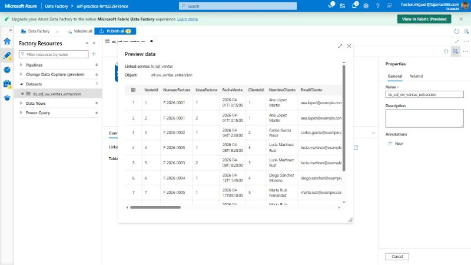

### 1.7 Pipeline `pl_sql_ventas_to_adls_raw` (actividad Copy)

Contiene una única actividad **Copy** (`cp_vw_ventas_to_raw`): lee la vista y escribe un CSV en `raw/sql/ventas`. El nombre del archivo se genera con una expresión dinámica:

```
@concat('ventas_', formatDateTime(utcNow(),'yyyyMMdd_HHmmss'), '.csv')
```

Como la lista de actividades no admitía arrastrar y soltar en esta sesión, definí el pipeline pegando su JSON en la vista de código `{}` (equivale a montarlo gráficamente):

```json
{"name":"pl_sql_ventas_to_adls_raw","properties":{"activities":[{"name":"cp_vw_ventas_to_raw","type":"Copy","dependsOn":[],"policy":{"timeout":"0.12:00:00","retry":0,"retryIntervalInSeconds":30,"secureOutput":false,"secureInput":false},"userProperties":[],"typeProperties":{"source":{"type":"AzureSqlSource","queryTimeout":"02:00:00","partitionOption":"None"},"sink":{"type":"DelimitedTextSink","storeSettings":{"type":"AzureBlobFSWriteSettings"},"formatSettings":{"type":"DelimitedTextWriteSettings","quoteAllText":true,"fileExtension":".txt"}},"enableStaging":false},"inputs":[{"referenceName":"ds_sql_vw_ventas_extraccion","type":"DatasetReference"}],"outputs":[{"referenceName":"ds_adls_raw_ventas_csv","type":"DatasetReference","parameters":{"pArchivo":{"value":"@concat('ventas_', formatDateTime(utcNow(),'yyyyMMdd_HHmmss'), '.csv')","type":"Expression"}}}]}],"annotations":[]}}
```

**Validate** → sin errores. **Debug** → `Succeeded` en 18 s.

Captura: `ej1_11_pipeline_validado.jpg` – pipeline con la actividad Copy y «Your pipeline has been validated».
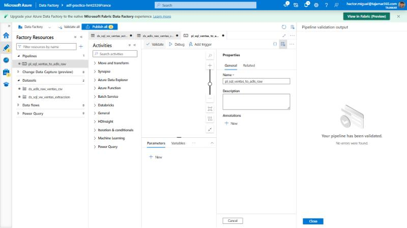

Captura: `ej1_12_debug_succeeded.jpg` – pestaña Output con la actividad en *Succeeded*.
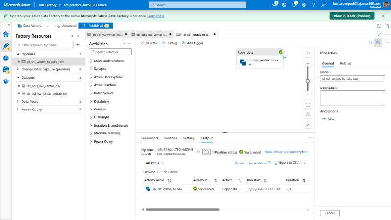

### 1.8 Publicar y verificar el resultado

*Debug* ejecuta el pipeline sin guardarlo en el servicio; para que exista de verdad (y poder usar triggers) hay que **Publish all**. Se publicaron 4 cambios: el pipeline, los 2 datasets y el Linked Service de ADLS.

Captura: `ej1_13_publicado.jpg` – aviso «Publishing completed – Successfully published».
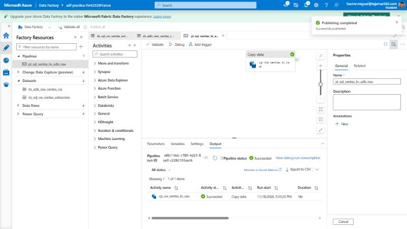

Verificación en el Storage Account `stadfhmt2326` → contenedor `raw` → `sql/ventas`: aparece `ventas_20261118_163323.csv` (blob en bloques, nivel Hot). ADF creó las carpetas solo.

Captura: `ej1_14_archivo_en_raw.jpg` – ruta `raw > sql > ventas` con el CSV.
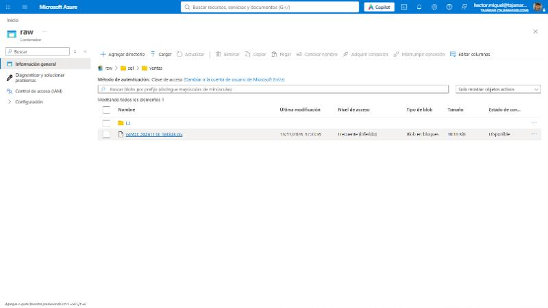

### 1.9 Trigger de programación (ingesta recurrente)

Un **trigger** lanza el pipeline automáticamente. Creé `tr_diario_sql_ventas` (tipo *Schedule*): zona horaria Madrid (UTC+1/+2, ajusta el horario de verano solo), recurrencia **cada 1 día**, con *Start trigger on creation* activado. Cada ejecución genera un CSV nuevo con marca de tiempo (`ventas_AAAAMMDD_HHMMSS.csv`), así se conserva la historia de extracciones.

Importante: un trigger **no se activa hasta que se publica**. ADF lo avisa en rojo («Make sure to Publish for trigger to be activated»), por eso hice *Publish all* de nuevo.

Captura: `ej1_15_trigger_config.jpg` – panel *New trigger* con Schedule, cada 1 día.
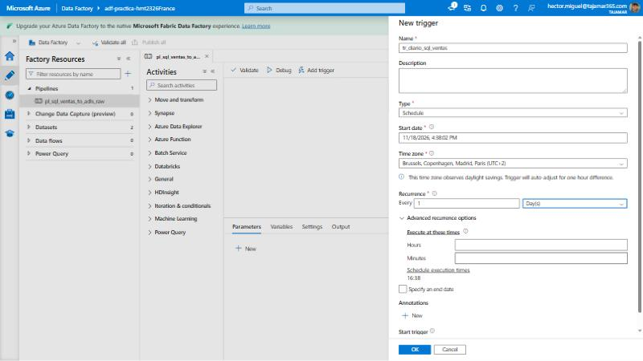

Captura: `ej1_16_trigger_publicado.jpg` – «Publishing… Deployed 1 of 1 resources» y el botón *Trigger (1)* en el pipeline.
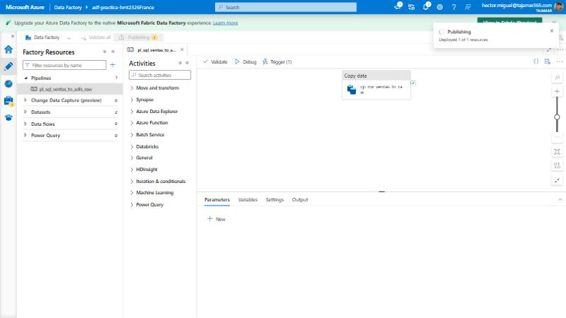

---

## Ejercicio 2 – Azure Cosmos DB for NoSQL → ADLS Gen2

### 2.1 Cuenta de Cosmos DB

Cosmos DB es una base de datos **NoSQL de documentos (JSON)**. Creé una cuenta con la API *for NoSQL* en el mismo grupo de recursos `rg-practica-adf`:

| Campo | Valor | Por qué |
|---|---|---|
| Tipo de carga | Aprendizaje | Opciones sencillas y baratas |
| Nombre | `cosmos-eventos-hmt2326` | Único globalmente |
| Ubicación | **France Central** | La política de la suscripción de estudiante solo permite esta región |
| Capacidad | Rendimiento aprovisionado | Necesario para fijar 400 RU/s |
| Nivel gratis | Aplicado | Primeros 1000 RU/s y 25 GB gratis |
| Límite total de rendimiento | Activado | Evita cargos inesperados |

Captura: `ej2_01_cosmos_basicos.jpg` – formulario con France Central, nivel gratis aplicado y límite de rendimiento.
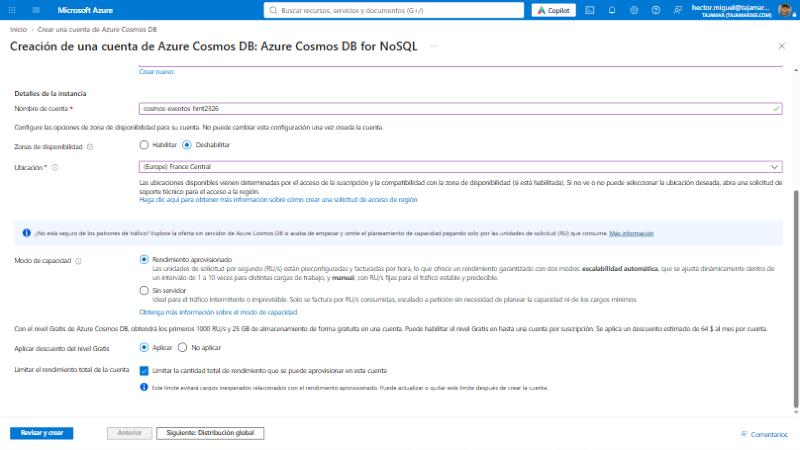

### 2.2 Base de datos y contenedor (Data Explorer)

En el **Explorador de datos** creé con *New Container*:

| Campo | Valor |
|---|---|
| Base de datos (nueva) | `db-eventos` |
| Contenedor | `eventos` |
| Clave de partición | `/usuario_id` |
| Rendimiento | Manual, **400 RU/s** (dentro del nivel gratis de 1000 RU/s) |

La **clave de partición** decide cómo Cosmos reparte los documentos entre particiones físicas. `usuario_id` es una buena elección porque hay muchos usuarios distintos (reparto uniforme) y las consultas típicas filtran por usuario.

Captura: `ej2_02_nuevo_contenedor.jpg` – panel *New Container* con db-eventos, eventos, /usuario_id y 400 RU/s.
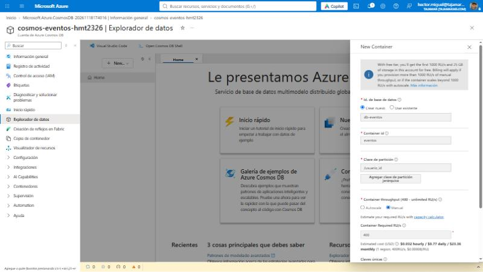

Captura: `ej2_03_contenedor_creado.jpg` – árbol `db-eventos > eventos` en el Explorador de datos.
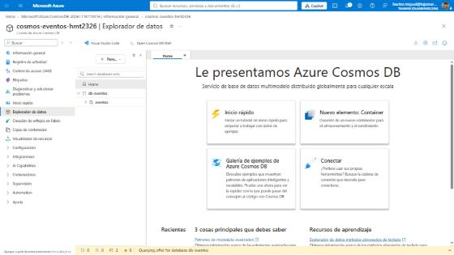

### 2.3 Carga de los 30 documentos

Subí `eventos_web.json` (30 documentos con `usuario_id`) desde el Explorador de datos: *eventos → Items → Upload Item*. Cosmos añade a cada documento campos de sistema (`id`, `_rid`, `_ts`…) y por eso la copia posterior los incluirá.

Captura: `ej2_04_30_documentos.jpg` – pestaña *Items* con los 30 documentos cargados.
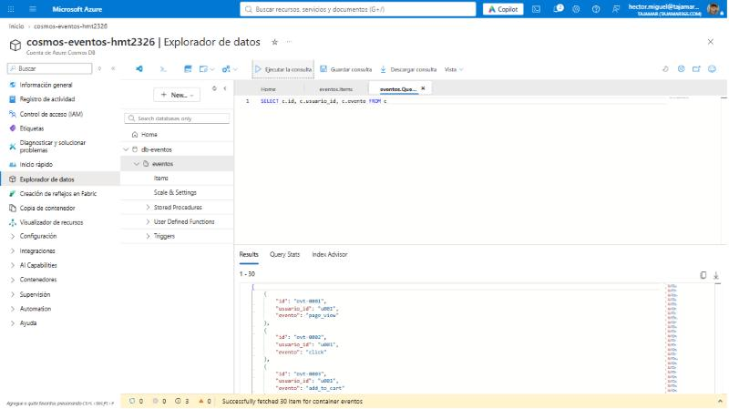

### 2.4 Linked Service `ls_cosmos_eventos`

En ADF Studio → *Manage → Linked services → New → Azure Cosmos DB for NoSQL*. Elegí **Account key + From Azure subscription**: ADF obtiene él mismo la clave de la cuenta, así que **no hay que escribir ni pegar ninguna clave** (y por tanto no aparece en este README). Base de datos: `db-eventos`. *Test connection* → correcta.

Captura: `ej2_05_ls_cosmos_conexion_ok.jpg` – «Connection successful».
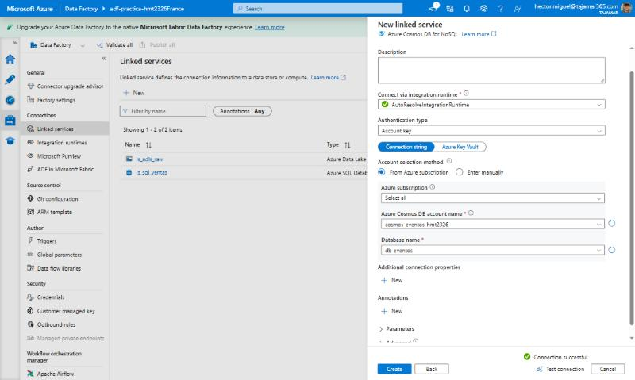

### 2.5 Datasets

| Dataset | Tipo | Apunta a |
|---|---|---|
| `ds_cosmos_eventos` | Azure Cosmos DB for NoSQL | contenedor `eventos` (el desplegable se quedó en «Loading…»: marqué *Enter manually* y escribí `eventos`) |
| `ds_adls_raw_eventos_json` | JSON sobre ADLS Gen2 | `raw/cosmos/eventos` |

Ambos sin parámetros: ruta fija, igual que en el Ej.1.

### 2.6 Pipeline `pl_cosmos_eventos_to_adls_raw`

Una actividad **Copy** (`Copy_eventos_cosmos_to_adls`): origen `CosmosDbSqlApiSource`, destino `JsonSink` en ADLS. Lo creé pegando el JSON desde el icono `{}` (code view). El editor de código **no permite renombrar**, así que el JSON lleva `pipeline1` y el nombre definitivo se cambia en *Properties*.

```json
{"name":"pipeline1","properties":{"activities":[{"name":"Copy_eventos_cosmos_to_adls","type":"Copy","dependsOn":[],"policy":{"timeout":"0.12:00:00","retry":0},"userProperties":[],"typeProperties":{"source":{"type":"CosmosDbSqlApiSource","preferredRegions":[],"detectDatetime":true},"sink":{"type":"JsonSink","storeSettings":{"type":"AzureBlobFSWriteSettings"},"formatSettings":{"type":"JsonWriteSettings"}},"enableStaging":false},"inputs":[{"referenceName":"ds_cosmos_eventos","type":"DatasetReference"}],"outputs":[{"referenceName":"ds_adls_raw_eventos_json","type":"DatasetReference"}]}],"annotations":[]}}
```

> ⚠️ Truco del editor Monaco: al escribir JSON cierra solo llaves y comillas y deja un `"}` sobrante al final. Solución: `Ctrl+End` y `Retroceso` dos veces; si sigue mal sale el aviso «Invalid JSON syntax».

### 2.7 Debug, publicación y trigger

1. **Debug** → *Succeeded*. Se crea la carpeta `raw/cosmos/eventos` en el lago.
2. **Publish all** (nada se guarda en el servicio hasta publicar).
3. Trigger de programación `tr_diario_cosmos_eventos`, recurrencia cada 1 día, publicado.

> Verificación: la carpeta `raw/cosmos/eventos` existe en el lago tras el Debug (modificada a las 18:08:50).

---

## Ejercicio 3 – Azure Blob Storage (históricos CSV) → ADLS Gen2

### 3.1 Cuenta de Blob Storage de origen

Para simular un "sistema origen" distinto del lago de datos creé una cuenta **`stblobhmt2326`** (Standard, LRS, France Central) con el **espacio de nombres jerárquico DESACTIVADO**: es Blob Storage normal, mientras que `stadfhmt2326` (destino) lo tiene activado y por eso es un ADLS Gen2.

Captura: `ej3_01_blob_sin_hns.jpg` – pestaña Avanzado con «Habilitar el espacio de nombres jerárquico» sin marcar.
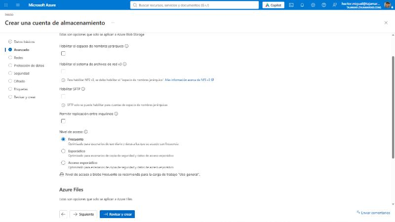

### 3.2 Contenedor `historico`

Dentro de `stblobhmt2326` creé el contenedor privado **`historico`**; los CSV irán en la "carpeta" virtual `ventas/` (en Blob normal las carpetas son solo prefijos del nombre del blob).

Captura: `ej3_02_contenedor_historico.jpg` – lista de contenedores con `$logs` e `historico`.
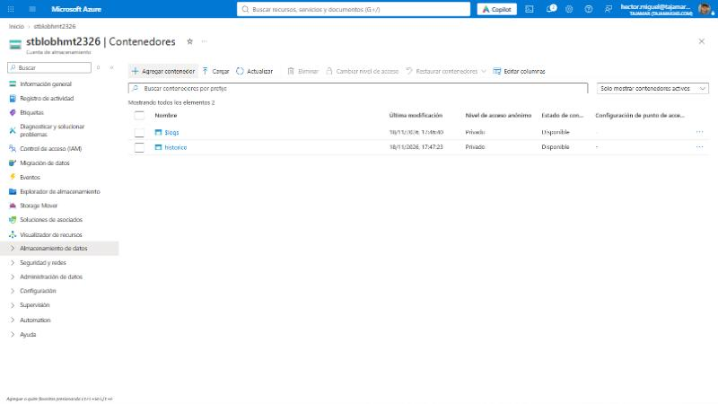

### 3.3 Subida de los 3 CSV

Los tres históricos (`ventas_2020.csv`, `ventas_2021.csv`, `ventas_2022.csv`, 60 filas cada uno) se subieron al contenedor `historico` con *Cargar*, indicando la carpeta de destino **`ventas`**.

Captura: panel *Cargar blob* con los 3 archivos y la carpeta `ventas`; después, el contenedor mostrando `ventas/` con los 3 CSV.

### 3.4 Linked Service `ls_blob_historico`

*New → Azure Blob Storage*, autenticación **Account key / From Azure subscription** (ADF recupera la clave, no se teclea), cuenta `stblobhmt2326`. *Test connection* correcta.

**Linked Service con clave vs Managed Identity.** Con la clave, ADF se identifica con un secreto que da acceso total a la cuenta; es rápido, pero hay que custodiarlo y rotarlo. Con Managed Identity se concede un rol RBAC (p. ej. *Storage Blob Data Reader*) a la identidad de ADF: no hay secretos, el acceso es mínimo y auditable. Es lo recomendable en producción; en el Ej.1 lo usé para ADLS (rol *Storage Blob Data Contributor*) y aquí la clave por sencillez.

### 3.5 Datasets Binary

Como los CSV se copian **tal cual**, sin interpretarlos, uso datasets de tipo **Binary** (no se parsea esquema):

| Dataset | Apunta a |
|---|---|
| `ds_blob_historico_ventas` | Blob `historico/ventas` |
| `ds_adls_raw_ventas_historico` | ADLS `raw/blob/ventas` |

### 3.6 Pipeline `pl_blob_ventas_historico_to_adls_raw`

Copy con **comodín** `ventas_*.csv` en la carpeta `ventas`, así recoge los tres archivos (y los de futuros años) sin listarlos uno a uno.

```json
{"name":"pipeline1","properties":{"activities":[{"name":"Copy_ventas_blob_to_adls","type":"Copy","dependsOn":[],"policy":{"timeout":"0.12:00:00","retry":0},"userProperties":[],"typeProperties":{"source":{"type":"BinarySource","storeSettings":{"type":"AzureBlobStorageReadSettings","recursive":true,"wildcardFolderPath":"ventas","wildcardFileName":"ventas_*.csv","deleteFilesAfterCompletion":false},"formatSettings":{"type":"BinaryReadSettings"}},"sink":{"type":"BinarySink","storeSettings":{"type":"AzureBlobFSWriteSettings"}},"enableStaging":false},"inputs":[{"referenceName":"ds_blob_historico_ventas","type":"DatasetReference"}],"outputs":[{"referenceName":"ds_adls_raw_ventas_historico","type":"DatasetReference"}]}],"annotations":[]}}
```

### 3.7 Debug, publicación y verificación

- **Debug**: *Succeeded* en 18 s (3 archivos copiados).
- **Publish all** completado.
- Verificado en `stadfhmt2326 → raw → blob → ventas`: `ventas_2020.csv` (14,07 KiB), `ventas_2021.csv` (14,14 KiB) y `ventas_2022.csv` (14,21 KiB), tipo *Blob en bloques*, 18/11/2026 18:29:09.

Es una **carga histórica puntual**, por eso no se programa trigger recurrente (si hiciera falta, bastaría *Trigger now*).


---

## Resumen final

| Ejercicio | Origen → Destino | Pipeline | Estado |
|---|---|---|---|
| 1 | Azure SQL DB → `raw/sql` | `pl_sql_ventas_to_adls_raw` | Debug OK, publicado, trigger diario |
| 2 | Cosmos DB → `raw/cosmos/eventos` | `pl_cosmos_eventos_to_adls_raw` | Debug OK, publicado, trigger diario |
| 3 | Blob (3 CSV) → `raw/blob/ventas` | `pl_blob_ventas_historico_to_adls_raw` | Debug OK, publicado, 3 CSV verificados |
