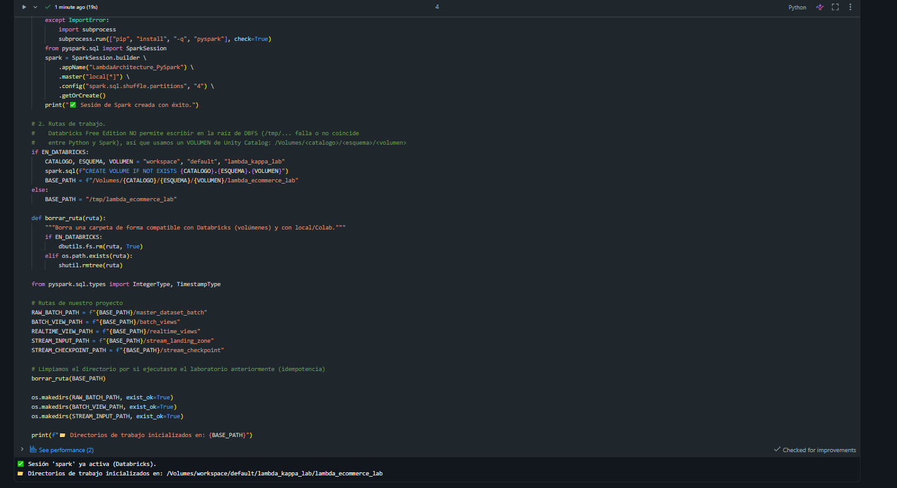
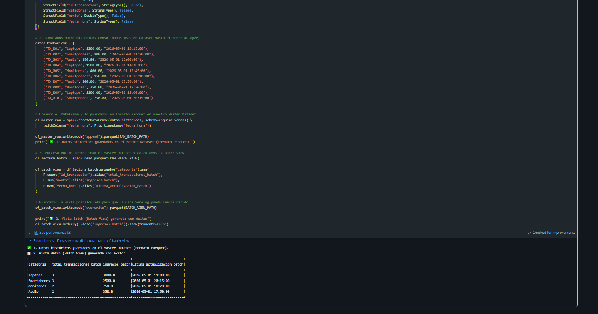
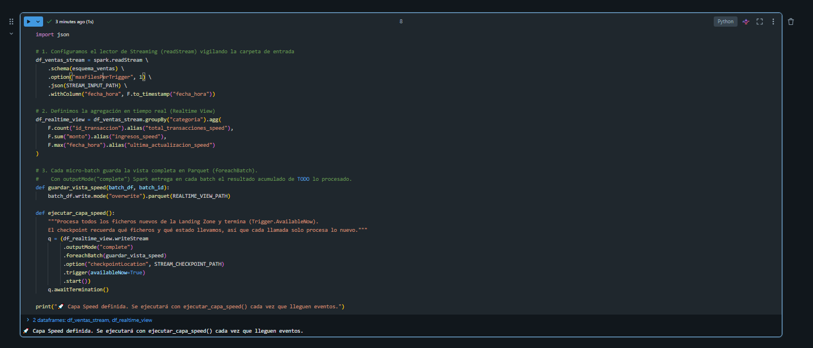
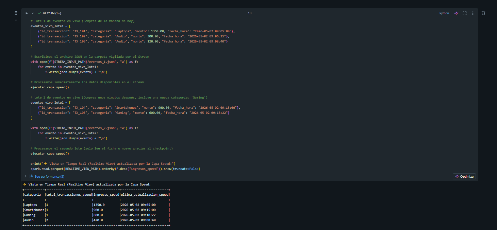
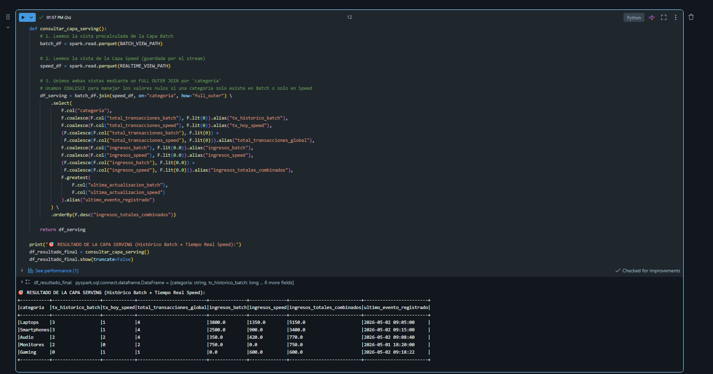
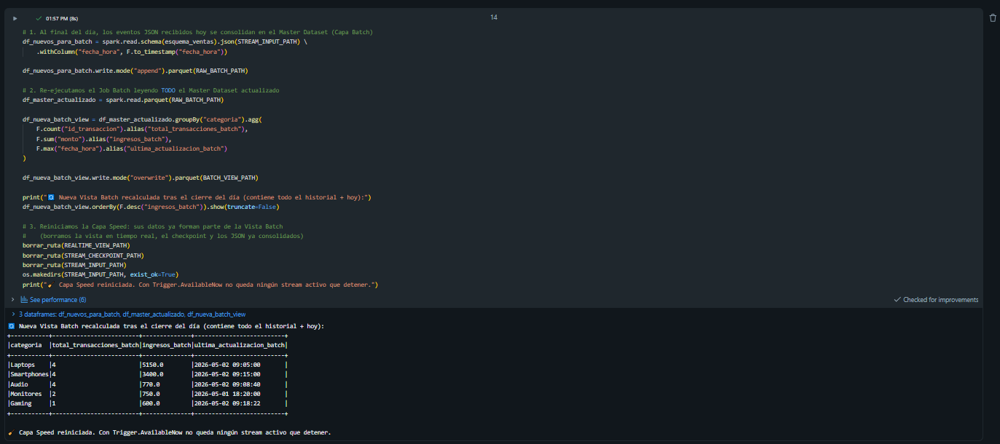
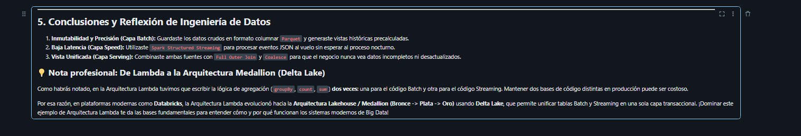

## Paso 0: Preparación del Entorno y Sesión de Spark

Si ejecutas esto en Databricks como he hecho yo, el objeto spark ya existe automáticamente.

## Paso 1: Capa Batch (El Master Dataset y las Batch Views)

En la Capa Batch, los datos brutos llegan a nuestro Data Lake (por ejemplo, archivos Parquet en Amazon S3, Azure Data Lake o DBFS en Databricks). Estos datos son inmutables. Un proceso programado (Batch Job) lee todo el histórico y calcula las agregaciones pesadas.

Vamos a simular el histórico de ventas consolidadas hasta ayer y a ejecutar nuestro trabajo por lotes para generar la Vista Batch (batch_view).

## Paso 2: Capa Speed (Procesamiento en Tiempo Real con Spark Structured Streaming)

Mientras nuestra vista Batch tiene la foto exacta hasta ayer a las 20:15, hoy la tienda sigue abierta y están entrando nuevas compras cada segundo. Si esperáramos al proceso Batch de mañana, el negocio estaría "ciego" durante 24 horas.

Aquí entra la Capa Speed:

Utilizaremos Spark Structured Streaming para escuchar continuamente una carpeta de llegada de archivos JSON en vivo (STREAM_INPUT_PATH). En un entorno productivo real, esto suele conectarse a Apache Kafka, AWS Kinesis o Azure Event Hubs, pero usar archivos JSON en una carpeta de aterrizaje (Landing Zone) sigue exactamente el mismo código y funciona gratis en Databricks Community Edition sin servidores externos.
Calcularemos las agregaciones en un stream con trigger(availableNow=True) (el único modo que admite Serverless) y guardaremos la realtime_view en Parquet con foreachBatch.

### Simulando la llegada de compras en vivo (Micro-batches)

Ahora que nuestro motor de streaming está encendido escuchando, vamos a simular que los clientes hacen compras en este momento enviando dos lotes de eventos JSON a la carpeta de entrada.

## Paso 3: Capa Serving (Unificación de Batch + Speed)

Teoría rápida:
Observa lo que tenemos hasta ahora:

En la Vista Batch (df_batch_view), tenemos categorías como Monitores (que tuvo ventas ayer, pero ninguna hoy) y ventas acumuladas de ayer.
En la Vista Speed (vista_tiempo_real), tenemos ventas de hoy e incluso una categoría nueva (Gaming) que ayer no existía.
La Capa Serving se encarga de hacer un FULL OUTER JOIN (o UNION ALL seguido de una agregación) entre la Vista Batch y la Vista Speed para entregar al usuario una tabla única, transparente y completamente actualizada.

## Paso 4: El Cierre del Ciclo (Sincronización Batch Nocturna)

¿Qué ocurre al final del día en una Arquitectura Lambda?
Los datos que hoy entraron por la Capa Speed también se guardan en el Master Dataset de la Capa Batch. Cuando llega la noche:

El proceso Batch vuelve a ejecutarse incluyendo los datos nuevos.
La Vista Speed se reinicia (se limpia), ya que esos datos ahora forman parte de la Vista Batch consolidada.
Veamos cómo funciona esta sincronización en código y detengamos nuestro stream de forma limpia.

