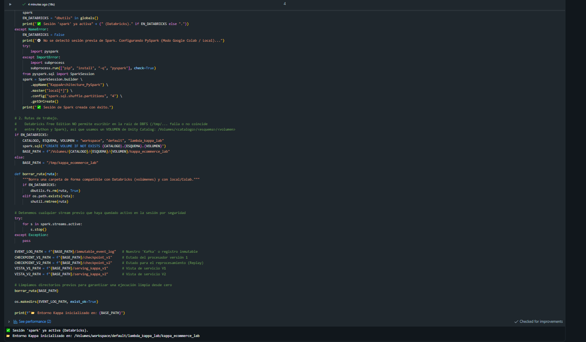
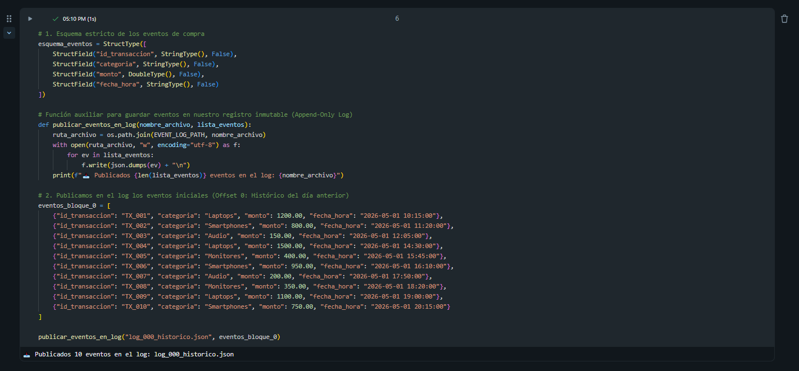
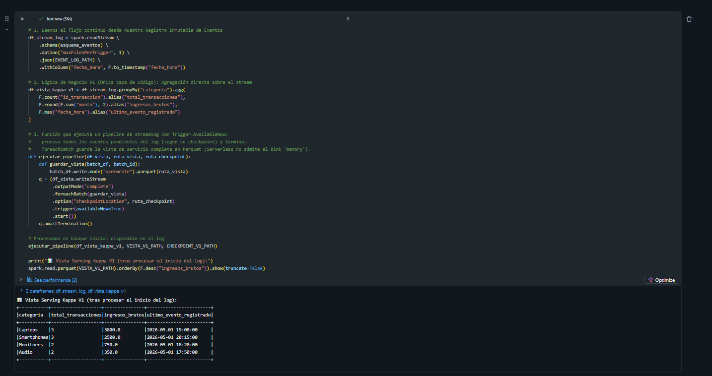
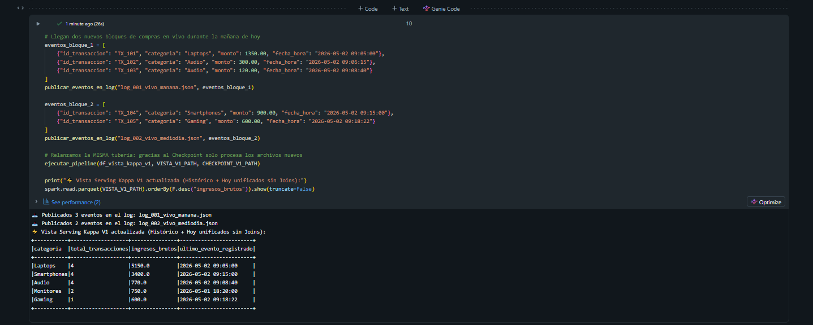
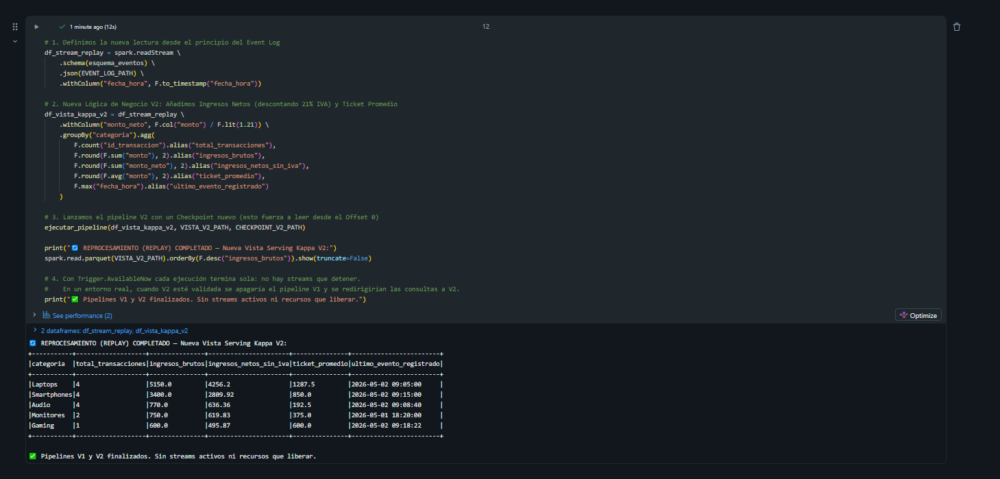
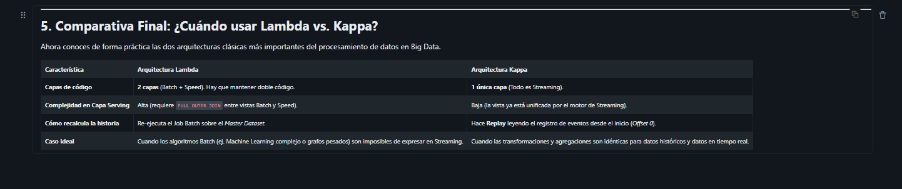

## Paso 0: Preparación del Entorno y Sesión de Spark

En esta primera celda verificamos el entorno (Databricks o Google Colab/Local), inicializamos la sesión spark y preparamos las carpetas que actuarán como nuestro Registro Inmutable de Eventos (Event Log) y nuestros directorios de Checkpointing (donde Spark guarda qué eventos ya ha leído).

### Caso de Uso: Analítica Continua de E-Commerce ("TechStore")

Para que puedas comparar directamente la Arquitectura Kappa con la Arquitectura Lambda, utilizaremos el mismo escenario de la tienda TechStore (Laptops, Smartphones, Audio, Monitores, Gaming).

En lugar de tener una tabla histórica en Parquet por un lado y JSONs por otro:

Todo (tanto las compras de ayer como las de hoy) vive en una única secuencia cronológica dentro de EVENT_LOG_PATH.
Crearemos una función auxiliar para inyectar lotes de eventos en este registro inmutable.

## Paso 2: Capa Única de Streaming (El corazón de la Arquitectura Kappa)

En Kappa no escribimos un Job Batch y un Job Streaming. Escribimos una sola tubería de Streaming (pipeline_kappa_v1) que lee desde EVENT_LOG_PATH.

Al arrancar por primera vez, el stream procesa todos los eventos históricos existentes en el log (log_000_historico.json).
Inmediatamente después, se queda escuchando nuevos eventos en tiempo real sin necesidad de hacer ningún FULL OUTER JOIN entre capas.

## Paso 3: Llegada de Eventos en Tiempo Real

Veamos qué ocurre cuando los clientes realizan nuevas compras hoy. Simplemente se añaden nuevos eventos al registro inmutable (`EVENT_LOG_PATH`) y **la misma tubería de streaming** actualiza la tabla `serving_kappa_v1` automáticamente.

## Paso 4: El Superpoder de Kappa — Reprocesamiento Histórico (Stream Replay)

¿Qué pasa si cambia la regla de negocio o hay que corregir un cálculo?
Imagina que el departamento financiero nos avisa:

"¡Atención Ingeniería de Datos! Todos los montos registrados en los eventos incluyen un 21% de impuestos (IVA) y necesitamos que el dashboard muestre también los Ingresos Netos (sin impuestos) y el Ticket Promedio desde el primer día."

En una Arquitectura Lambda, tendrías que modificar dos programas (el Job Batch y el Job Streaming) y esperar a la sincronización.
En la Arquitectura Kappa, como todos los eventos crudos siguen intactos en nuestro registro inmutable (EVENT_LOG_PATH), simplemente:
Lanzamos la Versión 2 de nuestro procesador de Streaming apuntando a un nuevo Checkpoint limpio (CHECKPOINT_V2_PATH).
Spark lee automáticamente toda la historia desde el primer evento (log_000) hasta el último (log_002) aplicando la nueva fórmula en segundos.
Cuando la vista V2 está lista, apagamos la V1.

