## Sección 0. Preparación del entorno

Databricks Free Edition no permite escribir en la raíz de DBFS (`dbfs:/`). Para guardar ficheros usaremos un **volumen de Unity Catalog**, que se comporta como una carpeta accesible desde tres sitios:

| Desde… | Ruta | Ejemplo |
|---|---|---|
| Spark | `/Volumes/<catálogo>/<esquema>/<volumen>/...` | `spark.read.parquet("/Volumes/workspace/default/formatos_datos/ventas")` |
| Python estándar (`open`, `os`, PyArrow, Pandas) | la misma ruta | `open("/Volumes/workspace/default/formatos_datos/pdi_sales.csv")` |
| `dbutils.fs` | la misma ruta | `dbutils.fs.ls("/Volumes/workspace/default/formatos_datos")` |

Que la misma ruta funcione en Spark y en Python nos permite **escribir con Spark e inspeccionar los bytes con PyArrow o con `open()`**, algo que haremos constantemente.

Primero instalamos `fastavro`, que usaremos únicamente para inspeccionar por dentro los ficheros Avro que genere Spark, y `cramjam`, que `fastavro` necesita para descomprimir los bloques comprimidos con *Snappy* (el códec que Spark usa por defecto en Avro). Tras instalar librerías hay que reiniciar el intérprete de Python.

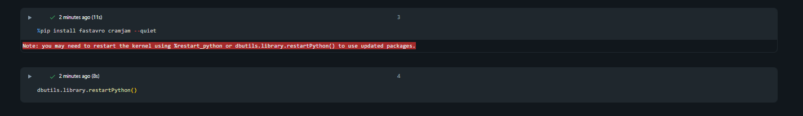

Ahora creamos el volumen. En Free Edition ya existen el catálogo `workspace` y el esquema `default`. Si tu instructor te indica otros nombres, cámbialos aquí.

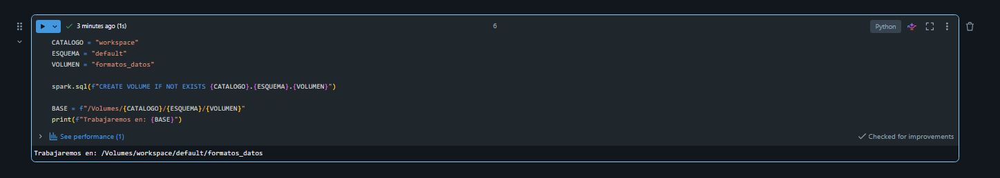

Definimos unas funciones auxiliares que usaremos durante toda la práctica:

- `tamano_bytes(ruta)`: suma el tamaño de los ficheros de datos de una ruta. Spark no escribe un fichero, sino **un directorio** con uno o varios ficheros `part-...` y ficheros de control (`_SUCCESS`, `_committed_...`, `_started_...`). Estos últimos se ignoran.
- `ficheros_datos(ruta, extension)`: devuelve los ficheros de datos de un directorio.
- `arbol(ruta)`: dibuja el árbol de carpetas.
- `plan_scan(df)`: muestra solo las líneas del plan de ejecución que indican qué lee Spark del disco (`ReadSchema`) y qué filtros entrega al lector (líneas que contienen `Filters`). En *Serverless* las consultas las ejecuta el motor **Photon**, cuyos planes pueden usar nombres algo distintos (`PhotonScan`, `RequiredDataFilters`, `DictionaryFilters`...). Si alguna vez la salida te parece incompleta, usa `plan_scan(df, completo=True)` para ver el plan entero.

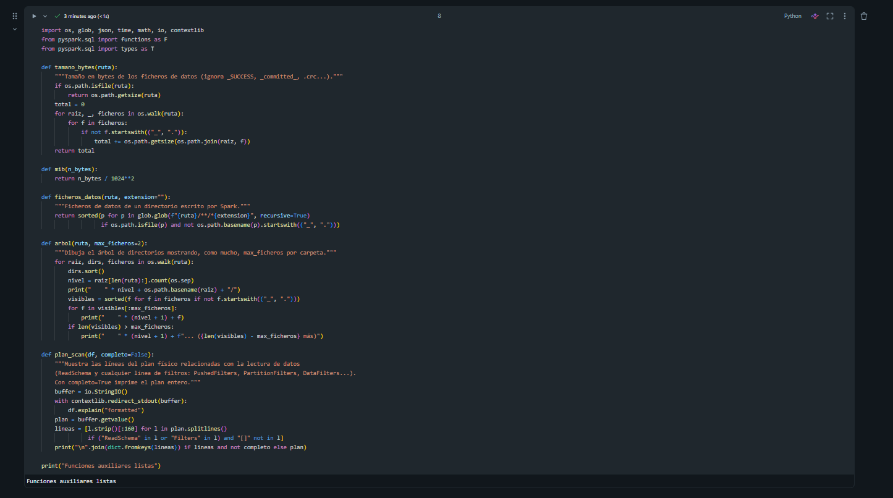

## Sección 1. Generación del dataset sintético de ventas

Los apuntes anteriores trabajan con el fichero `pdi_sales.csv`, con unas **841.000 ventas** de cuatro países. Como no tenemos el fichero original, vamos a generar uno con la misma estructura y las mismas "imperfecciones", porque precisamente esas imperfecciones son las que nos obligarán a limpiar y tipar los datos:

```text
ProductID;Date;Zip;Units;Revenue;Country
725;1/15/1999;41540   ;1;115.5;Germany
787;6/15/2002;41540   ;1;314.9;Germany
609;2/15/1999;M4E     ;1;778.8;Canada
```

| Columna | Tipo | Particularidad |
|---|---|---|
| `ProductID` | entero | Entre 1 y 2412 |
| `Date` | texto | Formato estadounidense `M/d/yyyy`, siempre día 15, entre 1999 y 2015 |
| `Zip` | texto | Código postal **con espacios a la derecha**. Canadá usa códigos alfanuméricos |
| `Units` | entero | Casi siempre 1 (columna muy repetitiva) |
| `Revenue` | decimal | Importe de la venta |
| `Country` | texto | Solo 4 valores: Canada, France, Germany, Mexico (baja cardinalidad) |
| — | — | El separador es **punto y coma** (`;`) |

Generamos los datos con funciones de Spark (`F.rand` con semilla), así que el proceso se ejecuta en paralelo y es reproducible: todos obtendréis datos muy parecidos.

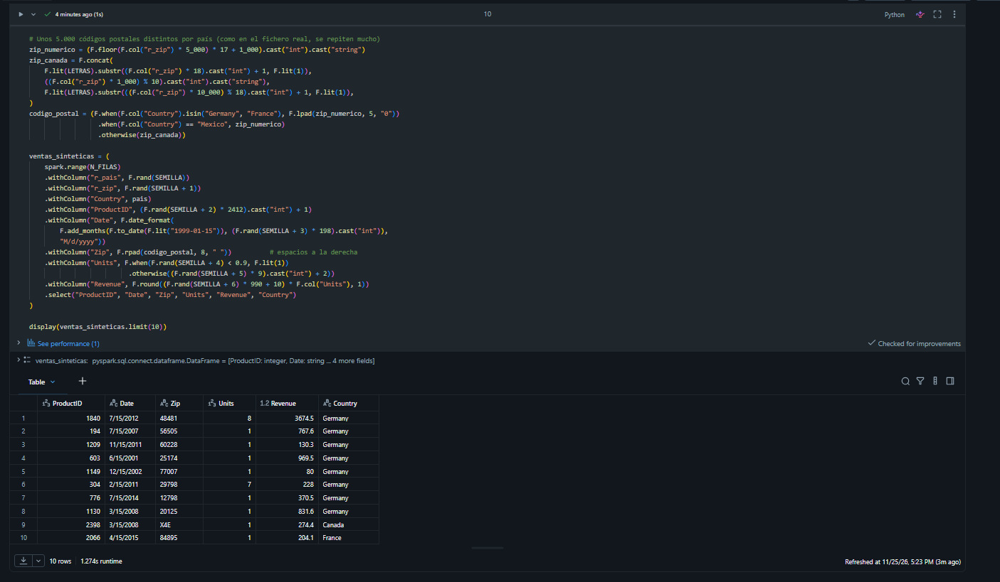

Ahora lo guardamos como **un único fichero CSV** llamado `pdi_sales.csv`, igual que el original.

Fíjate en dos detalles:

- Spark siempre escribe un **directorio**. Para obtener un único fichero, escribimos con `coalesce(1)` en una carpeta temporal y copiamos el `part-...csv` resultante con `dbutils.fs.cp`.
- Al **escribir** CSV, Spark elimina por defecto los espacios al principio y al final de cada valor. Para conservar los espacios del código postal hay que desactivar esa opción con `ignoreTrailingWhiteSpace = False`.

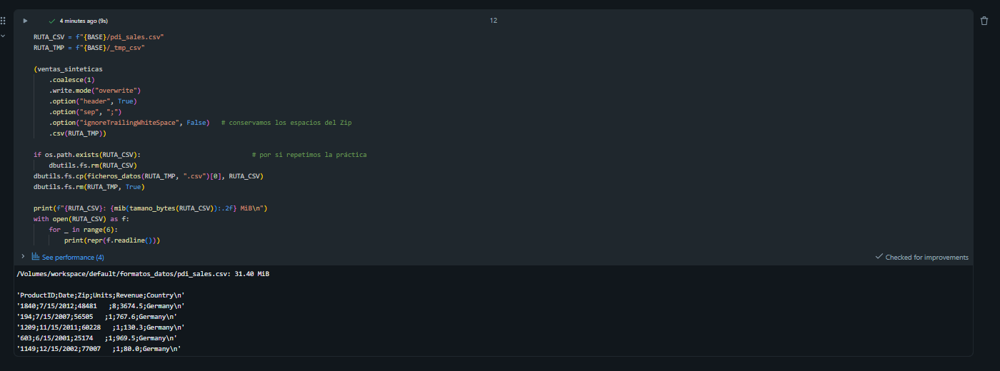

Usamos `repr()` para que se vean los espacios del código postal y el salto de línea `\n` del final de cada registro.

A partir de aquí **olvidamos cómo se generó el fichero** y lo tratamos como un fichero recibido de un sistema externo. Lo leemos **declarando el esquema**, en vez de pedirle a Spark que lo adivine con `inferSchema` (más adelante veremos por qué es importante):

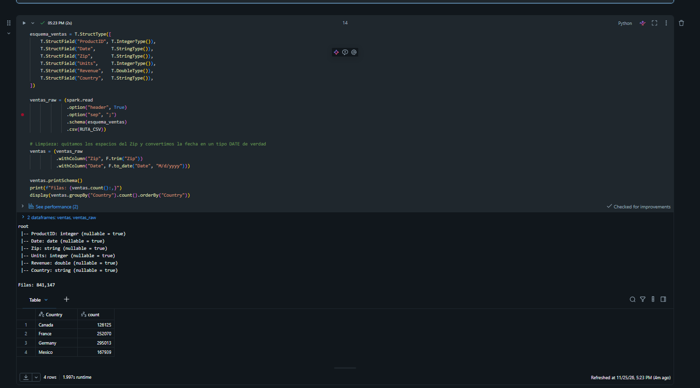

## Sección 2. ¿Qué le pedimos a un formato de datos?

Conforme los datos recorren los *pipelines*, el ingeniero de datos tiene que serializarlos en distintos formatos y convertir unos en otros. Un buen formato debería ser:

- **Independiente del lenguaje**: lo escribe Java y lo lee Python sin problemas.
- **Expresivo**: admite estructuras complejas y anidadas.
- **Eficiente**: rápido de leer y escribir, y compacto en disco.
- **Dinámico**: los programas pueden procesar tipos de datos nuevos.
- **Autodescriptivo (*standalone*)**: el fichero contiene todo lo necesario para interpretarlo.
- **Divisible (*splittable*) y comprimible**: Spark, Trino, DuckDB o Hadoop solo pueden repartir un fichero entre varios nodos si se puede **trocear en fragmentos independientes**.

Según cómo almacenan los datos, los formatos se dividen en:

- **Texto** (CSV, XML, JSON): legibles e interoperables, pero lentos y voluminosos.
- **Binario** (Avro, Parquet, ORC): más rápidos y compactos, pero no se pueden abrir con un editor.

| Característica | CSV | JSON | JSONL | Avro | Parquet | ORC |
|---|:-:|:-:|:-:|:-:|:-:|:-:|
| Legible por humanos | ✅ | ✅ | ✅ | | | |
| Independiente del lenguaje | ✅ | ✅ | ✅ | ✅ | ✅ | ✅ |
| Expresivo (datos anidados) | | ✅ | ✅ | ✅ | ✅ | ✅ |
| Eficiente en tamaño | | | | ✅ | ✅ | ✅ |
| Autodescriptivo | ❔ | ✅ | ✅ | ✅ | ✅ | ✅ |
| Divisible | ❔ | | ✅ | ✅ | ✅ | ✅ |
| Orientado a columnas | | | | | ✅ | ✅ |
| *Pushdown* de predicados | | | | | ✅ | ✅ |
| Evolución de esquema | | ❔ | ❔ | ✅ | ❔ | ❔ |
| Uso típico | Intercambio | APIs | Logs, eventos | *Streaming* | Analítica | Analítica (Hive) |

Dos matices importantes:

- **CSV divisible ❔**: un CSV en texto plano se puede dividir, pero si se comprime con *gzip* deja de serlo. Avro, Parquet y ORC siguen siendo divisibles aunque estén comprimidos, porque comprimen **por bloques** (bloque, *row group* y *stripe*, respectivamente).
- **Avro autodescriptivo ✅**: es cierto para el fichero `.avro`, que lleva el esquema en la cabecera. Los mensajes Avro que viajan por Kafka con *Schema Registry* solo llevan un identificador del esquema, así que por sí solos no son autodescriptivos.

Elegir bien el formato aporta mejor rendimiento de lectura y escritura, ficheros divisibles, soporte para esquemas que evolucionan y compresión.

### 2.1. JSON frente a JSONL

- Un documento **JSON** es un único objeto que puede ocupar muchas líneas. Para leer cualquier registro hay que *parsear* el documento entero, así que **no es divisible**.
- **JSONL** (*JSON Lines*) guarda **un objeto JSON por línea**. Cada línea es independiente, así que el fichero se puede trocear por saltos de línea.

```json
{ "empleados": [
    {"nombre": "Aitor", "altura": 182, "edad": 48},
    {"nombre": "Pedro", "altura": 178, "edad": null}
  ]
}
```

```json
{"nombre": "Aitor", "altura": 182, "edad": 48}
{"nombre": "Pedro", "altura": 178, "edad": null}
```

Esta distinción tiene una consecuencia práctica en Spark que sorprende a mucha gente: **`df.write.json()` escribe JSONL, no JSON**, y **`spark.read.json()` espera JSONL**. Vamos a comprobarlo creando un pequeño DataFrame de empleados que reutilizaremos en toda la práctica:

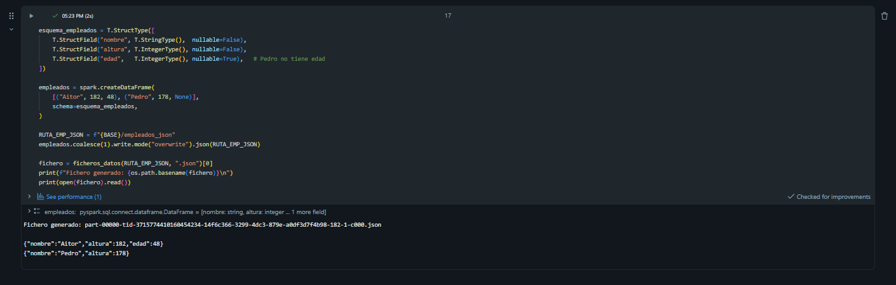

Spark ha escrito un objeto por línea (JSONL). Además, **ha omitido la clave `edad` de Pedro** porque su valor es nulo: por defecto Spark no escribe los campos nulos en JSON.

Ahora hagamos lo contrario: escribimos a mano el documento JSON "clásico" de varias líneas e intentamos leerlo con Spark.

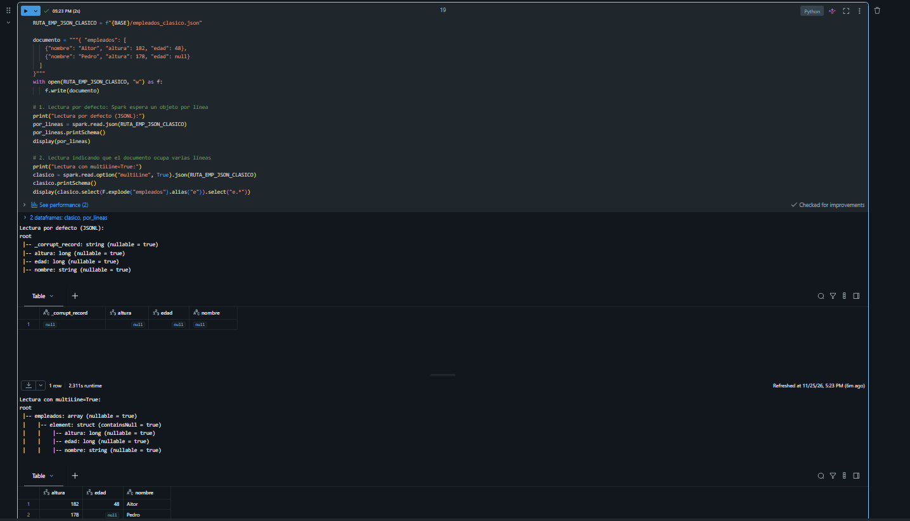

En la lectura por defecto, Spark trata **cada línea como un registro independiente**. Las líneas de los empleados las interpreta como si fueran registros sueltos, y las líneas que no son un objeto completo (`{ "empleados": [`, `]`, `}`) acaban en la columna interna `_corrupt_record`. El resultado mezcla datos y basura, y no avisa con ningún error. Con `multiLine=True` lo lee, pero **todo el documento lo procesa una única tarea**, porque no se puede dividir. Con un JSON de varios GB eso es un cuello de botella.

> **El precio de no tener esquema.** Guardar JSON como texto es cómodo, pero cada consulta tiene que *parsear* el documento completo. La alternativa clásica, aplanar el JSON en columnas tipadas, es rápida, pero cualquier cambio en el origen rompe el *pipeline*. Hay una tercera vía moderna: el tipo **VARIANT**, incorporado a la especificación de Parquet en 2025 y disponible en Databricks. Lo veremos en la siguiente sesión, sobre SQL analítico.

#### Reto 2.1

Lee el directorio `RUTA_EMP_JSON` (el JSONL que escribió Spark) **sin indicar esquema** y compara los tipos que infiere Spark con los de `esquema_empleados`. ¿Qué tipo asigna a `altura` y `edad`? ¿Qué implicaciones tiene en el tamaño de los datos si después se guardan en un formato binario?

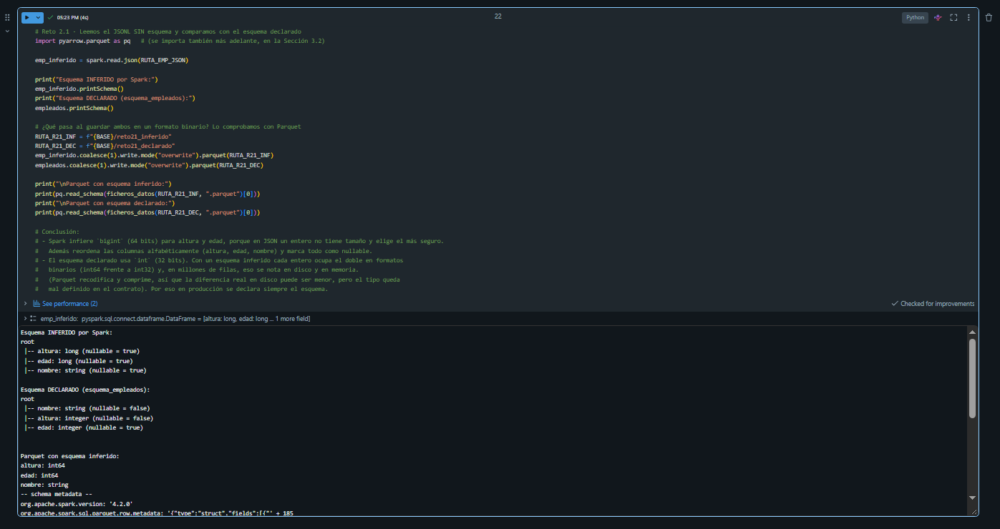

## Sección 3. Filas frente a columnas

CSV, XML o JSON son **formatos orientados a filas**: cada registro se guarda completo, uno detrás de otro. En un **formato orientado a columnas**, todos los valores de una columna se guardan juntos.

Tomemos tres pedidos de una tabla `orders`:

| order_id | cliente | importe | pais |
|---|---|---|---|
| 1 | Acme | 120.5 | ES |
| 2 | Globex | 80.0 | ES |
| 3 | Initech | 310.2 | FR |

Así se dispondrían en disco con cada organización:

```text
Por filas:     1,Acme,120.5,ES | 2,Globex,80.0,ES | 3,Initech,310.2,FR
Por columnas:  1,2,3 | Acme,Globex,Initech | 120.5,80.0,310.2 | ES,ES,FR
```

Si la consulta es `SELECT SUM(importe) FROM orders`:

- **Por filas**, hay que leer todos los bytes del fichero y descartar tres de cada cuatro valores.
- **Por columnas**, basta con leer el bloque `120.5,80.0,310.2`.

Además, como los valores de una columna son del mismo tipo y suelen repetirse (`ES,ES,FR`), **se comprimen mucho mejor**.

El almacenamiento por columnas también tiene inconvenientes:

- Para reconstruir un registro completo hay que leer de varios bloques de columnas.
- Actualizar una fila supone descomprimir, modificar, volver a comprimir y reescribir cada columna afectada. Para limitarlo, las columnas se reparten en varios ficheros usando particionado y *clustering*, pero modificar una sola fila sigue siendo caro.

Por eso las bases de datos **transaccionales (OLTP)** almacenan por filas y los sistemas **analíticos (OLAP)** almacenan por columnas.

### 3.1. Codificando las columnas

Antes de comprimir, los formatos columnares **recodifican** cada columna aprovechando que todos sus valores son del mismo tipo y que suelen repetirse. Las técnicas más habituales son:

- **Codificación por diccionario** (*dictionary encoding*): si una columna tiene pocos valores distintos (**baja cardinalidad**), se guarda un diccionario con los valores únicos y cada dato se sustituye por su índice.
  `Germany, Germany, France, Germany` → diccionario `{0: Germany, 1: France}` + datos `0, 0, 1, 0`
- **Run-Length Encoding (RLE)**: los valores consecutivos repetidos se guardan como pares (valor, repeticiones). `0, 0, 0, 1, 1, 0` → `(0×3), (1×2), (0×1)`. **Cuanto más ordenados estén los datos, mejor funciona.**
- ***Bit-packing***: los índices del diccionario son números pequeños, así que no necesitan 32 o 64 bits. Con 4 países bastan **2 bits** por valor.
- **Codificación delta**: en columnas crecientes (fechas, *timestamps*, identificadores) se guarda el primer valor y después solo las diferencias, que son números pequeños.

> **Codificación ≠ compresión.** Son dos capas en cascada. La **codificación** conoce el tipo de dato y actúa columna a columna. Algunos motores pueden incluso filtrar sobre los índices del diccionario sin descodificarlos. La **compresión** (*Snappy*, *gzip*, *zstd*...) es genérica: trata los bytes ya codificados como una secuencia opaca. Por eso un CSV con *gzip* sigue ocupando más que un Parquet con *Snappy*: el CSV no puede codificar por columnas.

¿Qué columnas de nuestras ventas se beneficiarán más de la codificación por diccionario? Calculemos su **cardinalidad**, es decir, el número de valores distintos de cada una:

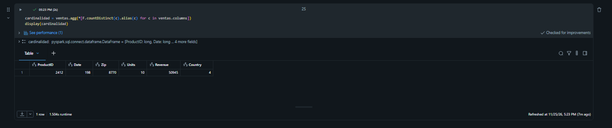

`Country` tiene 4 valores distintos entre más de 800.000 filas, y `Units` muy pocos. Son las candidatas perfectas para diccionario + RLE. `Revenue` y `Zip`, en cambio, tienen muchos valores distintos.

Simulemos en Python lo que haría un formato columnar con la columna `Country`, tomando 30 valores **tal y como vienen** y esos mismos 30 valores **ordenados**:

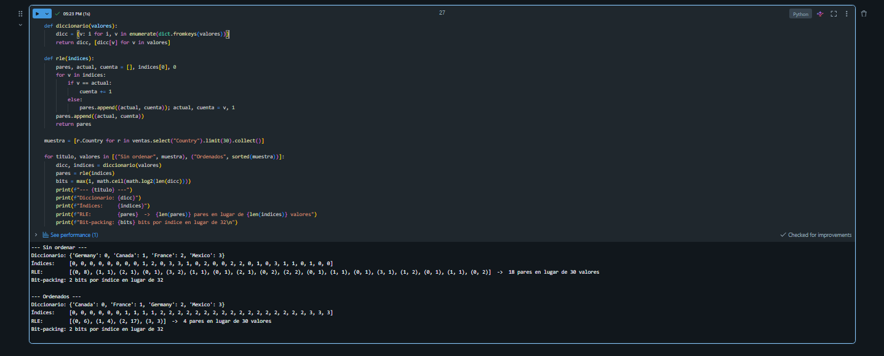

Con los datos ordenados, RLE reduce 30 valores a solo 4 pares. Retén esta idea, porque reaparecerá con el *pushdown*: **el orden en que escribimos los datos es una decisión de diseño, no un detalle.**

En un formato de filas esta codificación es imposible: en cada registro se mezclan cadenas, enteros y fechas, y no hay homogeneidad que aprovechar.

### 3.2. El tamaño importa

Los apuntes citan un análisis sobre AWS Athena, que cobra 5 $ por cada TB escaneado. En él, 1 TB de CSV pasa a ocupar unos 130 GB en Parquet, y cuando una consulta solo necesita una de las columnas, el ahorro en datos escaneados (y, por tanto, en dinero) es todavía mayor.

Vamos a comprobarlo con nuestros datos. Escribimos las ventas en Parquet, con las opciones por defecto, y comparamos los tamaños:

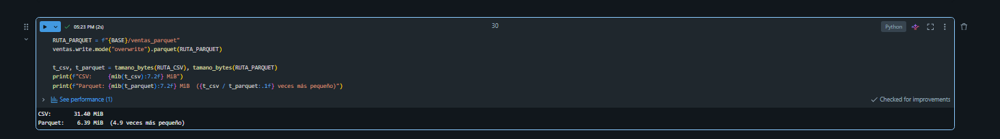

Ahora supongamos que el analista solo quiere `SELECT SUM(Revenue)`. ¿Cuántos bytes tiene que leer cada formato?

- En **CSV**, aunque solo queramos una columna, hay que recorrer el fichero entero para localizar los separadores.
- En **Parquet**, el pie del fichero indica dónde empieza y cuánto ocupa cada columna. Lo consultamos con **PyArrow**, que puede leer los metadatos de los ficheros que ha escrito Spark:

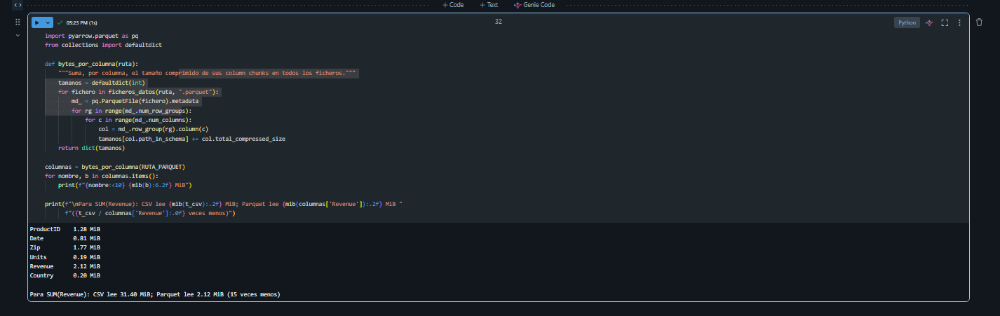

Spark aplica esta optimización automáticamente. En el plan de ejecución, la línea `ReadSchema` indica qué columnas se piden al fichero:

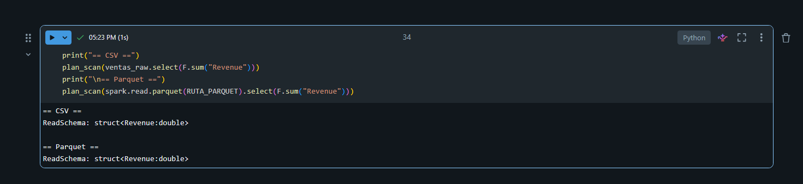

Las dos lecturas muestran `ReadSchema: struct<Revenue:double>`, pero no significan lo mismo. En CSV, Spark solo **convierte** esa columna, pero **lee del disco todos los bytes**. En Parquet **solo lee del disco** los bytes de esa columna. Las cifras de la celda anterior muestran la diferencia de coste.

%md
## Sección 4. Avro

[Apache Avro](https://avro.apache.org/) es un formato **binario orientado a filas**. Los datos se serializan en un binario compacto y el esquema que los describe se escribe en **JSON**. Esa combinación tiene tres consecuencias:

1. **El esquema viaja con los datos**, en la cabecera del fichero. Quien lee un `.avro` no necesita nada más para interpretarlo.
2. Al estar en JSON, el esquema es **legible y manipulable** con cualquier herramienta.
3. Dos programas pueden leer y escribir el mismo fichero con **versiones distintas del esquema** sin romperse. Esta **evolución de esquema** es lo que distingue a Avro del resto de formatos.

Por eso Avro es la elección natural cuando los datos **cruzan la frontera entre sistemas que evolucionan por separado** (típicamente, un productor y un consumidor de Kafka). Para analizar columnas, el formato adecuado es Parquet.

### 4.1. Estructura del fichero

Un fichero Avro tiene:

- Una **cabecera** con los metadatos: los "números mágicos" `Obj\x01`, el **esquema en JSON** y el **códec** de compresión.
- Una secuencia de **bloques de datos** en binario.
- Un ***sync marker***: 16 bytes aleatorios que aparecen al final de la cabecera y al final de cada bloque.

El *sync marker* explica dos propiedades de la tabla de la Sección 2:

- **Divisible**: un lector puede saltar a cualquier punto del fichero, buscar el siguiente *sync marker* y saber que ahí empieza un bloque completo. Así, varios nodos procesan fragmentos distintos en paralelo.
- **Divisible aunque esté comprimido**: la compresión se aplica bloque a bloque, no al fichero entero.

Los esquemas combinan tipos **primitivos** (`null`, `boolean`, `int`, `long`, `float`, `double`, `bytes`, `string`) y **compuestos** (`record`, `enum`, `array`, `map`, `union`, `fixed`). Este es el esquema de nuestros empleados:

```json
{
  "type": "record",
  "namespace": "com.empresa.rrhh",
  "name": "empleado",
  "fields": [
    {"name": "nombre", "type": "string"},
    {"name": "altura", "type": "int"},
    {"name": "edad",   "type": ["null", "int"], "default": null}
  ]
}
```

> **Campos opcionales.** En Avro todos los campos son obligatorios. Para que `edad` pueda faltar declaramos una **unión** con `null` y un valor `default`. Sin esa unión, escribir un empleado sin edad daría error. La pareja unión + `default` es la base de la evolución de esquema.

### 4.2. Avro en Spark

Databricks incluye el conector Avro de Spark, así que basta con `format("avro")`. Las opciones clave son:

| Opción | Al escribir | Al leer |
|---|---|---|
| `avroSchema` | Fuerza el esquema Avro con el que se escribe | Esquema del **lector** (evolución de esquema) |
| `recordName`, `recordNamespace` | Nombre del registro si Spark genera el esquema | — |
| `compression` | Códec: `uncompressed`, `snappy`, `deflate`, `zstandard`... | — |

Guardamos el esquema en un fichero `.avsc`, igual que haríamos en un proyecto real, y escribimos los empleados con él:

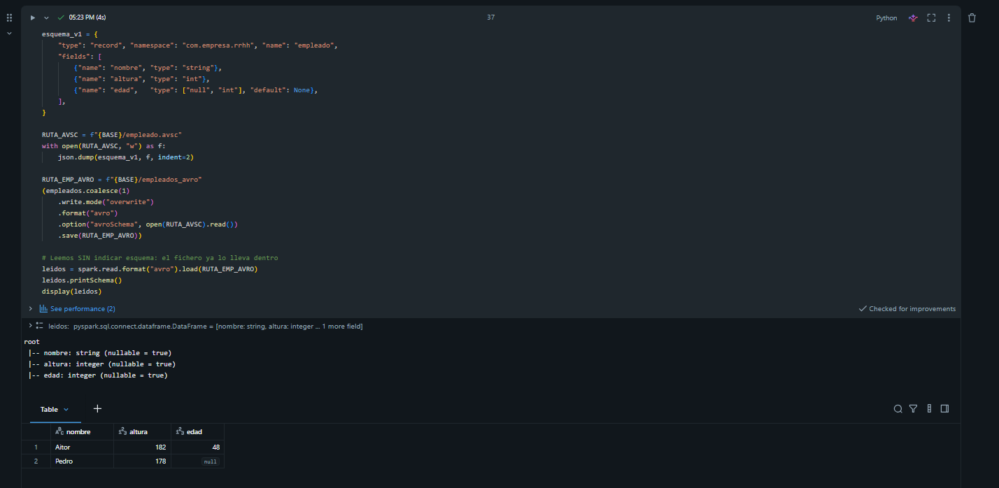

Spark ha recuperado los tipos sin que le pasemos ningún esquema: Avro es **autodescriptivo**. Para comprobar qué hay realmente dentro del fichero, abrimos su cabecera con `fastavro`:

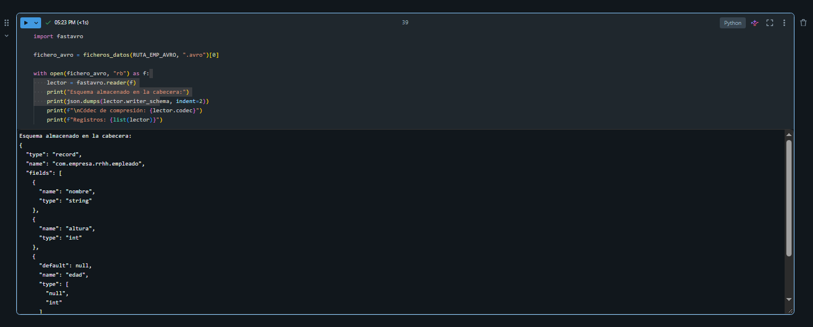

El esquema de la cabecera es nuestro `.avsc`. `fastavro` lo muestra con el nombre completo del registro (`com.empresa.rrhh.empleado`) en lugar de separar `namespace` y `name`, pero es el mismo esquema. El códec es `snappy`, el valor por defecto de Spark para Avro.

Ahora miramos directamente los bytes para localizar los números mágicos y el *sync marker*:

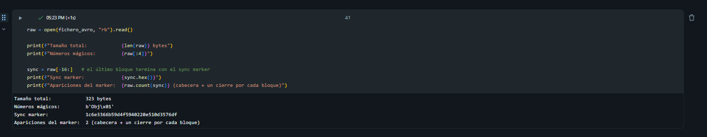

¿Qué pasa si **no** le damos a Spark el esquema? Que lo genera a partir del DataFrame. Escribamos los mismos empleados sin la opción `avroSchema` y veamos qué esquema acaba en la cabecera:

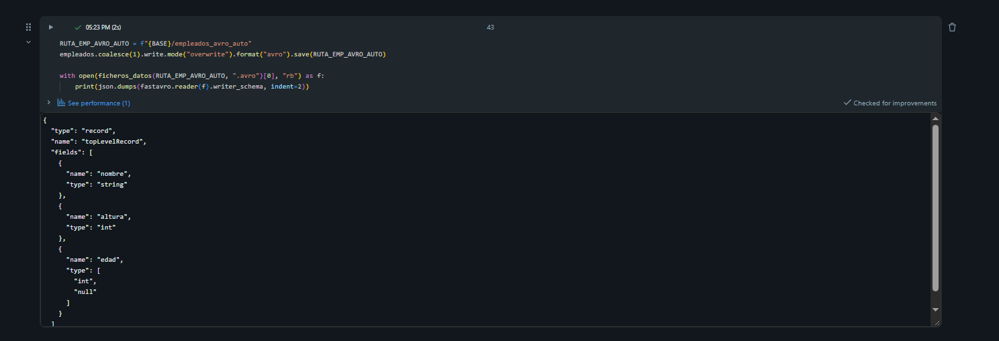

Spark ha inventado el nombre `topLevelRecord` y, para las columnas que admiten nulos (al menos `edad`), ha creado uniones del tipo `["int", "null"]` **sin valor `default`**. El fichero es válido, pero ese esquema es un mal punto de partida para un contrato entre sistemas. En producción, **declara siempre el esquema Avro**.

### 4.3. Evolución del esquema

Imagina que llevamos meses escribiendo ficheros de empleados con el esquema v1 y ahora necesitamos un campo `departamento`. Tenemos terabytes de ficheros antiguos sin ese campo. ¿Hay que reescribirlos?

Avro dice que **no**. Para ello distingue dos esquemas:

- ***Writer schema***: el esquema con el que se escribió el fichero. Está en su cabecera.
- ***Reader schema***: el esquema que espera el programa que lee, es decir, la versión actual del contrato.

Cuando no coinciden, Avro aplica la **resolución de esquemas** y traduce de uno a otro al vuelo. En Spark, el esquema del lector se indica con la opción `avroSchema` **al leer**:

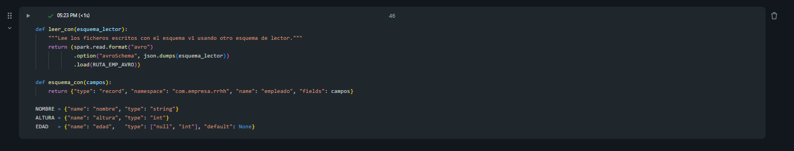

**Caso 1. Añadir un campo con valor por defecto.** Los ficheros antiguos se leen sin tocarlos y el campo que les falta se rellena con el `default`:

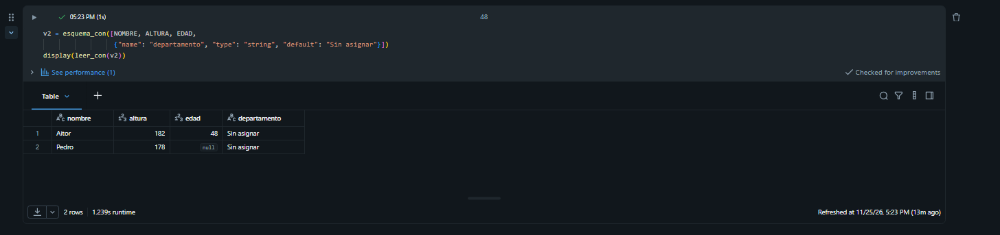

**Caso 2. Añadir un campo sin valor por defecto.** Avro no puede inventarse un valor que no está en el fichero y para el que no hay alternativa, así que **falla**. Este error es la mejor demostración de para qué sirve un `default`:

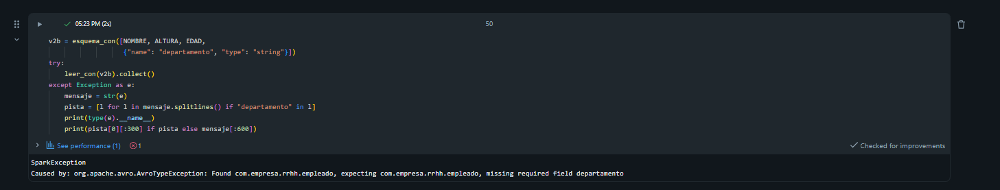

**Caso 3. Renombrar un campo.** Queremos que `nombre` pase a llamarse `nombre_completo`. Para que Avro sepa que es el mismo campo usamos `aliases`:

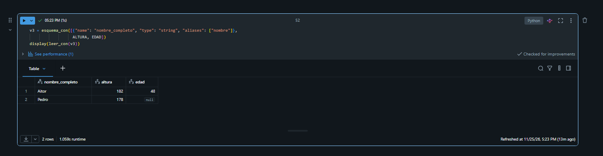

**Caso 4. Eliminar un campo.** Ya no nos interesa la edad. El dato sigue en el fichero, pero el lector lo ignora:

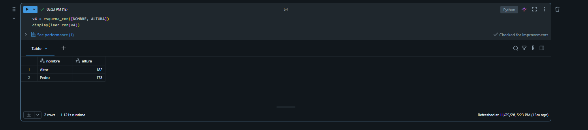

| Cambio en el esquema | ¿Se leen los ficheros antiguos? | Condición |
|---|---|---|
| Añadir un campo | Sí | Debe tener `default` |
| Añadir un campo | **No** | Si no tiene `default` |
| Renombrar un campo | Sí | Mediante `aliases` |
| Eliminar un campo | Sí | Siempre |

Ninguno de estos cambios obliga a reescribir un solo byte de los datos almacenados. Ni Parquet ni ORC ofrecen este nivel de control.

> **Compatibilidad hacia atrás y hacia delante.** Que un lector nuevo lea datos antiguos (lo que acabamos de hacer) es compatibilidad **hacia atrás** (*backward*). Que un lector antiguo lea datos nuevos es compatibilidad **hacia delante** (*forward*), y funciona porque el lector ignora los campos que no conoce. Si se cumplen ambas, la compatibilidad es **completa** (*full*). Añadir un campo con `default` tiene compatibilidad completa. De ahí la regla de oro: **todo campo nuevo lleva `default`**.

> **¿Y si el esquema no cabe en cada mensaje?** En un fichero `.avro` el esquema se escribe una vez y se reparte entre miles de registros. En Kafka cada mensaje es independiente, y repetir el esquema en cada uno multiplicaría su tamaño. La solución es un ***Schema Registry***, que guarda los esquemas y les asigna un identificador. Los mensajes viajan con ese identificador en lugar del esquema, así que ya no son autodescriptivos: sin acceso al registro no se pueden leer. En Spark se trabaja con ellos mediante `from_avro`/`to_avro`. Lo veremos en las sesiones de Kafka.

#### Reto 4.3

Comprueba la compatibilidad **hacia delante**:

1. Crea un DataFrame con dos empleados nuevos que incluya la columna `departamento`.
2. Escríbelo en Avro en una ruta nueva usando el esquema `v2` (opción `avroSchema` al escribir).
3. Léelo con el esquema **v1** (`esquema_v1`) como esquema del lector. ¿Qué ocurre con `departamento`?

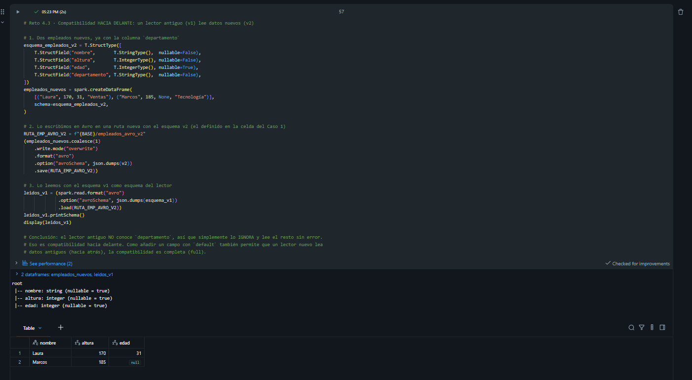

### 4.4. Avro con un caso real: ventas de Alemania

Repetimos el ejemplo de los apuntes con PySpark: partimos del CSV de ventas, limpiamos los códigos postales, nos quedamos con Alemania y guardamos el resultado en Avro. Esta vez dejamos que Spark genere el esquema, pero le damos un nombre y un *namespace* significativos. Guardamos dos versiones, con *Snappy* y con *deflate*:

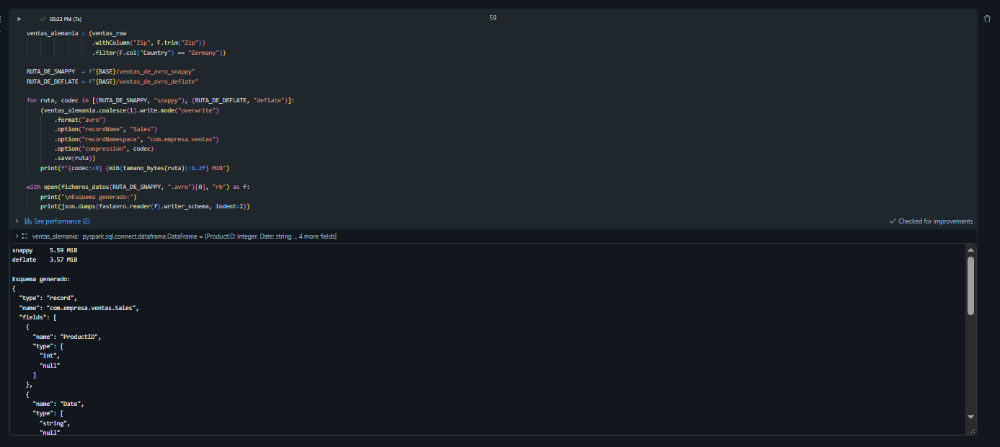

## Sección 5. Apache Arrow

[Apache Arrow](https://arrow.apache.org/) es una especificación de **formato columnar en memoria**. Avro, Parquet y ORC definen cómo guardar los datos **en disco**. Arrow define cómo representarlos **en RAM** para que distintas herramientas y lenguajes los compartan sin copiarlos ni serializarlos.

Hoy es la capa de interoperabilidad estándar del ecosistema de datos en Python. La usan Pandas 2.x, Polars, DuckDB y **Spark**, que recurre a Arrow para mover datos entre la JVM y Python en `toPandas()`, `createDataFrame(pandas_df)` y las *Pandas UDFs*.

Sus ventajas principales son:

- ***Zero-copy***: dos procesos pueden leer los mismos datos en memoria sin duplicarlos.
- **Vectorización**: el formato columnar facilita las instrucciones SIMD (*Single Instruction, Multiple Data*), que procesan varios valores en una sola instrucción.
- **Interoperabilidad**: la misma representación sirve en Python, R, Java, C++, Rust...
- **Ecosistema**: es la base de las librerías de lectura y escritura de Parquet, ORC y del formato Feather.

### 5.1. PyArrow

La estructura central de PyArrow es la **tabla** (`pa.Table`): parecida a un DataFrame, pero con tipado estricto y representación columnar.

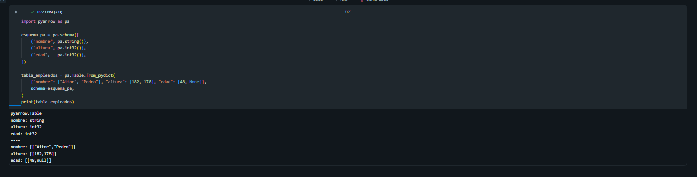

Desde Spark 4.0, un DataFrame de Spark se puede convertir directamente en una tabla Arrow con `toArrow()`. Es la forma más eficiente de llevar un resultado de Spark a la memoria del *driver* para seguir trabajando en Python. En versiones anteriores, se pasa por Pandas:

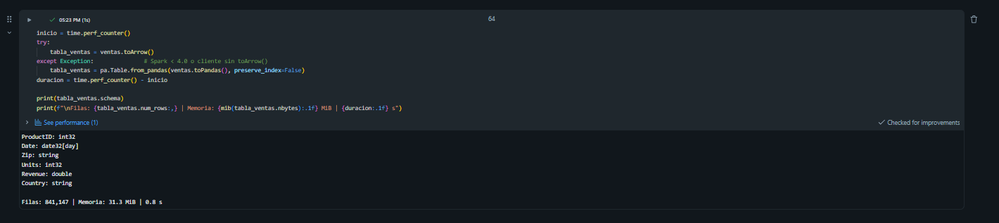

Observa que `Date` ha llegado como `date32` y `Revenue` como `double`. Los tipos se conservan en el paso de Spark a Arrow, cosa que no ocurría con los antiguos tipos de NumPy.

### 5.2. PyArrow y Pandas

Desde Pandas 2.0 se puede usar Arrow como almacenamiento interno de un DataFrame. Mejora el rendimiento y reduce la memoria, sobre todo con **cadenas de texto y valores nulos**. Leemos el mismo CSV desde el volumen con los dos *backends* y comparamos:

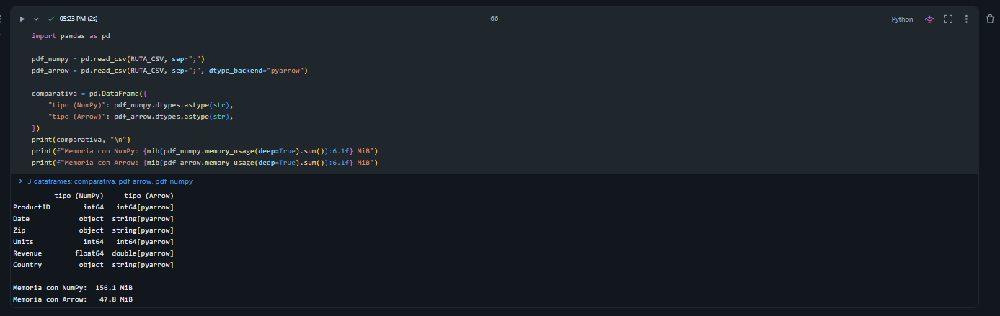

Las columnas de texto (`Date`, `Zip`, `Country`) son las que más memoria ahorran con Arrow. En las columnas numéricas puras la diferencia es pequeña.

### 5.3. El formato Feather

Además del formato en memoria, Arrow define un formato de fichero, **Feather** (o *Arrow IPC*), cuya estructura en disco es **la misma que en RAM**. Leerlo es prácticamente copiar bytes, así que es ideal para **ficheros intermedios** que se escriben y se leen continuamente dentro de un mismo *pipeline*.

Spark no lee Feather de forma nativa. En Databricks lo usaremos en los pasos que se ejecutan en Python sobre el *driver*:

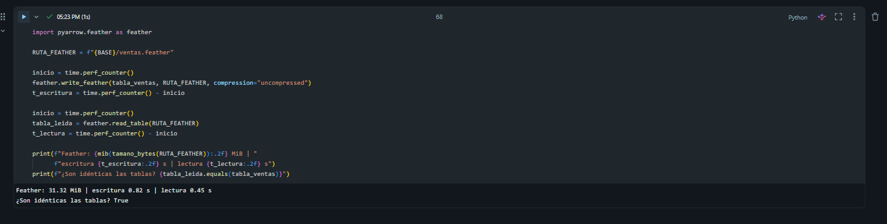

> **¿Feather o Parquet?** Usa **Feather** para ficheros intermedios que se leen y escriben con frecuencia dentro de un mismo *pipeline*. Usa **Parquet** para el almacenamiento definitivo, sobre todo si lo van a leer Spark, Athena u otras herramientas analíticas. Fíjate en el tamaño: Feather sin comprimir ocupa casi tanto como el CSV, o más. Está pensado para leer rápido, no para ahorrar espacio.

## Sección 6. Apache Parquet

[Apache Parquet](https://parquet.apache.org/) es un formato **orientado a columnas** que admiten prácticamente todos los *frameworks* y lenguajes. Como Avro, es **autodescriptivo**: el esquema va dentro del fichero. Es el formato por defecto de Spark y la base de Delta Lake.

Es idóneo para *datasets* con muchas columnas de las que solo se consultan unas pocas: comprime muy bien y en cada lectura solo recorre las columnas necesarias. Si Avro responde a "*los datos cruzan sistemas que evolucionan por separado*", Parquet responde a "*quiero escanear miles de millones de filas por dos columnas y que me cueste poco*".

### 6.1. Estructura del fichero

Un fichero Parquet se organiza así:

```text
Fichero
├── Row group 0                ← bloque horizontal de filas (unidad de paralelismo)
│   ├── Column chunk: ProductID   ← los valores de UNA columna, contiguos
│   │   ├── Dictionary page       ← el diccionario, si se usa
│   │   ├── Data page             ← unidad de codificación, compresión y lectura
│   │   └── Data page
│   ├── Column chunk: Date
│   └── ...
├── Row group 1
│   └── ...
└── Footer (pie)               ← esquema + posición, codificación, compresión
                                 y estadísticas (min, max, nulos) de cada column chunk
```

- **Row group**: un bloque horizontal de filas. Cada uno lo puede procesar un nodo distinto.
- **Column chunk**: dentro de un *row group*, los valores de una columna almacenados de forma contigua. Permite leer una columna sin tocar las demás.
- **Página**: la subdivisión final. Es la unidad de codificación y de compresión, y la unidad mínima de lectura: aunque solo necesitemos un valor, se lee la página entera.
- **Pie (*footer*)**: los metadatos. Se escribe al final porque las estadísticas solo se conocen cuando se han visto todos los datos, y así el fichero se escribe en una única pasada.

> **La página es la pieza clave.** Como cada página indica su codificación y su compresión, **cada columna puede elegir la que mejor le va**. Cuando se usa diccionario, este se guarda en una página especial al principio del *column chunk* y el resto de páginas solo contienen índices. La compresión se aplica después de codificar, página a página, por lo que Parquet sigue siendo divisible aunque esté comprimido.

### 6.2. Parquet con PySpark

Repetimos el ejemplo de los empleados en Parquet e inspeccionamos el fichero con PyArrow:

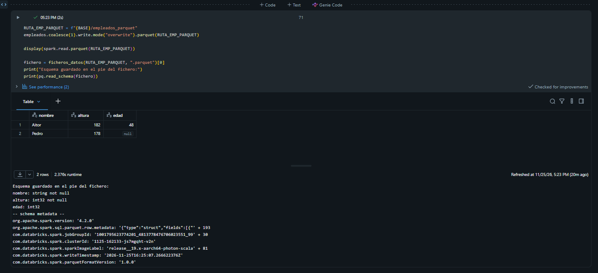

`altura` y `edad` se han guardado como `int32`, porque así lo declaramos en `esquema_empleados`.

> **Si no indicamos el esquema, Spark se lo inventa.** Al inferir un JSON, Spark asigna `bigint` (64 bits) a cualquier entero, y nadie te avisa de que esas columnas ocupan el doble (es lo que viste en el Reto 2.1). Al inferir un CSV, elige `int` cuando los valores caben, pero deja `Date` como texto, porque no reconoce el formato `M/d/yyyy`, y además tiene que leer el fichero una vez más solo para adivinar los tipos. **Inferir el esquema es cómodo para explorar, pero en un *pipeline* de producción hay que declararlo siempre.**

### 6.3. Controlando los *row groups*

Para que las optimizaciones de las próximas secciones se vean con claridad, escribimos las ventas en **un único fichero, ordenado por país y fecha**, con *row groups* más pequeños de lo habitual. En Spark, el tamaño del *row group* se controla en bytes con la opción `parquet.block.size` (por defecto, 128 MiB):

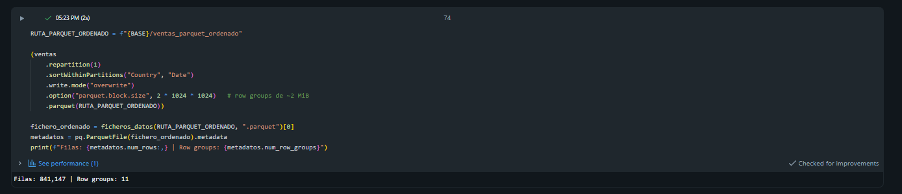

Spark decide dónde cortar cada *row group* según el tamaño **en memoria** de los datos, así que el número exacto puede variar. Además, en *Serverless* la escritura puede hacerla el motor Photon, que no siempre respeta `parquet.block.size`. Si obtienes **un solo *row group***, ejecuta la celda siguiente: reescribe el fichero con PyArrow, a partir de los mismos datos ordenados, en exactamente 4 *row groups*. Si ya tienes varios, la celda no hace nada.

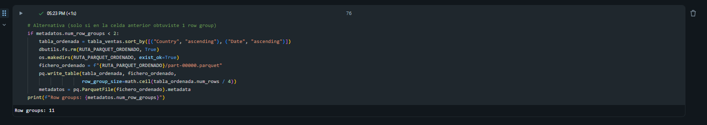

### 6.4. Datos anidados

¿Cómo guarda un formato columnar un pedido que contiene un cliente y una lista de líneas? La solución de Parquet es **aplanar el esquema hasta sus hojas**: cada campo simple del árbol se convierte en una columna física independiente, cuyo nombre es su ruta completa.

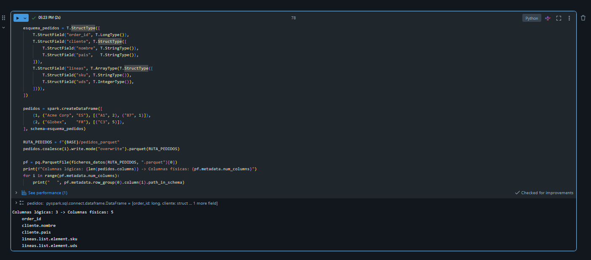

Las 3 columnas lógicas se han convertido en 5 columnas físicas. Como cada hoja es una columna de pleno derecho, Spark puede leer **una subcolumna anidada sin leer el resto del pedido** (*nested schema pruning*). Fíjate en `ReadSchema`:

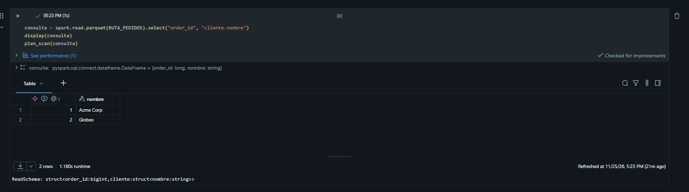

Spark solo ha pedido `order_id` y `cliente.nombre`. Ni el país del cliente, ni los SKU, ni las unidades se han leído del disco. Por eso Parquet es la mejor opción para documentos anidados de los que solo se consultan algunas subcolumnas.

> **¿Cómo reconstruye Parquet el pedido?** Si `lineas.list.element.sku` contiene `["A1", "B7", "C3"]`, ¿cómo sabe que los dos primeros son del pedido 1 y el tercero del pedido 2? Junto a cada valor guarda dos enteros muy pequeños. El **nivel de repetición** (*repetition level*) indica en qué punto del árbol empieza un elemento nuevo. El **nivel de definición** (*definition level*) indica hasta qué profundidad está definido el valor, y permite distinguir una lista vacía de una lista con un nulo.

### 6.5. Leyendo menos datos

¿Cómo se escanean mil millones de filas en dos segundos? **No escaneándolas.** El mismo truco se aplica a tres niveles, y cada uno amplía el anterior:

1. **Codificación**: que cada valor ocupe menos bytes.
2. ***Pushdown***: no leer las columnas ni los *row groups* que no hacen falta.
3. **Particionado**: no llegar siquiera a abrir el fichero.

Los tres son gratis para quien consulta y transparentes para el desarrollador, **siempre que los datos se hayan escrito con sentido**. Ese "siempre que" es el trabajo del ingeniero de datos.

#### 6.5.1. Codificación

Toda la información de codificación está en el pie del fichero, y se puede leer sin tocar los datos. Inspeccionamos el fichero ordenado: para cada *row group* y columna vemos la compresión, las codificaciones, el tamaño antes y después de comprimir, y las estadísticas.

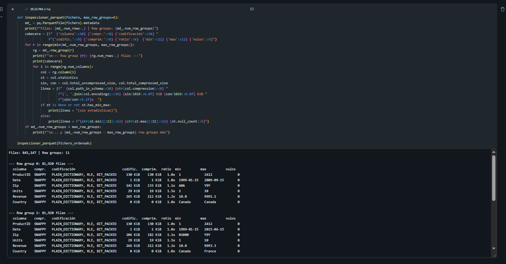

Fíjate en tres cosas:

- La codificación por diccionario (`PLAIN_DICTIONARY` o `RLE_DICTIONARY`, según la versión del escritor) se aplica **automáticamente**, sin pedirla.
- La compresión es la que Spark usa por defecto (`spark.sql.parquet.compression.codec`). Comprueba cuál aparece en tu entorno.
- `Country` apenas ocupa unos pocos KiB por *row group*: con los datos ordenados, diccionario + RLE la reducen a unos pocos pares (valor, repeticiones). Es el efecto que simulamos en la Sección 3.1. Por eso Parquet es especialmente eficiente con columnas de **baja cardinalidad**.

#### 6.5.2. *Pushdown*

Las estadísticas del pie permiten dos optimizaciones que Spark, Athena, DuckDB o PyArrow aplican automáticamente:

- ***Projection pushdown*** (poda de columnas): solo se leen del disco las columnas de la consulta. Es lo que medimos en la Sección 3.2.
- ***Predicate pushdown*** (*data skipping*): antes de leer, el motor compara el filtro con el **mínimo y el máximo** de cada *row group* y descarta los que no pueden contener resultados.

Veamos las estadísticas de `Country` y `Date` en cada *row group*, y razonemos como lo haría el motor ante dos filtros:

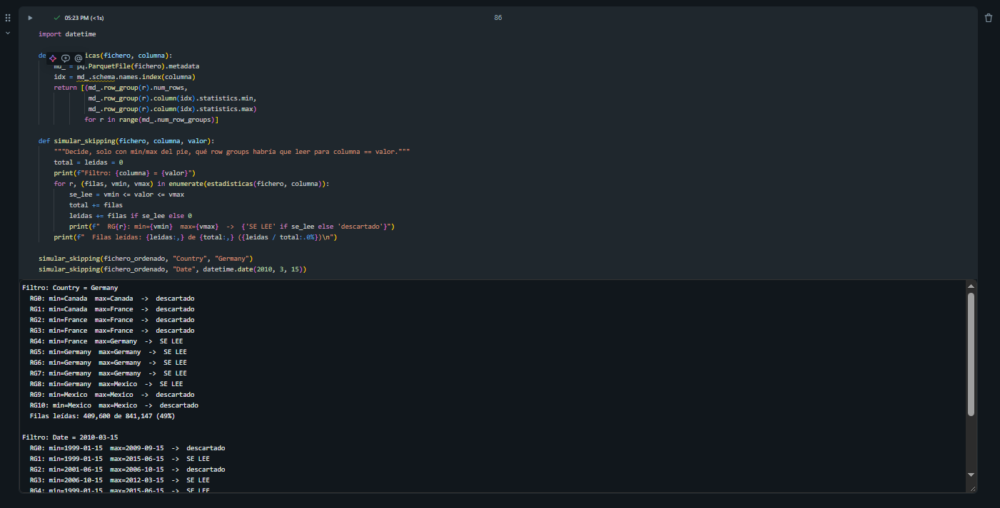

En el **mismo fichero**, con el **mismo formato** y la **misma codificación**, el filtrado anticipado funciona muy bien con `Country` y no sirve para nada con `Date`. La diferencia no está en Parquet, sino en cómo se escribió el fichero: **ordenado por `Country`**, así que cada *row group* contiene pocos países, pero las fechas solo están ordenadas dentro de cada país y casi todos los *row groups* abarcan un rango de fechas muy amplio.

Spark aplica este razonamiento él solo. En el plan, `PushedFilters` muestra los filtros que se entregan al lector de Parquet para que descarte *row groups*:

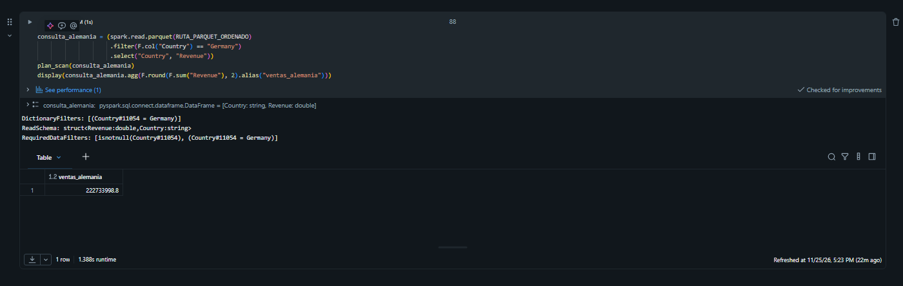

> **El *pushdown* no es magia.** Para que el filtrado anticipado descarte algo se necesitan dos condiciones:
> 1. Que el fichero tenga **varios *row groups***. Un fichero con un único *row group* nunca se salta nada.
> 2. Que los datos estén **ordenados, o al menos agrupados, por la columna del filtro**. Si los países están mezclados, todos los *row groups* tendrán `min=Canada, max=Mexico` y no se podrá descartar ninguno.

#### Reto 6.5

Demuestra la segunda condición con datos reales:

1. Recorre los ficheros de `RUTA_PARQUET` (escrito en la Sección 3.2 **sin ordenar**) con `ficheros_datos()` e inspecciona la columna `Country` de cada uno con `estadisticas()`. ¿Cuántos *row groups* podría descartar el filtro `Country = 'Germany'`?
2. Escribe una nueva versión del dataset **ordenada por `Date`** (con `parquet.block.size` pequeño) y usa `simular_skipping()` para comprobar qué filtro funciona ahora y cuál deja de funcionar.

*Pista:* si Spark te genera un único *row group*, usa la misma técnica que la celda alternativa de la Sección 6.3, pero ordenando la tabla Arrow por `Date`.

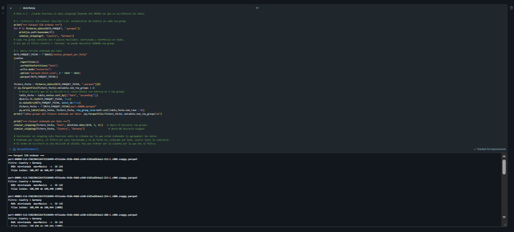

#### 6.5.3. Particionado

En la práctica, una tabla Parquet casi nunca es un fichero, sino **un directorio**. El descarte por estadísticas tiene un límite: el motor tiene que abrir cada fichero y leer su pie. Si repartimos los datos en carpetas según el valor de una columna, el motor puede **descartar directorios enteros sin abrir ningún fichero**. Es la misma idea, un nivel más arriba.

En Spark se hace con `partitionBy`:

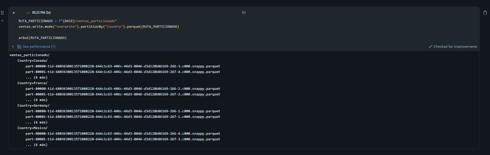

Los directorios siguen la convención `columna=valor`, conocida como ***Hive-style partitioning***, que entienden prácticamente todos los motores del ecosistema. Para leer, basta con apuntar al directorio raíz. El filtro sobre la columna de partición aparece en el plan como `PartitionFilters`:

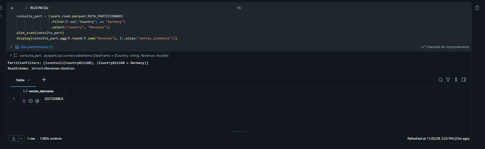

Un detalle elegante: **dentro de `Country=Germany/` los ficheros ya no contienen la columna `Country`**. Repetir "Germany" en cada fila no tendría sentido: el valor está en el nombre del directorio y el motor lo reconstruye al leer. Compruébalo:

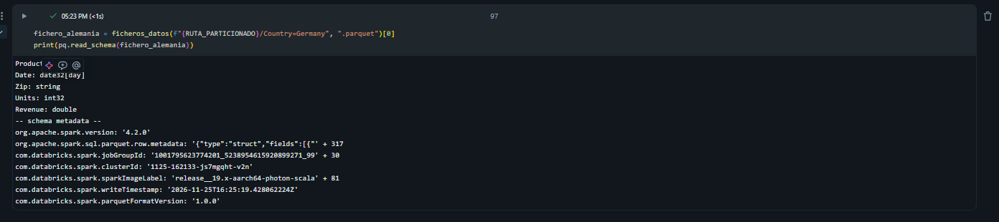

Es la codificación por diccionario llevada al sistema de ficheros: la partición cuesta cero bytes de datos.

Elegir la columna de particionado es una de las decisiones de diseño más importantes de un *data lake*. Hay que particionar por la columna por la que se filtra (típicamente, la fecha) **sin pasarse**: miles de directorios con un fichero diminuto cada uno empeoran el rendimiento en lugar de mejorarlo. Lo pondremos en práctica en la sesión sobre almacenamiento distribuido.

> **¿Y Apache ORC?** [ORC](https://orc.apache.org/) (*Optimized Row Columnar*) nació en 2013, el mismo año que Parquet, con el mismo objetivo y un diseño casi idéntico. Los bloques de filas se llaman *stripes* en lugar de *row groups*, y también tiene codificación por columna, compresión por bloque y estadísticas para el *pushdown*. Fue el formato nativo de Hive, pero hoy Parquet se ha impuesto fuera de ese ecosistema. ORC sigue siendo relevante en tablas Hive transaccionales y en migraciones desde ellas. Todo lo que has aprendido de Parquet se aplica a ORC, y en Spark se usa igual:

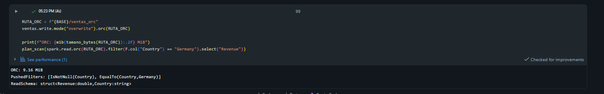

## Sección 7. Compresión

Comprimir hace que los datos ocupen menos en el almacenamiento (y cuesten menos), que se lean más rápido del disco y que viajen menos bytes por la red. A cambio, comprimir y descomprimir consume CPU.

> **Compresión ≠ codificación.** Recuerda la Sección 3.1: Parquet y ORC comprimen mejor que un CSV, no porque usen mejores algoritmos, sino porque **llegan al compresor con los datos ya recodificados**.

### 7.1. Eligiendo el algoritmo

Durante una década, elegir códec fue un dilema: rápido (***Snappy***) o pequeño (***gzip***), pero no ambas cosas. Por eso *Snappy* acabó siendo el códec por defecto de Parquet: en un clúster, cada ciclo de CPU dedicado a descomprimir se le quita a la consulta. ***Zstandard*** (*zstd*) rompió ese equilibrio: ofrece una velocidad comparable a *Snappy* con ratios de compresión parecidos a *gzip*.

Cuidado con una trampa práctica: **el mismo algoritmo cambia de nombre según el formato**. En Spark, todos se indican con la opción `compression` del escritor:

| Algoritmo | CSV / JSON | Avro | Parquet | ORC | Velocidad | Compresión | ¿Cuándo? |
|---|---|---|---|---|---|---|---|
| *Snappy* | `snappy` | `snappy` | `snappy` | `snappy` | Alta | Baja | Valor por defecto histórico de Parquet |
| *LZ4* | `lz4` | — | `lz4` | `lz4` | Muy alta | Baja | Cuando solo importa la latencia de lectura |
| *DEFLATE* | `gzip`, `deflate` | `deflate` | `gzip` | `zlib` | Baja | Media | Interoperabilidad con herramientas antiguas |
| *Zstandard* | `zstd` | `zstandard` | `zstd` | `zstd` | Alta | Alta | **La opción razonable por defecto hoy** |

### 7.2. Comparativa: formato × códec

Escribimos las mismas ventas en cada combinación de formato y códec, medimos el tamaño y el tiempo de escritura, y lo comparamos con el CSV de partida. Usamos `coalesce(1)` para que todas las salidas sean un único fichero comparable. Feather se escribe con PyArrow desde la tabla Arrow de la Sección 5.

La celda tarda unos minutos en ejecutarse. Si algún códec no está disponible en tu entorno, la celda lo indica y continúa con el resto.

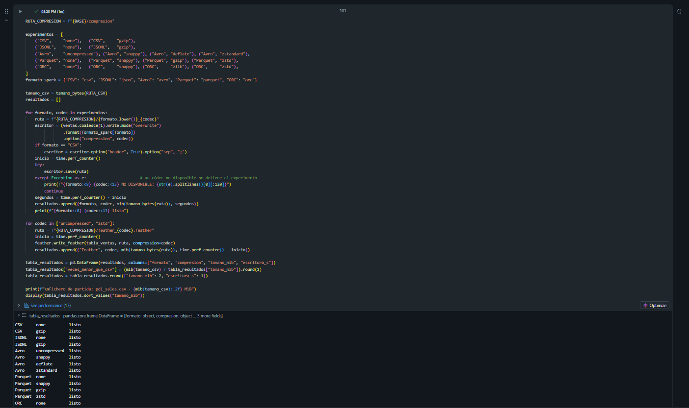
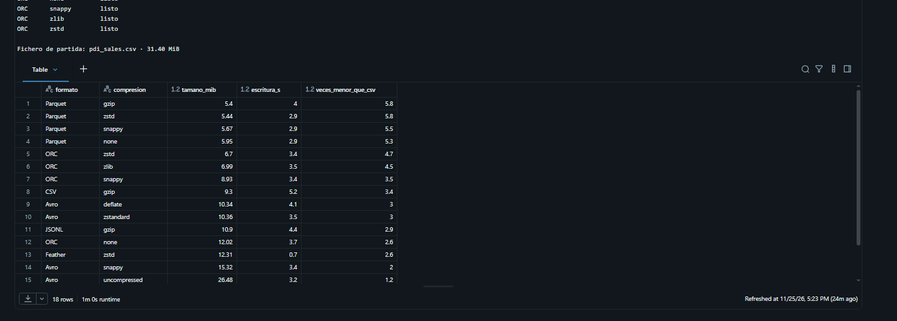

Busca en tu tabla el detalle más revelador: **Parquet sin comprimir ocupa menos que Avro comprimido con *Snappy***. La codificación columnar consigue por sí sola más reducción que la compresión de un formato de filas. La compresión ayuda, pero **la decisión importante es el formato**.

Fíjate también en JSONL: repetir los nombres de las claves en cada registro lo convierte en el formato más voluminoso.

Por último, medimos el coste de **leer** con una consulta analítica típica sobre tres de las salidas. Los tiempos dependen de la carga del cómputo *serverless* y de sus cachés, así que ejecútala dos o tres veces y fíjate en el orden de magnitud, no en las décimas:

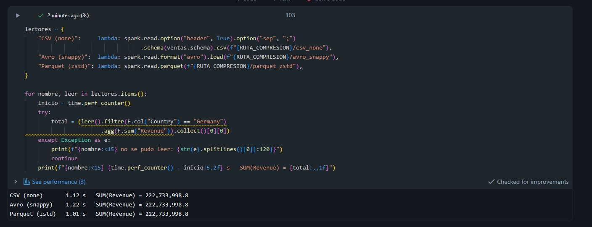

### 7.3. Entonces, ¿qué formato elijo?

| Situación | Formato |
|---|---|
| Lo va a abrir una persona o una hoja de cálculo | **CSV** |
| Es un fichero intermedio dentro del mismo *pipeline* en Python | **Arrow / Feather** |
| Viaja entre sistemas que evolucionan por separado (típicamente Kafka) | **Avro** |
| Es para analítica | **Parquet con *zstd*** |

#### Reto 7.3

¿Influye el **orden** de los datos en la compresión? Escribe las ventas en Parquet con *zstd* dos veces, con `coalesce(1)` en ambos casos:

1. Sin ordenar.
2. Ordenadas con `sortWithinPartitions("Country", "Date", "ProductID")`.

Compara el tamaño total con `tamano_bytes()` y el tamaño de cada columna con `bytes_por_columna()`. ¿Qué columnas se benefician más del orden y por qué? Relaciónalo con el RLE de la Sección 3.1.

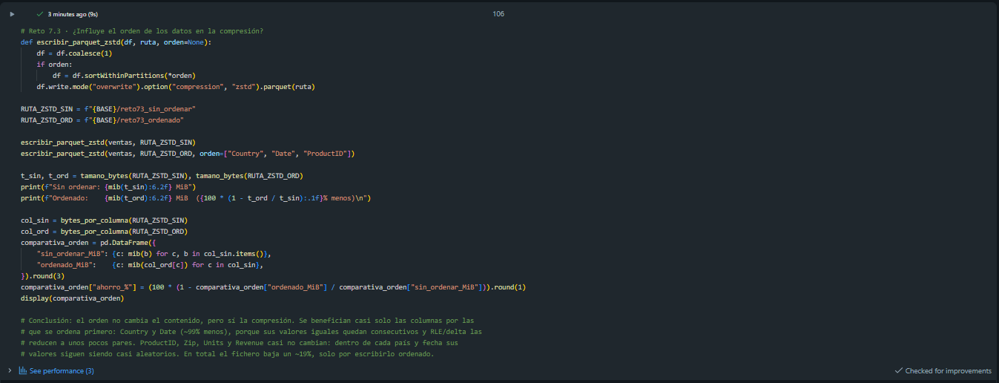
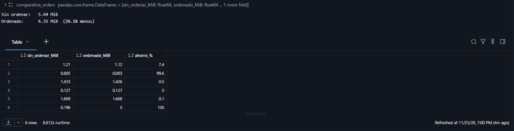

