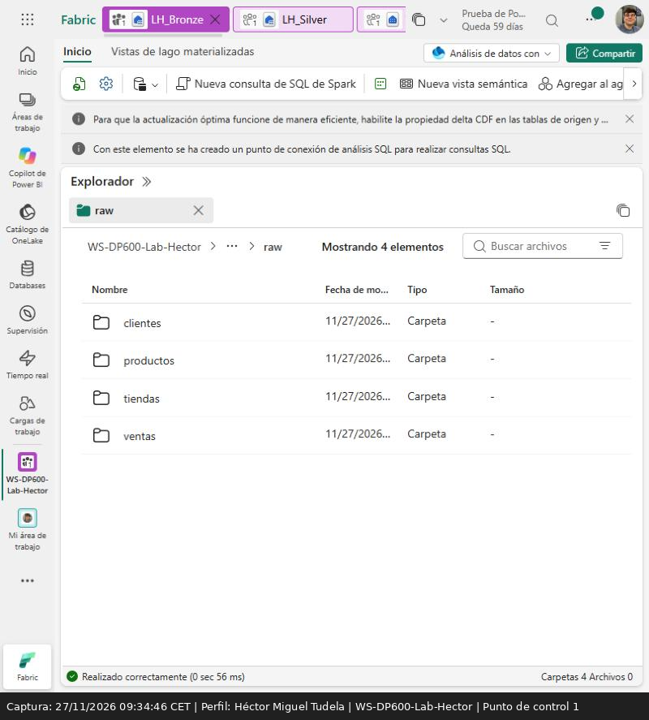

# 01 · Capa Bronze

**Objetivo:** generar con PySpark datos de ventas con suciedad deliberada y escribirlos como CSV en `LH_Bronze/Files/`.

Items: Lakehouse `LH_Bronze`, notebook `NB_01_Bronze_Ingesta`, workspace `WS-DP600-Lab-Hector` (trial de 60 días, cuenta Tajamar).

## Pasos
1. Crear workspace de tipo *Prueba de Fabric* y los lakehouses `LH_Bronze`, `LH_Silver` y el warehouse `WH_Gold`.
2. Crear `NB_01_Bronze_Ingesta`, adjuntarlo a `LH_Bronze` y ejecutar las celdas de generación (productos, clientes, tiendas, ventas).
3. Comprobar los CSV en `Files/` (**Punto de control 1**).

📸 **Captura:** CSV crudos en Files/ de LH_Bronze, con fecha, hora y perfil Héctor Miguel Tudela.

## Errores de esta fase
| # | Error | Causa | Solución |
|---|---|---|---|
| 1 | La prueba de Fabric aparece como "no disponible" | Activación desde la home no ofrecida a la cuenta de estudiante | Consejo del profesor: navegar en incógnito (Edge) y crear directamente un lakehouse/notebook; ahí ofrece activar el trial. Se creó un workspace de tipo *Prueba de Fabric*. |
| 2 | Nombre `WS-DP600-Lab` ya existía | Nombre global compartido con otros alumnos | Usar `WS-DP600-Lab-Hector` y adaptar las rutas `abfss://` |
