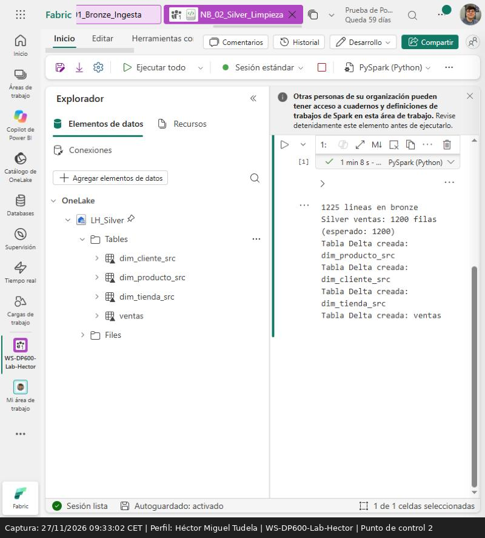

# 02 · Capa Silver

**Objetivo:** limpiar y conformar los CSV de Bronze en tablas Delta (`dim_producto_src`, `dim_cliente_src`, `dim_tienda_src`, `ventas`) en `LH_Silver` con `NB_02_Silver_Limpieza`.

Limpieza: deduplicado, tratamiento de nulos, normalización de formatos de fecha, eliminación de transacciones de prueba.

📸 **Captura:** Cuatro tablas Delta en LH_Silver (Punto de control 2).

## Errores / incidencias
- El explorador del notebook mostraba *Tables* vacío hasta pulsar **Actualizar**.
- El editor Monaco autoindenta: al escribir bloques con tabuladores se acumulaba la sangría → se escribió código en sentencias de una línea.
