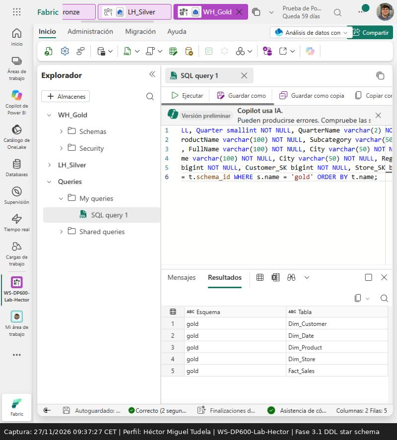
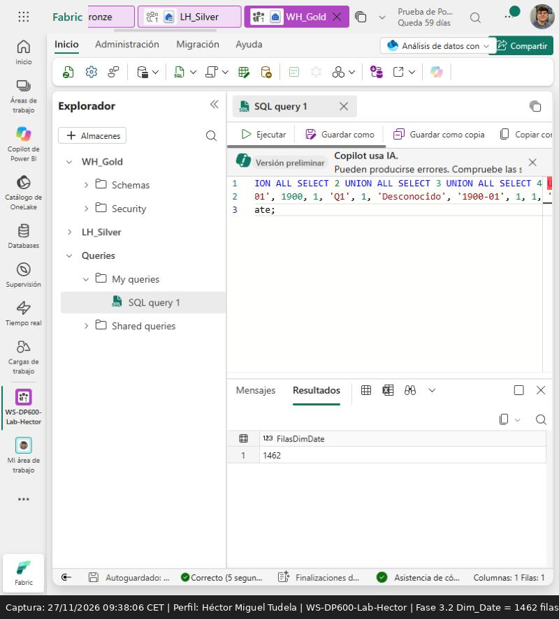
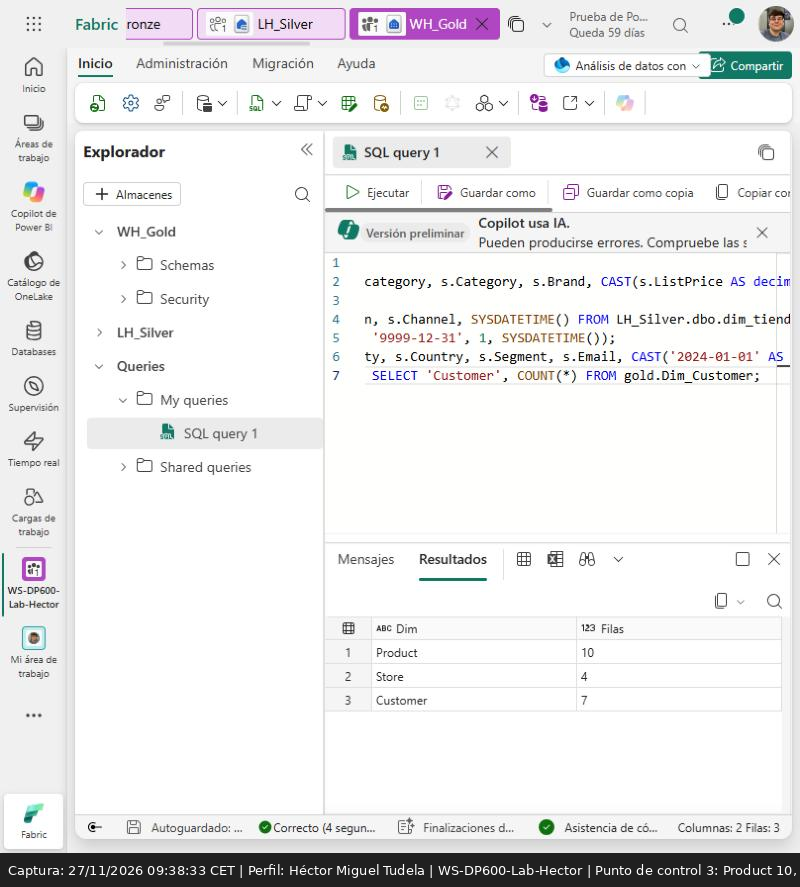
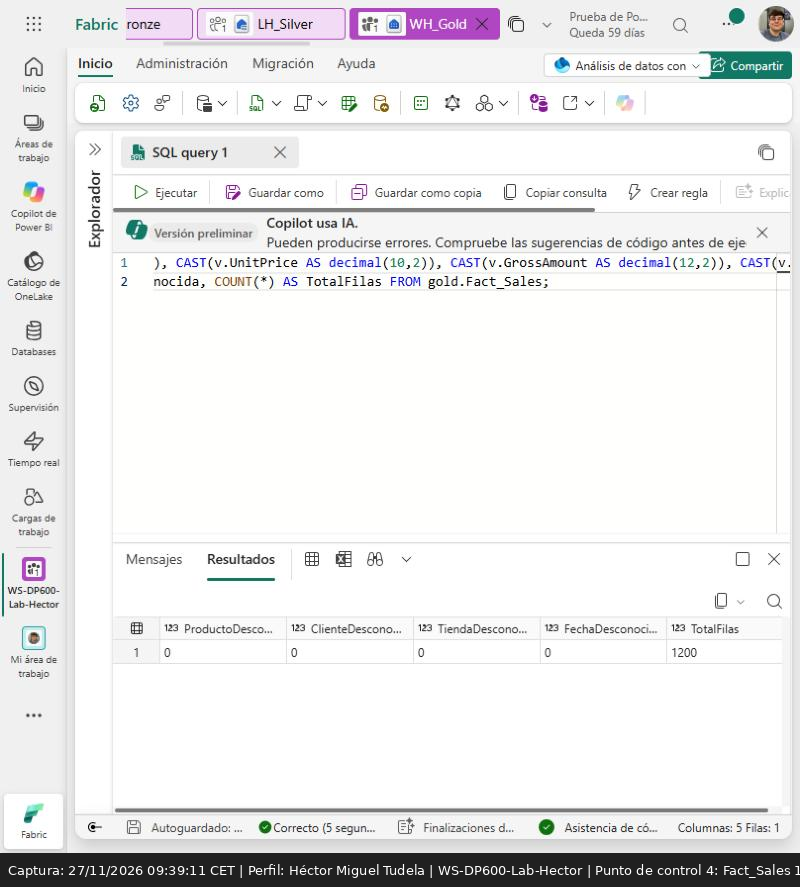
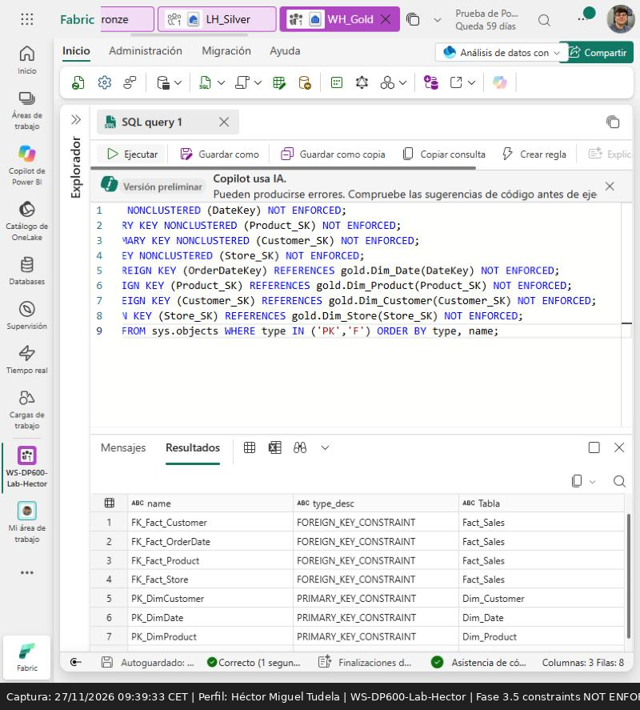
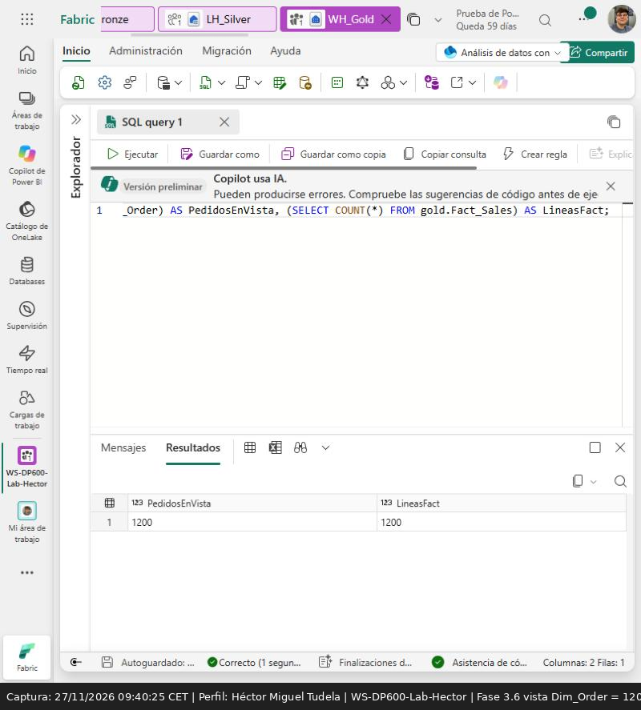

# 03 · Capa Gold: esquema en estrella en `WH_Gold`

Esquema `gold`: `Dim_Date` (1462 filas), `Dim_Product` (SCD1), `Dim_Customer` (SCD2 sobre `City`), `Dim_Store`, `Fact_Sales` (grano = línea de pedido). Claves sustitutas, PK/FK `NOT ENFORCED`, dimensión degenerada `OrderNumber` expuesta con la vista `gold.Dim_Order`, y dimensión *role-playing* de fecha (`OrderDateKey` activa, `ShipDateKey` inactiva).

## Pasos y evidencias
### 3.1 DDL

📸 **Captura:** Cinco tablas creadas en el esquema gold.

### 3.2 Dim_Date

📸 **Captura:** Dim_Date con 1462 filas.

### 3.3 Dimensiones

📸 **Captura:** Recuento de filas de las dimensiones (10 / 4 / 7).

### 3.4 Fact_Sales

📸 **Captura:** Fact_Sales con 1200 filas y 0 filas huérfanas en la auditoría.

### 3.5 Constraints

📸 **Captura:** PK/FK definidas como NOT ENFORCED.

### 3.6 Vista Dim_Order

📸 **Captura:** Vista gold.Dim_Order (dimensión degenerada).

## Errores
| # | Error | Causa | Solución |
|---|---|---|---|
| 3 | `Msg 156` al ejecutar `CREATE SCHEMA gold;` en un script con más sentencias | `CREATE SCHEMA/PROCEDURE/VIEW` deben ir solos en su lote | Ejecutar `CREATE SCHEMA` solo y después las tablas por separado |
| 4 | `Msg 15816` con `sys.procedures` | No soportado en modo de procesamiento distribuido | Usar `sys.objects WHERE type='P'` en una consulta independiente |
| 6 | `Msg 207 Invalid column name 'CustomerKey'` | La columna real es `Customer_SK` | Corregir el nombre |
