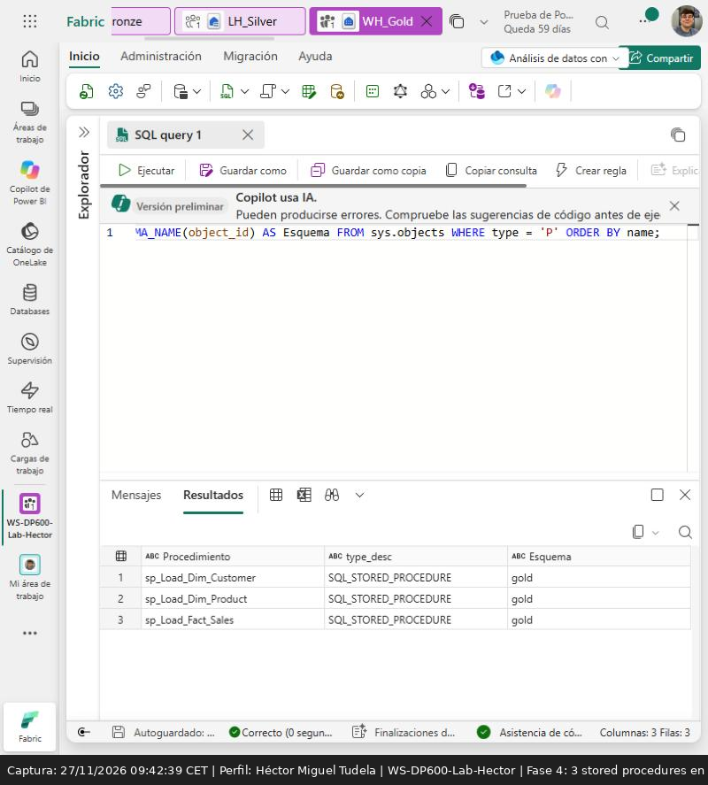
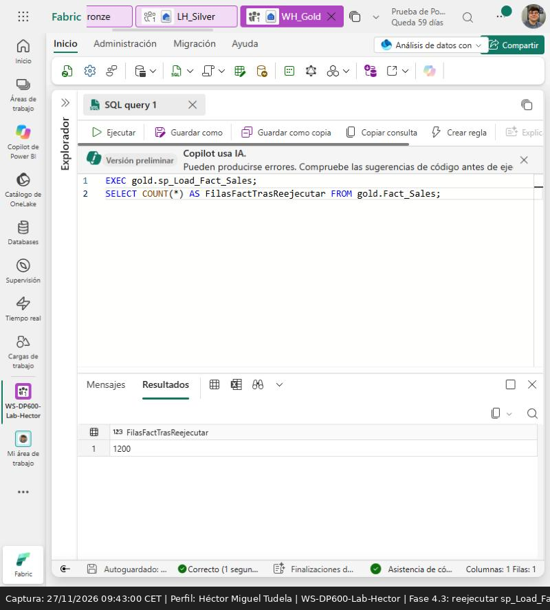
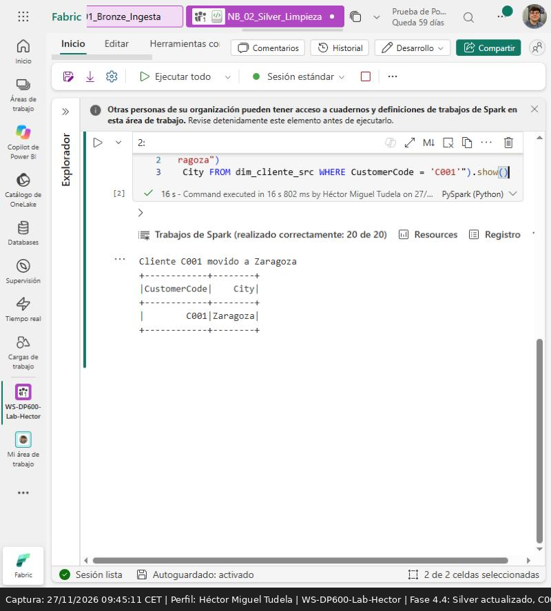
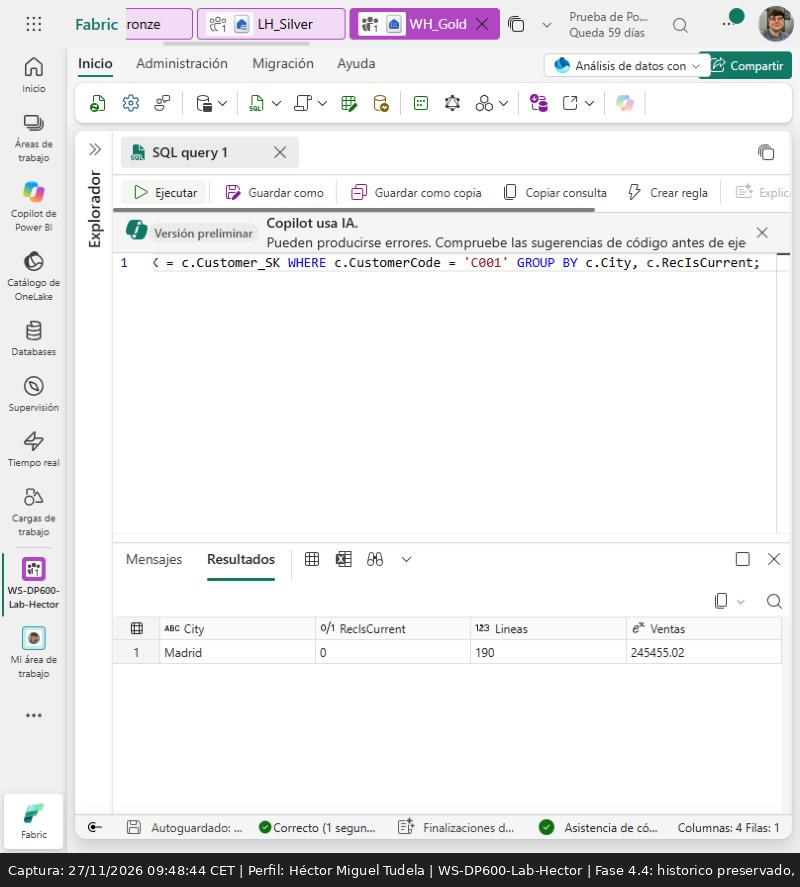

# 04 · Stored procedures de carga (MERGE, SCD2, hechos idempotentes)

- `gold.sp_Load_Dim_Product` — `MERGE` (SCD1).
- `gold.sp_Load_Dim_Customer` — SCD2: caduca la fila vigente e inserta la nueva versión.
- `gold.sp_Load_Fact_Sales` — carga idempotente (re-ejecutarla no duplica).
- Acceso a Silver mediante nombres de tres partes `LH_Silver.dbo.<tabla>`.




📸 **Captura:** Los tres procedimientos en el esquema gold.




📸 **Captura:** Fact_Sales sigue en 1200 filas tras ejecutar dos veces el procedimiento.


## Prueba SCD2 (Punto de control 5)
En `NB_02_Silver_Limpieza` se añadió una segunda celda que mueve al cliente C001 a Zaragoza:
```python
spark.sql("UPDATE dim_cliente_src SET City = 'Zaragoza' WHERE CustomerCode = 'C001'")
```



📸 **Captura:** Notebook mostrando C001 → Zaragoza.


📸 **Captura:** Dim_Customer con dos filas para C001: Madrid (cerrada) y Zaragoza (vigente).




📸 **Captura:** Las 190 líneas históricas siguen asignadas a la fila de Madrid.


## Errores
| # | Error | Causa | Solución |
|---|---|---|---|
| 5 | `EXEC sp_Load_Dim_Customer` afectó 0 filas y el endpoint seguía mostrando Madrid | Retraso de sincronización de metadatos del SQL analytics endpoint tras escribir con Spark (~1–2 min) | Esperar hasta ver Zaragoza en el endpoint y volver a ejecutar el procedimiento |
