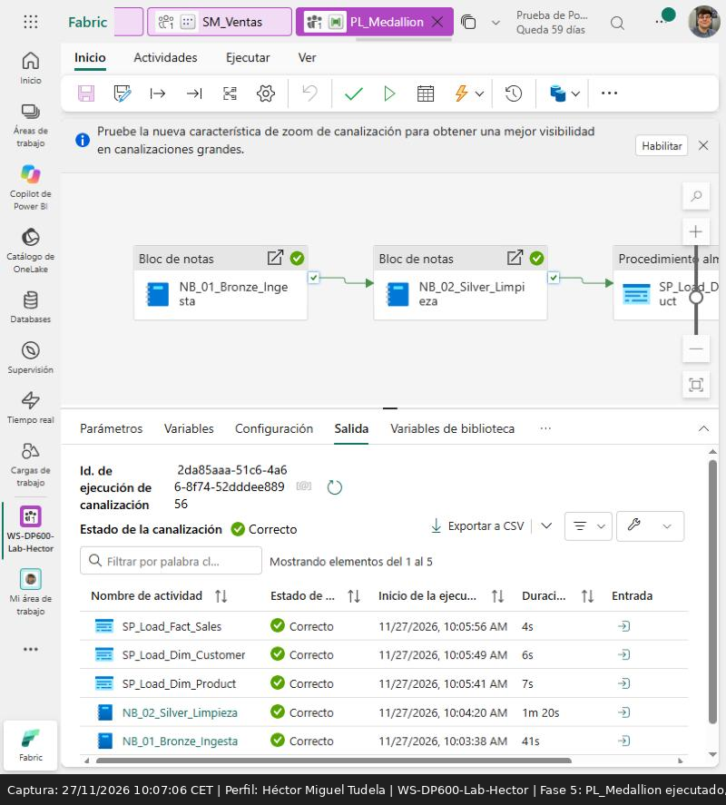
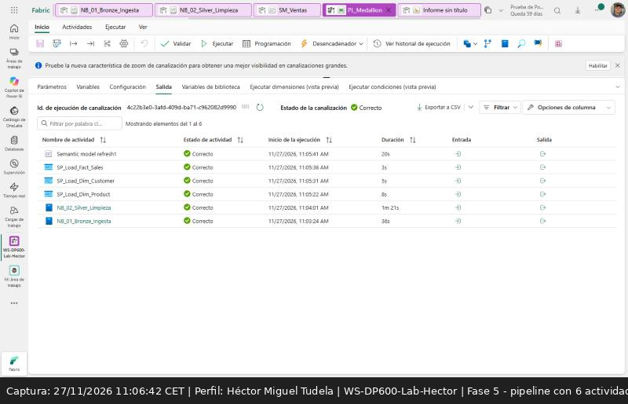
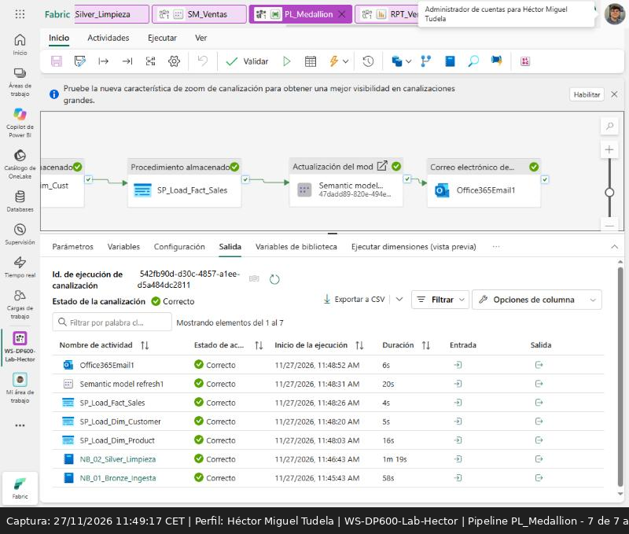
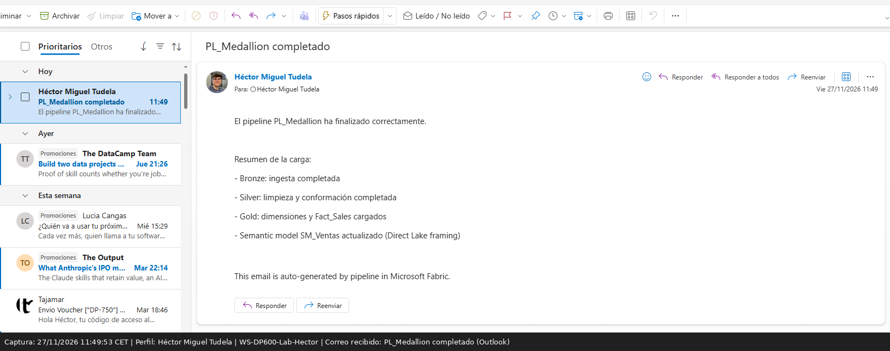

# 05 · Pipeline `PL_Medallion`

Cadena de 5 actividades, cada una con dependencia *On success* de la anterior:
`NB_01` → `NB_02` → `SP_Load_Dim_Product` → `SP_Load_Dim_Customer` → `SP_Load_Fact_Sales`.
Política: timeout 12 h, 0 reintentos, intervalo 30 s.

📸 **Captura:** Ejecución con las 5 actividades en estado Correcto.

## Actividad 6: Semantic model refresh ✅
Añadida y ejecutada: el pipeline completo (6 actividades) termina en Correcto. La conexión `PowerBIDatasets` se creó en *Administrar conexiones y puertas de enlace* (el selector "Obtener datos" del pipeline solo ofrecía bases de datos), con inicio de sesión hecho por el usuario.

📸 **Captura:** salida del pipeline con las 6 actividades en Correcto, fecha, hora y perfil.

## Actividad 7: Outlook ✅
Actividad *Office 365 Outlook* (`Office365Email1`) tras el refresco del modelo: conexión `MicrosoftOutlook hector.miguel` (inicio de sesión hecho por el usuario), destinatario `hector.miguel@tajamar365.com`, asunto "PL_Medallion completado". Ejecución completa: **7 de 7 actividades en Correcto** (NB_01 58 s, NB_02 1 min 19 s, SP_Dim_Product 16 s, SP_Dim_Customer 5 s, SP_Fact_Sales 4 s, refresh 20 s, Outlook 6 s).

📸 **Captura:** salida del pipeline con las 7 actividades en Correcto, fecha, hora y perfil.

**Correo recibido** (11:49, enviado por la actividad Outlook):

📸 **Captura:** bandeja de Outlook con el correo "PL_Medallion completado" y su cuerpo.

Nota (error 18): el campo *Cuerpo* es un editor incrustado (iframe de otro origen); la escritura automática no se registra, así que el texto lo pegó el usuario. La actividad de Teams no se añadió (opcional).

## Errores
| # | Error | Causa | Solución |
|---|---|---|---|
| 12 | Actividad *Stored procedure*: el selector de conexión ("Examinar todo") abre un diálogo en blanco que nunca carga | Fallo de UI en el panel integrado | Editar el JSON del pipeline con `endpoint`/`artifactId`/`workspaceId` del warehouse (de los detalles del ítem). Se perdió trabajo sin guardar tras un reload → guardar con frecuencia |
| 13 | Se añadió por error una actividad *Script* | Icono contiguo a *Stored procedure* | Eliminarla |
| 16 | Conexión de Power BI no creable desde el selector del pipeline | Crearla en Administrar conexiones y puertas de enlace y elegirla en el desplegable |
| 18 | Campo *Cuerpo* de Outlook no admite escritura automatizada | Editor en iframe de otro origen | Pegar el texto manualmente |
| 14 | Capturas con retraso / primer clic no registrado | Latencia del panel | Repetir el clic y esperar antes de capturar |
