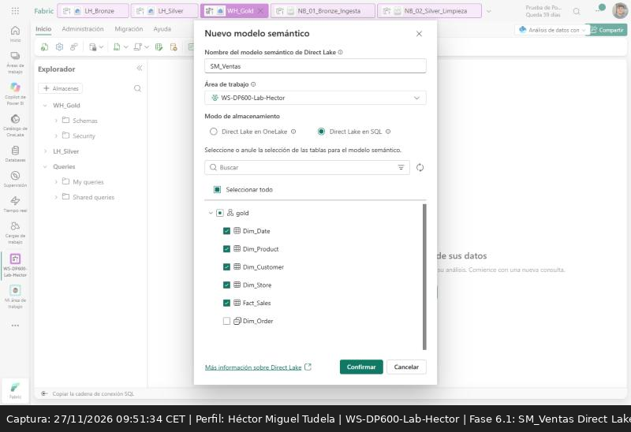
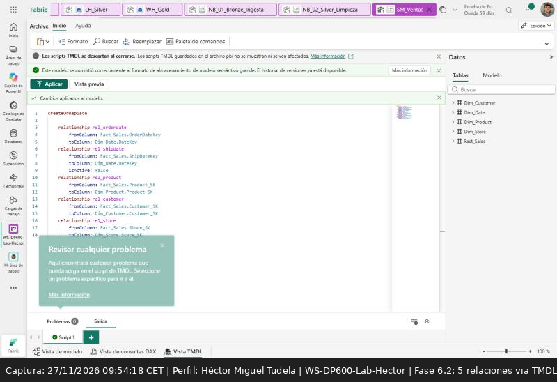
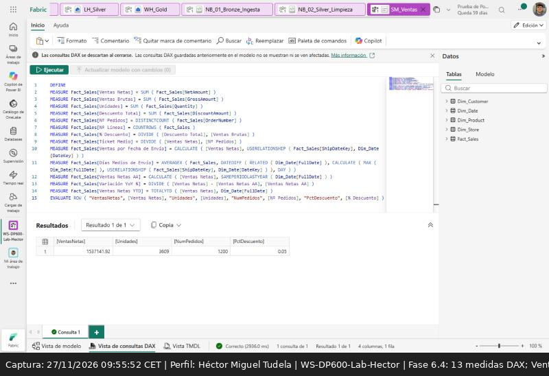
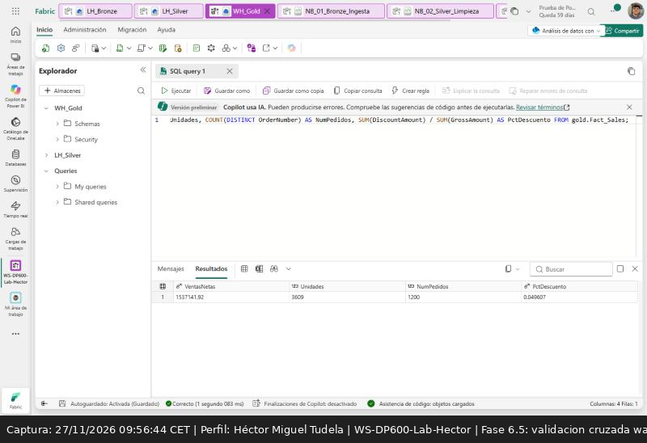
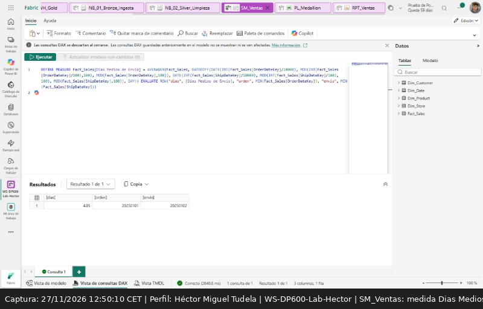
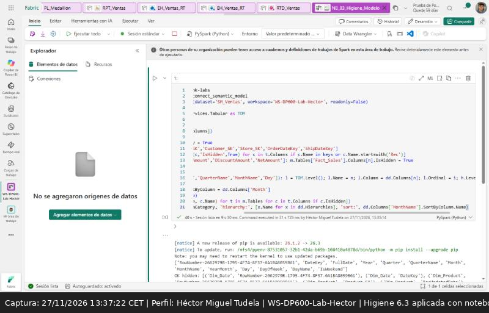

# 06 · Modelo semántico `SM_Ventas` (Direct Lake)

Creado desde `WH_Gold`, vista **TMDL** para relaciones y vista **consultas DAX** para medidas.

Relaciones: `OrderDateKey→Dim_Date` (activa), `ShipDateKey→Dim_Date` (inactiva, role-playing), `Product_SK`, `Customer_SK`, `Store_SK`.

Medidas (13, en `Fact_Sales`): Ventas Netas, Ventas Brutas, Unidades, Descuento Total, Nº Pedidos, Nº Líneas, % Descuento, Ticket Medio, Ventas por Fecha de Envío (`USERELATIONSHIP`), Días Medios de Envío, Ventas Netas AA (`SAMEPERIODLASTYEAR`), Variación YoY %, Ventas Netas YTD (`TOTALYTD`).

📸 **Captura:** Modelo SM_Ventas creado con las cinco tablas.

📸 **Captura:** Script TMDL con las cinco relaciones aplicado.

📸 **Captura:** Consulta DAX validando las medidas.

📸 **Captura:** Punto de control 7: warehouse y modelo coinciden (1 537 141,92 / 3609 / 1200 / ≈0,05).

## Errores
| # | Error | Solución |
|---|---|---|
| 7 | Botones equivocados (Nueva tabla, Descargar proyecto SQL) antes de dar con *Nuevo modelo semántico* | En ventana estrecha se oculta la pestaña Reporting → redimensionar a 1400×900 |
| 8 | `SM_Ventas` abre en *Visualización* (solo lectura) | Cambiar a *Edición* |
| 9 | El editor TMDL compone la sangría | Escribir sangría relativa y usar Shift+Tab |
| 10 | Vista DAX en blanco en la primera carga | Recargar la URL |
| 11 | Tabla `_Medidas` vacía no viable en Direct Lake | Medidas dentro de `Fact_Sales` |

**Higiene (6.3) no realizada:** tabla de fechas, jerarquía Calendario, ocultar claves, ordenar MonthName, formatos.

## Corrección de la medida *Días Medios de Envío*
La medida devolvía 0,00 en el informe. Se redefinió desde la vista de consultas DAX (`DEFINE MEASURE` + *Actualizar modelo con cambios*) calculando `DATEDIFF` entre la fecha de pedido y la de envío, ambas convertidas desde sus claves `yyyymmdd` (`OrderDateKey`, `ShipDateKey`). Resultado: **4,05 días** de media (primer pedido 20250101, envío 20250102).

📸 **Captura:** vista de consultas DAX con el resultado 4,05, fecha, hora y perfil.

Error 19: medida con 0,00 → la definición original no reflejaba la diferencia entre fechas; se recalculó desde las claves.

## Higiene del modelo (pasos 23–27)
Hacerlo a mano en el editor web era muy lento, así que se aplicó de una sola vez con un cuaderno de Fabric (`NB_03_Higiene_Modelo`, código en [`NB_03_Higiene_Modelo.py`](NB_03_Higiene_Modelo.py)) que edita `SM_Ventas` mediante TOM (semantic-link-labs):

| Paso | Acción |
|---|---|
| 23 | `Dim_Date` marcada como tabla de fecha (columna `FullDate`) |
| 24 | Ocultas `DateKey`, `Product_SK`, `Customer_SK`, `Store_SK`, `OrderDateKey`, `ShipDateKey` y todas las `Rec*` |
| 25 | Ocultas `Quantity`, `GrossAmount`, `DiscountAmount`, `NetAmount` del fact |
| 26 | Jerarquía `Calendario` (Year → QuarterName → MonthName → Day) |
| 27 | `MonthName` ordenada por `Month` |

📸 **Captura:** `img/06f-higiene-modelo-notebook.png` — celda ejecutada sin errores (imprime las columnas ocultas).

> Verificación visual de cada propiedad en el editor del modelo: pendiente (el cuaderno terminó sin error y guardó los cambios).
