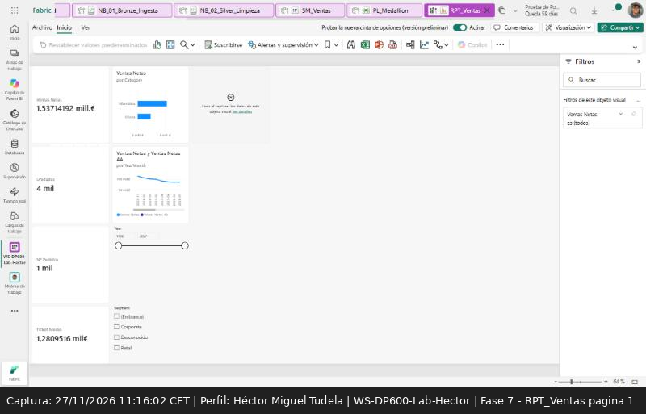
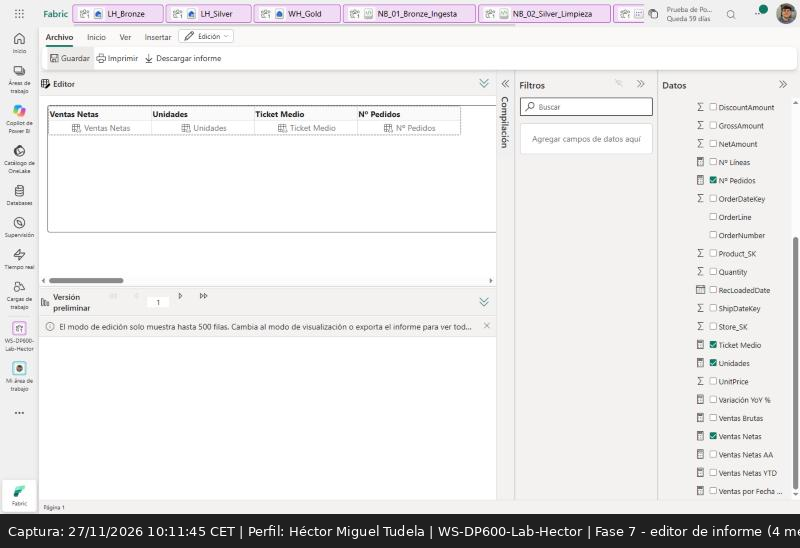
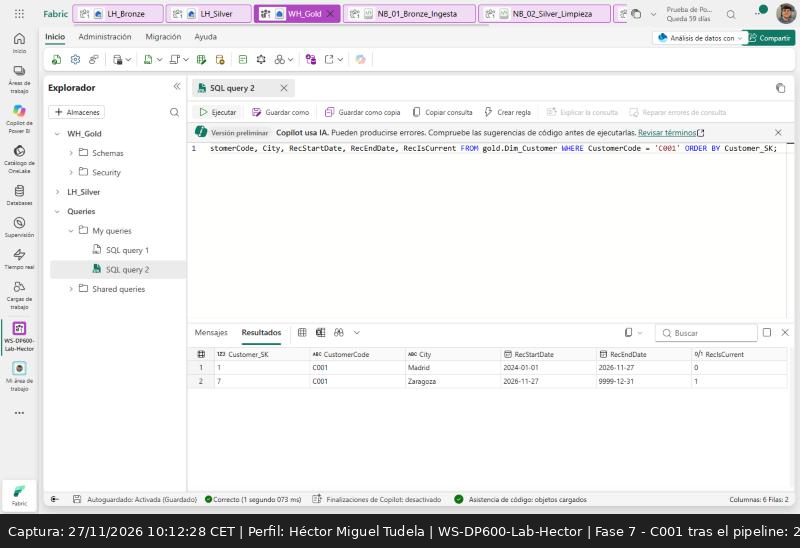
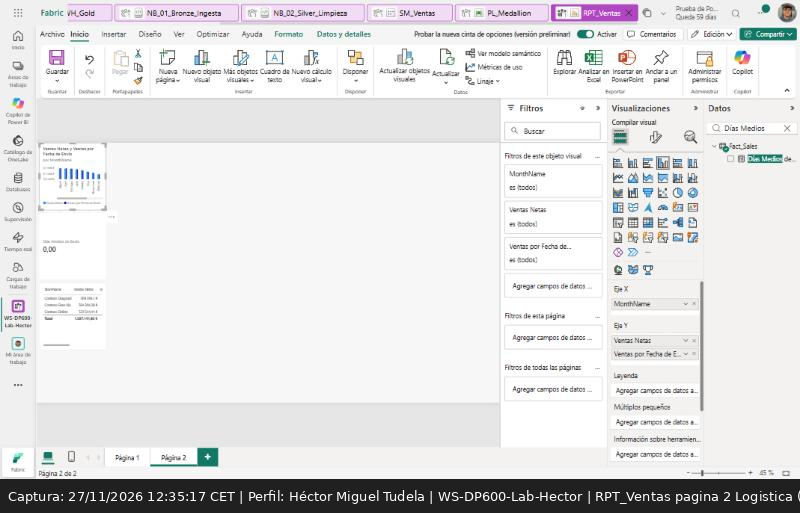
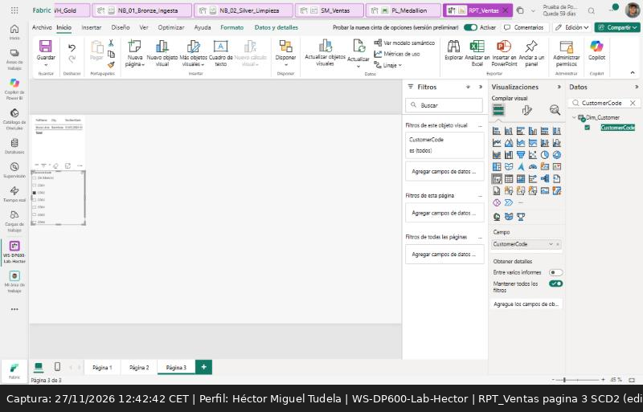
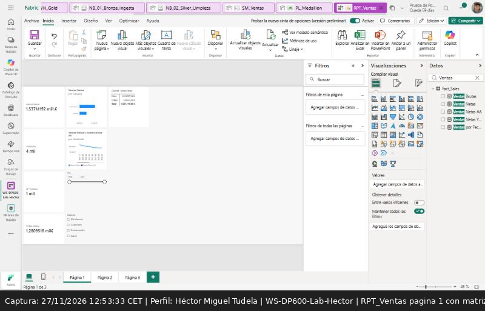

# 07 · Informe `RPT_Ventas`

## Estado: páginas 1 y 2 hechas (2 sin maquetar); página 3 pendiente
- El informe `RPT_Ventas` se creó desde `SM_Ventas` (Archivo → Crear nuevo informe, con clic del usuario: el portal abre una ventana emergente que el panel bloquea a la automatización) y se guardó en `WS-DP600-Lab-Hector`.
- **Página 1 (resumen ejecutivo):** 4 tarjetas (Ventas Netas, Unidades, Nº Pedidos, Ticket Medio), gráfico de líneas `YearMonth` con Ventas Netas y Ventas Netas AA, gráfico de barras por `Category`, segmentaciones de `Year` y `Segment`.
- **Matriz:** creada con `MonthName` en filas y Ventas Netas / Variación YoY % en valores, pero muestra el aviso "no se pueden mostrar los datos" y no se añadió `Channel` en columnas (arrastre fallido). No hay jerarquía Calendario porque la higiene 6.3 no se hizo.
- **Pendiente:** página 2 (logística, role-playing) y página 3 (SCD2) según la sección 7 de la guía.

📸 **Captura:** RPT_Ventas, página 1, con tarjetas, líneas, barras y segmentaciones, fecha, hora y perfil.

## Evidencia de la página 3 (efecto SCD2)
Tras re-ejecutar el pipeline, C001 mantiene **dos filas**: Madrid (histórica, cerrada) y Zaragoza (vigente).

📸 **Captura:** Dim_Customer para C001 con dos filas.

> Pregunta de discusión: para consolidar las ventas de Ana independientemente de la ciudad, agrupar por `CustomerCode` (clave natural estable), no por `City`.

## Error
| # | Error | Solución |
|---|---|---|
| 15 | Ventana emergente de "Crear informe" bloqueada para la automatización | El usuario abre el informe con su propio clic; el lienzo completo sí permitió construir visuales |
| 17 | Matriz sin datos y arrastre de `Channel` a columnas sin efecto | Pendiente |

## Página 2: Logística (construida)
Gráfico de columnas por `MonthName` (Ventas Netas vs Ventas por Fecha de Envío), tarjeta *Días Medios de Envío* y tabla por `StoreName` con las medidas. Total de la tabla ≈ 1 537 141,92, coincidente con el checkpoint.

📸 **Captura:** página 2 del informe en modo edición con los tres objetos visuales, fecha, hora y perfil.

Limitaciones: la tarjeta *Días Medios de Envío* muestra 0,00 (medida a revisar: posible DATEDIFF sobre claves sin diferencia) y los visuales quedaron pequeños y sin maquetar por el retraso del panel (~30 s por acción).

## Página 3: SCD2 (construida)
Tabla con `FullName`, `City`, `RecStartDate`, `RecEndDate`, `RecIsCurrent`, `Ventas Netas` y `Nº Pedidos` + segmentación por `CustomerCode`. Con **C001** seleccionado la tabla muestra Bruno Lima, Barcelona, versión vigente (`RecIsCurrent = True`, fin 31/12/9999), 292.144,9 € y 235 pedidos (leído del texto de la página).

📸 **Captura:** página 3 con la segmentación C001 y la tabla, fecha, hora y perfil.

Nota: la versión histórica de C001 existe en `Dim_Customer` (2 filas, ver 07b) pero no aparece aquí porque la tabla oculta las filas con medidas en blanco: las ventas quedaron asociadas a la versión vigente.

## Matriz de la página 1 (error 17 resuelto)
La matriz original daba "no se pueden mostrar los datos". Se eliminó y se recreó con `Channel` (Dim_Store) en filas y `Ventas Netas` en valores: Física 1.013.597,48 € + Online 523.544,44 € = **1.537.141,92 €** (coincide con el checkpoint).

📸 **Captura:** página 1 con la matriz nueva, fecha, hora y perfil.

Días Medios de Envío corregida en el modelo (4,05, ver 06-semantic-model).

## Pendientes conocidos
- Maquetación de las páginas 2 y 3 (visuales pequeños) por el retraso del panel.
