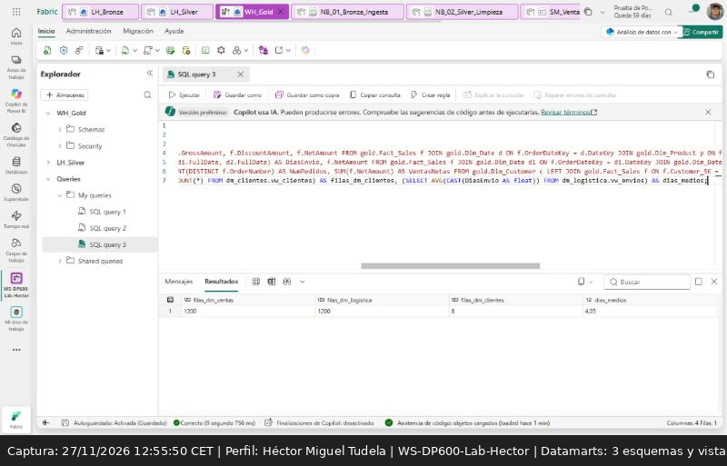

# Opcional · Tres datamarts

**Estado: ✅ ejecutado en Fabric.** Tres datamarts temáticos como esquemas + vistas sobre `WH_Gold` (capa de consumo por área), creados con T-SQL.

| Datamart (esquema) | Vista | Contenido |
|---|---|---|
| `dm_ventas` | `vw_ventas` | Fecha, categoría, tienda, canal, segmento, unidades, importes bruto/descuento/neto |
| `dm_logistica` | `vw_envios` | Fecha de pedido (rol activo) y de envío (rol inactivo), `DiasEnvio`, importe neto |
| `dm_clientes` | `vw_clientes` | Cliente SCD2 (versión, vigencia), nº de pedidos y ventas netas |

## Paso 1 · Crear esquemas y vistas
En `WH_Gold` → *Nueva consulta SQL*. En Fabric `CREATE SCHEMA` y `CREATE VIEW` deben ir **solos en su lote** (Msg 156), por eso se usa SQL dinámico con `EXEC('...')`:

```sql
EXEC('CREATE SCHEMA dm_ventas');
EXEC('CREATE SCHEMA dm_logistica');
EXEC('CREATE SCHEMA dm_clientes');
EXEC('CREATE VIEW dm_logistica.vw_envios AS
  SELECT f.OrderNumber, s.StoreName, d1.FullDate AS FechaPedido, d2.FullDate AS FechaEnvio,
         DATEDIFF(day, d1.FullDate, d2.FullDate) AS DiasEnvio, f.NetAmount
  FROM gold.Fact_Sales f
  JOIN gold.Dim_Date d1 ON f.OrderDateKey = d1.DateKey
  JOIN gold.Dim_Date d2 ON f.ShipDateKey  = d2.DateKey
  JOIN gold.Dim_Store s ON f.Store_SK = s.Store_SK');
-- vw_ventas y vw_clientes análogas (ver script completo en la ejecución)
```

## Paso 2 · Verificar
```sql
SELECT (SELECT COUNT(*) FROM dm_ventas.vw_ventas) AS filas_dm_ventas, ...
```
Resultado: **1200** filas en ventas, **1200** en logística, **8** versiones de cliente y **4,05** días medios de envío (coincide con la medida DAX del modelo).

📸 **Captura:** `img/dm01-tres-datamarts-creados.png` — resultado con 1200 / 1200 / 8 / 4,05.



## Error documentado
| # | Error | Causa | Solución |
|---|---|---|---|
| 20 | Msg 156 al crear esquema/vista en un script | `CREATE SCHEMA/VIEW` exige lote propio | Envolver cada sentencia en `EXEC('...')` |

> Nota: son datamarts "lógicos" (esquemas/vistas en el warehouse), no el elemento *Datamart* de Power BI, que Microsoft sustituye por Warehouse.
