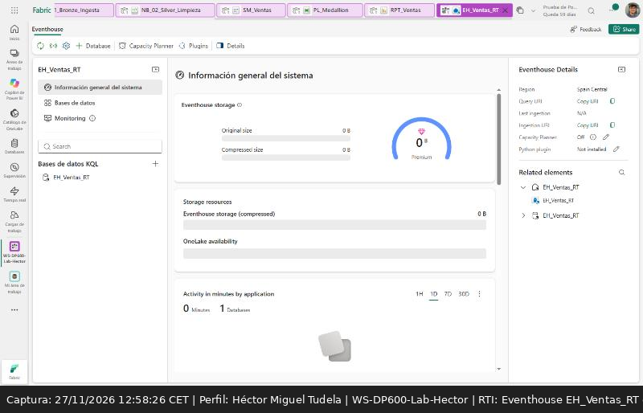
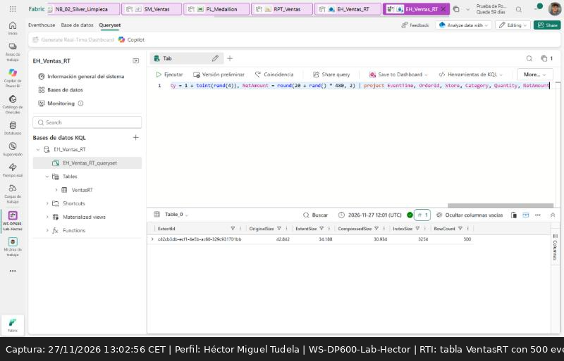
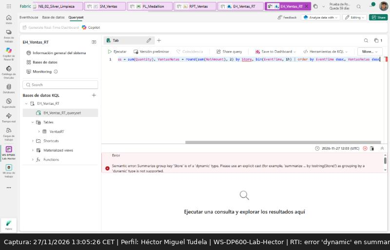
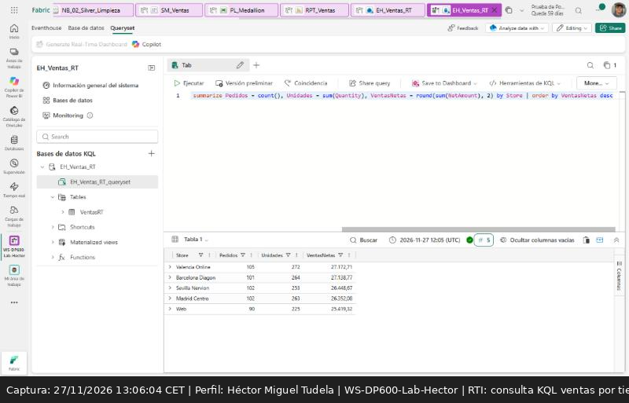
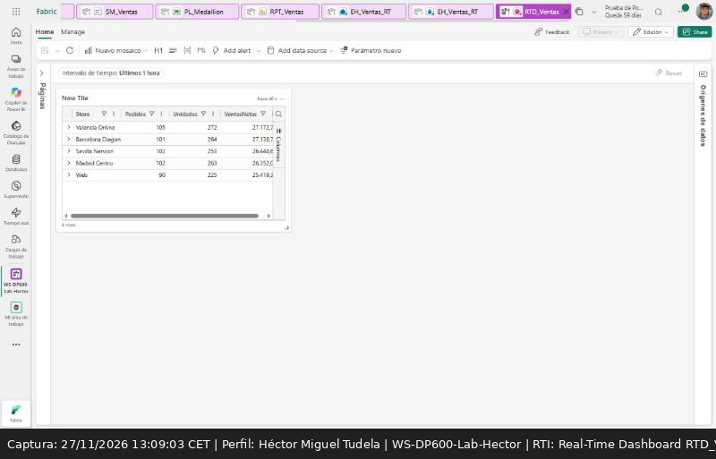

# Opcional · Caso en tiempo real (Real-Time Intelligence)

**Estado: ✅ ejecutado en Fabric (Eventhouse + KQL + Real-Time Dashboard). El Eventstream no se montó** (ver limitación al final).

Arquitectura real implementada: **Eventhouse `EH_Ventas_RT` → base de datos KQL → tabla `VentasRT` → KQL queryset → Real-Time Dashboard `RTD_Ventas`**.

## Paso 1 · Crear el Eventhouse
Workspace → *Nuevo elemento* → **Eventhouse** → nombre `EH_Ventas_RT` (crea también la base de datos KQL del mismo nombre y un queryset).

📸 **Captura:** `img/rt01-eventhouse-creado.png` — Eventhouse con su base de datos KQL.



## Paso 2 · Generar y cargar 500 eventos de venta
Como no hay un emisor externo de ventas, se simulan eventos con KQL (un pedido por minuto durante ~8 h) y se ingieren en la tabla:

```kql
.set-or-append VentasRT <| range i from 1 to 500 step 1
| extend EventTime = ago(1m * (500 - i)), OrderId = strcat("RT-", tostring(10000 + i)),
  Store = pack_array("Madrid Centro","Barcelona Diagonal","Valencia Online","Sevilla Nervion","Web")[toint(rand(5))],
  Category = pack_array("Bikes","Components","Clothing","Accessories")[toint(rand(4))],
  Quantity = 1 + toint(rand(4)), NetAmount = round(20 + rand() * 480, 2)
| project EventTime, OrderId, Store, Category, Quantity, NetAmount
```
📸 **Captura:** `img/rt02-tabla-ventasrt-500-eventos.png` — resultado con `RowCount = 500` y la tabla `VentasRT` en el explorador.



## Paso 3 · Consultar con KQL (y error encontrado)
Primer intento (falla):
```kql
VentasRT | summarize Pedidos = count() by Store, bin(EventTime, 1h)
```
📸 **Captura (error):** `img/rt03-error-dynamic-store.png`



| # | Error | Causa | Solución |
|---|---|---|---|
| 21 | *Summarize group key 'Store' is of a 'dynamic' type* | Indexar `pack_array(...)[n]` devuelve `dynamic`, y la columna se creó así | Convertir con `tostring()` antes de agrupar (o declarar el tipo al crear la tabla) |

Consulta corregida:
```kql
VentasRT
| extend Store = tostring(Store), Category = tostring(Category)
| summarize Pedidos = count(), Unidades = sum(Quantity), VentasNetas = round(sum(NetAmount), 2) by Store
| order by VentasNetas desc
```
Resultado: 5 tiendas, ~500 pedidos en total (Valencia Online lidera con ≈27.173 €).

📸 **Captura:** `img/rt04-consulta-kql-ventas-por-tienda.png`



## Paso 4 · Real-Time Dashboard
En el queryset: *Save to Dashboard → To a new Dashboard* → `RTD_Ventas`. El mosaico queda enlazado a la consulta y al intervalo "Últimas 1 hora" (con *auto refresh* configurable).

📸 **Captura:** `img/rt05-real-time-dashboard-rtd-ventas.png`



## Limitación (honesta)
- **No se montó el Eventstream**: el flujo es "tiempo real simulado" por ingesta KQL, no streaming continuo. Para streaming real bastaría añadir un Eventstream (fuente de ejemplo o Custom endpoint) con destino `VentasRT`; la tabla y el dashboard no cambiarían.
- El mosaico del dashboard es una tabla; falta añadir un gráfico temporal (`render timechart`).
