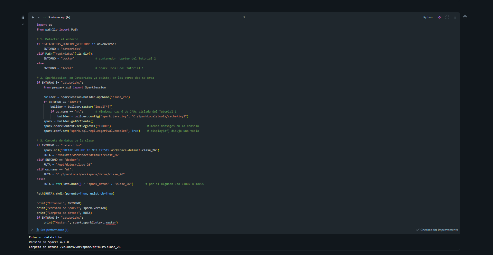
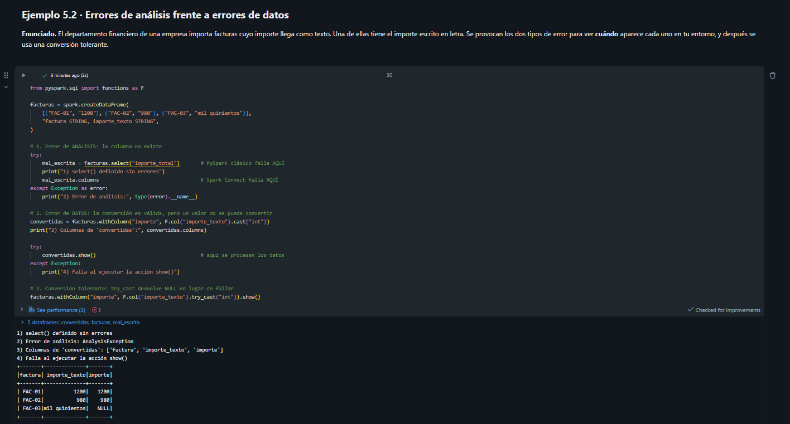
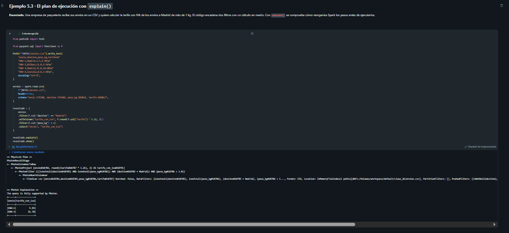
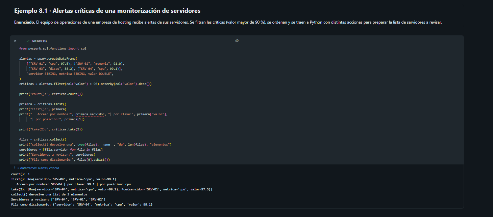
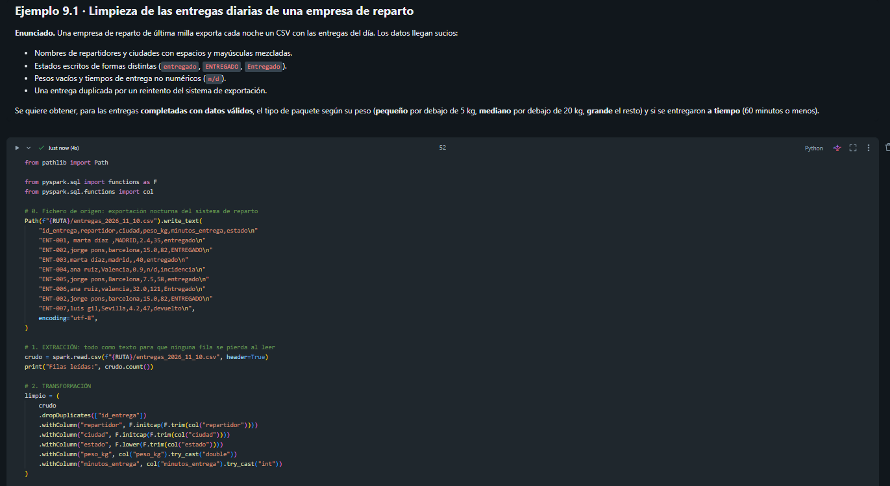
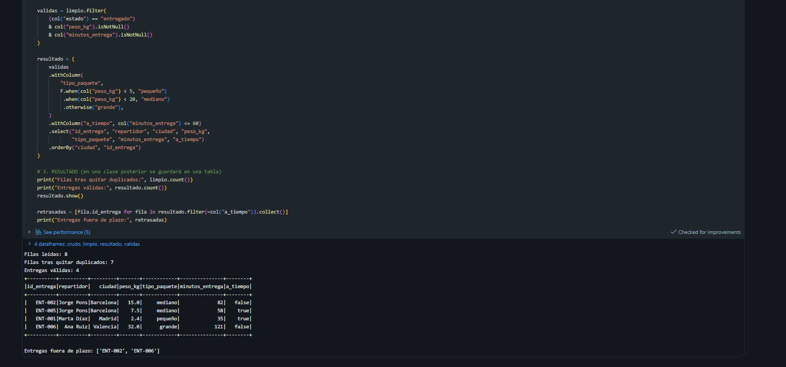

# Práctica 24 · Clase 26: Arquitectura de Spark y primeros DataFrames

**Alumno:** Héctor Miguel Tudela · Máster Big Data & IA (Tajamar)

## Contenido

| Fichero | Descripción |
| --- | --- |
| [`clase_26_pyspark_dataframes.ipynb`](clase_26_pyspark_dataframes.ipynb) | Los 20 ejercicios de la clase, con enunciado, código y salida |
| [`capturas/`](capturas/) | Capturas de la ejecución en Databricks |
| [`datos/`](datos/) | Copia de los ficheros de entrada (CSV y JSON) que usa el notebook |

## Ejercicios

| Nº | Ejercicio | Qué se practica |
| --- | --- | --- |
| 1.1 | La primera celda de Spark | `SparkSession`, `spark.range()`, `show()`, `display()` |
| 2.1 | Particiones de un millón de transacciones | `numPartitions`, `repartition()`, `spark_partition_id()` |
| 2.2 | Ver el trabajo de Spark | Acciones, jobs y Spark UI |
| 3.1 | Catálogo de una tienda de electrónica | `createDataFrame()`, `printSchema()`, `columns`, `dtypes` |
| 3.2 | Esquema inferido frente a explícito | `StructType` y esquema DDL |
| 3.3 | Opciones de `show()` y nulos | `truncate`, `vertical` |
| 4.1 | Ventas de tiendas de café | Leer CSV con `header` e `inferSchema` |
| 4.2 | Lecturas de contadores | `PERMISSIVE`, `DROPMALFORMED`, `FAILFAST` |
| 4.3 | Telemetría de camiones | JSON Lines, `struct` y `array` |
| 5.1 | Medir la pereza | Transformaciones frente a acciones |
| 5.2 | Errores de análisis y de datos | `cast()` y `try_cast()` |
| 5.3 | Plan de ejecución | `explain()` y optimizador Catalyst |
| 6.1 | Seleccionar columnas | `select()`, `col()`, `alias()` |
| 6.2 | Líneas de factura | `withColumn()`, `lit()`, `drop()` |
| 6.3 | Segmentar clientes | `when()` / `otherwise()`, conversión de tipos |
| 7.1 | Transferencias sospechosas | `filter()`, `isin()`, `between()` |
| 7.2 | Leads con datos incompletos | `isNull()`, `isNotNull()` |
| 7.3 | Reservas de hotel | `orderBy()`, `limit()`, `distinct()`, `dropDuplicates()` |
| 8.1 | Alertas de servidores | `count()`, `first()`, `take()`, `collect()` |
| 9.1 | Limpieza de entregas diarias | Pipeline completo: extracción, limpieza y resultado |

## Cómo ejecutarlo

1. Abrir el notebook en un entorno con PySpark 4.1 (Spark local, clúster Docker o Databricks).
2. Ejecutar primero la **celda de configuración**: detecta el entorno y define `spark` y `RUTA`.
3. Ejecutar el resto de celdas en orden. El propio notebook crea los ficheros de entrada en `RUTA`, así que no hay que copiar `datos/` a mano.
4. En local y Docker, la última celda cierra la sesión con `spark.stop()`.

## Entorno de las salidas guardadas

Las salidas guardadas dentro del notebook son de PySpark 4.1.4 con Java 21, en modo local sobre Linux (las pruebas del final son de Databricks). Se han quitado los mensajes de log de Spark (salida de error) para que se lea mejor. Los ejercicios 4.2 y 5.2 provocan errores a propósito y los capturan.

## Ideas clave

- Un DataFrame es inmutable y perezoso: las transformaciones solo construyen un plan y las acciones lo ejecutan.
- En un proceso real conviene definir el esquema en lugar de inferirlo.
- Los valores ausentes se buscan con `isNull()`; comparar con `== None` no devuelve filas.

## Pruebas de ejecución en Databricks

Ejecución en Databricks (Spark 4.2.0) de una selección de ejercicios.

### Configuración del entorno

### Ejercicio 5.2 · Errores de análisis y de datos

### Ejercicio 5.3 · Plan de ejecución

### Ejercicio 8.1 · Alertas de servidores

### Ejercicio 9.1 · Limpieza de entregas diarias (código)

### Ejercicio 9.1 · Limpieza de entregas diarias (resultado)

