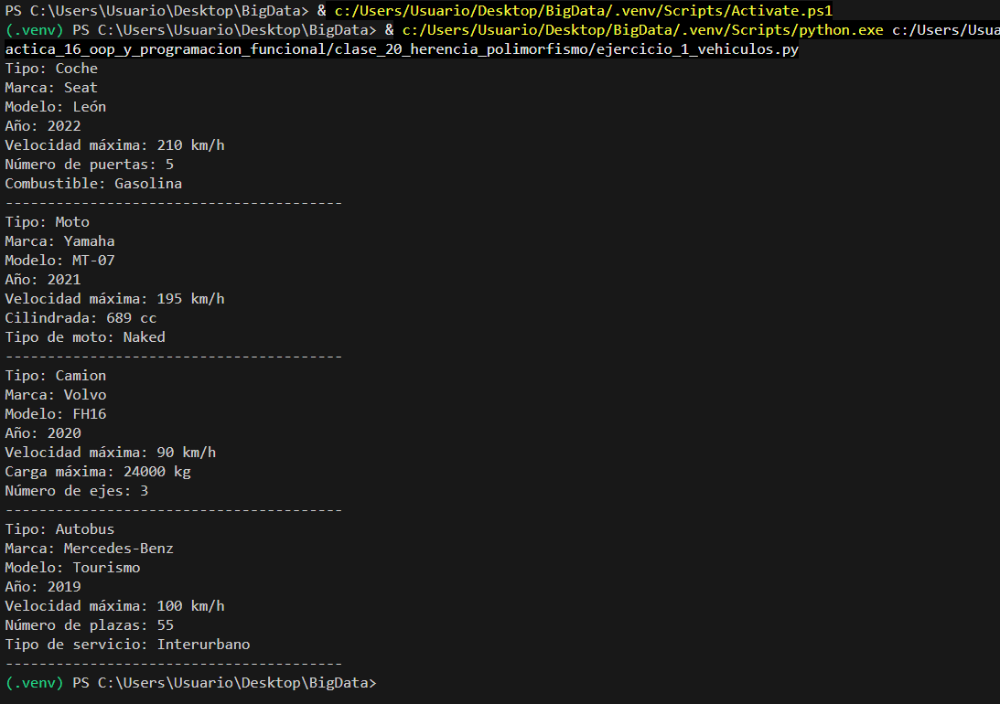
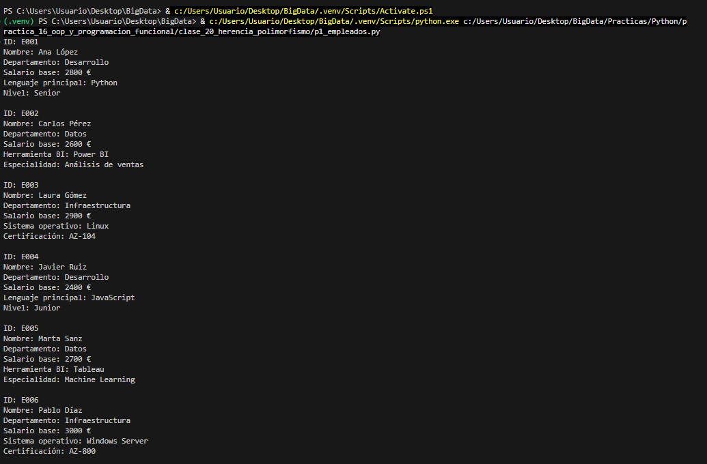
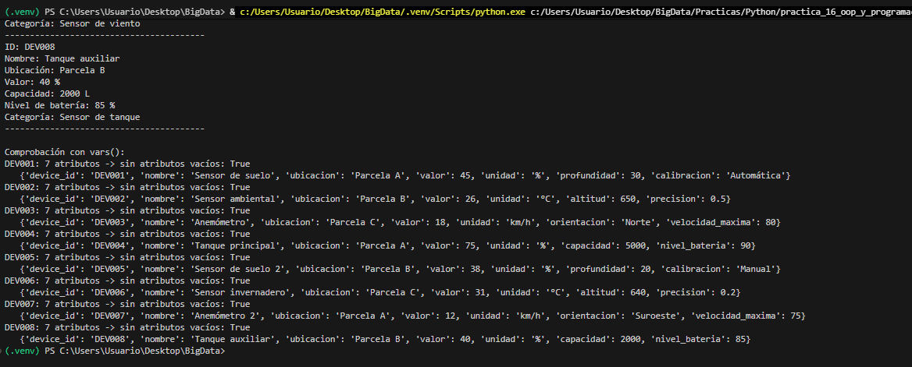
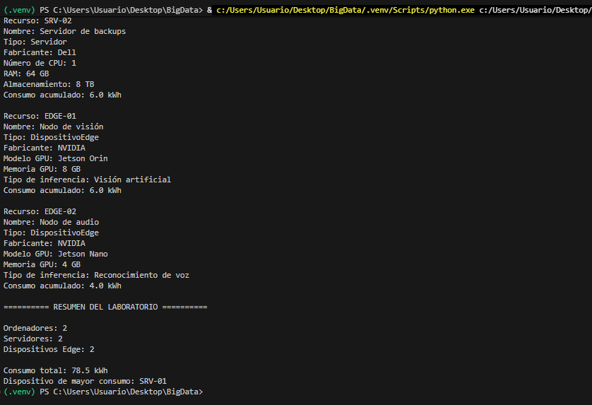
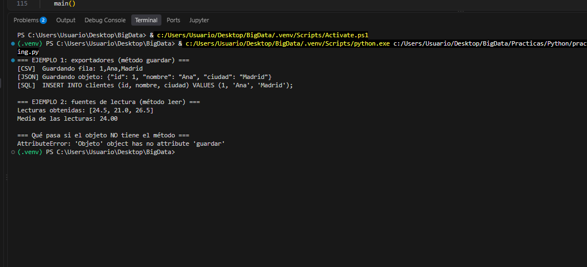
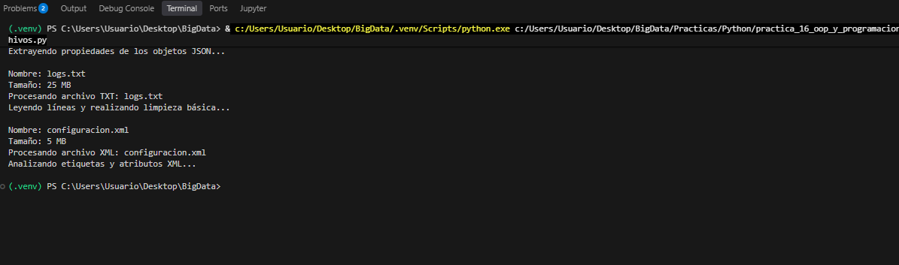
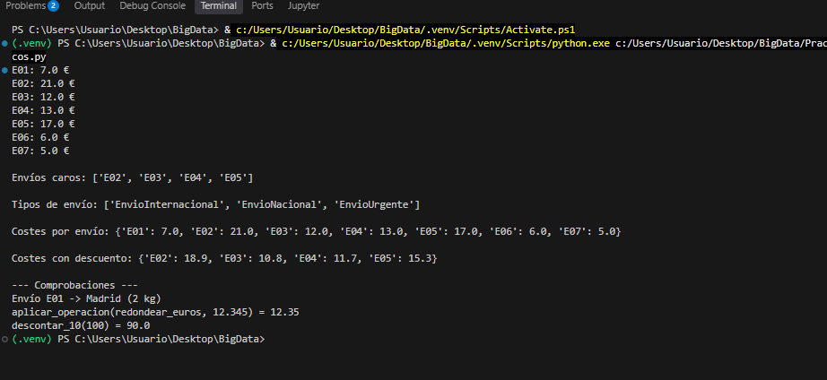
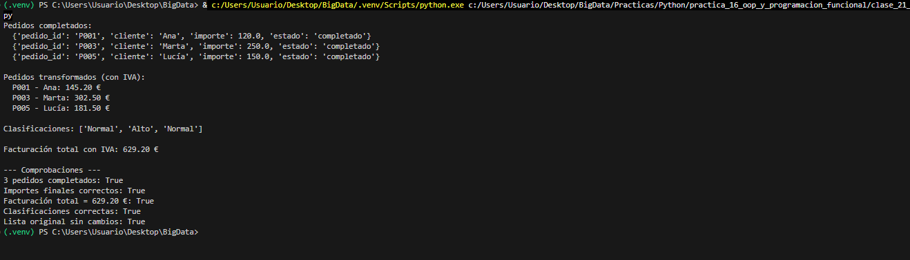
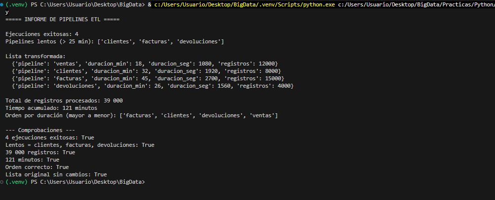

# 🧗🏽‍♂️ Práctica 16 - OOP y Programación Funcional

## 🎯 Objetivo

Afianzar la **programación orientada a objetos** (herencia, sobrescritura de métodos, `super()`, polimorfismo y *duck typing*) y dar el salto a la **programación funcional** en Python (comprehensions, funciones como argumentos, closures, `lambda`, `filter()`, `map()`, `reduce()` y `sorted()`).

- **Clase 20:** herencia y polimorfismo (Ejercicio 1, P1, P2, P3, Ejercicio 2 y P4).
- **Clase 21:** comprehensions y programación funcional (P1, P2 y P3).

## 🧰 Requisitos

- Python 3.10 o superior (probado con Python 3.13).
- VS Code con la extensión de Python (opcional, pero es el entorno de trabajo).
- Sin librerías externas: solo la biblioteca estándar (`json` y `functools.reduce`).

## 📁 Estructura de carpetas

```plain text
practica_16_oop_y_programacion_funcional/
├── README.md
├── clase_20_herencia_polimorfismo/
│   ├── ejercicio_1_vehiculos.py
│   ├── p1_empleados.py
│   ├── p2_iot.py
│   ├── p3_recursos_lab.py
│   ├── ejercicio_2_duck_typing.py
│   └── p4_procesamiento_archivos.py
└── clase_21_comprehensions_funcional/
    ├── p1_envios_logisticos.py
    ├── p2_pedidos_tienda.py
    └── p3_pipelines_etl.py
```

Cada `.py` incluye al principio el **enunciado completo del profesor** y debajo la solución con comentarios en español.

## 🚀 Cómo ejecutar (pasos)

1. Abre la carpeta `BigData/Practicas/practica_16_oop_y_programacion_funcional` en VS Code.
2. Abre una terminal integrada (`Ctrl + ñ`) y comprueba la versión de Python con `python --version`.
3. Ejecuta cada ejercicio con `python <carpeta>/<archivo>.py` (por ejemplo `python clase_20_herencia_polimorfismo/p1_empleados.py`).

---

# 📘 Clase 20: Herencia y polimorfismo

## Ejercicio 1. Jerarquía de vehículos

**Qué se pide:** una superclase `Vehiculo` y subclases `Coche`, `Moto`, `Camion` y `Autobus` con atributos adicionales; un objeto de cada una mostrado por pantalla.

**Código relevante:**

```python
class Vehiculo:
    def __init__(self, marca, modelo, anio, velocidad_max_kmh):
        self.marca = marca
        ...

class Coche(Vehiculo):
    def __init__(self, marca, modelo, anio, velocidad_max_kmh, num_puertas, combustible):
        super().__init__(marca, modelo, anio, velocidad_max_kmh)  # reutiliza la superclase
        self.num_puertas = num_puertas
        self.combustible = combustible

    def mostrar_informacion(self):
        super().mostrar_informacion()  # parte común
        print(f"Número de puertas: {self.num_puertas}")  # parte específica
```

**Resultado (extracto):**

```plain text
Tipo: Coche
Marca: Seat
Modelo: León
Año: 2022
Velocidad máxima: 210 km/h
Número de puertas: 5
Combustible: Gasolina
----------------------------------------
Tipo: Moto
Marca: Yamaha
Modelo: MT-07
Año: 2021
Velocidad máxima: 195 km/h
Cilindrada: 689 cc
Tipo de moto: Naked
----------------------------------------
...
```



**Conceptos:** herencia simple, `super().__init__()`, sobrescritura de `mostrar_informacion()`.

---

## Ejercicio P1. Sistema de gestión de empleados

**Qué se pide:** superclase `Empleado` y subclases `Desarrollador`, `AnalistaDatos` y `AdministradorSistemas`; seis objetos en la lista `empleados` y su impresión.

**Código relevante:**

```python
class Desarrollador(Empleado):
    def __init__(self, id_empleado, nombre, salario_base, departamento,
                 lenguaje_principal, nivel):
        super().__init__(id_empleado, nombre, salario_base, departamento)
        self.lenguaje_principal = lenguaje_principal
        self.nivel = nivel

    def mostrar_informacion(self):
        super().mostrar_informacion()
        print(f"Lenguaje principal: {self.lenguaje_principal}")
        print(f"Nivel: {self.nivel}")

for empleado in empleados:
    empleado.mostrar_informacion()   # cada objeto ejecuta SU versión
```



**Conceptos:** no repetir código común (DRY), sobrescritura, polimorfismo al recorrer una lista mixta.

---

## Ejercicio P2. Refactorización de dispositivos IoT

**Qué se pide:** sustituir la clase "todo en uno" (14 parámetros y cadena de `if/elif`) por `DispositivoIoT` + `SensorHumedad`, `SensorTemperatura`, `SensorViento` y `SensorTanque`; ocho objetos, `isinstance()` y `vars()`.

**Código relevante:**

```python
class SensorHumedad(DispositivoIoT):
    def __init__(self, device_id, nombre, ubicacion, valor, unidad,
                 profundidad, calibracion):
        super().__init__(device_id, nombre, ubicacion, valor, unidad)
        self.profundidad = profundidad
        self.calibracion = calibracion

def obtener_categoria(dispositivo):
    if isinstance(dispositivo, SensorHumedad):
        return "Sensor de humedad"
    ...

# Comprobación de que no hay atributos innecesarios
atributos = vars(dispositivo)
sin_none = all(valor is not None for valor in atributos.values())
```



**Conceptos:** refactorización de una clase "todo en uno" a una jerarquía, eliminación de `if/elif` por tipo, `isinstance()`, `vars()`.

---

## Ejercicio P3. Recursos de un laboratorio de Big Data

**Qué se pide:** `RecursoComputacional` con `calcular_consumo()` y subclases `Ordenador`, `Servidor` y `DispositivoEdge`; consumo individual y total, recuento con `isinstance()` y dispositivo de mayor consumo.

**Código relevante:**

```python
def calcular_consumo(self):
    """Consumo acumulado en kWh = (potencia en W * horas) / 1000."""
    return (self.potencia_w * self.horas_uso) / 1000

num_servidores = sum(1 for r in recursos if isinstance(r, Servidor))
```



**Conceptos:** método heredado que no se sobrescribe (`calcular_consumo()`), acumuladores, búsqueda del máximo, `isinstance()`.

---

## Ejercicio 2. Duck typing (2 ejemplos)

**Qué se pide:** dos ejemplos de polimorfismo mediante *duck typing*, es decir, sin herencia común.

- **Ejemplo 1:** `ExportadorCSV`, `ExportadorJSON` y `BaseDatos` comparten solo el método `guardar()`; la función `exportar(destino, datos)` funciona con cualquiera.
- **Ejemplo 2:** `SensorReal`, `SimuladorSensor` y `ArchivoLecturas` comparten solo `leer()`; `calcular_media(fuentes)` las trata igual.
- Se añade una prueba con un objeto que **no** tiene el método, para ver el `AttributeError`.



**Conceptos:** duck typing, polimorfismo sin herencia, `try/except AttributeError`.

---

## Ejercicio P4. Polimorfismo en un sistema de procesamiento de datos

**Qué se pide:** `ArchivoDatos` y subclases `ArchivoCSV`, `ArchivoJSON`, `ArchivoTXT`, **sin `super()`, sin herencia múltiple y sin `if/elif/isinstance/type`**; función `ejecutar_procesamiento()`; ampliación con `ArchivoXML` sin tocar la función.

**Código relevante:**

```python
class ArchivoCSV(ArchivoDatos):   # sin __init__: hereda el de ArchivoDatos
    def procesar(self):
        print(f"Procesando archivo CSV: {self.nombre}")
        print("Leyendo registros separados por comas...")

def ejecutar_procesamiento(archivo):
    archivo.mostrar_informacion()
    archivo.procesar()          # <- aquí está el polimorfismo

class ArchivoXML(ArchivoDatos):  # se añade sin modificar nada más
    def procesar(self):
        ...
```



### Preguntas

**20. ¿Qué métodos heredan las clases hijas de `ArchivoDatos`?**
El constructor `__init__` (y con él los atributos `nombre` y `tamano`), `mostrar_informacion()` y `procesar()`. Este último lo heredan pero lo sobrescriben.

**21. ¿Por qué las subclases sobrescriben `procesar()`?**
Porque cada formato se procesa de forma distinta. La versión genérica solo es un comportamiento por defecto.

**22. ¿Dónde se aplica exactamente el polimorfismo?**
En `archivo.procesar()` dentro de `ejecutar_procesamiento()`: la llamada es siempre la misma, pero se ejecuta la versión de la clase real del objeto.

**23. ¿Por qué no necesitamos `if` o `elif`?**
Porque es el propio objeto quien sabe cómo procesarse. Python elige la versión del método en tiempo de ejecución según la clase del objeto (enlace dinámico).

**24. ¿Qué ventaja ofrece al incorporar `ArchivoXML`?**
Solo hay que crear la nueva clase y añadir el objeto a la lista; no se modifica `ejecutar_procesamiento()` ni el bucle (principio abierto/cerrado: abierto a ampliar, cerrado a modificar).

**Conceptos:** herencia simple sin `super()`, sobrescritura, polimorfismo, principio abierto/cerrado.

---

# 📗 Clase 21: Comprehensions y programación funcional

## Ejercicio propuesto P1. Análisis de envíos logísticos

**Qué se pide:** jerarquía `Envio` → `EnvioNacional`/`EnvioInternacional`/`EnvioUrgente` con `super().calcular_coste()`; comprehensions (lista, conjunto y dos diccionarios); `aplicar_operacion()`, `redondear_euros()` y `crear_descuento()`; informe final. Sin `map()`/`filter()`/`reduce()`.

**Código relevante:**

```python
class EnvioNacional(Envio):
    def calcular_coste(self):
        return super().calcular_coste() + 3

envios_caros = [e.envio_id for e in envios if e.calcular_coste() >= 12]
tipos_envio = {type(e).__name__ for e in envios}
costes_por_envio = {e.envio_id: e.calcular_coste() for e in envios}

def crear_descuento(porcentaje):
    def aplicar_descuento(importe):
        return importe * (1 - porcentaje / 100)
    return aplicar_descuento

costes_con_descuento = {
    envio_id: aplicar_operacion(redondear_euros, aplicar_operacion(descontar_10, coste))
    for envio_id, coste in costes_por_envio.items() if coste >= 12
}
```



**Conceptos:** polimorfismo con `super()`, list/set/dict comprehensions, funciones como argumentos, closures (funciones que devuelven funciones).

---

## Ejercicio propuesto P2. Procesamiento de pedidos de una tienda online

**Qué se pide:** con `lambda`, `filter()`, `map()` y `reduce()`: seleccionar pedidos completados, añadir 21 % de IVA, sumar la facturación y clasificar los importes.

**Código relevante:**

```python
completados = list(filter(lambda p: p["estado"] == "completado", pedidos))

pedidos_con_iva = list(map(
    lambda p: {"pedido_id": p["pedido_id"], "cliente": p["cliente"],
               "importe_final": round(p["importe"] * (1 + IVA), 2)},
    completados))

facturacion_total = reduce(lambda acc, p: acc + p["importe_final"], pedidos_con_iva, 0)
```



**Conceptos:** `lambda`, `filter()`, `map()`, `reduce()` (de `functools`), inmutabilidad de los datos originales.

---

## Ejercicio propuesto P3. Análisis de ejecuciones de pipelines de datos

**Qué se pide:** con `lambda`, `filter()` (x2), `map()`, `reduce()` (x2) y `sorted()`: ejecuciones correctas y lentas, conversión a segundos, totales y ordenación por duración.

**Código relevante:**

```python
exitosas = list(filter(lambda e: e["estado"] == "ok", ejecuciones))
lentas = list(filter(lambda e: e["duracion_min"] > 25, exitosas))
total_registros = reduce(lambda acc, e: acc + e["registros"], exitosas, 0)
ordenadas = sorted(exitosas, key=lambda e: e["duracion_min"], reverse=True)
```



**Conceptos:** `filter()` encadenado, `map()` que crea diccionarios nuevos, `reduce()` con acumulador inicial, `sorted()` con `key=lambda`.

---

# ✅ Conclusiones

- La **herencia** evita repetir atributos y métodos comunes: la superclase guarda lo compartido y cada subclase añade solo lo suyo (P2 es el mejor ejemplo, de 14 parámetros con `None` a cinco clases limpias).
- El **polimorfismo** elimina cadenas de `if/elif`: la misma llamada (`procesar()`, `calcular_coste()`) ejecuta la versión de cada clase, y añadir una nueva (XML) no obliga a tocar el resto del código.
- El **duck typing** va un paso más allá: no hace falta ni herencia, basta con que el objeto tenga el método.
- Las **comprehensions** resumen en una línea lo que con bucles ocuparía cuatro o cinco, y los **closures** permiten crear funciones configurables (`crear_descuento(10)`).
- `filter()`, `map()` y `reduce()` con `lambda` expresan filtrar, transformar y acumular sin modificar los datos originales. En proyectos reales con tablas grandes, `pandas` (`df[df["estado"] == "ok"]`, `.assign()`, `.sum()`) haría lo mismo de forma más eficiente, pero aquí lo importante era entender el mecanismo.
