# Clase 15: Stored Procedures y Triggers
Base de datos: `SonoraDB`

## Índice

**Parte 01 · Stored Procedures (Ejercicios resueltos)**
1. [Ejercicio 1](#ejercicio-1)
2. [Ejercicio 2](#ejercicio-2)
3. [Ejercicio 3](#ejercicio-3)
4. [Ejercicio 4](#ejercicio-4)
5. [Ejercicio 5](#ejercicio-5)
6. [Ejercicio 6](#ejercicio-6)
7. [Ejercicio 7](#ejercicio-7)
8. [Ejercicio 8](#ejercicio-8)
9. [Ejercicio 9](#ejercicio-9)
10. [Ejercicio 10](#ejercicio-10)
11. [Ejercicio 11](#ejercicio-11)
12. [Ejercicio 12](#ejercicio-12)
13. [Ejercicio 13](#ejercicio-13)

**Parte 02 · Triggers (Ejercicios resueltos)**
1. [Ejercicio 1](#ejercicio-1-t)
2. [Ejercicio 2](#ejercicio-2-t)
3. [Ejercicio 3](#ejercicio-3-t)
4. [Ejercicio 4](#ejercicio-4-t)
5. [Ejercicio 5](#ejercicio-5-t)
6. [Ejercicio 6](#ejercicio-6-t)
7. [Ejercicio 7](#ejercicio-7-t)
8. [Ejercicio 8](#ejercicio-8-t)
9. [Ejercicio 9](#ejercicio-9-t)
10. [Ejercicio 10](#ejercicio-10-t)
11. [Ejercicio 11](#ejercicio-11-t)
12. [Ejercicio 12](#ejercicio-12-t)

---

# Parte 01 · Stored Procedures (Ejercicios resueltos)

## Ejercicio 1

```sql
CREATE OR ALTER PROCEDURE dbo.usp_usuarios_por_plan
AS
BEGIN
    SET NOCOUNT ON;

    SELECT plan_suscripcion, COUNT(*) AS usuarios
    FROM dbo.usuarios
    GROUP BY plan_suscripcion
    ORDER BY usuarios DESC;
END;
GO

EXEC dbo.usp_usuarios_por_plan;
```

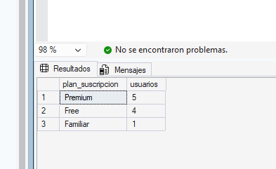
---

## Ejercicio 2

```sql
CREATE OR ALTER PROCEDURE dbo.usp_canciones_de_artista
    @artista nvarchar(100)
AS
BEGIN
    SET NOCOUNT ON;

    SELECT c.titulo, c.duracion_seg, c.fecha_lanzamiento
    FROM dbo.canciones AS c
    JOIN dbo.artistas AS a ON a.artista_id = c.artista_id
    WHERE a.nombre = @artista
    ORDER BY c.fecha_lanzamiento;
END;
GO

EXEC dbo.usp_canciones_de_artista @artista = N'MC Brisa';
EXEC dbo.usp_canciones_de_artista @artista = N'Los Planetas';
```

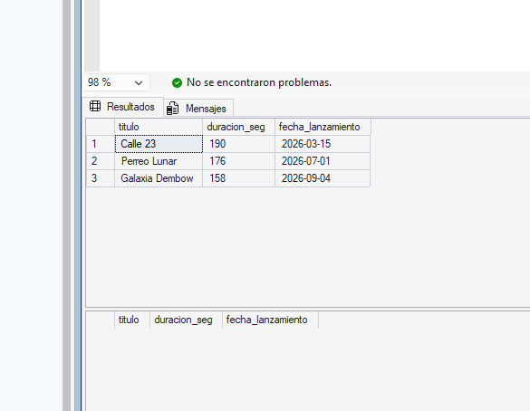

**Explicación:** Al buscar a `Los Planetas`, el procedimiento no devuelve ningún error, simplemente devuelve una tabla vacía. Desde fuera, no es posible distinguir si el artista no existe en la base de datos o si existe pero aún no tiene canciones cargadas en el catálogo.

---

## Ejercicio 3

- **a)** Da error (`Msg 201`). Falta el parámetro obligatorio `@hasta`.
- **b)** Funciona correctamente. Al llamar por nombre (`@param = valor`), el orden de los parámetros no importa.
- **c)** Da error de conversión de tipo (`Msg 245`). Se están pasando por posición y SQL Server intenta asignar `N'Free'` al parámetro `@top` que es de tipo `int`.
- **d)** Da error sintáctico (`Msg 119`). Después de pasar el primer parámetro por nombre (`@desde =`), no se puede volver a pasar parámetros por posición.
- **e)** Funciona sin error, pero devuelve **0 filas**. Pasa las fechas correctas por posición pero al revés, haciendo que la condición `WHERE fecha_hora >= '2026-09-23' AND fecha_hora < '2026-09-16'` sea imposible.

---

## Ejercicio 4

```sql
CREATE OR ALTER PROCEDURE dbo.usp_altas_desde
    @desde date,
    @pais char(2) = NULL
AS
BEGIN
    SET NOCOUNT ON;

    SELECT nombre_usuario, pais, plan_suscripcion, fecha_alta
    FROM dbo.usuarios
    WHERE fecha_alta >= @desde
      AND (@pais IS NULL OR pais = @pais)
    ORDER BY fecha_alta, nombre_usuario;
END;
GO

EXEC dbo.usp_altas_desde @desde = '2026-01-01';
EXEC dbo.usp_altas_desde @desde = '2026-01-01', @pais = 'ES';
```

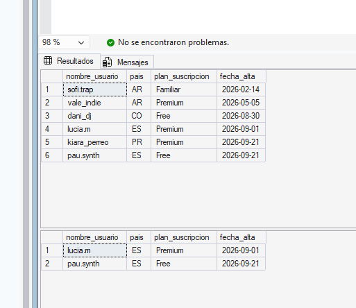

---

## Ejercicio 5

```sql
CREATE OR ALTER PROCEDURE dbo.usp_actividad_usuario
    @nombre_usuario nvarchar(50),
    @reproducciones int OUTPUT,
    @minutos decimal(8,1) OUTPUT
AS
BEGIN
    SET NOCOUNT ON;

    DECLARE @usuario_id int = (SELECT usuario_id FROM dbo.usuarios WHERE nombre_usuario = @nombre_usuario);

    SELECT @reproducciones = COUNT(*),
           @minutos = CAST(COALESCE(SUM(segundos_escuchados), 0) / 60.0 AS decimal(8,1))
    FROM dbo.reproducciones
    WHERE usuario_id = @usuario_id
      AND tipo_contenido = N'Canción'
      AND segundos_escuchados >= 30;
END;
GO

DECLARE @rep int, @min decimal(8,1);

EXEC dbo.usp_actividad_usuario @nombre_usuario = N'alexbeats', @reproducciones = @rep OUTPUT, @minutos = @min OUTPUT;
SELECT @rep AS reproducciones, @min AS minutos;

EXEC dbo.usp_actividad_usuario @nombre_usuario = N'vale_indie', @reproducciones = @rep OUTPUT, @minutos = @min OUTPUT;
SELECT @rep AS reproducciones, @min AS minutos;

EXEC dbo.usp_actividad_usuario @nombre_usuario = N'fantasma', @reproducciones = @rep OUTPUT, @minutos = @min OUTPUT;
SELECT @rep AS reproducciones, @min AS minutos;
```

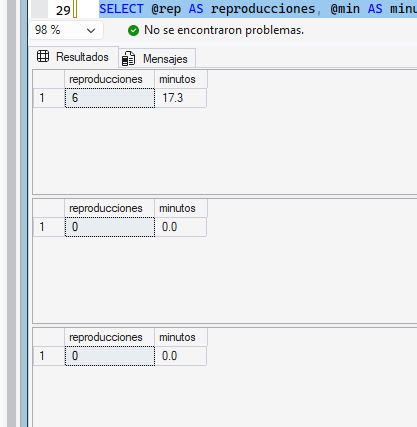

**Explicación:** Tanto `vale_indie` (que existe pero no tiene reproducciones) como `fantasma` (que no existe) devuelven el mismo resultado: `0` y `0.0`. Esto ocurre porque un `COUNT(*)` de cero filas siempre es 0, sin lanzar error. Desde fuera no se puede distinguir un caso del otro.

---

## Ejercicio 6

```sql
CREATE OR ALTER PROCEDURE dbo.usp_segmento_usuario
    @nombre_usuario nvarchar(50),
    @desde date,
    @hasta date
AS
BEGIN
    SET NOCOUNT ON;

    DECLARE @usuario_id int = (SELECT usuario_id FROM dbo.usuarios WHERE nombre_usuario = @nombre_usuario);
    
    IF @usuario_id IS NULL
    BEGIN
        PRINT N'Usuario no encontrado: ' + @nombre_usuario;
        RETURN 1;
    END;

    DECLARE @minutos decimal(8,1);
    SELECT @minutos = CAST(COALESCE(SUM(segundos_escuchados), 0) / 60.0 AS decimal(8,1))
    FROM dbo.reproducciones
    WHERE usuario_id = @usuario_id
      AND tipo_contenido = N'Canción'
      AND segundos_escuchados >= 30
      AND fecha_hora >= @desde
      AND fecha_hora < @hasta;

    DECLARE @segmento nvarchar(20);
    
    IF @minutos >= 10
        SET @segmento = N'Intensivo';
    ELSE IF @minutos >= 6
        SET @segmento = N'Habitual';
    ELSE IF @minutos > 0
        SET @segmento = N'Ocasional';
    ELSE
        SET @segmento = N'Sin actividad';

    SELECT @nombre_usuario AS nombre_usuario, @minutos AS minutos, @segmento AS segmento;
    
    RETURN 0;
END;
GO

DECLARE @estado int;
EXEC @estado = dbo.usp_segmento_usuario @nombre_usuario = N'lucia.m', @desde = '2026-09-16', @hasta = '2026-09-23';
EXEC @estado = dbo.usp_segmento_usuario @nombre_usuario = N'marta_rock', @desde = '2026-09-16', @hasta = '2026-09-23';
EXEC @estado = dbo.usp_segmento_usuario @nombre_usuario = N'sofi.trap', @desde = '2026-09-16', @hasta = '2026-09-23';
EXEC @estado = dbo.usp_segmento_usuario @nombre_usuario = N'vale_indie', @desde = '2026-09-16', @hasta = '2026-09-23';
EXEC @estado = dbo.usp_segmento_usuario @nombre_usuario = N'fantasma', @desde = '2026-09-16', @hasta = '2026-09-23';
SELECT @estado AS estado_fantasma;
```

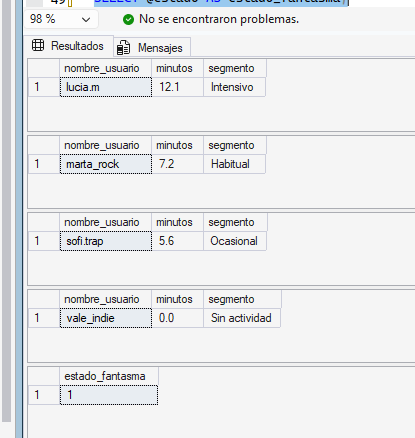

---

## Ejercicio 7

```sql
CREATE OR ALTER PROCEDURE dbo.usp_cifras_por_dia
    @desde date,
    @hasta date
AS
BEGIN
    SET NOCOUNT ON;

    DECLARE @resumen_temporal TABLE (
        dia date,
        reproducciones int,
        minutos decimal(8,1)
    );

    DECLARE @dia_actual date = @desde;
    DECLARE @dia_siguiente date;
    DECLARE @rep int, @min decimal(8,1);

    WHILE @dia_actual < @hasta
    BEGIN
        SET @dia_siguiente = DATEADD(DAY, 1, @dia_actual);

        EXEC dbo.usp_cifras_periodo 
             @desde = @dia_actual, 
             @hasta = @dia_siguiente, 
             @reproducciones = @rep OUTPUT, 
             @minutos = @min OUTPUT;

        INSERT INTO @resumen_temporal (dia, reproducciones, minutos)
        VALUES (@dia_actual, @rep, @min);

        SET @dia_actual = @dia_siguiente;
    END;

    SELECT dia, reproducciones, minutos FROM @resumen_temporal ORDER BY dia;
END;
GO

EXEC dbo.usp_cifras_por_dia @desde = '2026-09-20', @hasta = '2026-09-25';
```

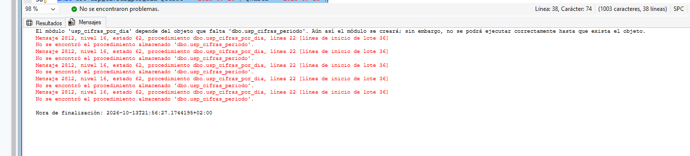
---

## Ejercicio 8

**¿Qué filas devuelve el script?**
El `SELECT` devolverá 4 filas con los pasos **1, 4, 6, y 7**.

**Explicación:**
1. El paso 1 entra correctamente.
2. El paso 2 falla (`Msg 515`) porque viola la restricción `NOT NULL` de la columna `texto`. Al fallar, la ejecución salta inmediatamente al bloque `CATCH`. El paso 3 jamás se ejecuta.
3. En el `CATCH`, entra el paso 4.
4. El `ERROR_NUMBER()` de un fallo de `NOT NULL` es 515 (no 2627 que es clave duplicada). El `IF` no tiene `BEGIN...END`, por lo que **solo controla el paso 5** (que es omitido).
5. Como no hay `BEGIN...END`, el paso 6 no está bajo el control del `IF` y se ejecuta.
6. El `CATCH` termina y el paso 7 se ejecuta con normalidad.

**¿Qué cambia si se añade una línea con `THROW;` justo antes de `END CATCH;`?**
El script se detiene en seco al llegar a ese `THROW;`. Dejarán de ejecutarse las líneas posteriores (incluyendo la del paso 7). La tabla `#pasos` conservará los registros 1, 4 y 6, pero el `SELECT` del final tampoco llegará a ejecutarse en la pantalla.

---

## Ejercicio 9

```sql
CREATE OR ALTER PROCEDURE dbo.usp_alta_artista
    @nombre nvarchar(100),
    @pais char(2),
    @genero nvarchar(50),
    @artista_id int OUTPUT
AS
BEGIN
    SET NOCOUNT ON;

    DECLARE @genero_id int = (SELECT genero_id FROM dbo.generos WHERE nombre = @genero);

    IF @genero_id IS NULL
        THROW 50010, N'El género indicado no existe.', 1;

    IF EXISTS (SELECT 1 FROM dbo.artistas WHERE nombre = @nombre)
        THROW 50011, N'Ya existe un artista con ese nombre.', 1;

    SELECT @artista_id = ISNULL(MAX(artista_id), 0) + 1 FROM dbo.artistas;

    INSERT INTO dbo.artistas (artista_id, nombre, pais, genero_id)
    VALUES (@artista_id, @nombre, @pais, @genero_id);
END;
GO

DECLARE @nuevo_id int;

-- Primera llamada
EXEC dbo.usp_alta_artista @nombre = N'Aurora Boreal', @pais = 'ES', @genero = N'Synthwave', @artista_id = @nuevo_id OUTPUT;
-- Devuelve error 50010 (Synthwave no existe)

-- Segunda llamada
EXEC dbo.usp_alta_artista @nombre = N'Aurora Boreal', @pais = 'ES', @genero = N'House', @artista_id = @nuevo_id OUTPUT;
SELECT @nuevo_id AS nuevo_id_creado;
SELECT * FROM dbo.artistas WHERE artista_id = @nuevo_id;

-- Tercera llamada
EXEC dbo.usp_alta_artista @nombre = N'Aurora Boreal', @pais = 'ES', @genero = N'House', @artista_id = @nuevo_id OUTPUT;
-- Devuelve error 50011 (Ya existe un artista con ese nombre)

-- Limpieza
DELETE FROM dbo.artistas WHERE artista_id = @nuevo_id;
```

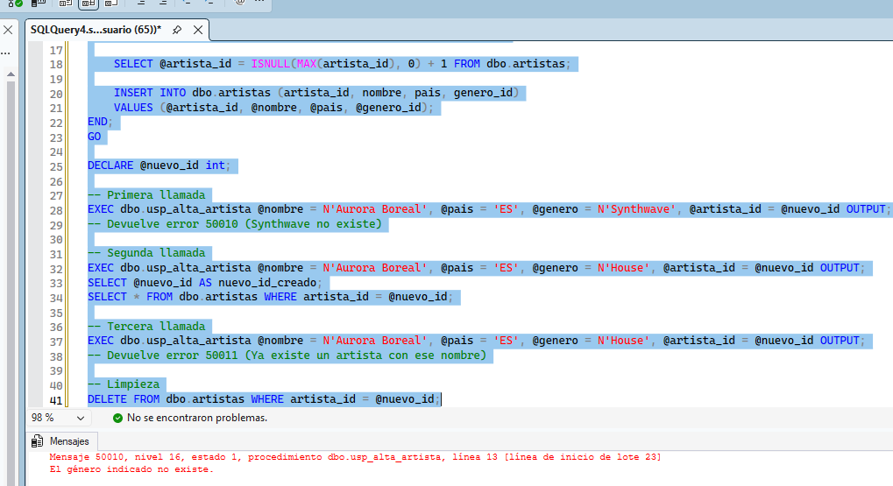

---

## Ejercicio 10

**a) Respuesta:** Quedarán 41 reproducciones, 9 usuarios, y 0 registros en bajas. La versión de Hugo agrupa las acciones en `BEGIN TRAN`, pero no cuenta con `XACT_ABORT ON` ni `TRY...CATCH`. El borrado de reproducciones ocurre, luego el insert falla por la restricción `CHECK` (motivo no admitido). La ejecución continúa y ejecuta el borrado del usuario y hace un `COMMIT` que valida las eliminaciones, sin rastro en bajas.

**c) Versión con plantilla de seguridad:**

```sql
CREATE OR ALTER PROCEDURE dbo.usp_baja_usuario
    @nombre_usuario nvarchar(50),
    @motivo nvarchar(30)
AS
BEGIN
    SET NOCOUNT ON;
    SET XACT_ABORT ON;

    DECLARE @usuario_id int = (SELECT usuario_id FROM dbo.usuarios WHERE nombre_usuario = @nombre_usuario);

    BEGIN TRY
        IF @usuario_id IS NULL
            THROW 50020, N'El usuario no existe.', 1;

        BEGIN TRAN;

            DELETE FROM dbo.reproducciones WHERE usuario_id = @usuario_id;

            INSERT INTO dbo.bajas_usuarios (usuario_id, nombre_usuario, motivo)
            VALUES (@usuario_id, @nombre_usuario, @motivo);

            DELETE FROM dbo.usuarios WHERE usuario_id = @usuario_id;

        COMMIT;
    END TRY
    BEGIN CATCH
        IF @@TRANCOUNT > 0 ROLLBACK;
        THROW;
    END CATCH;
END;
GO
```


Ejecutar el caso con "Se ha cansado" ahora lanzará la restricción `CHECK` en el `CATCH`, haciendo un `ROLLBACK` total. Seguirán habiendo 43 reproducciones, 10 usuarios y 0 bajas.

---

## Ejercicio 11

```sql
CREATE OR ALTER PROCEDURE dbo.usp_refrescar_resumen_diario
    @desde date,
    @hasta date
AS
BEGIN
    SET NOCOUNT ON;
    SET XACT_ABORT ON;

    DECLARE @log_id int, @insertadas int;
    DECLARE @periodo nvarchar(40) = CAST(@desde AS nvarchar(10)) + N' y ' + CAST(@hasta AS nvarchar(10));

    INSERT INTO dbo.log_cargas (proceso, inicio, estado)
    VALUES (N'usp_refrescar_resumen_diario', SYSDATETIME(), N'En curso');
    SET @log_id = SCOPE_IDENTITY();

    BEGIN TRY
        IF @desde IS NULL OR @hasta IS NULL OR @desde >= @hasta
            THROW 50001, N'Periodo no válido: @desde debe ser anterior a @hasta.', 1;

        BEGIN TRAN;
            
            DELETE FROM dbo.resumen_diario
            WHERE dia >= @desde AND dia < @hasta;

            INSERT INTO dbo.resumen_diario (dia, reproducciones, oyentes, minutos)
            SELECT CAST(r.fecha_hora AS date),
                   COUNT(*),
                   COUNT(DISTINCT r.usuario_id),
                   CAST(SUM(r.segundos_escuchados) / 60.0 AS decimal(8,1))
            FROM dbo.reproducciones AS r
            WHERE r.tipo_contenido = N'Canción'
              AND r.segundos_escuchados >= 30
              AND r.fecha_hora >= @desde
              AND r.fecha_hora < @hasta
            GROUP BY CAST(r.fecha_hora AS date);

            SET @insertadas = @@ROWCOUNT;
            
        COMMIT;

        UPDATE dbo.log_cargas
        SET fin = SYSDATETIME(),
            filas_insertadas = @insertadas,
            estado = N'OK'
        WHERE log_id = @log_id;

        IF @insertadas = 0
            PRINT N'Aviso: sin reproducciones válidas entre ' + @periodo + N'.';
        ELSE
            PRINT N'Resumen actualizado entre ' + @periodo + N'. Días con datos: ' + CAST(@insertadas AS nvarchar(10)) + N'.';

    END TRY
    BEGIN CATCH
        IF @@TRANCOUNT > 0 ROLLBACK;

        UPDATE dbo.log_cargas
        SET fin = SYSDATETIME(),
            estado = N'Error',
            mensaje_error = ERROR_MESSAGE()
        WHERE log_id = @log_id;

        THROW;
    END CATCH;
END;
GO
```

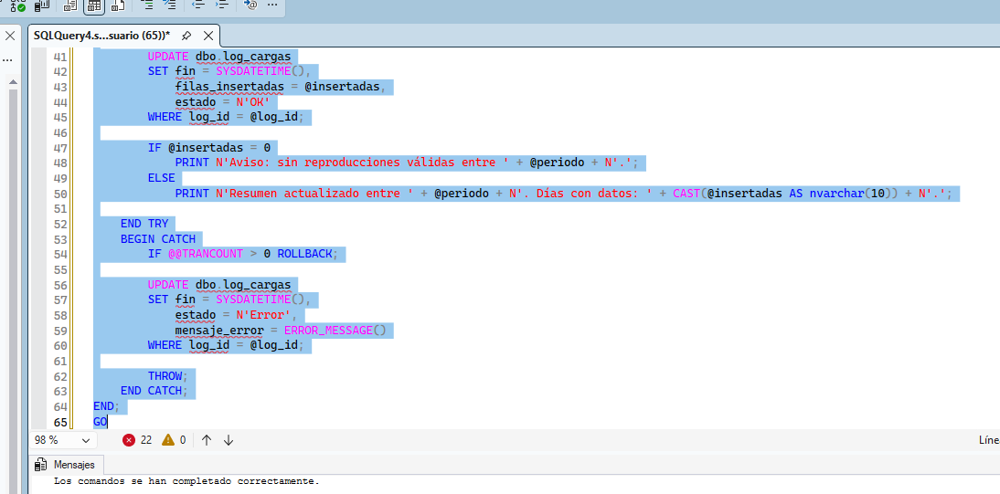

**Respuesta a la pregunta adicional:**
Si no existiera la transacción, y el `INSERT` fallara después de ejecutarse el `DELETE`, la tabla resumen quedaría temporalmente huérfana de los datos de esa semana. Los cuadros de mando mostrarían 0 reproducciones y 0 minutos para los días afectados en su siguiente refresco.

---

## Ejercicio 12

Análisis de la idempotencia de los lotes:
*   **A: No es idempotente.** Si se ejecuta dos veces seguidas, la tabla `#resumen_diario` sumará registros duplicados sin borrar los que había. Para arreglarlo se debe usar un `DELETE` previo para el rango temporal o el filtro `NOT EXISTS`.
*   **B: No es idempotente.** Cada ejecución suma `+ 5` a la duración actual de las canciones del `artista_id = 4`. Si se ejecuta el lote dos veces, se sumarán 10 segundos. La solución es asignar un valor fijo directamente: `SET duracion_seg = 200 WHERE ...`.
*   **C: Sí es idempotente.** Sobrescribe el valor con `PR`. Si se lanza otra vez, sigue fijando `PR`.
*   **D: Sí es idempotente.** La primera ejecución borra las filas anteriores. La segunda no borra nada porque ya no existen.
*   **E: No es idempotente, pero NO debe arreglarse.** Cada ejecución deja su propio rastro en el log por diseño, ya que lo que se mide son ejecuciones, no el estado final del sistema.

---

## Ejercicio 13

```sql
CREATE OR ALTER PROCEDURE dbo.usp_cargar_usuarios
AS
BEGIN
    SET NOCOUNT ON;
    SET XACT_ABORT ON;

    DECLARE @log_id int, @leidas int, @insertadas int, @rechazadas int;

    -- 1. Anotar el inicio
    INSERT INTO dbo.log_cargas (proceso, inicio, estado)
    VALUES (N'usp_cargar_usuarios', SYSDATETIME(), N'En curso');
    SET @log_id = SCOPE_IDENTITY();

    BEGIN TRY
        SET @leidas = (SELECT COUNT(*) FROM dbo.stg_usuarios_2309);

        -- 2. Staging 
        SELECT DISTINCT 
               s.usuario_id, s.nombre_usuario, s.email, s.pais, 
               CASE 
                   WHEN s.plan_suscripcion = N'Family' THEN N'Familiar'
                   ELSE s.plan_suscripcion 
               END AS plan_suscripcion, 
               s.fecha_alta,
               CASE
                   WHEN s.email IS NULL THEN N'Email vacío'
                   WHEN (CASE WHEN s.plan_suscripcion = N'Family' THEN N'Familiar' ELSE s.plan_suscripcion END) 
                        NOT IN (N'Free', N'Premium', N'Familiar') THEN N'Plan no reconocido'
               END AS motivo
        INTO #lote_usuarios
        FROM dbo.stg_usuarios_2309 AS s
        WHERE NOT EXISTS (SELECT 1 FROM dbo.usuarios AS u WHERE u.usuario_id = s.usuario_id);

        -- 3. Carga y registro de rechazos
        BEGIN TRAN;

            INSERT INTO dbo.rechazos_altas (log_id, usuario_id, nombre_usuario, motivo)
            SELECT @log_id, l.usuario_id, l.nombre_usuario, l.motivo
            FROM #lote_usuarios AS l
            WHERE l.motivo IS NOT NULL;

            SET @rechazadas = @@ROWCOUNT;

            INSERT INTO dbo.usuarios (usuario_id, nombre_usuario, email, pais, plan_suscripcion, fecha_alta)
            SELECT l.usuario_id, l.nombre_usuario, l.email, l.pais, l.plan_suscripcion, l.fecha_alta
            FROM #lote_usuarios AS l
            WHERE l.motivo IS NULL
              AND NOT EXISTS (SELECT 1 FROM dbo.usuarios AS u WHERE u.usuario_id = l.usuario_id);

            SET @insertadas = @@ROWCOUNT;

        COMMIT;

        -- 4. Anotar el final correcto
        UPDATE dbo.log_cargas
        SET fin = SYSDATETIME(),
            filas_leidas = @leidas,
            filas_insertadas = @insertadas,
            filas_rechazadas = @rechazadas,
            estado = N'OK'
        WHERE log_id = @log_id;

    END TRY
    BEGIN CATCH
        IF @@TRANCOUNT > 0 ROLLBACK;

        -- 4. Anotar error post-rollback
        UPDATE dbo.log_cargas
        SET fin = SYSDATETIME(),
            filas_leidas = @leidas,
            estado = N'Error',
            mensaje_error = ERROR_MESSAGE()
        WHERE log_id = @log_id;

        THROW;
    END CATCH;
END;
GO
```

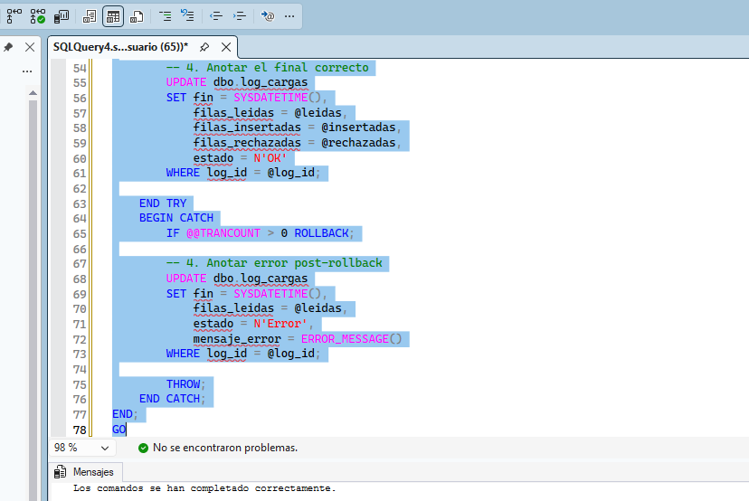

---

# Parte 02 · Triggers (Ejercicios resueltos)

## Ejercicio 1

```sql
CREATE OR ALTER TRIGGER dbo.trg_artistas_alta
ON dbo.artistas
AFTER INSERT
AS
BEGIN
    SET NOCOUNT ON;

    INSERT INTO dbo.altas_artistas (artista_id, nombre)
    SELECT artista_id, nombre
    FROM inserted;
END;
GO

INSERT INTO dbo.artistas (artista_id, nombre, pais, genero_id) VALUES
(10, N'Aurora Boreal', 'ES', 11),
(11, N'Trío Magnético', 'MX', 9);

SELECT artista_id, nombre FROM dbo.altas_artistas;

DELETE FROM dbo.artistas WHERE artista_id IN (10, 11);
DROP TRIGGER IF EXISTS dbo.trg_artistas_alta;
```


**Explicación:** Al hacer `DELETE`, la tabla `altas_artistas` se queda igual (conserva a los dos artistas). Esto ocurre porque el trigger fue creado específicamente como `AFTER INSERT`, y es completamente ajeno a las instrucciones de borrado.

---

## Ejercicio 2

El aviso aparecerá en total **3 veces**.

- **a)** Dispara. (Un `UPDATE` que no modifique datos dispara de todas formas).
- **b)** Dispara. (Otro `UPDATE` sin filas afectadas).
- **c)** No dispara. (El Trigger es `AFTER UPDATE, DELETE`. El `INSERT` se ignora).
- **d)** **Falla y no dispara.** (La canción 103 tiene reproducciones asociadas. El borrado falla por violación de la restricción `FOREIGN KEY`. Como las restricciones operan antes, el trigger `AFTER` nunca se dispara).
- **e)** Dispara. (Un borrado normal que pasará y ejecutará el trigger).
- **f)** No dispara. (El trigger aplica a la tabla `canciones`, y se está actualizando `artistas`).

---

## Ejercicio 3

Respuestas basadas en cómo actúan `inserted` y `deleted`:

| Instrucción | filas_inserted | filas_deleted |
| --- | --- | --- |
| **a) UPDATE de 4 usuarios de España** | 4 | 4 |
| **b) DELETE id > 10 (sin resultados)** | 0 | 0 |
| **c) INSERT de 2 usuarios** | 2 | 0 |
| **d) UPDATE para MX y Free (1 usuario)** | 1 | 1 |
| **e) UPDATE de toda la tabla (10 usuarios)** | 10 | 10 |

---

## Ejercicio 4

```sql
CREATE OR ALTER TRIGGER dbo.trg_empleados_historial_puestos
ON dbo.empleados
AFTER UPDATE
AS
BEGIN
    SET NOCOUNT ON;

    IF NOT UPDATE(puesto)
        RETURN;

    INSERT INTO dbo.historial_puestos (empleado_id, puesto_anterior, puesto_nuevo)
    SELECT i.empleado_id, d.puesto, i.puesto
    FROM inserted AS i
    JOIN deleted AS d ON d.empleado_id = i.empleado_id
    WHERE i.puesto <> d.puesto;
END;
GO
```


---

## Ejercicio 5

**a)** El trigger funciona perfectamente porque una única fila insertada devuelve un solo `cancion_id` en el `SELECT` del trigger. El total de Perreo Lunar (canción 103) suma 1, pasando a 8.
**b)** El intento de agregar el lote con 4 filas provoca un error del tipo *"Subquery returned more than 1 value"* (`Msg 512`). El trigger de Hugo asume erróneamente que solo se recibe una fila. Al fallar, la instrucción entera se anula, por lo que `reproducciones` se mantiene en sus 44 registros de la ejecución a).
**c) Trigger corregido orientado a conjuntos:**

```sql
CREATE OR ALTER TRIGGER dbo.trg_reproducciones_contador
ON dbo.reproducciones
AFTER INSERT
AS
BEGIN
    SET NOCOUNT ON;

    UPDATE c
    SET c.total = c.total + sub.nuevas
    FROM dbo.contador_canciones AS c
    JOIN (
        SELECT cancion_id, COUNT(*) AS nuevas
        FROM inserted
        WHERE cancion_id IS NOT NULL
        GROUP BY cancion_id
    ) AS sub ON sub.cancion_id = c.cancion_id;
END;
GO
```

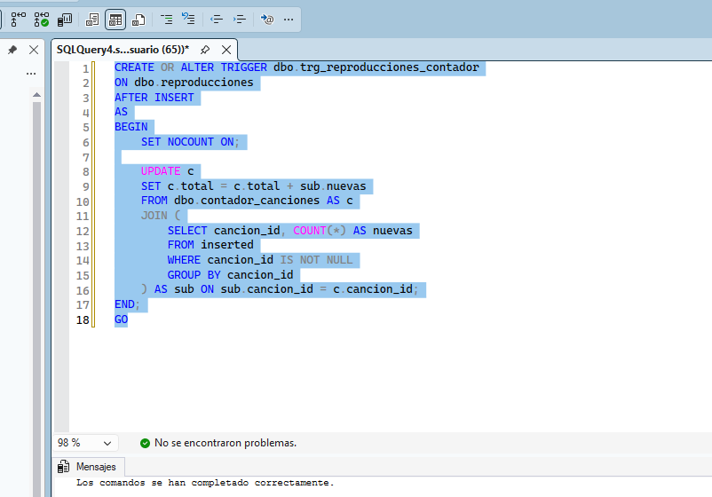

**d)** Al borrar datos, el contador se desfasa porque nuestro trigger es exclusivamente `AFTER INSERT`. Perreo Lunar mantendrá falsamente el total 10 marcado en el apartado c), pero su conteo real en `reproducciones` bajará a 7. Esto demuestra la peligrosidad de calcular totales acumulativos a base de triggers si no están protegidas y vigiladas todas las posibles transiciones (`INSERT`, `UPDATE` y `DELETE`).

---

## Ejercicio 6

```sql
CREATE OR ALTER TRIGGER dbo.trg_artistas_auditoria
ON dbo.artistas
AFTER INSERT, UPDATE, DELETE
AS
BEGIN
    SET NOCOUNT ON;

    IF EXISTS (SELECT 1 FROM inserted) AND NOT EXISTS (SELECT 1 FROM deleted)
    BEGIN
        INSERT INTO dbo.aud_artistas (operacion, artista_id, nombre)
        SELECT 'I', artista_id, nombre FROM inserted;
    END
    ELSE IF EXISTS (SELECT 1 FROM deleted) AND NOT EXISTS (SELECT 1 FROM inserted)
    BEGIN
        INSERT INTO dbo.aud_artistas (operacion, artista_id, nombre)
        SELECT 'D', artista_id, nombre FROM deleted;
    END
    ELSE IF EXISTS (SELECT 1 FROM inserted) AND EXISTS (SELECT 1 FROM deleted)
    BEGIN
        INSERT INTO dbo.aud_artistas (operacion, artista_id, nombre)
        SELECT 'U', i.artista_id, i.nombre
        FROM inserted AS i
        JOIN deleted AS d ON i.artista_id = d.artista_id
        WHERE i.nombre <> d.nombre;
    END
END;
GO
```

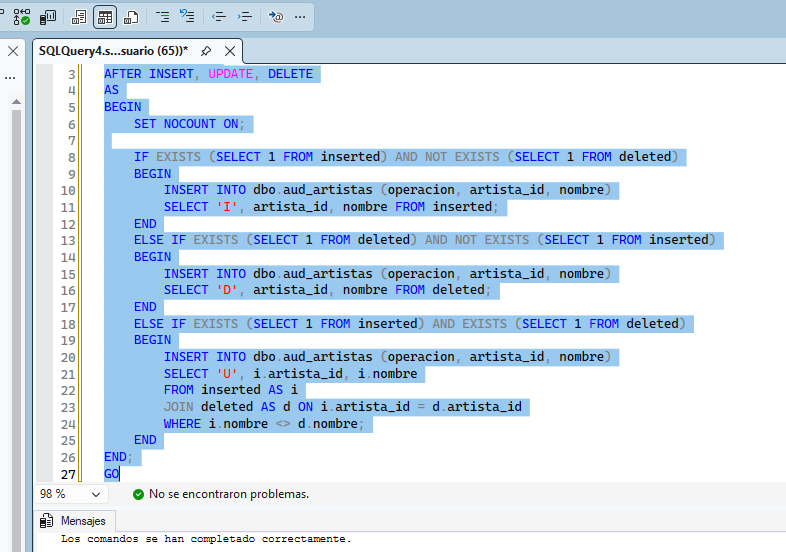

---

## Ejercicio 7

```sql
CREATE OR ALTER TRIGGER dbo.trg_reproducciones_fecha_alta
ON dbo.reproducciones
AFTER INSERT
AS
BEGIN
    SET NOCOUNT ON;

    IF EXISTS (
        SELECT 1
        FROM inserted AS i
        JOIN dbo.usuarios AS u ON u.usuario_id = i.usuario_id
        WHERE i.fecha_hora < u.fecha_alta
    )
        THROW 50130, N'Hay reproducciones anteriores a la fecha de alta de su usuario.', 1;
END;
GO
```


*   **Inserción a):** Lanza el error `Msg 50130`. La inserción se anula. Total `reproducciones`: 43.
*   **Inserción b):** Una de las reproducciones en el lote viola la restricción. Lanza el error `Msg 50130` y **ninguna** de las filas se carga, incluyendo las válidas. Total `reproducciones`: 43.
*   **Inserción c):** Sin la fila problemática, el lote se procesa correctamente. Total `reproducciones`: 45.

---

## Ejercicio 8

- **a)** Restricción (`CHECK`). Opera solo sobre una columna en la misma fila.
- **b)** Restricción (`UNIQUE`). La obligatoriedad de evitar duplicados es la función base.
- **c)** Restricción (`FOREIGN KEY`). Validar existencia entre dos tablas conectadas.
- **d)** **Trigger.** Requiere comparar valores de la fila entrante contra valores dinámicos guardados en otra tabla ajena (usuarios).
- **e)** Restricción (`CHECK`).
- **f)** **Trigger.** Validar un historial requiere registrar autor, fecha, y saber la transición del país.
- **g)** **Trigger.** Las restricciones no tienen alcance para ver el valor `deleted` para operar variaciones contra el `inserted`.
- **h)** Restricción (`NOT NULL`).

---

## Ejercicio 9

- **a)** Como todo reside bajo un `BEGIN TRAN`, la falla del trigger en el segundo `INSERT` activa el `THROW`. Al activarse bajo el `XACT_ABORT` por defecto de los triggers, **toda** la transacción se deshace. `transacciones_abiertas` será **0** y el número de artistas será **9**.
- **b)** Sin el contenedor `BEGIN TRAN`, el motor evalúa aisladamente los lotes. El primer artista (id=10) se ejecuta y persiste. El `INSERT` de reproducciones lanza el error del trigger, abortando automáticamente la ejecución y paralizando la ejecución de ese lote. El segundo artista nunca se insertará. `artistas` devolverá **10** filas.
- **c)** 
```sql
BEGIN TRY
    INSERT INTO dbo.reproducciones (reproduccion_id, usuario_id, cancion_id, fecha_hora, segundos_escuchados, dispositivo, tipo_contenido)
    VALUES (47, 9, 103, '2026-09-20 10:00', 176, N'Web', N'Canción');
END TRY
BEGIN CATCH
    IF @@TRANCOUNT > 0 ROLLBACK;

    SELECT ERROR_NUMBER() AS numero, 
           ERROR_PROCEDURE() AS origen, 
           ERROR_MESSAGE() AS mensaje;
END CATCH;
```

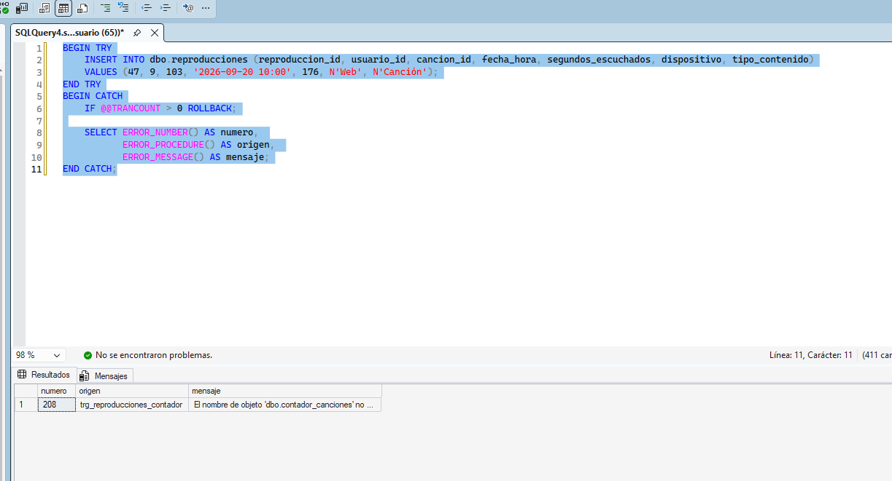

---

## Ejercicio 10

**a)**


**b)**
```sql
CREATE OR ALTER TRIGGER dbo.trg_altas_web_entrada
ON dbo.altas_web
INSTEAD OF INSERT
AS
BEGIN
    SET NOCOUNT ON;

    -- Acondicionamiento interno de la tabla insertada a tabla temporal 
    SELECT email, pais, 
           CASE 
               WHEN plan_suscripcion = N'Family' THEN N'Familiar'
               WHEN plan_suscripcion = N'Gratis' THEN N'Free'
               ELSE plan_suscripcion 
           END AS plan_suscripcion,
           fecha_registro
    INTO #entrada
    FROM inserted;

    -- Apartar planes inválidos
    INSERT INTO dbo.altas_web_rechazadas (email, pais, plan_suscripcion, motivo)
    SELECT email, pais, plan_suscripcion, N'Plan no reconocido'
    FROM #entrada
    WHERE plan_suscripcion NOT IN (N'Free', N'Premium', N'Familiar');

    -- Apartar emails duplicados cruzando con altas validadas existentes
    INSERT INTO dbo.altas_web_rechazadas (email, pais, plan_suscripcion, motivo)
    SELECT email, pais, plan_suscripcion, N'Email ya registrado'
    FROM #entrada
    WHERE plan_suscripcion IN (N'Free', N'Premium', N'Familiar')
      AND EXISTS (SELECT 1 FROM dbo.altas_web AS aw WHERE aw.email = #entrada.email);

    -- Insertar definitivos
    INSERT INTO dbo.altas_web (email, pais, plan_suscripcion, fecha_registro)
    SELECT email, pais, plan_suscripcion, fecha_registro
    FROM #entrada
    WHERE plan_suscripcion IN (N'Free', N'Premium', N'Familiar')
      AND NOT EXISTS (SELECT 1 FROM dbo.altas_web AS aw WHERE aw.email = #entrada.email);
END;
GO
```


---

## Ejercicio 11

**a)**
```sql
CREATE OR ALTER TRIGGER trg_ddl_vistas
ON DATABASE
AFTER CREATE_VIEW, ALTER_VIEW, DROP_VIEW
AS
BEGIN
    SET NOCOUNT ON;

    DECLARE @datos xml = EVENTDATA();

    INSERT INTO dbo.log_vistas (evento, vista)
    VALUES (@datos.value('(/EVENT_INSTANCE/EventType)[1]', 'nvarchar(100)'),
            @datos.value('(/EVENT_INSTANCE/ObjectName)[1]', 'nvarchar(128)'));
END;
GO
```

**b)** Dado que un trigger DDL actúa inmediatamente después de la orden pero dentro de su transacción subyacente (`XACT_ABORT ON` base), el intento del trigger de rellenar información en la tabla eliminada `dbo.log_vistas` lanzaría una excepción crítica en el entorno. Provocaría de facto que todas las `CREATE_VIEW`, `ALTER_VIEW`, o `DROP_VIEW` fallasen globalmente para cualquier usuario, quedando la base de datos inutilizable para el control de vistas hasta que se restableciese el trigger.

---

## Ejercicio 12

**e)**
```sql
SELECT r.reproduccion_id, u.nombre_usuario, r.fecha_hora, u.fecha_alta
FROM dbo.reproducciones AS r
JOIN dbo.usuarios AS u ON u.usuario_id = r.usuario_id
WHERE r.fecha_hora < u.fecha_alta;
```

**f)** Una restricción (como `CHECK` o `FK`) verifica permanentemente los datos y, a la hora de activarse con comprobaciones de lote en tablas existentes, no permitiría habilitar la función de control si detecta anomalías históricas que vulneren sus reglas. Sin embargo, un **Trigger** es transicional: asume reglas **solo sobre los eventos vigentes** de `INSERT` o `UPDATE` mientras el mismo siga operativo (`ENABLE`). Cuando en `b)` el trigger fue desactivado y posteriormente activado en `d)`, este fue silenciosamente habilitado ignorando absolutamente las cargas ilegales del punto `c)`. Todo mantenimiento donde se intercedan triggers debe ser rigurosamente registrado en una bitácora de incidencias manual para poder tener consciencia de la potencial entrada de anomalías.