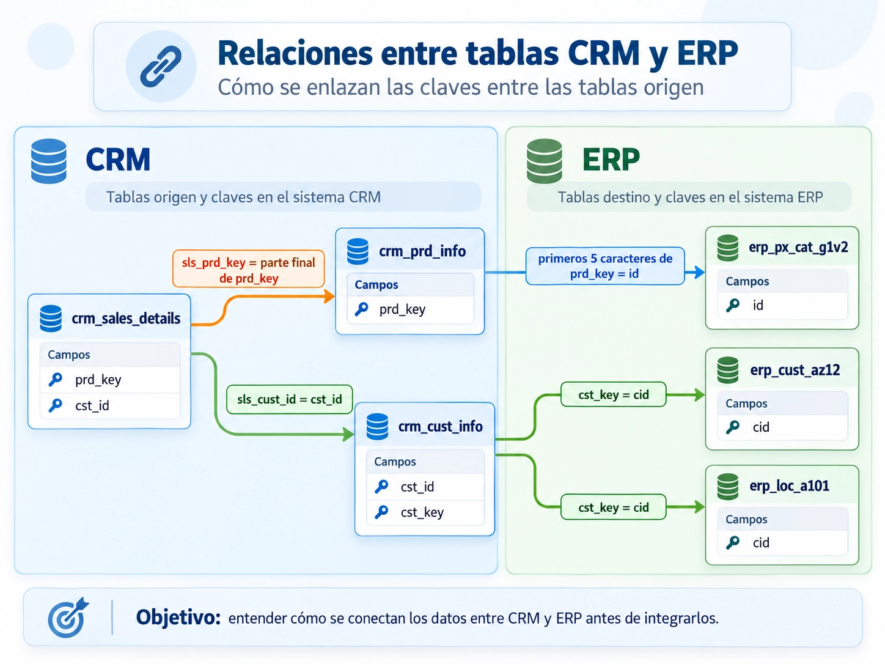
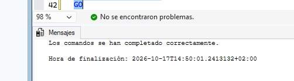
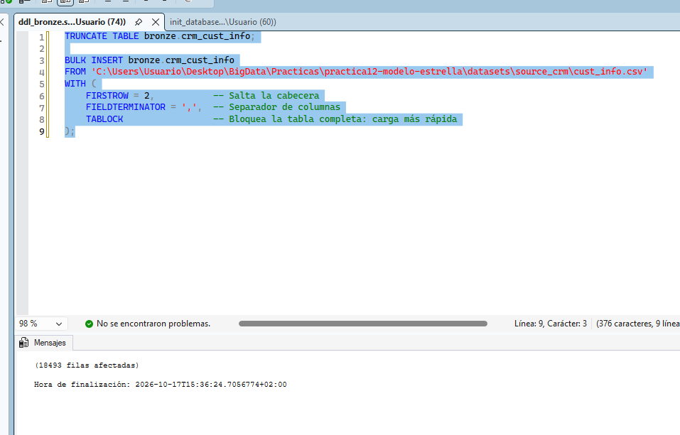
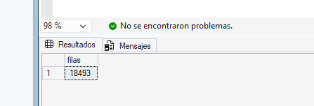
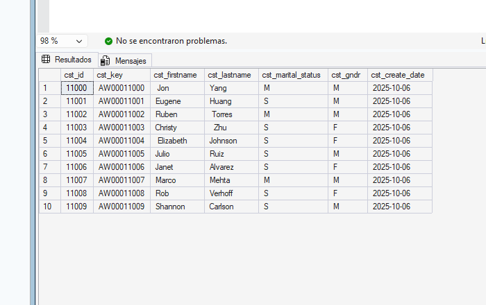

# Práctica 12 – Clase 17: Data Warehouse CicloNova en SQL Server

> Proyecto de extremo a extremo: construcción de un Data Warehouse con arquitectura Medallón (Bronze · Silver · Gold) sobre SQL Server 2025 con SSMS 22. Este README recoge **todas las secciones de la clase** (preparación del entorno, capas Bronze/Silver/Gold, orquestación, explotación y documentación) y, al final, los **ejercicios propuestos con enunciado y solución**.

---

## Índice

- [Contexto y objetivo](#contexto-y-objetivo)
- [Arquitectura Medallón (resumen)](#arquitectura-medallón-resumen)
- [Sección 4: Preparar el entorno de trabajo](#sección-4-preparar-el-entorno-de-trabajo)
- [Sección 5: Entender los sistemas origen](#sección-5-entender-los-sistemas-origen)
- [Sección 6: Crear la base de datos y los esquemas](#sección-6-crear-la-base-de-datos-y-los-esquemas)
- [Sección 7: Capa Bronze — ingesta de datos en bruto](#sección-7-capa-bronze--ingesta-de-datos-en-bruto)
- [Sección 8: Capa Silver — limpieza y estandarización](#sección-8-capa-silver--limpieza-y-estandarización)
- [Sección 9: Capa Gold — el modelo en estrella](#sección-9-capa-gold--el-modelo-en-estrella)
- [Sección 10: Orquestar la carga completa](#sección-10-orquestar-la-carga-completa)
- [Sección 11: Explotar la capa Gold](#sección-11-explotar-la-capa-gold)
- [Sección 12: Documentar y versionar](#sección-12-documentar-y-versionar)
- [Sección 13: Ejercicios propuestos (enunciado y solución)](#sección-13-ejercicios-propuestos-enunciado-y-solución)
- [Conclusiones](#conclusiones)

---

## Contexto y objetivo

El objetivo es construir **de principio a fin un Data Warehouse en SQL Server** para la empresa ficticia **CicloNova**.

Se busca conseguir **"una única versión de la verdad"**. Hoy los datos están repartidos en dos sistemas independientes, lo que provoca que cada área de la empresa maneje cifras diferentes en sus informes:

| Sistema | Contenido |
| --- | --- |
| **CRM** | Clientes, catálogo de productos y pedidos |
| **ERP** | Logística y demografía (fecha de nacimiento, género, país, categorías de producto) |

## Arquitectura Medallón (resumen)

| Capa | Función | Cómo se construye |
| --- | --- | --- |
| 🥉 **Bronze** | Datos en crudo, exactamente como llegan del origen | `BULK INSERT` + `TRUNCATE`/`INSERT` (carga completa), sin transformaciones |
| 🥈 **Silver** | Datos limpios y estandarizados | Duplicados, `TRIM`, estandarización, fechas no válidas, reglas de negocio (Ventas = Cantidad × Precio) |
| 🥇 **Gold** | Datos listos para negocio (modelo en estrella) | **Vistas** (`VIEW`) sobre Silver, con claves subrogadas (`ROW_NUMBER()`) |

**Modelo en estrella:** `dim_customers` y `dim_products` (dimensiones) alrededor de `fact_sales` (hechos).

```
 dim_customers ──┐
                 ├──►  fact_sales  ◄──┐
                                      └── dim_products
```

**Automatización y calidad:** procedimientos almacenados (`load_bronze`, `load_silver`), un trabajo diario de SQL Server Agent y scripts de *quality checks* (claves únicas, integridad referencial, estandarización).

---

## Sección 4: Preparar el entorno de trabajo

Enlace a los ficheros CSV (adjuntos en la clase).

### 4.1 Organizar los ficheros fuente

> **`BULK INSERT`** es la instrucción de T-SQL que usaremos para cargar los CSV. Lee un fichero de datos completo y lo inserta en una tabla en una sola operación, mucho más rápido que insertar las filas una a una con `INSERT`. Lee el fichero desde la máquina donde está instalado SQL Server y con los permisos de tu propio usuario de Windows, que es quien lanza la carga desde SSMS.

Crea esta estructura de carpetas y copia en ella los CSV. Es la ruta que usan los scripts del proyecto (`proc_load_bronze.sql`); si eliges otra, tendrás que cambiar las rutas del procedimiento:

```
C:\sql\dwh_project\datasets\
├── source_crm\
│   ├── cust_info.csv
│   ├── prd_info.csv
│   └── sales_details.csv
└── source_erp\
    ├── CUST_AZ12.csv
    ├── LOC_A101.csv
    └── PX_CAT_G1V2.csv
```

> 💡 El procedimiento escribe los nombres de los ficheros del ERP en minúsculas (`cust_az12.csv`, `loc_a101.csv`, `px_cat_g1v2.csv`). No hace falta renombrarlos: Windows no distingue mayúsculas de minúsculas en los nombres de fichero.

### 4.2 Estructura del repositorio

```
dwh_project/
├── datasets/                       # CSV del CRM y del ERP
├── docs/                           # Diagramas, catálogo de datos y convenciones
├── scripts/
│   ├── init_database.sql           # Base de datos y esquemas
│   ├── bronze/
│   │   ├── ddl_bronze.sql          # Tablas de Bronze
│   │   └── proc_load_bronze.sql    # Procedimiento bronze.load_bronze
│   ├── silver/
│   │   ├── ddl_silver.sql          # Tablas de Silver
│   │   └── proc_load_silver.sql    # Procedimiento silver.load_silver
│   └── gold/
│       └── ddl_gold.sql            # Vistas del modelo en estrella
├── tests/
│   ├── quality_checks_silver.sql   # Controles de calidad de la capa Silver
│   └── quality_checks_gold.sql     # Controles de calidad de la capa Gold
└── README.md
```

### 4.3 Convenciones de nombres

Acordarlas al principio evita discusiones y errores más adelante.

| Elemento | Regla | Ejemplo |
| --- | --- | --- |
| **General** | `snake_case`, minúsculas, en inglés, sin palabras reservadas | `customer_number` |
| **Tablas Bronze y Silver** | `<sistema_origen>_<entidad>`, con el nombre original de la entidad | `crm_cust_info` |
| **Objetos Gold** | `<categoría>_<entidad>` con nombre de negocio | `dim_customers`, `fact_sales` |
| **Prefijos Gold** | `dim_` dimensión · `fact_` hechos · `report_` informe | `report_sales_monthly` |
| **Claves subrogadas** | `<entidad>_key` | `customer_key` |
| **Columnas técnicas** | Prefijo `dwh_` | `dwh_create_date` |
| **Procedimientos de carga** | `load_<capa>` | `load_bronze`, `load_silver` |

---

## Sección 5: Entender los sistemas origen

### 5.1 La entrevista con el sistema origen

En un proyecto real, antes de cargar nada nos sentamos con los responsables de cada sistema. Estas son las preguntas que debemos llevar preparadas:

| Tema | Preguntas de ejemplo |
| --- | --- |
| **Contexto y propiedad** | ¿Quién es el dueño del dato? ¿Qué proceso de negocio soporta? ¿Hay documentación, modelo o catálogo? |
| **Arquitectura y tecnología** | ¿Dónde se almacena (SQL Server, Oracle, AWS, Azure…)? ¿Qué capacidades de integración ofrece (API, Kafka, extracción a fichero, conexión directa)? |
| **Extracción y carga** | ¿Carga completa o incremental? ¿Qué histórico necesitamos? ¿Qué volumen tienen las extracciones? ¿Cómo evitamos impactar en el rendimiento del origen? ¿Cómo nos autenticamos (tokens, claves SSH, VPN, IPs permitidas)? |

En nuestro caso las respuestas son sencillas: **ficheros CSV en carpetas**, **carga completa**, **sin histórico**.

### 5.2 Inventario de las fuentes

| Sistema | Fichero | Filas | Qué contiene |
| --- | --- | --- | --- |
| CRM | `cust_info.csv` | 18.494 | Clientes: id, clave, nombre, apellido, estado civil, género, fecha de alta |
| CRM | `prd_info.csv` | 397 | Productos con coste, línea y periodo de vigencia (histórico de precios) |
| CRM | `sales_details.csv` | 60.398 | Líneas de pedido: producto, cliente, fechas, importe, cantidad y precio |
| ERP | `CUST_AZ12.csv` | 18.484 | Fecha de nacimiento y género de cada cliente |
| ERP | `LOC_A101.csv` | 18.484 | País de cada cliente |
| ERP | `PX_CAT_G1V2.csv` | 37 | Categoría, subcategoría y si el producto requiere mantenimiento |

### 5.3 Cómo se relacionan las tablas



Fíjate en que **las claves no coinciden tal cual** entre sistemas. Es el primer gran reto de integración:

| Relación | Valor en una tabla | Valor en la otra | Qué habrá que hacer |
| --- | --- | --- | --- |
| Producto CRM ↔ Categoría ERP | `CO-RF-FR-R92B-58` | `CO_RF` | Extraer los 5 primeros caracteres y cambiar `-` por `_` |
| Ventas ↔ Producto CRM | `BK-R93R-62` | `BI-RB-BK-R93R-62` | Quitar los 6 primeros caracteres de `prd_key` |
| Cliente CRM ↔ Cliente ERP (AZ12) | `AW00011000` | `NASAW00011000` | Eliminar el prefijo `NAS` |
| Cliente CRM ↔ Ubicación ERP | `AW00011000` | `AW-00011000` | Eliminar el guion |

---

## Sección 6: Crear la base de datos y los esquemas

Usamos **un esquema por capa**. Así los permisos, la organización y la lectura del código quedan claros (`bronze.tabla`, `silver.tabla`, `gold.vista`). Ejecuta el script `scripts/init_database.sql`:

```sql
/*
=============================================================
Create Database and Schemas
=============================================================
Script Purpose:
    This script creates a new database named 'DataWarehouse' after checking if it already exists.
    If the database exists, it is dropped and recreated. Additionally, the script sets up three schemas
    within the database: 'bronze', 'silver', and 'gold'.

WARNING:
    Running this script will drop the entire 'DataWarehouse' database if it exists.
    All data in the database will be permanently deleted. Proceed with caution
    and ensure you have proper backups before running this script.
*/

USE master;
GO

-- Drop and recreate the 'DataWarehouse' database
IF EXISTS (SELECT 1 FROM sys.databases WHERE name = 'DataWarehouse')
BEGIN
    ALTER DATABASE DataWarehouse SET SINGLE_USER WITH ROLLBACK IMMEDIATE;
    DROP DATABASE DataWarehouse;
END;
GO

-- Create the 'DataWarehouse' database
CREATE DATABASE DataWarehouse;
GO

USE DataWarehouse;
GO

-- Create Schemas
CREATE SCHEMA bronze;
GO

CREATE SCHEMA silver;
GO

CREATE SCHEMA gold;
GO
```



---

## Sección 7: Capa Bronze — ingesta de datos en bruto

**Regla de oro de Bronze:** los datos se guardan **exactamente como llegan**. Nada de limpiar, renombrar ni filtrar. Los nombres de columna son los del origen.

### 7.1 Crear las tablas Bronze

Ejecuta el script `scripts/bronze/ddl_bronze.sql`. Sus tipos de dato están elegidos para **aceptar los valores tal como vienen**:

- Las fechas de ventas llegan como enteros (`20101229`) y algunas valen `0`, así que se guardan como `INT`.
- Las fechas de producto (`prd_start_dt`, `prd_end_dt`) se guardan como `DATETIME`. Veremos en la Sección 8.4 por qué esto facilita calcular la fecha de fin.

Fíjate también en el patrón que precede a cada tabla: `IF OBJECT_ID('bronze.tabla', 'U') IS NOT NULL DROP TABLE ...`. Comprueba si la tabla (`'U'` = tabla de usuario) ya existe y, si es así, la elimina. Así el script se puede ejecutar tantas veces como haga falta.

```sql
/*
===============================================================================
DDL Script: Create Bronze Tables
===============================================================================
Script Purpose:
    This script creates tables in the 'bronze' schema, dropping existing tables
    if they already exist.
	  Run this script to re-define the DDL structure of 'bronze' Tables
===============================================================================
*/

IF OBJECT_ID('bronze.crm_cust_info', 'U') IS NOT NULL
    DROP TABLE bronze.crm_cust_info;
GO

CREATE TABLE bronze.crm_cust_info (
    cst_id              INT,
    cst_key             NVARCHAR(50),
    cst_firstname       NVARCHAR(50),
    cst_lastname        NVARCHAR(50),
    cst_marital_status  NVARCHAR(50),
    cst_gndr            NVARCHAR(50),
    cst_create_date     DATE
);
GO

IF OBJECT_ID('bronze.crm_prd_info', 'U') IS NOT NULL
    DROP TABLE bronze.crm_prd_info;
GO

CREATE TABLE bronze.crm_prd_info (
    prd_id       INT,
    prd_key      NVARCHAR(50),
    prd_nm       NVARCHAR(50),
    prd_cost     INT,
    prd_line     NVARCHAR(50),
    prd_start_dt DATETIME,
    prd_end_dt   DATETIME
);
GO

IF OBJECT_ID('bronze.crm_sales_details', 'U') IS NOT NULL
    DROP TABLE bronze.crm_sales_details;
GO

CREATE TABLE bronze.crm_sales_details (
    sls_ord_num  NVARCHAR(50),
    sls_prd_key  NVARCHAR(50),
    sls_cust_id  INT,
    sls_order_dt INT,
    sls_ship_dt  INT,
    sls_due_dt   INT,
    sls_sales    INT,
    sls_quantity INT,
    sls_price    INT
);
GO

IF OBJECT_ID('bronze.erp_loc_a101', 'U') IS NOT NULL
    DROP TABLE bronze.erp_loc_a101;
GO

CREATE TABLE bronze.erp_loc_a101 (
    cid    NVARCHAR(50),
    cntry  NVARCHAR(50)
);
GO

IF OBJECT_ID('bronze.erp_cust_az12', 'U') IS NOT NULL
    DROP TABLE bronze.erp_cust_az12;
GO

CREATE TABLE bronze.erp_cust_az12 (
    cid    NVARCHAR(50),
    bdate  DATE,
    gen    NVARCHAR(50)
);
GO

IF OBJECT_ID('bronze.erp_px_cat_g1v2', 'U') IS NOT NULL
    DROP TABLE bronze.erp_px_cat_g1v2;
GO

CREATE TABLE bronze.erp_px_cat_g1v2 (
    id           NVARCHAR(50),
    cat          NVARCHAR(50),
    subcat       NVARCHAR(50),
    maintenance  NVARCHAR(50)
);
GO
```

### 7.2 Primera carga manual con `BULK INSERT`

Antes de automatizar, cargamos **una tabla a mano** para entender cada opción:

```sql
TRUNCATE TABLE bronze.crm_cust_info;

BULK INSERT bronze.crm_cust_info
FROM 'C:\sql\dwh_project\datasets\source_crm\cust_info.csv'
WITH (
    FIRSTROW = 2,           -- Salta la cabecera
    FIELDTERMINATOR = ',',  -- Separador de columnas
    TABLOCK                 -- Bloquea la tabla completa: carga más rápida
);
```



| Opción | Por qué la usamos |
| --- | --- |
| `TRUNCATE TABLE` | Vacía la tabla antes de cargar. Es el patrón **full load (truncate & insert)**: si ejecutamos dos veces, no duplicamos datos |
| `FIRSTROW = 2` | La primera fila son los nombres de columna |
| `FIELDTERMINATOR = ','` | Las columnas van separadas por comas. Los campos vacíos se cargan como `NULL` |
| `TABLOCK` | Bloquea la tabla entera durante la carga, lo que la acelera. Además permite el registro mínimo en el log si la base de datos usa el modelo de recuperación simple o de registro masivo |

> 💡 **Fin de línea.** Los CSV del proyecto usan fin de línea Windows (`CRLF`), que es el que `BULK INSERT` espera por defecto. Si algún día recibes ficheros generados en Linux (solo `LF`), añade `ROWTERMINATOR = '0x0a'`.

> 💡 **¿Y si un campo contiene comas?** Los scripts del proyecto separan las columnas solo por la coma. Funciona porque ningún CSV tiene comillas ni comas dentro de un valor. Si algún día llega un fichero con valores como `"Smith, John"`, habrá que añadir `FORMAT = 'CSV'`, que interpreta las comillas según el estándar CSV.

### 7.3 Validar la carga

Validar Bronze significa comprobar **completitud** (llegaron todas las filas) y **esquema** (cada dato cayó en su columna):

```sql
-- ¿Llegaron todas las filas?
SELECT COUNT(*) AS filas FROM bronze.crm_cust_info;


-- ¿Cada valor está en su columna? Revisa visualmente las primeras filas
SELECT TOP 10 * FROM bronze.crm_cust_info;
```




### 7.4 Automatizar con el procedimiento `bronze.load_bronze`

Ahora empaquetamos las seis cargas en un procedimiento almacenado: `scripts/bronze/proc_load_bronze.sql`. Además de cargar, incorpora tres buenas prácticas:

1. **Mensajes `PRINT`** para seguir el progreso.
2. **Medición de tiempos** por tabla y del lote completo (en segundos), para detectar cuellos de botella.
3. **`TRY...CATCH`** para capturar y mostrar cualquier error.

```sql
/*
===============================================================================
Stored Procedure: Load Bronze Layer (Source -> Bronze)
===============================================================================
Script Purpose:
    This stored procedure loads data into the 'bronze' schema from external CSV files.
    It performs the following actions:
    - Truncates the bronze tables before loading data.
    - Uses the `BULK INSERT` command to load data from csv Files to bronze tables.

Parameters:
    None.
	  This stored procedure does not accept any parameters or return any values.

Usage Example:
    EXEC bronze.load_bronze;
===============================================================================
*/
CREATE OR ALTER PROCEDURE bronze.load_bronze AS
BEGIN
	DECLARE @start_time DATETIME, @end_time DATETIME, @batch_start_time DATETIME, @batch_end_time DATETIME;
	BEGIN TRY
		SET @batch_start_time = GETDATE();
		PRINT '================================================';
		PRINT 'Loading Bronze Layer';
		PRINT '================================================';

		PRINT '------------------------------------------------';
		PRINT 'Loading CRM Tables';
		PRINT '------------------------------------------------';

		SET @start_time = GETDATE();
		PRINT '>> Truncating Table: bronze.crm_cust_info';
		TRUNCATE TABLE bronze.crm_cust_info;
		PRINT '>> Inserting Data Into: bronze.crm_cust_info';
		BULK INSERT bronze.crm_cust_info
		FROM 'C:\sql\dwh_project\datasets\source_crm\cust_info.csv'
		WITH (
			FIRSTROW = 2,
			FIELDTERMINATOR = ',',
			TABLOCK
		);
		SET @end_time = GETDATE();
		PRINT '>> Load Duration: ' + CAST(DATEDIFF(second, @start_time, @end_time) AS NVARCHAR) + ' seconds';
		PRINT '>> -------------';

        SET @start_time = GETDATE();
		PRINT '>> Truncating Table: bronze.crm_prd_info';
		TRUNCATE TABLE bronze.crm_prd_info;

		PRINT '>> Inserting Data Into: bronze.crm_prd_info';
		BULK INSERT bronze.crm_prd_info
		FROM 'C:\sql\dwh_project\datasets\source_crm\prd_info.csv'
		WITH (
			FIRSTROW = 2,
			FIELDTERMINATOR = ',',
			TABLOCK
		);
		SET @end_time = GETDATE();
		PRINT '>> Load Duration: ' + CAST(DATEDIFF(second, @start_time, @end_time) AS NVARCHAR) + ' seconds';
		PRINT '>> -------------';

        SET @start_time = GETDATE();
		PRINT '>> Truncating Table: bronze.crm_sales_details';
		TRUNCATE TABLE bronze.crm_sales_details;
		PRINT '>> Inserting Data Into: bronze.crm_sales_details';
		BULK INSERT bronze.crm_sales_details
		FROM 'C:\sql\dwh_project\datasets\source_crm\sales_details.csv'
		WITH (
			FIRSTROW = 2,
			FIELDTERMINATOR = ',',
			TABLOCK
		);
		SET @end_time = GETDATE();
		PRINT '>> Load Duration: ' + CAST(DATEDIFF(second, @start_time, @end_time) AS NVARCHAR) + ' seconds';
		PRINT '>> -------------';

		PRINT '------------------------------------------------';
		PRINT 'Loading ERP Tables';
		PRINT '------------------------------------------------';

		SET @start_time = GETDATE();
		PRINT '>> Truncating Table: bronze.erp_loc_a101';
		TRUNCATE TABLE bronze.erp_loc_a101;
		PRINT '>> Inserting Data Into: bronze.erp_loc_a101';
		BULK INSERT bronze.erp_loc_a101
		FROM 'C:\sql\dwh_project\datasets\source_erp\loc_a101.csv'
		WITH (
			FIRSTROW = 2,
			FIELDTERMINATOR = ',',
			TABLOCK
		);
		SET @end_time = GETDATE();
		PRINT '>> Load Duration: ' + CAST(DATEDIFF(second, @start_time, @end_time) AS NVARCHAR) + ' seconds';
		PRINT '>> -------------';

		SET @start_time = GETDATE();
		PRINT '>> Truncating Table: bronze.erp_cust_az12';
		TRUNCATE TABLE bronze.erp_cust_az12;
		PRINT '>> Inserting Data Into: bronze.erp_cust_az12';
		BULK INSERT bronze.erp_cust_az12
		FROM 'C:\sql\dwh_project\datasets\source_erp\cust_az12.csv'
		WITH (
			FIRSTROW = 2,
			FIELDTERMINATOR = ',',
			TABLOCK
		);
		SET @end_time = GETDATE();
		PRINT '>> Load Duration: ' + CAST(DATEDIFF(second, @start_time, @end_time) AS NVARCHAR) + ' seconds';
		PRINT '>> -------------';

		SET @start_time = GETDATE();
		PRINT '>> Truncating Table: bronze.erp_px_cat_g1v2';
		TRUNCATE TABLE bronze.erp_px_cat_g1v2;
		PRINT '>> Inserting Data Into: bronze.erp_px_cat_g1v2';
		BULK INSERT bronze.erp_px_cat_g1v2
		FROM 'C:\sql\dwh_project\datasets\source_erp\px_cat_g1v2.csv'
		WITH (
			FIRSTROW = 2,
			FIELDTERMINATOR = ',',
			TABLOCK
		);
		SET @end_time = GETDATE();
		PRINT '>> Load Duration: ' + CAST(DATEDIFF(second, @start_time, @end_time) AS NVARCHAR) + ' seconds';
		PRINT '>> -------------';

		SET @batch_end_time = GETDATE();
		PRINT '=========================================='
		PRINT 'Loading Bronze Layer is Completed';
        PRINT '   - Total Load Duration: ' + CAST(DATEDIFF(SECOND, @batch_start_time, @batch_end_time) AS NVARCHAR) + ' seconds';
		PRINT '=========================================='
	END TRY
	BEGIN CATCH
		PRINT '=========================================='
		PRINT 'ERROR OCCURED DURING LOADING BRONZE LAYER'
		PRINT 'Error Message' + ERROR_MESSAGE();
		PRINT 'Error Message' + CAST (ERROR_NUMBER() AS NVARCHAR);
		PRINT 'Error Message' + CAST (ERROR_STATE() AS NVARCHAR);
		PRINT '=========================================='
	END CATCH
END
```

Ejecútalo y valida:

```sql
EXEC bronze.load_bronze;

SELECT 'crm_cust_info'     AS tabla, COUNT(*) AS filas FROM bronze.crm_cust_info     UNION ALL
SELECT 'crm_prd_info',               COUNT(*)          FROM bronze.crm_prd_info      UNION ALL
SELECT 'crm_sales_details',          COUNT(*)          FROM bronze.crm_sales_details UNION ALL
SELECT 'erp_cust_az12',              COUNT(*)          FROM bronze.erp_cust_az12     UNION ALL
SELECT 'erp_loc_a101',               COUNT(*)          FROM bronze.erp_loc_a101      UNION ALL
SELECT 'erp_px_cat_g1v2',            COUNT(*)          FROM bronze.erp_px_cat_g1v2;
```

**Resultado esperado:**

| tabla | filas |
| --- | --- |
| crm_cust_info | 18.494 |
| crm_prd_info | 397 |
| crm_sales_details | 60.398 |
| erp_cust_az12 | 18.484 |
| erp_loc_a101 | 18.484 |
| erp_px_cat_g1v2 | 37 |

> 🔍 **Fíjate en el bloque `CATCH`.** Cuando algo falla (por ejemplo, falta un CSV), el procedimiento muestra el error con `PRINT`, pero **no lo vuelve a lanzar**. Para quien lo ejecuta, el procedimiento termina "con éxito" aunque la carga haya fallado. Mientras lo ejecutes tú a mano y leas los mensajes no es un problema, pero sí lo será cuando lo programemos en la Sección 10. Allí veremos cómo corregirlo con una sola línea.
>
> Las duraciones salen en **segundos**. Con estos volúmenes casi todas las tablas cargan en menos de un segundo, así que es normal ver `0 seconds`.

---

## Sección 8: Capa Silver — limpieza y estandarización

Silver es donde se hace **el trabajo duro**. Para cada tabla seguiremos siempre el mismo método:

1. **Detectar** el problema con una consulta sobre Bronze.
2. **Transformar** con SQL.
3. **Comprobar** que, tras la transformación, la consulta de detección ya no devuelve nada.

### 8.1 Crear las tablas Silver

Ejecuta el script `scripts/silver/ddl_silver.sql`. Las tablas Silver son casi iguales que las de Bronze, con tres diferencias:

- **Corregimos tipos de dato** cuando la transformación lo exige: las fechas de ventas pasan de `INT` a `DATE` y las de producto de `DATETIME` a `DATE`.
- **Añadimos columnas derivadas**: `cat_id` en `crm_prd_info`, que servirá para enlazar con el ERP.
- **Añadimos la columna técnica** `dwh_create_date`, que registra cuándo se cargó cada fila (`DEFAULT GETDATE()`). Es metadato del DWH, no del negocio, por eso lleva el prefijo `dwh_`.

```sql
/*
===============================================================================
DDL Script: Create Silver Tables
===============================================================================
Script Purpose:
    This script creates tables in the 'silver' schema, dropping existing tables
    if they already exist.
	  Run this script to re-define the DDL structure of 'bronze' Tables
===============================================================================
*/

IF OBJECT_ID('silver.crm_cust_info', 'U') IS NOT NULL
    DROP TABLE silver.crm_cust_info;
GO

CREATE TABLE silver.crm_cust_info (
    cst_id             INT,
    cst_key            NVARCHAR(50),
    cst_firstname      NVARCHAR(50),
    cst_lastname       NVARCHAR(50),
    cst_marital_status NVARCHAR(50),
    cst_gndr           NVARCHAR(50),
    cst_create_date    DATE,
    dwh_create_date    DATETIME2 DEFAULT GETDATE()
);
GO

IF OBJECT_ID('silver.crm_prd_info', 'U') IS NOT NULL
    DROP TABLE silver.crm_prd_info;
GO

CREATE TABLE silver.crm_prd_info (
    prd_id          INT,
    cat_id          NVARCHAR(50),
    prd_key         NVARCHAR(50),
    prd_nm          NVARCHAR(50),
    prd_cost        INT,
    prd_line        NVARCHAR(50),
    prd_start_dt    DATE,
    prd_end_dt      DATE,
    dwh_create_date DATETIME2 DEFAULT GETDATE()
);
GO

IF OBJECT_ID('silver.crm_sales_details', 'U') IS NOT NULL
    DROP TABLE silver.crm_sales_details;
GO

CREATE TABLE silver.crm_sales_details (
    sls_ord_num     NVARCHAR(50),
    sls_prd_key     NVARCHAR(50),
    sls_cust_id     INT,
    sls_order_dt    DATE,
    sls_ship_dt     DATE,
    sls_due_dt      DATE,
    sls_sales       INT,
    sls_quantity    INT,
    sls_price       INT,
    dwh_create_date DATETIME2 DEFAULT GETDATE()
);
GO

IF OBJECT_ID('silver.erp_loc_a101', 'U') IS NOT NULL
    DROP TABLE silver.erp_loc_a101;
GO

CREATE TABLE silver.erp_loc_a101 (
    cid             NVARCHAR(50),
    cntry           NVARCHAR(50),
    dwh_create_date DATETIME2 DEFAULT GETDATE()
);
GO

IF OBJECT_ID('silver.erp_cust_az12', 'U') IS NOT NULL
    DROP TABLE silver.erp_cust_az12;
GO

CREATE TABLE silver.erp_cust_az12 (
    cid             NVARCHAR(50),
    bdate           DATE,
    gen             NVARCHAR(50),
    dwh_create_date DATETIME2 DEFAULT GETDATE()
);
GO

IF OBJECT_ID('silver.erp_px_cat_g1v2', 'U') IS NOT NULL
    DROP TABLE silver.erp_px_cat_g1v2;
GO

CREATE TABLE silver.erp_px_cat_g1v2 (
    id              NVARCHAR(50),
    cat             NVARCHAR(50),
    subcat          NVARCHAR(50),
    maintenance     NVARCHAR(50),
    dwh_create_date DATETIME2 DEFAULT GETDATE()
);
GO
```

### 8.2 Catálogo de técnicas de transformación

Estas son las técnicas que vamos a aplicar. Todas aparecen en el mapa de métodos ETL del proyecto:

| Técnica | En qué consiste | Dónde la usamos |
| --- | --- | --- |
| **Eliminar duplicados** | Quedarse con un único registro por clave | Clientes CRM |
| **Filtrar datos** | Descartar filas sin valor de negocio | Clientes sin id |
| **Eliminar espacios sobrantes** | `TRIM` en textos | Nombres, líneas de producto, países |
| **Tratar datos ausentes** | Sustituir `NULL` por un valor por defecto | Coste de producto |
| **Tratar valores no válidos** | Convertir en `NULL` lo imposible | Fechas `0`, cumpleaños futuros |
| **Normalización y estandarización** | Pasar códigos a valores legibles y homogéneos | `M` → `Married`, `US` → `United States` |
| **Conversión de tipos** | Cambiar el tipo de dato | `20101229` → `2010-12-29` |
| **Columnas derivadas** | Crear columnas nuevas a partir de otras | `cat_id`, `prd_end_dt` |
| **Reglas de negocio** | Recalcular según una lógica acordada | Ventas = Cantidad × Precio |

### 8.3 `crm_cust_info`: clientes del CRM

**Detectar.** Primero, ¿la clave primaria es única y no nula?

```sql
SELECT cst_id, COUNT(*) AS repeticiones
FROM bronze.crm_cust_info
GROUP BY cst_id
HAVING COUNT(*) > 1 OR cst_id IS NULL;
```

Devuelve **6 filas**: **5 clientes duplicados** y un grupo con `cst_id` nulo que reúne **4 filas sin identificador**. Veamos uno de los duplicados:

```sql
SELECT * FROM bronze.crm_cust_info WHERE cst_id = 29466 ORDER BY cst_create_date;
```

| cst_id | cst_key | cst_firstname | cst_lastname | cst_marital_status | cst_gndr | cst_create_date |
| --- | --- | --- | --- | --- | --- | --- |
| 29466 | AW00029466 | NULL | NULL | NULL | NULL | 2026-01-25 |
| 29466 | AW00029466 | Lance | Jimenez | M | NULL | 2026-01-26 |
| 29466 | AW00029466 | Lance | Jimenez | M | M | 2026-01-27 |

El registro **más reciente es el más completo**. Esa será nuestra regla: por cada cliente, nos quedamos con la fila de `cst_create_date` más reciente.

```sql
-- Espacios sobrantes en los textos
SELECT cst_firstname FROM bronze.crm_cust_info WHERE cst_firstname != TRIM(cst_firstname);  -- 15 filas
SELECT cst_lastname  FROM bronze.crm_cust_info WHERE cst_lastname  != TRIM(cst_lastname);   -- 17 filas

-- Valores distintos en columnas de baja cardinalidad
SELECT DISTINCT cst_marital_status FROM bronze.crm_cust_info;  -- M, S, NULL
SELECT DISTINCT cst_gndr           FROM bronze.crm_cust_info;  -- M, F, NULL
```

> ⚠️ **SQL Server no ve los espacios finales al comparar.** Al comparar textos con `=` o `!=`, SQL Server ignora los espacios **al final** (`'Yang '` es igual a `'Yang'`). Por eso la consulta anterior solo detecta los espacios **al principio**. Para ver todos, compara la longitud en bytes, que sí cuenta los espacios finales:
>
> ```sql
> SELECT cst_firstname FROM bronze.crm_cust_info WHERE DATALENGTH(cst_firstname) != DATALENGTH(TRIM(cst_firstname));  -- 17 filas
> SELECT cst_lastname  FROM bronze.crm_cust_info WHERE DATALENGTH(cst_lastname)  != DATALENGTH(TRIM(cst_lastname));   -- 22 filas
> ```
>
> La transformación no se ve afectada: `TRIM` elimina los espacios de los dos extremos.

**Transformar.**

```sql
-- Extracto de scripts/silver/proc_load_silver.sql
TRUNCATE TABLE silver.crm_cust_info;
INSERT INTO silver.crm_cust_info (
    cst_id,
    cst_key,
    cst_firstname,
    cst_lastname,
    cst_marital_status,
    cst_gndr,
    cst_create_date
)
SELECT
    cst_id,
    cst_key,
    TRIM(cst_firstname) AS cst_firstname,
    TRIM(cst_lastname) AS cst_lastname,
    CASE
        WHEN UPPER(TRIM(cst_marital_status)) = 'S' THEN 'Single'
        WHEN UPPER(TRIM(cst_marital_status)) = 'M' THEN 'Married'
        ELSE 'n/a'
    END AS cst_marital_status, -- Normalize marital status values to readable format
    CASE
        WHEN UPPER(TRIM(cst_gndr)) = 'F' THEN 'Female'
        WHEN UPPER(TRIM(cst_gndr)) = 'M' THEN 'Male'
        ELSE 'n/a'
    END AS cst_gndr, -- Normalize gender values to readable format
    cst_create_date
FROM (
    SELECT
        *,
        ROW_NUMBER() OVER (PARTITION BY cst_id ORDER BY cst_create_date DESC) AS flag_last
    FROM bronze.crm_cust_info
    WHERE cst_id IS NOT NULL
) t
WHERE flag_last = 1; -- Select the most recent record per customer
```

> 🧠 **¿Por qué `UPPER(TRIM(...))` si los datos ya vienen en mayúsculas?** Programamos a la defensiva: si mañana el CRM envía `' m'`, la regla sigue funcionando. Y usamos `'n/a'` en vez de `NULL` para que los informes muestren un valor explícito en lugar de un hueco.

**Comprobar.** Repite las consultas de detección contra `silver.crm_cust_info`: no deben devolver filas.

| Resultado esperado en Silver | Valor |
| --- | --- |
| Filas | 18.484 |
| Duplicados o `cst_id` nulos | 0 |
| `cst_marital_status` | Married 10.011 · Single 8.473 |
| `cst_gndr` | Male 7.067 · Female 6.848 · n/a 4.569 |

### 8.4 `crm_prd_info`: productos del CRM

**Detectar.** La clave `prd_key` mezcla dos informaciones: la **categoría** (5 primeros caracteres) y el **código de producto** (el resto).

```sql
SELECT prd_key,
       SUBSTRING(prd_key, 1, 5)            AS parte_categoria,
       SUBSTRING(prd_key, 7, LEN(prd_key)) AS parte_producto
FROM bronze.crm_prd_info;
```

| prd_key | parte_categoria | parte_producto |
| --- | --- | --- |
| CO-RF-FR-R92B-58 | CO-RF | FR-R92B-58 |
| AC-HE-HL-U509-R | AC-HE | HL-U509-R |

En el ERP la categoría es `CO_RF` (con guion bajo), y en ventas el producto es `FR-R92B-58`. Separar la clave nos permitirá **unir ambos sistemas**.

```sql
-- Costes nulos o negativos
SELECT prd_id, prd_nm, prd_cost
FROM bronze.crm_prd_info
WHERE prd_cost IS NULL OR prd_cost < 0;            -- 2 productos sin coste

-- Valores de la línea de producto (fíjate en el espacio final)
SELECT DISTINCT '[' + prd_line + ']' AS prd_line FROM bronze.crm_prd_info;
-- [M ], [R ], [S ], [T ], NULL

-- Fechas de fin anteriores a la de inicio
SELECT prd_key, prd_nm, prd_start_dt, prd_end_dt
FROM bronze.crm_prd_info
WHERE prd_end_dt < prd_start_dt;                   -- 200 filas
```

Ese último resultado es grave. Mira el histórico de un mismo producto:

| prd_key | prd_start_dt | prd_end_dt |
| --- | --- | --- |
| AC-HE-HL-U509-R | 2011-07-01 | 2007-12-28 ❌ |
| AC-HE-HL-U509-R | 2012-07-01 | 2008-12-27 ❌ |
| AC-HE-HL-U509-R | 2013-07-01 | NULL |

Como en Bronze estas columnas son `DATETIME`, SSMS mostrará también la hora (`2011-07-01 00:00:00.000`). Aquí la omitimos para leer mejor.

Las fechas de fin del origen son incoherentes. **Las regeneramos**: cada versión termina **el día anterior al inicio de la siguiente versión**. La última versión queda con `prd_end_dt = NULL`, que significa *"vigente"*.

| prd_key | prd_start_dt | prd_end_dt (corregida) |
| --- | --- | --- |
| HL-U509-R | 2011-07-01 | 2012-06-30 ✅ |
| HL-U509-R | 2012-07-01 | 2013-06-30 ✅ |
| HL-U509-R | 2013-07-01 | NULL ✅ |

La función de ventana `LEAD()` nos da el valor de la fila siguiente dentro de cada producto.

**Transformar.**

```sql
-- Extracto de scripts/silver/proc_load_silver.sql
TRUNCATE TABLE silver.crm_prd_info;
INSERT INTO silver.crm_prd_info (
    prd_id,
    cat_id,
    prd_key,
    prd_nm,
    prd_cost,
    prd_line,
    prd_start_dt,
    prd_end_dt
)
SELECT
    prd_id,
    REPLACE(SUBSTRING(prd_key, 1, 5), '-', '_') AS cat_id, -- Extract category ID
    SUBSTRING(prd_key, 7, LEN(prd_key)) AS prd_key,        -- Extract product key
    prd_nm,
    ISNULL(prd_cost, 0) AS prd_cost,
    CASE
        WHEN UPPER(TRIM(prd_line)) = 'M' THEN 'Mountain'
        WHEN UPPER(TRIM(prd_line)) = 'R' THEN 'Road'
        WHEN UPPER(TRIM(prd_line)) = 'S' THEN 'Other Sales'
        WHEN UPPER(TRIM(prd_line)) = 'T' THEN 'Touring'
        ELSE 'n/a'
    END AS prd_line, -- Map product line codes to descriptive values
    CAST(prd_start_dt AS DATE) AS prd_start_dt,
    CAST(
        LEAD(prd_start_dt) OVER (PARTITION BY prd_key ORDER BY prd_start_dt) - 1
        AS DATE
    ) AS prd_end_dt -- Calculate end date as one day before the next start date
FROM bronze.crm_prd_info;
```

> 💡 **Detalle técnico.** Recuerda que en Bronze `prd_start_dt` es `DATETIME`. Con `DATETIME` se puede restar un número, que se interpreta en días: `LEAD(prd_start_dt) ... - 1` es el día anterior al inicio de la siguiente versión. Después, `CAST(... AS DATE)` quita la hora. Con el tipo `DATE` esa resta daría error y habría que usar `DATEADD(DAY, -1, ...)`.

| Resultado esperado en Silver | Valor |
| --- | --- |
| Filas | 397 |
| Productos con `prd_end_dt < prd_start_dt` | 0 |
| Versiones vigentes (`prd_end_dt IS NULL`) | 295 |
| `prd_line` | Road 162 · Mountain 112 · Other Sales 54 · Touring 52 · n/a 17 |

### 8.5 `crm_sales_details`: ventas

**Detectar fechas no válidas.** Las fechas llegan como enteros `YYYYMMDD`. Cualquier valor que no tenga 8 dígitos no es una fecha:

```sql
SELECT sls_order_dt, COUNT(*) AS filas
FROM bronze.crm_sales_details
WHERE sls_order_dt <= 0 OR LEN(sls_order_dt) != 8
GROUP BY sls_order_dt;
```

| sls_order_dt | filas |
| --- | --- |
| 0 | 17 |
| 5489 | 1 |
| 32154 | 1 |

Repite la consulta con `sls_ship_dt` y `sls_due_dt` (están limpias) y comprueba también la lógica temporal:

```sql
SELECT * FROM bronze.crm_sales_details
WHERE sls_order_dt > sls_ship_dt OR sls_order_dt > sls_due_dt;   -- 0 filas
```

**Detectar importes incoherentes.** La regla de negocio es **Ventas = Cantidad × Precio**:

```sql
SELECT sls_ord_num, sls_sales, sls_quantity, sls_price
FROM bronze.crm_sales_details
WHERE sls_sales != sls_quantity * sls_price
   OR sls_sales IS NULL OR sls_quantity IS NULL OR sls_price IS NULL
   OR sls_sales <= 0    OR sls_quantity <= 0    OR sls_price <= 0
ORDER BY sls_sales, sls_quantity, sls_price;
```

Aparecen ventas nulas, precios nulos, **precios negativos** y ventas que no cuadran con cantidad × precio.

> 🗣️ **Esto no se decide solo.** Ante datos así, lo correcto es hablar con el responsable del sistema origen. En nuestro proyecto, negocio acordó estas reglas:
>
> 1. Si la venta es nula, negativa, cero o no cuadra con cantidad × precio → **recalcularla** como `cantidad × |precio|`.
> 2. Si el precio es nulo, cero o negativo → **derivarlo** como `venta ÷ cantidad`.

**Transformar.**

```sql
-- Extracto de scripts/silver/proc_load_silver.sql
TRUNCATE TABLE silver.crm_sales_details;
INSERT INTO silver.crm_sales_details (
    sls_ord_num,
    sls_prd_key,
    sls_cust_id,
    sls_order_dt,
    sls_ship_dt,
    sls_due_dt,
    sls_sales,
    sls_quantity,
    sls_price
)
SELECT
    sls_ord_num,
    sls_prd_key,
    sls_cust_id,
    CASE
        WHEN sls_order_dt = 0 OR LEN(sls_order_dt) != 8 THEN NULL
        ELSE CAST(CAST(sls_order_dt AS VARCHAR) AS DATE)
    END AS sls_order_dt,
    CASE
        WHEN sls_ship_dt = 0 OR LEN(sls_ship_dt) != 8 THEN NULL
        ELSE CAST(CAST(sls_ship_dt AS VARCHAR) AS DATE)
    END AS sls_ship_dt,
    CASE
        WHEN sls_due_dt = 0 OR LEN(sls_due_dt) != 8 THEN NULL
        ELSE CAST(CAST(sls_due_dt AS VARCHAR) AS DATE)
    END AS sls_due_dt,
    CASE
        WHEN sls_sales IS NULL OR sls_sales <= 0 OR sls_sales != sls_quantity * ABS(sls_price)
            THEN sls_quantity * ABS(sls_price)
        ELSE sls_sales
    END AS sls_sales, -- Recalculate sales if original value is missing or incorrect
    sls_quantity,
    CASE
        WHEN sls_price IS NULL OR sls_price <= 0
            THEN sls_sales / NULLIF(sls_quantity, 0)
        ELSE sls_price  -- Derive price if original value is invalid
    END AS sls_price
FROM bronze.crm_sales_details;
```

> 🧠 **Doble `CAST`.** En SQL Server no se puede convertir directamente un `INT` a `DATE`. Primero pasamos el número a texto (`'20101229'`) y luego el texto a fecha. `CAST(... AS VARCHAR)` sin longitud usa 30 caracteres, de sobra para 8 dígitos. `NULLIF(sls_quantity, 0)` evita un error de división por cero si algún día llega una cantidad 0.

| Resultado esperado en Silver | Valor |
| --- | --- |
| Filas | 60.398 |
| `sls_order_dt` nulas (no válidas en origen) | 19 |
| Ventas o precios nulos, cero o negativos | 0 |
| Filas donde `sls_sales != sls_quantity * sls_price` | 0 |

### 8.6 `erp_cust_az12`: datos demográficos del ERP

**Detectar.**

```sql
-- La clave no casa con el CRM
SELECT TOP 5 cid FROM bronze.erp_cust_az12;            -- NASAW00011000 ...

-- Fechas de nacimiento fuera de rango
SELECT bdate FROM bronze.erp_cust_az12
WHERE bdate < '1924-01-01' OR bdate > GETDATE();       -- Hay cumpleaños en 2042, 2050... e incluso 9999

-- Valores de género sin estandarizar
SELECT DISTINCT '[' + gen + ']' AS gen FROM bronze.erp_cust_az12;
-- [Male], [Female], [M], [F], [ ], NULL
```

> 🗣️ **Decisión de negocio.** Las fechas **futuras** son imposibles: las convertimos en `NULL`. Las **muy antiguas** (clientes de más de 100 años) son sospechosas, pero posibles; las mantenemos y las señalamos al responsable del ERP.

**Transformar.**

```sql
-- Extracto de scripts/silver/proc_load_silver.sql
TRUNCATE TABLE silver.erp_cust_az12;
INSERT INTO silver.erp_cust_az12 (
    cid,
    bdate,
    gen
)
SELECT
    CASE
        WHEN cid LIKE 'NAS%' THEN SUBSTRING(cid, 4, LEN(cid)) -- Remove 'NAS' prefix if present
        ELSE cid
    END AS cid,
    CASE
        WHEN bdate > GETDATE() THEN NULL
        ELSE bdate
    END AS bdate, -- Set future birthdates to NULL
    CASE
        WHEN UPPER(TRIM(gen)) IN ('F', 'FEMALE') THEN 'Female'
        WHEN UPPER(TRIM(gen)) IN ('M', 'MALE') THEN 'Male'
        ELSE 'n/a'
    END AS gen -- Normalize gender values and handle unknown cases
FROM bronze.erp_cust_az12;
```

| Resultado esperado en Silver | Valor |
| --- | --- |
| Filas | 18.484 |
| `cid` que no existen en `silver.crm_cust_info` | 0 |
| Fechas de nacimiento futuras | 0 (16 convertidas en `NULL`) |
| `gen` | Male 8.612 · Female 8.396 · n/a 1.476 |

Comprueba la integración con el CRM:

```sql
SELECT cid FROM silver.erp_cust_az12
WHERE cid NOT IN (SELECT cst_key FROM silver.crm_cust_info);   -- 0 filas
```

### 8.7 `erp_loc_a101`: país del cliente

**Detectar.**

```sql
SELECT DISTINCT cntry FROM bronze.erp_loc_a101 ORDER BY cntry;
```

Un mismo país aparece escrito de varias formas: `United States`, `USA` y `US`; `Germany` y `DE`. Además hay valores vacíos y con solo espacios. Y la clave lleva un guion: `AW-00011000`.

**Transformar.**

```sql
-- Extracto de scripts/silver/proc_load_silver.sql
TRUNCATE TABLE silver.erp_loc_a101;
INSERT INTO silver.erp_loc_a101 (
    cid,
    cntry
)
SELECT
    REPLACE(cid, '-', '') AS cid,
    CASE
        WHEN TRIM(cntry) = 'DE' THEN 'Germany'
        WHEN TRIM(cntry) IN ('US', 'USA') THEN 'United States'
        WHEN TRIM(cntry) = '' OR cntry IS NULL THEN 'n/a'
        ELSE TRIM(cntry)
    END AS cntry -- Normalize and Handle missing or blank country codes
FROM bronze.erp_loc_a101;
```

**Resultado esperado** de `SELECT cntry, COUNT(*) FROM silver.erp_loc_a101 GROUP BY cntry`:

| cntry | clientes |
| --- | --- |
| United States | 7.482 |
| Australia | 3.591 |
| United Kingdom | 1.913 |
| France | 1.810 |
| Germany | 1.780 |
| Canada | 1.571 |
| n/a | 337 |

### 8.8 `erp_px_cat_g1v2`: categorías de producto

**Detectar.**

```sql
SELECT * FROM bronze.erp_px_cat_g1v2
WHERE cat != TRIM(cat) OR subcat != TRIM(subcat) OR maintenance != TRIM(maintenance);  -- 0 filas

SELECT DISTINCT maintenance FROM bronze.erp_px_cat_g1v2;   -- Yes, No
```

Esta tabla ya está limpia. **No todas las tablas necesitan transformaciones**, y está bien comprobarlo y documentarlo.

```sql
-- Extracto de scripts/silver/proc_load_silver.sql
TRUNCATE TABLE silver.erp_px_cat_g1v2;
INSERT INTO silver.erp_px_cat_g1v2 (
    id,
    cat,
    subcat,
    maintenance
)
SELECT
    id,
    cat,
    subcat,
    maintenance
FROM bronze.erp_px_cat_g1v2;
```

Antes de pasar a Gold, una comprobación de integración que nos dará una sorpresa:

```sql
SELECT DISTINCT cat_id
FROM silver.crm_prd_info
WHERE cat_id NOT IN (SELECT id FROM silver.erp_px_cat_g1v2);   -- CO_PE
```

La categoría `CO_PE` (pedales) existe en el CRM pero **no en el catálogo del ERP**. Lo dejamos como está y lo veremos reflejado en la capa Gold.

### 8.9 Automatizar con el procedimiento `silver.load_silver`

Todas las transformaciones están reunidas en `scripts/silver/proc_load_silver.sql`, con la misma estructura que el procedimiento de Bronze:

```sql
/*
===============================================================================
Stored Procedure: Load Silver Layer (Bronze -> Silver)
===============================================================================
Script Purpose:
    This stored procedure performs the ETL (Extract, Transform, Load) process to
    populate the 'silver' schema tables from the 'bronze' schema.
	Actions Performed:
		- Truncates Silver tables.
		- Inserts transformed and cleansed data from Bronze into Silver tables.

Parameters:
    None.
	  This stored procedure does not accept any parameters or return any values.

Usage Example:
    EXEC Silver.load_silver;
===============================================================================
*/

CREATE OR ALTER PROCEDURE silver.load_silver AS
BEGIN
    DECLARE @start_time DATETIME, @end_time DATETIME, @batch_start_time DATETIME, @batch_end_time DATETIME;
    BEGIN TRY
        SET @batch_start_time = GETDATE();
        PRINT '================================================';
        PRINT 'Loading Silver Layer';
        PRINT '================================================';

		PRINT '------------------------------------------------';
		PRINT 'Loading CRM Tables';
		PRINT '------------------------------------------------';

		-- Loading silver.crm_cust_info
        SET @start_time = GETDATE();
		PRINT '>> Truncating Table: silver.crm_cust_info';
		TRUNCATE TABLE silver.crm_cust_info;
		PRINT '>> Inserting Data Into: silver.crm_cust_info';
		INSERT INTO silver.crm_cust_info (
			cst_id,
			cst_key,
			cst_firstname,
			cst_lastname,
			cst_marital_status,
			cst_gndr,
			cst_create_date
		)
		SELECT
			cst_id,
			cst_key,
			TRIM(cst_firstname) AS cst_firstname,
			TRIM(cst_lastname) AS cst_lastname,
			CASE
				WHEN UPPER(TRIM(cst_marital_status)) = 'S' THEN 'Single'
				WHEN UPPER(TRIM(cst_marital_status)) = 'M' THEN 'Married'
				ELSE 'n/a'
			END AS cst_marital_status, -- Normalize marital status values to readable format
			CASE
				WHEN UPPER(TRIM(cst_gndr)) = 'F' THEN 'Female'
				WHEN UPPER(TRIM(cst_gndr)) = 'M' THEN 'Male'
				ELSE 'n/a'
			END AS cst_gndr, -- Normalize gender values to readable format
			cst_create_date
		FROM (
			SELECT
				*,
				ROW_NUMBER() OVER (PARTITION BY cst_id ORDER BY cst_create_date DESC) AS flag_last
			FROM bronze.crm_cust_info
			WHERE cst_id IS NOT NULL
		) t
		WHERE flag_last = 1; -- Select the most recent record per customer
		SET @end_time = GETDATE();
        PRINT '>> Load Duration: ' + CAST(DATEDIFF(SECOND, @start_time, @end_time) AS NVARCHAR) + ' seconds';
        PRINT '>> -------------';

		-- Loading silver.crm_prd_info
        SET @start_time = GETDATE();
		PRINT '>> Truncating Table: silver.crm_prd_info';
		TRUNCATE TABLE silver.crm_prd_info;
		PRINT '>> Inserting Data Into: silver.crm_prd_info';
		INSERT INTO silver.crm_prd_info (
			prd_id,
			cat_id,
			prd_key,
			prd_nm,
			prd_cost,
			prd_line,
			prd_start_dt,
			prd_end_dt
		)
		SELECT
			prd_id,
			REPLACE(SUBSTRING(prd_key, 1, 5), '-', '_') AS cat_id, -- Extract category ID
			SUBSTRING(prd_key, 7, LEN(prd_key)) AS prd_key,        -- Extract product key
			prd_nm,
			ISNULL(prd_cost, 0) AS prd_cost,
			CASE
				WHEN UPPER(TRIM(prd_line)) = 'M' THEN 'Mountain'
				WHEN UPPER(TRIM(prd_line)) = 'R' THEN 'Road'
				WHEN UPPER(TRIM(prd_line)) = 'S' THEN 'Other Sales'
				WHEN UPPER(TRIM(prd_line)) = 'T' THEN 'Touring'
				ELSE 'n/a'
			END AS prd_line, -- Map product line codes to descriptive values
			CAST(prd_start_dt AS DATE) AS prd_start_dt,
			CAST(
				LEAD(prd_start_dt) OVER (PARTITION BY prd_key ORDER BY prd_start_dt) - 1
				AS DATE
			) AS prd_end_dt -- Calculate end date as one day before the next start date
		FROM bronze.crm_prd_info;
        SET @end_time = GETDATE();
        PRINT '>> Load Duration: ' + CAST(DATEDIFF(SECOND, @start_time, @end_time) AS NVARCHAR) + ' seconds';
        PRINT '>> -------------';

        -- Loading crm_sales_details
        SET @start_time = GETDATE();
		PRINT '>> Truncating Table: silver.crm_sales_details';
		TRUNCATE TABLE silver.crm_sales_details;
		PRINT '>> Inserting Data Into: silver.crm_sales_details';
		INSERT INTO silver.crm_sales_details (
			sls_ord_num,
			sls_prd_key,
			sls_cust_id,
			sls_order_dt,
			sls_ship_dt,
			sls_due_dt,
			sls_sales,
			sls_quantity,
			sls_price
		)
		SELECT
			sls_ord_num,
			sls_prd_key,
			sls_cust_id,
			CASE
				WHEN sls_order_dt = 0 OR LEN(sls_order_dt) != 8 THEN NULL
				ELSE CAST(CAST(sls_order_dt AS VARCHAR) AS DATE)
			END AS sls_order_dt,
			CASE
				WHEN sls_ship_dt = 0 OR LEN(sls_ship_dt) != 8 THEN NULL
				ELSE CAST(CAST(sls_ship_dt AS VARCHAR) AS DATE)
			END AS sls_ship_dt,
			CASE
				WHEN sls_due_dt = 0 OR LEN(sls_due_dt) != 8 THEN NULL
				ELSE CAST(CAST(sls_due_dt AS VARCHAR) AS DATE)
			END AS sls_due_dt,
			CASE
				WHEN sls_sales IS NULL OR sls_sales <= 0 OR sls_sales != sls_quantity * ABS(sls_price)
					THEN sls_quantity * ABS(sls_price)
				ELSE sls_sales
			END AS sls_sales, -- Recalculate sales if original value is missing or incorrect
			sls_quantity,
			CASE
				WHEN sls_price IS NULL OR sls_price <= 0
					THEN sls_sales / NULLIF(sls_quantity, 0)
				ELSE sls_price  -- Derive price if original value is invalid
			END AS sls_price
		FROM bronze.crm_sales_details;
        SET @end_time = GETDATE();
        PRINT '>> Load Duration: ' + CAST(DATEDIFF(SECOND, @start_time, @end_time) AS NVARCHAR) + ' seconds';
        PRINT '>> -------------';

        -- Loading erp_cust_az12
        SET @start_time = GETDATE();
		PRINT '>> Truncating Table: silver.erp_cust_az12';
		TRUNCATE TABLE silver.erp_cust_az12;
		PRINT '>> Inserting Data Into: silver.erp_cust_az12';
		INSERT INTO silver.erp_cust_az12 (
			cid,
			bdate,
			gen
		)
		SELECT
			CASE
				WHEN cid LIKE 'NAS%' THEN SUBSTRING(cid, 4, LEN(cid)) -- Remove 'NAS' prefix if present
				ELSE cid
			END AS cid,
			CASE
				WHEN bdate > GETDATE() THEN NULL
				ELSE bdate
			END AS bdate, -- Set future birthdates to NULL
			CASE
				WHEN UPPER(TRIM(gen)) IN ('F', 'FEMALE') THEN 'Female'
				WHEN UPPER(TRIM(gen)) IN ('M', 'MALE') THEN 'Male'
				ELSE 'n/a'
			END AS gen -- Normalize gender values and handle unknown cases
		FROM bronze.erp_cust_az12;
	    SET @end_time = GETDATE();
        PRINT '>> Load Duration: ' + CAST(DATEDIFF(SECOND, @start_time, @end_time) AS NVARCHAR) + ' seconds';
        PRINT '>> -------------';

		PRINT '------------------------------------------------';
		PRINT 'Loading ERP Tables';
		PRINT '------------------------------------------------';

        -- Loading erp_loc_a101
        SET @start_time = GETDATE();
		PRINT '>> Truncating Table: silver.erp_loc_a101';
		TRUNCATE TABLE silver.erp_loc_a101;
		PRINT '>> Inserting Data Into: silver.erp_loc_a101';
		INSERT INTO silver.erp_loc_a101 (
			cid,
			cntry
		)
		SELECT
			REPLACE(cid, '-', '') AS cid,
			CASE
				WHEN TRIM(cntry) = 'DE' THEN 'Germany'
				WHEN TRIM(cntry) IN ('US', 'USA') THEN 'United States'
				WHEN TRIM(cntry) = '' OR cntry IS NULL THEN 'n/a'
				ELSE TRIM(cntry)
			END AS cntry -- Normalize and Handle missing or blank country codes
		FROM bronze.erp_loc_a101;
	    SET @end_time = GETDATE();
        PRINT '>> Load Duration: ' + CAST(DATEDIFF(SECOND, @start_time, @end_time) AS NVARCHAR) + ' seconds';
        PRINT '>> -------------';

		-- Loading erp_px_cat_g1v2
		SET @start_time = GETDATE();
		PRINT '>> Truncating Table: silver.erp_px_cat_g1v2';
		TRUNCATE TABLE silver.erp_px_cat_g1v2;
		PRINT '>> Inserting Data Into: silver.erp_px_cat_g1v2';
		INSERT INTO silver.erp_px_cat_g1v2 (
			id,
			cat,
			subcat,
			maintenance
		)
		SELECT
			id,
			cat,
			subcat,
			maintenance
		FROM bronze.erp_px_cat_g1v2;
		SET @end_time = GETDATE();
		PRINT '>> Load Duration: ' + CAST(DATEDIFF(SECOND, @start_time, @end_time) AS NVARCHAR) + ' seconds';
        PRINT '>> -------------';

		SET @batch_end_time = GETDATE();
		PRINT '=========================================='
		PRINT 'Loading Silver Layer is Completed';
        PRINT '   - Total Load Duration: ' + CAST(DATEDIFF(SECOND, @batch_start_time, @batch_end_time) AS NVARCHAR) + ' seconds';
		PRINT '=========================================='

	END TRY
	BEGIN CATCH
		PRINT '=========================================='
		PRINT 'ERROR OCCURED DURING LOADING BRONZE LAYER'
		PRINT 'Error Message' + ERROR_MESSAGE();
		PRINT 'Error Message' + CAST (ERROR_NUMBER() AS NVARCHAR);
		PRINT 'Error Message' + CAST (ERROR_STATE() AS NVARCHAR);
		PRINT '=========================================='
	END CATCH
END
```

> 🔍 **Detalles del script original**
>
> - El bloque `CATCH` tampoco relanza el error, como en Bronze (lo corregimos en la Sección 10).
> - Su mensaje de error dice `ERROR OCCURED DURING LOADING BRONZE LAYER`: es un copia y pega del procedimiento de Bronze. Si falla, recuerda que el error es de **Silver**.
> - `erp_cust_az12` se carga antes del rótulo `Loading ERP Tables`, así que en los mensajes aparece entre las tablas del CRM. Solo afecta a los mensajes, no a la carga.

```sql
EXEC silver.load_silver;
```

**Resultado esperado tras la carga:**

| Tabla Silver | Filas | Qué cambió respecto a Bronze |
| --- | --- | --- |
| crm_cust_info | 18.484 | −10 filas: 4 sin id y 6 duplicados eliminados |
| crm_prd_info | 397 | Claves separadas y fechas de fin regeneradas |
| crm_sales_details | 60.398 | Fechas convertidas y 23 importes corregidos |
| erp_cust_az12 | 18.484 | Prefijo `NAS` eliminado, 16 fechas futuras anuladas |
| erp_loc_a101 | 18.484 | Guion eliminado, países estandarizados |
| erp_px_cat_g1v2 | 37 | Sin cambios |

### 8.10 Validar la capa Silver con `quality_checks_silver.sql`

Las comprobaciones que hemos hecho tabla a tabla están reunidas en el script `tests/quality_checks_silver.sql` del proyecto. Se ejecuta **después de cada carga** (`EXEC silver.load_silver;`) y es la forma rápida de confirmar que la limpieza sigue funcionando cuando llegan datos nuevos.

El script mezcla dos tipos de comprobación:

| Tipo | Cómo se reconoce | Cómo se interpreta |
| --- | --- | --- |
| **Detección de errores** | Comentario `Expectation: No Results` | Si devuelve filas, algo ha fallado en la carga |
| **Revisión de valores** | `SELECT DISTINCT` sobre una columna | Hay que revisar a ojo que solo aparecen los valores estandarizados |

```sql
/*
===============================================================================
Quality Checks
===============================================================================
Script Purpose:
    This script performs various quality checks for data consistency, accuracy,
    and standardization across the 'silver' layer. It includes checks for:
    - Null or duplicate primary keys.
    - Unwanted spaces in string fields.
    - Data standardization and consistency.
    - Invalid date ranges and orders.
    - Data consistency between related fields.

Usage Notes:
    - Run these checks after data loading Silver Layer.
    - Investigate and resolve any discrepancies found during the checks.
===============================================================================
*/

-- ====================================================================
-- Checking 'silver.crm_cust_info'
-- ====================================================================
-- Check for NULLs or Duplicates in Primary Key
-- Expectation: No Results
SELECT
    cst_id,
    COUNT(*)
FROM silver.crm_cust_info
GROUP BY cst_id
HAVING COUNT(*) > 1 OR cst_id IS NULL;

-- Check for Unwanted Spaces
-- Expectation: No Results
SELECT
    cst_key
FROM silver.crm_cust_info
WHERE cst_key != TRIM(cst_key);

-- Data Standardization & Consistency
SELECT DISTINCT
    cst_marital_status
FROM silver.crm_cust_info;

-- ====================================================================
-- Checking 'silver.crm_prd_info'
-- ====================================================================
-- Check for NULLs or Duplicates in Primary Key
-- Expectation: No Results
SELECT
    prd_id,
    COUNT(*)
FROM silver.crm_prd_info
GROUP BY prd_id
HAVING COUNT(*) > 1 OR prd_id IS NULL;

-- Check for Unwanted Spaces
-- Expectation: No Results
SELECT
    prd_nm
FROM silver.crm_prd_info
WHERE prd_nm != TRIM(prd_nm);

-- Check for NULLs or Negative Values in Cost
-- Expectation: No Results
SELECT
    prd_cost
FROM silver.crm_prd_info
WHERE prd_cost < 0 OR prd_cost IS NULL;

-- Data Standardization & Consistency
SELECT DISTINCT
    prd_line
FROM silver.crm_prd_info;

-- Check for Invalid Date Orders (Start Date > End Date)
-- Expectation: No Results
SELECT
    *
FROM silver.crm_prd_info
WHERE prd_end_dt < prd_start_dt;

-- ====================================================================
-- Checking 'silver.crm_sales_details'
-- ====================================================================
-- Check for Invalid Dates
-- Expectation: No Invalid Dates
SELECT
    NULLIF(sls_due_dt, 0) AS sls_due_dt
FROM bronze.crm_sales_details
WHERE sls_due_dt <= 0
    OR LEN(sls_due_dt) != 8
    OR sls_due_dt > 20500101
    OR sls_due_dt < 19000101;

-- Check for Invalid Date Orders (Order Date > Shipping/Due Dates)
-- Expectation: No Results
SELECT
    *
FROM silver.crm_sales_details
WHERE sls_order_dt > sls_ship_dt
   OR sls_order_dt > sls_due_dt;

-- Check Data Consistency: Sales = Quantity * Price
-- Expectation: No Results
SELECT DISTINCT
    sls_sales,
    sls_quantity,
    sls_price
FROM silver.crm_sales_details
WHERE sls_sales != sls_quantity * sls_price
   OR sls_sales IS NULL
   OR sls_quantity IS NULL
   OR sls_price IS NULL
   OR sls_sales <= 0
   OR sls_quantity <= 0
   OR sls_price <= 0
ORDER BY sls_sales, sls_quantity, sls_price;

-- ====================================================================
-- Checking 'silver.erp_cust_az12'
-- ====================================================================
-- Identify Out-of-Range Dates
-- Expectation: Birthdates between 1924-01-01 and Today
SELECT DISTINCT
    bdate
FROM silver.erp_cust_az12
WHERE bdate < '1924-01-01'
   OR bdate > GETDATE();

-- Data Standardization & Consistency
SELECT DISTINCT
    gen
FROM silver.erp_cust_az12;

-- ====================================================================
-- Checking 'silver.erp_loc_a101'
-- ====================================================================
-- Data Standardization & Consistency
SELECT DISTINCT
    cntry
FROM silver.erp_loc_a101
ORDER BY cntry;

-- ====================================================================
-- Checking 'silver.erp_px_cat_g1v2'
-- ====================================================================
-- Check for Unwanted Spaces
-- Expectation: No Results
SELECT
    *
FROM silver.erp_px_cat_g1v2
WHERE cat != TRIM(cat)
   OR subcat != TRIM(subcat)
   OR maintenance != TRIM(maintenance);

-- Data Standardization & Consistency
SELECT DISTINCT
    maintenance
FROM silver.erp_px_cat_g1v2;
```

**Resultado esperado** al ejecutarlo sobre las tablas de esta clase:

| Tabla | Comprobación | Resultado esperado |
| --- | --- | --- |
| crm_cust_info | Clave primaria nula o duplicada | Sin filas |
| crm_cust_info | Espacios en `cst_key` | Sin filas |
| crm_cust_info | Valores de `cst_marital_status` | `Married`, `Single` |
| crm_prd_info | Clave primaria nula o duplicada | Sin filas |
| crm_prd_info | Espacios en `prd_nm` | Sin filas |
| crm_prd_info | Coste nulo o negativo | Sin filas |
| crm_prd_info | Valores de `prd_line` | `Mountain`, `n/a`, `Other Sales`, `Road`, `Touring` |
| crm_prd_info | Fecha de fin anterior a la de inicio | Sin filas |
| crm_sales_details | Fechas de vencimiento no válidas (sobre **Bronze**) | Sin filas |
| crm_sales_details | Pedido posterior al envío o al vencimiento | Sin filas |
| crm_sales_details | Ventas ≠ cantidad × precio, nulos o negativos | Sin filas |
| erp_cust_az12 | Fechas de nacimiento fuera de rango | ⚠️ **15 filas**, de 1916 a 1923 (ver nota) |
| erp_cust_az12 | Valores de `gen` | `Female`, `Male`, `n/a` |
| erp_loc_a101 | Valores de `cntry` | `Australia`, `Canada`, `France`, `Germany`, `n/a`, `United Kingdom`, `United States` |
| erp_px_cat_g1v2 | Espacios en categorías | Sin filas |
| erp_px_cat_g1v2 | Valores de `maintenance` | `No`, `Yes` |

> 🔍 **Las 15 fechas de nacimiento anteriores a 1924 no son un error de la carga.** En la Sección 8.6 decidimos convertir en `NULL` solo las fechas **futuras** y conservar las muy antiguas, porque son sospechosas pero posibles. El control las sigue mostrando a propósito: un control de calidad no siempre tiene que devolver 0 filas. A veces su función es **señalar un problema conocido** para que alguien lo revise con el responsable del ERP.

> 🔍 **La comprobación de fechas de ventas consulta `bronze`, no `silver`.** En Silver las fechas ya son de tipo `DATE`, así que no tiene sentido buscar valores con longitud distinta de 8. Este control valida el **origen**: comprueba que `sls_due_dt` llega limpio, y así es. Si cambias la columna por `sls_order_dt`, aparecerán las **19 fechas de pedido no válidas** de la Sección 8.5, que en Silver se convirtieron en `NULL`.

> 💡 **Lo que el script no comprueba.** Algunas reglas de la Sección 8 no tienen control en este script: los espacios en nombre y apellido, los valores de `cst_gndr` o que las claves del ERP existan en el CRM. Ampliarlo es el Ejercicio 1 de la Sección 13.

---

## Sección 9: Capa Gold — el modelo en estrella

En Gold dejamos de pensar en "tablas del CRM" y "tablas del ERP" y pasamos a pensar en **objetos de negocio**: clientes, productos y ventas.

### 9.1 Dimensiones, hechos y claves subrogadas

| Concepto | Qué es | Ejemplo en el proyecto |
| --- | --- | --- |
| **Dimensión** | Describe el contexto: *quién, qué, dónde*. Responde a "¿por qué agrupo?" | `dim_customers`, `dim_products` |
| **Hecho** | Registra eventos medibles: *cuánto*. Contiene métricas y claves a las dimensiones | `fact_sales` |
| **Clave subrogada** | Identificador propio del DWH, sin significado de negocio | `customer_key`, `product_key` |

> 🧠 **¿Por qué una clave subrogada si ya tengo `cst_id`?** Porque el DWH no debe depender de las claves de un sistema origen concreto. Si mañana se integra un segundo CRM con ids que se solapan, nuestras claves siguen siendo únicas. Además, una clave entera y compacta acelera las uniones.

El modelo final es una **estrella** con la tabla de hechos en el centro *(en el material original aquí van los diagramas del modelo de datos)*:

```
   gold.dim_customers                    gold.dim_products
   ------------------                    -----------------
   customer_key (PK)  ◄──┐          ┌──► product_key (PK)
   customer_id           │          │    product_id
   customer_number       │          │    product_number
   first_name            │          │    product_name
   last_name             │          │    category_id
   country               │          │    category
   marital_status        │          │    subcategory
   gender                │          │    maintenance
   birthdate             │          │    cost
   create_date           │          │    product_line
                         │          │    start_date
                   gold.fact_sales
                   ---------------
                   order_number
                   product_key (FK) ──┘
                   customer_key (FK) ─┘
                   order_date
                   shipping_date
                   due_date
                   sales_amount
                   quantity
                   price
```

En Gold usamos **vistas**: no almacenan datos, se calculan sobre Silver cada vez que se consultan. Así no hay que "cargar" Gold.

### 9.2 `gold.dim_customers`: integrar tres tablas en un cliente

Las tres vistas de Gold están en `scripts/gold/ddl_gold.sql`. Las vemos una a una. Un cliente se construye con `crm_cust_info` (datos principales), `erp_cust_az12` (fecha de nacimiento y género) y `erp_loc_a101` (país).

**Detectar el conflicto de integración.** El género existe en **dos** sistemas. ¿Coinciden?

```sql
SELECT DISTINCT
    ci.cst_gndr AS genero_crm,
    ca.gen      AS genero_erp
FROM silver.crm_cust_info ci
LEFT JOIN silver.erp_cust_az12 ca ON ci.cst_key = ca.cid
ORDER BY 1, 2;
```

Hay clientes con `Female` en el CRM y `Male` en el ERP, y muchos con `n/a` en el CRM pero informados en el ERP.

> 🗣️ **Regla de negocio acordada.** El **CRM es el sistema maestro** para el género. Solo si el CRM no lo tiene (`n/a`), usamos el valor del ERP.

```sql
/*
===============================================================================
DDL Script: Create Gold Views
===============================================================================
Script Purpose:
    This script creates views for the Gold layer in the data warehouse.
    The Gold layer represents the final dimension and fact tables (Star Schema)

    Each view performs transformations and combines data from the Silver layer
    to produce a clean, enriched, and business-ready dataset.

Usage:
    - These views can be queried directly for analytics and reporting.
===============================================================================
*/

-- =============================================================================
-- Create Dimension: gold.dim_customers
-- =============================================================================
IF OBJECT_ID('gold.dim_customers', 'V') IS NOT NULL
    DROP VIEW gold.dim_customers;
GO

CREATE VIEW gold.dim_customers AS
SELECT
    ROW_NUMBER() OVER (ORDER BY cst_id) AS customer_key, -- Surrogate key
    ci.cst_id                          AS customer_id,
    ci.cst_key                         AS customer_number,
    ci.cst_firstname                   AS first_name,
    ci.cst_lastname                    AS last_name,
    la.cntry                           AS country,
    ci.cst_marital_status              AS marital_status,
    CASE
        WHEN ci.cst_gndr != 'n/a' THEN ci.cst_gndr -- CRM is the primary source for gender
        ELSE COALESCE(ca.gen, 'n/a')  			   -- Fallback to ERP data
    END                                AS gender,
    ca.bdate                           AS birthdate,
    ci.cst_create_date                 AS create_date
FROM silver.crm_cust_info ci
LEFT JOIN silver.erp_cust_az12 ca
    ON ci.cst_key = ca.cid
LEFT JOIN silver.erp_loc_a101 la
    ON ci.cst_key = la.cid;
GO
```

> 💡 **¿Por qué `LEFT JOIN`?** La tabla maestra es la de clientes del CRM. Si un cliente no tuviera datos en el ERP, con un `INNER JOIN` desaparecería del DWH. Con `LEFT JOIN` lo conservamos y sus columnas del ERP quedan a `NULL`.

> 💡 **`DROP VIEW` + `CREATE VIEW`.** Igual que con las tablas, el script comprueba si la vista existe (`'V'` = vista) y la elimina antes de crearla. Así se puede ejecutar el script entero cada vez que cambies una vista.

**Resultado esperado:** 18.484 clientes. El género pasa de 4.569 `n/a` en el CRM a solo **15** tras integrar el ERP (Male 9.341 · Female 9.128 · n/a 15).

### 9.3 `gold.dim_products`: solo la versión vigente

Como no se requiere historificación, la dimensión solo contiene la **versión actual** de cada producto (`prd_end_dt IS NULL`).

```sql
-- =============================================================================
-- Create Dimension: gold.dim_products
-- =============================================================================
IF OBJECT_ID('gold.dim_products', 'V') IS NOT NULL
    DROP VIEW gold.dim_products;
GO

CREATE VIEW gold.dim_products AS
SELECT
    ROW_NUMBER() OVER (ORDER BY pn.prd_start_dt, pn.prd_key) AS product_key, -- Surrogate key
    pn.prd_id       AS product_id,
    pn.prd_key      AS product_number,
    pn.prd_nm       AS product_name,
    pn.cat_id       AS category_id,
    pc.cat          AS category,
    pc.subcat       AS subcategory,
    pc.maintenance  AS maintenance,
    pn.prd_cost     AS cost,
    pn.prd_line     AS product_line,
    pn.prd_start_dt AS start_date
FROM silver.crm_prd_info pn
LEFT JOIN silver.erp_px_cat_g1v2 pc
    ON pn.cat_id = pc.id
WHERE pn.prd_end_dt IS NULL; -- Filter out all historical data
GO
```

**Resultado esperado:** 295 productos. Los **7 pedales** (`CO_PE`) aparecen con `category` y `subcategory` a `NULL`, porque esa categoría no existe en el ERP. Es un hallazgo que hay que comunicar al equipo del ERP.

### 9.4 `gold.fact_sales`: la tabla de hechos

La tabla de hechos sustituye las claves de negocio de ventas por las **claves subrogadas** de las dimensiones. Para ello usamos las propias vistas de dimensión:

```sql
-- =============================================================================
-- Create Fact Table: gold.fact_sales
-- =============================================================================
IF OBJECT_ID('gold.fact_sales', 'V') IS NOT NULL
    DROP VIEW gold.fact_sales;
GO

CREATE VIEW gold.fact_sales AS
SELECT
    sd.sls_ord_num  AS order_number,
    pr.product_key  AS product_key,
    cu.customer_key AS customer_key,
    sd.sls_order_dt AS order_date,
    sd.sls_ship_dt  AS shipping_date,
    sd.sls_due_dt   AS due_date,
    sd.sls_sales    AS sales_amount,
    sd.sls_quantity AS quantity,
    sd.sls_price    AS price
FROM silver.crm_sales_details sd
LEFT JOIN gold.dim_products pr
    ON sd.sls_prd_key = pr.product_number
LEFT JOIN gold.dim_customers cu
    ON sd.sls_cust_id = cu.customer_id;
GO
```

Observa el **orden de las columnas**: primero las claves, después las fechas y por último las métricas. Es la convención habitual en las tablas de hechos y facilita su lectura.

### 9.5 Validar el modelo con `quality_checks_gold.sql`

Para la capa Gold, el proyecto incluye el script `tests/quality_checks_gold.sql`. Comprueba las dos propiedades sin las que un modelo en estrella no es fiable:

- **Unicidad de las claves subrogadas.** Si un `customer_key` apareciera dos veces en la dimensión, cada venta de ese cliente se contaría dos veces al hacer el `JOIN`.
- **Integridad referencial.** Toda venta debe encontrar su cliente y su producto. Una venta "huérfana" desaparece de cualquier informe que use `INNER JOIN` con las dimensiones.

```sql
/*
===============================================================================
Quality Checks
===============================================================================
Script Purpose:
    This script performs quality checks to validate the integrity, consistency,
    and accuracy of the Gold Layer. These checks ensure:
    - Uniqueness of surrogate keys in dimension tables.
    - Referential integrity between fact and dimension tables.
    - Validation of relationships in the data model for analytical purposes.

Usage Notes:
    - Investigate and resolve any discrepancies found during the checks.
===============================================================================
*/

-- ====================================================================
-- Checking 'gold.dim_customers'
-- ====================================================================
-- Check for Uniqueness of Customer Key in gold.dim_customers
-- Expectation: No results
SELECT
    customer_key,
    COUNT(*) AS duplicate_count
FROM gold.dim_customers
GROUP BY customer_key
HAVING COUNT(*) > 1;

-- ====================================================================
-- Checking 'gold.product_key'
-- ====================================================================
-- Check for Uniqueness of Product Key in gold.dim_products
-- Expectation: No results
SELECT
    product_key,
    COUNT(*) AS duplicate_count
FROM gold.dim_products
GROUP BY product_key
HAVING COUNT(*) > 1;

-- ====================================================================
-- Checking 'gold.fact_sales'
-- ====================================================================
-- Check the data model connectivity between fact and dimensions
SELECT *
FROM gold.fact_sales f
LEFT JOIN gold.dim_customers c
ON c.customer_key = f.customer_key
LEFT JOIN gold.dim_products p
ON p.product_key = f.product_key
WHERE p.product_key IS NULL OR c.customer_key IS NULL
```

**Resultado esperado:** las tres consultas deben devolver **sin filas**.

La última consulta valida a la vez las dos uniones de `fact_sales`. Si devolviera filas, el problema estaría en la construcción de las claves. Por ejemplo, una venta de un producto cuya versión vigente no existe en `dim_products`, o un `sls_cust_id` que no está en el CRM.

Como complemento, comprueba que la vista de hechos no pierde ni duplica filas respecto a Silver:

```sql
SELECT
    (SELECT COUNT(*) FROM silver.crm_sales_details) AS filas_silver,   -- 60.398
    (SELECT COUNT(*) FROM gold.fact_sales)          AS filas_gold;     -- 60.398
```

> ⚠️ **Sobre las claves subrogadas en vistas.** `ROW_NUMBER()` se recalcula en cada consulta. Es válido aquí porque el orden es determinista y no hay historificación. En un entorno productivo, las dimensiones suelen materializarse en tablas con una columna `IDENTITY` para que las claves sean estables entre cargas.

---

## Sección 10: Orquestar la carga completa

El proceso completo de extremo a extremo se reduce a dos llamadas:

```sql
USE DataWarehouse;
GO

EXEC bronze.load_bronze;   -- 1. Fuentes → Bronze
EXEC silver.load_silver;   -- 2. Bronze → Silver
-- 3. Gold no se carga: son vistas y reflejan Silver al instante
```

Negocio quiere los datos actualizados cada mañana antes de que empiece la jornada. Para no depender de que alguien ejecute los procedimientos a mano, creamos un **trabajo de SQL Server Agent** con dos pasos encadenados y una programación diaria.

### 10.1 Crear el trabajo con T-SQL

```sql
/* ============================================================
   scripts/job_carga_diaria.sql
   Crea el trabajo de SQL Server Agent que recarga el DWH cada día.
   Requisitos: SQL Server Agent arrancado y permisos de lectura
   sobre C:\sql\dwh_project\datasets para NT SERVICE\SQLSERVERAGENT (ver 10.2).
   Antes, aplica en los dos procedimientos el cambio del CATCH (ver abajo).
   ============================================================ */
USE msdb;
GO

-- Si el trabajo ya existe, lo eliminamos para poder recrearlo
IF EXISTS (SELECT 1 FROM dbo.sysjobs WHERE name = N'DWH - Carga diaria')
    EXEC dbo.sp_delete_job @job_name = N'DWH - Carga diaria';
GO

-- 1. El trabajo
EXEC dbo.sp_add_job
    @job_name    = N'DWH - Carga diaria',
    @description = N'Recarga completa de las capas Bronze y Silver del DataWarehouse',
    @enabled     = 1;

-- 2. Paso 1: Bronze. Si termina bien, pasa al siguiente; si falla, el trabajo se detiene con error
EXEC dbo.sp_add_jobstep
    @job_name          = N'DWH - Carga diaria',
    @step_name         = N'1 - Cargar Bronze',
    @subsystem         = N'TSQL',
    @database_name     = N'DataWarehouse',
    @command           = N'EXEC bronze.load_bronze;',
    @on_success_action = 3,    -- 3 = ir al siguiente paso
    @on_fail_action    = 2;    -- 2 = terminar el trabajo con error

-- 3. Paso 2: Silver. Solo se ejecuta si Bronze terminó bien
EXEC dbo.sp_add_jobstep
    @job_name          = N'DWH - Carga diaria',
    @step_name         = N'2 - Cargar Silver',
    @subsystem         = N'TSQL',
    @database_name     = N'DataWarehouse',
    @command           = N'EXEC silver.load_silver;',
    @on_success_action = 1,    -- 1 = terminar el trabajo con éxito
    @on_fail_action    = 2;

-- 4. Programación: todos los días a las 06:00
EXEC dbo.sp_add_schedule
    @schedule_name     = N'Diario 06:00',
    @freq_type         = 4,       -- 4 = diario
    @freq_interval     = 1,       -- cada 1 día
    @active_start_time = 060000;  -- formato HHMMSS

EXEC dbo.sp_attach_schedule
    @job_name      = N'DWH - Carga diaria',
    @schedule_name = N'Diario 06:00';

-- 5. Asignar el trabajo a este servidor
EXEC dbo.sp_add_jobserver
    @job_name    = N'DWH - Carga diaria',
    @server_name = N'(local)';
GO
```

> 🧠 **Por qué dos pasos y no uno.** Si Bronze falla (por ejemplo, porque falta un CSV), no tiene sentido ejecutar Silver: transformaría datos incompletos. Con `@on_fail_action = 2` el trabajo se detiene en el paso que falla y el historial nos dice exactamente dónde.

**Cambio necesario en los procedimientos.** Agent solo sabe que un paso ha fallado si el procedimiento **devuelve un error**. Los procedimientos originales lo capturan en el `CATCH` y lo muestran con `PRINT`, pero no lo relanzan (Sección 7.4). Tal como están, Agent daría por buena una carga fallida y ejecutaría Silver igualmente. La solución es añadir `THROW;` al final del bloque `CATCH` de `proc_load_bronze.sql` y de `proc_load_silver.sql`, y volver a ejecutar ambos scripts:

```sql
	BEGIN CATCH
		PRINT '=========================================='
		PRINT 'ERROR OCCURED DURING LOADING BRONZE LAYER'
		PRINT 'Error Message' + ERROR_MESSAGE();
		PRINT 'Error Message' + CAST (ERROR_NUMBER() AS NVARCHAR);
		PRINT 'Error Message' + CAST (ERROR_STATE() AS NVARCHAR);
		PRINT '=========================================='
		THROW;  -- Añadido: relanza el error para que SQL Server Agent detecte el fallo
	END CATCH
```

`THROW;` sin parámetros, dentro de un `CATCH`, vuelve a lanzar el mismo error que se capturó. Los mensajes se siguen mostrando y, además, quien ejecuta el procedimiento recibe el error.

### 10.2 Probar y supervisar el trabajo

No hace falta esperar a las 06:00. Lánzalo a mano:

```sql
EXEC msdb.dbo.sp_start_job @job_name = N'DWH - Carga diaria';
```

`sp_start_job` solo arranca el trabajo y vuelve de inmediato. Espera unos segundos y consulta el resultado de cada paso:

```sql
SELECT
    h.step_id,
    h.step_name,
    msdb.dbo.agent_datetime(h.run_date, h.run_time) AS inicio,
    CASE h.run_status
        WHEN 0 THEN 'Fallido'
        WHEN 1 THEN 'Correcto'
        WHEN 3 THEN 'Cancelado'
        WHEN 4 THEN 'En curso'
    END                                            AS estado,
    h.message
FROM msdb.dbo.sysjobhistory h
JOIN msdb.dbo.sysjobs j ON h.job_id = j.job_id
WHERE j.name = N'DWH - Carga diaria'
ORDER BY h.instance_id DESC;
```

El `step_id = 0` es el resumen del trabajo completo. En la columna `message` verás también los `PRINT` de los procedimientos, con la duración de cada tabla.

Desde SSMS 22 puedes hacer lo mismo de forma visual. En el Explorador de objetos, despliega **SQL Server Agent > Jobs**, haz clic derecho sobre **DWH - Carga diaria** y elige **Start Job at Step...** para lanzarlo o **View History** para ver el historial.

> ⚠️ **Si el paso 1 falla con *Operating system error code 5 (Access is denied)*.** Los pasos T-SQL de un trabajo cuyo propietario es administrador (`sysadmin`) se ejecutan con la cuenta del servicio de Agent, `NT SERVICE\SQLSERVERAGENT`. A mano te funcionaba porque la carga usaba tu usuario de Windows. Da permiso de lectura sobre la carpeta a esa cuenta desde una consola abierta **como administrador**:
>
> ```bash
> icacls "C:\sql\dwh_project\datasets" /grant "NT SERVICE\SQLSERVERAGENT:(OI)(CI)R"
> ```

---

## Sección 11: Explotar la capa Gold

Con el modelo en estrella, las preguntas de negocio que al principio eran imposibles se responden con consultas sencillas. Usa los resultados esperados para comprobar que tu DWH está bien construido.

Volvemos a las preguntas que planteó cada área en el planteamiento del proyecto:

| Área | Pregunta | Dónde se responde |
| --- | --- | --- |
| Dirección General | ¿Cuánto vendemos y cómo evoluciona? | 11.1 y 11.4 |
| Dirección Comercial | ¿Qué países generan más ingresos? ¿Cuántos pedidos hacemos? | 11.1 y 11.3 |
| Producto | ¿Qué categorías y productos venden más? | 11.2 y 11.5 |
| Marketing | ¿Cómo son nuestros clientes? | 11.3 y 11.6 |
| Finanzas | ¿Importe = cantidad × precio en todas las ventas? | 11.7 |

### 11.1 Indicadores principales

```sql
SELECT
    SUM(sales_amount)            AS ventas_totales,
    SUM(quantity)                AS unidades_vendidas,
    COUNT(DISTINCT order_number) AS pedidos,
    COUNT(DISTINCT customer_key) AS clientes_con_compras
FROM gold.fact_sales;
```

| ventas_totales | unidades_vendidas | pedidos | clientes_con_compras |
| --- | --- | --- | --- |
| 29.356.250 | 60.423 | 27.659 | 18.484 |

### 11.2 Rendimiento de productos: ventas por categoría

```sql
SELECT
    p.category,
    SUM(f.sales_amount) AS ventas,
    CAST(100.0 * SUM(f.sales_amount) / SUM(SUM(f.sales_amount)) OVER () AS DECIMAL(5,2)) AS pct_total
FROM gold.fact_sales f
JOIN gold.dim_products p ON f.product_key = p.product_key
GROUP BY p.category
ORDER BY ventas DESC;
```

| category | ventas | pct_total |
| --- | --- | --- |
| Bikes | 28.316.272 | 96,46 |
| Accessories | 700.262 | 2,39 |
| Clothing | 339.716 | 1,16 |

> 📊 **Lectura de negocio.** Las bicicletas generan más del 96 % de la facturación. La empresa depende casi por completo de una sola categoría.

### 11.3 Comportamiento de clientes: ventas por país

```sql
SELECT
    c.country,
    COUNT(DISTINCT c.customer_key) AS clientes,
    SUM(f.sales_amount)            AS ventas
FROM gold.fact_sales f
JOIN gold.dim_customers c ON f.customer_key = c.customer_key
GROUP BY c.country
ORDER BY ventas DESC;
```

| country | clientes | ventas |
| --- | --- | --- |
| United States | 7.482 | 9.162.327 |
| Australia | 3.591 | 9.060.172 |
| United Kingdom | 1.913 | 3.391.376 |
| Germany | 1.780 | 2.894.066 |
| France | 1.810 | 2.643.751 |
| Canada | 1.571 | 1.977.738 |
| n/a | 337 | 226.820 |

> 📊 **Lectura de negocio.** Australia, con menos de la mitad de clientes que Estados Unidos, factura prácticamente lo mismo. Merece un análisis del ticket medio por país.

### 11.4 Tendencias: ventas por año

```sql
SELECT
    YEAR(order_date)  AS anio,
    SUM(sales_amount) AS ventas,
    COUNT(DISTINCT customer_key) AS clientes
FROM gold.fact_sales
WHERE order_date IS NOT NULL
GROUP BY YEAR(order_date)
ORDER BY anio;
```

| anio | ventas | clientes |
| --- | --- | --- |
| 2010 | 43.419 | 14 |
| 2011 | 7.075.088 | 2.216 |
| 2012 | 5.842.231 | 3.255 |
| 2013 | 16.344.878 | 17.427 |
| 2014 | 45.642 | 834 |

> ⚠️ **Cuidado con la interpretación.** 2010 y 2014 **no son años completos**: los datos empiezan a finales de diciembre de 2010 y terminan en enero de 2014. Compararlos con el resto llevaría a conclusiones falsas. Es un buen ejemplo de por qué el analista debe conocer el alcance de los datos. Además, la consulta excluye las 19 ventas sin fecha de pedido (`order_date` nula), así que la suma de los años es algo menor que el total de la 11.1.

### 11.5 Top 5 productos

```sql
SELECT TOP 5
    p.product_name,
    p.subcategory,
    SUM(f.sales_amount) AS ventas
FROM gold.fact_sales f
JOIN gold.dim_products p ON f.product_key = p.product_key
GROUP BY p.product_name, p.subcategory
ORDER BY ventas DESC;
```

Los cinco primeros son variantes de la **Mountain-200**, encabezados por *Mountain-200 Black- 46* con 1.373.454.

### 11.6 Perfil de clientes

```sql
SELECT
    gender,
    marital_status,
    COUNT(*) AS clientes
FROM gold.dim_customers
GROUP BY gender, marital_status
ORDER BY gender, marital_status;
```

| gender | marital_status | clientes |
| --- | --- | --- |
| Female | Married | 4.743 |
| Female | Single | 4.385 |
| Male | Married | 5.260 |
| Male | Single | 4.081 |
| n/a | Married | 8 |
| n/a | Single | 7 |

> 📊 **Lectura de negocio.** Gracias a la integración con el ERP, Marketing pasa de no conocer el género de una cuarta parte de los clientes a desconocerlo solo en 15. La base de clientes está equilibrada, con algo más de clientes casados que solteros.

### 11.7 La pregunta de Finanzas: ¿son coherentes los importes?

```sql
SELECT COUNT(*) AS lineas_incoherentes
FROM gold.fact_sales
WHERE sales_amount IS NULL
   OR sales_amount <= 0
   OR sales_amount != quantity * price;
```

**Resultado esperado:** `0`. En origen había 35 líneas con importes o precios nulos, negativos o que no cuadraban. Ahora el Controller puede usar `sales_amount` sin hacer comprobaciones propias.

---

## Sección 12: Documentar y versionar

Un DWH sin documentación solo lo entiende quien lo construyó. Estos son los entregables de documentación del proyecto:

| Documento | Contenido | Para quién |
| --- | --- | --- |
| **Diagrama de arquitectura** | Capas, fuentes y consumo | Todo el equipo |
| **Diagrama de flujo (linaje)** | De qué tabla origen viene cada objeto | Ingenieros de datos |
| **Diagrama de integración** | Cómo se relacionan las tablas origen | Ingenieros de datos |
| **Modelo de datos** | Esquema en estrella con claves | Analistas |
| **Catálogo de datos** | Cada columna de Gold con tipo y descripción | Analistas y negocio |
| **Convenciones de nombres** | Reglas de nomenclatura | Todo el equipo |

Ejemplo de entrada del **catálogo de datos** para `gold.dim_customers`:

| Columna | Tipo | Descripción |
| --- | --- | --- |
| customer_key | INT | Clave subrogada que identifica de forma única cada cliente en la dimensión |
| customer_id | INT | Identificador numérico del cliente en el CRM |
| customer_number | NVARCHAR(50) | Código alfanumérico del cliente, usado para referenciarlo |
| country | NVARCHAR(50) | País de residencia (por ejemplo, `Australia`) |
| marital_status | NVARCHAR(50) | Estado civil: `Married`, `Single` o `n/a` |
| gender | NVARCHAR(50) | Género: `Male`, `Female` o `n/a`. Prioridad CRM, si no ERP |
| birthdate | DATE | Fecha de nacimiento (`YYYY-MM-DD`) |

> ⚠️ **La documentación también hay que mantenerla.** En el `data_catalog.md` del proyecto, la columna de mantenimiento de `gold.dim_products` se llama `maintenance_required`, pero en el modelo de datos (`data_model.png`) y en la vista se llama `maintenance`. Es un desajuste típico entre documentación y código. Cuando cambies una vista, actualiza también el catálogo en el mismo commit.

Y en cada hito, un commit con un mensaje que explique **qué** se hizo:

```bash
git add scripts/silver/
git commit -m "Silver: limpieza de clientes, productos y ventas + procedimiento load_silver"
```

> 🤖 **Prompt para generar el catálogo con IA.** Copia el código de tus vistas Gold y pega este prompt:
>
> ```
> Actúa como ingeniero de datos senior. A partir del código SQL de estas vistas de la capa Gold
> de un Data Warehouse, genera un catálogo de datos en Markdown. Para cada vista indica su
> propósito en una frase y una tabla con: nombre de columna, tipo de dato, descripción de
> negocio clara y un ejemplo de valor. Indica también de qué tabla Silver procede cada columna.
> [PEGA AQUÍ EL CÓDIGO DE LAS VISTAS]
> ```
>
> Revisa siempre el resultado: la IA no conoce las reglas de negocio que acordaste con los usuarios.

---

## Sección 13: Ejercicios propuestos (enunciado y solución)

Cada ejercicio incluye su **enunciado** y, a continuación, su **solución**.

---

### Ejercicio 1: Ampliar los controles de calidad

#### 📝 Enunciado

Los scripts de la carpeta `tests/` no cubren todas las reglas de la clase. Añade a `quality_checks_silver.sql` estas comprobaciones, indicando en un comentario `Expectation` el resultado esperado de cada una:

- Espacios sobrantes en `cst_firstname` y `cst_lastname` de `silver.crm_cust_info`.
- Valores distintos de `cst_gndr`.
- Ventas con `sls_order_dt` nula en `silver.crm_sales_details` (esperado: 19).
- Clientes de `erp_cust_az12` y de `erp_loc_a101` cuyo `cid` no existe en `crm_cust_info` (esperado: ninguno).
- Valores de `cat_id` de `crm_prd_info` sin correspondencia en `erp_px_cat_g1v2` (esperado: `CO_PE`).

Añade también a `quality_checks_gold.sql` una consulta que liste los productos de `gold.dim_products` sin categoría (esperado: los 7 pedales).

#### ✅ Solución

**Añadir a `tests/quality_checks_silver.sql`:**

```sql
-- ====================================================================
-- Ampliación (Ejercicio 1) - 'silver.crm_cust_info'
-- ====================================================================
-- Espacios sobrantes en nombre y apellido
-- Se compara con DATALENGTH porque SQL Server ignora los espacios finales al usar != con texto
-- Expectation: No Results
SELECT cst_firstname
FROM silver.crm_cust_info
WHERE DATALENGTH(cst_firstname) != DATALENGTH(TRIM(cst_firstname));

-- Expectation: No Results
SELECT cst_lastname
FROM silver.crm_cust_info
WHERE DATALENGTH(cst_lastname) != DATALENGTH(TRIM(cst_lastname));

-- Estandarización del género
-- Expectation: Female, Male, n/a
SELECT DISTINCT cst_gndr
FROM silver.crm_cust_info;

-- ====================================================================
-- Ampliación (Ejercicio 1) - 'silver.crm_sales_details'
-- ====================================================================
-- Ventas con fecha de pedido nula (no válida en origen)
-- Expectation: 19
SELECT COUNT(*) AS ventas_sin_fecha_pedido
FROM silver.crm_sales_details
WHERE sls_order_dt IS NULL;

-- ====================================================================
-- Ampliación (Ejercicio 1) - Integración ERP <-> CRM
-- ====================================================================
-- Clientes de erp_cust_az12 que no existen en el CRM
-- Expectation: No Results
SELECT cid
FROM silver.erp_cust_az12
WHERE cid NOT IN (SELECT cst_key FROM silver.crm_cust_info);

-- Clientes de erp_loc_a101 que no existen en el CRM
-- Expectation: No Results
SELECT cid
FROM silver.erp_loc_a101
WHERE cid NOT IN (SELECT cst_key FROM silver.crm_cust_info);

-- ====================================================================
-- Ampliación (Ejercicio 1) - Integración productos <-> categorías
-- ====================================================================
-- cat_id de productos sin correspondencia en el catálogo de categorías del ERP
-- Expectation: 1 fila -> CO_PE (problema conocido, ver Ejercicio 5)
SELECT DISTINCT cat_id
FROM silver.crm_prd_info
WHERE cat_id NOT IN (SELECT id FROM silver.erp_px_cat_g1v2);
```

**Añadir a `tests/quality_checks_gold.sql`:**

```sql
-- ====================================================================
-- Ampliación (Ejercicio 1) - 'gold.dim_products'
-- ====================================================================
-- Productos sin categoría
-- Expectation: 7 filas (los pedales, categoría CO_PE)
SELECT
    product_key,
    product_number,
    product_name,
    category_id
FROM gold.dim_products
WHERE category IS NULL;
```

> 💡 Estas consultas **no tienen por qué devolver 0 filas**. Las dos últimas señalan un problema **conocido** (`CO_PE`) que debe comunicarse al responsable del ERP.

---

### Ejercicio 2: Registro de cargas

#### 📝 Enunciado

Crea la tabla `dbo.dwh_load_log` (capa, tabla, filas cargadas, inicio, fin, estado, mensaje de error) y modifica `bronze.load_bronze` para que inserte una fila por cada tabla cargada. Pista: `@@ROWCOUNT` justo después del `BULK INSERT`.

#### ✅ Solución

**1. Tabla de registro:**

```sql
USE DataWarehouse;
GO

IF OBJECT_ID('dbo.dwh_load_log', 'U') IS NOT NULL
    DROP TABLE dbo.dwh_load_log;
GO

CREATE TABLE dbo.dwh_load_log (
    log_id         INT IDENTITY(1,1) PRIMARY KEY,
    layer          NVARCHAR(20)   NOT NULL,   -- bronze / silver / gold
    table_name     NVARCHAR(100)  NOT NULL,
    rows_loaded    INT            NULL,
    start_time     DATETIME2      NOT NULL,
    end_time       DATETIME2      NULL,
    status         NVARCHAR(20)   NOT NULL,   -- SUCCESS / ERROR
    error_message  NVARCHAR(4000) NULL
);
GO
```

**2. Procedimiento `bronze.load_bronze` modificado.**
`@@ROWCOUNT` se guarda en una variable **inmediatamente** después del `BULK INSERT`, antes de cualquier otra instrucción, porque cualquier `SET` o `PRINT` posterior lo reinicia. La variable `@tabla_actual` permite saber en qué tabla falló la carga cuando se llega al `CATCH`.

```sql
CREATE OR ALTER PROCEDURE bronze.load_bronze AS
BEGIN
    DECLARE @start_time DATETIME2, @end_time DATETIME2,
            @batch_start_time DATETIME2, @batch_end_time DATETIME2,
            @rows INT, @tabla_actual NVARCHAR(100);

    BEGIN TRY
        SET @batch_start_time = SYSDATETIME();
        PRINT '================================================';
        PRINT 'Loading Bronze Layer';
        PRINT '================================================';

        -- ---------------------- CRM ----------------------
        -- 1) bronze.crm_cust_info
        SET @tabla_actual = 'bronze.crm_cust_info';
        SET @start_time = SYSDATETIME();
        TRUNCATE TABLE bronze.crm_cust_info;
        BULK INSERT bronze.crm_cust_info
        FROM 'C:\sql\dwh_project\datasets\source_crm\cust_info.csv'
        WITH (FIRSTROW = 2, FIELDTERMINATOR = ',', TABLOCK);
        SET @rows = @@ROWCOUNT;                       -- justo después del BULK INSERT
        SET @end_time = SYSDATETIME();
        INSERT INTO dbo.dwh_load_log (layer, table_name, rows_loaded, start_time, end_time, status)
        VALUES ('bronze', @tabla_actual, @rows, @start_time, @end_time, 'SUCCESS');
        PRINT '>> ' + @tabla_actual + ': ' + CAST(@rows AS NVARCHAR) + ' rows';

        -- 2) bronze.crm_prd_info
        SET @tabla_actual = 'bronze.crm_prd_info';
        SET @start_time = SYSDATETIME();
        TRUNCATE TABLE bronze.crm_prd_info;
        BULK INSERT bronze.crm_prd_info
        FROM 'C:\sql\dwh_project\datasets\source_crm\prd_info.csv'
        WITH (FIRSTROW = 2, FIELDTERMINATOR = ',', TABLOCK);
        SET @rows = @@ROWCOUNT;
        SET @end_time = SYSDATETIME();
        INSERT INTO dbo.dwh_load_log (layer, table_name, rows_loaded, start_time, end_time, status)
        VALUES ('bronze', @tabla_actual, @rows, @start_time, @end_time, 'SUCCESS');
        PRINT '>> ' + @tabla_actual + ': ' + CAST(@rows AS NVARCHAR) + ' rows';

        -- 3) bronze.crm_sales_details
        SET @tabla_actual = 'bronze.crm_sales_details';
        SET @start_time = SYSDATETIME();
        TRUNCATE TABLE bronze.crm_sales_details;
        BULK INSERT bronze.crm_sales_details
        FROM 'C:\sql\dwh_project\datasets\source_crm\sales_details.csv'
        WITH (FIRSTROW = 2, FIELDTERMINATOR = ',', TABLOCK);
        SET @rows = @@ROWCOUNT;
        SET @end_time = SYSDATETIME();
        INSERT INTO dbo.dwh_load_log (layer, table_name, rows_loaded, start_time, end_time, status)
        VALUES ('bronze', @tabla_actual, @rows, @start_time, @end_time, 'SUCCESS');
        PRINT '>> ' + @tabla_actual + ': ' + CAST(@rows AS NVARCHAR) + ' rows';

        -- ---------------------- ERP ----------------------
        -- 4) bronze.erp_loc_a101
        SET @tabla_actual = 'bronze.erp_loc_a101';
        SET @start_time = SYSDATETIME();
        TRUNCATE TABLE bronze.erp_loc_a101;
        BULK INSERT bronze.erp_loc_a101
        FROM 'C:\sql\dwh_project\datasets\source_erp\loc_a101.csv'
        WITH (FIRSTROW = 2, FIELDTERMINATOR = ',', TABLOCK);
        SET @rows = @@ROWCOUNT;
        SET @end_time = SYSDATETIME();
        INSERT INTO dbo.dwh_load_log (layer, table_name, rows_loaded, start_time, end_time, status)
        VALUES ('bronze', @tabla_actual, @rows, @start_time, @end_time, 'SUCCESS');
        PRINT '>> ' + @tabla_actual + ': ' + CAST(@rows AS NVARCHAR) + ' rows';

        -- 5) bronze.erp_cust_az12
        SET @tabla_actual = 'bronze.erp_cust_az12';
        SET @start_time = SYSDATETIME();
        TRUNCATE TABLE bronze.erp_cust_az12;
        BULK INSERT bronze.erp_cust_az12
        FROM 'C:\sql\dwh_project\datasets\source_erp\cust_az12.csv'
        WITH (FIRSTROW = 2, FIELDTERMINATOR = ',', TABLOCK);
        SET @rows = @@ROWCOUNT;
        SET @end_time = SYSDATETIME();
        INSERT INTO dbo.dwh_load_log (layer, table_name, rows_loaded, start_time, end_time, status)
        VALUES ('bronze', @tabla_actual, @rows, @start_time, @end_time, 'SUCCESS');
        PRINT '>> ' + @tabla_actual + ': ' + CAST(@rows AS NVARCHAR) + ' rows';

        -- 6) bronze.erp_px_cat_g1v2
        SET @tabla_actual = 'bronze.erp_px_cat_g1v2';
        SET @start_time = SYSDATETIME();
        TRUNCATE TABLE bronze.erp_px_cat_g1v2;
        BULK INSERT bronze.erp_px_cat_g1v2
        FROM 'C:\sql\dwh_project\datasets\source_erp\px_cat_g1v2.csv'
        WITH (FIRSTROW = 2, FIELDTERMINATOR = ',', TABLOCK);
        SET @rows = @@ROWCOUNT;
        SET @end_time = SYSDATETIME();
        INSERT INTO dbo.dwh_load_log (layer, table_name, rows_loaded, start_time, end_time, status)
        VALUES ('bronze', @tabla_actual, @rows, @start_time, @end_time, 'SUCCESS');
        PRINT '>> ' + @tabla_actual + ': ' + CAST(@rows AS NVARCHAR) + ' rows';

        SET @batch_end_time = SYSDATETIME();
        PRINT '==========================================';
        PRINT 'Loading Bronze Layer is Completed';
        PRINT '   - Total Load Duration: ' + CAST(DATEDIFF(SECOND, @batch_start_time, @batch_end_time) AS NVARCHAR) + ' seconds';
        PRINT '==========================================';
    END TRY
    BEGIN CATCH
        PRINT '==========================================';
        PRINT 'ERROR OCCURRED DURING LOADING BRONZE LAYER';
        PRINT 'Table: '         + ISNULL(@tabla_actual, 'n/a');
        PRINT 'Error Message: ' + ERROR_MESSAGE();
        PRINT 'Error Number: '  + CAST(ERROR_NUMBER() AS NVARCHAR);
        PRINT 'Error State: '   + CAST(ERROR_STATE()  AS NVARCHAR);
        PRINT '==========================================';

        -- Registrar el fallo en la tabla en la que ocurrió
        INSERT INTO dbo.dwh_load_log (layer, table_name, rows_loaded, start_time, end_time, status, error_message)
        VALUES ('bronze', ISNULL(@tabla_actual, 'n/a'), NULL, ISNULL(@start_time, SYSDATETIME()),
                SYSDATETIME(), 'ERROR', LEFT(ERROR_MESSAGE(), 4000));

        THROW;  -- Relanza el error para que SQL Server Agent detecte el fallo
    END CATCH
END
GO
```

**3. Comprobación:**

```sql
EXEC bronze.load_bronze;

SELECT log_id, layer, table_name, rows_loaded, start_time, end_time,
       DATEDIFF(MILLISECOND, start_time, end_time) AS duracion_ms, status, error_message
FROM dbo.dwh_load_log
ORDER BY log_id DESC;
```

Resultado esperado: 6 filas `SUCCESS` con `rows_loaded` = 18494, 397, 60398, 18484, 18484 y 37.

> ⚠️ **Detalles de diseño**
> - Se usa `SYSDATETIME()` (DATETIME2) en vez de `GETDATE()` para medir en milisegundos.
> - El `INSERT` del log del bloque `CATCH` no impide el `THROW;` posterior: sigue relanzando el error original.
> - Si el procedimiento falla a mitad, las tablas ya cargadas conservan su fila `SUCCESS` y la tabla que falló queda con `ERROR`.

---

### Ejercicio 3: Ticket medio por país

#### 📝 Enunciado

Sobre la capa Gold, calcula el ticket medio por pedido (`ventas / pedidos`) de cada país. ¿Confirma la sospecha de la Sección 11.3 sobre Australia?

#### ✅ Solución

```sql
SELECT
    c.country,
    COUNT(DISTINCT c.customer_key)                                          AS clientes,
    COUNT(DISTINCT f.order_number)                                          AS pedidos,
    SUM(f.sales_amount)                                                     AS ventas,
    CAST(SUM(f.sales_amount) * 1.0 / COUNT(DISTINCT f.order_number)
         AS DECIMAL(10,2))                                                  AS ticket_medio,
    CAST(SUM(f.sales_amount) * 1.0 / COUNT(DISTINCT c.customer_key)
         AS DECIMAL(10,2))                                                  AS ventas_por_cliente
FROM gold.fact_sales f
JOIN gold.dim_customers c ON f.customer_key = c.customer_key
GROUP BY c.country
ORDER BY ticket_medio DESC;
```

**Cómo leer el resultado:**

- Se multiplica por `1.0` para evitar la división entera (todas las columnas de importe son `INT`).
- Se usa `COUNT(DISTINCT order_number)` porque `fact_sales` tiene una fila por **línea de pedido**, no por pedido.
- Con los datos de la Sección 11.3, las **ventas por cliente** ya muestran la diferencia: Australia ≈ 9.060.172 / 3.591 ≈ **2.523** frente a Estados Unidos ≈ 9.162.327 / 7.482 ≈ **1.225**. Es decir, cada cliente australiano gasta aproximadamente el doble.
- **Conclusión esperada:** si el `ticket_medio` de Australia sale también claramente por encima del de Estados Unidos, la sospecha se confirma: factura lo mismo con la mitad de clientes porque cada cliente (y cada pedido) vale más, no porque haya más pedidos. Si el ticket medio saliera similar, la explicación estaría en que los clientes australianos hacen **más pedidos** cada uno.

> 📌 Ejecuta la consulta en tu servidor y anota aquí los valores obtenidos para cerrar la conclusión con datos reales.

---

### Ejercicio 4: Nueva vista de informe

#### 📝 Enunciado

Siguiendo las convenciones de nombres, crea la vista `gold.report_customers` con una fila por cliente: edad, número de pedidos, ventas totales, fecha del primer y último pedido y un segmento (`VIP` si ha gastado más de 5.000 y tiene más de 12 meses de antigüedad como comprador, `Regular` si cumple solo una de las dos condiciones, `New` en otro caso).

#### ✅ Solución

```sql
-- =============================================================================
-- Create Report: gold.report_customers
-- =============================================================================
IF OBJECT_ID('gold.report_customers', 'V') IS NOT NULL
    DROP VIEW gold.report_customers;
GO

CREATE VIEW gold.report_customers AS
WITH customer_orders AS (
    -- Se agrega primero por cliente para no duplicar importes al unir con la dimensión
    SELECT
        customer_key,
        COUNT(DISTINCT order_number) AS total_orders,
        SUM(sales_amount)            AS total_sales,
        MIN(order_date)              AS first_order_date,
        MAX(order_date)              AS last_order_date
    FROM gold.fact_sales
    GROUP BY customer_key
),
customer_base AS (
    SELECT
        c.customer_key,
        c.customer_id,
        c.customer_number,
        CONCAT(c.first_name, ' ', c.last_name) AS customer_name,
        c.country,
        c.gender,
        -- Edad exacta: se resta 1 si el cumpleaños de este año aún no ha llegado
        CASE
            WHEN c.birthdate IS NULL THEN NULL
            ELSE DATEDIFF(YEAR, c.birthdate, GETDATE())
                 - CASE WHEN DATEADD(YEAR, DATEDIFF(YEAR, c.birthdate, GETDATE()), c.birthdate) > GETDATE()
                        THEN 1 ELSE 0 END
        END                                      AS age,
        COALESCE(o.total_orders, 0)              AS total_orders,
        COALESCE(o.total_sales, 0)               AS total_sales,
        o.first_order_date,
        o.last_order_date,
        -- Antigüedad como comprador: meses entre el primer y el último pedido
        COALESCE(DATEDIFF(MONTH, o.first_order_date, o.last_order_date), 0) AS lifespan_months
    FROM gold.dim_customers c
    LEFT JOIN customer_orders o
        ON c.customer_key = o.customer_key
)
SELECT
    customer_key,
    customer_id,
    customer_number,
    customer_name,
    country,
    gender,
    age,
    total_orders,
    total_sales,
    first_order_date,
    last_order_date,
    lifespan_months,
    CASE
        WHEN total_sales > 5000 AND lifespan_months > 12 THEN 'VIP'
        WHEN total_sales > 5000 OR  lifespan_months > 12 THEN 'Regular'
        ELSE 'New'
    END AS customer_segment
FROM customer_base;
GO
```

**Comprobaciones recomendadas:**

```sql
-- Una fila por cliente (esperado: 18.484 = 18.484)
SELECT (SELECT COUNT(*) FROM gold.report_customers) AS filas_report,
       (SELECT COUNT(*) FROM gold.dim_customers)    AS filas_dim;

-- Las ventas no se duplican (esperado: coinciden con la Sección 11.1, 29.356.250)
SELECT SUM(total_sales) AS ventas_report FROM gold.report_customers;

-- Reparto por segmento
SELECT customer_segment, COUNT(*) AS clientes
FROM gold.report_customers
GROUP BY customer_segment
ORDER BY clientes DESC;
```

**Decisiones y supuestos a tener en cuenta:**

| Decisión | Motivo |
| --- | --- |
| Se agrega `fact_sales` **antes** de unir | Evita multiplicar importes al hacer `JOIN` con la dimensión |
| `COUNT(DISTINCT order_number)` | La tabla de hechos tiene una fila por línea de pedido |
| `LEFT JOIN` desde `dim_customers` | Un cliente sin compras no desaparece del informe |
| Antigüedad = primer → último pedido | Los datos de ventas terminan en enero de 2014; medir contra `GETDATE()` clasificaría a todos como veteranos. **Es un supuesto**: si tu profesor la define respecto a otra fecha, basta con cambiar `lifespan_months` |
| Edad calculada con la fecha de hoy | Es la edad actual del cliente; con `birthdate` nula (16 fechas futuras anuladas) la edad es `NULL` |
| `Regular` con `OR` | Como el `WHEN` de `VIP` va antes, el `OR` solo se evalúa para quien **no** cumple las dos condiciones, es decir, "solo una" |

#### 🤖 Prompt para revisar la solución

```
Eres revisor de código SQL Server. Revisa esta vista de un Data Warehouse con modelo en
estrella (gold.fact_sales, gold.dim_customers, gold.dim_products). Comprueba: 1) que las
agregaciones no dupliquen importes, 2) que el cálculo de la edad y de la antigüedad sea
correcto, 3) que la segmentación siga exactamente esta regla: VIP si ha gastado más de 5.000
y tiene más de 12 meses de antigüedad como comprador, Regular si cumple solo una de las dos
condiciones, New en otro caso, 4) que respete las convenciones snake_case. No reescribas la
vista: señala los errores y explica por qué.
[PEGA AQUÍ TU VISTA]
```

---

### Ejercicio 5: Pedales sin categoría

#### 📝 Enunciado

Redacta el mensaje que enviarías al responsable del ERP explicando el problema de la categoría `CO_PE`: qué detectaste, cuántos productos afecta, qué impacto tiene en los informes y qué le pides.

#### ✅ Solución

**Consulta de apoyo** (para adjuntar la evidencia):

```sql
SELECT product_number, product_name, category_id, category, subcategory
FROM gold.dim_products
WHERE category IS NULL;   -- 7 productos, todos con category_id = 'CO_PE'
```

**Mensaje:**

> **Asunto:** Categoría CO_PE (pedales) ausente en el catálogo PX_CAT_G1V2
>
> Hola [nombre]:
>
> Durante la integración de datos del Data Warehouse de CicloNova hemos detectado una incoherencia entre el CRM y el ERP.
>
> **Qué hemos detectado.** La categoría de producto `CO_PE` (pedales) aparece en el catálogo de productos del CRM (`prd_info.csv`), pero **no existe en la tabla de categorías del ERP** (`PX_CAT_G1V2.csv`, 37 registros). El resto de categorías sí enlazan correctamente.
>
> **A cuántos productos afecta.** A **7 productos** vigentes del catálogo (todos con `CO_PE` en su clave). Te adjunto el listado.
>
> **Impacto.** Para esos productos no podemos informar de categoría, subcategoría ni de si requieren mantenimiento: en el modelo de datos aparecen en blanco. Esto afecta a cualquier informe que agrupe por categoría. Sus ventas se mostrarían sin clasificar o podrían quedar fuera si el informe filtra por categoría, y las cifras por categoría dejarían de cuadrar con el total.
>
> **Qué te pedimos.**
> 1. Que confirmes si `CO_PE` es una categoría válida que falta en el catálogo del ERP o si el código en el CRM es erróneo.
> 2. Que nos facilites la categoría, la subcategoría y el indicador de mantenimiento correctos para esos productos (o que añadas el registro al catálogo).
> 3. Que nos avises cuando esté corregido para recargar el DWH y revisar los informes.
>
> Hasta entonces mantenemos los datos tal como llegan, sin asignar ninguna categoría por nuestra cuenta, para no introducir valores que no estén validados por el negocio.
>
> Quedo a tu disposición para lo que necesites. Gracias de antemano.
>
> Un saludo,
> Héctor Miguel Tudela

---

## Conclusiones

- La arquitectura Medallón separa responsabilidades: **Bronze conserva el origen, Silver limpia y estandariza, Gold expone el modelo de negocio**.
- Las reglas de negocio (género maestro en el CRM, ventas = cantidad × precio, solo la versión vigente de producto) deben acordarse con los responsables de cada sistema, no decidirse solo.
- Un control de calidad no siempre debe devolver 0 filas: a veces sirve para **señalar un problema conocido** (fechas de nacimiento antiguas, categoría `CO_PE`).
- La automatización exige que los errores **se propaguen** (`THROW;`) y que las cargas queden **registradas** (`dwh_load_log`) para poder supervisarlas.
- La documentación (catálogo de datos, convenciones) también hay que mantenerla en el mismo commit que el código.